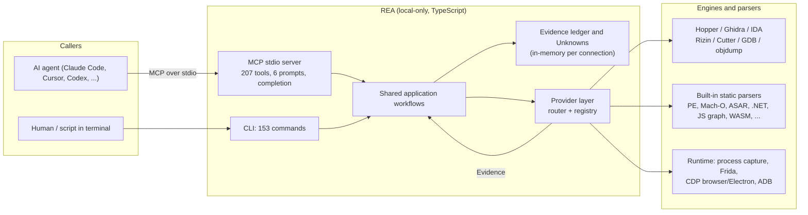
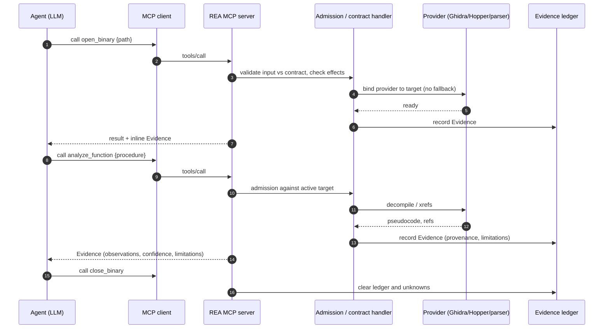
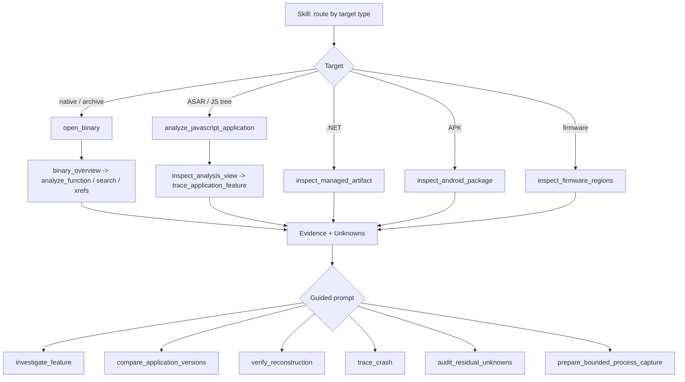

# 01 — Capabilities, MCP server, calling mechanisms, prompts and skill (overview)

This is the entry chapter for the main questions: **what can REA do, how is it exposed (MCP server and CLI), how does an agent call it, and which prompts and skill steer the agent.** Every statement here is detailed and cited in the chapter linked beside it; counts come from the generated catalogs (`docs/public/product-catalog.json`, `.cache/mcp-tool-catalog.json`) of `morluto/rea` v6.4.0 (HEAD `f75b1a4`).

> Note: the house-rules `CLAUDE.md` you attached describes only Hopper/Ghidra and six tool families. The code now has 18 tool families, 207 tools, 47 providers and 25 agent clients. This doc follows the code.

## 1. Capabilities at a glance

| Number | Fact | Detail |
|---|---|---|
| 207 | MCP tools | [13-tool-catalog-index.md](13-tool-catalog-index.md), [catalog/](catalog/), [tool-specs/](tool-specs/) |
| 18 | tool families | table below |
| 153 | primary CLI commands | [04-cli-reference.md](04-cli-reference.md) |
| 6 | guided MCP prompts | [12-ai-layer-prompts-and-skills.md](12-ai-layer-prompts-and-skills.md) |
| 1 | bundled skill `reverse-engineer-anything` (+6 reference docs) | [12 part b](12-ai-layer-prompts-and-skills-part-b-bundled-skill-verbatim.md) |
| 47 | providers (engines/parsers) | [06-provider-layer-and-session-routing.md](06-provider-layer-and-session-routing.md) |
| 25 | supported agent clients | [05-setup-doctor-update-uninstall-clients.md](05-setup-doctor-update-uninstall-clients.md) |

| Family | Tools | What it gives an analyst |
|---|---|---|
| direct (official-proxy) | 41 | Disassembly, pseudocode, xrefs, strings, names, bytes, bookmarks via Hopper/Ghidra/IDA |
| enhanced | 14 | Composite workflows: `analyze_function`, `batch_decompile`, `binary_overview`, `trace_call_path`, `trace_feature`, ObjC/Swift |
| native | 23 | Mach-O/PE/plist/signature inspectors; objdump, Rizin, Cutter, GDB sessions; ELF layout; recorded crashes; native call/UI observation |
| artifact | 16 | Archive/package graph, extraction, WASM, EVM, Go, Rust, SQLite, pcap-fields, signal decoders, keyed archives |
| managed | 7 | .NET metadata/CIL, native boundaries, member comparison |
| firmware | 2 | Region inspection and extraction (Binwalk/Unblob) |
| android / apktool / jeb / flutter | 5 / 2 / 4 / 2 | APK classes/methods/refs, resources, JEB units, Dart AOT |
| adb | 24 | Device/package/process/log inspection (6 of these mutate the device) |
| frida | 9 | Instrumentation sessions and scripts (executes target) |
| browser / electron / javascript-runtime | 12 / 6 / 2 | CDP page/network/runtime observation, scenarios, Electron fuses, JS app graph |
| pcap | 2 | Packet-capture summaries |
| application | 15 | Version comparison, feature tracing, source recovery, reconstruction ledgers, app graphs |
| session | 21 | `open_binary`/`close_binary`, Evidence bundles, unknowns, comparisons, process capture |

*Figure 1 — Capability map.* Both adapters (MCP and CLI) call the same application workflows. Workflows go through a provider layer to engines, and every result returns as an Evidence record that is also retained in the session ledger. Detail: [02](02-architecture-and-module-map.md), [03](03-mcp-server-runtime-and-contracts.md).

## 2. Calling mechanisms

| Mechanism | How it is invoked | Where documented |
|---|---|---|
| MCP `tools/call` over stdio | Agent client launches `rea mcp` (registered by `rea setup`); each tool has a named contract (JSON Schema 2020-12 in/out) | [03](03-mcp-server-runtime-and-contracts.md) §2, §4–§7 |
| MCP `tools/list` | Advertises all 207 tools; default payload ~3.09 MB, ~215 KB with output schemas off + compact inputs (measured by ch03 writer) | [03](03-mcp-server-runtime-and-contracts.md) §8 |
| MCP `prompts/list`, `prompts/get` | Six guided workflows; `listChanged` advertised | [12](12-ai-layer-prompts-and-skills.md) |
| MCP `completion/complete` | Completes prompt arguments (document, procedure, provider, evidence ids, unknowns) from live session state; not tool arguments | [12](12-ai-layer-prompts-and-skills.md) |
| MCP progress / cancellation | Progress notifications; a cancelled call gets no JSON-RPC reply but keeps partial Evidence | [03](03-mcp-server-runtime-and-contracts.md) §13 |
| CLI one-shot | `rea <command> [JSON input]`; binds a provider, returns one Evidence record | [04](04-cli-reference.md) |
| Agent skill | `SKILL.md` installed by `rea setup` into the agent; routes target type to the first tool | [12 part b](12-ai-layer-prompts-and-skills-part-b-bundled-skill-verbatim.md) |

Each tool declares audited **effects** (`mutatesTarget`, `writesFilesystem`, `launchesProcess`, `accessesNetwork`, `executesForeignCode`, `mutatesDevice`, ...) from which MCP annotations are derived ([03](03-mcp-server-runtime-and-contracts.md) §11, matrix in [13](13-tool-catalog-index.md)).

*Figure 2 — Typical tool-call chain.* The agent opens a target, which binds one immutable provider; later calls are admitted against that target, executed by the provider, and recorded as Evidence. `close_binary` clears the ledger. Full startup, `tools/call` and cancellation sequences: [03](03-mcp-server-runtime-and-contracts.md) §13.

## 3. Prompts and skill (how the agent is steered)

Six prompts, provider-neutral, suggest tool sequences without invoking them: `investigate_feature`, `compare_application_versions`, `verify_reconstruction`, `trace_crash`, `audit_residual_unknowns`, `prepare_bounded_process_capture`. User-supplied arguments are rendered as quoted untrusted data. The chaining table, verbatim prompt text, rendered output and six sequence diagrams are in [12-ai-layer-prompts-and-skills.md](12-ai-layer-prompts-and-skills.md); the skill and its references (verbatim) are in [12 part b](12-ai-layer-prompts-and-skills-part-b-bundled-skill-verbatim.md); other repo skills, `AGENTS.md` and tool-design rules are in [12 part c](12-ai-layer-prompts-and-skills-part-c-repo-skills-and-llm-text.md).

*Figure 3 — Skill routing and prompts.* The skill picks the first tool from the target type; results accumulate as Evidence/Unknowns, and prompts guide the investigation phases. The skill is summary-first (`detail: "summary"`, then `inspect_analysis_view`) to save agent tokens.

## 4. Chapter map and status

See [00-index.md](00-index.md).
