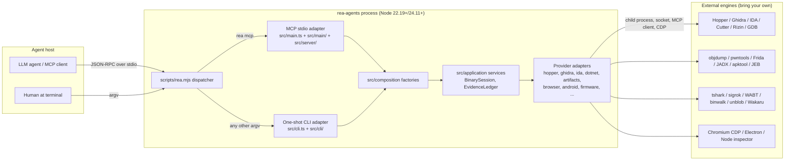
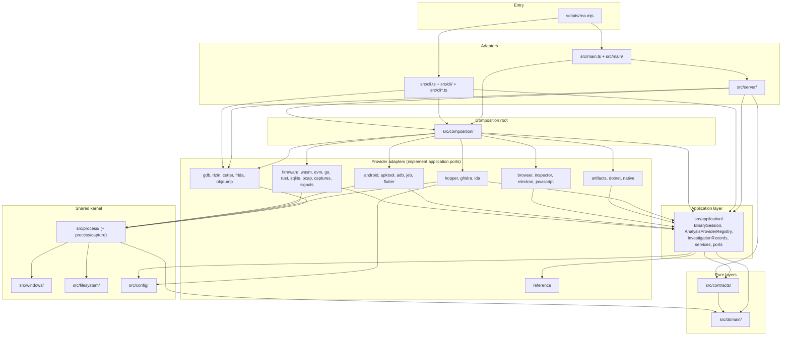
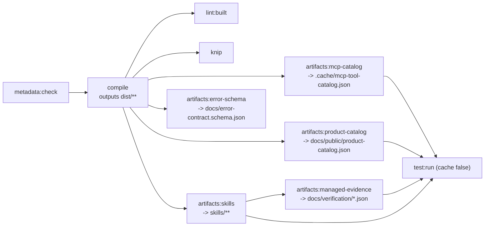
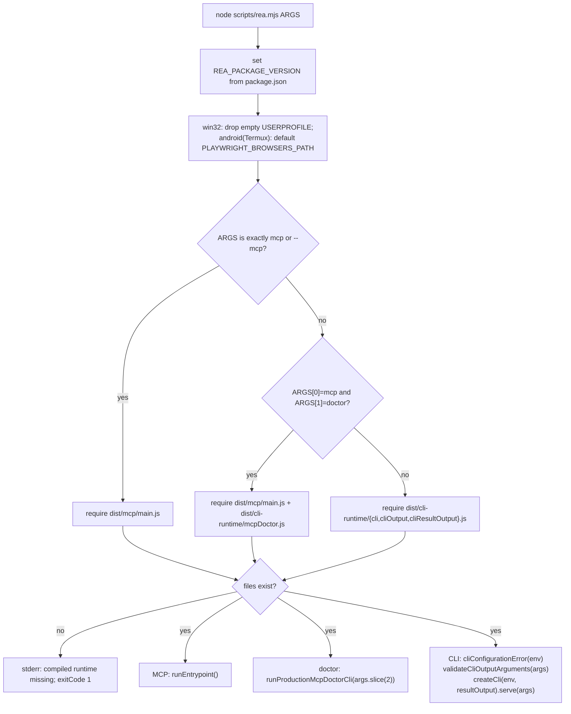
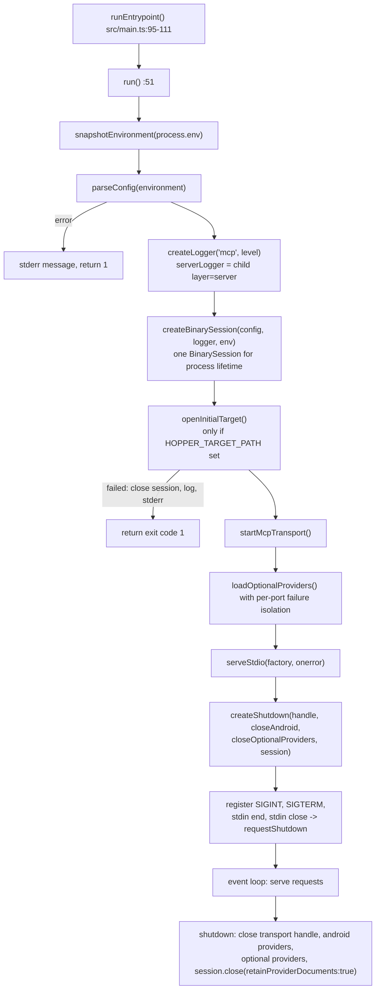
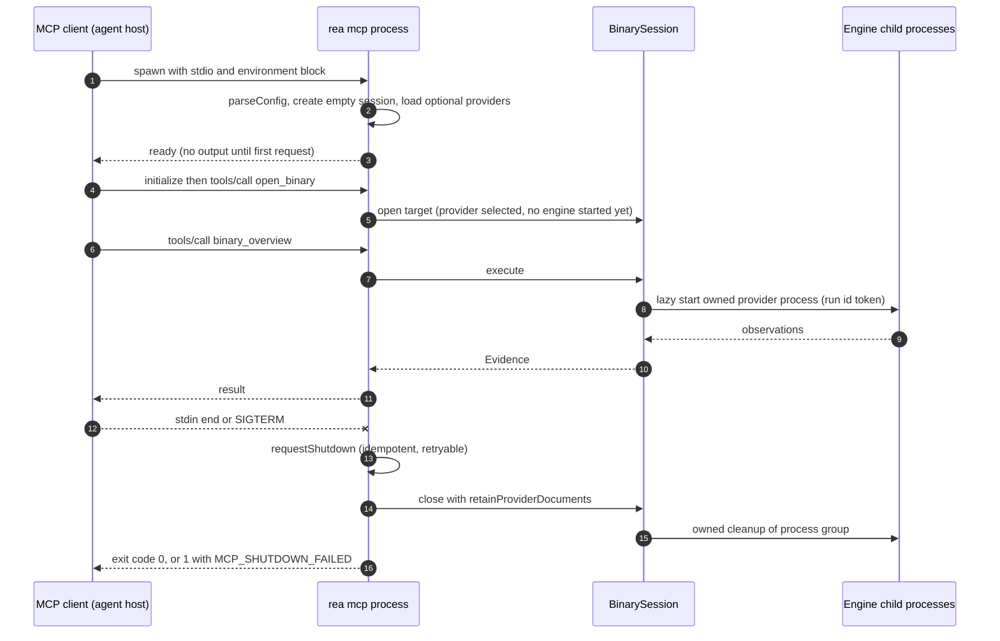
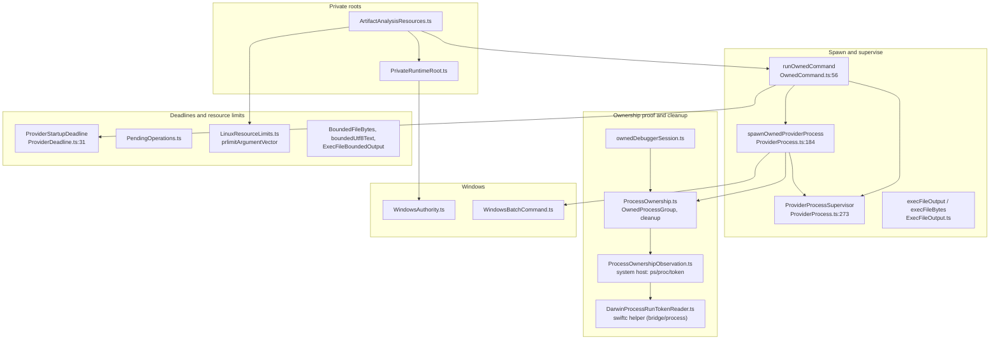
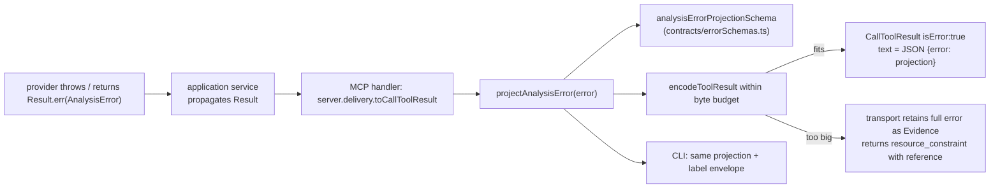

# 02 — Architecture and Module Map

Scope: how REA (`rea-agents` 6.4.0, source HEAD `f75b1a4`) is layered, what lives in every directory, how it is built and launched, how configuration and process supervision work, and how failures are modelled. Chapter 03 covers the MCP server internals in depth; chapters 04 to 06 cover CLI, setup and providers. Every claim cites `repo-relative/path.ts:START-END`. Statements that are not directly in code are marked **INFERRED**.

Reading guide for the security team: section 3 tells you which directories can be lifted out and which cannot (the import graph is **not** a clean DAG at directory level; see 3.3). Section 7 is the full list of operator-controlled environment variables. The final `## Porting notes` section is the extraction summary.

---

## 1. What REA is, structurally

REA is a single npm package (`package.json:2-3`, name `rea-agents`, version `6.4.0`) that ships two executables backed by one dispatcher (`package.json:40-43`, both `bin` entries point at `scripts/rea.mjs`):

* a one-shot **CLI** (`rea <command> ...`, built on the `incur` CLI framework, `package.json:336`, `src/cli.ts:14`), and
* a long-lived **MCP stdio server** (`rea mcp`, built on `@modelcontextprotocol/server` 2.3.1, `package.json:321-322`).

Both are thin adapters over the same application layer and the same provider factories. The design goal stated in the code is that the CLI and MCP adapters get identical provider selection, lifecycle and Evidence semantics (`src/composition/binary.ts:14-18`: "This is the sole production wiring point").

Everything is local: no network service is hosted; the process talks to the MCP client over stdio and to its analysis engines over child processes, Unix/Windows sockets, or (for IDA and JEB) an MCP client connection to a separately installed MCP server.

### Figure 2.1 — System context



*Caption: the two adapters (MCP, CLI) converge on `src/composition`, which wires the application layer to provider adapters; providers talk to externally installed engines.*

Walkthrough: the dispatcher is the only entry (`scripts/rea.mjs`). Exactly the argv `mcp` or `--mcp` selects the MCP runtime; `mcp doctor` selects the MCP doctor; every other argv goes to the CLI (`scripts/rea.mjs:14-16`, `scripts/rea.mjs:39-47`). Both adapters call into `src/composition`, never directly into provider classes (the one exception is the set of managers that `createServer` still constructs itself, see 3.2). REA installs none of the engines (`src/wasm/WabtFailures.ts:135`: "REA does not install tools"; `src/browser/modules/NativeModuleResolver.ts:89`); the operator supplies them through environment variables (section 7).

---

## 2. Layered architecture, verified against code

### 2.1 What the upstream diagram says

`docs/architecture.mermaid` (200 lines) is the maintainers' diagram. Its subgraphs are: Entry Points, Production Composition, Adapters, Application Layer, Provider Layers, Provider Process Foundation, Contracts Layer, Domain Layer, Configuration, Tests, Evaluation. I verified its edges against the real import graph (script described in 2.3).

### 2.2 The enforced rules (the only ones the code actually enforces)

`scripts/lib/module-boundaries.mjs` is the boundary checker, run by `npm run lint` through `verify:module-boundaries` (`package.json:129`, `package.json:279`). It parses every `src/**/*.ts` with Babel and flags import specifiers (including `import type`, re-exports and dynamic `import()`), rule by rule (`scripts/lib/module-boundaries.mjs:58-108`):

| Boundary id | Rule (source file prefix -> forbidden target) | Lines |
|---|---|---|
| `process-capture` | `src/process/capture/**` may not import `application`, `composition`, `server`, `cli`, `main`, `src/cli.ts`, `src/main.ts` | `scripts/lib/module-boundaries.mjs:62-69` |
| `provider-construction` | `src/application/javascript/**` may not import `src/artifacts/{Asar,Directory}ArtifactReader` | `:70-76` |
| `artifact-acquisition` | `src/artifacts/{javascript,apple,inventory,extraction}/**` and `ArtifactHash` may not import `application`, `composition`, `server`, `cli`, `main` | `:77-88` |
| `pure-layer` | `src/domain/**` and `src/contracts/**` may import only `domain` or `contracts`, never any other `src/<dir>/` and never `src/cli.ts`/`src/main.ts` | `:6`, `:89-95` |
| `application-composition` | `src/application/**` may not import `src/composition/**` | `:96-97` |
| `provider-construction` | `src/application/**` and `src/server/**` may not import any of the migrated provider roots `sqlite, evm, go, rust, wasm, captures, signals, android, firmware, ghidra, hopper, ida, inspector, javascript`, nor `artifacts/ArtifactProvider`, `dotnet/ManagedStaticProvider`, `native/NativeMacOSProvider`, nor `browser/*Provider.*` | `:7-22`, `:98-106` |

Two further static guards live in `scripts/verify/architecture-guards.mjs` (run by `npm run check`, `package.json:111`, `package.json:181`): no `localeCompare` in `src/domain` (ordering must be `compareUnicodeCodePoints`), no NUL-joined composite keys (use `compositeKey`), a single owner for transparent-wrapper unwrapping in JavaScript AST code, no bespoke AST child walkers, and single owners for `prlimit` argument vectors and the 32 MiB resident-input budget (`scripts/verify/architecture-guards.mjs:1-160`).

Note what is **not** enforced: nothing prevents `application` from importing `artifacts`, `process`, `config`, `browser/assets`, `reference` or `dotnet` (non-`*Provider` files); nothing forbids provider directories from importing `application` (they must, to implement its ports).

### 2.3 Measured import graph (my verification)

I walked every non-test `src/**/*.ts` file, resolved each relative import (including type-only imports) and aggregated by top-level directory (analysis scripts are in my scratchpad, not in the repo). Results that matter:

1. **`src/domain` has zero outgoing edges to any other `src/` directory.** Its only third-party imports are `zod` (171), `@babel/types` (58), `node:crypto` (34), `canonicalize` (25), `node:path`, and a handful of parsers (`@babel/parser`, `semver`, `plist`, `parse5`, `diff`, `@xmldom/xmldom`, `@jridgewell/trace-mapping`). So domain is side-effect-light but **not** dependency-free: it embeds a Babel-based JavaScript analyzer (`src/domain/javascript/`, 131 files).
2. **`src/contracts` imports only `domain`** (208 import edges) plus `zod`, `node:path`, `node:util`. Contracts are Zod schemas plus metadata.
3. **Providers depend on `application`**, not the reverse. Almost every provider directory has outgoing edges to `application` (exceptions: `objdump`, `gdb`, `rizin`, `cutter`, which are command/manager helpers built directly by `server`/`composition`) (for example `hopper -> application` 8, `ghidra -> application` 8, `browser -> application` 31) because they implement ports declared there (`src/application/AnalysisProvider.ts:123-250`). `application` does not import a provider implementation directory (guarded, 2.2). So the true dependency direction is **inward**: `domain/contracts <- application (ports) <- providers`, with `composition` as the only place that imports both (`src/composition` has edges to 31 provider and application directories).
4. **Adapters** `cli`, `main`, `server` import `application`, `composition`, `contracts`, `domain`. `server` also constructs four managers directly (`GdbSessionManager`, `RizinDebugSessionManager`, `CutterBridgeClient/Service`, `FridaInstrumentationManager`, `src/server/createServer.ts:34,131-136`); the boundary script does not list `gdb`, `rizin`, `cutter`, `frida` as migrated roots, so this is permitted.
5. **At directory level the graph is not a DAG.** A single strongly connected component contains essentially everything above `domain`/`contracts`. Concrete cycles:

| Cycle | Evidence |
|---|---|
| `application` <-> `artifacts` | `application -> artifacts` 38 edges (e.g. `src/application/AppBundleExecutable.ts -> src/artifacts/apple/InterfaceBuilderDecodeBudget.ts`); `artifacts -> application` 4 edges (`src/artifacts/ArtifactProvider.ts -> src/application/AnalysisProvider.ts`) |
| `application` <-> `browser` | `application -> browser` 2 (`src/application/WebScriptExportService.ts -> src/browser/assets/PublishWebScripts.ts`); `browser -> application` 31 |
| `process` <-> `windows` | `process -> windows` 3 (`src/process/ProviderProcess.ts -> src/windows/WindowsOwnedProcess.ts`); `windows -> process` 2 (`src/windows/WindowsOwnedProcess.ts -> src/process/ProcessOwnership.ts`, type only) |
| `process` <-> `artifacts` | `process -> artifacts` 5 (`src/process/ArtifactAnalysisResources.ts`); `artifacts -> process` 4 |
| `artifacts` <-> `native` | `artifacts -> native` 2 (`src/artifacts/MachOSliceArtifactReader.ts -> src/native/CommandRunner.ts`); `native -> artifacts` 17 |
| `artifacts` <-> `javascript` | 1 vs 8 |

6. **Foundation directories used as a shared kernel:** `process` (imported by 20+ directories), `filesystem`, `artifacts` (reader/hash/scope primitives imported by providers), `config` (imported by `ghidra` 10, `hopper` 2, `ida` 1, `application` 8, `process` 1).

So the sentence "dependency flow domain/contracts -> providers -> application -> CLI/MCP adapters" is correct only after you read the arrows as "may be imported by". Code-level flow is: adapters (`cli`, `main`, `server`) -> `composition` -> {`application`, providers}; providers -> `application` (ports) -> `domain`/`contracts`.

### Figure 2.2 — Verified layering (arrows = "imports")



*Caption: dependency direction as measured on the source tree. Enforced rules are only: `domain`/`contracts` import nothing outside themselves; `application` never imports `composition` or the migrated provider roots; `server` never imports the migrated provider roots.*

Walkthrough: read left to right as construction order. `main` and `cli` create the session and server through `composition`; `composition` is the only layer allowed to name concrete provider classes (`src/composition/binary.ts:4-12` imports `HopperProvider`, `GhidraProvider`, `IdaProvider`, `ManagedStaticProvider`). Providers implement ports from `application` and reuse the `process` kernel for owned child processes. The bottom two layers are pure data and schemas.

### 2.4 Discrepancies between `docs/architecture.mermaid` and the code

| Upstream diagram | Code reality |
|---|---|
| No nodes for `adb`, `apktool`, `captures`, `cutter`, `electron`, `filesystem`, `flutter`, `frida`, `go`, `jeb`, `pcap`, `rust`, `signals`, `sqlite` | All exist as top-level `src/` directories (section 4) and are wired in `src/composition` (`adb.ts`, `apktool.ts`, `captures.ts`, `electronFuses.ts`, `flutter.ts`, `go.ts`, `jeb.ts`, `pcap.ts`, `rust.ts`, `signals.ts`, `sqlite.ts`) |
| `SERVER --> GDB` only | `server` also imports `cutter` (3 edges), `frida` (1), `rizin` (2) directly (`src/server/createServer.ts:34,131-136`) |
| `PROCESS --> DOMAIN`, `PROCESS --> WINDOWS` | True, plus `process -> artifacts` (5), `process -> config`, `process -> identity.ts` |
| Implies a layered DAG | Directory graph has one large SCC (2.3 item 5) |
| "`SERVER --> COMPOSITION`" | True (27 edges) |
| "`APP --> BROWSER`" | True but only 2 edges, `src/application/WebScriptExportService.ts` |
| Tests node says "Vitest suite; fixtures hold fake launcher, bridge, CDP seams" | See section 4.4: 813 test files under `tests/`, plus 460 colocated `src/**/*.test.ts` |

---

## 3. Dependency summary table (measured)

Counts are edges (import statements, de-duplicated by file pair is not applied, so they over-count files). Only edges that explain structure are shown.

| From | Imports (count) |
|---|---|
| `domain` | none outside `domain` |
| `contracts` | `domain` (208) |
| `application` | `domain` (1080), `contracts` (35), `artifacts` (38), `process` (21), `filesystem` (9), `config` (8), `reference` (6), `dotnet` (2), `browser` (2), root identity files |
| `server` | `application` (223), `domain` (170), `contracts` (76), `composition` (27), `artifacts` (6), `process` (6), `config` (3), `cutter` (3), `gdb` (2), `rizin` (2), `frida` (1) |
| `cli` (+ `src/cli*.ts`) | `application` (67+), `domain` (127), `composition` (31), `contracts` (7), `artifacts` (9), `cutter` (2), `gdb`, `rizin`, `frida` (1 each) |
| `composition` | `application` (47), `browser` (13), `native` (5), `javascript` (5), `jeb` (3), `dotnet` (3), plus one or two edges to nearly every provider |
| `main` | `application` (6), `domain` (5), `server` (3), `composition` (1), `config` (1) |
| `hopper` | `domain` (72), `process` (22), `application` (8), `config` (2), `contracts` (2) |
| `ghidra` | `domain` (119), `process` (33), `config` (10), `application` (8), `windows` (3), `filesystem` (5) |
| `ida` | `domain` (45), `process` (6), `application` (4), `config` (1) |
| `process` | `domain` (45), `artifacts` (5), `windows` (3), `config` (1), `filesystem` (1) |
| `rust` | `go` (2) (shared ELF/Mach-O/PE container readers) |

---

## 4. Repository and module map

### 4.1 Repository top level

| Path | Role | Evidence |
|---|---|---|
| `src/` | All TypeScript (1,418 non-test files, ~298.9k lines; 460 colocated `*.test.ts`) | measured with `find`/`wc` |
| `dist/` | Compiled output (`tsc -p tsconfig.build.json`) plus bundled runtime directories `dist/mcp`, `dist/cli-runtime` | `package.json:293`, `scripts/bundle-runtime.mjs:20-31` |
| `bridge/` | Non-TypeScript code that runs inside external tools or helper processes (Python, Java, Swift) | 4.3 |
| `native/windows/` | Windows x64 Node-API addon source (C++); prebuilt artifact shipped under `native/windows/build/` | 4.5 |
| `scripts/` | 368 files: dispatcher (`rea.mjs`), build, generators, verifiers (`verify-*.mjs`), CI helpers | 4.6 |
| `tests/` | 813 test files, fixtures and harnesses | 4.4 |
| `docs/` | VitePress documentation; `docs/public/product-catalog.json`, `docs/error-contract.schema.json`, `docs/architecture.mermaid`, `docs/verification/` | `package.json:254` |
| `skills/` (generated), `.agents/skills/` | Agent skill text; `.agents/skills/reverse-engineer-anything/` is the source, `skills/` is generated by `npm run artifacts:skills` | `package.json:48-99` (`"skills"` in `files`), `turbo.json` task `artifacts:skills` |
| `third_party/` | READMEs/licences of vendored tool references (pwntools, pwndbg, WABT, EVMole) | `package.json:48-99` |
| `licenses/`, `THIRD_PARTY_NOTICES.md` | Third-party inventory (`npm run licenses:generate`) | `package.json:304` |
| `experiments/analysis-efficiency/` | Python/JS experiments for agent analysis efficiency; unit-tested by `npm run test:python` | `package.json:141` |
| `website/` | Static site sources and Python build/verify scripts (`scripts/prepare-website.py`, `verify-website.py`) | listing |
| `install.sh` | Curl-pipe installer with truncation guard (whole script inside one brace group) | `install.sh:1-12` |
| `server.json` | MCP registry metadata: npm package `rea-agents`, `runtimeHint: npx`, stdio, positional argument `mcp` | `server.json:1-27` |
| `.github/workflows/` | CI (`ci.yml`, `ci-full-pr.yml`, `real-*.yml` real-engine lanes, `nativeaot-fixtures.yml`, ...) | listing |
| `turbo.json`, `knip.json`, `.oxlintrc.json`, `.oxfmtrc.json`, `.jscpd.json`, `stryker*.mjs`, `vitest*.ts` | Tooling configuration | section 5 |
| `.nvmrc` | `24.18.0` | file |
| `.npmrc` | `engine-strict=true` | file |

### 4.2 Every directory under `src/`

Line and file counts exclude `*.test.ts` only. "Layer" uses the vocabulary of Figure 2.2. Descriptions marked **INFERRED** come from file names and tool descriptions where I did not read the implementation; they are corroborated by the tool catalog (`.cache/mcp-tool-catalog.json`).

| Directory | Files / lines | Layer | Role |
|---|---|---|---|
| `domain/` | 408 / 93,011 | Pure | Side-effect-light types, Zod schemas and algorithms: Evidence (`evidence.ts`, `evidenceBundle.ts`), error algebra (`analysisError*.ts`, `result.ts`), comparison semantics, analysis snapshot/profile, JSON utilities, JavaScript static-analysis model (`domain/javascript`, 131 files), Apple (`apple`, 15), native (`native`, 23), process capture model (`process`, 15), analysis view (`analysisView`, 22), managed (`managed`, 13). Cannot import other `src/` dirs (`scripts/lib/module-boundaries.mjs:89-95`) |
| `contracts/` | 76 / 10,593 | Pure | Caller-visible MCP tool contracts (name, schemas, effects, annotations, examples), prompt contracts, error schemas, compact-schema presentation. Chapter 03 |
| `application/` | 249 / 49,743 | Application | Ports (`AnalysisProvider.ts`, `*Port.ts`), `BinarySession` family (`application/binary/`), Evidence ledger and Unknown registry (`application/investigation/`), analysis services per family, setup/doctor/update/uninstall (`Setup*.ts`, `Doctor.ts`, `Update*.ts`, `Uninstall.ts`), enhanced workflows (`EnhancedTools.ts`), JavaScript reconstruction (`application/javascript`, 55 files) |
| `composition/` | 33 / 832 | Composition root | Fresh typed provider/session factories (section 6) |
| `server/` | 90 / 9,370 | Adapter | MCP request translation: `createServer.ts`, `EvidenceMcpServer.ts`, per-family `register*.ts`, delivery/encoding (`toolResult*.ts`), admission, progress, prompts |
| `main/` + `main.ts` | 5 / 374 + 128 | Adapter | MCP stdio process lifetime (section 8) |
| `cli/` + root `cli*.ts` | 50 / 7,290 + root files | Adapter | One-shot CLI command registration on `incur`; output rendering; JSON input; logging. Chapter 04 |
| `config/` | 11 / 571 | Kernel | Zod-validated environment parsing (section 7) |
| `process/` | 45 / 10,085 (+ `process/capture` 15) | Kernel | Owned process supervision primitives (section 9) |
| `windows/` | 3 / 806 | Kernel | `WindowsNativeLoader`, `WindowsOwnedProcess`, `WindowsPrivateRuntime`: TypeScript side of the Windows Node-API addon |
| `filesystem/` | 6 / 514 | Kernel | `OwnedFileHandle`, `OwnedDirectoryHandle`, `OwnedStagedOutput`, `RegularFile`, `StableFileHash`, `readFileHandleChunks`: handle-based, close-once file primitives |
| `artifacts/` | 47 / 12,383 | Provider (+kernel) | Safe artifact graph provider: readers for directory, ASAR, ZIP, Mach-O slices, native DMG mount; inventory/extraction (`inventory/`, `extraction/`), Apple (`apple/`, 9), JavaScript artifact access (`javascript/`), `SafeOutputTree*`, `ArtifactResourceScope` |
| `hopper/` | 22 / 5,262 | Deep provider | Hopper launch (`BridgeLauncher.ts`), Unix-socket client and protocol (`HopperClient.ts`, `protocol.ts`), request queue, target lease, regex search worker. Bridge: `bridge/hopper_bridge.py`. Chapter 07 |
| `ghidra/` | 45 / 11,096 | Deep provider | Ghidra discovery, headless launch (`GhidraLauncher.ts`, `GhidraJavaLaunch.ts`), per-architecture profiles (MIPS, PowerPC, RISC-V, PSP, PE, raw), wire/transport, extensions (NativeAOT). Bridge: `bridge/ghidra/*.java`. Chapter 08 |
| `ida/` | 16 / 3,992 | Deep provider | Adapter over an external `ida-pro-mcp` (MCP client connection), diagnostics redaction, workspace. Chapter 09 |
| `dotnet/` | 27 / 8,658 | Aux provider | Managed static metadata provider: PE/CLI reader, metadata heaps, members, IL anchors, native-boundary inspection (`ManagedStaticProvider.ts`). Never loads the target (`src/dotnet/ManagedStaticProviderMetadata.ts:36`) |
| `native/` | 45 / 11,614 | Aux provider | macOS native provider (`NativeMacOSProvider.ts`: Mach-O, signature, plist, UI/call observation via helper tools), Apple dispatch/ObjC/Swift facets, `pe/`, `parsers/`, BYO offline `pwntools/` (9 files) and `pwndbg/` adapters |
| `browser/` | 94 / 20,889 | Observation provider | CDP and Playwright capture: pages, scripts, network, storage, scenarios, Electron CDP, web module resolution (`modules/`), HAR/mitm history (`history/`, 17), execution coverage (`execution/`, 12), asset publication (`assets/`) |
| `inspector/` | 5 / 1,125 | Observation provider | Passive V8 Inspector discovery/capture (`V8InspectorProvider.ts`); reuses `browser` CDP helpers |
| `electron/` | 3 / 1,003 | Provider | Electron fuse reader (`ElectronFuseProvider.ts`) |
| `javascript/` | 20 / 4,968 | Provider | `sourceMaps/` (pinned codec in owned process), `analysis/` (worker process), `recovery/` (Wakaru adapter) |
| `android/` | 10 / 2,770 | Provider | JADX adapter over `jadx-headless-mcp` JAR (`JadxProvider.ts`, `JadxMcpTransport.ts`, `JadxConfiguration.ts`) |
| `apktool/` | 3 / 1,348 | Provider | Apktool client/decoder (`ApktoolProvider.ts`) |
| `adb/` | 6 / 3,482 | Provider | adb device analysis (`AdbProvider.ts`); 24 `adb-provider` tools |
| `jeb/` | 3 / 719 | Provider | JEB MCP client (`JebProvider.ts`, `JebMcpEndpoint.ts`; default `http://127.0.0.1:8425/mcp`, `src/jeb/JebMcpEndpoint.ts:7`) |
| `flutter/` | 6 / 2,541 | Provider | Flutter/Dart AOT build identification (`FlutterBuildProvider.ts`, `DartElf.ts`) |
| `firmware/` | 7 / 2,315 | Provider | binwalk/unblob adapters with owned processes, report normalization, private extraction |
| `wasm/` | 9 / 1,357 | Provider | WABT-based artifact inspection (`WabtArtifactProvider.ts`) |
| `evm/` | 8 / 1,327 | Provider | EVMole (WASM) in a bounded owned worker, Solidity metadata (`EvmoleInterfaceProvider.ts`) |
| `go/` | 7 / 1,867 | Provider | Go binary reader for ELF/Mach-O/PE images (`GoBinaryProvider.ts`) |
| `rust/` | 3 / 843 | Provider | Rust binary/auditable-section reader; reuses `go/` container readers |
| `sqlite/` | 7 / 1,764 | Provider | SQLite snapshot inspection in a worker (`SqliteDatabaseProvider.ts`, `SqliteDatabaseWorker.ts`) |
| `pcap/` | 6 / 1,789 | Provider | tshark + capinfos pipeline (`PcapProvider.ts`, `PcapNativeBound.ts`) |
| `captures/` | 3 / 694 | Provider | tshark field/packet inspection (`TsharkCaptureProvider.ts`) |
| `signals/` | 2 / 612 | Provider | sigrok-cli decoder (`SigrokRecordingProvider.ts`) |
| `gdb/` | 1 / 2,057 | Debugger manager | Persistent GDB/MI sessions (`GdbSessionManager.ts`). Built directly by `createServer` |
| `rizin/` | 2 / 1,608 | Debugger / command | `RizinCommand.ts` (static profile), `RizinDebugSessionManager.ts` (debug sessions) |
| `objdump/` | 1 / 24 | Command profile | `objdumpCommand` arguments |
| `cutter/` | 2 / 1,083 | Bridge client | Client for the Cutter plugin bridge directory (`CutterBridgeClient.ts`, `REA_CUTTER_BRIDGE_DIR`) |
| `frida/` | 2 / 1,588 | Instrumentation | `FridaInstrumentationManager.ts`; optional dependency `frida` (`package.json:388-390`) |
| `reference/` | 7 / 1,138 | Reader | Filesystem reference-source reader (bounded traversal, validation) used by reference-source import |
| `evaluation/` | 4 / 1,452 | Evaluation | Agent release evaluation: Codex transcript scoring, known-answer evaluation (`CodexAgentEval.ts`, `KnownAnswerEvaluation.ts`) |
| `src/*.ts` (19 root files) | | Mixed | `main.ts`, `cli.ts`, `cli*.ts`, `mcpDoctor.ts`, `doctorRuntime.ts`, `mcpStartupPolicy.ts`, `identity.ts`, `serverIdentity.ts`, `catalogIdentity.ts`, `logger.ts`, `generatedPackageMetadata.ts` |

### 4.3 `bridge/`

Code that runs **outside** the Node process (loaded into an engine or run as a helper). Shipped in the package (`package.json:48-99`) except where noted.

| Path | Language / lines | Runs inside | Used by |
|---|---|---|---|
| `bridge/hopper_bridge.py` | Python, 1,173 | Hopper's embedded Python | `src/hopper/BridgeLauncher.ts:403-408` writes `REA_SOCKET`, `REA_TOKEN`, `REA_RUN_ID`, `REA_TARGET_PATH`, `REA_OWNS_PROCESS_LIFETIME`, `REA_RECONNECT_TIMEOUT_SECONDS` into a generated launcher script (these are script constants, not environment variables) |
| `bridge/ghidra/ReaGhidraBridge.java` + 8 helpers | Java, 4,878 + ~700 | Ghidra headless script | `src/ghidra/GhidraLauncher.ts` |
| `bridge/cutter/rea_bridge.py` | Python, 816 | Cutter plugin | `src/cutter/CutterBridgeClient.ts` |
| `bridge/android/ReaJadxBridge.java` | Java, 368 | JADX | `src/android/` |
| `bridge/pwntools/*.py`, `bridge/pwndbg/*.py` | Python, ~800 | Caller-supplied Python / GDB | `src/native/pwntools`, `src/native/pwndbg` |
| `bridge/native/ReaNativeUI.swift`, `NativeUIChildren.swift`, `rea_lldb_tracer.py` | Swift/Python, ~1,070 | macOS helper / LLDB | `src/native/NativeUiHelperRuntime.ts`, `src/native/LldbCallTracer.ts` |
| `bridge/process/ProcessRunTokenReader*.swift` | Swift, 374 | macOS helper compiled with `swiftc` | `src/process/DarwinProcessRunTokenReader.ts` |
| `bridge/mitmproxy/capture.py` | Python, 384 | mitmdump addon | `src/browser/history/MitmproxyCaptureAdapter.ts` |
| `bridge/nativeaot/*.java` | Java, ~360 | Ghidra extension | `src/ghidra/extensions/nativeaot`; **not** in the npm `files` list; built by `npm run build:ghidra:nativeaot` (`package.json:272`) |

### 4.4 `tests/` layout and Vitest projects

Projects and ownership are defined once in `scripts/lib/test-projects.mjs:3-67` and consumed by `vitest.config.ts`. Run policy per project (pool, isolation, workers capped at 2) is in `vitest.config.ts:46-110`.

| Project | Group | Files owned | Notes |
|---|---|---|---|
| `domain` | source | `src/{contracts,domain}/**/*.test.ts` | threads, no isolation |
| `services` | source | `src/application/**/*.test.ts` | |
| `adapters` | source | `src/*.test.ts` and provider directories' `*.test.ts` | forks |
| `composition` | source | `tests/composition/**` (21 files) | |
| `conformance` | source | `tests/conformance/**` (105 files); `README.md` explains source-built semantic-oracle fixtures (`tests/conformance/README.md`) | |
| `evaluation` | source | `tests/evaluation/**` (13 files) incl. `moduleBoundaries.test.ts` | |
| `boundary` | built (needs `dist`) | `tests/boundary/**` (653 files) minus `cli`, `mcp`, `process` | |
| `cli-boundary` | built | `tests/boundary/cli/**` | each file spawns CLI |
| `process-boundary` | built | `tests/boundary/process/**` | serial |
| `mcp-boundary` | built | `tests/boundary/mcp/**`; in-memory MCP session per file | |
| `acceptance` | built | `tests/acceptance/**` (91 files) | |
| `process-global` | built | `tests/process-global/**` (24 files) | module mocks live here |

Support code: `tests/fixtures/` (197 files: fake launchers, fake bridges, CDP seams, MCP harnesses such as `tests/boundary/mcp/enhancedToolsHarness.ts`), `tests/support/` (23), `tests/processOwnershipRunner.ts` (custom Vitest runner that checks process ownership leaks), `tests/ciTestSequencer.ts`. Tests that need real engines are separate `verify-real-*.mjs` scripts under `scripts/` (section 4.6), not Vitest.

### 4.5 `native/windows/`

C++ source for a single Windows x64 Node-API 8 addon (`native/windows/src/addon.cc` 171 lines, `filesystem.cc` 747, `process.cc` 489, `authority.hpp` 140). Only the prebuilt `native/windows/build/rea-windows-x64.node` and `manifest.json` ship (`package.json:48-99`); `prepublishOnly` rejects a missing/stale artifact (`package.json:268`; `native/windows/README.md`). Stated boundaries (README): NTFS-only input admission with `OPEN_REPARSE_POINT`, private runtime roots with protected DACLs, atomic Job Object assignment; no environment override for loading a native module. In this checkout only `src/` and the README exist (no `build/`), so Windows native controls would report unavailable.

### 4.6 `scripts/`

| Group | Examples | Purpose |
|---|---|---|
| Dispatcher | `rea.mjs`, `rea-android-workspace-guardian.mjs` | Executable entry (section 5.4) |
| Build | `bundle-runtime.mjs`, `clean-build-output.mjs`, `prepack.mjs`, `prepare.mjs`, `check-dependency-install.mjs`, `run-exclusive*.mjs` | Compile, bundle, lock-serialize artifact generation |
| Generators | `generate-mcp-tool-catalog.mjs`, `generate-product-catalog.mjs`, `generate-skill-metadata.mjs`, `generate-package-metadata.mjs`, `generate-error-schema.mjs`, `generate-completion-ledger.mjs`, `generate-third-party-inventory.mjs` | Produce `.cache/mcp-tool-catalog.json`, `docs/public/product-catalog.json`, `skills/`, `src/generatedPackageMetadata.ts`, `docs/error-contract.schema.json`, `docs/verification/managed-conformance-*.json` |
| Verifiers | `verify-real-hopper*.mjs`, `verify-real-ghidra*.mjs` (~20 lanes), `verify-real-ida.mjs`, `verify-real-cutter.mjs`, `verify-*-client.mjs` (client setup checks), `verify-package*.mjs`, `verify-module-boundaries.mjs`, `verify/architecture-guards.mjs` | Real-engine and packaging verification; not part of default unit tests |
| Fixtures | `scripts/fixtures/**`, `build-conformance-fixtures.mjs`, `generate-nativeaot-fixtures.mjs`, `create-ghidra-windows-fixture.mjs` | Build deterministic oracle binaries (ignored under `build/`) |
| Release | `release-notes.mjs`, `release-npm-tag.mjs`, `verify-published-package.mjs` | Release tooling |

---

## 5. Build and runtime

### 5.1 Toolchain facts

* Node engines: `^22.19.0 || ^24.11.0 || >=26.0.0` (`package.json:44-46`); `engine-strict=true` in `.npmrc`; `.nvmrc` is `24.18.0`; package manager `npm@11.16.0` (`package.json:47`).
* ESM package (`"type": "module"`, `package.json:36`); one internal subpath import `#javascript-analysis-worker -> ./dist/composition/javascriptAnalysisWorkerProcess.js` (`package.json:37-39`), resolved with `import.meta.resolve` at `src/javascript/analysis/JavaScriptAnalysisWorker.ts:471`.
* TypeScript 7.0.2 (`package.json:382`) with strict flags incl. `exactOptionalPropertyTypes`, `noUncheckedIndexedAccess`, `verbatimModuleSyntax`, `NodeNext` modules, target ES2023 (`tsconfig.json:2-21`). `tsconfig.build.json` restricts to `src/**/*.ts` minus `*.test.ts`/`*.fixture.ts` with `rootDir: src` (`tsconfig.build.json:1-13`).
* Lint/format: `oxlint` 1.87.0, `oxfmt` 0.72.0 (`package.json:378-379`, `package.json:129-133`); dead-code `knip` (`knip.json`); duplicate detection `jscpd`; mutation testing `stryker` for "reverse tools" (`package.json:158`).
* Runtime dependencies of note (`package.json:314-354`): `@modelcontextprotocol/server` and `client` 2.3.1, `zod` 4.4.3, `incur` 0.6.1, `pino` 10.4.0, `playwright-core` 1.58.2, `@babel/parser`/`types` 8.0.4, `ajv` 8.20.0, `@lydell/node-pty`, `@xterm/headless`, `evmole`, `ws`, `isomorphic-git`, `plist`, `@zip.js/zip.js`, `@electron/asar`, `canonicalize`, `cborg`, `lossless-json`, `smol-toml`, `yaml`. Optional: `frida` 17.23.2 (`package.json:388-390`).

### 5.2 npm scripts (the ones that define the pipeline)

| Script | Command (abridged) | Line |
|---|---|---|
| `compile` | `clean-build-output.mjs && tsc -p tsconfig.build.json && bundle-runtime.mjs` | `package.json:293` |
| `build` | `run-exclusive.mjs artifacts turbo run artifacts:skills --force` | `:109` |
| `build:cached` | `check-dependency-install.mjs && run-exclusive artifacts turbo run artifacts:skills` | `:124` |
| `build:termux` / `compile:termux` | Termux variant using `typescript-termux` (5.9.3) with `--max-old-space-size=3072` | `:125-126`, `:294` |
| `typecheck` | `tsc --noEmit` | `:170` |
| `check` | turbo `typecheck lint:built format:check knip metadata:check` + `verify:architecture-guards` | `:111` |
| `check:fast`, `check:changed`, `check:pr`, `check:ci` | Subsets for local / PR / CI | `:113-121` |
| `lint` | `static-check-report.mjs lint && verify:module-boundaries` | `:129` |
| `start` | `node scripts/rea.mjs mcp` | `:137` |
| `test` | `test:prepare && vitest run` | `:138` |
| `test:prepare` | dependency check + generate MCP catalog, product catalog, managed evidence | `:300` |
| `test:boundary`, `test:mcp`, `test:acceptance`, `test:integration`, `test:coverage`, `test:ci:shard` | Vitest project subsets | `:146-160` |
| `mcp-catalog:generate/check` | regenerate / verify `.cache/mcp-tool-catalog.json` | `:106-107` |
| `docs:generate/check` | package metadata, skill metadata, product catalog, completion ledger, doc facts, error schema, licences | `:254-257` |
| `prepack` / `prepare` | build-then-verify before publish / install husky hooks | `:258-259` |
| `verify:*` (about 90) | real-engine and packaging verification lanes | `:162-300` |

`scripts/run-exclusive.mjs` is a supervisor that spawns `run-exclusive-command.mjs` detached and forwards SIGINT/SIGTERM over IPC (`scripts/run-exclusive.mjs:1-40`); it serialises tasks that write shared artifacts. `scripts/check-dependency-install.mjs` compares the root lockfile's direct dependency versions against `node_modules/.package-lock.json` (`scripts/check-dependency-install.mjs:1-45`).

### 5.3 Turbo task graph

`turbo.json` (`turbo.json:1-269`) defines cacheable tasks with explicit inputs/outputs:



*Caption: Turbo dependency edges from `turbo.json` (`compile` depends on `metadata:check`; the `artifacts:*` generators depend on `compile`; `test:run` depends on the three generators plus skills).*

Walkthrough: `compile` is the heart: it is the only task whose output is `dist/**`. Generated documentation artifacts are produced by **running the compiled code** (`scripts/generate-mcp-tool-catalog.mjs` imports `dist/`; `scripts/generate-error-schema.mjs:4` imports `../dist/contracts/errorSchemas.js`), so docs cannot drift from contracts without `check` failing. Cache policy: `cacheMaxAge` 7d, `cacheMaxSize` 500MB (`turbo.json:3-4`).

### 5.4 Bundling: `scripts/bundle-runtime.mjs`

After `tsc`, `bundleRuntime(root)` runs Rolldown (`rolldown` 1.2.12) twice over the compiled `dist/` (`scripts/bundle-runtime.mjs:10-134`) to cut filesystem resolution at startup:

| Output dir | Entries (input in `dist/`) | Chunk naming |
|---|---|---|
| `dist/mcp/` | `main.js` (from `dist/main.js`) | `[name]-[hash].js`, `minifyInternalExports: true` |
| `dist/cli-runtime/` | `cli.js`, `cliOutput.js`, `cliResultOutput.js` (from `dist/cli/cliResultOutput.js`), `mcpDoctor.js` | `<source path joined by __>-[hash].js` |

Settings common to both (`scripts/bundle-runtime.mjs:32-129`): `platform: "node"`, `treeshake: false`, `codeSplitting: true`, `strictExecutionOrder: true`, `minify: false`, no sourcemaps, all bare-specifier imports external (`external` returns true for anything not starting with `.` or absolute), `generatedPackageMetadata.js` is kept as a shared external re-pointed to `../generatedPackageMetadata.js` (`:13-15`, `:122-123`). A transform plugin rewrites every `import.meta.url` into `new URL("../<original compiled path>", import.meta.url).href` so bridges and `createRequire` still find files at their original `dist/` locations (`:44-104`); any other `import.meta` use throws, except `import.meta.resolve` of a `package.json#imports` key, which is left alone (`:67-78`, `:88-91`). Dynamic imports stay lazy (code splitting).

Because the bundle outputs live directly under `dist/`, the published layout is:

```
dist/
  *.js, */**.js          tsc output, module-for-module copy of src/
  generatedPackageMetadata.js
  mcp/main.js (+ chunks) bundled MCP runtime  -> used by scripts/rea.mjs mcp
  cli-runtime/{cli,cliOutput,cliResultOutput,mcpDoctor}.js (+ chunks) -> used by scripts/rea.mjs (CLI, mcp doctor)
  composition/javascriptAnalysisWorkerProcess.js   worker entry via "#javascript-analysis-worker"
```

**Finding (this checkout):** `dist/` contains the tsc output (42 subdirectories, `dist/main.js`, `dist/cli.js`) but neither `dist/mcp/` nor `dist/cli-runtime/`. Running `node scripts/rea.mjs mcp` prints "REA's compiled runtime is missing. Run `npm ci && npm run build:cached` ..." (observed; message from `scripts/rea.mjs:49-53`). `node dist/main.js` works directly because `dist/main.js` is the unbundled entry and has its own direct-entrypoint check (`src/main.ts:114-128`). All live MCP captures in chapter 03 were made with `node dist/main.js`. In a normal build `npm run compile` would produce the bundle; here the bundle step evidently did not run (**INFERRED**: the checkout was built with `tsc -p tsconfig.build.json` only).

### 5.5 The dispatcher: `scripts/rea.mjs`



*Caption: argument routing in the executable dispatcher (`scripts/rea.mjs:9-121`).*

Walkthrough:

* The dispatcher routes MCP **before** importing `incur` so that registration helpers owned by `incur` (for example `mcp add`) cannot capture `mcp` (comment `scripts/rea.mjs:7-8`).
* Exactly one argument equal to `mcp`/`--mcp` starts the server (`scripts/rea.mjs:14-15`); `mcp doctor` is a distinct diagnostic mode with its own runtime files (`:16`, `:39-47`).
* In CLI mode it validates `REA_LOG_LEVEL` first via `cliConfigurationError` (`src/cli.ts:56-63`, called at `scripts/rea.mjs:77`), validates output arguments (`--format`, filters) and prints a rendered error JSON for bad output arguments (`:81-83`). Result output is streamed by `createCliResultOutput`; if nothing was written, an "empty filtered output" notice is rendered (`:97-98`).
* Windows: an empty `USERPROFILE` is deleted because Node's home lookup throws on it (`:19-23`). Termux: `PLAYWRIGHT_BROWSERS_PATH` defaults to `$XDG_CACHE_HOME/ms-playwright` because Playwright's registry does not know the `android` platform (`:25-37`).

---

## 6. `src/composition/`: provider and session factories

33 files, 832 lines. Rule: this is the only layer that names concrete provider classes. Each factory takes an **environment snapshot** (`snapshotEnvironment`, `src/process/snapshotEnvironment.ts:1-16`: frozen copy; on Windows keys are upper-cased with first-sorted-key wins, matching Node child-process semantics) and returns a fresh object; construction does no I/O, no tool acquisition (`src/composition/wasm.ts:5`, `src/composition/evm.ts:10-14`).

| Factory (file@line) | Returns | Notes |
|---|---|---|
| `createBinarySession` (`binary.ts@19`) | `BinarySession` | Builds `HopperProvider`, `GhidraProvider`, `IdaProvider`, wraps them in `AnalysisProviderRegistry([hopper, ghidra, ida], config.analysisProvider)`, adds three lazily loaded auxiliary providers; delegates to `composeBinarySession` (`src/application/binary/BinarySessionComposition.ts:11-18`) |
| `createManagedBinarySession` (`binary.ts@40`) | `BinarySession` | Empty deep-provider registry + `ManagedStaticProvider` (execution-free managed metadata) |
| `createArtifactBinarySession` (`binary.ts@46`) | `Promise<BinarySession>` | Empty registry + `ArtifactProvider` loaded by dynamic `import()` |
| `auxiliaryAnalysisProviderDeclarations` (`auxiliaryAnalysisProviders.ts@19`) | `LazyAnalysisProvider` declarations | Three auxiliary providers: `ARTIFACT_GRAPH_PROVIDER` (`ArtifactProvider`), `NATIVE_MACOS_PROVIDER_IDENTITY` (`NativeMacOSProvider`), `MANAGED_STATIC_PROVIDER` (`ManagedStaticProvider`). Identity and capabilities are known statically; the implementation module loads only at first target-bound use (`LazyAnalysisProvider`, `src/application/binary/LazyAnalysisProvider.ts:24-60`) |
| `createDirectAnalysis` (`directAnalysis.ts@17`) | `{runDirectAnalysis, runProviderAnalysis, runSessionStatus}` | One-shot CLI binding; each call dynamic-imports `application/DirectAnalysis.js` (keeps CLI startup cheap); `parseConfig` is invoked inside `readConfiguration` |
| `runManagedProviderExecution` (`directAnalysis.ts@68`) | function | Managed metadata without configuration or native candidates |
| `createOptionalObservationFactories` / `loadOptionalObservationProviders` (`optionalObservationProviders.ts@24`, `@67`) | five observation ports | Loads browser observation, browser scenario, Electron observation, Electron active scenario, JS runtime observation **independently** (`Promise.all` of `loadPort`), returning healthy peers plus `optionalProviderLoadFailures` per failed port (`:67-108`) |
| `createReverseEngineeringCommandPort` / `createReverseEngineeringService` (`reverseEngineering.ts@14`, `@49`) | objdump and rizin command resolution | Executables from `REA_OBJDUMP_COMMAND` (default `objdump`) and `REA_RIZIN_COMMAND` (default `rizin`); objdump runs with `DEBUGINFOD_URLS=""` (`src/composition/reverseEngineering.ts:14-26`) |
| `wasmArtifactModule` (`wasm.ts@16`), `evmInterfaceModule` (`evm.ts@17`) | static module descriptors | `{contract, cliCommand, create(env, injected?)}`: names one operation contract, its CLI command, and a fresh-service factory; "the host owns injected service identity and its retryable cleanup lifetime" (`evm.ts:13-16`) |
| `createJebAnalysisProvider` (`jeb.ts@13`) | `JebAnalysisPort` | An invalid `REA_JEB_MCP_URL` yields an "unconfigured" provider returning a `ConfigurationError` instead of failing server startup |
| `createAndroidAnalysisProvider` (`android.ts@6`), `createAdbDeviceAnalysisProvider` (`adb.ts@5`), `createApktoolResourceAnalysisProvider` (`apktool.ts@5`), `createPcapAnalysisProvider` (`pcap.ts@5`), `createFlutterBuildAnalysisProvider` (`flutter.ts@5`), `createFirmwareAnalysisProvider` (`firmware.ts@6`), `createJavaScriptRecoveryProvider` (`javascriptRecovery.ts@6`), `createSqliteDatabaseService` (`sqlite.ts@5`), `createGoBinaryService` (`go.ts@5`), `createRustBinaryService` (`rust.ts@5`), `createPacketCaptureService` (`captures.ts@3`), `createSignalRecordingService` (`signals.ts@3`), `createPeResourcesService` / `createBinaryLayoutService` / `createRecordedCrashService` (`binaryDiagnostics.ts@9,13,19`), `createWebModuleTraceService` (`webModules.ts@6`), `createWebRuntimeService` (`webRuntime.ts@5`), `createWebNetworkCaptureService` (`webNetworkCaptures.ts@7`), `createWebSourceLocationService` (`webSourceLocations.ts@6`), `createElectronFuseService` (`electronFuses.ts@5`), `createBrowserScenarioProvider` (`browserScenario.ts@6`) | service/provider per family | One-liner constructors: `new Service(new Provider(environment))` |
| `javascriptAnalysisWorkerProcess.ts` | worker entry | Not a factory: a child-process entry point that serves the JS static-analysis worker protocol (`serveJavaScriptAnalysisWorker(analyze)`, `:90-97`); referenced through `package.json#imports` |
| `resolveWindowsProviderExecutable.ts@39` | helper | Resolves a command to an executable on Windows (PATHEXT aware) |

### Session composition detail

`BinarySession` is built from a `SessionProviderRouter` and an `InvestigationRecords` aggregate (`BinarySessionComposition.ts:11-18`). The router holds the deep-provider registry (one immutable binding per target, no failure fallback) plus **disjoint** auxiliary providers that serve operation families the deep provider does not (`SessionProviderRouter.selectable(registry, auxiliaryProviders)`). `AnalysisProviderRegistry` takes the three deep candidates sorted deterministically and a selector (`auto` or an exact provider ID, `src/contracts/providerSelection.ts:4-17`). Provider selection internals are chapter 06; the surface used by adapters is `BinarySessionPort` (`src/application/binary/BinarySessionPort.ts:37-106`).

---

## 7. `src/config/`: environment variables

### 7.1 How configuration is loaded

All settings come from the process environment; there is no config file read by the server. `main.ts` snapshots the environment (`src/main.ts:54`), then `parseConfig` (`src/config/parseConfig.ts:43-98`) validates it with one Zod object schema (`src/config/environment.ts:23-78`) and projects an `AppConfig` (`src/config/types.ts:8-28`). Invalid values return `Result.err(ConfigurationError)`; Zod messages name the constraint, never the rejected value (`environment.ts:94`). `main.ts` prints the projected message to stderr and exits 1 (`src/main.ts:55-59`). Cross-field rule: `REA_GHIDRA_COMPILER_SPEC_ID` requires `REA_GHIDRA_LANGUAGE_ID` (`environment.ts:135-149`). Several settings are read **outside** `AppConfig` by the component that needs them (7.3); those are validated lazily at use (or at server construction: `createServer` parses the three MCP profile settings and throws a `ConfigurationError` if invalid, `src/server/createServer.ts:590-620`).

### 7.2 Central schema (`src/config/environment.ts`)

Verbatim:

```ts
// src/config/environment.ts:23-78
const environmentSchema = z.object({
  REA_ANALYSIS_PROVIDER: analysisProviderSelectorSchema.default("auto"),
  REA_MCP_MAX_RESPONSE_BYTES: mcpResponseBudgetSchema.optional(),
  REA_MCP_INPUT_SCHEMA_PROFILE: mcpInputSchemaProfileSchema.optional(),
  REA_MCP_OUTPUT_SCHEMA_PROFILE: mcpOutputSchemaProfileSchema.optional(),
  REA_IDA_MCP_CONFIG: z
    .string()
    .min(1)
    .refine(isAbsolute, "REA_IDA_MCP_CONFIG must be absolute")
    .optional(),
  GHIDRA_INSTALL_DIR: z
    .string()
    .min(1)
    .refine(isAbsolute, "GHIDRA_INSTALL_DIR must be absolute")
    .optional(),
  JAVA_HOME: z
    .string()
    .min(1)
    .refine(isAbsolute, "JAVA_HOME must be absolute")
    .optional(),
  REA_GHIDRA_NATIVEAOT_JAR: z
    .string()
    .min(1)
    .refine(isAbsolute, "REA_GHIDRA_NATIVEAOT_JAR must be absolute")
    .optional(),
  REA_GHIDRA_STARTUP_TIMEOUT_MS: providerStartupTimeoutSchema.default(
    DEFAULT_GHIDRA_STARTUP_TIMEOUT_MS,
  ),
  REA_HOPPER_STARTUP_TIMEOUT_MS: providerStartupTimeoutSchema.default(
    DEFAULT_HOPPER_STARTUP_TIMEOUT_MS,
  ),
  REA_SWIFTC_COMPILE_TIMEOUT_MS: providerStartupTimeoutSchema.default(
    DEFAULT_SWIFTC_COMPILE_TIMEOUT_MS,
  ),
  REA_GHIDRA_LANGUAGE_ID: ghidraLanguageIdSchema.optional(),
  REA_GHIDRA_COMPILER_SPEC_ID: ghidraCompilerSpecIdSchema.optional(),
  REA_GHIDRA_DISABLED_ANALYZERS: ghidraDisabledAnalyzersSchema.optional(),
  REA_GHIDRA_SEED_FILE: z
    .string()
    .min(1)
    .refine(isAbsolute, "REA_GHIDRA_SEED_FILE must be absolute")
    .optional(),
  REA_ILSPY_CMD_PATH: z
    .string()
    .min(1)
    .refine(isAbsolute, "REA_ILSPY_CMD_PATH must be absolute")
    .optional(),
  HOPPER_LAUNCHER_PATH: z.string().min(1).optional(),
  HOPPER_TARGET_PATH: z.string().min(1).optional(),
  HOPPER_TARGET_KIND: z.enum(["executable", "database"]).default("executable"),
  HOPPER_LOADER_ARGS_JSON: z.string().optional(),
  REA_LOG_LEVEL: z
    .enum(["trace", "debug", "info", "warn", "error", "fatal", "silent"])
    .default("info"),
  REA_REFERENCE_SECRET_PATTERNS_JSON: z.string().default("[]"),
});
```

The resulting typed config:

```ts
// src/config/types.ts:8-28
export interface AppConfig {
  readonly mcpMaxResponseBytes?: number;
  readonly mcpInputSchemaProfile?: McpInputSchemaProfile;
  readonly analysisProvider: AnalysisProviderSelector;
  readonly idaMcpConfigPath?: string;
  readonly ghidraInstallDir: string | undefined;
  readonly ghidraJavaHome: string | undefined;
  readonly ghidraStartupTimeoutMs: number;
  readonly ghidraLanguageOverride?: GhidraLanguageOverride;
  readonly ghidraDisabledAnalyzers?: readonly string[];
  readonly ghidraSeedFile?: string;
  readonly ghidraNativeAotJar?: string;
  readonly ilspyCmdPath: string | undefined;
  readonly hopperLauncherPath: string;
  readonly hopperStartupTimeoutMs: number;
  readonly hopperTargetPath: string | undefined;
  readonly hopperTargetKind: "executable" | "database";
  readonly hopperLoaderArgs: readonly string[];
  readonly logLevel: LogLevel;
  readonly referenceSourcePolicy: ReferenceSourcePolicy;
}
```

Note that `REA_MCP_OUTPUT_SCHEMA_PROFILE` and `REA_SWIFTC_COMPILE_TIMEOUT_MS` are validated by the schema but are **not** copied into `AppConfig`; they are re-read from the environment by `createServer` (`src/server/createServer.ts:602-610`) and `DarwinProcessRunTokenReader` (`src/process/DarwinProcessRunTokenReader.ts:88-96`).

Reusable parse helpers (verbatim excerpts):

```ts
// src/config/providerStartupTimeout.ts:3-21
/** Default absolute deadline for Ghidra import, analysis, bridge, and readiness. */
export const DEFAULT_GHIDRA_STARTUP_TIMEOUT_MS = 330_000;
/** Default absolute deadline for Hopper launch, analysis, bridge, and readiness. */
export const DEFAULT_HOPPER_STARTUP_TIMEOUT_MS = 120_000;
/** Default deadline for Darwin ownership-helper `swiftc` compilation. */
export const DEFAULT_SWIFTC_COMPILE_TIMEOUT_MS = 120_000;
// Node schedules delays above this signed 32-bit boundary as a 1 ms timer.
const MAX_TIMER_DELAY_MS = 2_147_483_647;
export const providerStartupTimeoutSchema = z
  .string()
  .regex(/^[1-9]\d*$/u, "must be a positive decimal integer")
  .transform(Number)
  .pipe(z.number().int().min(1).max(MAX_TIMER_DELAY_MS));
```

```ts
// src/config/mcpResponseBudget.ts:9, 14-17
const MINIMUM_RESPONSE_BYTES = 10 * 1024 * 1024;
export const mcpResponseBudgetSchema = z
  .string()
  .regex(/^[1-9]\d*$/u)
  .transform(Number)
  .pipe(z.number().int().safe().min(MINIMUM_RESPONSE_BYTES));
```

### 7.3 Complete environment variable table

"Where read" is the code location that consumes the variable. "Default" is what happens when unset. Variables set by REA for children or build scripts are listed separately in 7.4. Platform gates come from code (`createServer.ts:186-250` for the availability policy).

**A. Central config (`AppConfig`)**

| Variable | Type / constraint | Default | Where read | Effect |
|---|---|---|---|---|
| `REA_ANALYSIS_PROVIDER` | `auto` or provider id matching `^[a-z][a-z0-9-]*$` (not literally `auto` as an id) | `auto` | `src/config/environment.ts:24`; `src/contracts/providerSelection.ts:4-17` | Deep-provider selection policy (same parser as CLI `--provider` and `open_binary.provider_id`) |
| `REA_MCP_MAX_RESPONSE_BYTES` | decimal safe int >= 10,485,760 | unset: SDK `STDIO_DEFAULT_MAX_BUFFER_SIZE` (10 MiB, `node_modules/@modelcontextprotocol/server/dist/src-Cqbh3MYc.mjs:7159`) | `environment.ts:25`; `src/main.ts:74`; `createServer.ts:590-600` | Response budget; 1,024 bytes are reserved for the envelope (`src/server/toolResult.ts:49-52`). Captured at startup |
| `REA_MCP_INPUT_SCHEMA_PROFILE` | `full` or `compact` | `full` | `environment.ts:26`; `createServer.ts:612-620`; `src/mcpDoctor.ts:496` | `compact` presents input schemas within a 13 KiB budget (`src/config/mcpInputSchemaProfile.ts:11`) |
| `REA_MCP_OUTPUT_SCHEMA_PROFILE` | `full` or `off` | `full` | `environment.ts:27`; `createServer.ts:602-610` | `off` omits `outputSchema` from `tools/list` only (`src/server/EvidenceMcpServer.ts:69-91`) |
| `REA_IDA_MCP_CONFIG` | absolute path to an IDA MCP registration JSON (max 64 KiB, `src/ida/IdaConfiguration.ts:64`) | unset (IDA unavailable) | `environment.ts:28-32`; `src/doctorRuntime.ts:29` | Enables the IDA provider |
| `GHIDRA_INSTALL_DIR` | absolute | unset | `environment.ts:33-37` | Ghidra install root |
| `JAVA_HOME` | absolute | unset | `environment.ts:38-42` | JDK for Ghidra and JADX (`src/android/JadxConfiguration.ts` runs `$JAVA_HOME/bin/java --list-modules`) |
| `REA_GHIDRA_NATIVEAOT_JAR` | absolute | unset | `environment.ts:43-47` | Optional NativeAOT recovery extension JAR (Linux x86-64 only: `src/ghidra/extensions/nativeaot/NativeAotAdapter.ts:14`) |
| `REA_GHIDRA_STARTUP_TIMEOUT_MS` | decimal int 1..2,147,483,647 | `330000` | `environment.ts:48-50` | Absolute deadline for Ghidra import, analysis, bridge and readiness |
| `REA_HOPPER_STARTUP_TIMEOUT_MS` | same | `120000` | `environment.ts:51-53` | Same for Hopper |
| `REA_SWIFTC_COMPILE_TIMEOUT_MS` | same | `120000` | `environment.ts:54-56`; `src/process/DarwinProcessRunTokenReader.ts:96` | macOS ownership-helper `swiftc` compile deadline |
| `REA_GHIDRA_LANGUAGE_ID` | `proc:LE|BE:size:variant` regex (`src/config/ghidraLanguageOverride.ts:16-22`) | unset | `environment.ts:57`; `src/ghidra/GhidraLanguageCatalog.ts:191` | Forces Ghidra import language |
| `REA_GHIDRA_COMPILER_SPEC_ID` | `[A-Za-z0-9_.+-]+`; requires language id | unset | `environment.ts:58`, `:135-149` | Compiler spec |
| `REA_GHIDRA_DISABLED_ANALYZERS` | comma list, <= 32 names, each <= 120 chars matching `^[A-Za-z0-9][A-Za-z0-9 ._-]*$` | unset | `environment.ts:59`; `src/config/ghidraDisabledAnalyzers.ts:3-4,11,19-42` | Auto-analyzers disabled before analysis |
| `REA_GHIDRA_SEED_FILE` | absolute | unset | `environment.ts:60-64`; `src/ghidra/GhidraAnalysisSeeds.ts:59,194` | Analysis seed file |
| `REA_ILSPY_CMD_PATH` | absolute | unset | `environment.ts:65-69`; `src/application/Doctor.ts:436` | Optional `ilspycmd` (doctor/diagnostics) |
| `HOPPER_LAUNCHER_PATH` | non-empty path | platform default: macOS probes `macHopperLauncherCandidates(home)` for an executable else `MAC_HOPPER_SYSTEM_LAUNCHER`; Linux probes `linuxHopperLauncherCandidates` else `REA_MANAGED_LINUX_HOPPER_LAUNCHER`; other platforms `MAC_HOPPER_SYSTEM_LAUNCHER` | `environment.ts:70`; `src/config/parseConfig.ts:25-40,83-88` | Hopper launcher |
| `HOPPER_TARGET_PATH` | non-empty path | unset | `environment.ts:71`; `src/main/startup.ts:14` | If set, MCP startup opens this target before serving |
| `HOPPER_TARGET_KIND` | `executable` or `database` | `executable` | `environment.ts:72` | Kind for the initial target |
| `HOPPER_LOADER_ARGS_JSON` | JSON array of NUL-free strings | `[]` | `environment.ts:73`; `src/config/parsers.ts:17-27` | Hopper loader argv (empty strings preserved) |
| `REA_LOG_LEVEL` | `trace|debug|info|warn|error|fatal|silent` | `info` | `environment.ts:74-76`; `src/logger.ts:10-23`; `src/cli.ts:56-66` | pino level; logs go to **stderr** (`src/logger.ts:38`) so stdout stays protocol/JSON |
| `REA_REFERENCE_SECRET_PATTERNS_JSON` | JSON array of non-empty strings | `[]` | `environment.ts:77`; `src/config/parsers.ts:9-15` | Reference-source import secret exclusion patterns |

**B. Provider-local variables (read by the owning component, not `AppConfig`)**

| Variable | Default | Where read | Used for |
|---|---|---|---|
| `REA_PWNTOOLS_PYTHON` | unset | `src/native/pwntools/PwntoolsDecoder.ts:211`; `src/native/pwndbg/PwndbgCoreContext.ts:142`; availability `createServer.ts:196` | Absolute Python with pwntools 4.15.0 (Linux x64 only); gates `inspect_recorded_crash`, `inspect_binary_layout` |
| `REA_PWNTOOLS_MAX_INPUT_BYTES` | 32 MiB (`src/native/pwntools/PwntoolsRelease.ts:13`); max 1 GiB (`PwntoolsInputLimit.ts:8`) | `src/native/pwntools/PwntoolsInputLimit.ts:33` | Artifact size bound |
| `REA_PWNDBG_GDB` / `REA_PWNDBG_GDBINIT` / `REA_PWNDBG_VENV_PATH` | `/usr/bin/gdb` / `""` / `""` | `src/native/pwndbg/PwndbgCoreContext.ts:68-70,85-87` | Optional core-only pwndbg adapter |
| `REA_GDB_COMMAND` | `gdb` | `src/gdb/GdbSessionManager.ts:349` | GDB executable for `start_gdb_session` |
| `REA_RIZIN_COMMAND` | `rizin` | `src/composition/reverseEngineering.ts:30`; `src/rizin/RizinDebugSessionManager.ts:271` | rizin executable |
| `REA_OBJDUMP_COMMAND` | `objdump` | `src/composition/reverseEngineering.ts:20` | objdump executable |
| `REA_CUTTER_BRIDGE_DIR` | `~/.cache/rea/cutter-bridge`; on Windows with `LOCALAPPDATA` set, `%LOCALAPPDATA%\REA\CutterBridge` (`src/cutter/CutterBridgeClient.ts:281-285`) | `src/cutter/CutterBridgeClient.ts:254-255` | Directory where the Cutter plugin publishes sessions |
| `REA_TSHARK_COMMAND` | unset (must be absolute; Linux only) | `src/captures/TsharkCaptureProvider.ts:139`; `src/pcap/PcapConfiguration.ts:10` | tshark 4.x |
| `REA_CAPINFOS_COMMAND` | unset | `src/pcap/PcapConfiguration.ts:11` | capinfos |
| `REA_TSHARK_PRLIMIT_COMMAND` | `/usr/bin/prlimit` | `src/captures/TsharkCaptureProvider.ts:150`; `src/pcap/PcapNativeBound.ts:9` | util-linux prlimit used to bound tshark |
| `REA_SIGROK_COMMAND` / `REA_SIGROK_PRLIMIT_COMMAND` | unset / `/usr/bin/prlimit` | `src/signals/SigrokRecordingProvider.ts:135,148` | sigrok-cli 0.7.2 |
| `REA_WABT_BIN_DIRECTORY` | unset (must be absolute) | `src/wasm/WabtArtifactProvider.ts:109` | WABT 1.0.42 tools |
| `REA_BINWALK_COMMAND` / `REA_UNBLOB_COMMAND` | unset (absolute; Linux) | `src/firmware/FirmwareCommand.ts:49` | Firmware inspection / extraction engines |
| `REA_FIRMWARE_PRLIMIT_COMMAND` | `/usr/bin/prlimit` | `src/firmware/FirmwareCommand.ts:82` | |
| `REA_WAKARU_COMMAND` / `REA_JAVASCRIPT_PRLIMIT_COMMAND` | unset (absolute; Linux x64) / `/usr/bin/prlimit` | `src/javascript/recovery/WakaruCommand.ts:65,86` | Wakaru JS recovery |
| `REA_EVM_PRLIMIT_COMMAND` | `/usr/bin/prlimit` | `src/evm/EvmoleInterfaceProvider.ts:204` | EVMole worker limit |
| `REA_BROWSER_EXECUTABLE` | unset (absolute) | `src/browser/modules/NativeModuleResolver.ts:80`; availability `createServer.ts:212` | Caller-supplied Chromium supporting `import.meta.resolve` for web module tracing |
| `REA_BROWSER_NO_SANDBOX` | unset | `src/browser/modules/NativeModuleResolver.ts:128` | Value `"true"` adds no-sandbox flag (**security-relevant**) |
| `REA_MITMDUMP_COMMAND` | unset (absolute; Linux) | `src/browser/history/MitmproxyCaptureAdapter.ts:21` | mitmdump 12.2.3 for native capture decoding |
| `REA_JADX_MCP_JAR` | unset | `src/android/JadxConfiguration.ts:367` | `jadx-headless-mcp` 0.7.1 JAR |
| `REA_JADX_HEAP_MIB` / `REA_JADX_ACTIVE_PROCESSOR_COUNT` | unset | `src/android/JadxConfiguration.ts:484-485` | JVM `-Xmx<N>m` / `-XX:ActiveProcessorCount=<N>`; positive safe int, count <= 2,147,483,647 |
| `REA_ADB_PATH` | unset: resolves `adb` from `PATH` | `src/adb/AdbConfiguration.ts:13-33` | Must be absolute when set |
| `REA_APKTOOL_COMMAND` | unset: `apktool` from PATH (Windows probes PATHEXT) | `src/apktool/ApktoolConfiguration.ts:26-60` | Must be absolute when set |
| `REA_JEB_MCP_URL` | `http://127.0.0.1:8425/mcp` (`src/jeb/JebMcpEndpoint.ts:7`) | `src/jeb/JebProvider.ts:108`; `src/composition/jeb.ts:17`; `src/doctorRuntime.ts:17` | JEB MCP endpoint |
| `REA_DARWIN_SWIFTC_PATH` / `REA_DARWIN_MODULE_CACHE_PATH` (+ `SDKROOT`) | unset | `src/process/ProcessOwnershipObservation.ts:234-235` | Direct Darwin helper compile (absolute paths required: `DarwinProcessRunTokenReader.ts:324`) |
| `GHIDRA_HEADLESS_MAXMEM`, `GHIDRA_MAXMEM` | `2G` (first non-empty wins) | `src/ghidra/GhidraJavaLaunch.ts:178` | Ghidra heap `-Xmx` |
| `REA_BUILD_COMMIT` | `null` in identity | `src/serverIdentity.ts:68` | Reported in `server_identity` |

**C. Set by REA itself (not user configuration)**

| Variable | Set by | Purpose |
|---|---|---|
| `REA_PACKAGE_VERSION` | `scripts/rea.mjs:13` | Exported to the process; I found no consumer in `src/` (**INFERRED** informational / for child processes) |
| `REA_PROCESS_RUN_ID` | `src/process/ProviderProcess.ts:205`; `src/process/capture/ProcessCaptureEnvironment.ts:23`; `src/browser/PlaywrightElectronActiveProvider.ts:402` | Per-run token injected into owned children so cleanup can prove ownership of descendants by reading their environment (`src/process/ProcessOwnership.ts:228`). Capture scenarios may not set it themselves (`src/domain/process/processScenario.ts:17`) |
| `GHIDRA_JAVA_OPTIONS`, `JDK_JAVA_OPTIONS`, `GHIDRA_HEADLESS_JAVA_OPTIONS` | cleared by `src/ghidra/GhidraInstallation.ts:623`, `GhidraLauncher.ts:853-865` | Prevent ambient JVM options from changing Ghidra's launch |
| `DEBUGINFOD_URLS` | forced to `""` for objdump (`src/composition/reverseEngineering.ts:26`) | Prevent network debuginfo fetches |

**D. Installer / test only (not read by the shipped runtime):** `REA_VERSION` (`install.sh:18`), `REA_CI_TEST_HISTORY` (`vitest.config.ts`), `REA_VERIFY_*`, `REA_NATIVEAOT_*`, `REA_CLANG`, `REA_CC`, `REA_READINESS_REPORT_PATH`, `REA_HOPPER_CONFORMANCE_MANIFEST_PATH`, `REA_CUTTER_EXPECTED_VERSION` (verification scripts under `scripts/`).

Operational consequence worth stating for the security team: the MCP client's *registration* (the env block in the client's MCP config) is where these are set; `rea doctor`/`setup` (chapter 05) write and check them.

### 7.4 Home directory resolution

`homeDirectoryFromEnvironment(env, platform)` (`src/config/homeDirectory.ts:9-29`): on `win32` first non-empty of `USERPROFILE`, `HOMEDRIVE+HOMEPATH`, `HOME`; elsewhere first non-empty of `HOME`, `USERPROFILE`; falls back to `os.userInfo().homedir`.

---

## 8. `src/main/` and `src/main.ts`: MCP stdio process lifetime

Eight lines of intent: build config and a single long-lived `BinarySession`, optionally open an initial target, load optional observation providers, start `serveStdio` with a **server factory**, install idempotent shutdown on SIGINT/SIGTERM/stdin end/stdin close.

### Figure 8.1 — Process lifetime



*Caption: startup and shutdown of the MCP adapter (`src/main.ts:51-93`, `src/main/transport.ts:25-183`, `src/main/shutdown.ts:16-92`).*

Walkthrough with citations:

1. **Entry guard.** `main.ts` runs `runEntrypoint()` only when `process.argv[1]` resolves (realpath) to its own module URL (`src/main.ts:113-128`, using `CURRENT_ENTRYPOINT_PATH`, `src/process/CurrentEntrypointPath.ts:11`). When bundled, `scripts/rea.mjs` calls `runEntrypoint` explicitly (`scripts/rea.mjs:54-56`).
2. **Startup failure redaction.** Any thrown startup cause is swallowed and replaced by `SERVER_START_FAILED` ("REA could not start. Run `rea doctor`, then restart REA from your MCP client.", `src/main/messages.ts:7-8`), exit code 1; "unexpected failures must not leak internal details" (`src/main.ts:104-110`).
3. **Dependencies are injected** through `RuntimeDependencies` (`src/main/types.ts:3-11`): `env`, `serve`, `writeStderr`, `setExitCode`, `registerShutdown`, optional `createServer` and `loadOptionalProviders`. This is what lets tests run the whole lifetime without touching the process.
4. **Initial target** (`src/main/startup.ts:6-33`): if `hopperTargetPath` is configured, `session.open(path, {targetKind})`; on failure the session is closed and both the open error and any cleanup error are logged and written to stderr; exit 1. Despite its name `HOPPER_TARGET_PATH` is passed to the provider-neutral session (`session.open`), so any selected deep provider may handle it (**INFERRED** from `BinarySession.open` taking a provider selector; naming is historical).
5. **Optional providers load before the server is created** (`src/main/transport.ts:40-57`). A thrown loader only warns ("affected tools remain unavailable"); each per-port failure is logged individually ("its peers remain available"). They are shared by all server instances.
6. **Server factory, not a single server** (`src/main/transport.ts:84-116`). `serveStdio(factory, {onerror})` may invoke the factory more than once: the SDK can construct a *probe* instance, then discard it and construct a replacement (see `node_modules/@modelcontextprotocol/server/dist/stdio.mjs:131-146`: one instance is pinned for the connection lifetime after the opening exchange picks the protocol era; a probe may be discarded). Therefore every invocation creates a **new** Android (JADX) provider (`createAndroidAnalysisProvider`, `:87-89`) and a new `createServer({kind:"session", session}, {...})`; all instances share the same `BinarySession`, the same logger, the same delivery policy and the same optional providers. Each server is added to a `Set` and removed on its own `close()` (`:102-107`), so a discarded probe's provider resources are still closed at shutdown.
7. **Start failure cleanup** (`:117-162`): `Promise.allSettled` of `session.close()`, android close, server close, optional provider close; each rejection and the binary-cleanup error projection is logged and written to stderr; returns `{ok:false}` and `run` returns exit 1.
8. **Shutdown** (`src/main/shutdown.ts:16-92`): an ordered array of cleanup owners (transport handle, android providers, optional providers, session). `shutdown()` is memoised in `shutdownAttempt` and **retryable on failure** (reset in the `.catch`, `:71-74`); owners that already closed are not re-run (`closed` flags, `:29-44`, `:49-56`). Closing runs in parallel with `Promise.allSettled`; one failure rethrows it, several are wrapped in `AggregateError("Multiple MCP cleanup operations failed")`. The session is closed with `retainProviderDocuments: true` (`:39`), i.e. REA closes its bridge resources "without assuming ownership of the Hopper app" (`src/main.ts:45-49`). A failed shutdown sets exit code 1 and prints `MCP_SHUTDOWN_FAILED` ("REA could not close cleanly. End the REA process before starting it again.") plus the projected `AnalysisError` message (`:77-89`). Signal handlers are `process.once` for SIGINT/SIGTERM and `stdin` `end`/`close` (`src/main.ts:32-44`).

### Figure 8.2 — Process lifetime as a sequence (client, REA, engines)



*Caption: the process lifetime from the agent's point of view. For Ghidra the engine starts at the first provider-backed query, not at `open_binary` (`docs/mcp-contracts.md`, "Ghidra first-query deadlines and recovery"); when each other provider starts its engine is covered in chapters 06 to 09 (step 8 is therefore illustrative for Ghidra).*

### Messages (verbatim)

```ts
// src/main/messages.ts:1-8
export const MCP_CONNECTION_LOST =
  "REA lost its MCP client connection. Restart REA from your MCP client.";
export const MCP_CONNECTION_START_FAILED =
  "REA could not start its MCP connection. Restart REA from your MCP client; run `rea doctor` if it fails again.";
export const MCP_SHUTDOWN_FAILED =
  "REA could not close cleanly. End the REA process before starting it again.";
export const SERVER_START_FAILED =
  "REA could not start. Run `rea doctor`, then restart REA from your MCP client.";
```

```ts
// src/main/types.ts:3-11
export interface RuntimeDependencies {
  readonly env: NodeJS.ProcessEnv;
  readonly serve: typeof import("@modelcontextprotocol/server/stdio").serveStdio;
  readonly writeStderr: (text: string) => void;
  readonly setExitCode: (code: number) => void;
  readonly registerShutdown: (handler: () => void) => () => void;
  readonly createServer?: typeof import("../server/createServer.js").createServer;
  readonly loadOptionalProviders?: () => Promise<OptionalProviderLoadResult>;
}
```

Startup deadlines clients are expected to respect are defined in `src/mcpStartupPolicy.ts:8-17`:

```ts
// src/mcpStartupPolicy.ts:8-17
export const MCP_STARTUP_POLICY = {
  codexStartupTimeoutSeconds: 30,
  kimiStartupTimeoutMs: 30_000,
  kimiToolTimeoutMs: 120_000,
  initializeBudgetMs: 15_000,
  toolsListBudgetMs: 5_000,
  firstCatalogBudgetMs: 20_000,
  doctorDeadlineMs: 30_000,
  doctorStderrBytes: 64 * 1024,
} as const;
```

Measured here (cold, `node dist/main.js`, this sandbox): `initialize` answered in about 1.7 s; `tools/list` returned 207 tools / 3,087,977 bytes in about 0.8 s (chapter 03, 3.1).

---

## 9. `src/process/`: process supervision primitives

45 files, 10,085 lines, plus `process/capture` (15 files, the PTY/process capture harness behind `capture_process_scenario`). This is the "provider process foundation": every child process REA owns for long-lived or bounded work goes through these primitives, so that cleanup is provable and bounded.

### Figure 9.1 — Primitives and what builds on them



*Caption: the supervision toolkit. Provider adapters (`ghidra`, `hopper`, `firmware`, `pcap`, `evm`, ...) call `spawnOwnedProviderProcess` / `runOwnedCommand`; 22 provider files outside `src/process/` call `spawnOwnedProviderProcess`/`runOwnedCommand` (grep; e.g. `ghidra/GhidraLauncher.ts`, `hopper/BridgeLauncher.ts`, `gdb/GdbSessionManager.ts`, `firmware/FirmwareCommand.ts`). Direct `node:child_process` imports outside `src/process/` exist in `ghidra/GhidraInstallation.ts`, `browser/BrowserProcessStartup.ts`, `application/UpdateRuntime.ts`, `application/MacHopper.ts`, `android/JadxWorkspaceRoot.ts`, `ida/IdaMcpConnection.ts` and `hopper/BridgeLauncher.ts` (grep).*

| Primitive (file) | What it guarantees |
|---|---|
| `spawnOwnedProviderProcess` (`ProviderProcess.ts:184`) with `OwnedProviderProcessSpawnOptions` (`:22-48`) | Spawn with a mandatory `runId`; detached process group on POSIX; optional argv-prefix identity (`expectedCommand`, `null` disables for interpreter scripts); optional pre-quoted Windows batch invocation; stdin ignored unless `stdin: "pipe"`; optional Windows Job Object `memoryLimitBytes` (other platforms refuse it); optional run-token descendant sweep; abortable native preparation |
| `ProviderProcessSupervisor` (`ProviderProcess.ts:273`) | Attaches to stdout/stderr, records exit independent of stream close, retains **complete** output per stream with optional `maxDiagnosticBytes` truncation flag, `stop()` is idempotent: token-verified group cleanup when an ownership proof exists, otherwise bounded TERM then KILL escalation (default grace 250 ms / 1,000 ms, `ProviderProcess.ts:18-19`) for a directly owned child |
| `ProcessOwnership.ts` (1,118 lines) | `OwnedProcessGroup` = `{runId, leaderPid, processGroupId, expectedCommand?, expectedParentPid?, sweepTokenOwnedProcesses?, captureBaseline?, sampledProcessGroupIds?}` (`:16-34`). Signals are only sent to processes whose identity is proven by start-time identity and/or the `REA_PROCESS_RUN_ID` token read from the process environment (`:228`); "REA never kills a process it cannot prove it owns" (`docs/mcp-contracts.md:461`). Cleanup results are typed (`ProcessCleanupResult`, `:155`); lineage observations are historical snapshots, not live inventories (`docs/mcp-contracts.md`) |
| `ProcessOwnershipObservation.ts` | `systemProcessOwnershipHost` reading the OS process table (Linux `/proc` start times via `parseLinuxProcessStartTime`, macOS via the Swift helper) |
| `DarwinProcessRunTokenReader.ts` | Compiles `bridge/process/ProcessRunTokenReader*.swift` with `swiftc` (deadline `REA_SWIFTC_COMPILE_TIMEOUT_MS`, SIGINT on timeout) so macOS can read other processes' environment tokens |
| `runOwnedCommand` (`OwnedCommand.ts:56`) | One short-lived owned command with `timeoutMs`, `diagnosticBytes`, optional accepted non-zero exit; throws `OwnedCommandFailure` with `reason: "cancelled"|"timeout"|"output-limit"|"process"`, snapshot, cleanup result and **resources** (`ownedCommandResources`: runId, pid, process group) so a caller can retain failed cleanup for retry (`retainCleanup` callback) |
| `execFileOutput`, `execFileBytes`, `execFileBoundedOutput` | Bounded `execFile` wrappers (max output bytes, timeout) for version probes and tool listings |
| `ProviderStartupDeadline` (`ProviderDeadline.ts:31`) | One absolute deadline shared by all phases of a provider handshake; distinguishes `timeout` from `cancelled`; owns its timer and external-signal listener; must be disposed |
| `PendingOperations<Key,Value>` (`PendingOperations.ts:23`) | Correlates event-driven replies (socket protocols) with timers and abort listeners; settle/timeout/cancel remove both |
| `waitForAbortable`, `ABORTED` (`AbortablePromise.ts`) | Race a promise against an abort signal |
| `LinuxResourceLimits.ts` | `BOUNDED_PRODUCER_LIMITS` = input 32 MiB, output 4 MiB, command timeout 30 s, address space 1 GiB, file size 64 MiB, CPU 30 s (`:19-26`); `prlimitArgumentVector` pins soft and hard ceilings with `--core=0:0` (`:29-37`); `clampLinuxResourceLimits` never raises inherited limits; `readLinuxResourceLimits` reads `/proc/self/limits` |
| `JavaScriptWorkerMemoryLimit.ts` | Heap limit for the JS analysis worker; Bun worker runtime reserve 512 MiB (`:16`) |
| `PrivateRuntimeRoot.ts` | Owner-only private temp root: POSIX `mkdtemp` (proof `posix-mkdtemp-owner-only`), Windows requires the native DACL boundary (`windowsNativeCapabilities(...).private_runtime_dacl`); idempotent close |
| `ArtifactAnalysisResources.ts` (350 lines) | Couples admission, artifact descriptors, producer cleanup and private workspaces into one scope for artifact-analysis providers |
| `ProviderDiagnosticRedaction.ts`, `ProviderRunLineage.ts`, `ProcessCommandIdentity.ts`, `ProcessRunTokenObservations.ts` | Redaction of transport credentials in captured output; per-provider run lineage; command identity matching; token reads |
| `ownedDebuggerSession.ts` | Stop/detach protocol for GDB/rizin-style debuggers with verification that inferiors ended (`stopOwnedDebuggerProcess`, `closeOwnedDebuggerSessions`, `:175-311`) |
| `WindowsAuthority.ts`, `WindowsBatchCommand.ts` | Windows native capability probe; safe `cmd.exe` batch invocation with metacharacter refusal (`WindowsBatchCommandError` reasons `invalid_comspec`, `metacharacter`) |
| `snapshotEnvironment.ts`, `CurrentEntrypointPath.ts`, `BoundedFileBytes.ts`, `boundedUtf8Text.ts`, `MacCodeSignature.ts` | Small utilities used everywhere |
| `process/capture/` (15 files) | `ProcessHarness.ts` (`captureProcessScenario`), PTY terminal renderer (xterm headless), journal, sampling, filesystem snapshots/effects, normalization. May not import `application`/`server`/`cli`/`main` (`process-capture` boundary) |

Design pattern across the toolkit (stated in code comments): a failed cleanup is not an exception to be swallowed; it becomes a retained, retryable obligation attached to the error (`cleanup_incomplete`, resources listed) and surfaced to the caller (see section 10).

---

## 10. Error algebra and `Result`

### 10.1 `Result<T, E>`

All expected failures cross module boundaries as values, not exceptions:

```ts
// src/domain/result.ts:1-10
/** A typed channel for expected success or failure. */
export type Result<T, E> =
  | { readonly ok: true; readonly value: T }
  | { readonly ok: false; readonly error: E };

/** Construct a successful result. */
export const ok = <T>(value: T): Result<T, never> => ({ ok: true, value });

/** Construct a failed result. */
export const err = <E>(error: E): Result<never, E> => ({ ok: false, error });
```

Exceptions are reserved for programmer errors and for the lifecycle layer's `AggregateError`s; the MCP handler layer converts `Result.err(AnalysisError)` into an `isError: true` tool result (chapter 03, 5).

### 10.2 The tagged error class family

`AnalysisError` is the abstract base (`src/domain/analysisErrorBase.ts:64-114`). Every subclass sets a literal `_tag` that must be one of the 27 values in `ANALYSIS_ERROR_TAGS` (`analysisErrorBase.ts:4-33`), so projection can be exhaustive (`assertKnownAnalysisErrorTag`, `src/domain/analysisErrorProjection.ts:49`).

Base fields (`analysisErrorBase.ts:55-113`): `diagnostics` (structured-cloned JSON), `capturedOutput` (`stdout`, `stderr`, `truncated`, byte counts, `exit_code`, `signal`), `cleanup` (`reason`, `resources`), `cleanupIncomplete`, `cleanupResources`, `partialObservation` (a union of 20 partial-observation shapes, `:153-175`, including full `Evidence`), `userMessage`, `userCategory`, `executionFailure`, `cleanupReport`. Methods: `retainSecondaryFailure(failure, diagnostics)` (wrap in `AggregateError` and keep primary), `resolveCleanup()`, `retainPartialObservation(obs)`.

| `_tag` | Class (file) | Projected `code` | Projected `category` | Notes |
|---|---|---|---|---|
| `AnalysisProtocolError` | `analysisErrorCore.ts:50` | `unreadable_output` | `execution_failure` (default) | invalid input/output at application boundary |
| `AnalysisInputError` | `:55` | `invalid_request` | `invalid_input` | carries `issues[]` with `reason` in `unknown_argument|missing_argument|invalid_type|out_of_range|invalid_value|invalid_format` (`:70-84`) |
| `AnalysisAccessDeniedError` | `:167` | `access_denied` | `unavailable` | EACCES/EPERM |
| `AnalysisArtifactChangedError` | `:183` | `artifact_changed` | `integrity_mismatch` | |
| `AnalysisOutputError` | `:95` | `unreadable_output` | `execution_failure` | optional `remediationAction`, `cleanupOnly` |
| `AnalysisCapabilityUnavailableError` | `:114` | `capability_unavailable` | `unsupported_provider` (or `unavailable` if `retryable`) | |
| `AnalysisUnsupportedTargetError` | `:8` | `unsupported_target` | `unsupported_target` | |
| `AnalysisCancelledError` | `:139` | `cancelled` | `cancelled` | |
| `AnalysisTimeoutError` | `:151` | `provider_timeout` | `timeout` | |
| `AnalysisResourceConstraintError` | `:33` | `resource_constraint` | `resource_constraint` | `resource` in `memory|cpu|file-size|transport|capacity` (`:24-30`); `capacity` is retryable |
| `ProviderSelectionError` | `domain/providerSelectionError.ts` | `provider_unavailable` or `capability_unavailable` | `unavailable` / `unsupported_provider` | |
| `ProviderAdapterError` | `providerAdapterError.ts:12` | `execution_failure` | `execution_failure` | catch-all adapter failure; also used to wrap cleanup failures |
| `BrowserObservationError` | `browserObservationError.ts` | per `reason` | per `reason` | |
| `ArtifactOperationError` | `artifactOperationError.ts` | per `reason` | `integrity_mismatch` / `truncated` / `cancelled` / `unavailable` / `execution_failure` | |
| `ProcessCaptureError` | `process/capture/ProcessCaptureError.ts` | `process_capture_failed` etc. | `userCategory` or `execution_failure` | |
| `EvidenceIntegrityError` | `evidenceErrors.ts` | `evidence_integrity_mismatch` | `integrity_mismatch` | |
| `EvidenceFileError` | `evidenceErrors.ts` | per reason | `invalid_input` for missing/not-file/wrong-kind/exists | |
| `UnknownRegistryError` | `unknownRegistryError.ts` | `revision_conflict` etc. | | |
| `HopperTimeoutError`, `HopperCancelledError`, `HopperProtocolError`, `HopperRemoteError`, `HopperProcessError`, `HopperStartError` | `hopperErrors.ts` | `provider_timeout`, `cancelled`, `unreadable_output`, `execution_failure`(or `invalid_request`), `provider_unavailable`, `provider_unavailable` | | |
| `ConfigurationError` | `configurationErrors.ts:18` | `configuration_invalid` | `invalid_input` | `settings[] = {setting, constraint}` (never values) |
| `NoBinaryOpenError` | `:30` | `target_unavailable` | `unavailable` | message: "No app is open. Ask the user which app to investigate, then call open_binary with its local path." |
| `BinaryTargetError` | `:49` | `target_unavailable` (or `invalid_request` for `load_selection_rejected`, `access_denied` if `systemCode`) | `unavailable` / `invalid_input` / `unsupported_target` | `constraint` enum |

Mapping sources: `STATIC_ERROR_CODES` (`analysisErrorProjection.ts:187-213`), specialized dispatch (`underlyingErrorCode`, `:97-126`), `STATIC_ERROR_CATEGORIES` (`analysisErrorPresentation.ts:198-216`), `analysisErrorCategory` (`:121`).

### 10.3 Projection: tagged error to caller-safe JSON

`projectAnalysisError(error)` (`analysisErrorProjection.ts:46-95`) produces:

```
{ code, category, message, retryable, remediation:{action}, details? }
```

* `code` becomes `cleanup_incomplete` whenever `error.cleanupIncomplete` is true, with `details.execution_failure` preserving the underlying code (`:50-66`).
* `retryable` is true for `artifact_changed`, `invalid_request`, `provider_timeout`, `cancelled`, `revision_conflict`, `provider_unavailable` (`RETRYABLE_CODES`, `:537-544`), for retryable capability errors, and for `capacity` resource constraints.
* `details` combines per-class details, `diagnostics`, cleanup resources, `captured_output`, and `partial_observation` (JSON-validated).
* Messages are authored by `analysisErrorUserMessage` and `analysisErrorRemediationAction` (`analysisErrorPresentation.ts`), not taken from raw `Error.message`, so provider internals do not leak.

### Figure 10.1 — From failure to wire



*Caption: the same projection feeds MCP and CLI. The JSON Schema for the projection is generated from `src/contracts/errorSchemas.ts` into `docs/error-contract.schema.json` (chapter 03, 7).*

### 10.4 Cleanup failures compose

`analysisErrorWithCleanupFailure(primary, cleanup, operation)` (`src/domain/analysisErrorCleanup.ts:6-43`) builds a `ProviderAdapterError` whose cause is an `AggregateError([primary, cleanup])`, whose user message is the primary's message, which preserves the primary's captured output and partial observation, merges both resource lists, and records both projected errors under `diagnostics.primary_error` and `diagnostics.cleanup_error`. This is how a failed `open_binary` that also failed to restore the previous target reports both (`BinarySession.#restoreAfterFailedOpen`, `src/application/binary/BinarySession.ts:566-573`).

---

## 11. Cross-cutting conventions visible in the code

* **Immutability and snapshots at boundaries**: environment snapshots (`snapshotEnvironment`), `structuredClone` of diagnostics, frozen `ToolResultDelivery` (`src/server/toolResult.ts:49-52`).
* **Deterministic ordering**: `compareUnicodeCodePoints` everywhere (guarded), so Evidence/identity is locale independent.
* **Lazy heavy modules**: dynamic `import()` for auxiliary providers, CLI direct analysis and optional observation providers keeps MCP/CLI startup fast; the Rolldown bundle exists for the same reason (`scripts/bundle-runtime.mjs:6-9`).
* **No tool acquisition**: REA never downloads or installs analysis engines at run time; configuration only points to caller-supplied binaries (the exceptions are the setup flow for Hopper and the client-registration writers, chapter 05).
* **Typed capability declaration before work**: providers declare `capabilities(): CapabilityDescriptor[]` with `effects` (`src/application/AnalysisProvider.ts:192-225`) before any client is created; the same effect vocabulary drives MCP annotations (chapter 03).

---

## Porting notes

**(a) Separable units, by increasing coupling**

| Unit | Directory | Separable? | Why |
|---|---|---|---|
| Error algebra + `Result` | `src/domain/result.ts`, `analysisError*.ts`, `configurationErrors.ts`, `providerAdapterError.ts`, `hopperErrors.ts` etc. | Yes, with small trimming | Depends only on `jsonValue.ts` and a few type imports (the `AnalysisPartialObservation` union in `analysisErrorBase.ts:153-175` pulls in many domain types: replace it with `unknown` or your own union) |
| Evidence / Unknown / comparison domain model | `src/domain/**` (non-javascript) | Yes (it is the lowest layer) | Needs `zod`, `canonicalize`, `node:crypto`; no I/O. Use as a library |
| JavaScript static-analysis model | `src/domain/javascript/**` + `src/javascript/analysis` worker | Yes as a unit | Needs `@babel/parser` and `@babel/types`; ~131 files; heavy |
| Process supervision kernel | `src/process/**` (without `capture/`), `src/windows/**`, `src/filesystem/**` | Partly | Cycles with `artifacts` (`ArtifactAnalysisResources`, `LinuxResourceLimits` import `ArtifactReader`) and `windows`; the core (`ProviderProcess`, `ProcessOwnership*`, `OwnedCommand`, `ProviderDeadline`, `PendingOperations`) depends only on `domain/unicodeCodePointOrder`, `node:*`, and `windows/` |
| Config parsing | `src/config/**` | Pattern only | Imports `contracts/providerSelection` and `application` launcher candidate helpers; the table in section 7 is the real deliverable |
| Individual providers (`dotnet`, `go`, `rust`, `wasm`, `sqlite`, `firmware`, `pcap`, `captures`, `signals`, `evm`) | each directory | Yes, each as a tool | Each implements an application port; they depend on `domain`, `process`, `artifacts` readers, `contracts` and `application` port types. The port types are the contract to re-create |
| Deep providers `hopper`, `ghidra`, `ida` | | Separable but heavy | Bridge files in `bridge/` ship with them; consume `process`, `config`, `windows` |
| Composition | `src/composition/**` | Re-write | It is the glue; your product will have its own |
| Adapters | `src/server/**`, `src/cli/**`, `src/main/**` | Re-use the patterns | See chapters 03 and 04 |

**(b) Dependencies to carry:** `zod` 4.x (schemas everywhere), `pino` (logging to stderr), `@modelcontextprotocol/server` 2.3.1 (MCP), `incur` (CLI), `playwright-core` (browser scenarios), `@lydell/node-pty` + `@xterm/headless` (process capture), `@babel/parser`/`types` (JS analysis), `canonicalize` (identity digests). Node >= 22.19. Bring-your-own engines per section 7.

**(c) What must be re-implemented when lifting out a unit:** (1) the directory-level cycles (2.3 item 5): `process`/`artifacts`/`windows`/`native` cross-imports must be cut by moving `ArtifactReader` and `ArtifactResourceScope` types into the kernel; (2) the `application` ports for any provider you take; (3) env parsing (section 7) in your own configuration scheme; (4) the Windows native addon artifact if you need Windows ownership proofs.

**(d) Malware-analysis relevance and caveats**

* The layering gives a clean place to put an **execution-free** policy: the `dotnet`, `artifacts`, `go`, `rust`, `wasm`, `sqlite`, `firmware` (inspection), `evm` providers are static (the managed provider states it never loads the target nor executes code, `src/dotnet/ManagedStaticProviderMetadata.ts:36`; effects in chapter 03 table show `executesForeignCode: false`).
* Anything that **executes the target or foreign code** is concentrated in: `process/capture` (`capture_process_scenario`), `native` (LLDB call tracing, native UI scenarios), `browser` scenario providers (page JavaScript), `electron` active scenarios, `gdb`/`rizin`/`cutter` command tools, `frida`, `adb` mutating tools. The tools flagged `executesForeignCode` are listed in chapter 03, 4.3. **A malware workflow must run these only inside an isolated VM/container; REA contains process-ownership cleanup but not a sandbox.**
* `REA_BROWSER_NO_SANDBOX=true` removes the browser sandbox (`src/browser/modules/NativeModuleResolver.ts:128`); never set it outside a disposable VM.
* `HOPPER_TARGET_PATH` opens a target automatically at MCP start (`src/main/startup.ts:14`); with hostile samples, prefer explicit `open_binary` so the open is an agent-visible action.
* Cleanup semantics: failed cleanup is surfaced as `cleanup_incomplete` with the process group, pid and run id (`ownedCommandResources`), which is what a triage harness should alert on before reusing the host.
