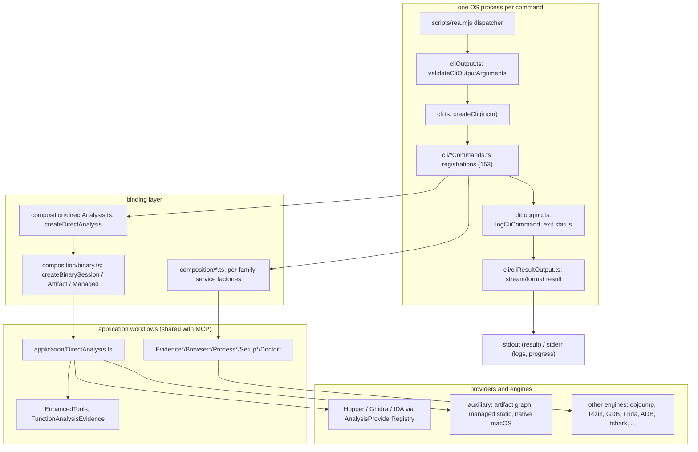
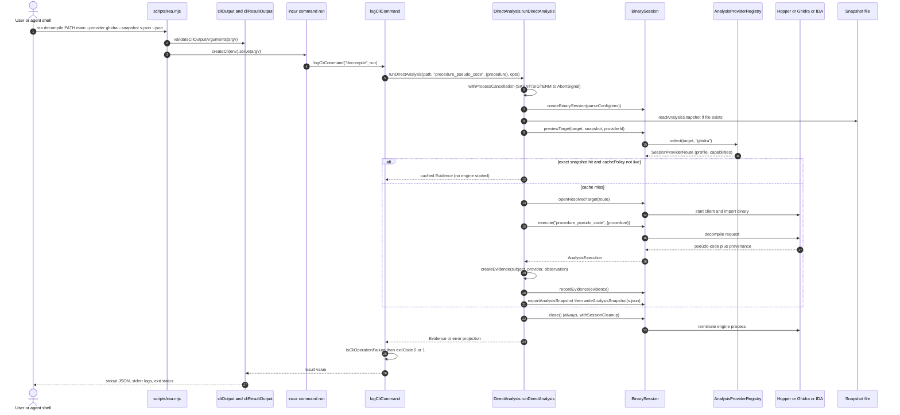
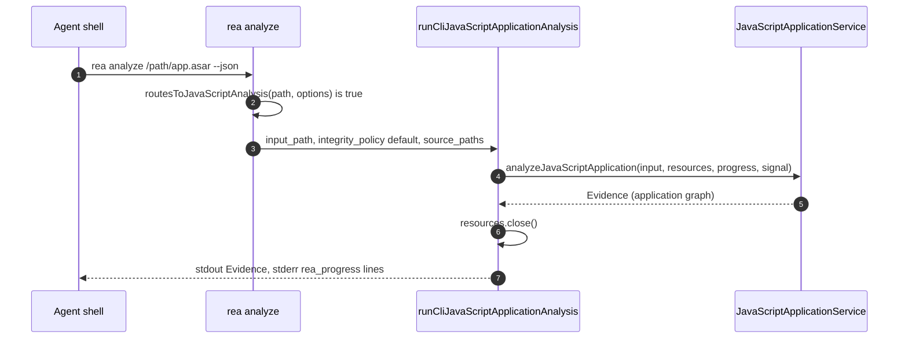

# 04 — CLI reference

> Scope: the one-shot `rea` command line (`rea-agents` package, v6.4.0). Everything below was read from the checkout at `/home/user/morluto/rea` (HEAD f75b1a4) and, where stated, **executed** against the built `dist/` in an isolated `HOME`. Source paths are repo-relative. Companion chapters: [02-architecture-and-module-map.md](02-architecture-and-module-map.md), [03-mcp-server-runtime-and-contracts.md](03-mcp-server-runtime-and-contracts.md), [05-setup-doctor-update-uninstall-clients.md](05-setup-doctor-update-uninstall-clients.md), [06-provider-layer-and-session-routing.md](06-provider-layer-and-session-routing.md), [10-evidence-model-ledger-unknowns-bundles.md](10-evidence-model-ledger-unknowns-bundles.md).

## 4.1 What the CLI is (and is not)

The CLI is a thin, **stateless, one-process-per-command** adapter over the same application workflows the MCP server uses. Its framework is the `incur` library (`Cli.create`, `src/cli.ts:88-97`, incur 0.6.1). Each invocation:

1. is dispatched by `scripts/rea.mjs` (or intercepted for MCP, see 4.2),
2. validates output flags, builds a command tree (`createCli`, `src/cli.ts:70-140`),
3. opens whatever provider/session the command needs, runs **one** operation, and closes everything (`withSessionCleanup`, `src/application/DirectAnalysisCleanup.ts:12-32`),
4. prints one result document (usually an **Evidence record**, otherwise a workflow-specific JSON object, or an error projection).

There is **no daemon and no cross-command session**: "every CLI invocation is intentionally isolated and does not retain a target or provider client for a subsequent command" (`src/application/DirectAnalysis.ts:89-93`; `docs/cli.md:3-5`). State that must survive between commands is carried explicitly in files: `--snapshot` analysis snapshots, saved Evidence JSON, Evidence bundles.

Two inventories are authoritative and are kept in lock-step by tests/generators:

* `src/cliCommandNames.ts:2-157` — `CLI_COMMANDS`, 153 canonical names (`CLI_COMMAND_NAMES`, line 160); one alias `compare-bundles` (`CLI_COMMAND_ALIASES`, line 163).
* `docs/public/product-catalog.json` `.cli` — `primary_count: 153`, `aliases: [{name: "compare-bundles", target: "compare"}]` (verified by script). `rea providers --json` reports `server_identity.catalog.counts.cli_commands = 153`, `mcp_tools = 207`, `mcp_prompts = 6` (observed output; corrected after verification: the counts sit under `server_identity.catalog`, there is no top-level `catalog` key).

`src/cliCommandNames.ts:166-186` (`CLI_COMMAND_TOOL_ALIASES`) records the CLI commands whose MCP operation has a different name; `189-255` (`MCP_TOOLS_WITHOUT_DEDICATED_CLI`) lists 65 MCP operations that deliberately have **no** CLI twin (session navigation, bookmarks, comments, `open_binary`/`close_binary`, GDB/Rizin/Frida *session* tools, unknown-ledger tools, `export_evidence_bundle`/`import_evidence_bundle`, `compare_artifacts`, `verify_reconstruction`, …). The CLI therefore covers *stateless* operations; anything that needs a retained session is MCP-only.

### Component / dependency diagram



*Figure 4.1 — CLI component and dependency view.* `rea.mjs` only dispatches; `createCli` registers all 153 commands (`src/cli.ts:99-136`); commands that need the generic binary session go through the bound `createDirectAnalysis` helpers (`src/composition/directAnalysis.ts:17-62`), while every other family builds its own service via a `src/composition/<family>.ts` factory or directly. `logCliCommand` is the single place where success/failure is decided and `process.exitCode` is set. Walkthrough: arguments flow left to right; results flow to `cliResultOutput`; stdout carries the result, stderr carries pino logs and progress.

## 4.2 Entry point and dispatch (`scripts/rea.mjs`)

| Step | Behaviour | Source |
|---|---|---|
| Version stamp | `process.env.REA_PACKAGE_VERSION` is set from `package.json` before anything loads | `scripts/rea.mjs:10-13` |
| MCP intercept | exactly one argv equal to `--mcp` or `mcp` → `dist/mcp/main.js` `runEntrypoint()` (production stdio server). The CLI module is never loaded. | `scripts/rea.mjs:14-15,54-56` |
| MCP doctor | `mcp doctor …` → `dist/cli-runtime/mcpDoctor.js` `runProductionMcpDoctorCli`; output printed, `exitCode` from result | `scripts/rea.mjs:16,57-65` |
| Everything else | loads `dist/cli-runtime/{cli,cliOutput,cliResultOutput}.js` | `scripts/rea.mjs:66-99` |
| Missing build | if the compiled runtime files are absent: message `REA's compiled runtime is missing. Run \`npm ci && npm run build:cached\` …`, `exitCode = 1` | `scripts/rea.mjs:39-53` |
| Windows/Termux shims | empty `USERPROFILE` deleted on win32; Playwright cache path set on Termux (`process.platform === "android"`) | `scripts/rea.mjs:19-37` |
| Config precheck | `REA_LOG_LEVEL` invalid → stderr message, exit 1, before any command | `src/cli.ts:55-63`, `scripts/rea.mjs:77-80` |
| Output precheck | invalid `--filter-output` slice or token-window with structured format → JSON error on **stdout**, exit 1 | `scripts/rea.mjs:81-83`, `src/cliOutput.ts:111-136` |
| Serve | `createCli(process.env, resultOutput).serve(args, {stdout})`; empty filtered output is rendered as `{}` | `scripts/rea.mjs:85-98`, `src/cliOutput.ts:138-151` |

`bin` maps both `rea` and `rea-agents` to `scripts/rea.mjs` (`package.json:40-43`). `engines.node` is `^22.19.0 || ^24.11.0 || >=26.0.0` (`package.json:44-46`).

**Verification note (corrected after verification).** `dist/cli-runtime/` is produced by `scripts/bundle-runtime.mjs`, invoked by `npm run compile` (`package.json:293`). When this chapter was first drafted the directory was absent, so `node scripts/rea.mjs …` printed the "compiled runtime is missing" message and the executions quoted here used an equivalent harness that imports `dist/cli.js` and calls `createCli(process.env).serve(args, …)`. At re-verification time the bundled runtime exists (`dist/cli-runtime/{cli,cliOutput,cliResultOutput,mcpDoctor}.js`), `node scripts/rea.mjs --version` prints `6.4.0`, and the output-flag behaviours of `cliResultOutput.ts`/`cliOutput.ts` (`--token-count`, `--token-limit` with `--json` → `UNSUPPORTED_OUTPUT_COMBINATION`, unclosed slice → `INVALID_OUTPUT_FILTER`, `--full-output` envelope, invalid `REA_LOG_LEVEL` → stderr + exit 1) were re-run through the real dispatcher and match the descriptions.

### Built-in incur commands and flags (not REA code)

`rea --help` also lists incur-owned integrations: `rea completions`, `rea mcp add` (register this CLI as an MCP server in agent configs via incur's `SyncMcp.register`, default command `npx -y rea-agents@6.4.0 mcp`, `src/cli.ts:91-95`) and `rea mcp doctor` (REA-owned, above). Global flags (`--format toon|json|yaml|md|jsonl`, `--filter-output`, `--full-output`, `--token-count/--token-limit/--token-offset`, `--schema`, `--llms/--llms-full`, `--help`, `--version`, `--mcp`) come from incur (`node_modules/incur/dist/Help.js:314`), as does an **undocumented-by-REA `--update` flag** that runs incur's own updater (`node_modules/incur/dist/Cli.js:365-377`). `rea update` (REA-owned, chapter 05) is the supported update path; the incur `--update` path is **INFERRED** to be unrelated to REA's verified-release logic (it was not executed).

## 4.3 Global conventions

### 4.3.1 Output modes

| Flag | Effect | Source |
|---|---|---|
| (none) | TOON (incur's compact human/agent format) | `docs/cli.md:316`; `src/cliOutput.ts:31` |
| `--json` / `--format json` | JSON. Indented only when stdout is a TTY; **compact when piped**, same value | `src/cli/jsonOutput.ts:7-26,52-67`; `docs/cli.md:316-320` |
| `--format jsonl` | arrays become one JSON value per line; non-arrays as one line | `src/cli/jsonOutput.ts:52-67` |
| `--format yaml` / `--format md` | incur formatting | `src/cliOutput.ts:5` |
| `--filter-output a,b.c,x[0,3]` | key-path projection (incur `Filter`); unclosed `[` slice rejected up front; fully filtered-away structured output is `{}` | `src/cliOutput.ts:92-108,138-151`; `src/cli/cliResultOutput.ts:139-141` |
| `--full-output` | wraps result: success → `{ok:true,data,meta:{command,duration}}`; failure → `{ok:false,error,meta}` | `src/cli/cliResultOutput.ts:199-225,257-278` |
| `--token-count` | prints estimated token count (tokenx) instead of the result | `src/cli/cliResultOutput.ts:147-182` |
| `--token-limit/--token-offset` | slice output by tokens; **rejected with json/jsonl/yaml** (`UNSUPPORTED_OUTPUT_COMBINATION`) | `src/cliOutput.ts:1-2,125-134` |
| `--schema` | JSON Schema of the command's args/options (no output schema) | observed |
| `--llms`, `--llms-full` | machine-readable command manifest (`incur.v1`) | observed (`--llms --format json`) |

Large JSON is streamed in parts (`jsonParts`) rather than materialised as one string; `--token-count` guards against strings larger than `constants.MAX_STRING_LENGTH` (`src/cli/cliResultOutput.ts:147-198`). Prompts, logs and progress go to **stderr** so stdout stays machine-readable (`src/logger.ts:31`; `src/cli/javascriptApplicationAnalysis.ts:20-25` writes `{"rea_progress": …}` lines to stderr; `docs/installation.md` for setup prompts).

### 4.3.2 Exit statuses

Source of truth: `logCliCommand` (`src/cliLogging.ts:74-116`) and `docs/cli.md:322-331`.

| Status | When | Source |
|---|---|---|
| `0` | operation completed; result may still carry partial Evidence, limitations, unresolved unknowns | `docs/cli.md:324` |
| `1` | the returned value is classified as a failure (see below), or an `AnalysisError` is thrown | `src/cliLogging.ts:98,101` |
| `130` / `143` | SIGINT / SIGTERM during a command wrapped by `withCommandCancellation`; the operation's `AbortSignal` is aborted, cleanup awaited, then `process.exitCode` set | `src/cli/commandCancellation.ts:9-32` |
| `1` (cleanup) | GDB/Rizin one-shot cleanup failure forces `exitCode = 1` even though output was produced | `src/cli/reverseEngineeringCommands.ts` (`cleanupFailed`) |
| `0` / `1` setup | `planned`, `cancelled`, `ready` → 0; `needs_confirmation`, `needs_human` → 1 | `src/application/SetupTypes.ts:122-139` |
| `1` doctor | `healthy === false` in the returned report | `src/cliLogging.ts:57` |
| `1` update / uninstall | `status:"failed"` (or cleanup failure) | `src/application/UpdateFailure.ts`, `UninstallFailure.ts` |

**How a result is classified as a failure** (`src/cliLogging.ts:18-59`): a returned object is a failure if it parses as an `analysisErrorProjectionSchema` record, or as an `analysisCliErrorEnvelopeSchema` (`{error:"<label>", code, category, message, retryable, remediation, details}` — the shape produced by `cliError()` helpers, e.g. `src/application/DirectAnalysis.ts:638-641`), or contains a nested projection under `.error`, or is a record with `healthy === false`. Commands can override with a custom predicate (`isSetupFailure`, `isProcessCliFailure`, `isReferenceSourceImportCliFailure`, …). The CLI therefore **returns errors as ordinary result documents on stdout** with exit status 1; it does not throw to the shell.

Example failure (executed): `rea decompile /nonexistent/x main --json` → exit 1,

```json
{
  "error": "Analysis failed",
  "code": "target_unavailable",
  "category": "unavailable",
  "message": "Cannot open artifact: target does not exist or a path component is not a directory: ENOENT: …",
  "retryable": false,
  "remediation": { "action": "Cannot open artifact: …" },
  "details": { "path": "/nonexistent/x", "reason": "target does not exist or a path component is not a directory: ENOENT: …" }
}
```

and, on this host (no engine configured), `rea analyze ./sample.bin --json` → `code: "provider_unavailable"`, `retryable: true`, `details.candidate_ids: ["ghidra","hopper","ida"]`, per-provider `rejections[]` with `code: "not_configured"`, and `details.operation: "current_document"` (executed). Provider-selection error codes are `PROVIDER_REJECTION_CODES` (`src/contracts/providerSelection.ts`, listed verbatim in chapter 06).

### 4.3.3 Argument and JSON-input conventions

Four distinct input styles exist; knowing which a command uses matters when scripting or porting:

| Style | Used by | Details |
|---|---|---|
| **Positional + flags (kebab/camel)** | native analysis, artifacts, ADB, JEB, Android, Frida, … | Positionals are `incur` `args`; flags are `options`. Flag names are **inconsistent in case by family** (note: `rea <cmd> --help` renders camelCase option keys in kebab-case, e.g. `--max-depth`, `--install-hopper`, `--skill-client`, whereas `--schema` and the tables below list the option *keys* as declared, e.g. `maxDepth`; both spellings were observed to be accepted, e.g. `setup --installHopper` and `setup --install-hopper` both add the `install_hopper` action; snake_case keys such as `--display_filter` are shown as-is): native commands use kebab (`--target-format`, `--entry-point`, `--file-offset`, `--output-directory`), most others camelCase (`--maxDepth`, `--allowedOrigins`, `--integrityPolicy`), packet/signal/pcap tools use snake_case (`--display_filter`, `--packet_limit`). Check the generated table below or `--schema`. |
| **Positional OR option for the same value** | `decompile`, `function`, `instructions`, `xrefs`, `trace`, `search` | `rea decompile PATH ADDRESS` or `--procedure=<v>`; the `--x=<value>` form exists "for leading dashes" (`src/cli/coreBinaryCommands.ts:156-163`). Supplying both errors (`resolveCliAnalysisSelector`, `src/cli/analysisSelector.ts`). |
| **Inline JSON or JSON file path (`inputJson`)** | 19 commands with an `inputJson` argument (`trace-application-feature`, `trace-javascript-semantics`, `compare-application-versions`, `compare-source-to-bundle`, `compare-javascript-export-shapes`, `project-{android,apple,harmony}-application-graph`, `build-reconstruction-obligation-ledger`, `evaluate-reconstruction-coverage`, `reconcile-javascript-runtime`, `capture-browser-scenario`, `capture-electron-scenario`, `inspect-analysis-view`, `inspect-evidence-bundle`, `verify-managed-native-boundaries`, `import-managed-reconstruction`, `project-managed-application-graph`, and `observe-native-calls PATH inputJson`) plus the JSON-or-file positionals of `compare-wasm-interfaces`, `compare-web-captures` and `compare-web-screenshots` | `parseCliJsonInput` (`src/cliJsonInput.ts:14-57`): first tries `safeParseJson(value)` as inline JSON; on failure treats the string as a **file path** and reads it as a bounded regular file (streaming parser for large inputs, `src/application/JsonInputFile.ts`). Errors carry `input_path` and `input_reason` (`invalid-json`, `read-failed` or `too-large`) merged into `details`. Strings starting with `{`/`[` that look like broken JSON and cannot be a file produce `invalid_format`/`expected: JSON` instead of an ENOENT. |
| **Path-to-JSON-file args** | `capture-process <scenario>`, `compare-process-captures <left> <right> [traceSpec]`, `evidence-import/export/compare`, `compare-wasm-interfaces`, `export-web-scripts`, `compare-web-captures` | The argument is always a file. |

Relative paths: "Shared MCP contracts reject relative paths, so CLI workflows resolve operator-relative values before validation" (`resolveCliJsonPaths`, `src/cliJsonInput.ts:82-89`, only for named key paths; `file:`/`scheme://` values are left alone, regex at line 72).

Native "open" flags shared by every deep-analysis command (`nativeOpenOptionFields`, `src/cli/options.ts:38-43`), reproduced here because they define provider binding:

```ts
// src/cli/options.ts:38-43 (trailing comments added by this document; the source has none)
export const nativeOpenOptionFields = {
  "target-format": formatSelectionOption,   // dos-com | raw-binary (headerless interpretation)
  architecture: architectureSelectionOption, // 6502|x86|x86_64|arm|arm64; required with raw-binary
  "entry-point": entryPointSelectionOption,  // 0x-hex load+entry; required with raw-binary
  provider: providerSelectionOption,         // "auto" or provider id /^[a-z][a-z0-9-]*$/ (not "auto" as an id)
};
```

(`src/cli/options.ts:11-43`; selector schema `src/contracts/providerSelection.ts`.) `--snapshot <file>` adds a read/update analysis snapshot (below). Standing preference: env `REA_ANALYSIS_PROVIDER` (default `"auto"`, `src/config/environment.ts:24`); explicit `--provider` wins (`docs/cli.md:142-143`).

### 4.3.4 Environment variables read at the CLI boundary

| Variable | Role | Source |
|---|---|---|
| `REA_LOG_LEVEL` | `trace` … `fatal`, or `silent`; default silent in CLI; invalid → exit 1 | `src/cli.ts:55-63,80-87`; `src/logger.ts:11` |
| `REA_ANALYSIS_PROVIDER` | default provider selector | `src/config/environment.ts:24` |
| `HOPPER_LAUNCHER_PATH`, `GHIDRA_INSTALL_DIR`, `JAVA_HOME`, `REA_IDA_MCP_CONFIG`, `REA_ILSPY_CMD_PATH`, `REA_GHIDRA_*`, `REA_HOPPER_STARTUP_TIMEOUT_MS`, … | provider configuration, all parsed by `parseConfig(environment)` (absolute-path refinements) | `src/config/environment.ts:24-77`; chapters 06–08 |
| `REA_REFERENCE_SECRET_PATTERNS_JSON` | extra sensitive-path ignore patterns for `import-reference-source` | `src/config/environment.ts:77`; `docs/cli.md:275-277` |
| `REA_JEB_MCP_URL`, `REA_JADX_MCP_JAR`, … | optional provider endpoints; also propagated into client registrations by setup | `src/doctorRuntime.ts:17-26` |
| `HOME`/`USERPROFILE`/`HOMEDRIVE+HOMEPATH` | home directory resolution for setup/doctor/uninstall | `src/config/homeDirectory.ts` |

The environment is **snapshotted** once (`snapshotEnvironment`, `src/cli.ts:77`) and threaded through every factory; commands do not consult `process.env` ambiently (`DirectAnalysisDependencies.readConfiguration: "without consulting ambient state"`, `src/application/DirectAnalysisDependencies.ts:8-9`).

## 4.4 How a one-shot command binds a provider

### 4.4.1 The three session shapes

`createDirectAnalysis(environment)` (`src/composition/directAnalysis.ts:17-62`) returns three lazily-imported, environment-bound functions, each backed by `DirectAnalysisDependencies` (`src/application/DirectAnalysisDependencies.ts:7-21`):

```ts
// src/application/DirectAnalysisDependencies.ts:7-21
export interface DirectAnalysisDependencies {
  /** Read the caller-selected configuration without consulting ambient state. */
  readonly readConfiguration: () => ReturnType<typeof parseConfig>;
  readonly createBinarySession: (config: AppConfig, logger: Logger) => BinarySession | Promise<BinarySession>;
  /** Create an artifact-only session without selecting native analysis engines. */
  readonly createArtifactBinarySession: () => BinarySession | Promise<BinarySession>;
  readonly createManagedBinarySession: () => BinarySession | Promise<BinarySession>;
}
```

| Bound function | Session factory | Used by | Needs engine? |
|---|---|---|---|
| `runDirectAnalysis(path, tool, args, {snapshotPath, providerId, formatHint, architecture, entryPoint, logger, signal})` | `createBinarySession(config, logger)` = `AnalysisProviderRegistry([Hopper, Ghidra, IDA], config.analysisProvider)` + 3 lazy auxiliary providers (artifact graph, native macOS, managed static) | the 20 "provider-neutral" commands (family 4.2) | **Yes** — Hopper, Ghidra or IDA (one is bound per target) |
| `runProviderAnalysis(path, tool, args, logger, signal)` | same factory, **or** `createArtifactBinarySession()` when the tool is in `ARTIFACT_ANALYSIS_OPERATIONS`, **or** the managed path when `isManagedToolName(tool)` | artifact, managed, Apple-native utility commands | No deep engine (auxiliary providers only) |
| `runSessionStatus(logger)` | `createBinarySession` (no target) | `capabilities`, `providers` | No |

`src/composition/binary.ts:21-37` is "the sole production wiring point, so both adapters [CLI and MCP] share identical provider selection, profile, lifecycle, and Evidence semantics":

```ts
// src/composition/binary.ts:21-37 (condensed: parameter types and wrapping reflowed, logic unchanged)
export const createBinarySession = (config, logger, selectedEnvironment): BinarySession => {
  const environment = snapshotEnvironment(selectedEnvironment);
  const hopper = new HopperProvider(config, logger, environment);
  const ghidra = new GhidraProvider(config, logger, environment);
  const ida = new IdaProvider(config, environment);
  return composeBinarySession(
    new AnalysisProviderRegistry([hopper, ghidra, ida], config.analysisProvider),
    auxiliaryAnalysisProviderDeclarations(environment).map((d) => new LazyAnalysisProvider(d)),
  );
};
```

`composeBinarySession` wraps registry + auxiliaries in `SessionProviderRouter.selectable(...)` and a fresh `InvestigationRecords` ledger (`src/application/binary/BinarySessionComposition.ts:11-18`). Deep and auxiliary providers must declare **disjoint** operation sets or construction throws (`SessionProviderRouter.selectable`, `src/application/binary/SessionProviderRouter.ts:45-64`). Auxiliary providers are `LazyAnalysisProvider`s: nothing is loaded until an operation routes to them (`src/composition/auxiliaryAnalysisProviders.ts:19-52`).

### 4.4.2 Selection of the deep provider for a target

Per target, `AnalysisProviderRegistry.select` (`src/application/binary/AnalysisProviderRegistry.ts:151-190`) applies: explicit `--provider` → `#selectConcrete` (must be supported for this target and available, else a structured `unknown_provider`/`target_unsupported`/`provider_unavailable` selection error); else `REA_ANALYSIS_PROVIDER` (concrete or `auto`) ; `auto` → `#selectAutomatically` evaluates all supported+available candidates and selects the single match, returning an `ambiguous` selection error with `details.candidate_ids` when several qualify (`AnalysisProviderRegistry.ts:328`; `docs/cli.md:135-161`). If **zero** candidates are usable, selection succeeds with `binding: null` (an *unbound* route); the failure surfaces only when a deep operation is requested, via `unboundOperationError` → `provider_unavailable`/`target_unsupported` with the per-candidate rejections (`AnalysisProviderRegistry.ts:204-221`, `SessionProviderRouter.ts:98-108`, `BinarySession.ts:696-697`). Providers are sorted by ID code-point order (`AnalysisProviderRegistry.ts:113-117`), so there is **no priority**: the default selector "is not interpreted as priority" (`defaultSelector()` doc comment, `AnalysisProviderRegistry.ts:126-128`). The resulting `SessionProviderRoute` (`SessionProviderRouter.ts:23-35`) carries the identity, per-operation `CapabilityDescriptor`s, the `AnalysisProfileCommitment`, and a `createClient` factory (a `CompositeProvider` of the auxiliaries plus the bound deep provider). Chapter 06 documents the registry in depth.

### 4.4.3 `runAnalysis` — the one-shot algorithm (`src/application/DirectAnalysis.ts:212-391`)

1. **Session creation** — `options.createSession` (artifact path) or `readConfiguration()` → `createBinarySession(config, logger)`; a config error returns an error document immediately (lines 232-240).
2. **Cleanup envelope** — everything below runs inside `withSessionCleanup(session, …, directAnalysisCleanupFailure)`; the session is always `close()`d. If the operation and the close both fail, an `AggregateError` is thrown; if only close fails the output is rewrapped with `code:"cleanup_incomplete"`, `retryable:false`, `details.cleanup:"incomplete"` and the original failure preserved (`DirectAnalysisCleanup.ts:12-73`).
3. **Snapshot preparation** — if `--snapshot` names an existing file it is parsed (`readAnalysisSnapshot`) and its target is checked against the requested path (`snapshotMatchesTarget`), else `EvidenceIntegrityError("Analysis snapshot target does not match the requested binary")` (`prepareSnapshot`, lines 516-554).
4. **Replay without starting a provider** — with a snapshot, `session.previewTarget` resolves the route *without creating a client*; if the operation is cacheable (`allowsSnapshotReplay`: capability `cachePolicy !== "live"`, never `trace_native_ui_action`) and the snapshot has an exact match on `(target, bindingProfile, operation, parameters, provider, evidenceProfile)` the **cached Evidence is returned and no engine starts** (lines 261-305). Exception: Windows + Ghidra must first admit the source through the native owner (`requiresNativeSourceAdmissionBeforeReplay`, `src/application/binary/AnalysisSnapshotCache.ts:88-90`).
5. **Open** — `session.open(path, {signal, formatHint, architecture, entryPoint, snapshot, providerId})` or `openResolvedTarget(previewed)` (lines 306-326). This is where an engine process (Hopper/Ghidra/IDA bridge) is started and the binary is imported.
6. **Execute** — `executeAnalysisTool` (lines 393-483) has three branches:
   * `analyze_function` → `executeFunctionAnalysisEvidence` (`src/application/FunctionAnalysisEvidence.ts`) returns Evidence;
   * the **composed workflows** `binary_overview`, `inspect_native_api`, `inspect_native_dispatch_metadata`, `trace_feature`, `trace_native_values`, `trace_native_ui_action` → `new EnhancedTools(observed).execute(tool, args, signal)` inside `executeComposedWorkflow`, which observes the *primitive* provider calls the workflow makes (e.g. `binary_overview` calls `list_segments`, `list_procedures`, `list_strings` — `src/application/EnhancedTools.ts:628-630`) so that upstream limitations/profile are folded into one workflow Evidence (`createWorkflowEvidence`);
   * everything else is a single primitive: `session.execute(tool, args)` then `createEvidence(subject, provider, {operation, parameters, result, analysisProfile, rawResult, limitations, relationshipCoverage, locations, evidenceLinks})`.
   * Special retry: for `xrefs`, if the only input issue is `address` having an invalid format, the symbol is resolved to an address by `resolveXrefsAddress` and the call retried once (lines 417-446).
7. **Record** — `session.recordEvidence(evidence)`; for workflow tools `recordWorkflowUnknowns` registers residual unknowns in the in-process ledger; with `--snapshot` the workflow record and then the whole snapshot are exported and written (atomic, overwrite=true, `writeAnalysisSnapshot`), partial-failure paths keep the evidence as `retainPartialObservation` (lines 336-386).
8. **Return** — the **Evidence object itself** is the command output (`return output`, line 387).

Cancellation: `withProcessCancellation` installs `SIGINT`/`SIGTERM` listeners that abort an `AbortController` for the duration of the operation and removes them after cleanup (lines 497-514); wrapped commands (`withCommandCancellation`) additionally map the signal to exit codes 130/143.

### 4.4.4 How Evidence is returned

* Primitive and workflow commands return **one Evidence record** (strict zod `evidenceSchema`, `src/domain/evidence.ts:123-141,167`): `evidence_id` (`ev_<sha256>` of the semantic projection, so identical observations get identical IDs), `subject{name,digest.sha256,format,architecture,local_path}`, `provider{id,name,version}`, `analysis_profile`, `predicate_type` (default `rea.analysis`), `operation`, `parameters`, `raw_result`, `normalized_result`, `confidence ∈ observed|derived|inferred`, `authority ∈ shipped-artifact|controlled-replay|historical-reference|external-service|analyst-inference`, `environment`, `limitations[]`, `relationship_coverage`, `locations[]`, `evidence_links[]` (`src/domain/evidence.ts:123-141`, `createEvidence` at 340-356). Chapter 10 owns the full model.
* Real example (executed, `rea inspect-artifact ex.zip --json`): `evidence_id: ev_5e87…`, `subject.format: "zip"`, `provider.id: "rea-artifact-graph"`, `operation: "inspect_artifact"`, `parameters: {"integrity_policy":"fail"}`, `authority: "shipped-artifact"`, two limitations ("Inspection derives bounded static hypotheses … does not execute the artifact …"), and `evidence_links: ["ev_7f55…"]`.
* **A CLI result is a single record, not a bundle.** The CLI keeps no session ledger across commands, and no CLI command assembles a bundle from records. Bundles come from MCP (`export_evidence_bundle`) — see 4.7. Feeding a CLI result file to `evidence-import` fails with `wrong-kind` (executed; message: "Expected an Evidence bundle with records and manifest arrays, but this JSON is one Evidence record (ev_…). Export a session bundle with the MCP export_evidence_bundle tool and supply that file.").
* Large results: complete JavaScript-application Evidence "can be hundreds of megabytes"; the intended pattern is to save to a file and project it with `inspect-analysis-view` (`docs/cli.md:23-38`).

### 4.4.5 Sequence diagram — `rea analyze` / `rea decompile` end to end



*Figure 4.2 — `rea decompile` (representative of the 20 deep-analysis commands).* Walkthrough: steps 1-3 are process-boundary work (argument validation, command tree). Steps 4-6 are the logging/exit-status envelope. The workflow function creates a fresh `BinarySession` (7), optionally loads the snapshot (8), and **previews** the provider route before starting anything (9-11). With an exact cached observation the engine is never started (12-13). Otherwise the engine is started and the binary imported (15), the single primitive `procedure_pseudo_code` is executed (16-18), wrapped into Evidence (19), recorded and persisted into the snapshot (20-21). The session is closed in every case (22-23), and `logCliCommand` classifies the value and sets the exit status (25). `rea analyze PATH` differs in three ways: (a) for a directory or `.asar` with no `--provider/--snapshot/--target-format/--architecture/--entry-point` it is **rerouted** to the static JavaScript application analysis (`routesToJavaScriptAnalysis`, `src/cli/coreBinaryCommands.ts:218-247`; `.app` is excluded) and never touches a native engine; (b) otherwise it calls `runDirectAnalysis(path, "binary_overview", {})`, whose tool is one of the **composed workflows**, so step 16 becomes several primitive calls (`list_segments`, `list_procedures`, `list_strings`) observed by `executeComposedWorkflow` and folded into a single workflow Evidence; (c) `--integrityPolicy` and `--sourcePath` are only valid in lane (a) and otherwise raise `AnalysisInputError` (`coreBinaryCommands.ts:82-110`). `rea inspect` is identical to `rea analyze` minus the JavaScript routing and the two extra options (`coreBinaryCommands.ts:124-137`).



*Figure 4.3 — `rea analyze` on a directory or ASAR (JavaScript lane).* No provider is bound; progress is JSON lines on stderr (`src/cli/javascriptApplicationAnalysis.ts:20-25`). A resource-cleanup failure converts even a successful result into a `ProviderCleanupError` document (lines 36-56).

## 4.5 `capabilities`, `providers`, `instructions`

* **`capabilities` and `providers`** (`src/cli/utilityCommands.ts:154-171`) register the *same* handler, `runSessionStatus(logger)` (`src/application/DirectAnalysisStatus.ts:13-41`): read config, create a `BinarySession` **with no target**, return `session.status()` plus `capabilities` (provider capability sets, with the SQLite capability appended — `sqliteDatabaseCapability(process.versions.node)`) and a `server_identity`, then close. Only the description string differs ("List provider capabilities and side effects" vs "List configured analysis providers"); **their output is byte-identical apart from `server_identity.server.started_at`** (executed: `cmp` differs only at the timestamp). Executed output shape (this host, no engines): top-level keys `open:false`, `capabilities[]` (per provider `{provider{id,name,version}, shared_limitations[], groups[{operations[], effects[], limitations[], available, reason, availability_code}]}`), `analysis_provider_binding:null`, `analysis_provider_candidates[]` (one per deep provider with `availability.status/code/reason/diagnostics.checks[]`), `analysis_run`, `analysis_activity`, `provider_operation_health`, `server_identity`. Providers listed in `capabilities[]` here: `native-macos`, `rea-artifact-graph`, `rea-dotnet-static`, `sqlite`; candidates: `ghidra`, `hopper`, `ida`. Effect tags per group use the vocabulary `launches_process`, `may_show_ui`, `may_access_network`, `may_write_filesystem` (observed). This is the CLI counterpart of the MCP `binary_session` tool's status (`MCP_TOOLS_WITHOUT_DEDICATED_CLI` contains `binary_session`).
* **`instructions`** is **not** an informational command: despite its name it is `rea instructions PATH [ADDRESS]` → MCP `read_function_instructions` — "Read every raw instruction without decompiling" (`src/cliCommandNames.ts:171`, `src/cli/coreBinaryCommands.ts:393-440`). There is no CLI command that prints agent instructions. The agent-facing instruction text lives in the MCP server (`mcp.instructions` string in `src/cli.ts:93-94`, chapter 12) and the bundled skill (chapter 05 §Skill).
* **Provider selection UX**: `doctor --provider hopper|ghidra|ida|jadx` (`DOCTOR_PROVIDER_IDS`, `src/application/DoctorProviderIds.ts`) diagnoses a deep engine; other adapters (e.g. `pwntools-elf`) are not accepted by `doctor --provider` (`docs/cli.md:157-159`).

## 4.6 Snapshots (`--snapshot`)

A snapshot "retains successful analysis results for later queries … reuses an exact result when the target bytes, operation, parameters, provider and settings match. Mutations and cursor-dependent calls are excluded … Snapshot files are local and use owner-only permissions" (`docs/cli.md:170-208`). Mechanics: `AnalysisSnapshotCache` (`src/application/binary/AnalysisSnapshotCache.ts`), file I/O `AnalysisSnapshotFiles.ts`; the CLI preserves workflow entries and Evidence records when updating (`DirectAnalysis.ts:336-386`). Invariants: target SHA must match (`EvidenceIntegrityError` otherwise); `trace_native_ui_action` is never cached; a metadata write invalidates the session's cache (`docs/cli.md:177-179`). Snapshots are accepted by `analyze`, `inspect`, `decompile`, `function`, `instructions`, `search`, `xrefs`, `trace`, `inspect-native-api`, `inspect-native-dispatch-metadata` (see the table's `--snapshot` option).

## 4.7 Evidence commands: `evidence-import`, `evidence-export`, `compare`, `inspect-evidence-bundle`, `inspect-analysis-view`

All five are **file-to-file, session-free** (no provider, no engine) — ideal for porting. Implementation: `src/cliEvidenceCommands.ts:16-66`, `src/application/EvidenceBundleCommands.ts`, `src/application/EvidenceBundleFiles.ts`, `src/cli/analysisViewCommands.ts`.

| Command | Behaviour | Output | Source |
|---|---|---|---|
| `evidence-import PATH` | **Validates only** — it does not store anything (no session). Reads the file with bounds, parses `evidenceBundleSchema`, re-validates every `rea.process-capture` record's `normalized_result`. | `{imported: N, unknowns_added: U, total: N}` | `EvidenceBundleCommands.ts:19-29`; `EvidenceBundleFiles.ts:39-113` |
| `evidence-export SRC OUT [--overwrite]` | Re-reads SRC as an *immutable authenticated* bundle, re-serialises canonically (`canonicalJsonParts`), writes **atomically**; refuses to replace OUT unless `--overwrite` | `{path, bytes, records}` | `EvidenceBundleCommands.ts:32-67`; `EvidenceBundleFiles.ts:115-150` |
| `compare LEFT RIGHT` (alias `compare-bundles`) | Reads both bundles in parallel as sealed snapshots and runs `compareBundles` | `{status, left_bundle_sha256, right_bundle_sha256, summary{records_*, unknowns_*, unresolved}, changes[], limitations[]}` | `EvidenceBundleCommands.ts:70-91`; `src/domain/bundleComparison.ts` |
| `inspect-evidence-bundle JSON` | Input `{path (absolute), detail: "complete" or "summary" (default complete), filters?}`; `filters` ⇒ `detail:"summary"` required; summary returns per-record discovery metadata without payloads | `kind:"evidence-bundle-summary"`, `total_retained_records`, `matching_records`, `records[…]` | `analysisViewCommands.ts:25-71`; `src/application/investigation/InspectEvidenceBundle.ts:11-35` |
| `inspect-analysis-view JSON` | Projects a *view* (summary / page / one module …) of completed Evidence of 13 named families (binary layout, JavaScript application, native function, artifact inventory, WASM, Mach-O, Interface Builder, EVM, managed, Android package, Dart AOT, web network capture, pcap) | view-specific | `analysisViewCommands.ts:72-105`; `src/domain/analysisView/analysisView.ts`; chapter 11 |

Contracts reproduced verbatim:

```ts
// src/contracts/sessionToolSchemas.ts:12-15
export const getEvidenceBundleInputSchema = z.strictObject({
  detail: z.enum(["complete", "summary"]).default("complete"),
  filters: evidenceRecordFiltersSchema.optional(),
});
```

```ts
// src/domain/evidenceRecordSummary.ts:8-14
export const evidenceRecordFiltersSchema = z.strictObject({
  evidence_id: prefixedDigestSchema("ev").optional(),
  operation: z.string().min(1).optional(),
  target_sha256: digestSchema.optional(),
  analysis_profile_digest: digestSchema.optional(),
  procedure_address: z.string().min(1).optional(),
});
```

```ts
// src/domain/evidenceBundle.ts:42-50
export const evidenceBundleSchema = z.strictObject({
  artifacts: z.array(artifactManifestSchema),
  providers: z.array(providerManifestSchema),
  environments: z.array(environmentManifestSchema),
  scenarios: z.array(scenarioManifestSchema),
  captures: z.array(captureManifestSchema),
  unknowns: z.array(residualUnknownSchema),
  records: z.array(evidenceSchema),
});
```

Worked example (executed in a scratch dir). A bundle was produced from the `inspect-artifact` record with the library function `createEvidenceBundle([record])` (there is no CLI for this step), then:

```text
$ rea evidence-import bundle.json --json     -> {"imported":1,"unknowns_added":0,"total":1}                 exit 0
$ rea evidence-export bundle.json canon.json --json -> {"path":".../canon.json","bytes":7081,"records":1}   exit 0
$ rea evidence-export bundle.json canon.json --json -> {"error":"Analysis failed","code":"invalid_request",
     "message":"Evidence file already exists. Choose another path or allow overwrite.", ...}               exit 1
$ rea compare bundle.json canon.json --json  -> {"status":"unchanged","left_bundle_sha256":"a8635b70…",
     "right_bundle_sha256":"a8635b70…","summary":{"records_unchanged":1,…},"changes":[],"limitations":[]}  exit 0
$ echo '{"path":"/abs/bundle.json","detail":"summary"}' > in.json ; rea inspect-evidence-bundle in.json --json
     -> {"kind":"evidence-bundle-summary","total_retained_records":1,"matching_records":1,"records":[{"evidence_id":"ev_5e87…",…}]}
```

The identical SHA-256 for the original and the canonical export shows canonical serialisation is deterministic. Records inside a bundle are sorted by `evidence_id` by code-point order, so record order carries no meaning (`createEvidenceBundle`, `src/domain/evidenceBundle.ts:86-120`).

CLI-vs-MCP asymmetry worth noting for ports: MCP `import_evidence_bundle`/`export_evidence_bundle` operate on the **session ledger** (records + unknowns recorded during the connection). The CLI `evidence-*` commands never create such a ledger; they only validate/canonicalise/compare files. See chapter 10 for the ledger and the bundle contracts.

## 4.8 Command reference (all 153 + 1 alias)

**Legend.** Positional args are `<name>`; `*` = required; `=value` = default; options are shown as `--flag`. Option types/ranges are in `rea <cmd> --schema`; the table shows names only to stay readable (types in `schemas.json`-style output are reproduced for the central commands in 4.3/4.4). Array options are repeated flags (`--x a --x b`) in incur. **MCP twin** = the MCP tool whose operation/contract the CLI reuses (name from `CLI_COMMAND_TOOL_ALIASES` or kebab→snake identity, verified against `.cache/mcp-tool-catalog.json`; `-` = no MCP tool). **Eff** = effect flags copied from that tool's catalog `effects` object (`.cache/mcp-tool-catalog.json`), *not* from the CLI code: `L` launches a process (an engine/helper — not necessarily the target), `W` writes the filesystem, `N` network, `X` **executes foreign (target) code**, `T` mutates the target (or its device/database), `D` mutates a device, `U` changes UI state, `V` may discard data; `-` none flagged. `idempotent` and `mutatesSession` are omitted (corrected after verification: `mutatesSession` is true for 196 of the 207 catalog tools because Evidence recording counts; the 11 exceptions are `evaluate_reconstruction_coverage`, `binary_session`, `export_evidence_bundle`, `list_unknowns`, `verify_unknown_resolution`, `get_evidence_bundle`, `list_cutter_sessions`, `gdb_session_status`, `list_frida_devices`, `list_frida_processes`, `frida_session_status`). Options whose `--schema` default is literally `null` (`--display_filter`, `--packet_limit`, `--input_format`, `--annotations`, `--protocol`, `--decoder`) are listed here without `=null`. **Binding** (family table below) = which one-shot session shape the command uses (4.4.1). In the MCP catalog 25 tools have `requiresSession: true`; the CLI never needs one (even `compare` is the file-based twin of `compare_bundles`).

Family-level binding (applies to every row of that family):

| # | Family | Binding model | Needs an engine/provider? | Exit/err convention |
|---|---|---|---|---|
| 4.1 | Lifecycle (`setup`, `doctor`, `uninstall`, `update`) | `SetupHost`/`DoctorHost`/`UninstallHost`/`UpdateHost` (chapter 05) | No (reads host; setup may install Hopper) | status-specific (4.3.2) |
| 4.2 | Provider-neutral binary analysis | `runDirectAnalysis` → `BinarySession` + Hopper/Ghidra/IDA | **Yes**, one deep provider | error projection + exit 1 |
| 4.3 | Provider status | `runSessionStatus` (no target) | No | `{error: projection}` if config invalid |
| 4.4 | Reference source | `importReferenceSource` + `ArtifactResourceScope` | No | `isReferenceSourceImportCliFailure` |
| 4.5 | Artifacts | `runProviderAnalysis` on `createArtifactBinarySession` (ArtifactProvider) | No (may spawn helper tools for some formats; `assetutil` macOS only) | projection |
| 4.6 | Apple native (macOS) | `runProviderAnalysis` on the full session; NativeMacOSProvider (`unsupported_host` elsewhere) | No Hopper; **requires macOS** | projection; `capture/observe` commands act on live apps |
| 4.7 | Managed | managed-only session `createManagedBinarySession` (`ManagedStaticProvider`) | No | projection |
| 4.8 | Diagnostics/Go/Rust/SQLite/WASM/EVM | dedicated services in `src/composition/*.ts` or `runProviderAnalysis` | No | projection |
| 4.9 | Firmware/pcap/signals | service wrappers around external tools (firmware: `FirmwareProvider`/binwalk, per `src/firmware/FirmwareCommand.test.ts`; packet captures: `TsharkCaptureProvider`; signals: `SigrokRecordingProvider`) | external tool required | projection |
| 4.10 | objdump/Rizin/GDB/Cutter | `createReverseEngineeringService(env)` / `GdbSessionManager` / `RizinDebugSessionManager` / `CutterBridgeService` | external tool required | `executeWithCleanup`, exit 1 on cleanup failure |
| 4.11 | Frida/process capture | `FridaInstrumentationPort` service / `captureProcessScenarioFile` | Frida / none; **executes target** | `isProcessCliFailure` |
| 4.12 | Android/Flutter/JEB/ADB | per-family providers (`composition/android.ts`, `adb.ts`, `jeb.ts`, `apktool.ts`, `flutter.ts`) | JADX / apktool / adb / JEB as applicable | projection |
| 4.13 | Browser/web | `browserContext()` → CDP/Playwright providers | a Chromium (loopback CDP) | `browserCliError` |
| 4.14 | Electron/JS runtime/application graph | Electron/Inspector providers; JavaScript application service; pure-function workflows over saved Evidence JSON | Node/Electron for runtime ones; none for graph workflows | `Application workflow failed` envelope |
| 4.15 | Evidence files/views | file-only | No | projection |

### 4.1 Lifecycle (4)

| Command | Positional args | Options (`*` required, `=` default) | MCP twin | Eff | Description |
|---|---|---|---|---|---|
| `doctor` | - | `--target` `--client=[]` `--provider=[]` `--skill` | - | - | Check whether REA is ready |
| `setup` | - | `--yes=false` `--installHopper=false` `--client=[]` `--skillClient=[]` `--allDetected=false` `--skill` `--dryRun=false` `--accessible=false` | - | - | Configure agent integrations and optional analysis providers |
| `uninstall` | - | `--purgeData=false` | - | - | Remove REA-owned agent configuration and skill files |
| `update` | - | - | - | - | Update this REA installation and verify the installed release |

### 4.2 Provider-neutral binary analysis (deep provider) (20)

| Command | Positional args | Options (`*` required, `=` default) | MCP twin | Eff | Description |
|---|---|---|---|---|---|
| `address-to-file-offset` | <path>* <address>* | `--target-format` `--architecture` `--entry-point` `--provider` | address_to_file_offset | - | Resolve an analysis address to its original file byte offset |
| `analyze` | <path>* | `--snapshot` `--target-format` `--architecture` `--entry-point` `--provider` `--integrityPolicy` `--sourcePath` | binary_overview (or analyze_javascript_application) | - | Get an overview of an app |
| `annotate-native-function` | <path>* <procedure>* | `--name` `--comment` `--inline-comment` `--target-format` `--architecture` `--entry-point` `--provider` | annotate_native_function | LWTV | Edit function annotations and return refreshed analysis |
| `decompile` | <path>* <address> | `--procedure` `--file-offset` `--snapshot` `--target-format` `--architecture` `--entry-point` `--provider` | procedure_pseudo_code | - | Read one part of an app as code |
| `function` | <path>* <address> | `--procedure` `--snapshot` `--target-format` `--architecture` `--entry-point` `--provider` | analyze_function | - | Analyze one complete function with evidence |
| `inspect` | <path>* | `--snapshot` `--target-format` `--architecture` `--entry-point` `--provider` | binary_overview | - | Inspect an app overview with evidence |
| `inspect-native-api` | <path>* <address>* | `--snapshot` `--target-format` `--architecture` `--entry-point` `--provider` | inspect_native_api | - | Reconstruct one native function API boundary with evidence |
| `inspect-native-data-type` | <path>* | `--type` `--address` `--target-format` `--architecture` `--entry-point` `--provider` | inspect_native_data_type | - | Inspect one recovered database type or typed data object |
| `inspect-native-dispatch-metadata` | <path>* | `--maxRecords=5000` `--snapshot` `--target-format` `--architecture` `--entry-point` `--provider` | inspect_native_dispatch_metadata | - | Inspect typed Objective-C and Swift dispatch metadata |
| `inspect-native-instruction` | <path>* <address>* | `--target-format` `--architecture` `--entry-point` `--provider` | inspect_native_instruction | - | Inspect one native instruction with decoded operand facts |
| `inspect-native-load-image` | <path>* | `--target-format` `--architecture` `--entry-point` `--provider` | inspect_native_load_image | - | Verify loaded native bytes, source mappings, relocations and entry |
| `instructions` | <path>* <address> | `--procedure` `--snapshot` `--target-format` `--architecture` `--entry-point` `--provider` | read_function_instructions | - | Read every raw instruction without decompiling |
| `read-bytes` | <path>* <address>* | `--length=256` `--target-format` `--architecture` `--entry-point` `--provider` | read_bytes | - | Read exact provider memory bytes at one analysis address |
| `resolve-native-call-targets` | <path>* <address>* | `--target-format` `--architecture` `--entry-point` `--provider` | resolve_native_call_targets | - | Resolve one static native call site |
| `search` | <path>* <pattern> | `--pattern` `--kind="strings"` `--mode="literal"` `--caseSensitive=false` `--snapshot` `--target-format` `--architecture` `--entry-point` `--provider` | search_strings / search_procedures | - | Search every analyzed string or procedure name |
| `search-bytes` | <path>* <pattern>* | `--mask` `--start` `--end` `--cursor` `--limit=100` `--target-format` `--architecture` `--entry-point` `--provider` | search_bytes | - | Find masked byte patterns in initialized provider memory |
| `trace` | <path>* <query> | `--query` `--caseSensitive=false` `--snapshot` `--target-format` `--architecture` `--entry-point` `--provider` | trace_feature | - | Trace a literal feature through analyzed references |
| `trace-native-ui-action` | <path>* <action>* | `--maxDepth=8` `--maxNodes=250` `--maxEdges=500` `--target-format` `--architecture` `--entry-point` `--provider` | trace_native_ui_action | - | Trace a compiled UI action selector to its native handler and direct callees |
| `trace-native-values` | <path>* <procedure>* | `--maxDepth=3` `--maxFunctions=16` `--maxCallSites=256` `--maxNodes=5000` `--maxEdges=10000` `--offset=0` `--limit=1000` `--target-format` `--architecture` `--entry-point` `--provider` | trace_native_values | - | Trace bounded native def-use and call dependencies |
| `xrefs` | <path>* <address> | `--address` `--snapshot` `--target-format` `--architecture` `--entry-point` `--provider` | xrefs | - | List bounded references to an analyzed address |

### 4.3 Provider status (2)

| Command | Positional args | Options (`*` required, `=` default) | MCP twin | Eff | Description |
|---|---|---|---|---|---|
| `capabilities` | - | - | - | - | List provider capabilities and side effects |
| `providers` | - | - | - | - | List configured analysis providers |

### 4.4 Reference source (1)

| Command | Positional args | Options (`*` required, `=` default) | MCP twin | Eff | Description |
|---|---|---|---|---|---|
| `import-reference-source` | <root>* | `--detail="full"` `--outlineDepth` | - | - | Import a source tree as historical reference only |

### 4.5 Artifacts (safe artifact graph provider) (6)

| Command | Positional args | Options (`*` required, `=` default) | MCP twin | Eff | Description |
|---|---|---|---|---|---|
| `decode-interface-builder` | <path>* | `--maxDocuments=64` `--maxObjects=20000` `--maxConnections=40000` | decode_interface_builder | - | Decode compiled storyboard and nib archives from an app bundle |
| `extract-artifact` | <path>* | `--integrityPolicy="fail"` | extract_artifact | LW | Extract all regular artifact contents safely |
| `inspect-artifact` | <path>* | `--integrityPolicy="fail"` | inspect_artifact | LW | Inspect one artifact and return all available observations and next probes |
| `inspect-asset-catalog` | <path>* | `--offset=0` `--limit=1000` | inspect_asset_catalog | L | Inspect compiled Apple asset catalog metadata |
| `inspect-keyed-archive` | <path>* <archive>="." | `--root` `--offset=0` `--limit=20000` | inspect_keyed_archive | - | Inspect a Foundation keyed archive as an object-reference graph |
| `trace-dylib-resolution` | <path>* | `--root` `--architecture` | trace_dylib_resolution | - | Trace dyld load-path resolution for a Mach-O or every executable in an app bundle |

### 4.6 Apple native utilities (macOS only) (8)

| Command | Positional args | Options (`*` required, `=` default) | MCP twin | Eff | Description |
|---|---|---|---|---|---|
| `capture-native-ui-scenario` | <path>* | `--pid*` `--windowId*` `--screenshot=true` `--accessibility=true` `--maxNodes=500` `--steps` | capture_native_ui_scenario | LWNXTUV | Run declarative AX actions or waits in one exact native application window |
| `demangle-swift` | <path>* <symbols>* | - | demangle_swift | L | Demangle Swift symbols without Hopper |
| `inspect-macho` | <path>* | - | inspect_macho | L | Run inspect_macho without launching Hopper |
| `inspect-plist` | <path>* | `--relativePath` | inspect_plist | L | Parse app plist metadata without launching Hopper |
| `inspect-signature` | <path>* | - | inspect_signature | L | Run inspect_signature without launching Hopper |
| `list-architectures` | <path>* | - | list_architectures | L | Run list_architectures without launching Hopper |
| `observe-native-calls` | <path>* <inputJson>* | - | observe_native_calls | LWNXU | Launch a Mach-O under LLDB and record entries into selected functions or Objective-C methods |
| `observe-native-ui` | <path>* | `--pid*` `--windowId*` `--screenshot=true` `--accessibility=true` `--maxNodes=500` | observe_native_ui | LW | Observe one already-running native application window by PID and window ID |

### 4.7 Managed (.NET PE/CLI) (7)

| Command | Positional args | Options (`*` required, `=` default) | MCP twin | Eff | Description |
|---|---|---|---|---|---|
| `compare-managed-members` | <leftPath>* <rightPath>* | - | compare_managed_members | - | Compare managed PE/CLI member inventories by exact declared type, name, and signature; names alone never form a match |
| `import-managed-reconstruction` | <inputJson>* | - | import_managed_reconstruction | - | Import decompiler-produced managed reconstruction against exact static member evidence |
| `inspect-managed-artifact` | <path>* | - | inspect_managed_artifact | - | Inspect PE/CLI identity without loading target code |
| `inspect-managed-members` | <path>* | `--type` | inspect_managed_members | - | Inspect PE/CLI metadata members, signatures, CIL anchors, and ldstr string literals without loading target code |
| `inspect-managed-native-boundaries` | <path>* | - | inspect_managed_native_boundaries | - | Inspect PE/CLI PInvoke and native implementation boundary declarations without loading target code |
| `project-managed-application-graph` | <inputJson>* | - | project_managed_application_graph | - | Project authenticated managed static Evidence into an application graph |
| `verify-managed-native-boundaries` | <inputJson>* | - | verify_managed_native_boundaries | - | Verify managed P/Invoke declarations against authenticated native Evidence |

### 4.8 Binary diagnostics, Go, Rust, SQLite, WASM, EVM (9)

| Command | Positional args | Options (`*` required, `=` default) | MCP twin | Eff | Description |
|---|---|---|---|---|---|
| `compare-wasm-interfaces` | <input>* | - | compare_wasm_interfaces | - | Compare core WASM interfaces from two exact inspection Evidence records |
| `inspect-binary-layout` | <path>* | - | inspect_binary_layout | LW | Inspect binary file/linked layout without executing the selected object |
| `inspect-evm-interface` | <path>* <encoding>* | - | inspect_evm_interface | LW | Infer interface candidates from explicit local EVM bytecode |
| `inspect-go-binary` | <path>* | - | inspect_go_binary | - | Inspect embedded Go compiler, modules and build settings without target execution |
| `inspect-pe-resources` | <path>* | `--maxFileBytes=67108864` `--maxEntries=16384` | inspect_pe_resources | - | Inspect PE resource identities, payload ranges, hashes and icon-group relationships |
| `inspect-recorded-crash` | <path>* | `--debuggerContext=false` | inspect_recorded_crash | LW | Inspect supplied core registers/signals and optional debugger mapping evidence |
| `inspect-rust-binary` | <path>* | - | inspect_rust_binary | - | Inspect an embedded cargo-auditable Rust dependency list without target execution |
| `inspect-sqlite-database` | <path>* | `--table` `--column` `--schemaScope` `--rowLimit` | inspect_sqlite_database | LW | Inspect SQLite schema and optional ordinary-table rows from a local snapshot |
| `inspect-wasm-artifact` | <path>* | `--glue_paths` `--candidate_paths` | inspect_wasm_artifact | LW | Inspect an explicit local WASM artifact with WABT |

### 4.9 Firmware, packet captures, signals (8)

| Command | Positional args | Options (`*` required, `=` default) | MCP twin | Eff | Description |
|---|---|---|---|---|---|
| `decode-signal-recording` | <path>* | `--decoders*` `--input_format` `--annotations` `--line_offset=0` `--line_limit` `--all_lines=false` | decode_signal_recording | LW | Decode an existing signal recording with caller-supplied sigrok |
| `extract-firmware` | <path>* <outputDirectory>* | `--offset` `--length` `--maxDepth=3` `--maxOutputBytes=268435456` `--maxOutputFiles=10000` | extract_firmware | LW | Extract selected firmware bytes and return verified files and provenance |
| `inspect-firmware-regions` | <path>* | - | inspect_firmware_regions | LW | Inspect firmware signature candidates without extracting them |
| `inspect-packet-capture` | <path>* | `--fields*` `--display_filter` `--decode_as=[]` `--packet_limit` `--two_pass=true` `--match_offset=0` `--match_limit` `--all_matches=false` | inspect_packet_capture | LW | Inspect an existing packet capture with caller-supplied TShark |
| `inspect-packet-fields` | - | `--kind="protocols"` `--protocol` `--query=""` `--offset=0` `--limit` `--all=false` | inspect_packet_fields | LW | Search installed TShark protocol and field definitions |
| `inspect-pcap-capture` | <path>* | - | inspect_pcap_capture | LW | Inspect one pcap/pcapng capture: endpoints, DNS, TLS SNI, and protocol distribution |
| `inspect-pcap-client` | - | - | inspect_pcap_client | LW | Inspect the caller-selected tshark and capinfos binaries without reading a capture |
| `inspect-signal-decoders` | - | `--decoder` `--query=""` `--offset=0` `--limit` `--all=false` | inspect_signal_decoders | LW | Search installed sigrok decoders or selected decoder help |

### 4.10 External RE engines (objdump, Rizin, GDB, Cutter) (7)

| Command | Positional args | Options (`*` required, `=` default) | MCP twin | Eff | Description |
|---|---|---|---|---|---|
| `cutter-command` | <sessionId>* <expectedGeneration>* <command>* | `--json=false` | cutter_command | LWNXTU | Execute one Rizin command in a selected live Cutter instance |
| `debug-with-gdb` | <command>* | `--inferiorTty*` | gdb_console | LWNXT | Run one unrestricted GDB console command in an ephemeral MI session; provide an inferior TTY so a live target can be safely detached |
| `debug-with-rizin` | <path>* <command>* | `--inferiorTty*` `--backend` | rizin_debug_command | LWNXTUV | Run one unrestricted Rizin debugger command in an ephemeral session |
| `execute-rizin-command` | <path>* <command>* | - | execute_rizin_command | LWNXTV | Execute one Rizin command against a local artifact |
| `inspect-with-objdump` | <path>* <operation>* | `--followDebugLinks=false` | inspect_with_objdump | L | Inspect a local artifact with GNU objdump and retain its raw output as Evidence |
| `list-cutter-sessions` | - | - | list_cutter_sessions | N | List live Cutter instances connected through the REA Python plugin bridge |
| `list-objdump-architectures` | - | - | inspect_with_objdump | L | List BFD targets advertised by the installed GNU objdump |

### 4.11 Dynamic instrumentation and process capture (5)

| Command | Positional args | Options (`*` required, `=` default) | MCP twin | Eff | Description |
|---|---|---|---|---|---|
| `capture-process` | <scenario>* | - | capture_process_scenario | LWNX | Capture one caller-selected process scenario |
| `compare-process-captures` | <left>* <right>* <traceSpec> | - | compare_process_captures | - | Compare two process capture Evidence JSON files |
| `instrument-with-frida` | <mode>* <target>* | `--remoteAddress` `--token` `--certificate` `--origin` `--keepaliveInterval` `--deviceId` `--script` `--scriptFile` `--argument` `--durationMs=1000` | instrument_with_frida | LNXT | Run one Frida script against a selected process and detach |
| `list-frida-devices` | - | `--remoteAddress` `--token` `--certificate` `--origin` `--keepaliveInterval` | list_frida_devices | LN | List local Frida devices and an optional remote endpoint |
| `list-frida-processes` | - | `--remoteAddress` `--token` `--certificate` `--origin` `--keepaliveInterval` `--deviceId` | list_frida_processes | LN | List processes visible through a Frida device |

### 4.12 Android, Flutter, JEB, ADB (37)

| Command | Positional args | Options (`*` required, `=` default) | MCP twin | Eff | Description |
|---|---|---|---|---|---|
| `capture-adb-screen` | <serial>* | `--output-directory*` | capture_adb_screen | LWN | Capture one screen frame as a digested PNG |
| `collect-adb-bugreport` | <serial>* | `--output-directory*` | collect_adb_bugreport | LWN | Collect and digest one device-generated bugreport archive |
| `decode-android-resources` | <path>* | `--locale` `--strings=true` | decode_android_resources | LW | Decode one APK's manifest, metadata, and string resources with apktool |
| `decompile-jeb-item` | <item-address>* <item-kind>* | `--unit-path` | decompile_jeb_item | N | Decompile one JEB type or method to engine pseudo-code |
| `identify-flutter-build` | <path>* | - | identify_flutter_build | W | Identify a Flutter build's Dart snapshot hash and engine facts by pure APK parsing |
| `inspect-adb-client` | - | - | inspect_adb_client | L | Inspect the caller-selected adb client without contacting devices |
| `inspect-adb-device` | <serial>* | - | inspect_adb_device | LN | Inspect one device's build identity through a fixed getprop whitelist |
| `inspect-adb-display` | <serial>* | - | inspect_adb_display | LN | Report the display's declared size and density |
| `inspect-adb-package` | <serial>* <package>* | - | inspect_adb_package | LN | Inspect one installed package's version, installer, and flags through dumpsys |
| `inspect-adb-window` | <serial>* | - | inspect_adb_window | LN | Report the window manager's current focus declarations |
| `inspect-android-class` | <path>* <className>* | - | inspect_android_class | LW | Inspect one exact APK class's member inventory |
| `inspect-android-method` | <path>* <className>* <methodName>* | `--overloadIndex` | inspect_android_method | LW | Decompile one APK method with explicit overload selection |
| `inspect-android-package` | <path>* | - | inspect_android_package | LW | Inspect APK declarations and decoded manifest without executing it |
| `inspect-apktool-client` | - | - | inspect_apktool_client | L | Inspect the caller-selected apktool launcher without decoding anything |
| `inspect-dart-aot` | <path>* | `--abi` | inspect_dart_aot | W | Inspect one ABI's Dart AOT snapshot: sections, headers, and the string pool |
| `inspect-jeb-client` | - | - | inspect_jeb_client | N | Inspect the running JEB MCP client without opening a target |
| `install-adb-package` | <serial>* <apk-path>* | `--replace=false` | install_adb_package | LNTD | Install one local APK; --replace requests reinstall mode to keep existing app data |
| `list-adb-devices` | - | - | list_adb_devices | LN | List attached devices with serial, state, transport, and inferred kind |
| `list-adb-directory` | <serial>* <device-path>* | - | list_adb_directory | LN | List one device directory with kinds, permissions, and sizes |
| `list-adb-features` | <serial>* | - | list_adb_features | LN | List the device's declared hardware and software features |
| `list-adb-packages` | <serial>* | `--scope="all"` | list_adb_packages | LN | List installed packages on one device with base APK device paths |
| `list-adb-processes` | <serial>* | - | list_adb_processes | LN | List running processes exactly as ps -A reports them |
| `list-adb-services` | <serial>* | - | list_adb_services | LN | List the device's binder services and interfaces |
| `list-jeb-units` | - | `--filter` `--parent-unit-path` `--index=0` `--count=100` | list_jeb_units | N | List JEB project units by path and type with optional filter |
| `open-jeb-project` | <path>* | - | open_jeb_project | N | Open or create a JEB project from an artifact or .jdb2 database |
| `pull-adb-file` | <serial>* <device-path>* | `--output-directory*` | pull_adb_file | LWN | Pull one device file to a local copy with a SHA-256 digest |
| `pull-adb-package` | <serial>* <package>* | `--output-directory*` | pull_adb_package | LWN | Pull one installed package's complete APK set with SHA-256 digests |
| `push-adb-file` | <serial>* <local-path>* <device-path>* | `--overwrite=false` | push_adb_file | LWNTD | Push one local file to the device; refuses existing targets without --overwrite |
| `read-adb-logcat` | <serial>* | `--count=500` `--buffer="main"` `--pid` | read_adb_logcat | LN | Read a bounded dump of the device log for one buffer |
| `read-adb-setting` | <serial>* <namespace>* <key>* | - | read_adb_setting | LN | Read one settings value from system, secure, or global |
| `resolve-adb-packages` | <serial>* <query>* | - | resolve_adb_packages | LN | Find installed packages by case-insensitive name substring |
| `search-android-classes` | <path>* <query>* | - | search_android_classes | LW | Search APK class names; empty query inventories all classes |
| `start-adb-activity` | <serial>* <action>* | `--data-uri` `--component` `--extra=[]` | start_adb_activity | LNTD | Start an intent with am start (action, URI, component, extras) |
| `start-adb-app` | <serial>* <package>* | - | start_adb_app | LNTD | Start one installed app by resolving and launching its launcher activity |
| `stop-adb-app` | <serial>* <package>* | - | stop_adb_app | LNTD | Force-stop every process of one package |
| `trace-android-references` | <path>* <className>* | `--methodName` `--overloadIndex` | trace_android_references | LW | Trace incoming APK using nodes for a class or selected method |
| `uninstall-adb-package` | <serial>* <package>* | - | uninstall_adb_package | LNTD | Uninstall one package and its data from the device |

### 4.13 Browser and web observation (16)

| Command | Positional args | Options (`*` required, `=` default) | MCP twin | Eff | Description |
|---|---|---|---|---|---|
| `analyze-web-bundle` | <endpoint>* <targetId>* | `--allowedOrigins` `--observationMs=500` `--fetchSourceMaps=false` | analyze_web_bundle | N | Capture and statically analyze a page bundle, defaulting to the selected target origin |
| `capture-browser-scenario` | <inputJson>* | - | capture_browser_scenario | LWNXTUV | Run one bounded Playwright browser scenario and return Evidence |
| `capture-web-screenshot` | <endpoint>* <targetId>* | `--allowedOrigins` | capture_web_screenshot | N | Capture one visible page viewport within the supplied origin scope |
| `compare-web-captures` | <beforeJson>* <afterJson>* | `--normalizationJson="{\"rules\":[]}"` | compare_web_captures | - | Compare two normalized passive captures or recorded browser scenarios |
| `compare-web-screenshots` | <beforeJson>* <afterJson>* | `--channelThreshold=0` | compare_web_screenshots | - | Compare two self-verifying PNG artifact JSON values |
| `discover-webmcp-tools` | <endpoint>* <targetId>* | `--allowedOrigins` `--observationMs=100` | discover_webmcp_tools | N | Passively discover page-declared WebMCP tools |
| `export-web-scripts` | <capturePath>* <outputDirectory>* | - | export_web_scripts | W | Export retained website scripts into an absent directory for static JavaScript analysis |
| `inspect-web-event-listeners` | <endpoint>* <targetId>* <selector>* | `--allowedOrigins` | inspect_web_event_listeners | N | Inspect native listener source locations on the first main-document CSS match |
| `inspect-web-network-capture` | <capturePath>* <format>* | `--record` `--sensitiveValue=[]` | inspect_web_network_capture | LW | Inspect retained HAR, native mitmproxy, Fiddler SAZ or aioquic qlog records without fetching recorded URLs |
| `inspect-web-page` | <endpoint>* <targetId>* | `--allowedOrigins` `--observationMs=500` `--includeAccessibilityText=false` `--includeConsoleText=false` `--includeJsonBodyShapes=false` `--includeWebsocketShapes=false` `--includeScriptSources=false` `--includeStorageKeys=false` `--includeStorageFingerprints=false` | inspect_web_page | N | Passively inspect one page through CDP, defaulting to its current origin |
| `list-browser-targets` | <endpoint>* | `--allowedOrigins` | list_browser_targets | N | List page targets from a selected loopback CDP browser, optionally filtered by origin |
| `observe-web-execution` | <endpoint>* <targetId>* | `--allowedOrigins` `--observationMs=10000` | observe_web_execution | NTV | Observe precise page execution; resets counters and temporarily disables optimization |
| `observe-web-session` | <endpoint>* <targetId>* | `--allowedOrigins` `--observationMs=10000` | observe_web_session | N | Observe user-driven page navigation during a chosen window |
| `recover-javascript-sources` | <path>* <outputDirectory>* | `--additionalPath` `--extractionMode` `--rewriteLevel` | recover_javascript_sources | LW | Recover readable JavaScript modules with source provenance and verified files |
| `trace-web-module-imports` | <manifestPath>* <scriptIndex>* | `--importerUrl` `--importMapPath` `--importMapBaseUrl` | trace_web_module_imports | LWN | Trace one captured script's native imports to URLs and captured source candidates |
| `trace-web-source-location` | <manifestPath>* <scriptIndex>* <sourceMapPath>* <sourceMapUrl>* <line>* <column>* | - | trace_web_source_location | LW | Trace one retained script position through an explicitly selected local source map |

### 4.14 Electron, JavaScript runtime and application graph workflows (18)

| Command | Positional args | Options (`*` required, `=` default) | MCP twin | Eff | Description |
|---|---|---|---|---|---|
| `analyze-javascript-application` | <path>* | `--maxSemanticNodes` `--maxSemanticNodesPerFile` `--sourcePath` `--maxHeapMb` `--analysisTimeoutMs` `--artifactFormat="auto"` `--integrityPolicy="fail"` | analyze_javascript_application | - | Statically reconstruct a local JavaScript/Electron application |
| `build-reconstruction-obligation-ledger` | <inputJson>* | - | build_reconstruction_obligation_ledger | - | Generate a deterministic Evidence-backed reconstruction obligation ledger page |
| `capture-electron-scenario` | <inputJson>* | - | capture_electron_scenario | LWNXTUV | Run one owned Electron scenario with cancellable actions |
| `compare-application-versions` | <inputJson>* | - | compare_application_versions | - | Compare two authenticated JavaScript Application Graph versions |
| `compare-javascript-export-shapes` | <inputJson>* | - | compare_javascript_export_shapes | - | Compare exact static JavaScript export return shapes without execution |
| `compare-source-to-bundle` | <inputJson>* | - | compare_source_to_bundle | - | Compare committed historical source with authenticated application Evidence |
| `evaluate-reconstruction-coverage` | <inputJson>* | - | evaluate_reconstruction_coverage | - | Evaluate inline fail-closed reconstruction coverage |
| `inspect-electron-fuses` | <path>* | - | inspect_electron_fuses | - | Inspect packaged Electron fuse bytes without launching the application |
| `inspect-electron-page` | <endpoint>* <targetId>* | `--observationMs=100` `--includeScriptSources=false` | inspect_electron_page | N | Passively inspect one Electron file page |
| `list-electron-targets` | <endpoint>* | - | list_electron_targets | N | List local file pages exposed by the selected Electron CDP endpoint |
| `list-javascript-runtime-targets` | <endpoint>* | - | list_javascript_runtime_targets | N | List Node/Electron V8 Inspector targets |
| `observe-javascript-runtime` | <endpoint>* <targetId>* | `--runtimeKind` `--observationMs=100` | observe_javascript_runtime | N | Passively observe one exact Node/Electron Inspector target |
| `project-android-application-graph` | <inputJson>* | - | project_android_application_graph | - | Project authenticated APK inventory Evidence into an Android application graph |
| `project-apple-application-graph` | <inputJson>* | - | project_apple_application_graph | - | Project authenticated IPA or macOS app inventory Evidence into an Apple application graph |
| `project-harmony-application-graph` | <inputJson>* | - | project_harmony_application_graph | - | Project authenticated HarmonyOS HAP, HSP, or App Pack inventory Evidence into an application graph |
| `reconcile-javascript-runtime` | <inputJson>* | - | reconcile_javascript_runtime | - | Reconcile static application and passive runtime Evidence JSON |
| `trace-application-feature` | <inputJson>* | - | trace_application_feature | - | Trace a typed seed through authenticated application Evidence JSON |
| `trace-javascript-semantics` | <inputJson>* | - | trace_javascript_semantics | - | Trace bounded static semantic relations through authenticated application Evidence |

### 4.15 Evidence files and views (6)

| Command | Positional args | Options (`*` required, `=` default) | MCP twin | Eff | Description |
|---|---|---|---|---|---|
| `compare` | <left>* <right>* | - | compare_bundles (session-owned twin) | - | Compare two canonical Evidence bundles |
| `compare-bundles` | <left>* <right>* | - | compare_bundles | - | (alias) |
| `evidence-export` | <source>* <output>* | `--overwrite=false` | export_evidence_bundle (not equivalent) | WV | Validate and atomically export canonical Evidence JSON |
| `evidence-import` | <path>* | - | import_evidence_bundle (not equivalent) | - | Validate and import a bounded local Evidence bundle |
| `inspect-analysis-view` | <inputJson>* | - | inspect_analysis_view | - | Project a selected view of completed binary-layout, JavaScript application, native function, artifact-inventory, WASM, Mach-O, Interface Builder, EVM, managed, Android package, Dart AOT, web network capture or pcap Evidence JSON |
| `inspect-evidence-bundle` | <inputJson>* | - | get_evidence_bundle | - | Inspect complete or selected discovery metadata from a local Evidence bundle |

### 4.8.1 Notes that qualify individual rows

* **`analyze`** — description "Get an overview of an app". Routes to `analyze-javascript-application` for directories / `.asar` when no native-binding option is present (4.4.5); otherwise `binary_overview`. MCP twin shown as dual.
* **`inspect`** — same native overview with Evidence, no JavaScript routing.
* **`trace`** — "Trace a literal feature through analyzed references" (`trace_feature`), *not* process tracing. `--caseSensitive` default false.
* **`search`** — `--kind strings|procedures` (default strings), `--mode literal|regex` (default literal) selects `search_strings` or `search_procedures`.
* **`decompile --file-offset 0x…`** — Ghidra-only source-file byte offset mapped internally to an analysis address (`src/cli/coreBinaryCommands.ts:175-181,195-205`); the two selectors are folded through `resolveCliAnalysisSelector` with the synthetic form `file-offset:<hex>`.
* **`capabilities` / `providers`** — identical handler (4.5).
* **`setup`** is declared `outputPolicy: "agent-only"` (`src/cli/setupCommands.ts:52`): in an interactive human terminal the result is rendered through prompts (`@clack/prompts`) rather than printed (chapter 05).
* **`compare-bundles`** is an `incur` alias of `compare` (`src/cliEvidenceCommands.ts:51`), not a separate registration.
* **`list-objdump-architectures`** has no MCP tool of its own: it calls `inspect_with_objdump` with `{operation:"architectures"}` (`src/cli/reverseEngineeringCommands.ts`), whereas `inspect-with-objdump` accepts `file_headers|section_headers|symbols|relocations|dwarf|disassemble|disassemble_all`.
* **`debug-with-gdb`** takes **no target path**: one console command in an ephemeral GDB/MI session whose `--inferiorTty` is mandatory ("provide an inferior TTY so a live target can be safely detached"). Commands that would "invalidate the verified inferior output route" are refused (`gdbOneShotCommandMayInvalidateDetachProof`) and must use the persistent MCP GDB session tools. `debug-with-rizin` requires `--inferiorTty` (Linux TTY) and optional `--backend`; both are *unrestricted* debugger consoles.
* **`cutter-command`** acts on an **already running** Cutter instance connected through the REA Python plugin bridge (`list-cutter-sessions` gives `sessionId` and `expectedGeneration`, a UUID + integer generation guard against stale sessions, `src/cli/cutterCommands.ts:31-41`).
* **`instrument-with-frida`** needs exactly one of `--script` / `--scriptFile`, `mode attach|spawn`, `--durationMs 0…60000` (default 1000); `attach` needs a positive integer PID; remote options (`--remoteAddress --token --certificate --origin --keepaliveInterval`) are mutually exclusive with `--deviceId` and require `--remoteAddress` (`src/cli/fridaCommands.ts:170-296`).
* **ADB family (24 commands)** — device-facing. Read-only inspection (`list-adb-*`, `inspect-adb-*`, `read-adb-*`) vs **mutating** `install-adb-package`, `uninstall-adb-package` ("and its data"), `start-adb-app`, `start-adb-activity`, `stop-adb-app`, `push-adb-file` (flag `D`/`T` above) and **file-pulling** `pull-adb-package`, `pull-adb-file`, `capture-adb-screen`, `collect-adb-bugreport` (write to `--output-directory`, digest results).
* **Browser/Electron/web family** — loopback-only CDP endpoints (`list-browser-targets` "from a selected loopback CDP browser"); origin scoping via `--allowedOrigins`; scenarios (`capture-browser-scenario`, `capture-electron-scenario`) **launch and drive** the page/app. Details in chapters 17 and 16.

### 4.8.2 Commands that execute, launch, or mutate the analysed target

For the defensive-malware use case this is the most important cut of the CLI. Using the `effects.executesForeignCode` flag from the MCP catalog plus the descriptions above:

| Command | What actually runs | Isolation required |
|---|---|---|
| `capture-process` | runs a caller-selected executable scenario (terminal, exit, filesystem observations) | **Yes** — VM/container/disposable account; the process has the analyst's privileges (`docs/cli.md:303-304`: "Launched targets run with your user permissions") |
| `instrument-with-frida spawn …` / `attach` | spawns or attaches and injects a script | **Yes** |
| `observe-native-calls` | "Launch a Mach-O under LLDB and record entries" | **Yes** (macOS) |
| `capture-native-ui-scenario`, `observe-native-ui` | drive/observe an already-running app window via AX | Yes (UI side effects) |
| `capture-browser-scenario`, `capture-electron-scenario` | launch a Playwright browser / Electron app and perform declared actions (network access flagged) | **Yes**; network egress control |
| `debug-with-gdb`, `debug-with-rizin`, `execute-rizin-command`, `cutter-command` | **unrestricted** debugger/disassembler console commands; Rizin and GDB can run host shell commands and start the inferior | **Yes** |
| `inspect-with-objdump` | runs GNU objdump on the sample (parsing risk, no target execution) | parser-exposure only |
| `analyze`/`decompile`/… with Hopper, Ghidra or IDA | loads the binary into an engine; no target execution, but a complex native parser stack ingests hostile input | engine sandbox recommended |
| `inspect-recorded-crash --debuggerContext`, `inspect-binary-layout` | helper process against supplied files; layout inspection is described as "without executing the selected object"; the debugger-context helper is **INFERRED** to be the pwntools/pwndbg bridge (`bridge/pwntools/recorded_crash*.py`, `bridge/pwndbg/*` are shipped in `package.json` `files`) | parser-exposure only |
| `extract-artifact`, `extract-firmware` | **write extracted files** into an output directory (bounded: `maxOutputBytes` 256 MiB, `maxOutputFiles` 10000, `maxDepth` 3) | treat output dir as hostile; path-traversal is guarded by the artifact reader |
| ADB mutators | change a physical/emulated device | use a lab device |

The pure-static, no-target-execution commands are the artifact, managed (.NET), Go/Rust, SQLite, WASM, EVM, firmware-region, Mach-O/plist/signature, JavaScript-application, source-map and Evidence-file families.

## 4.9 Worked examples

All commands below were run unless marked *(doc)*.

```bash
# provider-neutral analysis (needs an engine; here none → structured failure, exit 1)
rea analyze ./sample.bin --json
# static, no engine
rea inspect-artifact /abs/ex.zip --json > ev.json        # one Evidence record
rea providers --json                                      # same payload as `rea capabilities --json`
rea evidence-export bundle.json canon.json --overwrite --json
rea compare left.json right.json --json
# saved-Evidence projection pipeline (doc, docs/cli.md:27-31)
rea analyze-javascript-application /abs/app --json > app-evidence.json
jq -c '{source:{kind:"inline",evidence:.},view:{kind:"summary"}}' app-evidence.json > app-view.json
rea inspect-analysis-view app-view.json
# snapshot reuse (doc, docs/cli.md:188-191): the second identical query is answered from the snapshot
rea analyze /abs/prog --provider ghidra --snapshot /abs/analysis/prog.json
rea analyze /abs/prog --provider ghidra --snapshot /abs/analysis/prog.json
# ensure a downstream formatter cannot mask a failure (doc, docs/cli.md:333-339)
set -o pipefail; rea inspect-artifact ./app.asar --json | jq . > inspection.json
```

Selected `--schema` output (executed), `rea decompile --schema --format json` options (abridged to load-bearing constraints):

```json
{ "options": { "properties": {
  "procedure":   { "type": "string", "minLength": 1 },
  "file-offset": { "type": "string", "pattern": "^0x[0-9a-fA-F]+$" },
  "snapshot":    { "type": "string", "minLength": 1 },
  "target-format": { "enum": ["dos-com", "raw-binary"] },
  "architecture":  { "enum": ["6502", "x86", "x86_64", "arm", "arm64"] },
  "entry-point":   { "type": "string", "pattern": "^0x[0-9A-Fa-f]{1,16}$" },
  "provider":      { } } } }
```

## 4.10 Behaviours worth knowing (and a few oddities)

1. **Errors are results.** Scripts must check the exit status *and* may parse `code`/`category`/`retryable`/`remediation` from stdout. Use `set -o pipefail` (`docs/cli.md:333`).
2. **`capabilities` ≡ `providers`** (identical output) despite different descriptions.
3. **`instructions` is an analysis command**, not documentation.
4. **Option-name casing is inconsistent** across families (kebab vs camel vs snake) because options reuse each domain's zod contract field names.
5. **`--json` output size**: complete Evidence can reach hundreds of MB; always redirect to a file and project with `inspect-analysis-view`.
6. **No CLI path creates an Evidence bundle** or retains records across commands; bundle workflows are MCP-first.
7. **`evidence-import` is validation-only** — its output field `imported` is just the record count (`EvidenceBundleCommands.ts:24-28`); nothing is persisted.
8. **`README`/docs vs. code (counts):** `docs/cli.md` and the catalogs agree on 153 commands; the user's attached house-rules file (older) knows only Hopper/Ghidra — the code now routes Hopper, Ghidra and IDA as deep providers plus ~15 other engine families.
9. **Windows** — `scripts/rea.mjs` fixes empty `USERPROFILE`; historical-source import returns `unsupported_host` on native Windows (`docs/cli.md:286-290`); Ghidra replay needs native admission (`AnalysisSnapshotCache.ts:88-90`).

## Porting notes

**(a) Separable units**

| Unit | Files | Notes |
|---|---|---|
| Command-name inventory + alias/twin maps | `src/cliCommandNames.ts` | pure data; the single source for CLI/MCP parity checks (`CLI_COMMAND_TOOL_ALIASES`, `MCP_TOOLS_WITHOUT_DEDICATED_CLI`) |
| Output boundary (format flags, token windows, filter validation, streaming JSON) | `src/cliOutput.ts`, `src/cli/cliResultOutput.ts`, `src/cli/jsonOutput.ts`, `src/domain/jsonSerialization.ts` | depends on incur's `Filter`/`Formatter` and `tokenx`; the streaming-JSON writer is independent and reusable |
| Failure classification & exit-code policy | `src/cliLogging.ts`, `src/cli/commandCancellation.ts`, `src/contracts/errorSchemas.ts`, `src/domain/analysisErrorProjection.ts` | the "errors are results with exit 1; signals 130/143" contract is portable on its own |
| JSON-or-file input convention | `src/cliJsonInput.ts`, `src/application/JsonInputFile.ts`, `Utf8JsonInput.ts` | bounded/streaming parser (`stream-json`) is the heavy part |
| One-shot analysis runner (open → execute → Evidence → snapshot → close) | `src/application/DirectAnalysis.ts`, `DirectAnalysisCleanup.ts`, `DirectAnalysisStatus.ts`, `src/composition/directAnalysis.ts` | needs a `BinarySession` implementation and an `AnalysisProvider` set; the algorithm (preview-route → snapshot replay → open → execute → record → persist → always-close) is the reusable idea |
| Evidence file commands | `src/cliEvidenceCommands.ts`, `EvidenceBundleCommands.ts`, `EvidenceBundleFiles.ts`, `src/domain/evidence*.ts`, `bundleComparison.ts` | **cleanest lift-out**: no provider, no session, file→file; needs zod + `canonicalize` + the evidence/bundle schemas |
| Per-family registrations | `src/cli/<family>Commands.ts` | each is `register*(cli, logger, …)`; families are independent of each other (only `logCliCommand`, `parseCliJsonInput`, `CLI_COMMANDS`) |

**(b) Dependencies.** `incur` (command framework: `Cli.create`, `z`, `Filter`, `Formatter`, `Cli.toCommands` — REA monkey-patches `command.run` via the internal `Cli.toCommands` WeakMap in `cliResultOutput.ts:44-53` and `omittableDefaults.ts:11`, so an incur upgrade can break it), `zod`, `pino` (stderr logger), `tokenx`, `semver`, `write-file-atomic`, `stream-json`/`stream-chain`; the deep-analysis runner additionally needs `AnalysisProviderRegistry`, `SessionProviderRouter`, `BinarySession`, `InvestigationRecords`, snapshot cache (chapter 06, 10, 11).

**(c) Must be re-implemented when lifting.** Any non-incur CLI shell (flag parsing, help, `--schema`, `--llms`); the omittable-defaults presentation shim; a provider registry equivalent if the engines differ; the platform shims in `rea.mjs` (Windows `USERPROFILE`, Termux Playwright path).

**(d) Malware-analysis relevance and caveats.**
* Safest first-line CLI set (no target execution, no engine): `inspect-artifact`, `extract-artifact` (writes files — use a scratch dir), `inspect-managed-*` (.NET metadata/IL, no loading), `inspect-go-binary`, `inspect-rust-binary`, `inspect-pe-resources`, `inspect-binary-layout`, `inspect-macho`/`inspect-signature` (macOS), `inspect-firmware-regions`/`extract-firmware`, `inspect-wasm-artifact`, `inspect-evm-interface`, `analyze-javascript-application` (static, never runs the app), `inspect-sqlite-database`, `inspect-android-package`, `search-android-classes`/`inspect-android-*` (JADX), `inspect-pcap-capture`.
* Deep static analysis (`analyze`, `decompile`, `function`, `xrefs`, `trace`, …) needs Hopper/Ghidra/IDA configured; each invocation re-imports the binary unless `--snapshot` is used — for large malware samples **use `--snapshot`** to avoid repeated engine start/analysis.
* **Execution-class commands (4.8.2) must be run only inside an isolated, disposable environment** (VM snapshot, no shared folders, controlled egress). The CLI itself adds no sandbox; `docs/cli.md:303-304` states launched targets "run with your user permissions".
* The Evidence record (authority, confidence, limitations, SHA-256 subject) is the natural unit for malware triage notes; remember CLI results are single records and `evidence_id` is deterministic, so identical re-runs dedupe.
