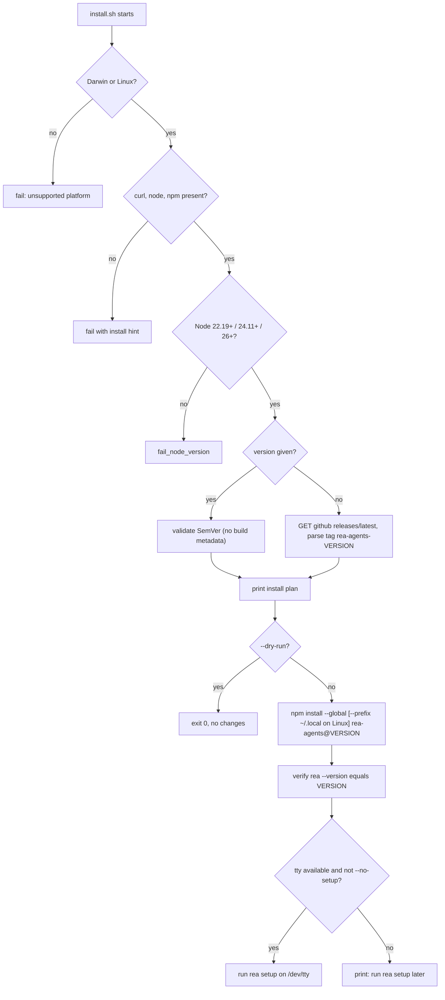
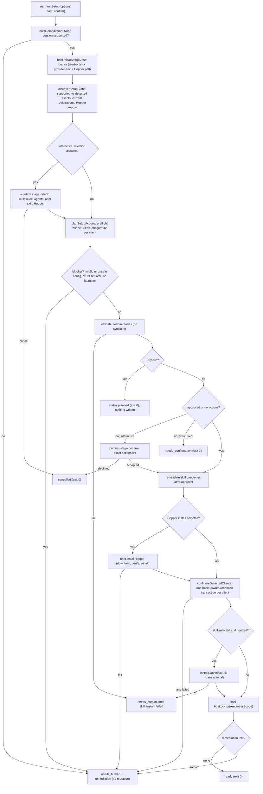
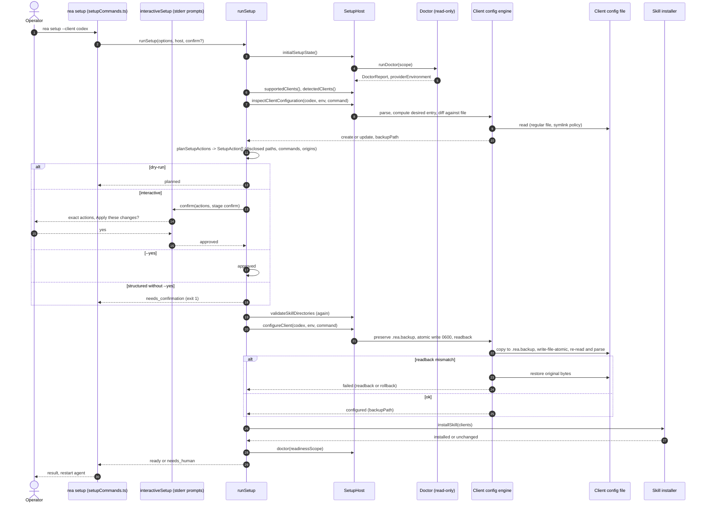
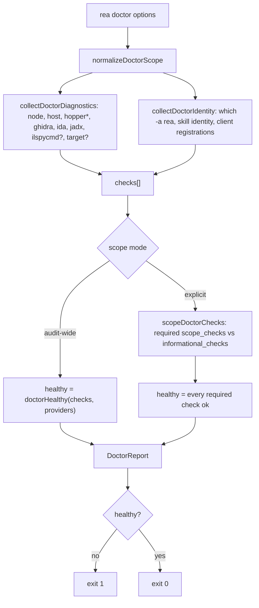
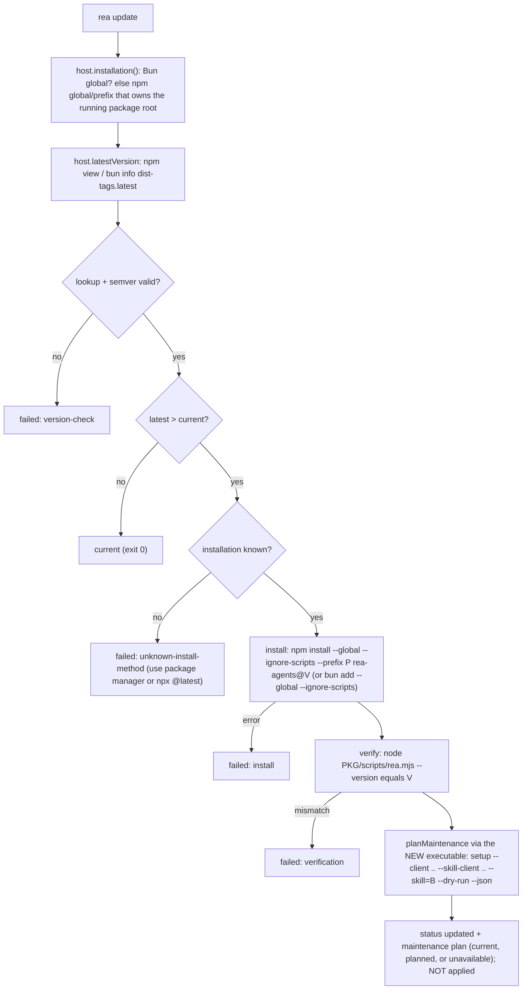
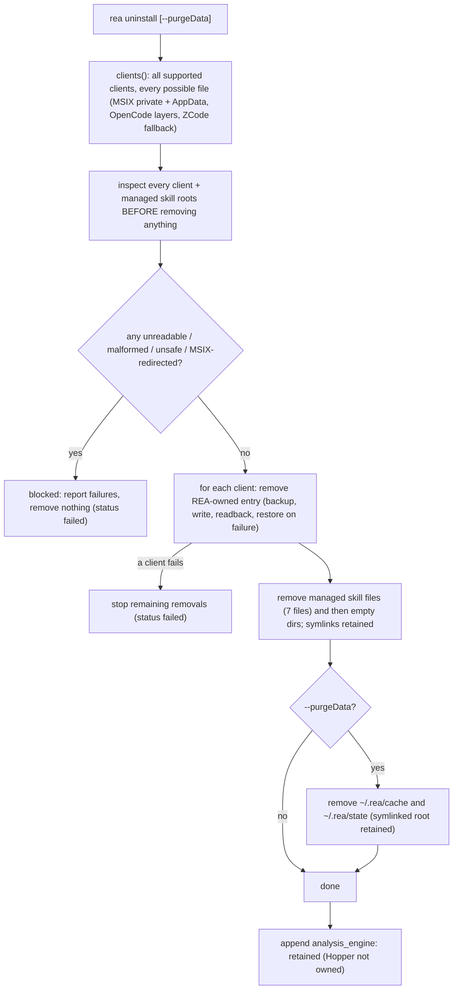

# 05 — Setup, doctor, update, uninstall and the 25 agent clients

> Scope: how REA gets installed, connected to agent clients, verified, updated and removed. Source: `/home/user/morluto/rea` (HEAD f75b1a4). All paths are repo-relative. Statements marked *(executed)* were run against the built `dist/` with `HOME` pointed at an empty scratch directory (nothing outside it was touched); everything else comes from reading the code and docs. Related chapters: [04-cli-reference.md](04-cli-reference.md) (command conventions, exit codes), [03-mcp-server-runtime-and-contracts.md](03-mcp-server-runtime-and-contracts.md) (what the registered server is), [12-ai-layer-prompts-and-skills.md](12-ai-layer-prompts-and-skills.md) (skill text), [21-security-model.md](21-security-model.md).

## 5.1 Command surface

| Command | Purpose | Flags (source) | Mutates host? | Exit status |
|---|---|---|---|---|
| `rea setup` | plan, approve and apply: agent MCP registrations, bundled skill, optional Hopper install | `--yes/-y`, `--installHopper`, `--client <id>` (repeat), `--skillClient <id|shared>` (repeat), `--allDetected`, `--skill` (tri-state: omitted/true/false), `--dryRun`, `--accessible` (`src/cli/setupCommands.ts:53-89`) | yes, only after approval | 0 for `planned`/`cancelled`/`ready`; 1 for `needs_confirmation`/`needs_human` (`src/application/SetupTypes.ts:122-139`) |
| `rea doctor` | read-only diagnosis | `--target <path>`, `--client <id>` (repeat), `--provider hopper|ghidra|ida|jadx` (repeat), `--skill` (`src/cli/setupCommands.ts:105-136`; `DOCTOR_PROVIDER_IDS = ["hopper","ghidra","ida","jadx"]`, `src/application/DoctorProviderIds.ts:2`) | no (writes nothing; may probe `ldd`, `sw_vers`, brew, `which -a rea`) | 1 when `healthy === false` (`src/cliLogging.ts:57`) |
| `rea update` | update the **owning** npm/Bun global installation and *plan* (not apply) integration maintenance | none (`src/cli/setupCommands.ts:170-190`) | yes: runs `npm install --global …` / `bun add --global …` | 1 on `status:"failed"` or cleanup failure |
| `rea uninstall` | remove REA-owned registrations + managed skill files; optionally cache/state | `--purgeData` (`src/cli/setupCommands.ts:143-169`) | yes | 1 on `status:"failed"` |
| `rea mcp add` | incur built-in: register this CLI in agent configs | `--command/-c`, `--agent`, `--no-global` (incur `Cli.js:~735-760`) | yes (via incur `SyncMcp`) — **not** the REA setup transaction (no preview, backups or verification described in REA code) | — |
| `rea mcp doctor` | spawn the production MCP server, check startup and `tools/list` | (chapter 03) | no | 1 on unhealthy |
| `install.sh` | curl wrapper: global `npm install` of a pinned `rea-agents` then optional `rea setup` | `--version`, `--dry-run`, `--no-setup`/`--no-prompt`, `--verbose` | yes (npm global) | non-zero on any `fail()` |

`rea setup` is registered with `outputPolicy: "agent-only"` (`src/cli/setupCommands.ts:52`): the human terminal sees prompts rendered by `@clack/prompts` on **stderr**; structured results go to stdout only when a format is requested.

## 5.2 Component map

```mermaid
flowchart LR
  subgraph CLI["CLI adapter"]
    SC["cli/setupCommands.ts"]
    IS["cli/interactiveSetup.ts (clack prompts)"]
  end
  subgraph Setup["Setup transaction"]
    S["Setup.ts runSetup"]
    SP["SetupPlan.ts discover + plan"]
    SH["SetupHost.ts systemSetupHost"]
    SCC["SetupClientConfiguration.ts"]
    SK["SetupSkill.ts"]
    SCL["SetupClients.ts"]
    SRB["SetupRecoveryBackup.ts"]
  end
  subgraph Cfg["Client configuration engine"]
    SUP["SupportedClients.ts (25 definitions)"]
    CCD["ClientConfigurationDocument.ts (parse / entry / serialize)"]
    CCF["ClientConfigurationFiles.ts (layered read)"]
    CRI["ClientRegistrationIdentity.ts (launcher, ownership)"]
    CRS["ClientRegistrationStatus.ts (aligned / stale / ...)"]
    SPEC["Gemini / Hermes / Dsh / ClaudeDesktop / Msix helpers"]
  end
  subgraph Diag["Diagnosis"]
    D["Doctor.ts + DoctorDiagnostics.ts + DoctorScope.ts"]
    DR["doctorRuntime.ts (provider inspections)"]
  end
  subgraph Life["Lifecycle"]
    U["Update.ts / UpdateRuntime.ts / UpdateMaintenance.ts"]
    UN["Uninstall.ts"]
  end
  subgraph Prov["Provider installers"]
    MH["MacHopper.ts / MacHopperPaths.ts"]
    LH["LinuxHopper.ts"]
    HD["HopperDownload.ts"]
  end
  SC --> S
  SC --> IS
  S --> SP --> SH
  SH --> SCC --> CCD
  SCC --> SRB
  SH --> SK
  SH --> MH
  SH --> LH
  MH --> HD
  LH --> HD
  SH --> D
  D --> DR
  SP --> CRS
  SCC --> CCF
  CCD --> SUP
  CRS --> CRI
  D --> CRS
  U --> D
  U --> S
  SC --> UN
  SC --> U
  UN --> CCD
  UN --> SK
```



*Figure 5.1 — Component dependencies.* `Setup.ts` owns only the control flow and talks to the outside world through the `SetupHost` interface (`src/application/SetupTypes.ts:65-102`), implemented by `systemSetupHost` (`src/application/SetupHost.ts:138-249`). Client-specific knowledge lives in the **client configuration engine** (`SupportedClients.ts`, `ClientConfigurationDocument.ts`, ...), which setup, doctor, update-maintenance and uninstall all share — so a registration written by setup is by construction readable by doctor and removable by uninstall. Doctor depends on the same engine via `ClientRegistrationStatus.ts`. Update never writes configuration; it asks the freshly installed executable to produce a `setup --dry-run` plan (5.9).

## 5.3 Install paths

### 5.3.1 Entry points

| Route | What happens | Source |
|---|---|---|
| `npx rea-agents setup` (or `@latest`) | package runner executes the CLI; setup registers a **pinned package-runner command** `npx -y rea-agents@<exact-version> mcp` | `docs/installation.md:14-29`; `src/application/ClientRegistrationIdentity.ts:53-63` |
| `bunx rea-agents setup` | same, registers `bunx rea-agents@<version> mcp` | `ClientRegistrationIdentity.ts:23-37,53-63` |
| global `npm install --global rea-agents` then `rea setup` | registers an **absolute entrypoint**: `[<entrypoint>, "mcp"]` on POSIX, `[<node>, <entrypoint>, "mcp"]` on Windows | `src/application/SetupHost.ts:62-73` |
| `curl -fsSL …/install.sh | bash` | installs `rea-agents@<ver>` globally, verifies the installed `rea --version`, starts `rea setup` only if `/dev/tty` is usable | `install.sh:79-179` |
| MCP Registry `io.github.morluto/rea` | registry metadata launches `npx` with `mcp` (npm package `rea-agents` 6.4.0, stdio) | `server.json`; `docs/installation.md:1038-1070` |
| skill only: `npx skills add morluto/rea --skill reverse-engineer-anything` | installs instructions/references only — no MCP registration, no engines | `docs/installation.md:421-449` |

`install.sh` details worth knowing (all verified by reading): the whole file is wrapped in a `{ … }` brace group so a truncated `curl | bash` download cannot execute a partial script (`install.sh:2-9,181-183`); Node gate `22.x ≥22.19`, `24.x ≥24.11` or `≥26` (`:121-124`, mirrors `package.json` engines); the version is either `--version`/`REA_VERSION` (must match a SemVer regex, build metadata rejected, `:126-139`) or the tag of the latest GitHub release `rea-agents-<semver>` fetched with `curl --proto =https --tlsv1.2` (`:129-132`); Linux installs with `--prefix "$HOME/.local"`, macOS into the npm global prefix (`:141-148`); a mismatch between the installed `rea --version` and the requested version is fatal (`:168-170`). It prints the exact `npm` command and destination before acting, and `--dry-run` stops there. Only macOS and Linux are accepted (`:113`).



*Figure 5.2 — `install.sh` flow.* Every `fail` exits 1 with a one-line remediation. Neither `--no-prompt` nor a non-interactive shell grants permission to install external dependencies (`docs/installation.md` "curl wrapper" paragraph): `install.sh` never installs Hopper itself; that is a separate, explicitly approved action of `rea setup`.

### 5.3.2 Runtime requirements and ownership

Doctor's `node` check passes for Node per the supported range or for Bun when its reported Node-compatibility version is supported (`src/application/DoctorDiagnostics.ts:98-127`). The `host` check requires macOS ≥12, a Linux distribution with a recognised package family (apt/dnf/pacman), or Windows x64 (the "experimental Windows x64 Ghidra P0 boundary") (`DoctorDiagnostics.ts:129-148`). On Linux a procps-compatible `ps` must be on `PATH` for owned-process supervision (`docs/installation.md:333-346`).

## 5.4 `rea setup`: plan → approval → write

### 5.4.1 Contracts (verbatim)

```ts
// src/application/SetupTypes.ts:184-197
export interface SetupOptions {
  readonly approved: boolean;
  readonly installHopper: boolean;
  readonly structured: boolean;
  readonly proposeHopper?: boolean;
  readonly clientIds?: readonly string[];
  /** Skill roots to update independently of MCP registrations (maintenance). */
  readonly skillClientIds?: readonly string[];
  readonly installSkill?: boolean;
  readonly readinessScope?: DoctorScope;
  readonly dryRun?: boolean;
  readonly allDetectedClients?: boolean;
  readonly onProgress?: (event: SetupProgressEvent) => void;
}
```

```ts
// src/application/SetupTypes.ts:104-119
export interface SetupResult {
  readonly status:
    | "planned"
    | "cancelled"
    | "needs_confirmation"
    | "ready"
    | "needs_human";
  readonly plannedActions: readonly SetupAction[];
  readonly appliedActions: readonly string[];
  readonly clients: Readonly<Record<string, ClientConfigurationResult>>;
  readonly doctor: SetupDoctorSummary;
  /** Supported-client discovery state captured before setup mutations. */
  readonly clientStates: readonly SetupClientState[];
  readonly remediation?: string;
  readonly code?: SetupFailureCode;
}
```

```ts
// src/application/SetupTypes.ts:168-181
export interface SetupAction {
  readonly id: string;
  readonly kind: "install_hopper" | "configure_client" | "install_skill";
  readonly label: string;
  readonly target: string;
  readonly detail: string;
  readonly external: boolean;
  readonly operation: "create" | "update" | "install";
  readonly backupPath?: string;
  readonly networkOrigins?: readonly string[];
  readonly commands?: readonly string[];
  readonly integrity?: string;
}
```

```ts
// src/application/SetupTypes.ts:27-51
export type ClientConfigurationResult =
  | { readonly status: "unchanged" | "configured" | "skipped"; readonly backupPath?: string }
  | { readonly status: "failed"; readonly reason: "path" | "target_changed" | "backup" | "write" | "readback" }
  | { readonly status: "failed"; readonly reason: "rollback"; readonly backupPath?: string;
      readonly failure: { readonly kind: "restore"; readonly path: string; readonly detail: string } };
```

```ts
// src/application/SetupTypes.ts:65-102 (SetupHost: every effect setup needs)
export interface SetupHost {
  readonly platform: NodeJS.Platform;
  readonly homeDirectory: string;
  skillDestinations(clientIds: readonly string[]): readonly SkillDestination[];
  readonly registrationCommand: readonly string[];
  readonly registrationCommandBlocker?: string;
  readonly nodeVersion: string;
  macosVersion(): Promise<string | undefined>;
  linuxDistribution(): Promise<LinuxDistribution | undefined>;
  initialSetupState(scope?: DoctorScope): Promise<SetupInitialState>;
  installHopper(replaceExisting: boolean): Promise<SetupHopperInstallResult>;
  close?(): Promise<string | undefined>;
  detectedClients(): Promise<readonly SetupClient[]>;
  supportedClients(): Promise<readonly SetupClient[]>;
  configureClient(client, providerEnvironment, command): Promise<ClientConfigurationResult>;
  clientNeedsConfigure(client, providerEnvironment, command): Promise<boolean>;
  inspectClientConfiguration(client, providerEnvironment, command): Promise<ClientConfigurationInspection>;
  skillNeedsInstall(clientIds: readonly string[]): Promise<boolean>;
  validateSkillDirectories(clientIds: readonly string[]): Promise<Result<void, SetupSkillInstallError>>;
  installSkill(clientIds: readonly string[]): Promise<SkillInstallResult>;
  doctor(scope?: DoctorScope): Promise<Awaited<ReturnType<typeof runDoctor>>>;
}
```

(Parameter lists abbreviated only where the three arguments repeat; the exact signatures are `src/application/SetupTypes.ts:81-95`.) Setup failure codes (`src/application/SetupInstallFailure.ts:4-19`): `unsupported_host, download_failed, integrity_mismatch, authorization_or_package_manager_failed, launcher_missing, runtime_dependency_unavailable, unsupported_hopper_build, setup_cancelled, destination_exists, mount_failed, bundle_invalid, publisher_verification_failed, copy_failed, skill_install_failed, cleanup_failed`.

### 5.4.2 How CLI flags become `SetupOptions` (`src/cli/setupCommands.ts:204-320`)

| Derived value | Rule |
|---|---|
| `interactive` | `!yes && !dryRun && !formatExplicit && stdin, stdout **and** stderr are TTYs` (`:287-299`) |
| `approved` | `yes && !dryRun` (`:258`) |
| `structured` | `formatExplicit || dryRun` (`:260`) |
| `proposeHopper` | `interactive || installHopper` (`:263`) |
| explicit scope | any of `--allDetected`, `--client`, `--skillClient`, `--skill`, `--installHopper` (`:301-306`) |
| `installSkill` | only when a scope is explicit: `--skill` if given, else `true` iff a client/skill-client/all-detected was selected (`:268-270`) |
| `readinessScope` | when explicit clients/skill-clients are given: `{clients, skillClients?, providers: installHopper ? ["hopper"] : [], skill}` so the post-apply doctor checks exactly what was selected (`:272-283`) |

Consequences (documented in `docs/installation.md:100-116`): `--yes` **without** a scope flag only touches *existing REA-owned registrations* (default selection = clients whose registration is already owned/aligned or stale, `SetupPlan.ts:111-120`); `--all-detected` is required for broad automation; Hopper installation non-interactively needs `--installHopper` in addition to `--yes`.

### 5.4.3 Workflow (`runSetupWorkflow`, `src/application/Setup.ts:86-369`)



*Figure 5.3 — Setup flow.* Walkthrough: setup is **read-only until the approval gate**. Everything before it (doctor, discovery, per-client `inspectClientConfiguration`, skill-directory admission) can only *refuse* (`needs_human`) or describe (`planned`). After approval the order is fixed: **Hopper → client registrations (sequential, each its own transaction) → skill → final doctor**. A failure in a later stage does not roll back earlier stages: a client written before another client fails stays configured (`configureDetectedClients` collects the first failure message but continues through all selected clients, `src/application/SetupClients.ts:28-72`; the workflow then returns `needs_human` and skips the skill, `Setup.ts:338-349`). `status: ready` requires *no remediation text*: after installing Hopper on macOS the result is `needs_human` with "Open Hopper, choose its demo mode or activate a license, then rerun rea doctor --json" (`Setup.ts:508-520`), even though everything succeeded.

Details of each stage:

1. **Host gate** — `hostRemediation(host, false)` fails only if the Node version is unsupported (`SetupHost.ts:117-135`); with Hopper selected it additionally requires macOS ≥12 or a Linux distribution on the tested list (Ubuntu 24.04+, Fedora 41+, Nobara 44+, 64-bit Arch, CachyOS, Omarchy).
2. **Initial state** — `systemSetupHost.initialSetupState` runs the *full doctor read-only*, collects the Hopper launcher path and builds `providerEnvironment` from provider inspections (`SetupHost.ts:165-189`; see 5.6.4).
3. **Discovery** (`discoverSetupState`, `SetupPlan.ts:38-132`) — for each of the 25 definitions compute `detected` (any of config path / layered config paths / marker path exists, `SetupHost.ts:372-402`, `SupportedClients.ts:712-723`), registration state from doctor (`aligned|stale|missing|invalid|unknown|manual`), and the per-client `SetupClientState.status ∈ configured|missing|needs_configuration|invalid|unknown`. **Detection grants context, not permission**: newly detected clients stay unselected (`docs/installation.md:35-37`). Hopper is *proposed* only on supported hosts when no provider environment was detected (or a Linux Hopper repair is needed) and `proposeHopper` is set (`SetupPlan.ts:59-69`).
4. **Selection** (interactive only) — `confirm(..., {stage:"select"})` shows a multiselect of all non-`unsupported` clients (Grok Bot is excluded), then offers the skill (default **No** when no client is selected) and Hopper (default **No**) (`src/cli/interactiveSetup.ts` `selectSetupActions`). Ctrl-C at any prompt → `cancelled`, exit 0.
5. **Planning** (`planSetupActions`, `SetupPlan.ts:135-233`) — validates ids (`Unsupported setup client: X.`), refuses when the registration command cannot be determined (`registrationCommandBlocker`), runs `inspectClientConfiguration` for every selected client in parallel, and **blocks the whole transaction on the first `invalid` inspection** with `"<client>: <remediation>"` — malformed or unsafe configuration therefore stops everything *before* Hopper installation or any write (`docs/installation.md:55-58`). Concrete `SetupAction`s are generated by `setupPlan` (`SetupPlan.ts:265-342`): `install_hopper` (macOS target `~/Applications/Hopper Disassembler.app`, Linux "system package manager", with `networkOrigins`, `commands`, and on Linux `integrity: "<bytes> bytes · SHA-1 <hash>"`), one `configure_client:<id>` per write (operation `create|update`, `backupPath`), one `install_skill[:<client>]` per distinct destination. If Hopper is being installed, an already-current registration is still re-written to add `HOPPER_LAUNCHER_PATH` (`plannedClientWrites`, `SetupPlan.ts:236-262`). A Windows MSIX redirected-write blocker is added via `redirectedWriteBlocker` (`SetupPlan.ts:214-224`).
6. **Dry run** — returns `planned` with the actions and a compact doctor summary (`Setup.ts:250-261`); exit 0.
7. **Approval** — one of: `--yes` (`approved`), interactive confirm (`"Apply these N changes?"`, default Yes), or none (structured → `needs_confirmation`, exit 1, `remediation: "Review the setup plan, then rerun interactively or with --yes."`) (`Setup.ts:263-298`). Skill directories are validated again *after* approval because "approval may pause while a skill manager changes a selected directory" (`Setup.ts:300-306`).
8. **Apply** in the order above, then `host.close()` runs in `runSetup`'s `finally`-equivalent, and a cleanup failure converts even a successful result into `needs_human` with `code: "cleanup_failed"` (`Setup.ts:32-84`).

### 5.4.4 Sequence diagram — setup approval



*Figure 5.4 — Approval sequence.* The LLM/agent is not involved in the setup transaction itself: it is an operator-approved local file transaction. (An agent may *drive* the CLI with `--dry-run --json`, then `--yes --client …`; the documented pattern for agents is "show and approve the exact changes before applying that scope", `docs/installation.md:430-438`.) All consent happens at step "confirm"; nothing between steps 3-9 writes to disk.

### 5.4.5 The per-client write transaction (`SetupClientConfiguration.ts`)

`configureClientConfiguration` → `configureClientDocument` (lines 73-201) then `persistClientConfiguration` (203-343):

1. Refuse when `configPathError` is set (e.g. invalid `PI_CODING_AGENT_DIR`, ambiguous MSIX package) → `failed: path`.
2. `readClientConfigurationFiles(client)` reads **every layered source** (OpenCode: up to 5 files; Gemini: system defaults / user / workspace / system override), because the *effective* configuration decides whether the planned entry would actually win.
3. DSH editability check, then **policy blocks** (`readClientPolicyBlock`, `GeminiClientSettings.ts`): Gemini `mcp.excluded` / `mcp.allowed` from system, user and trusted-workspace scopes; a block makes the result `failed: readback` and the plan `invalid` with an explanation. Setup never edits administrator/workspace settings or grants workspace trust (`docs/client-configuration.md:192-206`).
4. `resolveClientConfigTransactionPath(configPath)`: a missing path is fine (first run); a regular file is used as is; a **symlink is followed only if it is user-owned and its target is a user-owned regular file**, else `failed: path` (`src/application/ClientConfigPath.ts:20-55`).
5. Read original text (regular-file read, `RegularFileRead.ts`), `parseClientConfiguration` (format-specific, 5.5.2). Malformed → `failed: readback` (and the *plan* reported `invalid` with "The existing configuration is malformed. Repair it before setup applies any other changes.").
6. Compute `desired` entry (`clientConfigurationDesired`, lines 650-713): `clientRegistrationEntry(format, launcher, environment)` + client-specific timeouts. `registrationCurrent` is true (→ `unchanged`, no write, no backup) iff the entry deep-equals `desired` **and** no legacy OpenCode entry remains **and** no client disable list hides it (`:638-648`).
7. **Backup** (`persistClientConfiguration`): for an existing file, `selectCurrentRecoveryBackup(<configPath>.rea.backup, original)`: if no backup exists the first backup is `<config>.rea.backup`; if one exists with identical bytes it is reused; if one exists with **different** bytes a *new* file `<config>.rea.backup.<sha256-of-original>.recovery` is used; if that path is occupied by different data → `failed: backup`. The copy uses `COPYFILE_EXCL` (never overwrites) and is re-verified byte-for-byte (`SetupRecoveryBackup.ts:28-80`; `SetupClientConfiguration.ts:213-232`). So the *first snapshot is never replaced*, and each distinct pre-image is kept once.
8. **Write**: `mkdir -p` the directory; `write-file-atomic` with `mode 0o600`; JSON/JSONC edits use `jsonc-parser` `modify` on the original text at the edited key paths only (preserving comments/formatting, `ClientConfigurationDocument.ts:1355-1391`); TOML/YAML/Cordis have format-specific serializers that preserve unrelated content and comments.
9. **Readback**: re-read, re-parse, require `registrationCurrent` and equality of any copied ZCode fallback servers; on mismatch or parse failure `restoreConfig` rewrites the original bytes (or deletes a first-run file); if even that fails the result is `failed: rollback` carrying the backup path and the restore error (`:600-636`). A `RegularFileCleanupFailure` during readback restores and re-throws as `ClientConfigurationCleanupRollbackFailure` (`:34-52`).
10. MSIX `target_changed` guard: just before the write, `packageReadTargetChanged` re-checks that the package still reads the planned file (Windows, 5.12).

Idempotence evidence *(executed)*: setting up Codex twice with `--client codex --yes --skill=false --json` in a scratch home: first run `status: ready`, `appliedActions: ["configured_codex"]`, `clients.codex = {status:"configured", backupPath: ".../.codex/config.toml.rea.backup"}`; second run `status: ready`, `plannedActions: []`, `appliedActions: []`, `clients: {}`.

## 5.5 The client configuration engine

### 5.5.1 `SetupClient` and registration shape

```ts
// src/application/SupportedClients.ts:13-55 (verbatim)
export interface SetupClient {
  readonly name: string;
  readonly displayName?: string;
  readonly configPath: string;
  /** User configuration files in increasing precedence, including the write target. */
  readonly configPaths?: readonly string[];
  /** Read-only Gemini scopes and trust inputs; never setup write targets. */
  readonly geminiSettings?: {
    readonly systemPath: string; readonly defaultsPath: string;
    readonly workspaceDirectory: string; readonly trustedFoldersPath: string;
    readonly trustOverride?: boolean; readonly platform: NodeJS.Platform;
  };
  /** Unresolved path evidence only; consumers must not perform I/O on it. */
  readonly configPathError?: string;
  /** Same-scope fallback ZCode stops loading after its first native server. */
  readonly zcodeFallbackPath?: string;
  readonly markerPath?: string;
  /** MSIX package storage that decides which configuration the client reads. */
  readonly msixPackage?: MsixPackageView;
  /** A running client can rewrite its configuration from memory. */
  readonly quitBeforeSetup?: boolean;
  readonly format?:
    | "json" | "toml" | "vscode" | "copilot_cli" | "opencode" | "commandcode" | "grok"
    | "omp" | "pi" | "kimi" | "hermes" | "zcode_fallback" | "zcode" | "dsh" | "unsupported";
}
```

The registration entry builder is the heart of "what gets written", reproduced verbatim:

```ts
// src/application/ClientConfigurationDocument.ts:1437-1512
export const clientRegistrationEntry = (
  format: ClientRegistrationDialect,
  command: readonly string[],
  environment: Readonly<Record<string, string>>,
): Record<string, unknown> => {
  const [executable = "rea", ...args] = command;
  switch (format) {
    case "opencode":
      return { type: "local", command: [...command], enabled: true,
        ...(Object.keys(environment).length === 0 ? {} : { environment: { ...environment } }) };
    case "kimi":
      // Kimi infers stdio from command; it uses `transport`, not `type`.
      return { command: executable, args,
        ...(Object.keys(environment).length === 0 ? {} : { env: environment }) };
    case "opencode_v2":
      // V2 connects servers unless `disabled` is true.
      return { type: "local", command: [...command],
        ...(Object.keys(environment).length === 0 ? {} : { environment: { ...environment } }) };
    case "vscode":
    case "omp":
    case "pi":
      return { type: "stdio", command: executable, args,
        ...(Object.keys(environment).length === 0 ? {} : { env: environment }) };
    case "copilot_cli":
      return { type: "stdio", command: executable, args, tools: ["*"],
        ...(Object.keys(environment).length === 0 ? {} : { env: environment }) };
    case "commandcode":
      return { transport: "stdio", enabled: true, command: executable, args,
        ...(Object.keys(environment).length === 0 ? {} : { env: environment }) };
    case "dsh":
      return dshClientRegistrationEntry(command, environment);
    case "hermes":
      // Hermes reads stdio servers from `mcp_servers.<name>` and connects them
      // unless `enabled` is false, so the entry states it explicitly.
      return { command: executable, args,
        ...(Object.keys(environment).length === 0 ? {} : { env: environment }), enabled: true };
    default:
      return { command: executable, args,
        ...(Object.keys(environment).length === 0 ? {} : { env: environment }) };
  }
};
```

(Whitespace condensed; the logic is unchanged.) Client-specific additions applied on top in `clientConfigurationDesired` (`SetupClientConfiguration.ts:700-712`): Codex and Grok Build get `startup_timeout_sec = 30` (`MCP_STARTUP_POLICY.codexStartupTimeoutSeconds`); Kimi gets `startupTimeoutMs = 30000` and `toolTimeoutMs = 120000` and preserves a user `enabledTools` (`src/mcpStartupPolicy.ts`). The DSH entry is `{serverName:"rea", transport:"stdio", command, args, env?}` (`DshCordisPatch.ts:424-438`).

The server table key per format (`clientConfigurationServersKey`, `ClientConfigurationDocument.ts:80-96`):

| Format | Server table (key path) |
|---|---|
| `toml`, `grok`, `hermes` | `mcp_servers.rea` |
| `opencode` | `mcp.rea` (V1) or `mcp.servers.rea` when the file already uses OpenCode V2's native table (`opencode_v2`); the V1 entry is removed in that case |
| `zcode` | `mcp.servers.rea` |
| `vscode` | `servers.rea` |
| `dsh` | Cordis patch list entry id `rea-mcp` (an `insert` of the client config) |
| everything else | `mcpServers.rea` |

### 5.5.2 Parsing/serialising per format (`ClientConfigurationDocument.ts:98-260,1355-1391`)

| Format | Parser | Serializer | Notes |
|---|---|---|---|
| `json` (and `vscode`, `opencode`, `copilot_cli`, `commandcode`, `grok`-excluded) | JSONC (`jsonc-parser`, trailing commas allowed, BOM tolerated, empty file = `{}`) | in-place `modify` of edited key paths preserving comments | |
| `pi`, `kimi`, `zcode` | **strict `JSON.parse`** (no comments/BOM; Pi rejects an empty existing file; Kimi treats empty as `{}`) | same in-place edit | a clean error beats writing a file the client's own loader would reject |
| `toml` (Codex), `grok` | TOML (`smol-toml`-style `parseToml`) | `serializeCodexConfiguration` / `serializeGrokConfiguration` (edit the `[mcp_servers.rea]`/`.env` tables, plus Grok's `disabled_mcp_servers` list) | |
| `hermes` | YAML with comment preservation (`HermesConfigurationYaml.ts`) | `editHermesConfigurationYaml` | |
| `dsh` | Cordis YAML patch sequence (`DshCordisYaml.ts`, `DshCordisPatch.ts`) | `serializeDshDocument` (plans replacements from source snapshots; refuses group-targeted insertions and whole-config expressions) | caller `!!js` expressions kept unevaluated |
| `omp` | JSONC | also removes `rea` from `disabledServers` (`OMP_DISABLED_SERVERS_KEY`) | |

### 5.5.3 Launcher command and **version pinning** (`SetupHost.ts:62-101`, `ClientRegistrationIdentity.ts`)

`setupRegistration(platform, home, env)` chooses what the client will exec:

```ts
// src/application/SetupHost.ts:62-73
export const setupRegistrationCommand = (platform, packageRunner, entrypointPath): readonly string[] => {
  if (packageRunner !== undefined)
    return packageRunnerRegistrationCommand(packageRunner, platform);
  if (entrypointPath === undefined || entrypointPath.length === 0) return [];
  return platform === "win32"
    ? [process.execPath, entrypointPath, "mcp"]
    : [entrypointPath, "mcp"];
};
```

```ts
// src/application/ClientRegistrationIdentity.ts:53-63
export const packageRunnerRegistrationCommand = (runner, platform = process.platform): readonly string[] => {
  const command = runner === "npx"
      ? ["npx", "-y", PRODUCT_IDENTITY.registrationPackageSpecifier, "mcp"]
      : ["bunx", PRODUCT_IDENTITY.registrationPackageSpecifier, "mcp"];
  // Both runners may be .cmd shims on Windows, which clients cannot spawn directly.
  return platform === "win32" ? ["cmd.exe", "/d", "/c", ...command] : command;
};
```

`PRODUCT_IDENTITY.registrationPackageSpecifier = "rea-agents@<exact version>"` (`src/identity.ts:11`). The runner is detected from `npm_command === "exec"` plus a `bun/` user agent (`invokingPackageRunner`, `:23-37`). Consequences:

* A registration made through `npx`/`bunx` is **pinned to the exact version that ran setup** (e.g. `npx -y rea-agents@6.4.0 mcp`), never `@latest`, and never a path into the runner's temp cache (`docs/installation.md:1060-1070`). Newer releases do **not** reach existing registrations automatically; `rea update` plans a scoped refresh (5.9).
* A global install registers an **absolute entrypoint path** (or `node + entrypoint` on Windows), which follows in-place `npm install -g` upgrades but breaks if the install moves.
* If neither is available setup stops with "REA could not determine the current executable entrypoint…" (`SetupHost.ts:89-91`). On Windows a launcher stored in an MSIX package's private storage is refused (`packagePrivateLauncherBlocker`).
* Doctor's `registrationAligned` (`ClientRegistrationStatus.ts:287-355`) treats as **aligned** exactly: the npx/bunx command for the current package version (the *exact* `registrationPackageSpecifier`), `[node, <current entrypoint>, "mcp"]`, or `[<current entrypoint>, "mcp"]`. A registration for a different pinned version, a different install, or a foreign command is `stale` (with `package_reference` and a targeted remediation, `packageVersionRemediation`); an unverifiable relative/unknown launcher is `unknown` (it is retained, never overwritten). Per-client extras also make a registration `stale`: missing `startup_timeout_sec` (Codex/Grok Build), wrong Kimi timeouts, non-`stdio` `type` for Kimi/OMP/Pi/VS Code, wrong DSH `serverName/transport`, Copilot `tools` ≠ `["*"]`, CommandCode `transport` ≠ `stdio`.
* **Ownership** (`classifyClientRegistrationCommand`, `ClientRegistrationIdentity.ts:118-152`): `owned` = a package-runner command naming `rea-agents`, `rea-agents@latest`, the current pinned specifier, or `rea-agents@<valid semver>`; or `[node, <this entrypoint>, "mcp"]`; or `[rea|<this entrypoint>, "mcp"]`. `foreign` = a different command under the key `rea` (kept untouched by uninstall: "The rea-named registration is not REA-owned", `Uninstall.ts`). `unknown` = cannot be established. Only `owned` registrations are selected by default and refreshed by `update`.

### 5.5.4 Environment variable registration

Setup never copies the ambient process environment. It builds `providerEnvironment` = *settings that provider adapters publish after validating the installation* (`SetupProviderEnvironment`: "Exact non-secret provider variables propagated into managed registrations", `SetupTypes.ts:15-16`):

| Variable | Published by | When | Source |
|---|---|---|---|
| `GHIDRA_INSTALL_DIR`, `JAVA_HOME` | Ghidra doctor inspection | Ghidra installation is `available` | `src/ghidra/GhidraDoctor.ts:27-34` |
| `REA_IDA_MCP_CONFIG` | IDA registration inspection | the config file parses/validates | `src/ida/IdaDoctor.ts:23-24` |
| `REA_JADX_MCP_JAR` (+ `JAVA_HOME`, `REA_JADX_HEAP_MIB`, `REA_JADX_ACTIVE_PROCESSOR_COUNT` if set) | JADX inspection | jar path validated | `src/android/JadxDoctor.ts:38-52` |
| `REA_JEB_MCP_URL` | `createSystemDoctorHost` | env value present and a valid JEB MCP endpoint | `src/doctorRuntime.ts:17-26` |
| `HOPPER_LAUNCHER_PATH` | doctor's discovered Hopper launcher, or the path returned by a just-completed Hopper install | Hopper found / installed | `SetupHost.ts:183-185`; `Setup.ts:419-422` |

These are merged *over* the existing entry's own `env`/`environment` map by `clientRegistrationEnvironment` (`ClientRegistrationEnvironment.ts:18-65`): existing user overrides such as `REA_MCP_INPUT_SCHEMA_PROFILE`, `REA_MCP_OUTPUT_SCHEMA_PROFILE`, `REA_MCP_MAX_RESPONSE_BYTES` are **preserved**, detected provider values replace only matching keys, unknown client-specific keys survive, and the merged map is validated with the runtime parser (`parseEnvironment`/`parseEnvironmentValues`, `src/config/environment.ts`) — an invalid value fails setup *before any write* (`ConfigurationError("Invalid REA server environment")`) instead of silently dropping the map. For layered clients each layer is validated separately and inherited values are not copied down (`docs/installation.md:78-83`). Key name differs by dialect: `env` for most, `environment` for OpenCode (`ClientRegistrationEnvironment.ts:26-29`).

## 5.6 Supported agent clients (25)

Definitions: `SUPPORTED_CLIENT_DEFINITIONS`, `src/application/SupportedClients.ts:485-710`; generated catalog `docs/public/product-catalog.json` `.setup_clients` (25 rows: `id, display_name, format, configuration`). Home = resolved by `homeDirectoryFromEnvironment` (`HOME` on POSIX; `USERPROFILE` → `HOMEDRIVE+HOMEPATH` → `HOME` on Windows; fallback `os.userInfo().homedir`, `src/config/homeDirectory.ts`). `XDG` = `$XDG_CONFIG_HOME` if non-empty else `~/.config`.

| # | `--client` id | Display | Config file written (user scope) | Override env | Format / table | Entry shape (besides `command`,`args`,`env`) | Skill root used | Source lines |
|---|---|---|---|---|---|---|---|---|
| 1 | `claude_code` | Claude Code | `~/.claude.json` | `CLAUDE_CONFIG_DIR` → `$CLAUDE_CONFIG_DIR/.claude.json` | JSONC `mcpServers.rea` | — | `~/.claude/skills` (`$CLAUDE_CONFIG_DIR/skills`) | 487-495 |
| 2 | `claude_desktop` | Claude Desktop | macOS `~/Library/Application Support/Claude/claude_desktop_config.json`; Linux `$XDG/Claude/claude_desktop_config.json`; Windows: MSIX-aware resolver (5.12) | `XDG_CONFIG_HOME`, `APPDATA`, `LOCALAPPDATA` | JSONC `mcpServers.rea`; `quitBeforeSetup` | — | shared `~/.agents/skills` | 497-503; resolver 146-160 |
| 3 | `codex` | Codex | `~/.codex/config.toml` | `CODEX_HOME` | TOML `[mcp_servers.rea]` | `startup_timeout_sec = 30` | shared | 504-511 |
| 4 | `cursor` | Cursor | `~/.cursor/mcp.json` | — | JSONC `mcpServers.rea` | — | shared | 512-518 |
| 5 | `gemini_cli` | Gemini CLI | `~/.gemini/settings.json` | `GEMINI_CLI_HOME` (config + skills) | JSONC `mcpServers.rea` | policy checks (`mcp.allowed/excluded`, trust, system/defaults/workspace scopes) | `$GEMINI_CLI_HOME/.agents/skills` (default shared) | 519-530; 446-477 |
| 6 | `windsurf` | Windsurf | `~/.codeium/windsurf/mcp_config.json` | — | JSONC `mcpServers.rea` | — | shared | 531-537 |
| 7 | `devin` | Devin | POSIX `$XDG/devin/mcp_config.json` (also on macOS); Windows `%APPDATA%\devin\mcp_config.json` | `XDG_CONFIG_HOME`, `APPDATA` | JSONC `mcpServers.rea` | — | shared | 538-545; 479-483 |
| 8 | `opencode` | OpenCode | existing-file search in `$OPENCODE_CONFIG_DIR/opencode.json(c)` → `$OPENCODE_CONFIG` → `$XDG/opencode/opencode.json(c)`; layered read list adds `config.json` | `OPENCODE_CONFIG_DIR`, `OPENCODE_CONFIG`, `XDG_CONFIG_HOME` | JSONC `mcp.rea` (V1) or `mcp.servers.rea` (V2) | `{type:"local", command:[…], enabled:true, environment}` (V1); V2 omits `enabled` | shared | 546-553; 351-444 |
| 9 | `antigravity` | Antigravity | `~/.gemini/config/mcp_config.json` | — | JSONC `mcpServers.rea` | — | `~/.gemini/config/skills` | 554-561 |
| 10 | `copilot_cli` | GitHub Copilot CLI | `~/.copilot/mcp-config.json` | `COPILOT_HOME` | JSONC `mcpServers.rea` | `type:"stdio"`, `tools:["*"]` | shared | 562-569 |
| 11 | `commandcode` | Command Code | `~/.commandcode/mcp.json` | — | JSONC `mcpServers.rea` | `transport:"stdio"`, `enabled:true` | shared | 570-577 |
| 12 | `qwen_code` | Qwen Code | `~/.qwen/settings.json` | `QWEN_HOME` (`~`, `~/…`, relative → cwd) | JSONC `mcpServers.rea` | — | shared | 578-585; 163-187 |
| 13 | `kimi` | Kimi Code | `~/.kimi-code/mcp.json` | `KIMI_CODE_HOME` | **strict JSON** `mcpServers.rea` | `startupTimeoutMs:30000`, `toolTimeoutMs:120000`; no `type` | shared | 586-593 |
| 14 | `vscode` | VS Code | Linux `$XDG/Code/User/mcp.json`; macOS `~/Library/Application Support/Code/User/mcp.json`; Windows `%APPDATA%\Code\User\mcp.json` | `XDG_CONFIG_HOME`, `APPDATA` | JSONC `servers.rea` | `type:"stdio"` | shared | 594-601; 113-130 |
| 15 | `trae` | Trae | same layout as VS Code with `Trae` (`…/Trae/User/mcp.json`) | `XDG_CONFIG_HOME`, `APPDATA` | JSONC `mcpServers.rea` | — | `~/.trae/skills` | 602-610; 131-148 |
| 16 | `workbuddy` | WorkBuddy | `~/.workbuddy/mcp.json` (all platforms) | — | JSONC `mcpServers.rea` | — | `~/.workbuddy/skills` | 611-618 |
| 17 | `grok_build` | Grok Build | `~/.grok/config.toml` | `GROK_HOME` | TOML `[mcp_servers.rea]` (+ `[mcp_servers.rea.env]`; edits root `disabled_mcp_servers`) | `startup_timeout_sec = 30` | shared | 619-626 |
| 18 | `omp` | OMP | `~/.omp/agent/mcp.json`; profile `~/.omp/profiles/<name>/agent/mcp.json` | `PI_CONFIG_DIR`, `PI_CODING_AGENT_DIR`, `OMP_PROFILE`/`PI_PROFILE` (validated `^[a-z0-9][a-z0-9._-]{0,63}$`, no trailing `.`, no Windows device names) | JSONC `mcpServers.rea` | `type:"stdio"`; removes `rea` from `disabledServers` | shared | 627-636; 311-327 |
| 19 | `pi` | Pi | `~/.pi/agent/mcp.json` | `PI_CODING_AGENT_DIR` (`~`, file URLs, Windows drive normalisation; relative stays relative to cwd) | **strict JSON** `mcpServers.rea` | `type:"stdio"` | shared | 637-647; 335-370 |
| 20 | `hermes` | Hermes | `config.yaml` in `$HERMES_HOME` (else `%LOCALAPPDATA%\hermes` on Windows, `~/.hermes` elsewhere; `HERMES_DATA_DIR_SUFFIX`; sticky `active_profile` honoured) | `HERMES_HOME` | YAML `mcp_servers.rea` (comments preserved) | `enabled: true` | `<hermes home>/skills` | 648-657; `HermesClientHome.ts` |
| 21 | `qoder` | Qoder | `~/.qoder/settings.json` | `QODER_CONFIG_DIR` | JSONC `mcpServers.rea` | — | `~/.qoder/skills` | 658-667 |
| 22 | `droid` | Factory Droid | `~/.factory/mcp.json` | — | JSONC `mcpServers.rea` | — | `~/.factory/skills` | 668-677 |
| 23 | `zcode` | ZCode | `~/.zcode/cli/config.json` (+ same-scope fallback `~/.agents/mcp.json`) | — | **strict JSON** `mcp.servers.rea` | no transport discriminator | `~/.zcode/skills` | 678-687 |
| 24 | `dsh` | DeepSeek Harness | `$DSH_HOME/cordis.patch.yml` (default `~/.dsh/cordis.patch.yml`) | `DSH_HOME`, `DSH_AGENTS_HOME` | Cordis YAML patch list (`insert` id `rea-mcp`) | `serverName:"rea"`, `transport:"stdio"` | `$DSH_AGENTS_HOME/skills` (default `~/.agents/skills`) | 688-698; 203-232 |
| 25 | `grok_bot` | Grok Bot | **none** — manual hosted connector; `~/.grokbot` (or absolute `SAND_DATA_ROOT`) is only a detection marker | `SAND_DATA_ROOT` | `format: "unsupported"` | operator adds a custom MCP server `rea` running `npx -y rea-agents@<version> mcp` in the Bot chat | — | 699-709; 242-251 |

Notes: (i) rows 1-24 are "managed" and 25 is manual in the catalog (`product-catalog.json` `.setup_clients[*].configuration`). (ii) `docs/installation.md:482-484` says `dsh`, `kimi`, `workbuddy` need a release containing them and that **npm 6.4.0 accepted dry-run plans for 17 client IDs** (checked 2026-10-11); this checkout (main) defines 25. (iii) "Shared" skill root = `~/.agents/skills`, also read natively by Kimi, Qwen, Pi and Grok Build (`docs/client-configuration.md:146-148,185,379-380`). (iv) `clientSkillDirectories` de-duplicates by directory and relabels the one equal to `~/.agents/skills` as `shared` (`SupportedClients.ts:812-860`).

### 5.6.1 Client-specific behaviours worth porting or testing

* **ZCode fallback**: ZCode reads `~/.agents/mcp.json` only while the native table is empty. When setup writes the *first* native server it copies the fallback's `mcpServers` into the native table so they keep loading, leaves the fallback untouched, and fails (rather than guessing) if the fallback is malformed; `enable:false` makes doctor report `stale` (`docs/client-configuration.md:289-311`; `SetupClientConfiguration.ts:~535-598`).
* **OpenCode** layering, V1/V2 dialect, JSON-before-JSONC precedence and `OPENCODE_CONFIG*` (`SupportedClients.ts:351-444`; `docs/client-configuration.md:363-373`).
* **Gemini CLI**: a workspace or system `mcpServers.rea` replaces the *entire* user entry; setup stops if the winning definition conflicts with its planned entry (`docs/client-configuration.md:202-206`).
* **Hermes** and **DSH** preserve comments and unrelated entries (YAML round-trip).
* **Claude Desktop** must be fully quit before setup (`quitBeforeSetup`) because a running app can rewrite its config from memory.
* **Copilot CLI 1.0.95** `gpt-4.1` can block chat with the full input-schema profile; workaround `REA_MCP_INPUT_SCHEMA_PROFILE=compact` in the entry's `env` (preserved by setup) (`docs/client-configuration.md:15-34`). Claude Code with a non-first-party `ANTHROPIC_BASE_URL` disables tool search and sends all 172(+) tool schemas each request (~496 KB default, ~290 KB compact) (`:101-136`). `REA_MCP_OUTPUT_SCHEMA_PROFILE=off` drops advertised output schemas for clients whose stdio reader rejects the large catalog frame.

## 5.7 Skill installation

*What it is.* One bundled skill, `reverse-engineer-anything`, made of exactly seven files (`src/application/SetupSkill.ts:22-30`):

```ts
export const MANAGED_SKILL_FILES = [
  "SKILL.md",
  "references/connection-and-recovery.md",
  "references/native-and-artifacts.md",
  "references/javascript-applications.md",
  "references/android-applications.md",
  "references/runtime-observation.md",
  "references/evidence-workflows.md",
] as const;
```

*Provenance.* Authored under `.agents/skills/reverse-engineer-anything/` (SKILL.md 341 lines + six references, 1,103 lines total; frontmatter `name: reverse-engineer-anything`, `metadata.version: "42"`). The **shipped** copy is generated at build time into `skills/reverse-engineer-anything/` by `scripts/generate-skill-metadata.mjs` (`npm run artifacts:skills`, part of `build`/`build:cached`, `package.json:109,124,296`): it injects `  tool_count: <catalog mcp_tools>` after the version line, rewrites every `rea-agents@latest` to the pinned `rea-agents@<version>` ("A shipped skill must run the version it ships with", `generate-skill-metadata.mjs:33-41`), normalises CRLF, and rebuilds the output directory. `package.json` `files` ships `skills` (`:76`). At runtime `canonicalSkillContent` reads `new URL("../../skills/reverse-engineer-anything/<file>", import.meta.url)` (`SetupSkill.ts:78-84`).

> **Finding (executed).** In this checkout `skills/` has not been generated, so `rea setup --skill --yes` fails: `status: needs_human`, `code: skill_install_failed`, "REA skill prepare failed at /home/user/morluto/rea/skills/reverse-engineer-anything/SKILL.md: ENOENT". `npm run artifacts:skills` (or `docs:generate`) must run first; the npm tarball contains it.

*Destinations.* `skillDestinations(home, clientIds, env, platform)` → `<root>/reverse-engineer-anything` for every distinct root among the selected clients (table 5.6 "Skill root"); with no client the root is `~/.agents/skills` (`shared`) (`SetupSkill.ts:192-205`; `SupportedClients.ts:812-860`). `setup --skill-client <id|shared>` refreshes a destination independently of MCP selection (`docs/installation.md:130-139`).

*Install algorithm* (`installCanonicalSkill`, `SetupSkill.ts:543-628`):

1. Admission: every selected root and its `references/` must be a real directory or absent — **a symbolic link or non-directory is refused** (`skillDirectoryIssues`, `:284-300`) with "Use a regular skill directory, or run setup with --skill=false …".
2. Read the canonical file and the existing bytes + mode for each of the 7 paths; `changed` = those whose bytes differ. No changes → `unchanged`.
3. **Backup** every existing changed file as `<file>.rea.backup` (or `.rea.backup.<sha256>.recovery` when a different backup exists) with `COPYFILE_EXCL` and verification (`preserveCurrentSkillBackup`, `:516-541`).
4. Write each changed file atomically (`write-file-atomic`, mode = original mode or `0o600`), recording them in `attempted` *before* each write so an ambiguous publish is covered by rollback.
5. Readback each file byte-for-byte. Any failure → `restoreSkillFiles` in reverse order (rewrite originals / remove new files) and a `SetupSkillInstallError{stage: prepare|backup|write|readback, rollbackFailures, recoveryBackupPaths}` whose `remediation` ends "Check permissions and rerun setup."

*Freshness / identity.* `readInstalledSkillIdentity` parses `  version: "…"` and `  tool_count: N` from the installed `SKILL.md` and compares **all** managed files byte-for-byte to the bundled copy (`:630-663`). Doctor requires `version === PRODUCT_IDENTITY.skillVersion` **and** `tool_count === CATALOG_IDENTITY.counts.mcp_tools` **and** canonical bytes (`Doctor.ts:~328-336`); states `aligned|stale|missing|unmanaged|unknown` (`unmanaged` = symlinked/non-directory roots, `unknown` = unreadable). Setup treats a non-canonical existing copy as "needs install", i.e. **overwrites local edits** (after backing them up).

Skill content (what the agent reads) is covered in chapter 12; its first section "Connect only when needed" tells an agent not to run diagnostics before each investigation and to read `references/connection-and-recovery.md` only when tools are absent.

## 5.8 Hopper installation (optional, explicit approval only)

Setup can install the commercial Hopper disassembler; this is the only step that downloads and installs third-party software, and it is disclosed in the plan (`SetupAction.external: true`, `networkOrigins`, `commands`, `integrity`).

| | macOS (`MacHopper.ts`) | Linux (`LinuxHopper.ts`) | Windows |
|---|---|---|---|
| Support | macOS ≥12 (`hostRemediation`) | Ubuntu 24.04+, Fedora 41+, Nobara 44+, 64-bit Arch, CachyOS, Omarchy (`hopperSetupSupported`) | **not supported** ("REA supports Hopper on macOS and selected 64-bit Linux distributions", `SetupHost.ts:124-125`) |
| Source | metadata `https://www.hopperapp.com/include/files-api.php?request=releases&public=true`, then the file URL, which must start with `https://www.hopperapp.com:443/downloader/public/` (`MacHopper.ts:21-23,~120`) | three **hard-coded** release records (deb/rpm/arch `Hopper-6.4.2-Linux-demo.*`) with byte length and SHA-1 (`LinuxHopper.ts:26-48`) | — |
| Integrity | `file_hash` from the vendor metadata, compared as **SHA-1** (`MacHopper.ts:336`), download capped at 100,000,000 bytes, 120 s deadline (`HopperDownload.ts`); then `hdiutil attach -readonly -nobrowse`, `codesign --verify --deep --strict`, and `codesign` against the pinned Developer-ID requirement (bundle `com.cryptic-apps.hopper-web-4`, team `2AMA2753NF`, `src/domain/hopperPublisher.ts`) | length + **SHA-1** equality against the pinned value (`packageIntegrityMatches`, `:495-500`) | — |
| Install | `ditto` into `~/Applications/Hopper Disassembler.app` via a `.rea-stage` directory and atomic `rename` (previous bundle renamed aside and restored on failure); refuses an existing destination unless replace is requested; then `open` (`MacHopper.ts:~150-190`) | `apt-get install -y <pkg> xvfb xauth python3 libx11-6 libxtst6` / `dnf install -y …` / `pacman -S --needed … ; pacman -U …`, run directly as root or through **`pkexec`** (`linuxPackageManagerCommands`, `:459-493`); launcher `/opt/hopper/bin/Hopper` | — |
| Post | needs the user to open Hopper once (demo/licence) — `finalSetupRemediation` | REA runs Hopper under a private Xvfb display and selects the demo mode (`SetupPlan.ts:293`); `doctor` checks `hopper-demo-runtime`, `hopper-version` | — |

Security-relevant observations: (1) both Hopper integrity checks rely on **SHA-1**; on macOS the expected hash is read from the same vendor origin as the file, so it detects corruption but not a compromised vendor endpoint — the pinned **code-signing identity** is the real authenticity check there. On Linux the hashes are pinned in REA's source, but no package signature is verified beyond the package manager's own policy. (2) The install prompt is separate from agent registration and defaults to **No** interactively. (3) Hopper is "not owned by REA uninstall" (`Uninstall.ts`, `analysis_engine: retained`). Cleanup of temp dirs and mounts is retried and, if it fails, escalates setup to `needs_human` with `cleanup_failed` (`Setup.ts:47-83`).

Install failure → `SetupFailureCode` with remediation text (`SetupInstallFailure.ts`), `needs_human`, exit 1, and `doctor` summary included.

## 5.9 `rea doctor`

Doctor is **read-only** and composes three groups of checks (`inspectDoctor`, `Doctor.ts:211-283`):

1. **Environment/provider diagnostics** (`collectDoctorDiagnostics`, `DoctorDiagnostics.ts:28-56`) in order: `node`; `host`; `hopper` (+ `hopper-version`, `hopper-demo-runtime` on Linux when a launcher exists); every **provider inspection** (`ghidra`, `ida`, `jadx`, via `createSystemDoctorHost` → `inspectSystemGhidraProvider`, `inspectIdaRegistration`, `inspectJadxProvider`, `src/doctorRuntime.ts:27-31`); optional `ilspycmd` (only when `REA_ILSPY_CMD_PATH` is set); optional `target` (when `--target`, with route-specific admission details via `parseBinaryTarget`).
2. **Identity** (`collectDoctorIdentity`, `Doctor.ts:285-355`): `installations.paths` from `which -a rea` / `where rea` (`state: single|multiple|unknown`); installed **skill identity**; every client **registration status** from the shared engine; SDK and catalog identity; `live_server.state: "unknown"` with the remediation "Call binary_session in the active client to inspect the running server identity" — doctor checks files and prerequisites, **never** the live agent connection.
3. **Scope partition** (`DoctorScope.ts`): with no `--client/--provider/--skill` the report is `mode: "audit-wide"`; otherwise `mode: "explicit"`.



*Figure 5.5 — Doctor flow.* **Audit-wide health** (`doctorHealthy`, `DoctorDiagnostics.ts:59-96`) = all *core* checks pass **and** every *configured* provider's checks pass **and** at least one deep provider (Hopper or an inspected provider) is available. Unconfigured providers are optional but **at least one must be available**, so a fresh host reports `healthy: false` (executed: `environment_healthy: false` with no engine). **Explicit scope** (`scopeDoctorChecks`, `DoctorScope.ts:54-120`) requires only: `node` (and `target` if given), the Hopper `host` check when `hopper` is selected, the selected providers' checks (a missing selected provider yields a synthetic failing `provider:<id>` check "Requested provider X is unavailable."), one `registration:<client>` check per `--client` (`not detected` → remediation "Install or select X, then run rea setup --client X"; Grok Bot → manual connector remediation), and `skill:identity` with `--skill`. Everything else is `informational_checks`; `environment_healthy` still summarises the full audit. This is why `rea doctor --client codex --json` can exit 0 on a host with no engine at all.

Check record and classifications (verbatim):

```ts
// src/application/Doctor.ts:50-66
export interface DoctorCheck {
  readonly name: string;
  readonly ok: boolean;
  readonly classification:
    | "healthy" | "missing_dependency" | "runtime_failure" | "unsupported_host"
    | "unsupported_target" | "missing_analysis_engine" | "unknown" | "config_drift";
  readonly detail?: string;
  readonly details?: Readonly<Record<string, JsonValue>>;
  readonly remediation?: string;
}
```

Registration state semantics (`ClientRegistrationStatus.ts:44-67`): `aligned` (command matches), `stale` (owned but old version/other install/missing per-client fields), `unknown` (launcher identity cannot be verified), `missing`, `invalid` (unparseable, blocked by policy, or unresolved path), `manual` (Grok Bot). Doctor *"does not resolve package-runner requests"*: it compares the pinned version string only (`packageVersionRemediation`).

Worked example *(executed, scratch home, Codex configured by the preceding setup)*: `rea doctor --client codex --json` → `healthy: true`, `environment_healthy: false`, `scope: {mode:"explicit", clients:["codex"], providers:[], skill:false, target:null}`, `scope_checks: [node ok, registration:codex ok]`, `identity.registrations[0] = {client:"codex", command:[<entrypoint>,"mcp"], state:"aligned", remediation:null}`; exit 0. Before setup the same call reported `state:"missing"` with "Run rea setup to refresh this registration, then restart the client." (`setup --dry-run` output embeds this doctor summary).

## 5.10 `rea update`

`runUpdate(currentVersion, host, output)` (`src/application/Update.ts:142-247`):



*Figure 5.6 — Update flow.* Key properties (all from code):

* **Only the installation that owns the running package** is updated: Bun if `<BUN global dir>/node_modules/rea-agents` canonicalises to the running package root *and* the global `package.json` exists (`detectBunInstallation`, `UpdateRuntime.ts:168-193`); else npm if `npm root --global` owns it, with a fallback to the curl-installer layout `<prefix>/lib/node_modules/rea-agents` (`detectNpmInstallation`, `:96-136`). A source checkout or a package-runner copy is "unknown" and gets `unknown-install-method` with remediation "…For a one-off latest invocation, use npx rea-agents@latest."
* The command is pinned and script-free: `npm install --global --ignore-scripts --prefix <prefix> rea-agents@<resolved version>` / `bun add --global --ignore-scripts rea-agents@<v>` (`updateInstallCommand`, `Update.ts:88-115`); Bun runs with `BUN_INSTALL_GLOBAL_DIR` and cwd pinned to the owning global directory and requires Bun ≥1.2.17 (`UpdateRuntime.ts:274-340`). Child processes get an environment **without `npm_command`** so the new entry point does not inherit the runner identity (`withoutPackageRunnerIdentity`).
* **Verification** executes the newly installed `scripts/rea.mjs --version` and requires an exact match (`UpdateRuntime.ts:352-360`).
* **Maintenance is planned, not applied** (`UpdateMaintenance.ts:87-157`): `existingMaintenanceScope` selects only *enabled, owned, aligned-or-stale* registrations and existing REA skill roots; the new executable is asked for `setup … --dry-run --json`; the parsed plan is validated by a zod schema (`external:false` only, kinds `configure_client|install_skill`) and rejected if it touches anything outside the scope. The result's `remediation` is "REA is updated. Run the maintenance command to review and approve changes to existing REA integrations, then restart affected agents." This matters for security review: **update cannot silently rewrite agent configuration**.
* Local-scope Claude Code registrations (`claude mcp add --scope local …`) are invisible to doctor/update/uninstall and must be refreshed by hand (`docs/installation.md:269-286`).

Worked example *(executed)*: `rea update --json` from the checkout → `{"status":"current","currentVersion":"6.4.0","latestVersion":"6.4.0","installMethod":"unknown"}`, exit 0 (registry lookup succeeded through the sandbox proxy).

## 5.11 `rea uninstall`



*Figure 5.7 — Uninstall flow.* (`runUninstall`, `src/application/Uninstall.ts:115-185`; `systemUninstallHost`, `:212-344`; `removeClient`, `:435-535`.) Properties:

* **Ownership-gated**: an entry named `rea` is removed only when `clientRegistrationRemoval` says it is REA-owned (same classifier as doctor). A foreign `rea` entry → `retained` "The rea-named registration is not REA-owned." DSH is removed by entry id `rea-mcp` unless a Cordis expression "may produce registration rows" (then retained untouched).
* **All-or-nothing preflight** across all clients and skill roots; a malformed or unsafe file stops the operation before any removal ("No REA registration, skill, or data was removed. Repair each failed configuration, then rerun uninstall.").
* **Per-client transaction**: copy to `<config>.rea.backup` with `COPYFILE_EXCL` (EEXIST tolerated — first backup preserved), atomic write, re-parse, verify absence, restore original on any failure; failure of one client **stops** the rest (partial removal is reported item-by-item).
* **Skill removal** deletes only the seven managed files (manifest last, only if every other file was removable), then empty `references/` and root directories; a non-managed `SKILL.md` or any symlink is retained.
* **Purge** removes only `~/.rea/cache` and `~/.rea/state`, refusing a symlinked or non-directory root (`purgeManagedData`, `:577-608`).
* Never removes Hopper, Node, the npm package itself, Evidence files, captures, other skills or other MCP servers. (Removing the global package is a separate `npm uninstall -g rea-agents`.)
* Windows MSIX: both the package-private copy and the `%APPDATA%` copy lose REA's entry (`uninstallConfigPaths`, `:~330-343`); if the process was started by the app (redirected view) uninstall refuses.

Worked example *(executed, scratch home after the Codex setup)*: `rea uninstall --json` → `status: "complete"`; `codex: removed "Removed registration from …/.codex/config.toml."`; 22 other clients `skipped "Configuration does not exist."`; `grok_bot: skipped` with the manual-connector text; `skill: skipped "… Skill directory does not exist."`; `analysis_engine: retained "Hopper is not owned by REA uninstall."`. `model="x"` (the user's pre-existing TOML) stayed in the file and `config.toml.rea.backup` remained on disk.

## 5.12 Platform differences

| Topic | macOS | Linux | Windows |
|---|---|---|---|
| Supported host (doctor `host`) | ≥ 12 | distro with apt/dnf/pacman family (`supportsReaHost`) | x64 only; "experimental Windows x64 Ghidra P0 boundary" |
| `install.sh` | yes; npm global prefix | yes; `--prefix ~/.local` | **not supported** by the script (use npm/npx directly) |
| Registration launcher | `[entrypoint,"mcp"]` or npx/bunx | same | `[node, entrypoint, "mcp"]` or `cmd.exe /d /c npx …` (shim cannot be spawned directly) |
| Hopper auto-install | yes (DMG + codesign) | selected distros (deb/rpm/arch + `pkexec`) | **no** |
| Config roots | `~/Library/Application Support/{Claude,Code/User,Trae/User}` | `$XDG_CONFIG_HOME/{Claude,Code/User,Trae/User,devin,opencode}` | `%APPDATA%` for Code/Trae/devin; Hermes `%LOCALAPPDATA%\hermes`; Claude Desktop MSIX-aware |
| Doctor extras | `sw_vers`, brew cask probe | `ldd` on Hopper launcher, private-display (Xvfb) probe | MSIX package inspection; native Job Object / DACL readiness for Ghidra |
| Env/home | `HOME` | `HOME` | `USERPROFILE` (empty value deleted by `rea.mjs`) → `HOMEDRIVE+HOMEPATH` → `HOME` |
| Process view | — | procps `ps` required for owned-process checks | AppData virtualisation by MSIX apps (below) |

**Claude Desktop MSIX on Windows** (`ClaudeDesktopConfigLocation.ts`, `MsixPackageStorage.ts`, `docs/client-configuration.md:36-99`): package family `Claude_pzs8sxrjxfjjc` is virtualised: once it has saved a config, it reads the package-private copy `%LOCALAPPDATA%\Packages\Claude_pzs8sxrjxfjjc\LocalCache\Roaming\Claude\claude_desktop_config.json` and ignores `%APPDATA%`. Resolution: no package → `%APPDATA%` file; package with private copy → that copy; package without a private copy → the `%APPDATA%` file if it exists, else (new registration) the private path; a `Claude_*` package from another publisher → **error, no fallback** (`doctor` reports `invalid`, uninstall stops for *every* client). A process started by the running MSIX app sees the private files at the AppData paths (`processView: redirected`); setup/uninstall then refuse to change Claude Desktop, VS Code, Trae, Devin, Hermes or skill directories, because those writes would land in private storage or be overwritten from memory. Setup also refuses to register a launcher that lives inside any MSIX package's private storage. This was observed on Windows 11 (MSIX 2.31226.1.0) per the docs; uninstall against the real app is "unverified".

## 5.13 Manual MCP configuration and version pinning

The authoritative manual form (`docs/installation.md:1038-1070`, generated block pinned by release-please markers):

```json
{
  "mcpServers": {
    "rea": {
      "command": "npx",
      "args": ["-y", "rea-agents@6.4.0", "mcp"]
    }
  }
}
```

Variants and rules:

* **Pin exactly one version** for persistent registrations; `@latest` makes startup behaviour change underneath the agent. Roll back with `npm exec --yes --package=rea-agents@2.4.0 -- rea setup` (`docs/installation.md:1087-1093`); setup keeps pinning to the version that ran it.
* Windows: `{"command":"cmd.exe","args":["/d","/c","npx","-y","rea-agents@6.4.0","mcp"]}`.
* Claude Code local scope (project-only): `claude mcp add --scope local rea -- npx -y rea-agents@6.4.0 mcp` (Windows: `… -- cmd.exe /d /c npx -y rea-agents@6.4.0 mcp`) with `CLAUDE_CONFIG_DIR` **unset**; avoid `--scope project` (writes `.mcp.json` into the repo). doctor/uninstall/update ignore local-scope entries (`docs/installation.md:236-286`).
* Separate Claude Code profile: `CLAUDE_CONFIG_DIR=~/.claude-rea npx rea-agents setup --client claude_code` writes `$CLAUDE_CONFIG_DIR/.claude.json` and `$CLAUDE_CONFIG_DIR/skills`; keep the same prefix for doctor/update/uninstall (`docs/installation.md:152-235`). These routes control *discovery* only; an agent under the same OS account can still run `rea` from `PATH`/`npx` — clean-room separation needs an OS-level boundary (`:157-163`).
* Environment overrides belong in the entry's `env` (`REA_MCP_INPUT_SCHEMA_PROFILE`, `REA_MCP_OUTPUT_SCHEMA_PROFILE`, `REA_MCP_MAX_RESPONSE_BYTES`, provider paths like `GHIDRA_INSTALL_DIR`); setup preserves them on refresh.
* Production startup check for any registration: `rea mcp doctor --json` (child stderr kept ≤64 KiB, `stderr_truncated` flag; log truncation does not change health) (`docs/cli.md:308-314`; budgets `MCP_STARTUP_POLICY`, `src/mcpStartupPolicy.ts`: initialize 15 s, tools/list 5 s, first catalog 20 s, doctor deadline 30 s).
* `docs/client-verification.md` records optional native-client lanes (`verify:qwen-client`, `verify:pi-client`, `verify:hermes-client`, `verify:gemini-client`, `verify:opencode-client`, …): installed client + loopback model fixture, real stdio MCP calls, skill activation, full catalog forwarding, Windows/POSIX coverage notes. They prove client plumbing, **not** live model-provider compatibility (`docs/client-verification.md:1-58`).

## 5.14 Findings and discrepancies

1. **Generated skill missing in the checkout** — `skills/` is a build output; `setup --skill` and doctor's skill identity cannot work until `npm run artifacts:skills` runs (executed).
2. **`dist/cli-runtime` absent** — `scripts/rea.mjs` reports "compiled runtime is missing" for CLI commands in this checkout although `dist/cli.js` exists (see chapter 04 §4.2).
3. **Client count**: docs say 17 client IDs in npm 6.4.0 and list 24 + Grok Bot for main; the code defines 25 (consistent with `product-catalog.json`).
4. **SHA-1** is the integrity primitive for Hopper downloads (both OSes).
5. **Doctor `healthy` on a clean host is `false`** by design in audit mode (needs ≥1 deep provider); use scoped doctor for automation.
6. **`mcp add`** (incur built-in) bypasses the reviewed setup transaction; prefer `rea setup`.
7. **Partial application** across clients is possible (no cross-client atomicity); results are reported per client in `clients{}`.
8. **Skill overwrite**: non-canonical existing skill files are replaced (backed up first) — local edits are not merged.
9. The attached house-rules CLAUDE.md predates these flows; it describes only Hopper/Ghidra.

## Porting notes

**(a) Separable units**

| Unit | Files | Why separable |
|---|---|---|
| Atomic, backed-up, verified config-edit transaction (`backup → atomic write → readback → rollback`, with first-snapshot-preserving recovery backups) | `SetupClientConfiguration.ts` (`persistClientConfiguration`, `restoreConfig`), `SetupRecoveryBackup.ts`, `ClientConfigPath.ts`, `RegularFileRead.ts` | generic for any tool that edits users' config; depends only on `write-file-atomic` and a regular-file reader |
| Format-preserving client document model (JSONC/TOML/YAML/Cordis) and `clientRegistrationEntry` dialect table | `ClientConfigurationDocument.ts`, `HermesConfigurationYaml.ts`, `DshCordis*.ts`, `GeminiClientSettings.ts` | the dialect table is the reusable knowledge of "how 25 agents declare a stdio MCP server" |
| Supported-client path resolution (env overrides, XDG, MSIX, profiles) | `SupportedClients.ts`, `ClaudeDesktopConfigLocation.ts`, `MsixPackageStorage.ts`, `HermesClientHome.ts` | pure functions over `(home, platform, env)` + a few `lstat/readdir` probes |
| Registration identity/ownership classifier & alignment checker | `ClientRegistrationIdentity.ts`, `ClientRegistrationStatus.ts` | lets another tool decide "is this entry mine / current?" |
| Plan→approve→apply orchestrator with injectable `SetupHost` | `Setup.ts`, `SetupPlan.ts`, `SetupTypes.ts` | host interface isolates every effect; good for tests and for re-hosting in another CLI |
| Read-only doctor with scoped readiness | `Doctor*.ts` | `DoctorHost` injectable; scope semantics are the valuable part |
| Skill bundle installer (managed-file manifest, symlink refusal, backups, rollback, identity parse) | `SetupSkill.ts`, `scripts/generate-skill-metadata.mjs` | independent of REA except for the file list and `PRODUCT_IDENTITY` |
| Update-with-verification + dry-run maintenance planning | `Update.ts`, `UpdateRuntime.ts`, `UpdateMaintenance.ts` | npm/Bun installation ownership detection is reusable |
| Contained uninstall | `Uninstall.ts` | ownership-gated removal pattern |
| Hopper installers | `MacHopper*.ts`, `LinuxHopper.ts`, `HopperDownload.ts` | vendor-specific; only the bounded-download/verify/stage/rename pattern generalises |

**(b) Dependencies**: `write-file-atomic`, `jsonc-parser`, a TOML parser/serializer, `yaml` (comment-preserving), `zod`, `semver`, `cross-spawn`, `@clack/prompts` (interactive UI only), `incur` (CLI registration), Node `fs/promises`, `child_process` (`hdiutil`, `codesign`, `ditto`, `ldd`, `pkexec`, `apt-get|dnf|pacman`, `npm`, `bun`). Internal: `PRODUCT_IDENTITY`, `CATALOG_IDENTITY`, `MCP_STARTUP_POLICY`, the provider doctors (`GhidraDoctor`, `IdaDoctor`, `JadxDoctor`) for the environment that setup propagates.

**(c) Must be re-implemented** when lifting into another sub-tool: the product constants (server key `rea`, skill name, package specifier), the provider-inspection adapters, the catalog-count identity check (`tool_count`) if the tool inventory differs, the Windows MSIX handling if Windows is in scope, and the client list itself — it is a moving target (each client's schema changes; the repo carries per-client verification notes for that reason).

**(d) Malware-analysis relevance and caveats**
* Setup/doctor/update/uninstall do **not** touch samples and execute nothing from a target. They *do* download and install third-party software (Hopper) and edit user-level agent configuration — in a malware-analysis lab, run setup only on the **analyst workstation/VM image**, not on a host that handles live samples, and prefer `--dry-run --json` plus review.
* The registration **pins an exact REA version** and (for global installs) an absolute path: for reproducible, auditable analysis environments this is the desired property; verify with `rea doctor --client <id> --json` and keep `*.rea.backup` files as the change record.
* An agent configured through setup gains every REA tool, including the **execution-class** ones listed in chapter 04 §4.8.2 (process capture, Frida, GDB/Rizin consoles, browser/Electron scenarios). Registration is therefore a privilege grant to the agent: use per-profile/per-project registration (5.13) and run the whole agent in an isolated environment; the docs themselves note these routes control discovery only (`docs/installation.md:157-163`).
* The skill (7 files) is prompt content the agent will trust: pin it to the shipped version (done by `generate-skill-metadata.mjs`), and treat edits to `~/.agents/skills/reverse-engineer-anything` as a supply-chain surface — doctor detects drift (`stale`), setup would overwrite it.
* Update only changes the package; configuration changes require a separate reviewed `setup` — appropriate for change-controlled environments.
