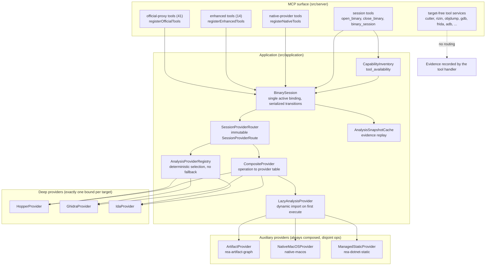
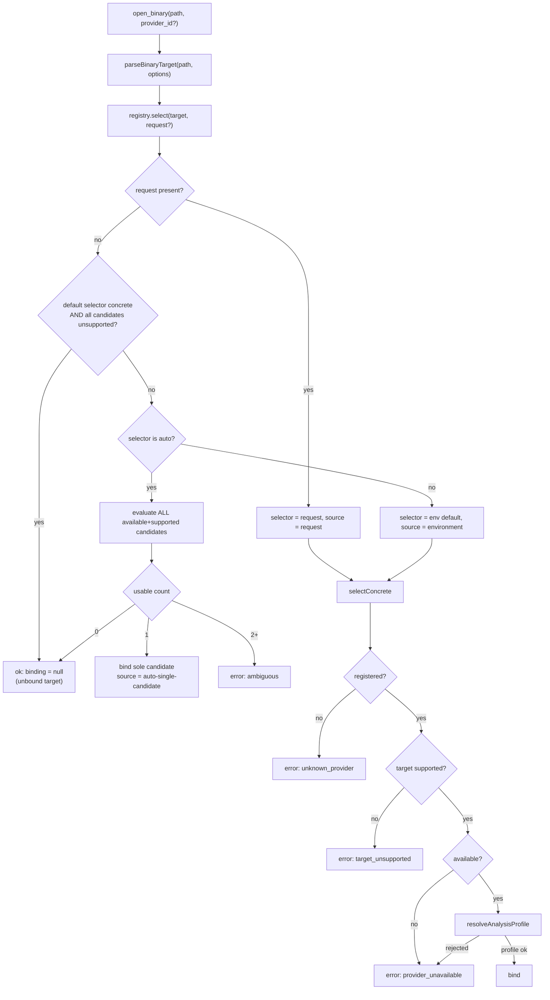
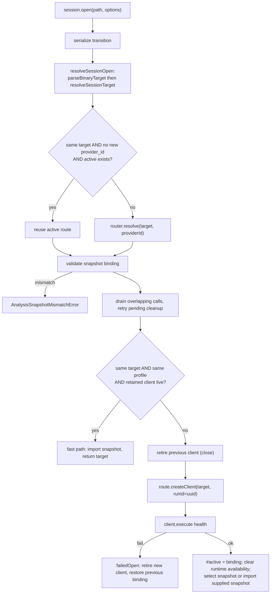
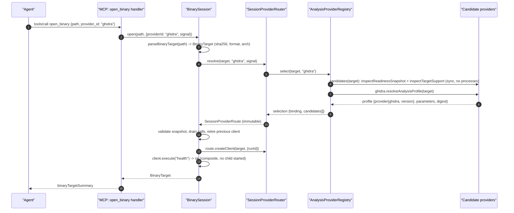
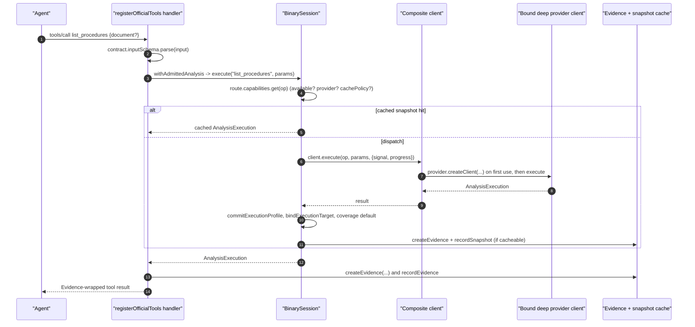

# 06 - Provider layer and session routing

Scope: `src/application/AnalysisProvider.ts`, `src/application/binary/*` (registry, router, composite, lazy loader, `BinarySession`), `src/contracts/providerSelection.ts`, `src/application/CapabilityInventory.ts`, `src/composition/binary.ts` and `auxiliaryAnalysisProviders.ts`, `src/native/*` (macOS provider and Apple parsers), the 47 providers in `docs/public/product-catalog.json`.

Related chapters: Hopper `07-hopper-provider.md`; Ghidra `08-ghidra-provider.md`; the other native providers `09-other-native-providers.md`; MCP tool registration `03-mcp-server-runtime-and-contracts.md`; Evidence model `10-evidence-model-ledger-unknowns-bundles.md`; security model `21-security-model.md`.

All paths are repo-relative to `/home/user/morluto/rea` (HEAD `f75b1a4`).

---

## 1. The layering in one picture

REA has **two different provider mechanisms** that the product catalog lists together as "47 providers". It is important not to conflate them:

1. **Session-bound `AnalysisProvider`s** - routed through `BinarySession` / `SessionProviderRouter`. They answer operations for the *single active target* and are what the "official-proxy" (`direct`) and "enhanced" tools call. There are exactly **six** in the production composition: three *deep* candidates (`hopper`, `ghidra`, `ida`; selectable, mutually exclusive per target) and three *auxiliary* providers (`rea-artifact-graph`, `native-macos`, `rea-dotnet-static`; always composed in, disjoint operations) - `src/composition/binary.ts:19-37`, `src/composition/auxiliaryAnalysisProviders.ts:19-53`.
2. **Target-free tool services** - Cutter, Rizin, objdump, GDB, Rizin debugger, Frida, ADB, Apktool, JEB, tshark, sigrok, WABT, firmware, browser, etc. They are registered directly as MCP tools in `src/server/createServer.ts` (lines 439-758, 831-904) and take explicit paths or session IDs in their input; they do not go through provider selection or a bound target. In the product catalog they are still called "providers" (they carry a `ProviderIdentity` in their Evidence).

The catalog's per-provider tool lists are generated by `providerCatalog()` in `scripts/lib/catalog-builders.mjs:149-340`, which pairs each provider identity constant with the tool contracts it serves.

### 1.1 Component diagram



*Caption: Provider layer and routing. Solid arrows are calls in the session-bound path; the dashed arrow is the target-free path that bypasses `BinarySession`'s provider selection.*

Walkthrough: every session-bound tool call enters `BinarySession.execute`. The session consults the active **route**, an immutable object built by `SessionProviderRouter` at `open_binary` time that maps each operation name to a `CapabilityDescriptor`. The route's client is a `CompositeProvider` client that dispatches each operation to exactly one child (a deep provider chosen by the registry, or one of the three auxiliaries), instantiating children lazily. Target-free tools skip all of this and create their own Evidence.

---

## 2. The `AnalysisProvider` contract (verbatim)

All of the following is from `src/application/AnalysisProvider.ts`. Types are reproduced because every provider, the router and `BinarySession` depend on them.

### 2.1 Operations and executions (`AnalysisProvider.ts:23-62`)

```ts
export interface ExecutionOptions {
  readonly signal?: AbortSignal;
  readonly progress?: ProgressReporter;
  /**
   * Set when a procedure selector came from provider output, such as a
   * revisited callee, rather than from the caller. A provider-derived
   * selector is never the caller's input mistake. Absent means the caller
   * supplied it.
   */
  readonly selectorOrigin?: "provider";
}

/** Closed operations accepted by provider-backed analysis sessions. */
export type AnalysisOperation =
  | OfficialToolName
  | EnhancedToolName
  | NativeToolName
  | ArtifactAnalysisOperation
  | ManagedToolName
  | "health";

/** Atomic successful provider observation with exact producing provenance. */
export interface AnalysisExecution {
  readonly result: JsonValue;
  readonly rawResult: JsonValue | null;
  readonly provider: ProviderIdentity;
  readonly analysisProfile?: AnalysisProfileCommitment;
  readonly limitations: readonly string[];
  /** Provider-owned completeness assessment for caller/callee observations. */
  readonly relationshipCoverage?: RelationshipCoverage;
  /**
   * Whether the provider capped an `xrefs` read: true when it reported a
   * truncation, false when it explicitly reported none. Absent when it reports
   * nothing, which is not a completeness claim. Never part of Evidence or tool
   * output.
   */
  readonly referencesTruncated?: boolean;
  readonly locations: readonly EvidenceLocation[];
  readonly subject: EvidenceSubjectTarget | null;
}
```

`createAnalysisExecution(result, provider, options)` (lines 81-120) is the adapter-boundary constructor: it validates `result` and `rawResult` with `jsonValueSchema.parse`, clones the profile, copies limitations/locations and stores `subject: options.subject ?? null`. `rawResult` is `null` unless a provider supplies a representation distinct from `result` (avoids duplicating the result in every Evidence record).

### 2.2 Ports and clients (`AnalysisProvider.ts:122-190`)

```ts
/** Provider-neutral application capability for one analysis operation. */
export interface AnalysisOperationPort {
  execute(
    operation: AnalysisOperation,
    parameters: Readonly<Record<string, JsonValue>>,
    options?: ExecutionOptions,
  ): Promise<Result<AnalysisExecution, AnalysisError>>;
}

/** Retained provider-process observation attributed to its producing provider. */
export interface ProviderRuntimeLineageSnapshot {
  readonly provider: ProviderIdentity;
  readonly observation: ProcessLineageObservation;
}

/** One provider's current serial-request activity, including detached callers. */
export interface ProviderRequestActivitySnapshot {
  readonly provider: ProviderIdentity;
  readonly active: {
    readonly requestId: number;
    readonly operation: string;
    readonly elapsedMs: number;
    readonly callerState: "waiting" | "cancelled";
  } | null;
  readonly queuedRequests: number;
}

/** Provider session bound to exactly one parsed artifact. */
export interface AnalysisClient extends AnalysisOperationPort {
  /** Execute only if this operation can run without loading or starting a provider. */
  executeIfReady?(
    operation: AnalysisOperation,
    parameters: Readonly<Record<string, JsonValue>>,
    options?: ExecutionOptions,
  ): Promise<Result<AnalysisExecution, AnalysisError> | undefined>;
  /** Retained token-verified process snapshots for dynamic providers this client started. */
  runtimeLineageSnapshots?(): readonly ProviderRuntimeLineageSnapshot[];
  /** Current provider work that may outlive a timed-out or cancelled caller. */
  requestActivitySnapshots?(): readonly ProviderRequestActivitySnapshot[];
  /** Current operational health for the active provider bridge. */
  operationHealthSnapshot?(): ProviderOperationHealth | undefined;
  /** Close owned resources and retain failed cleanup for a later retry. */
  close(
    options?: Pick<ExecutionOptions, "progress"> & {
      readonly retainDocument?: boolean;
    },
  ): Promise<Result<null, AnalysisError>>;
}

/** Per-client identity allocated before any provider side effect starts. */
export interface AnalysisClientContext {
  readonly runId: string;
}

export interface ProviderIdentity {
  readonly id: string;
  readonly name: string;
  readonly version: string | null;
}

/** Typed analysis profile resolved before provider startup; null means unresolved. */
export interface AnalysisProfileResolution {
  readonly profile: AnalysisProfileCommitment | null;
}

/** Cancellation context for side-effect-free provider profile resolution. */
export interface AnalysisProfileResolutionOptions {
  readonly signal?: AbortSignal;
}
```

### 2.3 Capability contract (`AnalysisProvider.ts:192-241`)

```ts
interface CapabilityEffects {
  readonly mutatesArtifact: boolean;
  readonly launchesProcess: boolean;
  readonly mayShowUi: boolean;
  readonly mayAccessNetwork: boolean;
  readonly mayWriteFilesystem: boolean;
  readonly changesPermissions: boolean;
  readonly requiresRoot: boolean;
}

type CapabilityAvailability =
  | {
      readonly available: true;
      readonly reason: null;
      readonly availabilityCode?: null;
    }
  | {
      readonly available: false;
      readonly reason: string;
      readonly availabilityCode?: ProviderRejectionCode;
    };

export type CapabilityDescriptor = CapabilityAvailability & {
  /**
   * Snapshot opts immutable, profile-bound reads into replay despite incidental
   * private filesystem writes. Live state must always be re-observed. Omitting
   * this policy retains conservative effect checks; mutation and UI-state
   * exclusions apply to every policy.
   */
  readonly cachePolicy?: "snapshot" | "live";
  readonly provider: ProviderIdentity;
  readonly operation: Exclude<AnalysisOperation, "health">;
  readonly effects: CapabilityEffects;
  readonly limitations: readonly string[];
};

/** Factory and capability declaration for an analysis implementation. */
export interface AnalysisProvider {
  identity(): ProviderIdentity;
  capabilities(): readonly CapabilityDescriptor[];
  resolveAnalysisProfile?(
    target: BinaryTarget,
    options?: AnalysisProfileResolutionOptions,
  ): Promise<Result<AnalysisProfileResolution, AnalysisError>>;
  createClient(
    target: BinaryTarget,
    profile?: AnalysisProfileCommitment,
    context?: AnalysisClientContext,
  ): AnalysisClient;
}
```

Note: the **provider-level** effect vocabulary (`mutatesArtifact`, `launchesProcess`, `mayShowUi`, `mayAccessNetwork`, `mayWriteFilesystem`, `changesPermissions`, `requiresRoot`) is different from the **tool-level** `ToolEffects` vocabulary (`mutatesTarget`, `mutatesSession`, `writesFilesystem`, `launchesProcess`, `accessesNetwork`, `changesUiState`, `mayDiscardData`, `executesForeignCode`, `mutatesDevice`, `idempotent`; `src/contracts/toolEffects.ts`). The provider vocabulary has no "executes foreign code" bit because no `AnalysisProvider` executes the target; the tool vocabulary has it for the target-free services that do. `mutatesSession` is true for almost every tool because recording Evidence counts ("Includes additive Evidence recording, navigation state, and unknown updates", `toolEffects.ts` doc comment), which is why nearly every tool's MCP `readOnlyHint` is false. **Corrected after verification:** it is not *every* tool. In `.cache/mcp-tool-catalog.json` 196 of 207 tools have `mutatesSession: true`; the 11 with `false` are `evaluate_reconstruction_coverage`, `binary_session`, `export_evidence_bundle`, `list_unknowns`, `verify_unknown_resolution`, `get_evidence_bundle`, `list_cutter_sessions`, `gdb_session_status`, `list_frida_devices`, `list_frida_processes`, `frida_session_status`, and six of them carry `readOnlyHint: true` (`evaluate_reconstruction_coverage`, `list_unknowns`, `verify_unknown_resolution`, `get_evidence_bundle`, `gdb_session_status`, `frida_session_status`).

### 2.4 Candidate contract used by the registry (`AnalysisProvider.ts:243-293`)

```ts
/** Bounded host observation made without starting an analysis process. */
export type ProviderAvailability =
  | {
      readonly status: "available";
      readonly code: null;
      readonly reason: null;
      readonly diagnostics: Readonly<Record<string, JsonValue>>;
    }
  | {
      readonly status: "unavailable";
      readonly code: ProviderRejectionCode;
      readonly reason: string;
      readonly diagnostics: Readonly<Record<string, JsonValue>>;
    };

/** Provider-owned target support observation before profile resolution. */
export type ProviderTargetSupport =
  | {
      readonly status: "supported";
      readonly code: null;
      readonly reason: null;
      readonly diagnostics: Readonly<Record<string, JsonValue>>;
    }
  | {
      readonly status: "unsupported";
      readonly code:
        | "target_kind_unsupported"
        | "target_format_unsupported"
        | "architecture_unsupported"
        | "target_role_unsupported"
        | "managed_target_unsupported";
      readonly reason: string;
      readonly diagnostics: Readonly<Record<string, JsonValue>>;
    };

/** One owner-observed availability/capability snapshot for provider discovery. */
export interface AnalysisProviderReadinessSnapshot {
  readonly availability: ProviderAvailability;
  readonly capabilities: readonly CapabilityDescriptor[];
}

/** Deep provider candidate discoverable before one target-bound route is chosen. */
export interface AnalysisProviderCandidate extends AnalysisProvider {
  resolveAnalysisProfile(
    target: BinaryTarget,
    options?: AnalysisProfileResolutionOptions,
  ): Promise<Result<AnalysisProfileResolution, AnalysisError>>;
  inspectAvailability(): ProviderAvailability;
  inspectReadinessSnapshot?(): AnalysisProviderReadinessSnapshot;
  inspectTargetSupport(target: BinaryTarget): ProviderTargetSupport;
}
```

The key discipline: `inspectAvailability()` and `inspectTargetSupport()` are **synchronous and side-effect free** (no process start); `resolveAnalysisProfile()` is async but still must not start the analysis engine (it may hash the launcher, read language catalogs, inspect FAT headers). Only `createClient()` + first `execute` start anything.

### 2.5 Provider selection vocabulary (`src/contracts/providerSelection.ts:1-40`)

```ts
/** Stable provider identifier accepted at CLI, MCP, and environment boundaries. */
export const analysisProviderIdSchema = z
  .string()
  .min(1)
  .regex(/^[a-z][a-z0-9\x2d]*$/u)
  .refine((value) => value !== "auto", {
    message: "auto is reserved for provider selection",
  });

/** Explicit provider ID or the deterministic automatic-selection policy. */
export const analysisProviderSelectorSchema = z.union([
  z.literal("auto"),
  analysisProviderIdSchema,
]);

/** Stable reasons a deep provider cannot participate in target selection. */
export const PROVIDER_REJECTION_CODES = [
  "not_configured",
  "executable_missing",
  "runtime_missing",
  "runtime_unavailable",
  "unsupported_host",
  "unsupported_version",
  "target_kind_unsupported",
  "target_format_unsupported",
  "architecture_unsupported",
  "target_role_unsupported",
  "managed_target_unsupported",
  "open_options_invalid",
  "version_unresolved",
] as const;
```

---

## 3. `AnalysisProviderRegistry`: deterministic selection, no fallback

Source: `src/application/binary/AnalysisProviderRegistry.ts` (453 lines), `AnalysisProviderEvaluation.ts` (138 lines).

### 3.1 Registration invariants (constructor, lines 80-124)

- every provider ID must satisfy `analysisProviderIdSchema` (`^[a-z][a-z0-9-]*$`, not `auto`);
- IDs are unique;
- every capability's `provider` must equal the provider's own identity (id, name, version) - "mismatched capability provenance" throws;
- no provider may declare the same operation twice;
- providers are stored **sorted by Unicode code point of ID** (`compareUnicodeCodePoints`), so "registration order never affects selection or caller-visible output" (class doc, line 70-73).

### 3.2 Selector resolution (`select`, lines 151-201)

Inputs: `target`, optional `requestedSelector` (the `provider_id` of `open_binary`, or `--provider` on the CLI), and the registry's configured default (`REA_ANALYSIS_PROVIDER`, default `"auto"`, `src/config/environment.ts:24`).

| Step | Behaviour (code) |
|---|---|
| Abort check | already-aborted signal returns `AnalysisCancelledError("open_binary")` |
| Validate request | an invalid `provider_id` returns `ProviderSelectionError(reason: "invalid_options")` |
| Choose selector | `request ?? defaultSelector`; `selectionSource` = `"request"` when a request was supplied, `"environment"` when the configured default is a concrete ID, `"auto-single-candidate"` for auto |
| All-unsupported shortcut | if **no request was given**, the default names a registered provider, and every candidate reports `unsupported` for this target, the result is `ok` with `binding: null` (an intentionally *unbound* target; artifact tools still work) - lines 177-189 |
| Concrete selector | `#selectConcrete`: unknown ID -> `unknown_provider`; `targetSupport != supported` -> `target_unsupported`; `availability == unavailable` -> `provider_unavailable`; else evaluate (resolve profile) |
| `auto` | `#selectAutomatically`: evaluate **all** candidates concurrently that are `available && supported`; 0 usable -> `ok` with `binding: null`; exactly 1 -> bind it (`auto-single-candidate`); **more than 1 -> `ProviderSelectionError(reason: "ambiguous")`** |

So **there is no priority, ranking, or preference order**. If Hopper and Ghidra are both installed and both support the target, `auto` fails with `ambiguous` and the user message "Multiple analysis providers support this target. Choose one with provider_id, --provider, or REA_ANALYSIS_PROVIDER." (`src/domain/providerSelectionError.ts:79-80`). Registry output never depends on registration order or on which provider "is better".

`ProviderSelectionFailureReason` (verbatim, `src/domain/providerSelectionError.ts:8-13`): `unknown_provider | provider_unavailable | target_unsupported | ambiguous | invalid_options`.

### 3.3 Candidate evaluation (`evaluateAnalysisProviderCandidate`, `AnalysisProviderEvaluation.ts:26-114`)

For a candidate that is available and supports the target, the registry awaits `resolveAnalysisProfile(target, {signal})` (wrapped in `waitForAbortable`). Outcomes:

- thrown exception -> candidate demoted to `unavailable` with code `version_unresolved`, reason "Provider profile resolution threw" (the cause is intentionally not leaked);
- `AnalysisCancelledError` -> propagates;
- `AnalysisUnsupportedTargetError` -> candidate target support rewritten to `unsupported/target_format_unsupported` with the reason;
- other `AnalysisError` -> `unavailable/version_unresolved` with the error message and `error_tag`;
- `profile === null` -> "Provider version or analysis profile could not be resolved";
- profile that fails `analysisProfileSchema` or whose `provider.id/name` differ from the candidate identity (or `version` differs when the candidate's declared version is non-null) -> rejected.

Only a validated profile makes a candidate "usable". Note the asymmetry exploited by Hopper/Ghidra: their declared `version` is `null`, so the **profile supplies the concrete version** (Hopper `launcher-sha256:<digest>`, Ghidra the observed release, IDA `"1"` declared).

### 3.4 The immutable binding (`AnalysisProviderBinding`, lines 47-62, verbatim)

```ts
/** One immutable deep-provider binding selected before client startup. */
export interface AnalysisProviderBinding {
  readonly provider: AnalysisProviderCandidate;
  readonly identity: ProviderIdentity & { readonly version: string };
  readonly selectionSource: "request" | "environment" | "auto-single-candidate";
  readonly profile: AnalysisProfileCommitment;
  /** The provider's capabilities, attributed to its resolved identity. */
  readonly capabilities: readonly CapabilityDescriptor[];
}

/** Complete result used for both a bound and intentionally unbound target. */
export interface AnalysisProviderSelection {
  readonly requestedProviderId: string;
  readonly binding: AnalysisProviderBinding | null;
  readonly candidates: readonly AnalysisProviderCandidateStatus[];
}
```

`selectedResult` (lines 368-398) re-attributes the provider's capability descriptors to the **resolved identity** (so every capability reports the committed `version`), marks the candidate `selected: true`, and clones everything (`structuredClone`) so later mutation of provider state cannot alter the binding.

### 3.5 Selection flow diagram



*Caption: Provider selection algorithm. There is no ranking stage anywhere: either exactly one candidate qualifies, the caller named one, or selection fails or leaves the target unbound.*

Walkthrough: a concrete selector (from the request or the environment default) is validated strictly in the order registered -> supports target -> available -> profile resolves; each failing step has its own error reason so the agent can act. `auto` tries every available and supporting candidate in parallel; zero usable candidates leaves the target **unbound** (so artifact/managed/native tools that need no deep provider still work, while deep operations return a `ProviderSelectionError` describing every candidate's rejection via `unboundOperationError`), exactly one binds, and two or more is an `ambiguous` failure that lists candidate IDs and per-candidate rejections (`candidateRejections`, lines 422-439).

### 3.6 Why "no failure fallback"

The tool description of `open_binary` states it: "the binding remains stable until close or an explicit switch, with no failure fallback" (MCP tool catalog `open_binary` description). In code this is structural: the route is created once per target transition (`SessionProviderRouter.resolve`) and `BinarySession.#execute` only ever uses `active.route`; a provider runtime failure marks capabilities unavailable (`#observeRuntimeAvailability`, `BinarySession.ts:781-814`) but never re-runs `registry.select`. `docs/ghidra-provider.md` repeats it: "One deep provider stays bound to the target; runtime failure never selects another provider automatically."

---

## 4. `SessionProviderRouter` and `CompositeProvider`

### 4.1 Router (`src/application/binary/SessionProviderRouter.ts`, 205 lines)

`SessionProviderRouter.selectable(registry, auxiliaryProviders)` (lines 45-66) enforces global invariants at construction:

- provider IDs unique across deep and auxiliary providers (`assertUniqueProviderIds`);
- auxiliary providers' operations are **pairwise disjoint** (`assertDisjoint`);
- no operation is declared by both a deep and an auxiliary provider (`"Deep and auxiliary providers both declare operation ..."`).

`SessionProviderRoute` (lines 24-34, verbatim):

```ts
/** Immutable operation routes and binding metadata for one target transition. */
export interface SessionProviderRoute {
  readonly identity: ProviderIdentity;
  readonly capabilities: ReadonlyMap<string, CapabilityDescriptor>;
  readonly profile: AnalysisProfileCommitment | null;
  readonly binding: AnalysisProviderBinding | null;
  readonly selection: AnalysisProviderSelection | undefined;
  createClient(
    target: BinaryTarget,
    context: AnalysisClientContext,
  ): AnalysisClient;
}
```

`selectableRoute` (lines 112-143) builds the route for a selection: the provider list is `[...auxiliary, bindingProvider?]`; with exactly one provider and no binding it is used directly; otherwise `new CompositeProvider(providers)`; the capability map merges auxiliary capabilities and the binding's re-attributed capabilities keyed by operation name; `profile` is the binding's profile (or `null` when unbound); `createClient` calls `provider.createClient(target, binding?.profile, context)` or an `emptyClient` (which answers only `health`) when there are no providers at all. The pre-target route (`initialRoute()`) is `selectableRoute(auxiliaries, undefined)` so discovery before any target still reports auxiliary capabilities and all deep candidates (`candidateStatuses`, lines 91-95).

`resolve(target, providerId?, signal?)` (lines 74-88) = `registry.select(...)` then `selectableRoute(...)`. `unboundOperationError(operation, route)` (lines 98-109) returns a `ProviderSelectionError` only when the route is unbound, a selection exists, and the operation is one of the registry's declared deep operations.

### 4.2 Composite (`CompositeProvider.ts`, 227 lines)

- identity: `{ id: "composite:<sorted child ids joined by +>", name: "REA composite analysis provider", version: null }` (lines 19-28).
- constructor builds `#providerByOperation` and **throws if two children declare the same operation** (lines 126-137); capabilities sorted by `(operation, provider.id)`.
- `createClient(target, profile, context)` (lines 156-226): children are created **lazily** through `clientFor(provider)` on first dispatch; the profile is passed only to the child whose `provider.id` equals `profile.provider.id` (line 167).
- `execute("health")` calls `executeCompositeHealth` (lines 80-110): probes only **already instantiated** children (`operationHealthSnapshot` state must be `idle`/`busy` else `ProviderAdapterError`; then each child's `execute("health")`). With no instantiated children it returns `ok` immediately - **this is why `open_binary` does not start Hopper/Ghidra** (they start on first use; see chapters 07/08).
- unknown operations -> `AnalysisCapabilityUnavailableError(compositeId, op, "operation is not declared by this provider set")`.
- `close` closes every instantiated child in parallel; one failure is returned as-is, several are aggregated into a `ProviderCleanupError` listing per-provider failures.
- `runtimeLineageSnapshots`, `requestActivitySnapshots`, `operationHealthSnapshot` aggregate children (health: first non-idle snapshot, else the first; `undefined` if any child lacks a snapshot).

### 4.3 Lazy loading (`LazyAnalysisProvider.ts`, 154 lines)

`LazyAnalysisProvider` keeps provider **identity and capability declarations synchronous** (so discovery works with no dynamic imports) and loads the implementation module with `import()` on first `execute`. The auxiliary wiring (`src/composition/auxiliaryAnalysisProviders.ts:25-51`) declares, for each of the three auxiliaries, `{identity, capabilities, load: async () => (await import(...)).X}`. Failures of the load are cached negatively only until the next call (`this.#provider = undefined` on rejection), a closed lazy client refuses later calls with `client_closed`, and thrown non-`AnalysisError` values become `ProviderAdapterError`.

### 4.4 Auxiliary routing

Auxiliary providers' operations are always present in every route's capability map:

| Auxiliary | Identity | Operations |
|---|---|---|
| `ArtifactProvider` | `rea-artifact-graph` v`1` | `inventory_artifact`, `inspect_artifact`, `extract_artifact`, `decode_interface_builder`, `inspect_asset_catalog`, `inspect_keyed_archive`, `trace_dylib_resolution` (artifact-provider tools; catalog lists 6 plus the internal `inventory_artifact`, which `binarySessionStatus` hides) |
| `NativeMacOSProvider` | `native-macos` | the 8 native contracts + `inspect_native_dispatch_metadata` (unavailable with `unsupported_host` off macOS, `NativeMacOSProviderMetadata.ts:26-34`) |
| `ManagedStaticProvider` | `rea-dotnet-static` v`1` | `inspect_managed_artifact`, `inspect_managed_members`, `inspect_managed_native_boundaries` |

`createManagedBinarySession()` and `createArtifactBinarySession()` (`src/composition/binary.ts:40-57`) compose the *same* machinery with an **empty** registry (`new AnalysisProviderRegistry([])`) and a single auxiliary - used for execution-free CLI paths with no deep engine.

---

## 5. `BinarySession`: the single active binding

Source: `src/application/binary/BinarySession.ts` (989 lines) plus `BinarySessionOpen.ts`, `BinarySessionExecution.ts`, `BinarySessionPort.ts`, `BinarySessionRecords.ts`, `BinarySessionStatus.ts`, `AnalysisSnapshotCache.ts`.

Class doc (lines 67-73): "Owns the single active target shared by CLI and MCP adapters. Target transitions are serialized because switching targets tears down the active provider client. A failed switch recreates the previous target instead of retaining a client whose resources were already shut down."

### 5.1 Binding record (lines 58-65)

```ts
interface SessionBinding {
  readonly target: BinaryTarget;
  readonly client: AnalysisClient;
  readonly profile: AnalysisProfileCommitment | null;
  readonly route: SessionProviderRoute;
  readonly runId: string;
  nativeSourceAdmitted: boolean;
}
```

One binding exists at a time (`#active`). Target, profile and route are fixed at open; only `nativeSourceAdmitted` mutates (set true after a successful Ghidra operation, used by the Windows Ghidra replay rule, `requiresNativeSourceAdmissionBeforeReplay`, `AnalysisSnapshotCache.ts:88-90`).

### 5.2 Concurrency model

- `#serialize(operation)` (lines 854-879) chains lifecycle transitions (`open`, `close`, `closeWithSnapshot`, `withAdmittedExternalMutation`) on `#transition`, increments a generation counter, and aborts any in-flight "prompt completion" controllers.
- Normal calls (`execute`, `withAdmittedAnalysis`) may **overlap** each other but wait for a pending transition (`#waitForTransition`, lines 950-985, abort-aware). Each registered call remembers the generation it was admitted under; a transition drains (`#drainCalls`) only calls admitted at or before its own generation, so later calls queue behind it.
- `executeIfProviderReady` (lines 621-650) is the prompt-completion fast path: it runs only if no transition is pending and the client implements `executeIfReady`; Hopper and Ghidra expose it for `list_documents`/`list_procedures` only.

### 5.3 Open sequence



*Caption: `BinarySession.open`. The new client is created and health-probed before the binding replaces the old one, and on failure the previous target is re-created.*

Walkthrough (`#openWithinTransition`, lines 261-371): `resolveSessionOpen` parses the path into an immutable `BinaryTarget` (hashing, format detection, `BinaryTargetResolver`), reuses the active route if the same target is reopened without a new `provider_id` (so "reopening the same target and profile retains its active database and metadata edits"), validates that any supplied `AnalysisSnapshot` matches target, provider and profile exactly (`validateSnapshot`, `BinarySessionOpen.ts:147-166` -> `AnalysisSnapshotMismatchError("... profile_mismatch ...")`), waits for overlapping calls, retries pending cleanup, and takes the **liveness fast path** (`#tryRetainedFastPath`, lines 115-129; `#retainedClientLive`, lines 905-917: `idle`/`busy` snapshot states are live; `exited`/`unreachable`/`unknown`/`not_started` are not). Otherwise it retires the previous client, creates the new client with a fresh `runId` (UUID) and requires `health` to succeed. On any failure `#failedOpen` retires the new client and `#restore`s the previous binding (`#restore`, lines 919-948), merging cleanup failures into the returned error (`analysisErrorWithCleanupFailure`).

### 5.4 Execution (`#execute`, lines 679-779)

1. wait for pending transition;
2. `prepareSessionExecution` (`BinarySessionExecution.ts:55-94`): no active -> `NoBinaryOpenError`; capability missing/unavailable -> `unboundOperationError` (selection failure with per-candidate reasons) else `AnalysisCapabilityUnavailableError(providerId, op, reason)`; the profile applies only when the operation's provider equals the profile's provider (`active.profile !== null && capability.provider.id === active.profile.provider.id`); computes `cacheable` via `isSnapshotCacheable` and a `cached` replay via `lookupSnapshot`;
3. if the capability `mutatesArtifact`, **invalidate the snapshot before dispatch** ("A failed reply cannot prove that a dispatched metadata write rolled back", line 709-711);
4. `active.client.execute(...)`;
5. `commitExecutionProfile`: the execution's provider must equal the profile's committed provider (id, name, version) else `ProviderAdapterError(profile.provider.id, "<op>:profile")`; then the profile is attached to the execution;
6. `bindExecutionTarget`: stamps the `EvidenceSubjectTarget {path, sha256, format, architecture?}` of the active target, and **rejects a provider-supplied subject whose SHA-256 differs from the active target** (`"<op>:subject"`), except for artifact-bundle operations (`inventory_artifact`, `inspect_artifact`, `extract_artifact`) whose subject is the source archive path;
7. for `procedure_callers`/`procedure_callees` with no coverage reported, attach `relationshipCoverage: {status: "unknown", reason: "Provider did not report relationship coverage ..."}` (lines 719-731) - **missing coverage is recorded as unknown, never assumed complete**;
8. `#observeRuntimeAvailability`: success clears the operation's runtime-unavailable mark; `AnalysisCapabilityUnavailableError` marks that operation unavailable; `ProviderAdapterError`, `HopperProcessError` or `HopperStartError` marks **every** operation of that provider unavailable (`binary_session` then reports the reason) and fires availability listeners (used for MCP `tools/list_changed`);
9. if cacheable and profile-bound, `createEvidence(subject, provider, {operation, parameters, result, analysisProfile, rawResult, limitations, relationshipCoverage, locations})`, record it, and `recordSnapshot(...)` for replay. Four Apple operations (`decode_interface_builder`, `inspect_asset_catalog`, `inspect_keyed_archive`, `trace_dylib_resolution`) are explicitly excluded from replay.

Note: the official/enhanced tool handlers ALSO create Evidence (`registerOfficialTools.ts:78-98`). The `BinarySession`-level Evidence recording is for the **snapshot cache** (so a later `open_binary` with a snapshot can replay); the tool handler's Evidence is the one returned to the agent. See chapter 10 for how Evidence relates to the ledger.

### 5.5 Snapshot cacheability rule (`AnalysisSnapshotCache.ts:70-85`, verbatim; the draft cited 67-77)

```ts
/** Whether an operation is immutable and independent of provider UI state. */
export const isSnapshotCacheable = (
  operation: AnalysisOperation,
  descriptor: CapabilityDescriptor | undefined,
  parameters: Readonly<Record<string, JsonValue>>,
): descriptor is CapabilityDescriptor =>
  !STATEFUL_OPERATIONS.has(operation) &&
  (!DOCUMENT_SCOPED_OPERATIONS.has(operation) ||
    typeof parameters.document === "string") &&
  (!CURSOR_DEFAULT_OPERATIONS.has(operation) ||
    typeof parameters.address === "string") &&
  descriptor?.effects.mutatesArtifact === false &&
  descriptor.cachePolicy !== "live" &&
  (descriptor.cachePolicy === "snapshot" ||
    descriptor.effects.mayWriteFilesystem === false) &&
  descriptor.effects.changesPermissions === false;
```

(`STATEFUL_OPERATIONS` = `health, current_address, current_procedure, current_document, goto_address, list_documents`; `CURSOR_DEFAULT_OPERATIONS` = `address_name, comment, inline_comment, next_address, prev_address, xrefs`.) Consequences: Hopper cursor-dependent calls without an explicit address are never replayed; Ghidra's reads declare `cachePolicy: "snapshot"` so they replay despite `mayWriteFilesystem: true`; IDA declares `cachePolicy: "live"` so it is **never** replayed (the external database can change); `BinarySession.allowsSnapshotReplay` (lines 156-163) exposes the same decision to CLI composed workflows. Cache ceiling: `SNAPSHOT_CACHE_ENTRY_CEILING = 10_000`.

### 5.6 Close, switch, and external mutation

- `close()` drains, retires the active client (retaining failed cleanup in `#pendingCleanup` so the *next* open/close retries it, lines 513-548), clears session records, and closes write resources.
- `closeWithSnapshot(path, overwrite)` drains, exports an immutable `AnalysisSnapshot`, writes it atomically, then closes; the receipt (`SavedAnalysisSnapshot`) reports bytes and entry counts.
- `withAdmittedExternalMutation` (lines 374-431) is the gate for tools that run unrestricted third-party commands (`execute_rizin_command`, `cutter_command`, `rizin_debug_command`, `gdb_console`, ...): it serializes, drains, **refuses if the active binding is Ghidra** (`"Close the active Ghidra session explicitly before an external mutation; rebinding would discard its ephemeral analysis edits."`), invalidates the snapshot, runs the mutation, and then **closes the active target** ("A protocol reply does not prove that background writers have stopped. Retire the old analysis and require an explicit fresh open"). That is why those tools' descriptions say "In a shared MCP server, this admitted command closes any active binary-analysis session; after its effects have settled, call open_binary before further analysis."

### 5.7 Provider identity and profile attribution (`providerIdentity`, `analysisProfile`; lines 132-181)

`providerIdentity(operation?)` returns the exact provider that owns an operation (from the route's capability map). For **enhanced** operations that have no direct descriptor (e.g. `binary_overview`), if exactly one available deep provider owns official operations the enhanced Evidence is attributed to it. `analysisProfile(operation?)` returns the profile only if the operation's provider is the profile's provider (a managed/artifact operation has no deep profile).

---

## 6. Capability inventory and `binary_session`

`binary_session` (MCP) "Report[s] the complete current target, provider, capability availability, client-feature, analysis, and server-identity status without starting analysis."

Flow (`src/server/registerSessionStatusTool.ts:42-130`): probe Android/ADB/Apktool availability concurrently (owner probes, abortable) -> `session.status()` (`binarySessionStatus`) -> `buildCapabilityInventory(status, availabilityPolicy, clientFeatures)` -> `compactToolAvailability(...)` -> merge `client_features` and `server_identity`:

```ts
const projectSessionStatus = (options: {...}) =>
  jsonObjectSchema.parse({
    ...options.status,
    tool_availability: compactToolAvailability(options.toolAvailability),
    client_features: options.clientFeatures,
    server_identity: options.serverIdentity,
  });
```

(`registerSessionStatusTool.ts:132-`; line cites corrected after verification.)

### 6.1 `session.status()` projection (`BinarySessionStatus.ts:36-109`)

Shape (derived from the code and the `sessionProvider` schema, `src/contracts/toolOutputSchemaPrimitives.ts:464-490`):

```json
{
  "open": true,
  "capabilities": [ { "provider": {"id","name","version"}, "shared_limitations": [], "groups": [ {"operations": [], "effects": [], "limitations": [], "available": true, "reason": null, "availability_code": null} ] } ],
  "analysis_provider_binding": { "provider": {"id","name","version"}, "selection_source": "request|environment|auto-single-candidate", "analysis_profile": {"provider":{...},"parameters":{...},"digest":"<sha256>"} },
  "analysis_provider_candidates": [ { "provider": {...}, "availability": {"status","code","reason","diagnostics"}, "target_support": {"status","code","reason","diagnostics"}, "selected": true, "capabilities": [ ... ] } ],
  "analysis_run": { "run_id": "<uuid>", "process_lineage": {"status": "not_observed|snapshots", "snapshots": []} },
  "analysis_activity": { "status": "not_observed|idle|busy", "providers": [ {"provider":{...},"active":{"request_id","operation","elapsed_ms","caller_state"}|null,"queued_requests":0} ] },
  "provider_operation_health": null,
  "kind": "...", "format": "...", "path": "...", "sha256": "..."
}
```

(Constructed from the schema and projection code; the target summary fields come from `binaryTargetSummary`.) `providerCapabilitySets` (lines 213-281) **groups** operations of one provider that share `(effects, limitations-after-common-prefix, availability, reason, availability_code)` to keep the payload small; `commonLimitationsPrefix` factors the shared prefix into `shared_limitations`. The projection **omits the internal `inventory_artifact` operation** from capability lists. Runtime-unavailable operations are overlaid (`available: false, reason: "<tag>: <message>"`).

### 6.2 `buildCapabilityInventory` (`src/application/CapabilityInventory.ts`, 827 lines)

It turns that status plus an `AvailabilityPolicy` into one `ToolAvailability` record per tool contract (`TOOL_CONTRACTS.map(...)`, sorted by name). Per-tool record schema (`toolOutputSchemaPrimitives.ts:337-390`): `{name, surface (tool kind), default_mode_available?, modes?, client_requirements, effects{...10 booleans}, annotations{read_only,destructive,idempotent,open_world}, available, reason, remediation}` with

```ts
export const toolUnavailabilityReason = z.enum([
  "client_capability_missing",
  "target_required",
  "provider_missing",
  "provider_unavailable",
  "target_unsupported",
  "unsupported_host",
]);
```

Decision procedure `availabilityFor` (lines 290-314), in order:

1. two always-available browser observation workflows; `get_navigation_context` has its own two-mode logic (`current_selection` needs `current_document, current_address, resolve_containing_procedure`; `explicit_document` needs `current_address, resolve_containing_procedure`);
2. `analyze_javascript_application` / `reconcile_javascript_runtime` always available;
3. **optional-provider load failure** (browser, Electron, V8, Frida) -> `provider_unavailable` with "Adapter X could not load";
4. **workflow/target-free availability** (`workflowAvailabilityFor`): per-tool rules driven by `AvailabilityPolicy` flags and the host (e.g. `inspect_packet_capture` needs `packetCaptureEnabled`; remediation text names `REA_TSHARK_COMMAND`, `prlimit`; `inspect_sqlite_database` needs the Node `DatabaseSync` capability; `inspect_binary_layout`/`inspect_recorded_crash` need `REA_PWNTOOLS_PYTHON`; `kind === "android-provider"` needs JADX availability; adb/apktool/JEB owner probes; firmware tools; etc.);
5. **host availability** (`hostAvailability`): a descriptor with `availability_code: "unsupported_host"` makes the tool unavailable regardless of target (except enhanced tools);
6. **target availability**: active-target kinds (`official-proxy`, `enhanced`, `native-provider`, `artifact-provider`) -> `target_required` when nothing is open; non-executable/database targets for official/enhanced -> `target_unsupported`; Mach-O-only operations (`inspect_signature`, `inspect_macho`, `list_architectures`, `observe_native_calls`, `observe_native_ui`, `capture_native_ui_scenario`) need a Mach-O executable;
7. **provider availability** (`providerAvailability`): enhanced tools by composition; other tools by their descriptor (`provider_missing` if no provider declares the operation; `provider_unavailable` with the descriptor reason otherwise).

**Enhanced tool composition** (`ENHANCED_REQUIREMENTS`, lines 103-132, verbatim) - an enhanced tool is available iff the bound provider set declares and makes available each required operation:

```ts
const ENHANCED_REQUIREMENTS: Readonly<
  Record<string, readonly (string | readonly string[])[]>
> = {
  trace_native_values: ["analyze_function", "resolve_native_call_targets"],
  trace_native_ui_action: [
    "decode_interface_builder",
    "list_names",
    "procedure_callees",
  ],
  inspect_native_dispatch_metadata: ["list_names"],
  get_objc_classes: ["list_names"],
  get_objc_protocols: ["list_names"],
  batch_decompile: ["procedure_pseudo_code"],
  get_call_graph: ["procedure_callees", "procedure_callers"],
  analyze_swift_types: ["list_procedures"],
  find_xrefs_to_name: ["list_names", "xrefs"],
  binary_overview: [
    ["current_document", "list_documents"],
    "list_procedures",
    "list_strings",
  ],
  analyze_function: ["analyze_function"],
  inspect_native_api: ["analyze_function"],
  trace_feature: [
    "search_strings",
    "search_procedures",
    "xrefs",
    "resolve_containing_procedure",
  ],
};
```

Consequence worth noting for porting: because IDA does not declare `list_names`/`xrefs`... (IDA declares `xrefs` but not `list_names`), tools like `get_objc_classes`, `find_xrefs_to_name` are unavailable under IDA; `get_call_graph` is unavailable under the IDA headless (modern) and native profiles because `procedure_callers` is declared `available: false` there (`IdaProviderCapabilities.ts:78-85`); the legacy attached profile declares it available.

`compactToolAvailability` (lines 247-295) groups tools with identical `(surface, effects, annotations, available, reason, remediation, modes, client_requirements-if-different)` into `groups[{names: [...], ...facts}]`, so the payload is one group per distinct state rather than 207 records. The capability inventory is **target-free capable**: with no target open it still reports provider and host-level availability (`target_required` for session-bound tools).

`AvailabilityPolicy` (lines 45-67) carries: `packetCaptureEnabled, signalRecordingEnabled, wasmArtifactEnabled, evmInterfaceEnabled, processCaptureEnabled, optionalProviderLoadFailures, binaryLayoutEnabled, recordedCrashEnabled, firmwareInspectionEnabled, firmwareExtractionEnabled, androidAnalysisAvailability, adbAnalysisAvailability, apktoolAnalysisAvailability, jebAnalysisAvailability, javascriptRecoveryEnabled, webModuleResolutionEnabled, browserObservationEnabled, browserScenarioEnabled, electronObservationEnabled, electronAutomationEnabled, v8InspectorObservationEnabled`. These flags are supplied by `createServer.ts` through `sessionAvailabilityPolicy` (`src/server/sessionAvailabilityPolicy.ts`), defaulting to `false` when no policy callback is configured.

---

## 7. Sequence diagrams

### 7.1 Agent opens a binary with explicit provider selection



*Caption: `open_binary` with an explicit provider. No analysis engine is launched; the output is a bound, immutable (target, provider, profile) triple.*

### 7.2 Agent calls a deep operation (Evidence path)



*Caption: Session-bound tool call. The handler records Evidence for the agent; the session additionally records a cache entry when the operation is replayable.*

---

## 8. The provider catalog (47 providers)

Source of truth: `docs/public/product-catalog.json` (`providers[]`, generated by `scripts/generate-product-catalog.mjs` -> `providerCatalog()`), cross-checked against `.cache/mcp-tool-catalog.json` (`kind`, `effects`) and the provider source. "Tier" legend: **D** = deep `AnalysisProvider` (registry), **A** = auxiliary `AnalysisProvider` (always composed), **S** = target-free tool service / REA-internal workflow (not routed through the registry). Effects columns summarise the union over that provider's tools; "EXECUTES" marks `executesForeignCode` tools (they run the target, a caller-chosen executable/script, or an application under analysis) and require a sandbox (see section 10).

The catalog's `version` is the catalog identity version (`null` means resolved at runtime, e.g. a launcher digest or observed release). Tier assignment is from `src/composition/*` (D: `binary.ts:24-36`; A: `auxiliaryAnalysisProviders.ts:34-51`); all other providers are S (registered in `createServer.ts`).

| tier | id | name | version (catalog) | ops | MCP tool kind(s) | wraps | required binary / env var | platforms | read-only vs mutating / executes |
|---|---|---|---|---|---|---|---|---|---|
| S | `adb` | Android Debug Bridge | null (resolved at runtime) | 24 | adb-provider | Android Debug Bridge client (the caller's `adb`) | `REA_ADB_PATH`, else `adb` on `PATH` | host with adb; no host gate found in `src/adb` (INFERRED any) | Device-mutating: `install_adb_package`, `uninstall_adb_package`, `push_adb_file`, `start_adb_activity`, `start_adb_app`, `stop_adb_app`; the rest read/pull. Does not run on the analysis host; acts on a device. |
| S | `apktool` | Apktool | null (resolved at runtime) | 2 | apktool-provider | Apktool launcher (needs Java) | `REA_APKTOOL_COMMAND`, else `apktool` on `PATH` (>= 2.7.0) | host with Apktool+JRE | Read-only on the APK; decodes resources into a private workspace. |
| S | `binwalk` | Binwalk | 3.1.0 | 1 | firmware-provider | Binwalk 3.1.x region scanner | `REA_BINWALK_COMMAND` + util-linux `prlimit` (`REA_FIRMWARE_PRLIMIT_COMMAND`) | Linux (x64 verified) | Read-only inspection; scratch files only. |
| S | `cutter.python-plugin` | Cutter Python plugin | null (resolved at runtime) | 2 | native-provider | REA Python plugin running inside the user's live Cutter GUI (loopback TCP, token descriptor) | `REA_CUTTER_BRIDGE_DIR` (default `~/.cache/rea/cutter-bridge`); Cutter itself | Linux, macOS, Windows (bridge has POSIX and Windows-ACL descriptor code) | **`cutter_command` runs an arbitrary Rizin command (can edit/persist state, run plugin effects, shell).** `list_cutter_sessions` is read-only. |
| S | `electron-fuses` | REA Electron fuse reader | 1 | 1 | artifact-provider | Built-in reader of the Electron fuse wire | none | any | Read-only; does not launch the app. |
| S | `evmole-interface` | REA EVM interface adapter | evmole@0.9.3 | 1 | artifact-provider | Bundled `evmole@0.9.3` library, offline | none (`REA_EVM_PRLIMIT_COMMAND` optional limiter) | Linux x64 verified | Read-only, offline. |
| S | `fiddler-saz` | REA Fiddler SAZ capture adapter | 1;zip.js@2.15.0;xmldom@0.9.12 | 1 | browser-provider | Bundled SAZ parser (`zip.js`, `xmldom`) | none | any | Read-only, offline; never fetches recorded URLs. |
| S | `flutter` | Flutter build identification | null (resolved at runtime) | 2 | flutter-provider | Built-in APK/Dart-snapshot parser | none | any | Read-only pure parsing. |
| S | `frida` | Frida | null (resolved at runtime) | 9 | native-provider | Frida Core via optional npm dependency `frida@17.23.2` | none (devices/hosts per call) | host supported by Frida | **EXECUTES/instruments the target**: `instrument_with_frida`, `load_frida_script`, `resume_frida_session` (executesForeignCode); spawn/attach, script runs inside the target. Details in ch. 18. |
| D | `ghidra` | Ghidra | null (resolved at runtime) | 29 | enhanced, official-proxy | Ghidra `analyzeHeadless` + packaged Java bridge | `GHIDRA_INSTALL_DIR`, `JAVA_HOME`, others (ch. 08) | Linux x64/arm64, macOS x64/arm64, Windows x64 (P0, read-only) | Static; 26 read-only ops + 3 ephemeral-database edits (`set_address_name`, `set_addresses_names`, `annotate_native_function`). Does not execute the target. |
| S | `gnu.gdb` | GNU GDB | null (resolved at runtime) | 4 | native-provider | GNU GDB (MI3 console) | `REA_GDB_COMMAND` (default `gdb`) | Linux for persistent sessions (/proc readback) | **`gdb_console` is unrestricted (can `run` the inferior, `shell`, write files)**; `close_gdb_session` may detach/resume a live inferior. |
| S | `gnu.objdump` | GNU objdump | null (resolved at runtime) | 1 | native-provider | GNU objdump | `REA_OBJDUMP_COMMAND` (default `objdump`) | host with objdump | Read-only static output; clears `DEBUGINFOD_URLS`. |
| S | `go-build-info` | REA Go build-information reader | 1 | 1 | artifact-provider | Built-in Go build-info reader | none | any | Read-only; does not run the binary. |
| S | `har-schema/lossless-json` | REA HAR capture adapter | har-schema@2.0.0;jsonc-parser@3.3.1;lossless-json@4.3.1 | 1 | browser-provider | Bundled HAR parser (`har-schema`, `jsonc-parser`, `lossless-json`) | none | any | Read-only, offline. |
| D | `hopper` | Hopper Disassembler | null (resolved at runtime) | 36 | enhanced, official-proxy | Hopper Disassembler GUI + in-process Python bridge | `HOPPER_LAUNCHER_PATH`, `REA_HOPPER_STARTUP_TIMEOUT_MS`, `HOPPER_LOADER_ARGS_JSON` (ch. 07) | macOS, Linux | Static; 6 document-editing ops (`set_*`, `unset_bookmark`), `goto_address` moves the cursor. Does not execute the target. |
| D | `ida` | IDA MCP adapter | 1 | 14 | enhanced, official-proxy | External IDA MCP server (attached GUI or headless idalib supervisor) | `REA_IDA_MCP_CONFIG` (JSON registration) | host of the configured IDA server | Read-only live observations (no mutation tools). Spawns the operator-configured stdio command. See ch. 09. |
| S | `jadx` | JADX headless | 0.7.1 | 5 | android-provider | `jadx-headless-mcp` 0.7.1 JAR (JVM) | `REA_JADX_MCP_JAR`, `REA_JADX_HEAP_MIB`, `REA_JADX_ACTIVE_PROCESSOR_COUNT`, JDK | Linux, macOS, Windows x64 | Static decompilation of APK; read-only. |
| S | `jeb` | JEB | null (resolved at runtime) | 4 | jeb-provider | Live JEB MCP endpoint (BYO) | `REA_JEB_MCP_URL` (default `http://127.0.0.1:8425/mcp`) | any (loopback only) | Read-only via network to loopback; REA never launches JEB. |
| S | `mitmproxy-native-tnetstring` | REA offline native mitmproxy adapter | 12.2.3 | 1 | browser-provider | Offline mitmproxy flow decoding via caller's `mitmdump` 12.2.3 | `REA_MITMDUMP_COMMAND` (absolute) | Linux | Read-only, offline (`--no-server`). |
| A | `native-macos` | macOS native inspection utilities | null (resolved at runtime) | 8 | native-provider | macOS developer tools (`otool`, `lipo`, `codesign`, `plutil`, `swift-demangle` via `xcrun`), `lldb`, REA Swift UI helper | `REA_DARWIN_SWIFTC_PATH`, `REA_DARWIN_MODULE_CACHE_PATH`, `REA_SWIFTC_COMPILE_TIMEOUT_MS` | macOS only | Static inspection ops are read-only; **`observe_native_calls` LAUNCHES the Mach-O under LLDB (executes the sample)**; **`capture_native_ui_scenario` drives a running app (press/scroll/type)**. See ch. 09. |
| S | `pcap` | Packet capture analysis | null (resolved at runtime) | 2 | pcap-provider | Wireshark `tshark` + `capinfos` summaries | `REA_TSHARK_COMMAND`, `REA_CAPINFOS_COMMAND`, `REA_TSHARK_PRLIMIT_COMMAND` | Linux, Windows (`unsupported_host` elsewhere) | Read-only offline captures. |
| S | `pwntools-elf` | REA pwntools ELF adapter | pwntools@4.15.0;pyelftools@0.33;unicorn@2.1.2 | 2 | native-provider | Caller Python with unchanged pwntools 4.15.0, pyelftools 0.33, Unicorn 2.1.2 (+ optional pwndbg 2026.09.15 core-only GDB) | `REA_PWNTOOLS_PYTHON`, `REA_PWNDBG_GDB`, `REA_PWNDBG_GDBINIT`, `REA_PWNDBG_VENV_PATH` | Linux x64 | Static; offline adapter, no host launch of the target (Unicorn may emulate PLT bytes). See ch. 09. |
| S | `rea-analysis-view` | REA analysis view projection | 1 | 1 | application | REA-internal projection over retained Evidence | none | any | Session-read only. |
| S | `rea-android-application` | REA Android application workflows | 1 | 1 | application | REA-internal Android application graph workflow | none | any | Derives from prior Evidence. |
| S | `rea-apple-application` | REA Apple application workflows | 1 | 1 | application | REA-internal Apple application graph workflow | none | any | Derives from prior Evidence. |
| A | `rea-artifact-graph` | REA safe artifact graph provider | 1 | 6 | artifact-provider | REA-internal safe artifact inventory/extraction (archives, IPA, APK, ...) | none | any | Extracts to a private workspace; never executes content. Auxiliary provider composed into every session. |
| S | `rea-cdp-browser` | REA Chrome DevTools Protocol observation provider | 2 | 10 | browser-provider | Chromium via Chrome DevTools Protocol | `REA_BROWSER_EXECUTABLE` (absolute) | any (BYO Chromium) | Launches a browser and loads/observes pages (network); `observe_web_execution` mutates target page state. Ch. 17. |
| S | `rea-cdp-electron` | REA Electron file-page CDP observation provider | 1 | 2 | electron-provider | Electron file-page observation via CDP | none | any | Passive: lists/inspects Electron `file://` page targets from a caller-supplied loopback CDP endpoint without evaluating renderer JS. Ch. 16/17. |
| A | `rea-dotnet-static` | REA managed static analysis provider | 1 | 3 | managed-provider | REA-internal managed PE/CLI static parser | none (`REA_ILSPY_CMD_PATH` is carried in `AppConfig.ilspyCmdPath` for optional ILSpy-based workflows; INFERRED) | any | Executes no target code ("without loading or executing target code"). Auxiliary provider. |
| S | `rea-dotnet-workflows` | REA managed-code workflows | 1 | 4 | application | REA-internal managed-code workflows | none | any | Derives from Evidence. |
| S | `rea-javascript-application` | REA JavaScript application analyzer | 1 | 1 | electron-provider | REA-internal JS/Electron application analyzer (worker process) | `REA_JAVASCRIPT_PRLIMIT_COMMAND` (optional) | any | Static; no execution of app code. |
| S | `rea-javascript-application-workflows` | REA JavaScript application workflows | 1 | 8 | application | REA-internal JS application workflows | none | any | One read-only-annotated tool; derives from Evidence. |
| S | `rea-javascript-runtime-reconciliation` | REA JavaScript runtime reconciliation | 1 | 1 | electron-provider | REA-internal static/runtime reconciliation | none | any | Derives from Evidence. |
| S | `rea-pe-resources` | REA PE resource parser | 1 | 1 | native-provider | REA-internal PE resource parser | none | any | Execution-free. |
| S | `rea-playwright-browser-scenario` | REA Playwright browser scenario capture provider | 1 | 1 | browser-provider | Playwright-driven browser scenario capture | `REA_BROWSER_EXECUTABLE` | any | **EXECUTES page JavaScript and drives the page** (`capture_browser_scenario`). |
| S | `rea-playwright-electron-active` | REA Playwright active Electron observation provider | 1 | 1 | electron-provider | Playwright-driven Electron active observation | none (Electron app supplied by caller) | any | **LAUNCHES and drives the Electron app** (`capture_electron_scenario`). |
| S | `rea-v8-inspector` | REA passive Node/Electron V8 Inspector provider | 1 | 2 | runtime-provider | Passive Node/Electron V8 Inspector client | none | any | Attaches to an already-exposed inspector endpoint (network). |
| S | `rea-web-script-export` | REA captured script export | 1 | 3 | application | REA-internal captured-script export | none | any | Writes script exports into a new absolute directory from an already-retained capture; reads local manifests. |
| S | `rizin` | Rizin | null (resolved at runtime) | 1 | native-provider | Rizin CLI one-shot (`rizin -N -q -c <cmd> <path>`) | `REA_RIZIN_COMMAND` (default `rizin`) | host with Rizin | **`execute_rizin_command` runs an arbitrary Rizin command** (shell, plugins, file write, network). |
| S | `rizin.debugger` | Rizin debugger | null (resolved at runtime) | 4 | native-provider | Rizin debugger (`rizin -N -0 -d ...`) | `REA_RIZIN_COMMAND` | Linux only (/proc readback) | **EXECUTES the target under a debugger** (`start_rizin_debug_session`, `rizin_debug_command`). |
| S | `rust-auditable` | REA Rust dependency reader | 1 | 1 | artifact-provider | Built-in cargo-auditable reader | none | any | Read-only. |
| S | `sigrok-recording` | REA sigrok recording adapter | sigrok-cli@0.7.2 | 2 | artifact-provider | `sigrok-cli` 0.7.2 + libsigrokdecode | `REA_SIGROK_COMMAND`, `REA_SIGROK_PRLIMIT_COMMAND` | Linux | Read-only decoding of recorded files. |
| S | `sqlite` | REA SQLite database inspector | null (resolved at runtime) | 1 | artifact-provider | Node `node:sqlite` `DatabaseSync` on a copied snapshot | none | Node 24.x >= 24.15 or 26+ | Read-only (copies DB). |
| S | `tshark-capture` | REA TShark capture adapter | tshark@4 | 2 | artifact-provider | Wireshark `tshark` field extraction | `REA_TSHARK_COMMAND`, `REA_TSHARK_PRLIMIT_COMMAND` | Linux | Read-only offline. |
| S | `unblob` | Unblob | 26.6.4 | 1 | firmware-provider | Unblob 26.6.x extractor | `REA_UNBLOB_COMMAND` + `prlimit` | Linux (x64 verified) | Extracts firmware to a private workspace; does not execute extracted programs. |
| S | `wabt-artifact` | REA WABT artifact adapter | wabt@1.0.42 | 1 | artifact-provider | WABT 1.0.42 tools | `REA_WABT_BIN_DIRECTORY` | any (BYO WABT) | Read-only; never executes WASM. |
| S | `wakaru` | Wakaru | 1.14.0 | 1 | application | Wakaru JS recovery (Node tool) | `REA_WAKARU_COMMAND` + `prlimit` | Linux x64 | Static transform of JS; writes recovered sources. |

Notes on the table:

- **The tool counts** are the catalog's `capabilities[]` lengths. Providers that share a tool family (`har-schema/lossless-json`, `fiddler-saz`, `mitmproxy-native-tnetstring` all serve `inspect_web_network_capture`; `binwalk` and `unblob` split the firmware tools) are separate identities for the same tool contract; the Evidence's provider identity depends on the carrier format selected.
- Corrected after verification: three providers carry a `readOnlyHint: true` tool, not one: `rea-javascript-application-workflows` (`evaluate_reconstruction_coverage`, 1 of 8), `gnu.gdb` (`gdb_session_status`) and `frida` (`frida_session_status`); the session-kind tools `list_unknowns`, `verify_unknown_resolution` and `get_evidence_bundle` are read-only too but belong to no provider. All other provider tools report `readOnlyHint: false` because of `mutatesSession` (Evidence recording).
- Provider IDs are the strings that appear in Evidence `provider.id`, in the analysis profile's provider, and in `binary_session.capabilities[].provider.id`. Deep-provider IDs (`hopper`, `ghidra`, `ida`) are the only valid `provider_id` selector values (besides `auto`).
- Environment variables are those the code actually reads (`grep` of `src/`); no flags beyond those found in code are listed. `REA_ANALYSIS_PROVIDER` (default `auto`) and `REA_LOG_LEVEL` are global.

### 8.1 Global provider-related environment variables

| Variable | Default | Meaning | Source |
|---|---|---|---|
| `REA_ANALYSIS_PROVIDER` | `auto` | default deep-provider selector (`auto` or a registered ID) | `src/config/environment.ts:24` |
| `REA_IDA_MCP_CONFIG` | unset | absolute path to IDA MCP registration | `environment.ts:28-32` |
| `HOPPER_*`, `GHIDRA_*`, `REA_GHIDRA_*`, `JAVA_HOME` | see ch. 07/08 | engine configuration | `environment.ts:33-73` |
| `REA_MCP_MAX_RESPONSE_BYTES`, `REA_MCP_INPUT_SCHEMA_PROFILE`, `REA_MCP_OUTPUT_SCHEMA_PROFILE` | unset | MCP delivery tuning (ch. 03) | `environment.ts:25-27` |
| `REA_LOG_LEVEL` | `info` (server schema default; the one-shot CLI uses `silent` when the variable is unset, `src/cli.ts:80-87`) | pino level | `environment.ts:74-76` |
| `REA_REFERENCE_SECRET_PATTERNS_JSON` | `[]` | secret-redaction patterns for reference sources | `environment.ts:77` |

---

## 9. `src/native` and `src/application/binary` module map

### 9.1 `src/application/binary/` (6 216 lines including tests)

| File | Lines | Role |
|---|---|---|
| `AnalysisProviderRegistry.ts` | 453 | registry + selection (section 3) |
| `AnalysisProviderEvaluation.ts` | 138 | profile resolution and rejection projection |
| `SessionProviderRouter.ts` | 205 | route construction, invariants |
| `CompositeProvider.ts` | 227 | operation-disjoint dispatch, health aggregation |
| `LazyAnalysisProvider.ts` | 154 | dynamic-import adapter for auxiliaries |
| `BinarySession.ts` | 989 | active binding, transitions, execution |
| `BinarySessionOpen.ts` | 166 | parse + route + snapshot-binding validation |
| `BinarySessionExecution.ts` | 158 | capability/profile/subject binding helpers |
| `BinarySessionPort.ts` | 106 | `BinarySessionPort` interface used by CLI/MCP |
| `BinarySessionRecords.ts` | 371 | Evidence/Unknown/snapshot records (base class) |
| `BinarySessionStatus.ts` | 329 | status projection (section 6.1) |
| `BinarySessionComposition.ts` | 18 | `composeBinarySession(registry, auxiliaries)` |
| `AnalysisSnapshotCache.ts` / `AnalysisSnapshotFiles.ts` | 383 / 144 | bounded replay cache and snapshot file I/O |
| `AnalysisClientCleanup.ts` | 29 | normalizes a rejected `close()` into `ProviderCleanupError` |
| `BinaryTargetSummary.ts` | 11 | summary view of a `BinaryTarget` |

`BinarySessionPort` (`BinarySessionPort.ts:37-106`) is the narrow interface the CLI and MCP adapters consume: `execute`, `executeIfProviderReady`, `withAdmittedAnalysis`, `withAdmittedExternalMutation`, `open`, `close`, `closeWithSnapshot`, `status`, `activeTarget`, `exportAnalysisSnapshot`, `importAnalysisSnapshot`, `providerIdentity(op)`, `analysisProfile(op)`, `allowsSnapshotReplay(op)`, `invalidateSnapshotForExternalMutation`, `recordWorkflowSnapshot`, plus `InvestigationRecordPort` (Evidence/Unknown recording) and availability/snapshot-change subscriptions. `open()` options: `{signal, targetKind, formatHint, architecture, entryPoint, snapshot, providerId}`.

### 9.2 `src/native/` (macOS and native-format helpers)

| Path | Role |
|---|---|
| `NativeMacOSProvider.ts` (1172 lines), `NativeMacOSProviderMetadata.ts` (57) | the auxiliary `native-macos` provider: `inspect_macho`, `list_architectures`, `inspect_signature`, `inspect_plist`, `demangle_swift`, `observe_native_ui`, `observe_native_calls`, `capture_native_ui_scenario`, `inspect_native_dispatch_metadata`; runs `lipo`, `otool`, `codesign`, `plutil`, `swift-demangle` located by `xcrun --find` (`CommandRunner.ts:280-300`) |
| `LldbCallTracer.ts`, `LldbRetainedObservations.ts`, `bridge/native/rea_lldb_tracer.py` | owned LLDB call observation (**executes the sample**, ch. 09) |
| `NativeUiHelperRuntime.ts`, `NativeUiObservation.ts`, `NativeUiOutputBudget.ts`, `bridge/native/ReaNativeUI.swift`, `NativeUIChildren.swift` | compiled-on-demand Swift AX/ScreenCaptureKit helper |
| `Apple*.ts`, `MachoArchitectureSelection.ts`, `NativeMachoInspection.ts`, `SignatureTargetBinding.ts` | Mach-O / Objective-C / Swift dispatch metadata decoding (chapter 14) |
| `parsers/` (`codesign`, `lipo`, `otool`, `dyldInfo`, `plist`, `demangle`, `machoUuid`, `echoedPath`) | pure text-output parsers for Apple tools |
| `pe/PeResource*.ts` | `rea-pe-resources` PE resource parser (execution-free) |
| `pwntools/*`, `pwndbg/PwndbgCoreContext.ts` | BYO-Python pwntools adapters (ch. 09) |

`NativeMacOSProviderMetadata.ts:26-57` (verbatim logic): availability is `darwin`-only (`unsupported_host` elsewhere), `launchesProcess` is true for all but `inspect_native_dispatch_metadata`, and `OWNED_PROCESS_OPERATIONS = {capture_native_ui_scenario, observe_native_calls}` get `mayShowUi`, `mayAccessNetwork`, `mayWriteFilesystem`; `observe_native_ui` additionally `mayWriteFilesystem` (screenshot).

---

## 10. Worked examples

**Explicit provider** - agent flow from `docs/ida-provider.md` ("Connect an agent once"):

```json
{"name":"open_binary","arguments":{"path":"/absolute/path/to/program","provider_id":"ida"}}
{"name":"analyze_function","arguments":{"procedure":"main"}}
{"name":"search_strings","arguments":{"pattern":"license"}}
{"name":"close_binary","arguments":{}}
```

**Ambiguity** (constructed from the registry code and its test `AnalysisProviderRegistry.test.ts` "returns actionable unknown, unavailable, and unsupported failures"): with Hopper and Ghidra both available for an x86-64 ELF and `REA_ANALYSIS_PROVIDER` unset, `open_binary {path}` returns a `ProviderSelectionError` with `reason: "ambiguous"`, `candidateIds: ["ghidra","hopper","ida"]` (sorted), `rejections` listing why `ida` is out (e.g. `not_configured`), and user message "Multiple analysis providers support this target. Choose one with provider_id, --provider, or REA_ANALYSIS_PROVIDER." Retrying with `"provider_id":"hopper"` binds Hopper with `selection_source: "request"`.

**Unbound target**: opening a `.zip` or `.apk` (artifact) under `auto` returns an unbound session (`analysis_provider_binding: null`); `inspect_artifact` works (auxiliary), while `list_procedures` returns a `ProviderSelectionError` (`target_unsupported`) from `unboundOperationError`.

---

## Porting notes

**(a) Separable units**

1. **Provider contract** (`src/application/AnalysisProvider.ts`, `src/contracts/providerSelection.ts`, `src/domain/analysisProfile.ts`): small, dependency-light (only `zod`, `canonicalize`, `Result`, `JsonValue`, error classes). This is the cleanest seam: a port can adopt these interfaces unchanged and write new providers against them.
2. **`AnalysisProviderRegistry` + `AnalysisProviderEvaluation`**: pure selection logic with no I/O; port as-is to get deterministic, auditable provider choice ("no ranking, ambiguity is an error").
3. **`SessionProviderRouter` + `CompositeProvider` + `LazyAnalysisProvider`**: generic operation-disjoint composition and lazy loading; depends only on the contract and error types.
4. **`BinarySession` family**: the stateful core (serialized transitions, drain, rollback on failed open, snapshot cache, external-mutation gate). Larger and coupled to `BinaryTarget` parsing (`BinaryTargetResolver`), Evidence (`createEvidence`), `InvestigationRecords`, and tool-contract name sets (`OFFICIAL_TOOL_CONTRACTS`, `ENHANCED_TOOL_CONTRACTS`). Port as one unit with those.
5. **`CapabilityInventory` + `toolOutputSchemaPrimitives` availability schemas**: portable if the target system has the same tool contract list (`TOOL_CONTRACTS`); the `ENHANCED_REQUIREMENTS` table is the only hard-coded composition knowledge.
6. **Per-provider adapters**: Hopper (ch. 07), Ghidra (ch. 08), IDA/Cutter/etc. (ch. 09) are independent of each other; each needs only the contract plus `src/process/*` for process ownership.

**(b) Dependencies**

`zod`, `canonicalize` (RFC 8785), `pino` (loggers passed in), Node >= 22.19/24.11/26. Provider adapters additionally need their BYO external engines (see table). The session needs `BinaryTargetResolver` (format/arch/hash detection; chapter 14/15), `InvestigationRecords` and `domain/evidence` (chapter 10).

**(c) What must be re-implemented**

- Composition root wiring (`src/composition/*`) and the MCP registration glue (`src/server/register*`) are host-specific.
- The per-tool availability *policy* (`AvailabilityPolicy` flags, remediation strings) is product text tied to REA's environment variables; keep the schema, rewrite the strings.
- If a port wants **different selection semantics** (e.g. ranked auto-selection), it must change only `#selectAutomatically`; every other component assumes an immutable single binding with no failover.

**(d) Malware-analysis relevance and caveats**

- **Determinism and audit**: the committed `analysis_profile` digest (provider, version, load parameters) plus target SHA-256 are in every Evidence; cached results are replayed only for exactly the same triple. For malware triage this gives reproducible, comparable analyses across analysts and across Hopper/Ghidra runs (comparison across providers is explicitly never text-equivalence; see chapter 11).
- **No silent failover** is a *safety* property: an analyst never gets Ghidra output labelled as Hopper after a crash.
- **Which providers touch the sample at runtime.** Session-bound deep providers (Hopper, Ghidra, IDA) parse the sample statically. The target-free services flagged EXECUTES in the table - `frida` (instrument/spawn), `rizin.debugger` (`rizin -d`), `gnu.gdb` (`gdb_console` can `run`), `cutter.python-plugin` and `rizin` (arbitrary Rizin commands including shell escape), `native-macos` (`observe_native_calls` launches under LLDB; `capture_native_ui_scenario` drives a running app), and the Playwright scenario providers - **execute or drive the sample or arbitrary code**. They are *not* gated by any REA sandbox: authority is the REA process user. Run them only inside a disposable, network-isolated VM, and consider not exposing those tools to the agent at all (the MCP server lists all registered tools; availability, not authority, is what `binary_session` reports).
- Every such tool goes through `withAdmittedExternalMutation` (closing the deep binding), so executing the sample and analysing it statically in the same session is sequenced rather than concurrent.
- **Single binding per session**: parallel analysis of several samples needs several REA servers (or sequential `open_binary`).
