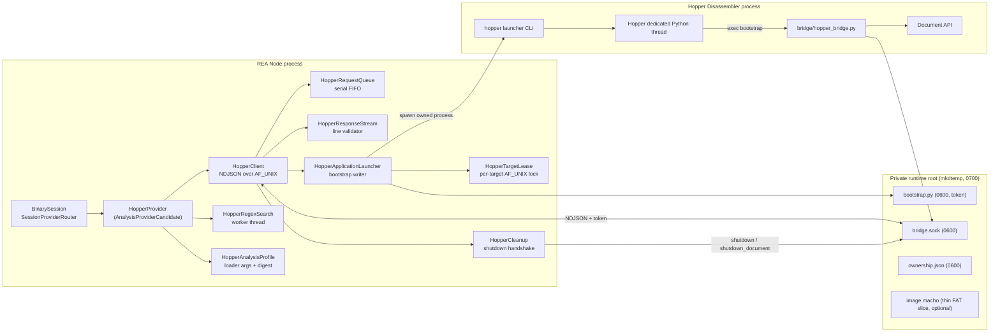
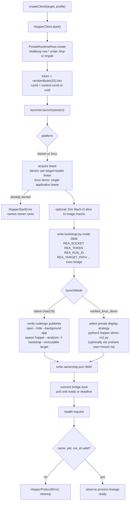
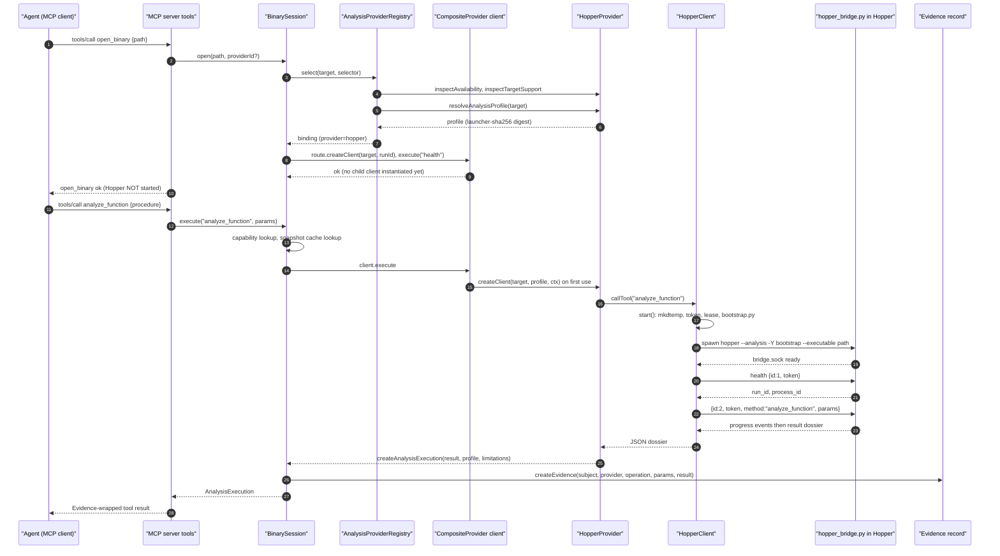

# 07 - The Hopper provider

Scope: `src/hopper/*`, `bridge/hopper_bridge.py`, `scripts/hopper-demo-x11.py`, the Hopper install/discovery helpers in `src/application/{LinuxHopper,MacHopper,MacHopperPaths,HopperDownload}.ts` and `src/config/parseConfig.ts`, and how the 41 `official-proxy` tools (the `direct` tool family) map to Hopper operations.

Related chapters: provider layer and selection in `06-provider-layer-and-session-routing.md`; Ghidra in `08-ghidra-provider.md`; evidence model in `10-evidence-model-ledger-unknowns-bundles.md`; security model in `21-security-model.md`.

All paths are repo-relative to the REA checkout (`/home/user/morluto/rea`, HEAD `f75b1a4`).

---

## 1. What the Hopper provider is

Hopper Disassembler (commercial, GUI application, Python scripting API embedded in the app) is driven by REA as an **in-process-scripted GUI application**:

1. REA writes a small `bootstrap.py` that sets four globals and `exec()`s `bridge/hopper_bridge.py`.
2. REA launches Hopper's own launcher (`hopper` / `Hopper`) with `--analysis -Y <bootstrap.py> --executable <target>` (or `--database <target>`), so Hopper loads the target, runs auto-analysis, and then runs REA's Python bridge **inside Hopper's dedicated Python thread**.
3. The bridge opens a Unix-domain socket (`AF_UNIX`, mode `0600`) inside a per-session private directory and speaks newline-delimited JSON (NDJSON) with a bearer token.
4. REA's Node-side `HopperClient` connects, authenticates every request with the token, queues requests serially (the Hopper API is single-threaded), and translates replies into `AnalysisExecution` objects that become Evidence.

Provider identity (`src/hopper/HopperProviderCapabilities.ts:7-12`):

```ts
/** Public identity committed by every Hopper-backed observation. */
export const HOPPER_PROVIDER_IDENTITY: ProviderIdentity = Object.freeze({
  id: "hopper",
  name: "Hopper Disassembler",
  version: null,
});
```

`version: null` at declaration time; the **concrete committed version is `launcher-sha256:<sha256 of the launcher file>`** (`src/hopper/HopperAnalysisProfile.ts:76-80`; see section 6). So Hopper "version" is a digest of the launcher binary, not a vendor version string.

`HopperProvider implements AnalysisProviderCandidate` (`src/hopper/HopperProvider.ts:43`), one of the three "deep" providers registered in `src/composition/binary.ts:24-36` (`[hopper, ghidra, ida]`).

### 1.1 Component diagram



*Caption: Hopper provider component and dependency diagram. Node-side classes (top-left) own a private runtime directory; the Python bridge executes inside Hopper's own process and is the only code that touches Hopper's Document API.*

Walkthrough: `HopperProvider` is created once with the app config and an environment snapshot; `createClient()` builds a `HopperClient` bound to one target and a `HopperApplicationLauncher`. The launcher acquires a lease (a bound Unix socket whose existence proves a live owner), writes `bootstrap.py`, and spawns Hopper under process ownership tracking. Hopper's launcher runs the bootstrap on its Python thread, which `exec`s the bridge; the bridge binds `bridge.sock` in the same private directory. The client connects, authenticates with the token, performs a `health` handshake that must echo the per-launch `run_id`, and then serves analysis requests through a serial FIFO.

---

## 2. Capability contract and operation table

### 2.1 Declared operations (verbatim)

`src/hopper/HopperProviderCapabilities.ts:14-61` (operation array is lines 15-52, `MUTATING_OPERATIONS` is lines 54-61):

```ts
/** Analyst operations implemented by REA's private Hopper bridge. */
export const HOPPER_OPERATIONS = Object.freeze([
  "address_name",
  "comment",
  "current_address",
  "current_procedure",
  "current_document",
  "goto_address",
  "inline_comment",
  "list_bookmarks",
  "list_documents",
  "list_names",
  "list_procedures",
  "list_segments",
  "list_strings",
  "next_address",
  "prev_address",
  "procedure_address",
  "procedure_assembly",
  "procedure_callees",
  "procedure_callers",
  "procedure_info",
  "read_function_instructions",
  "read_bytes",
  "address_to_file_offset",
  "procedure_references",
  "procedure_pseudo_code",
  "resolve_containing_procedure",
  "search_procedures",
  "search_strings",
  "set_address_name",
  "set_addresses_names",
  "set_bookmark",
  "set_comment",
  "set_inline_comment",
  "unset_bookmark",
  "xrefs",
  "analyze_function",
] as const satisfies readonly (OfficialToolName | "analyze_function")[]);

const MUTATING_OPERATIONS = new Set<string>([
  "set_address_name",
  "set_addresses_names",
  "set_bookmark",
  "set_comment",
  "set_inline_comment",
  "unset_bookmark",
]);
```

Capability descriptors (`src/hopper/HopperProviderCapabilities.ts:64-108`) are generated for those 36 operations **plus `search_bytes`**, which is declared `available: false` with reason `"Masked byte search has not been verified for Hopper."`. Every descriptor carries these effects:

```ts
effects: Object.freeze({
  mutatesArtifact: MUTATING_OPERATIONS.has(operation),
  launchesProcess: true,
  mayShowUi: true,
  mayAccessNetwork: false,
  mayWriteFilesystem: MUTATING_OPERATIONS.has(operation),
  changesPermissions: false,
  requiresRoot: false,
}),
```

(`src/hopper/HopperProviderCapabilities.ts:75-82`.) Per-operation limitation strings (analysis completeness, regex semantics, string encodings, file-offset caveats) are attached at lines 84-105.

`launchesProcess: true` and `mayShowUi: true` apply to **all** Hopper operations because the first call starts the Hopper GUI application. This is a launch of **Hopper** (the analysis engine), not execution of the analysed binary. Hopper performs static analysis only; REA never asks Hopper to run the target (the bridge exposes no debugger/execute method - see the closed dispatch in section 4.3).

### 2.2 Operation matrix: official-proxy tools versus providers

Generated by loading `dist/` (`OFFICIAL_TOOL_CONTRACTS`, `HOPPER_OPERATIONS`, `GHIDRA_OPERATIONS`, `IDA_OPERATIONS`). `O` = member of the 41-tool `official-proxy` set; `H`, `G`, `I` = declared by Hopper, Ghidra, IDA respectively.

| Operation | O | H | G | I | Effect class (from `TOOL_EFFECTS` / provider descriptor) |
|---|---|---|---|---|---|
| address_name | O | H | G | - | read |
| address_to_file_offset | O | H | G | - | read |
| analyze_function | - (enhanced) | H | G | I | read (composed dossier) |
| annotate_native_function | O | - | G | - | **mutates target** (Ghidra only) |
| comment | O | H | - | - | read |
| current_address | O | H | - | - | read (cursor state) |
| current_document | O | H | - | - | read |
| current_procedure | O | H | - | - | read (cursor state) |
| goto_address | O | H | - | - | **changes UI state** (moves Hopper cursor) |
| inline_comment | O | H | - | - | read |
| inspect_native_data_type | O | - | G | - | read |
| inspect_native_instruction | O | - | G | - | read |
| inspect_native_load_image | O | - | G | - | read |
| list_bookmarks | O | H | - | - | read |
| list_documents | O | H | G | I | read |
| list_names | O | H | G | - | read |
| list_procedures | O | H | G | I | read |
| list_segments | O | H | G | - | read |
| list_strings | O | H | G | I | read |
| next_address / prev_address | O | H | - | - | read |
| procedure_address | O | H | G | I | read |
| procedure_assembly | O | H | G | I | read |
| procedure_callees / procedure_callers | O | H | G | I | read |
| procedure_info | O | H | G | - | read |
| procedure_pseudo_code | O | H | G | I | read (runs Hopper decompiler) |
| procedure_references | O | H | G | - | read |
| read_bytes | O | H | G | - | read |
| read_function_instructions | O | H | G | I | read |
| resolve_containing_procedure | O | H | G | I | read |
| resolve_native_call_targets | O | - | G | - | read |
| search_bytes | O | - (declared unavailable) | G | - | read |
| search_procedures / search_strings | O | H | G | I | read |
| set_address_name | O | H | G | - | **mutates target** (renames) |
| set_addresses_names | O | H | G | - | **mutates target** (batch rename) |
| set_bookmark / unset_bookmark | O | H | - | - | **mutates target** |
| set_comment / set_inline_comment | O | H | - | - | **mutates target** |
| xrefs | O | H | G | I | read |

How the "official-proxy" (`direct`) tools reach Hopper: `registerOfficialTools` (`src/server/registerOfficialTools.ts:33-46`) loops over `OFFICIAL_TOOL_CONTRACTS` and registers one MCP tool per contract; each handler calls `withAdmittedAnalysis` and then `analysis.execute(contract.name, arguments_, {signal, progress})` (`src/server/registerOfficialTools.ts:128-137`, `runOfficialOperation`). That goes through `BinarySession.execute`, which looks up `route.capabilities.get(operation)`; if the bound deep provider is Hopper the operation is dispatched to `HopperClient.callTool(operation, params)` (`src/hopper/HopperProvider.ts:309-316`; `search_strings`/`search_procedures` with `mode:"regex"` are diverted to `HopperRegexSearch` first), i.e. **the MCP tool name is the bridge method name 1:1**. The result is wrapped via `createAnalysisExecution(...)` and `createEvidence(...)` (`src/server/registerOfficialTools.ts:78-98`). There are 41 official-proxy tools in total (35 supported by Hopper; 6 are Ghidra-only: `annotate_native_function`, `inspect_native_data_type`, `inspect_native_instruction`, `inspect_native_load_image`, `resolve_native_call_targets`, `search_bytes`). All 41 report `readOnlyHint: false` in the MCP catalog because every tool has `mutatesSession: true` (it records Evidence into the in-memory session); this is an annotation artifact, not a statement that the tool writes to the target (see `src/contracts/toolEffects.ts` `ToolEffects` doc comment: "Includes additive Evidence recording, navigation state, and unknown updates").

### 2.3 Bridge methods, parameters and mutation authority

Everything below is in `bridge/hopper_bridge.py` `_dispatch` (lines 736-1024). The dispatch is a **closed set**; any other method raises `InvalidRequestError("Unknown bridge method")` (line 1024).

| Method | Parameters read (bridge) | Notes / authority | Lines |
|---|---|---|---|
| `health` | none | Returns `{name:"REA Hopper bridge", version:"1.0.0", run_id, process_id}` | 738-744 |
| `shutdown` | none | Behaviour depends on `REA_OWNS_PROCESS_LIFETIME`; may only detach (document retained) or request stop + `cleanup_required` | 745-774 |
| `shutdown_document` | none | Requests background stop, waits, `closeDocument()` | 745-774 |
| `list_documents` | none | document names | 775-776 |
| `current_document` | none | name of bound document | 777-778 |
| `analyze_function` | `procedure`, `document` | Composes assembly, pseudocode, callers/callees, refs, strings, CFG blocks (lines 630-733) | 783-784 |
| `read_function_instructions` | `procedure`, `document` | Raw instructions without decompile (610-627) | 785-786 |
| `read_bytes` | `address`, `length` (default 256, int >= 1) | Segment-bounded; returns `bytes_hex`, `returned_bytes`, `complete` | 787-818 |
| `address_to_file_offset` | `address` | Needs `getFileOffsetFromAddress` and reverse `getAddressFromFileOffset`; rejects if round trip disagrees | 819-853 |
| `resolve_containing_procedure` | `address` | | 854-859 |
| `procedure_references` | `procedure`, `direction` (`incoming`/`outgoing`) | | 860-861 |
| `current_address` / `current_procedure` | none | cursor state | 863-866 |
| `goto_address` | `address` | **moves Hopper cursor** (`moveCursorAtAddress`), then verifies | 867-875 |
| `address_name`, `comment`, `inline_comment`, `xrefs` | `address` | read annotations / references | 876-885 |
| `next_address`, `prev_address` | `address` | | 886-904 |
| `list_segments` | none | permissions explicitly reported as unavailable (null) | 905-933 |
| `list_procedures`, `list_strings`, `list_names` | `address` optional (strings/names) | cached inventories | 934-946 |
| `search_procedures`, `search_strings` | `pattern`, `mode` (literal only natively), `case_sensitive` | regex handled in Node worker | 947-949 |
| `procedure_address`, `procedure_assembly`, `procedure_pseudo_code`, `procedure_callers`, `procedure_callees`, `procedure_info` | `procedure` | | 950-974 |
| `set_address_name` | `address`, `name` | **mutation**: `document.setNameAtAddress`; invalidates caches; read-back verification | 975-984 |
| `set_addresses_names` | `names` (dict address to name) | **mutation**, validates all first then applies | 985-995 |
| `set_comment`, `set_inline_comment` | `address`, `comment` | **mutation** (segment comment APIs) | 996-1005 |
| `list_bookmarks` | none | | 1006-1007 |
| `set_bookmark`, `unset_bookmark` | `address`, `name` | **mutation** | 1008-1023 |

Safety properties enforced in the bridge:
- All calls are bound to the single session document (`_document()` at lines 178-192): a document name that matches a different open document is rejected (`"Hopper document belongs to another target"`).
- `EXHAUSTIVE_ANALYSIS_METHODS` (lines 137-155) require Hopper's background analysis to be complete (`require_analysis_complete`, lines 57-63) otherwise `CapabilityUnavailableError`.
- Address parsing prefers symbol names over bare hex (lines 239-263) and rejects addresses outside the unsigned 64-bit range.
- Symbol-name length is limited at 1024 UTF-16 units (line 16 constant).
- Mutations invalidate the bridge's inventory/pseudocode caches (`_invalidate_search_inventory`, `_invalidate_pseudocode`, lines 492-507) and verify by read-back.

**Persistence caveat (INFERRED from the bridge code and `docs/installation.md`):** the bridge mutates the *live Hopper document* only. It never calls a save/export method, so annotations are in Hopper's in-memory document and are discarded when REA closes the document (`shutdown_document` → `closeDocument()`) unless the analyst saves in the Hopper GUI. Evidence for this: no `saveDocument` / `writeDatabase` string in `bridge/hopper_bridge.py`.

---

## 3. Wire protocol (NDJSON over a private Unix socket)

### 3.1 Schema (verbatim)

`src/hopper/protocol.ts:11-79`:

```ts
const remoteErrorSchema = z
  .object({
    code: z.number().int(),
    message: z.string(),
    type: z
      .enum([
        "remote",
        "authorization",
        "invalid_request",
        "capability_unavailable",
        "bridge_exception",
      ])
      .default("remote"),
  })
  .strict();

const responseSchema = z.union([
  z
    .object({
      id: z.number().int().nonnegative(),
      result: jsonValueSchema,
    })
    .strict(),
  z
    .object({
      id: z.number().int().nonnegative(),
      error: remoteErrorSchema,
    })
    .strict(),
]);

const eventSchema = z
  .object({
    id: z.number().int().nonnegative(),
    event: z.discriminatedUnion("type", [
      z
        .object({
          type: z.literal("progress"),
          phase: z.string().min(1),
          completed: z.number().nonnegative().finite(),
          total: z.number().nonnegative().finite().nullable(),
          message: z.string().min(1),
          terminal: z.boolean().optional(),
        })
        .strict(),
      z
        .object({
          type: z.literal("diagnostic"),
          error: remoteErrorSchema,
        })
        .strict(),
    ]),
  })
  .strict()
  .superRefine((message, context) => {
    if (
      message.event.type === "progress" &&
      message.event.total !== null &&
      message.event.completed > message.event.total
    ) {
      context.addIssue({
        code: "custom",
        message: "Progress total cannot be less than completed",
        path: ["event", "total"],
      });
    }
  });

const messageSchema = z.union([responseSchema, eventSchema]);
```

Request shape (client side, `src/hopper/HopperClient.ts:187`): `JSON.stringify({ id, token, method, params }) + "\n"`. The bridge requires **exactly** the key set `{"id","token","method","params"}` (`bridge/hopper_bridge.py:1044`).

### 3.2 Authentication and framing rules (bridge side, `bridge/hopper_bridge.py:1027-1110`)

- One request per line; `request["id"]` must be a non-negative int (not bool); `method` non-empty str; `params` a dict.
- Token check: `hmac.compare_digest(request["token"], REA_TOKEN)` after `isascii()` check (lines 1054-1058); failure -> `PermissionError("Invalid bridge capability")` -> error `type:"authorization"`.
- For each authenticated request the bridge emits a `progress` event `completed:0,total:1`, then (on success) a terminal `progress` event, then the response line. On failure, an authenticated request additionally gets a `diagnostic` event then the error response.
- Error codes: all bridge errors use `code: -32000` (`_safe_diagnostic`, lines 1129-1140). Unexpected exceptions are redacted to `"<ExceptionType>: Hopper bridge operation failed"` (no message leakage).
- The socket is `listen(1)`: a single client connection; after a disconnect the bridge waits `REA_RECONNECT_TIMEOUT_SECONDS` (30 s, `HOPPER_SHUTDOWN_TIMEOUT_MS`) for a reconnect so cleanup can reauthenticate (lines 1143-1166).

Node-side stream validator (`src/hopper/HopperResponseStream.ts`): any malformed JSON, schema violation, or unknown response id aborts the protocol and fails all queued requests with `HopperProtocolError`.

### 3.3 Worked exchange (constructed from the code, not captured)

Values are illustrative; shape is exact per the schemas above. `TOKEN` is 64 hex chars (`randomBytes(32).toString("hex")`, `HopperClient.ts:367`).

```
-> {"id":1,"token":"TOKEN","method":"health","params":{}}
<- {"id":1,"event":{"type":"progress","phase":"hopper_bridge","completed":0,"total":1,"message":"Hopper bridge started request"}}
<- {"id":1,"event":{"type":"progress","phase":"hopper_bridge","completed":1,"total":1,"message":"Hopper bridge completed request","terminal":true}}
<- {"id":1,"result":{"name":"REA Hopper bridge","version":"1.0.0","run_id":"<uuid>","process_id":4242}}
-> {"id":2,"token":"TOKEN","method":"procedure_callers","params":{"procedure":"0x100003f50"}}
<- {"id":2,"event":{...progress...}}
<- {"id":2,"result":["0x100003e10","0x100003e90"]}
```

`parseHopperServerInfo` (`src/hopper/HopperSessionValues.ts:16-35`) accepts the health reply only if `name === "REA Hopper bridge"`, `process_id` is a positive safe integer, and `run_id` equals the run ID REA generated - this binds the socket to the exact launch.

---

## 4. Session lifecycle

### 4.1 Launch flow



*Caption: Hopper client start sequence. Failure at any step runs `#startupFailure`, which closes the transport and runs the cleanup state machine so no token-bearing file remains.*

Walkthrough with citations:
- Runtime root: `PrivateRuntimeRoot.create({parent: SESSION_ROOT, prefix: "rea-"})` (`src/hopper/HopperClient.ts:355-359`); `SESSION_ROOT` is `/tmp` on macOS, `os.tmpdir()` otherwise (line 82). POSIX `mkdtemp` creates the directory owner-only atomically (`src/process/PrivateRuntimeRoot.ts:70-75`); on Windows a `WindowsPrivateRuntime` is used (not relevant: Hopper is darwin/linux only).
- Socket path/token/run: `HopperClient.ts:366-371`.
- Launcher input: `{directory, socketPath, token, runId}` (lines 372-384).
- `ownership.json` (run_id, leader pid, process group id, parent pid, launcher command, created_at; mode 0600): lines 396-413. It lets a later process recognise and clean orphaned groups.
- Connect/poll: `#connect` (line 673) retries until the socket exists or the startup deadline (`REA_HOPPER_STARTUP_TIMEOUT_MS`, default 120 000 ms; docs `docs/installation.md`) elapses.
- Handshake: `health` with the remaining deadline (lines 423-441).

Launch arguments (`src/hopper/BridgeLauncher.ts:206-215`):

```ts
const action =
  this.options.targetKind === "database" ? "--database" : "--executable";
const argumentsForTarget = [
  ...this.options.loaderArgs,
  "--analysis",
  "-Y",
  bootstrapPath,
  action,
  input.loadedPath,
];
```

Bootstrap file content (`src/hopper/BridgeLauncher.ts:396-411`):

```ts
const bridgeBootstrapSource = (
  session: BridgeSession,
  options: SharedHopperApplicationLauncherOptions,
  ownsProcessLifetime: boolean,
  loadedPath: string,
): string =>
  [
    `REA_SOCKET = ${JSON.stringify(session.socketPath)}`,
    `REA_TOKEN = ${JSON.stringify(session.token)}`,
    `REA_RUN_ID = ${JSON.stringify(session.runId)}`,
    `REA_TARGET_PATH = ${JSON.stringify(loadedPath)}`,
    `REA_OWNS_PROCESS_LIFETIME = ${ownsProcessLifetime ? "True" : "False"}`,
    `REA_RECONNECT_TIMEOUT_SECONDS = ${HOPPER_SHUTDOWN_TIMEOUT_MS / 1_000}`,
    `exec(compile(open(${JSON.stringify(options.bridgeScriptPath)}, 'rb').read(), ${JSON.stringify(options.bridgeScriptPath)}, 'exec'))`,
    "",
  ].join("\n");
```

The bootstrap is written with mode `0600` (`BridgeLauncher.ts:345-356`) and **removed on every non-success path** (lines 289-294). On success it remains in the runtime root until `PrivateRuntimeRoot.close()` removes the whole directory.

Spawning: `spawnOwnedProviderProcess` (`src/process/ProviderProcess.ts`) tags the child with the run token so only token-verified processes are signalled during cleanup (`cleanupOwnedProcessGroup`, `src/process/ProcessOwnership.ts`).

### 4.2 Platform launch modes

| Aspect | macOS (`launchMode: "native"`) | Linux (`launchMode: "verified_linux_demo"`) |
|---|---|---|
| Selection | `HopperProvider.createClient`, `src/hopper/HopperProvider.ts:257-264` (`this.platform === "linux"` picks the demo mode) | same |
| Launcher path default | canonical system app, then `~/Applications/Hopper Disassembler.app`, then other `Hopper*.app` (`src/application/MacHopperPaths.ts`, `parseConfig.ts:28-32`) | `/opt/hopper/bin/Hopper`, `~/.local/share/rea/hopper/bin/Hopper`, `/opt/hopper-v4/bin/hopper`, `/usr/bin/hopper` (`src/application/LinuxHopper.ts`, doc `docs/installation.md` "Launcher paths") |
| Process ownership | REA owns only the short-lived `hopper` helper's process group; the GUI app may be created/reused by LaunchServices (`providerLifetime: "external-application"`, `shutdownMode: "bridge-request"`) | REA owns the demo app and private X display (`providerLifetime: "launcher-process"`, `shutdownMode: "process-cleanup"`) |
| Pre-launch | `open --hide --background -a <app>` and wait 5 s if not already running (`BridgeLauncher.ts:512-533`); codesign check of publisher team ID `2AMA2753NF` (`src/hopper/HopperMacPublisher.ts`, `src/domain/hopperPublisher.ts`) | Probe for a private Xvfb display strategy `direct` or `user-mount-namespace` (`src/hopper/LinuxPrivateDisplayProbe.ts`) |
| Launch wrapper | none | `python3 scripts/hopper-demo-x11.py --owner-stdin --strategy <s> --hopper <path> --socket <sock> -- <hopper> <args>`; for `user-mount-namespace` wrapped in `/usr/bin/unshare --user --map-root-user --mount --propagation private` (`BridgeLauncher.ts:447-494`) |
| Lease | per `(realpath(target), kind, loaderArgs)` | one per user for the whole Hopper application (`acquireLinuxHopperApplicationLease`) |
| Saved `.hop` database | **declined** (`HopperProvider.inspectTargetSupport`, lines 117-124) | supported |
| Version pinning | publisher team-id verification | helper only accepts two known Hopper build SHA-256 digests (`scripts/hopper-demo-x11.py` `SUPPORTED_HOPPER_SHA256`); the installer pins Hopper 6.4.2 packages (`src/application/LinuxHopper.ts:21-44`) |

The Linux helper drives Hopper's registration dialog (clicks the "Demo" button at pixel offsets `DEMO_CLICK_LEFT=116`, `DEMO_CLICK_BOTTOM=22` in a fixed 1280x1024 virtual screen, `scripts/hopper-demo-x11.py:30-35`) on a private X display. This is GUI automation against a pinned vendor build and will break with other builds.

### 4.3 Request execution, queueing, caching

- `HopperClient.callTool` (`HopperClient.ts:493-508`) starts the client lazily then calls `#request`. `callToolIfReady` (512-521) never starts the client and is used only by `executeIfReady` for `list_documents` and `list_procedures` (prompt completion; `HopperProvider.ts:331-341`).
- `HopperRequestQueue` is a **serial FIFO**: only one request is on the wire at a time because Hopper's API is single-threaded (`src/hopper/HopperRequestQueue.ts`, class doc "FIFO that keeps the wire serialized until Hopper actually replies"). Cancellation or timeout settles the *caller* but the wire request stays "active" until Hopper replies; `requestActivity()` exposes such detached work (`callerState: "waiting" | "cancelled"`), surfaced in `binary_session.analysis_activity`.
- Timeout bounds: integer in `[0, 2_147_483_647]` ms (`HopperRequestQueue.ts` `MAX_TIMEOUT_MS`).
- Heartbeat/progress: bridge `progress` events are forwarded to the MCP progress reporter (`acceptEvent`).
- Regex search: `search_strings`/`search_procedures` with `mode:"regex"` never reach the bridge's literal-only matcher (bridge raises `CapabilityUnavailableError` for regex, `hopper_bridge.py:547-548`). `HopperRegexSearch` (`src/hopper/HopperRegexSearch.ts`) fetches the inventory via the literal path, then matches with ECMAScript Unicode semantics in a `worker_threads` Worker with a 5 s matching deadline (`MATCHING_DEADLINE_MS = 5_000`) so a catastrophic regex cannot stall Hopper's thread.
- Bridge-side caches: `_search_inventory_cache` keyed `(id(document), kind)` and `_pseudocode_cache`, invalidated on every rename/comment mutation.
- Session-level snapshot cache: `BinarySession` may replay cached Evidence for read-only, profile-bound operations (`isSnapshotCacheable`, `src/application/binary/AnalysisSnapshotCache.ts:71-85`, which also requires `cachePolicy !== "live"`; see chapter 06). Hopper's mutating operations set `effects.mutatesArtifact: true`, so they are never cached and invalidate the snapshot (`BinarySession.ts:711`).

### 4.4 Cleanup and shutdown

Entry point: `HopperClient.close()` -> `#close` (lines 548-575) -> `cleanupHopperSession` (`src/hopper/HopperCleanup.ts`). Ordered phases (cleanup source lines 62-134):

1. `confirmExternalApplicationExit` - if Hopper (external GUI app) already exited, mark shutdown confirmed.
2. `requestShutdown`: skipped if a bridge operation is still active (logged). Method is `shutdown` when `retainDocument` is requested or the launch is `process-cleanup` mode; otherwise `shutdown_document`.
3. Bridge replies: `analysis_stopped`, `document_closed`, optional `document_retained`, `cleanup_required`. Acknowledgement logic: `isHopperShutdownAcknowledgement` / `isHopperCleanupRequired` (`HopperSessionValues.ts:40-56`).
4. If `cleanup_required` (Linux demo), `launch.cleanup()` kills the owned process group (token-verified); a failed group cleanup falls back to `shutdown_document`.
5. Runtime root removal - **only if the process stopped and (shutdown confirmed or no external application/prepared image)**. Otherwise the private directory is deliberately retained and reported as an unresolved resource (`"Private runtime retained because process or native document closure was not confirmed"`).
6. Lease release only if process stopped *and* shutdown confirmed.

Retry semantics: failed cleanup is recorded on `BinarySession.#pendingCleanup` and retried on the next `open`/`close` (`BinarySession.ts:513-548`). If a startup timed out and the bridge becomes ready later, `#reconnectForCleanup` (`HopperClient.ts:577-637`) reconnects to the *same run's* socket, re-authenticates via `health` (must match runId), then shuts down.

Failure/exit diagnostics are typed (`HopperProcessError` with `providerState: "exited"|"unreachable"`, `stage: connection|analysis|decompilation`, `launcherFailure`); `hopperOperationStage` (`src/hopper/HopperOperationStage.ts`) classifies `health` as `connection`, `procedure_pseudo_code` as `decompilation`, everything else `analysis`.

### 4.5 Lease (duplicate-document guard)

`src/hopper/HopperTargetLease.ts:27-67`: lease directory `/tmp/rea-hopper-<uid>` (created 0700, ownership and mode re-verified, `ensureLeaseDirectory` lines 167-230). A lease is **a bound `AF_UNIX` socket** named after a hash of the canonical `(realpath, kind, loaderArgs)` identity; the socket lives exactly as long as its owner. An acquirer that finds an existing socket connects to ask who owns it: a live owner replies with its `runId` (reported to the user as "already open in REA session ..."), `ECONNREFUSED` means stale and the socket is removed under a serialized recovery directory (`reserveRecovery("<socket>.recovery")`, `src/hopper/HopperTargetLease.ts:85-125`). There is no PID file; liveness is the socket itself.

---

## 5. Security-relevant design (private local authenticated sockets)

| Control | Where | Effect |
|---|---|---|
| Per-session private directory | `PrivateRuntimeRoot.create` (`mkdtemp`, owner-only) | socket, bootstrap and ownership files are unreachable to other local users |
| Socket mode `0600`, `listen(1)` | `hopper_bridge.py:1147-1150` | single local client; no network exposure (AF_UNIX, no TCP) |
| 256-bit bearer token per request | `HopperClient.ts:367`, `hopper_bridge.py:1054-1058` | defence against another process of the same user guessing the path; constant-time comparison |
| Token only in `bootstrap.py` (0600) and process memory | `BridgeLauncher.ts:345-356`; deleted on failure | token is not in argv (the bootstrap *path* is) or environment |
| `run_id` echo | `parseHopperServerInfo` | a stale or foreign bridge cannot impersonate this launch |
| Closed method set; exact request key set | `hopper_bridge.py:1024, 1044` | no generic eval; Hopper's Python API is reachable only via fixed methods |
| Diagnostics redaction | `_safe_diagnostic` | internal exceptions are not echoed to the client |
| Process ownership tokens | `spawnOwnedProviderProcess` / `cleanupOwnedProcessGroup` | REA only signals process groups it verifiably started |
| Publisher verification (macOS) | `verifyMacHopperNativeHelper` (`codesign --verify --strict -R=...` Team ID `2AMA2753NF`) | failure only withholds the "authorization denied before handoff" conclusion; never grants lease release |
| Apple-Event injection guard | `BridgeLauncher.ts:276-285` | values containing `"`, `\`, CR or LF withhold the pre-handoff-denial conclusion because Hopper's vendor helper interpolates arguments into AppleScript literals unescaped |

Caveat: the vendor GUI process itself is not sandboxed by REA. A malicious sample can attempt to exploit Hopper's loader (Mach-O/ELF/PE parsers). Hopper runs **as the REA user with that user's privileges** on macOS; on Linux it runs on a private X display but not in a container. For malware triage, run REA inside a disposable VM/container.

---

## 6. Analysis profile (what "version" and "open semantics" mean)

`resolveHopperAnalysisProfile` (`src/hopper/HopperAnalysisProfile.ts:38-104`) is called by the registry before client creation (see ch. 06). It:

1. Returns `profile: null` for targets other than `executable`/`database`.
2. For Mach-O, reads the first four bytes to classify `thin` / `fat32` / `fat64` by magic (`0xcafebabe`, `0xbebafeca`, `0xcafebabf`, `0xbfbafeca`).
3. For FAT and no `HOPPER_LOADER_ARGS_JSON` override, resolves a **thin slice image** (`resolveHopperMachOImage`, `src/hopper/HopperMachOImage.ts`): validates the selected architecture slice without `lipo`, commits `{method, architecture_count, container_table_sha256, source_offset, byte_length, cpu_type, cpu_subtype}` (schema `hopperMachOImageSchema`, lines 22-31), and the launcher later copies exactly those bytes to `image.macho` in the private directory. Offsets in Evidence refer to the **original** file.
4. Derives loader args (`hopperLoaderArgsForTarget`): `-l Mach-O <arch>` / `-l FAT <arch> -l Mach-O` / `-l ELF <arch>` / `-l WinPE <arch>`; arch flags `--intel-32`, `--intel-64`, `--armv7`, `--aarch64`. MIPS, RISC-V, PowerPC, raw binaries, DOS MZ/COM are **declined** with specific `target_*_unsupported` / `architecture_unsupported` reasons (Ghidra owns them).
5. Computes `sha256` of the launcher executable and builds the commitment:

```ts
const provider = {
  id: options.provider.id,
  name: options.provider.name,
  version: `launcher-sha256:${launcherDigest.value}`,
};
return ok({
  profile: createAnalysisProfile(provider, {
    target_kind: target.kind,
    target_format: target.format,
    function_dossier_coverage: "observed-facets-and-call-relationships-v1",
    architecture: target.architecture ?? null,
    available_architectures: [
      ...(target.availableArchitectures ?? []),
    ].sort(),
    ...(machoContainer === undefined
      ? {}
      : { macho_container: machoContainer }),
    ...(preparedImage === undefined
      ? {}
      : { prepared_image: { ...preparedImage } }),
    loader: {
      source:
        options.loaderArgsOverride.length === 0
          ? "derived"
          : "configured_override",
      arguments: [...loaderArgs],
    },
  }),
});
```

The profile digest is RFC 8785 canonical JSON hashed with SHA-256 (`src/domain/analysisProfile.ts:37-75`). Any change in launcher binary, loader arguments or slice changes the digest, which prevents replaying cached Evidence from a different Hopper build or load configuration (see snapshot binding in chapter 06/11).

Target support (`HopperProvider.inspectTargetSupport`, lines 104-167) summary: supports `executable` (ELF, PE, Mach-O, universal Mach-O) and `database` (non-macOS only); declines ELF MIPS/RISC-V/PowerPC, `raw-binary`, `dos-mz`, `dos-com`, and non-executable/database kinds (archives, artifacts must be extracted first).

Availability (`inspectAvailability`, lines 69-102): host must be `darwin` or `linux`, launcher must be an executable regular file (`code: unsupported_host` / `executable_missing`).

---

## 7. Configuration surface (Hopper-relevant)

Schema fragment, `src/config/environment.ts:70-73,51-53`:

```ts
  HOPPER_LAUNCHER_PATH: z.string().min(1).optional(),
  HOPPER_TARGET_PATH: z.string().min(1).optional(),
  HOPPER_TARGET_KIND: z.enum(["executable", "database"]).default("executable"),
  HOPPER_LOADER_ARGS_JSON: z.string().optional(),
```

```ts
  REA_HOPPER_STARTUP_TIMEOUT_MS: providerStartupTimeoutSchema.default(
    DEFAULT_HOPPER_STARTUP_TIMEOUT_MS,
  ),
```

| Variable | Meaning | Source |
|---|---|---|
| `HOPPER_LAUNCHER_PATH` | explicit Hopper launcher (executable regular file) | `parseConfig.ts:83-88` |
| `HOPPER_LOADER_ARGS_JSON` | JSON array of loader args; overrides derived loader args (profile records `configured_override`) | `environment.ts:73`, `HopperProvider.ts:250-253` |
| `REA_HOPPER_STARTUP_TIMEOUT_MS` | launch + analysis + bridge readiness budget, default 120 000, max 2 147 483 647 | `docs/installation.md` "Launcher paths and troubleshooting" |
| `HOPPER_TARGET_PATH`, `HOPPER_TARGET_KIND` | legacy preselected target settings carried in `AppConfig` (`src/config/types.ts`) | `parseConfig.ts:93-95` |
| (not an env var) `REA_MANAGED_LINUX_HOPPER_LAUNCHER` | TypeScript constant `"/opt/hopper/bin/Hopper"` (`src/application/LinuxHopper.ts:343`): first Linux launcher candidate and the fallback when none is executable | `parseConfig.ts:36-39` |
| (not an env var) `REA_X11_DIAGNOSTIC=` | stdout line prefix `LINUX_PRIVATE_DISPLAY_DIAGNOSTIC_PREFIX` emitted by the demo helper (`src/hopper/LinuxPrivateDisplayDiagnostic.ts:9`) | - |

Default launcher resolution (`src/config/parseConfig.ts:25-41`): macOS candidates then `MAC_HOPPER_SYSTEM_LAUNCHER`; Linux candidates (managed `/opt/hopper/bin/Hopper` first, then `~/.local/share/rea/hopper/bin/Hopper`, `/opt/hopper-v4/bin/hopper`, `/usr/bin/hopper`; `LinuxHopper.ts:352-358`) then `REA_MANAGED_LINUX_HOPPER_LAUNCHER` (the "diagnostic fallback" if none exists); any other platform -> `MAC_HOPPER_SYSTEM_LAUNCHER` (so Windows reports `unsupported_host`).

### 7.1 Installation (Mac and Linux)

From `docs/installation.md` section "Hopper" and the code:

- Hopper is separate commercial software; the free demo has vendor limits. REA **reuses** an existing install and never removes Hopper on uninstall.
- **macOS 12+**: `rea setup` downloads the official DMG (`https://www.hopperapp.com:443/downloader/public/Hopper-6.6.0-demo.dmg`, 34 846 271 bytes, per the comment in `src/domain/hopperPublisher.ts`), checks published size and digest, validates the application bundle, installs atomically to `~/Applications/Hopper Disassembler.app`. No Homebrew, no admin.
- **Linux** (Ubuntu 24.04+, Fedora 41+, Nobara 44+, Arch/CachyOS/Omarchy): downloads pinned **Hopper 6.4.2** `.deb` (35 755 772 bytes), `.rpm` (32 264 475), or Arch `.pkg.tar.xz` (29 405 968) from `https://www.hopperapp.com:443/downloader/public/` and verifies the length and SHA-1 (`src/application/LinuxHopper.ts:21-44`), then invokes the native package manager (needs `--yes --install-hopper` for unattended use). The Linux helper only accepts two specific Hopper executable SHA-256 values (`scripts/hopper-demo-x11.py`, `src/application/LinuxHopper.ts:17-20`).
- Linux runs the demo on a private Xvfb display; if `/tmp/.X11-unix` is an immutable mount, the helper uses an unprivileged user+mount namespace with a private tmpfs over that directory (no sudo).
- `rea doctor --provider hopper --json` reports the chosen strategy and mount facts (see chapter 05).

Porting-relevant: the download and package-manager steps are an install-time concern separate from the runtime provider; the runtime provider needs only an executable launcher path.

---

## 8. Sequence diagram: agent to Hopper to Evidence

Flow: an agent opens a Mach-O and asks for a function dossier.



*Caption: Agent request to Evidence for the Hopper provider. The agent never sees sockets or tokens; the provider boundary is `AnalysisClient.execute`. Hopper is launched lazily by the first Hopper-backed operation, not by `open_binary`.*

Walkthrough: steps 1-9 are the one-time target binding (`BinarySession.#openWithinTransition`, `src/application/binary/BinarySession.ts:261-371`). The route's provider is a `CompositeProvider` (auxiliary families plus the bound deep provider; `selectableRoute`, `src/application/binary/SessionProviderRouter.ts:112-143`) whose `health` only probes children that are *already instantiated* (`executeCompositeHealth`, `src/application/binary/CompositeProvider.ts:80-110`), so **`open_binary` does not start Hopper**. Hopper (a GUI launch plus auto-analysis) starts on the first Hopper-backed operation: `CompositeProvider.createClient`'s `clientFor` calls `HopperProvider.createClient` lazily (lines 161-172, 184-199), and `HopperClient.callTool` starts the bridge (`HopperClient.ts:493-508`). The first tool call therefore pays startup latency (up to `REA_HOPPER_STARTUP_TIMEOUT_MS`). Steps 10-24 repeat per tool call: `BinarySession.#execute` (lines 679-779) resolves the capability from the immutable route, may replay a cached execution, otherwise calls the client, binds the profile (`commitExecutionProfile`) and target (`bindExecutionTarget`), and records Evidence (`createEvidence` + snapshot) when cacheable. Relationship coverage for `procedure_callers`, `procedure_callees`, `analyze_function` is hard-coded `complete` by the Hopper provider (`HopperProvider.ts:282-286`) while limitations record that unresolved native calls are not enumerated.

---

## 9. Failure model

| Condition | Typed error | Where |
|---|---|---|
| Launcher missing / not executable | provider availability `executable_missing` | `HopperProvider.ts:92-101` |
| Unsupported host (Windows) | `unsupported_host` | `HopperProvider.ts:74-80` |
| Another REA owns same target/app | `HopperStartError` with owner run ID | `BridgeLauncher.ts:318-327` |
| Startup deadline exceeded | `HopperTimeoutError`/startup interruption | `HopperClient.ts:720-737` |
| Hopper exits or socket lost | `HopperProcessError{providerState}` | `HopperClient.ts:137-164, 832-849, 924, 965` |
| Bridge reports `capability_unavailable` | mapped to `AnalysisCapabilityUnavailableError("hopper", op, msg)` | `HopperClient.ts:523-540` |
| Analysis still running | bridge `CapabilityUnavailableError` "requires completed Hopper background analysis" | `hopper_bridge.py:57-63` |
| macOS Apple Events denied | classified launcher failure with remediation text | `HopperClient.ts:768-800` |
| Malformed bridge reply | `HopperProtocolError` aborts all requests | `HopperResponseStream.ts` |

Runtime availability is also tracked per provider by `BinarySession.#observeRuntimeAvailability` (`BinarySession.ts:781-814`): a `ProviderAdapterError`, `HopperProcessError` or `HopperStartError` marks every capability of that provider unavailable in `binary_session` output until the next successful call or reopen.

---

## Porting notes

**(a) Separable units**

1. `bridge/hopper_bridge.py` - a self-contained Hopper scripting server (stdlib only: `json`, `hmac`, `os`, `socket`, `typing`). It can be reused standalone: it needs only the four injected globals (`REA_SOCKET`, `REA_TOKEN`, `REA_RUN_ID`, `REA_TARGET_PATH`) plus `REA_OWNS_PROCESS_LIFETIME` and `REA_RECONNECT_TIMEOUT_SECONDS`, and the global `Document` that Hopper injects. It has a test seam (`_configure_hopper_api`).
2. NDJSON protocol + `HopperRequestQueue` + `HopperResponseStream` (`src/hopper/protocol.ts`, `HopperRequestQueue.ts`, `HopperResponseStream.ts`) - generic "serial authenticated JSON-RPC over Unix socket" client; only depends on `zod`, `Result`, `ProgressReporter`.
3. `HopperTargetLease` - generic "single-owner lock via bound Unix socket with stale recovery"; depends only on `node:net`/`fs`.
4. `PrivateRuntimeRoot` + owned-process ownership (`src/process/*`) - shared infrastructure (also used by Ghidra and others); reusable.
5. `HopperAnalysisProfile` + `HopperMachOImage` - FAT-slice validation without `lipo`; reusable by any tool needing a verified thin slice.
6. `HopperRegexSearch` - bounded-time regex in a worker.
7. Install helpers `src/application/{LinuxHopper,MacHopper,HopperDownload}.ts` - pinned download + digest verify + package manager orchestration.

**(b) Dependencies**

- Hopper Disassembler (commercial; demo mode has limits) with its documented CLI (`--analysis -Y <script> --executable|--database`). macOS or Linux only. Python 3 on Linux for the demo helper (`/usr/bin/python3`, `/usr/bin/unshare` optionally). On macOS: `/usr/bin/open`, `/usr/bin/codesign`, `/bin/ps`, AppleScript automation permission.
- Node: `node:net`, `node:worker_threads`, `zod`, `pino`, plus REA's `process/` ownership library and `domain/result`.
- Evidence/profile types from `src/application/AnalysisProvider.ts` and `src/domain/analysisProfile.ts` (canonicalize package for RFC 8785).

**(c) What must be re-implemented to port**

- The `AnalysisProvider` adapter shell (`HopperProvider`) if the target system has a different provider abstraction; the capability table (`HOPPER_OPERATIONS`) is the contract to preserve.
- Process ownership (`spawnOwnedProviderProcess`, `cleanupOwnedProcessGroup`, token-verified process lineage) if the host framework lacks it - it is the safety mechanism for not killing unrelated processes.
- The Linux headless demo automation (`hopper-demo-x11.py`) is tied to two exact Hopper builds and fixed pixel coordinates; a port must re-verify against its own Hopper version or use a licensed Hopper that does not show the registration dialog.
- Evidence recording and snapshot caching live in `BinarySession` (chapter 06/10), not in the provider.

**(d) Malware-analysis relevance and caveats**

- Value: Hopper provides strong static disassembly/decompilation for Mach-O/ELF/PE x86/x86-64/ARM/ARM64 with REA's closed, auditable read API; Evidence carries limitations (partial CallReference classification, string encodings inferred).
- **Does not execute the sample.** The bridge has no debugger or run-target method; Hopper loads and statically analyses. Still, the loader parses attacker-controlled data in a large GUI process: treat as untrusted-input parsing and run REA/Hopper inside a disposable, network-isolated VM.
- **Mutating tools** (`set_address_name`, `set_addresses_names`, `set_comment`, `set_inline_comment`, `set_bookmark`, `unset_bookmark`) edit the Hopper document only (not the sample file on disk; no save call exists). `goto_address` changes the Hopper cursor (UI state).
- The macOS route may bring Hopper to the foreground (vendor helper issues an AppleScript `activate`); a Linux run is headless on a private display.
- Hopper does not support MIPS/RISC-V/PowerPC/raw/DOS targets here; use Ghidra (chapter 08) for firmware/embedded malware.
- Saved `.hop` databases are declined on macOS, so a prior analyst database cannot be loaded there.
- Single-document constraint: one live Hopper application per user on Linux; REA enforces it via the lease, which limits parallel sample analysis on one host.
