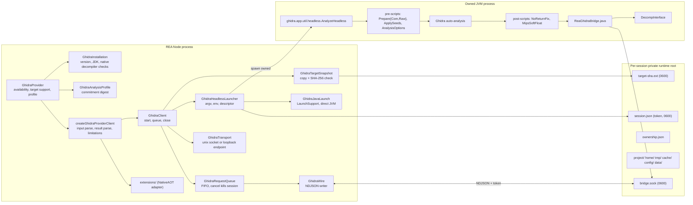
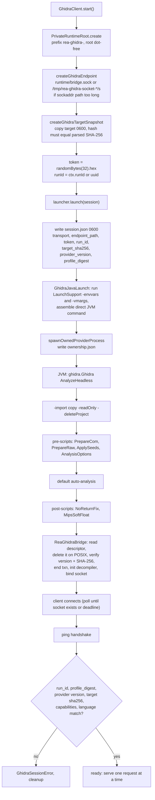
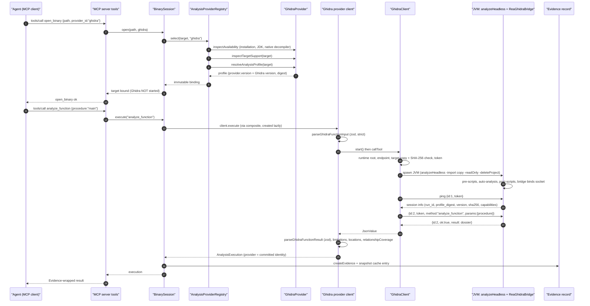

# 08 - The Ghidra provider

Scope: `src/ghidra/*`, `src/ghidra/extensions/*`, `bridge/ghidra/*.java`, `bridge/nativeaot/*.java`, `docs/ghidra-*.md`, `docs/windows-ghidra-p0.md`, `docs/raw-binary.md`, and the Ghidra sections of `docs/installation.md`.

Related chapters: provider layer in `06-provider-layer-and-session-routing.md`; Hopper in `07-hopper-provider.md`; evidence in `10-evidence-model-ledger-unknowns-bundles.md`; Windows native module in `09-other-native-providers.md`; security model in `21-security-model.md`.

All paths are repo-relative to the REA checkout (`/home/user/morluto/rea`, HEAD `f75b1a4`).

---

## 1. What the Ghidra provider is

REA runs **Ghidra's `analyzeHeadless` on an ephemeral private copy of the target**, with a packaged Java `HeadlessScript` (`bridge/ghidra/ReaGhidraBridge.java`, 4 878 lines) as a post-script that, after auto-analysis finishes, opens a private authenticated socket and serves a closed set of JSON operations until shutdown. The Ghidra process, temp project, copied target, home/cache/config directories and socket all live under one per-session private runtime directory that is deleted on close.

Properties (all from code; section cites follow):

- **Bring your own Ghidra.** REA never downloads or installs Ghidra or the JDK. Accepted: Ghidra 12.1.x (verified 12.1.4) and a 64-bit full JDK within that install's `application.java.min/max` (JDK 21+ for 12.1) (`src/ghidra/GhidraInstallationPolicy.ts:4-6,58-98`, `docs/installation.md` "Ghidra").
- **Static only.** No debugger, emulator or target execution is reachable through the bridge's closed dispatch (`ReaGhidraBridge.java:429-476`). The one place caller-supplied *code* runs is the opt-in extension JAR (`REA_GHIDRA_NATIVEAOT_JAR`), which runs inside Ghidra's JVM, not the target (section 9).
- **One Program per session.** `list_documents` always returns one name.
- **Original bytes untouched.** The tool imports a copy (`target-<sha12>.<ext>`, mode 0600) and passes `-readOnly -deleteProject`; annotation edits go to the ephemeral database only and are discarded on close.

Identity (`src/ghidra/GhidraProviderCapabilities.ts:13-18`):

```ts
/** Public identity committed by every Ghidra-backed observation. */
export const GHIDRA_PROVIDER_IDENTITY: ProviderIdentity = Object.freeze({
  id: "ghidra",
  name: "Ghidra",
  version: null,
});
```

The concrete committed `version` is the **observed Ghidra application version** (`installation.providerVersion`), set when the profile resolves (`src/ghidra/GhidraAnalysisProfile.ts:98` `const provider = { ...identity, version: installation.providerVersion }`). The Java bridge refuses to serve if `Application.getApplicationVersion()` differs from the descriptor's `provider_version` (`ReaGhidraBridge.java:216-218`).

`GhidraProvider implements AnalysisProviderCandidate` (`src/ghidra/GhidraProvider.ts:78`), registered as the second deep provider (`src/composition/binary.ts:24-36`).

### 1.1 Component diagram



*Caption: Ghidra provider components. The Node client owns a runtime root that holds the copied target, the token-bearing descriptor, and the socket; the JVM is launched directly (not through Ghidra's shell wrapper) so REA can verify process ownership.*

Walkthrough: `GhidraProvider` answers discovery questions without starting anything (installation inspection is cached; `inspectGhidraInstallation` is read-only and does not execute the Ghidra launcher). `createGhidraProviderClient` validates that the committed profile and the live configuration agree (language override, seeds, analyzers, extensions), builds a `GhidraClient`, and defers launching until the first operation. `GhidraClient.start()` allocates the runtime directory and endpoint, copies and hash-checks the target, generates a 256-bit token, and asks the launcher to spawn the JVM. The JVM imports the copy, runs scripts and auto-analysis, and the bridge then binds the socket. The client connects and requires an exact `ping` handshake.

---

## 2. Capability contract and operations

### 2.1 Operation lists (verbatim)

`src/ghidra/GhidraInventoryValues.ts:25-48`:

```ts
export const GHIDRA_INVENTORY_OPERATIONS = [
  "inspect_native_load_image",
  "read_bytes",
  "search_bytes",
  "address_to_file_offset",
  "address_name",
  "list_documents",
  "list_names",
  "list_procedures",
  "list_segments",
  "list_strings",
  "procedure_address",
  "resolve_containing_procedure",
  "search_procedures",
  "search_strings",
  "set_address_name",
  "set_addresses_names",
] as const;

/** Inventory operations that write analyst names into the session database. */
export const GHIDRA_NAMING_OPERATIONS = [
  "set_address_name",
  "set_addresses_names",
] as const satisfies readonly GhidraInventoryOperation[];
```

`src/ghidra/GhidraFunctionValues.ts:46-60`:

```ts
export const GHIDRA_FUNCTION_OPERATIONS = [
  "annotate_native_function",
  "inspect_native_data_type",
  "inspect_native_instruction",
  "resolve_native_call_targets",
  "analyze_function",
  "procedure_assembly",
  "procedure_callees",
  "procedure_callers",
  "procedure_info",
  "procedure_pseudo_code",
  "read_function_instructions",
  "procedure_references",
  "xrefs",
] as const;
```

`src/ghidra/GhidraSessionValues.ts:14-26` (handshake capabilities and mutation set):

```ts
/** Exact methods proved by the bridge handshake after auto-analysis. */
export const GHIDRA_SESSION_CAPABILITIES = [
  "ping",
  "shutdown",
  ...GHIDRA_INVENTORY_OPERATIONS,
  ...GHIDRA_FUNCTION_OPERATIONS,
] as const;

/** Methods that edit the session database; read-only bridges omit them. */
export const GHIDRA_MUTATING_OPERATIONS: ReadonlySet<string> = new Set([
  "annotate_native_function",
  ...GHIDRA_NAMING_OPERATIONS,
]);
```

16 inventory + 13 function = **29 operations**; the product catalog and docs describe them as **26 read-only** (14 inventory/search + 12 function) plus **3 session-database edits** (`set_address_name`, `set_addresses_names`, `annotate_native_function`). On Windows the 3 mutators are advertised unavailable (`windowsP0Capabilities`, section 8).

### 2.2 Read-only adapter operations (complete list) with inputs

Input schemas are validated in Node *before* crossing the socket (`parseGhidraInventoryInput` / `parseGhidraFunctionInput`). Shared field shapes: `document` is `string|null` (default null, must equal the single Program name); an address is `0x`-hex or `<encoded-space>:0x<hex>` (regex in `GhidraInventoryValues.ts:65-70`).

| Operation | Inputs (zod, strict) | What it returns / notes | Class |
|---|---|---|---|
| `inspect_native_load_image` | `{}` | measured load image: source file mappings, image base, address spaces, entry context; independent attestation for DOS MZ, COM, raw; PE returns "unsupported attestation" + NativeAOT metadata | read |
| `read_bytes` | `document, address, length (int 1..MAX_SAFE, default 256)` | initialized loader-adjusted bytes; stops at unmapped/uninitialized, reports completeness | read |
| `search_bytes` | `pattern` (hex pairs, `??` wildcard), optional `mask`, `document, start, end, limit (1..1000, default 100), cursor` | masked byte search per block, paginated with cursor | read |
| `address_to_file_offset` | `document, address` | offset from Ghidra source-byte mapping, needs complete original `FileBytes` whose SHA-256 matches | read |
| `address_name` | `document, address` | primary symbol name | read |
| `list_documents` | `{}` | exactly one Program name | read |
| `list_names` | `document, address?` | symbols (primary/dynamic/external/type/source facts) | read |
| `list_procedures` | `document` | all functions incl. externals, thunk flags | read |
| `list_segments` | `document` | memory blocks (end exclusive; R/W/X, init, overlay, space) | read |
| `list_strings` | `document, address?` | Ghidra-defined string Data only; charset, byte length, terminator state | read |
| `procedure_address` | `document, procedure` | entry address | read |
| `resolve_containing_procedure` | `document, address` | containing function identity or not found | read |
| `search_procedures` / `search_strings` | `pattern, mode literal|regex (default literal), case_sensitive (default false), document` | Java `Pattern` regex; complete matching set in one reply | read |
| `inspect_native_data_type` | `document, type XOR address` | recovered DataType details; NativeAOT overlay metadata for PE | read |
| `inspect_native_instruction` | `document, address` | decoded instruction facts incl. p-code/flow | read |
| `resolve_native_call_targets` | `document, address` | resolved call targets at a call site | read |
| `analyze_function` | `procedure` | function dossier: pseudocode, assembly, callers/callees, typed references, strings, CFG, bounded high-p-code value flow | read |
| `procedure_assembly` / `procedure_info` / `procedure_callers` / `procedure_callees` / `procedure_pseudo_code` / `read_function_instructions` | `document, procedure` | per name | read |
| `procedure_references` | `document, procedure, direction incoming|outgoing (default outgoing)` | typed ReferenceManager edges | read |
| `xrefs` | `document, address` | exact references to an address (no kinds) | read |

Mutating operations (Linux/macOS only):

| Operation | Inputs | Effect |
|---|---|---|
| `set_address_name` | `document, address, name` | renames a function entry or creates/renames the primary label; USER_DEFINED source; readback-verified |
| `set_addresses_names` | `document, names {address: name}` (>= 1) | each address in its own transaction; per-address success; failure rolls back only that address |
| `annotate_native_function` | `procedure, name?, comment?, inline_comment?` (at least one; empty string clears) | atomic rename + PRE/EOL comment at function entry, refreshed analysis, rollback on any failure |

`annotate_native_function` schema (verbatim, `src/domain/native/nativeFunctionAnnotations.ts:5-24`):

```ts
export const nativeFunctionAnnotationsInputSchema = z
  .strictObject({
    procedure: z.string().min(1),
    name: z.string().min(1).optional(),
    comment: z
      .string()
      .optional()
      .describe("Regular entry comment; empty text clears it"),
    inline_comment: z
      .string()
      .optional()
      .describe("Inline entry comment; empty text clears it"),
  })
  .refine(
    (value) =>
      value.name !== undefined ||
      value.comment !== undefined ||
      value.inline_comment !== undefined,
    "Supply at least one annotation change",
  );
```

Of the 41 official-proxy tools, Ghidra implements 29 (`address_name`, `address_to_file_offset`, `annotate_native_function`, `inspect_native_data_type`, `inspect_native_instruction`, `inspect_native_load_image`, `list_documents`, `list_names`, `list_procedures`, `list_segments`, `list_strings`, `procedure_address`, `procedure_assembly`, `procedure_callees`, `procedure_callers`, `procedure_info`, `procedure_pseudo_code`, `procedure_references`, `read_bytes`, `read_function_instructions`, `resolve_containing_procedure`, `resolve_native_call_targets`, `search_bytes`, `search_procedures`, `search_strings`, `set_address_name`, `set_addresses_names`, `xrefs`, plus the enhanced `analyze_function`). Hopper-only (GUI-state/bookmark/comment) tools are `comment`, `inline_comment`, `current_*`, `goto_address`, `list_bookmarks`, `next_address`, `prev_address`, `set_bookmark`, `unset_bookmark`, `set_comment`, `set_inline_comment`. See the matrix in `07-hopper-provider.md` section 2.2.

### 2.3 Capability descriptor generation (verbatim)

`src/ghidra/GhidraProviderCapabilities.ts:171-197`:

```ts
/** Provider-neutral capabilities advertised by every non-Windows Ghidra session. */
export const CAPABILITIES: readonly CapabilityDescriptor[] = Object.freeze(
  GHIDRA_OPERATIONS.map((operation) => {
    return Object.freeze({
      provider: GHIDRA_PROVIDER_IDENTITY,
      operation,
      available: true,
      reason: null,
      // Project writes are private import machinery. Analysis reads are bound
      // to the artifact/profile; session annotations disable snapshot replay.
      ...(GHIDRA_MUTATING_OPERATIONS.has(operation) ||
      operation === "list_documents"
        ? {}
        : { cachePolicy: "snapshot" as const }),
      effects: Object.freeze({
        mutatesArtifact: GHIDRA_MUTATING_OPERATIONS.has(operation),
        launchesProcess: true,
        mayShowUi: false,
        mayAccessNetwork: false,
        mayWriteFilesystem: true,
        changesPermissions: false,
        requiresRoot: false,
      }),
      limitations: Object.freeze(limitationsFor(operation)),
    });
  }),
);
```

Key differences from Hopper: `mayShowUi: false`, `mayWriteFilesystem: true` for **every** op (project/runtime files), and `cachePolicy: "snapshot"` for every read op except `list_documents`, which allows `BinarySession` to replay cached Evidence (`isSnapshotCacheable`, ch. 06) despite those incidental writes.

`healthLimitations` (shared by every operation, verbatim, `src/ghidra/GhidraProviderCapabilities.ts:26-31`):

```ts
export const healthLimitations = Object.freeze([
  "The session serves operations only after Ghidra reports default auto-analysis complete; incomplete analysis does not expose partial results.",
  "The imported Program and temporary project are ephemeral and deleted on close. Annotation operations edit session database metadata; original executable bytes are never written.",
  "Cancelling an active Ghidra request terminates its ephemeral database and discards session annotations. The selected target remains open; the next provider query imports the original artifact again.",
]);
```

The per-operation limitation strings (Java regex semantics, string inventory coverage, xrefs kinds, pseudocode caveat, etc.) are in `limitationsFor` (`GhidraProviderCapabilities.ts:47-169`).

---

## 3. Headless launch protocol

### 3.1 Process and protocol diagram



*Caption: Ghidra headless launch protocol. Everything token-bearing lives in the private runtime directory; the bridge deletes the descriptor immediately after reading it on POSIX hosts.*

Walkthrough with citations:

1. `GhidraClient.#startWithin` (`src/ghidra/GhidraClient.ts:568-671`): create runtime root (`prefix: "rea-ghidra-"`, parent from `ghidraSessionRoot()` which rejects any parent path element starting with `.` because Ghidra aborts on dot-prefixed project path elements, `src/ghidra/GhidraSessionRoot.ts:31-55`); create endpoint (`GhidraTransport.ts:21-49`: if `bridge.sock` path would exceed 103 bytes on macOS / 107 on Linux a second owner-only dir under `/tmp` named `rea-ghidra-socket-*` holds the socket); snapshot the target; token and run ID; launch.
2. Snapshot (`src/ghidra/GhidraTargetSnapshot.ts:23-104`): opens the source `O_RDONLY|O_NONBLOCK` (so a FIFO swapped in cannot block), requires a regular file, writes `target-<12 hex of sha>.<ext>` with mode `0o600` through a hashing `Transform`, and **throws `AnalysisArtifactChangedError` if the observed SHA-256 differs from the one committed when the target was parsed**. The extension is kept only if it matches `^\.[A-Za-z0-9]{1,12}$`, else `.bin`. This closes the TOCTOU between `open_binary` and import.
3. Launcher (`src/ghidra/GhidraLauncher.ts:189-440`): creates `project/ home/ tmp/ cache/ config/ data/` (0700), writes `session.json` with the token (0600, atomic) - verbatim shape in section 3.2 - and builds the argument list.
4. JVM command (`src/ghidra/GhidraJavaLaunch.ts:160-191`): REA runs Ghidra's own `LaunchSupport.jar` twice (`-envvars`, `-vmargs`) to learn the JDK and VM args, rejects any that override `os.arch`/`os.name` (`rejectJvmPlatformOverrides`, line 171), and then **execs the JVM directly**:

```ts
return {
  command,
  environment,
  arguments: [
    ...vmArguments,
    ...(options.platform === "darwin" ? ["-Xdock:name=Ghidra-Headless"] : []),
    `-Xmx${environment.GHIDRA_HEADLESS_MAXMEM || environment.GHIDRA_MAXMEM || "2G"}`,
    "-XX:ParallelGCThreads=2",
    "-XX:CICompilerCount=2",
    "-Djava.awt.headless=true",
    ...isolatedProperties,
    "-showversion",
    "-cp",
    join(installRoot, "Ghidra", "Framework", "Utility", "lib", "Utility.jar"),
    "ghidra.Ghidra",
    "ghidra.app.util.headless.AnalyzeHeadless",
    ...options.arguments,
  ],
};
```

(`GhidraJavaLaunch.ts:172-190`.) On Windows the official `analyzeHeadless.bat` is used instead (`ghidraHeadlessCommand`), via an absolute `cmd.exe`.

5. Headless arguments (`GhidraLauncher.ts:555-719`, verbatim argument skeleton):

```
<projectRoot> rea-project
-import <runtime>/target-<sha12>.<ext>
[-loader MzLoader -processor "x86:LE:16:Real Mode" -cspec default]              # DOS MZ
[-loader BinaryLoader -loader-baseAddr 1000:0100 -processor ... -cspec default] # DOS COM
[-loader PspElfLoader -processor Allegrex:LE:32:default -cspec default]          # PSP
[-processor <languageId> [-cspec <compilerSpecId>]]                              # override / pinned language
[-loader BinaryLoader -loader-baseAddr <entry> -processor <lang> -cspec <spec>]  # raw binary
-readOnly -deleteProject
-log <runtime>/ghidra.log -scriptlog <runtime>/script.log
-scriptPath <bridge dir>
[-preScript ReaGhidraPrepareCom.java]
[-preScript ReaGhidraPrepareRaw.java <languageId> <entryHex>]
[-preScript ReaGhidraApplySeeds.java <seedSnapshotPath>]
[-preScript ReaGhidraAnalysisOptions.java <comma-separated analyzer names>]
[-postScript ReaGhidraNoReturnFix.java]        # non-Windows only
[-postScript ReaGhidraMipsSoftFloat.java]      # soft-float MIPS only
-postScript <bridge>/ReaGhidraBridge.java <runtime>/session.json
```

The comments in the source note that the bridge script is selected by explicit path because Ghidra checks the caller's cwd before `-scriptPath` for a basename (`GhidraLauncher.ts:714-716`). The token is **never** on argv: only the descriptor path is.

6. Environment (`GhidraLauncher.ts:816-844`): `HOME`, `TMPDIR`, `XDG_CACHE_HOME`, `XDG_CONFIG_HOME`, `XDG_DATA_HOME` are redirected into the runtime root (Windows additionally `USERPROFILE`, `APPDATA`, `LOCALAPPDATA`, `TEMP`, `TMP`). `docs/installation.md` states REA clears `_JAVA_OPTIONS`, `JAVA_TOOL_OPTIONS`, `JDK_JAVA_OPTIONS`, `GHIDRA_JAVA_OPTIONS` from the caller and owns `GHIDRA_HEADLESS_JAVA_OPTIONS`. (`ghidraJavaEnvironment`, `GhidraInstallation.ts:612`.)
7. `spawnOwnedProviderProcess` starts the JVM in its own process group and records `ownership.json` (run_id, transport, endpoint, pid, process_group_id, parent_pid, `ownership_kind: posix-process-group | windows-job-object`, launcher, headless_script, created_at; `GhidraLauncher.ts:367-383`).
8. In the JVM (`ReaGhidraBridge.run`, `ReaGhidraBridge.java:184-247`): reads the descriptor and requires exactly the keys in `DESCRIPTOR_KEYS` (lines 127-135) (plus optional `analysis_extensions`); on POSIX **deletes the descriptor immediately** (lines 196-198); verifies Raw Binary preparation properties; verifies `Application.getApplicationVersion()` equals `provider_version`; verifies `currentProgram.getExecutableSHA256()` equals `target_sha256` with a constant-time compare (lines 219-228); ends the GhidraScript transaction so each edit owns its own transaction; runs extensions; initializes one persistent `DecompInterface`; then `serve()`.
9. Transport in the JVM: **Unix-domain socket** (`ServerSocketChannel` UNIX, path from descriptor, `rw-------`, single accepted client) on Linux/macOS (`ReaGhidraBridge.java:261-272`); **authenticated loopback TCP** on Windows (`127.0.0.1:<ephemeral>`, endpoint JSON `{"host","port"}` published atomically; first frame must carry a valid token within 1 s, otherwise the peer is dropped and the bridge keeps waiting; `ReaGhidraBridge.java:274-357`).
10. Client connects (`GhidraSocketConnection.ts`), `completeGhidraStartupHandshake` sends `ping` (`GhidraClientStartup.ts:33-61`) and `parseGhidraSessionInfo` enforces the exact identity (`GhidraSessionValues.ts:143-181`): schema `sessionInfoSchema`, `run_id` equals this launch, `read_only` equals `(transport is loopback)`, capability set equals the expected set (the 3 mutators removed when read-only), `provider.version` and `profile_digest` equal the committed values, `target.sha256` equals the parsed target, language/compiler-spec equal expected when pinned, and exactly one of `analysis_complete` / `analysis_timed_out` is true. Startup deadline default 330 000 ms (`REA_GHIDRA_STARTUP_TIMEOUT_MS`).

### 3.2 Descriptor, request, response, handshake (verbatim)

Descriptor written by `GhidraLauncher.ts:241-256` (`session.json`, mode 0600):

```ts
`${JSON.stringify({
  transport: session.transport,
  endpoint_path: session.endpointPath,
  token: session.token,
  run_id: session.runId,
  target_sha256: session.targetSha256,
  provider_version: session.providerVersion,
  profile_digest: session.profileDigest,
  ...(extensions.length === 0
    ? {}
    : { analysis_extensions: extensions }),
})}\n`
```

Request (client `GhidraWire.request`, `src/ghidra/GhidraClientWire.ts:86-88`) and Java check (`ReaGhidraBridge.java:4664-4675`): exactly `{"id": <int > 0>, "token": "<64 hex>", "method": "<op>", "params": {...}}` per line; Java rejects different key sets and token mismatch (constant-time).

Response schema (verbatim, `src/ghidra/protocol.ts:6-22`):

```ts
const responseSchema = z.discriminatedUnion("ok", [
  z.strictObject({
    id: z.number().int().positive(),
    ok: z.literal(true),
    result: jsonValueSchema,
  }),
  z.strictObject({
    id: z.number().int().positive(),
    ok: z.literal(false),
    error: z
      .object({
        code: z.string().min(1),
        message: z.string().min(1),
      })
      .strict(),
  }),
]);
```

Differences from Hopper's wire: Ghidra replies use `{"id","ok":true,"result"}` / `{"id","ok":false,"error":{"code","message"}}` and carry **no progress events** (progress is generated Node-side as a 10 s "Waiting for Ghidra startup" heartbeat during startup, `GhidraClient.ts:235-262`). Error codes seen in the bridge include `invalid_request`, `not_found`, `analysis_incomplete`, `method_unavailable` (Windows mutators), `bridge_exception`, `decompile_cancelled`.

Handshake schema (verbatim, `src/ghidra/GhidraSessionValues.ts:37-106`) is reproduced here because it is the identity contract:

```ts
const sessionInfoSchema = z
  .object({
    name: z.literal("REA Ghidra bridge"),
    run_id: z.string().uuid(),
    profile_digest: z.string().regex(/^[a-f0-9]{64}$/u),
    provider: z
      .object({
        id: z.literal("ghidra"),
        version: z.string().min(1),
      })
      .strict(),
    read_only: z.boolean(),
    analysis_complete: z.boolean(),
    analysis_timed_out: z.boolean(),
    /** Program Information attributes; absent load state remains unknown. */
    pdb: z
      .strictObject({
        file: pdbAttributeSchema,
        guid: pdbAttributeSchema,
        /** Ghidra stores CodeView age as a hexadecimal string. */
        age: pdbAttributeSchema,
        signature: pdbAttributeSchema,
        version: pdbAttributeSchema,
        loaded: z.boolean().nullable(),
        resource_limit: z
          .strictObject({
            utf16_budget: z.literal(PDB_ATTRIBUTE_UTF16_BUDGET),
            omitted_attributes: z
              .array(z.enum(["file", "guid", "age", "signature", "version"]))
              .min(1)
              .max(5),
          })
          .optional(),
      })
      .refine(
        (pdb) =>
          [pdb.file, pdb.guid, pdb.age, pdb.signature, pdb.version].reduce<number>(
            (sum, value) => sum + (value?.length ?? 0),
            0,
          ) <= PDB_ATTRIBUTE_UTF16_BUDGET,
        "PDB attributes exceed the aggregate wire budget",
      )
      .optional(),
    analysis_extensions: z.array(ghidraExtensionResultSchema).optional(),
    analysis_seeds: ghidraSeedReportSchema.optional(),
    mips_soft_float_storage: z
      .object({
        policy: z.literal(GHIDRA_MIPS_SOFT_FLOAT_STORAGE),
        functions: z.number().int().nonnegative(),
        definitions: z.number().int().nonnegative(),
      })
      .strict()
      .optional(),
    capabilities: z.array(capabilitySchema),
    target: z
      .object({
        name: z.string().min(1),
        language_id: z.string().min(1),
        compiler_spec_id: z.string().min(1),
        image_base: z.string().regex(/^0x[0-9a-f]+$/u),
        default_address_space: z.string().min(1),
        sha256: z.string().regex(/^[a-f0-9]{64}$/u),
      })
      .strict(),
  })
  .strict();
```

(Whitespace of the `.refine` reduce was reformatted for width; logic is identical to lines 71-82.)

Shutdown acknowledgement required (`GhidraSessionValues.ts:184-189`): `{shutdown: true, project_ephemeral: true}`; Java side `ReaGhidraBridge.java:393-399`.

### 3.3 Close, cancellation and ownership

- `close` (`GhidraClient.ts:761-860`) fails queued requests, sends `shutdown` (10 s timeout, `SHUTDOWN_TIMEOUT_MS`; skipped when forcing a stop after cancellation; a missing or invalid acknowledgement is only logged as a warning), destroys the socket, then stops the owned process (`ProviderProcessSupervisor.stop`; `incomplete` throws and the runtime is **retained**), closes snapshot owners and removes the runtime roots. Any unverified step keeps the runtime root and surfaces a cleanup failure that a later close retries.
- **Cancelling an in-flight operation kills the session.** `GhidraRequestQueue` is a one-request-at-a-time FIFO (`src/ghidra/GhidraRequestQueue.ts:34-60`); on cancel of the *active* request it invokes `onActiveCancellation`, which `GhidraClient` wires to `#stopAfterActiveCancellation` -> `#requestClose(true)` (`GhidraClient.ts:167-171, 491-510`). Annotations are lost; the next provider call re-launches and re-imports from the original artifact (limitation text `healthLimitations[2]`). Queued (not-yet-active) requests are removed cheaply without killing the session.
- `operationHealthSnapshot()` reports `exited` / `unreachable` / `unknown` so `BinarySession` can retire a dead client (ch. 06).
- On POSIX Linux, a procps-compatible `ps` must be on `PATH` because process ownership verification reads process environments (`docs/installation.md` "Linux owned-process prerequisite").

---

## 4. Sequence diagram: agent to Ghidra to Evidence

Flow: open a PE, then analyze a function.



*Caption: Agent request to Evidence for the Ghidra provider. As with Hopper, `open_binary` only binds the target and provider; the expensive import and auto-analysis happen on the first provider operation (or health on PE/extension/seed/soft-float targets, which start eagerly to verify observations).*

Walkthrough: for PE targets, extension, seed, or MIPS soft-float configurations the provider client calls `client.start()` before every operation to refresh handshake-derived observations (PDB state, seed outcomes, soft-float storage, extension results; `GhidraProviderClient.ts:813-832`). For other targets the first `callTool` starts the session implicitly. Result parsing is strict: `parseGhidraFunctionResult` / `parseGhidraInventoryResult` validate the bridge JSON against zod schemas (`src/ghidra/GhidraFunctionValues.ts`, `GhidraInventoryValues.ts`) so malformed bridge output becomes a typed error rather than Evidence. First-query client timeouts are discussed in `docs/mcp-contracts.md#ghidra-first-query-deadlines-and-recovery`.

---

## 5. Analysis profile (what is committed)

`resolveGhidraAnalysisProfile` (`src/ghidra/GhidraAnalysisProfile.ts:56-300`) returns a digest-committed profile for every executable. The committed parameter keys (all strings are contract revision labels that change whenever REA's observation semantics change, so old snapshots cannot replay):

| Key | Example value | Meaning |
|---|---|---|
| `target_kind`, `target_format`, `architecture`, `available_architectures` | `executable`, `pe`, `x86_64`, `[...]` | target identity |
| `executable_role`, `managed`, `native_aot_metadata{...}` | PE only | PE role and NativeAOT parser limits (`NATIVE_AOT_*` constants) |
| `import_mode` | `ephemeral-source-immutable` | |
| `annotation_policy` | `atomic-function-entry-metadata-v1` | |
| `load_image_observations` | `source-mappings-entry-context-v2` | |
| `function_body_evidence` | `complete-inclusive-ranges-v1` | |
| `function_references` | `complete-body-and-entry-reference-manager-v2` | |
| `call_relationship_coverage` | `function-body-call-coverage-v5` | (`callRelationshipCoverage` const line 41) |
| `function_dossier_coverage` | `observed-facets-and-call-relationships-v1` | |
| `string_inventory_evidence` | `defined-data-coverage-v1` | |
| `location_resolution` | `explicit-address-exact-entry-symbol-first-v3` | |
| `procedure_file_offset_resolution` | `address-first-unique-target-source-mapping-v2` | |
| `instruction_flow_evidence` / `instruction_references` / `function_boundary_observations` | `decoded-return-pcode-v1` / `exact-address-incoming-v1` / `ghidra-function-boundary-limitations-v3` | |
| `no_return_repair` | `returning-imports-decoded-return-v2` or `disabled-windows-p0` | |
| `process_launch` | `inspected-jvm-launch-support-v1` or `official-headless-script-v1` (Windows) | |
| `jump_table_evidence`, `decompiler_jump_loads` | `typed-case-default-blocks-v1`, `true` | |
| `loader`, `language_id`, `compiler_spec_id`, `language_selection` | `auto-from-header` or pinned | `language_selection` is `configured-v1` (env override) or `provider-pinned-v1` (MIPS/RISC-V/PPC/PSP lanes) |
| `analyzer_preset` (+ `analysis_options.disabled_analyzers`) | `ghidra-default` or `ghidra-default+disabled:<names>` | |
| lane-specific | `mips_*`, `riscv_*`, `powerpc_*`, DOS `load_segment`, `entry_offset`, `register_context`, raw `entry_point` | |
| added by the provider | `analysis_extensions`, `analysis_seeds` | JAR digest / seed file digest (`GhidraProvider.ts:277-301`) |

The provider-level identity commits the **observed Ghidra version** (not a file digest as in Hopper). Heap/CPU controls (`GHIDRA_HEADLESS_MAXMEM`, `GHIDRA_MAXMEM`, `-XX:ParallelGCThreads=2`, `-XX:CICompilerCount=2`) are explicitly **not** part of the profile (`docs/installation.md` "Ghidra heap and CPU controls").

### 5.1 Language, lane and target admission

`GhidraProvider.inspectTargetSupport` (`src/ghidra/GhidraProvider.ts:161-222`): supports only `executable` targets (not databases, archives); universal Mach-O with more than one slice is refused ("analyze a thinned Mach-O slice instead"); supported architectures `x86, x86_64, arm, arm64, mips, 6502, riscv, powerpc` (set at lines 66-75); MIPS/PSP gated by `ghidraProcessorUnsupportedReason`; Windows uses `inspectWindowsP0TargetSupport` (native x86/x86-64 PE app/DLL non-managed, or raw 6502).

Verified lanes and where documented:

| Lane | Admission (summary) | Language pin | Doc / code |
|---|---|---|---|
| Generic native ELF/PE/Mach-O | header-detected | `auto-from-header` | `docs/ghidra-provider.md` |
| DOS MZ | validated MZ header | loader `MzLoader`, `x86:LE:16:Real Mode`, spec `default`, load segment `0x1000` | `docs/ghidra-dos.md`, `GhidraLauncher.ts:611-619` |
| DOS COM (explicit) | 1..65280 bytes at `1000:0100` | `BinaryLoader`, same language; `ReaGhidraPrepareCom.java` sets CS/DS/ES/SS=0x1000 | `ghidra-dos.md`, `bridge/ghidra/ReaGhidraPrepareCom.java` |
| Raw binary | caller-supplied `--target-format raw-binary --architecture <x> --entry-point <hex>` | `ghidraRawBinaryLanguage`: `6502:LE:16:default`/default, `x86:LE:32:default`/gcc, `x86:LE:64:default`/gcc, `ARM:LE:32:v7`/default, `AARCH64:LE:64:v8A`/default; `ReaGhidraPrepareRaw.java` seeds the entry | `docs/raw-binary.md`, `GhidraRawBinaryLanguage.ts` |
| MIPS ELF32 (o32) | `ET_EXEC`/`ET_REL`, endian-matched; second admission for recordless legacy firmware | pinned `MIPS:<LE|BE>:32:default` | `docs/ghidra-mips.md`, `GhidraMipsProfile.ts` |
| MIPS soft-float | declared soft-float o32 | `ReaGhidraMipsSoftFloat.java` installs a `__rea_soft_float` prototype model (`o32-soft-float-prototype-v1`) because Ghidra's MIPS32 specs only model hard-float | `ghidra-mips.md` §soft-float |
| PSP Allegrex | Linux x64, LE ELF32 `ET_EXEC`, `e_flags=0x10a23001` + inspected ABI record | `PspElfLoader`, `Allegrex:LE:32:default`; requires operator-installed `ghidra-allegrex` extension | `docs/ghidra-psp.md`, `GhidraPspExtension.ts` |
| RISC-V ELF | LE ELF32/64 `ET_EXEC`, double-float ABI | `RISCV:LE:{32,64}:default` + `gcc` | `docs/ghidra-riscv.md` |
| PowerPC ELF32 BE | `ET_EXEC`, BE | `PowerPC:BE:32:default` (not e500) | `docs/ghidra-ppc.md`, `GhidraPowerPcProfile.ts` |
| NativeAOT PE (x64, RTR 9.1) | PE32+ | built-in read-only snapshot parser; optional JAR adapter | `docs/ghidra-nativeaot.md` |
| Windows PE (experimental P0) | native x86/x86-64 PE app/DLL, raw 6502 | auto | `docs/windows-ghidra-p0.md` |

### 5.2 Seeds, analysis options, no-return fix, MIPS soft-float, prepare scripts

- **Analysis seeds** (`REA_GHIDRA_SEED_FILE`, absolute path): TSV `address<TAB>kind[<TAB>name]` with `kind in {function, code, label}`; `0x` hex addresses; `#` comments; labels need a name; code seeds take none; limits 32 MiB / 1 000 000 entries / 2000-char names (`src/ghidra/GhidraAnalysisSeeds.ts:11-16, 73-120`). The seed file is snapshotted into the runtime, its SHA-256 and per-kind counts go into the profile (`ghidraSeedCommitmentSchema`), and `ReaGhidraApplySeeds.java` applies them *before* auto-analysis (functions highest-address first, then code, then labels) and records a report in program properties (`"REA analysis seeds"`) that the handshake returns (`ghidraSeedReportSchema`); the session fails if the report differs from the commitment.
- **Disabled analyzers** (`REA_GHIDRA_DISABLED_ANALYZERS`, comma-separated exact names, <= 32 names, <= 120 chars each): `ReaGhidraAnalysisOptions.java` checks each name exists for this Program (else throws `Unknown Ghidra analyzer for this program`) and disables it before auto-analysis; profile records `analyzer_preset`.
- **No-return fix** (`ReaGhidraNoReturnFix.java`, non-Windows post-script): clears no-return flags on external functions named `malloc`, `__tls_get_addr`, `memcpy`, `memset`, `strlen`, `__errno_location`, clears flags on local functions that contain a decoded RET, re-disassembles affected call sites, and refits owning functions. Unknown imports and genuine no-return imports keep their flags. Profile `no_return_repair: returning-imports-decoded-return-v2`.
- **MIPS soft-float** (`ReaGhidraMipsSoftFloat.java`): see table above.
- **Prepare raw / COM** (`ReaGhidraPrepareRaw.java`, `ReaGhidraPrepareCom.java`): set entry/context on the BinaryLoader import and set the program property that the bridge requires (`"REA raw binary prepared"` / `"REA DOS COM prepared"`; `ReaGhidraBridge.java:204-215`) before serving; a missing property aborts with `REA raw binary entry preparation failed`.
- **COM** specifically: `ReaGhidraPrepareCom.java` requires language `x86:LE:16:Real Mode`, format `Raw Binary`, entry `1000:0100`, image size 1..0xff00, and sets segment registers to 0x1000.

---

## 6. Configuration surface

Schema (`src/config/environment.ts:33-69`, selected lines):

```ts
  GHIDRA_INSTALL_DIR: z.string().min(1).refine(isAbsolute, "GHIDRA_INSTALL_DIR must be absolute").optional(),
  JAVA_HOME: z.string().min(1).refine(isAbsolute, "JAVA_HOME must be absolute").optional(),
  REA_GHIDRA_NATIVEAOT_JAR: ...absolute...optional(),
  REA_GHIDRA_STARTUP_TIMEOUT_MS: providerStartupTimeoutSchema.default(DEFAULT_GHIDRA_STARTUP_TIMEOUT_MS),
  REA_SWIFTC_COMPILE_TIMEOUT_MS: providerStartupTimeoutSchema.default(DEFAULT_SWIFTC_COMPILE_TIMEOUT_MS),
  REA_GHIDRA_LANGUAGE_ID: ghidraLanguageIdSchema.optional(),
  REA_GHIDRA_COMPILER_SPEC_ID: ghidraCompilerSpecIdSchema.optional(),
  REA_GHIDRA_DISABLED_ANALYZERS: ghidraDisabledAnalyzersSchema.optional(),
  REA_GHIDRA_SEED_FILE: ...absolute...optional(),
```

| Variable | Default | Effect |
|---|---|---|
| `GHIDRA_INSTALL_DIR` | else `PATH` discovery of `ghidra`/`ghidraRun` (read-only; `discoverGhidraInstallationOnPath`, `GhidraInstallation.ts:976`) | an explicit value always wins, even if invalid |
| `JAVA_HOME` | else `java`/`javac` on PATH; setup records observed JDK home | must be a 64-bit full JDK within the install's declared Java range, matching host arch/OS for the native decompiler |
| `REA_GHIDRA_STARTUP_TIMEOUT_MS` | 330 000 | import + analysis + bridge readiness; 1..2 147 483 647 |
| `GHIDRA_HEADLESS_MAXMEM` > `GHIDRA_MAXMEM` > `2G` | `2G` | JVM `-Xmx` (not in profile) |
| `REA_GHIDRA_LANGUAGE_ID`, `REA_GHIDRA_COMPILER_SPEC_ID` | unset | passes `-processor` / `-cspec`; validated against installed `.ldefs`; spec requires language (`environment.ts:134-149`); rejected for DOS/raw/PSP |
| `REA_GHIDRA_SEED_FILE` | unset | see 5.2 |
| `REA_GHIDRA_DISABLED_ANALYZERS` | unset | see 5.2 |
| `REA_GHIDRA_NATIVEAOT_JAR` | unset | opt-in extension JAR (<= 8 MiB regular file), digest committed to profile; **code runs inside Ghidra JVM** |
| `REA_SWIFTC_COMPILE_TIMEOUT_MS` | 120 000 | Darwin ownership-helper Swift compile deadline |
| `REA_ANALYSIS_PROVIDER` | `auto` | provider selector, see chapter 06 |

Host prerequisites checked by `rea doctor` (`GhidraInstallation.ts`, `GhidraDoctor.ts`): platform/arch, Ghidra application version `12.1.x`, `support/analyzeHeadless(.bat)`, Java major range from `application.java.min/max`, 64-bit JDK, `javac`/`javac.exe`, JVM `os.arch`/`os.name` mapping to a native decompiler directory `Ghidra/Features/Decompiler/os/<platform>/` (header-inspected, not name-trusted). macOS may need a manually built native decompiler (documented recipes in `docs/installation.md`).

---

## 7. NativeAOT

- **Built-in** (no JAR): x64 PE32+ with .NET 8 ReadyToRun 9.1 metadata. A parser (`src/domain/native/nativeAotPe.ts`, used by `createNativeAotSnapshotOwner`, `GhidraProviderClient.ts:140`) reads the exact admitted target snapshot captured from the Ghidra session (`readTargetSnapshot`, `GhidraClient.ts:314-340`), handles DEHYDRATED_DATA, MethodTable relationships, virtual slots, and frozen strings in a parser-owned in-memory overlay, and returns `metadata_recovery` inside `inspect_native_load_image` / `inspect_native_data_type`. Limits: 128 MiB captured PE bytes, 64 MiB-equivalent work, 64 MiB overlay/index buffers, 4 MiB report JSON (`docs/ghidra-nativeaot.md`).
- **Optional extension JAR** (`REA_GHIDRA_NATIVEAOT_JAR`): built from the pinned submodule `third_party/ghidra-nativeaot` plus REA's facade (`bridge/nativeaot/NativeAot*.java`) via `npm run build:ghidra:nativeaot`. Extension contract (`src/ghidra/extensions/GhidraExtensions.ts:20-30`, verbatim):

```ts
export const ghidraExtensionSchema = z.strictObject({
  id: z.string().regex(/^[a-z][a-z0-9\x2d]*$/u),
  path: z.string().refine(isAbsolute, "Extension path must be absolute"),
  configured_path: z
    .string()
    .refine(isAbsolute, "Extension path must be absolute"),
  sha256: digest,
  entry_class: z.string().min(1),
  integration_api: z.literal(1),
});
```

The JAR bytes are copied into the runtime, digest rechecked before load, loaded by `ReaGhidraExtensions.java` in a `URLClassLoader` and closed with the session. It is the only path that writes rehydrated bytes into the (ephemeral) database; unavailable on Windows P0. **Trust note:** "JARs execute within Ghidra; supply a build you trust" (`docs/ghidra-nativeaot.md`).

---

## 8. Windows P0 (experimental)

Source: `docs/windows-ghidra-p0.md`, `src/ghidra/GhidraProviderCapabilities.ts:33-38,199-228`, `src/process/WindowsAuthority.ts`, `src/windows/*`, `native/windows/` (see chapter 09).

- Windows 10+ x64, fixed local NTFS, Node >= 22.19/24.11/26, Ghidra 12.1.x, 64-bit full JDK. Admits native non-managed x86/x86-64 PE applications and DLLs, and explicit raw NMOS 6502 images.
- All 26 read-only ops are available; the 3 mutators are advertised `available: false`, `availabilityCode: "unsupported_host"`, reason `"Windows Ghidra P0 does not admit database mutation."` (`windowsP0Capabilities`). The bridge also refuses them with `method_unavailable` if called (`ReaGhidraBridge.java:461-471`) and the handshake `read_only` is `true` for the loopback transport.
- Transport: authenticated IPv4 loopback (Node path IPC does not reach Java AF_UNIX); endpoint file contains only `{"host":"127.0.0.1","port":N}`; the bearer token stays in the private immutable descriptor.
- Process containment: the child is created suspended and assigned atomically to an owned Job Object (kill-on-close, no breakaway), private runtime directory has a protected DACL (current user + SYSTEM), path admission opens each component without following reparse points and captures volume serial / file ID; the snapshot is streamed from the admitted handle on a worker. "Analysis runs with the caller's authority; these controls are not a sandbox for the Ghidra engine." Capability limitation strings advertise these (`windowsP0Limitations`).
- The no-return repair is disabled on Windows (profile `no_return_repair: disabled-windows-p0`).

---

## 9. Mutation, execution and trust summary

| Aspect | Facts (with source) |
|---|---|
| Executes the target? | No. Static import/analysis only; limitation text for `inspect_native_load_image` states "no target execution or project mutation occurs" (`GhidraProviderCapabilities.ts:68-72`). Static DOS/raw analysis "does not emulate" (profile limitation strings). |
| Executes other code | Ghidra itself (operator-installed), its LaunchSupport JVM, REA's packaged Java scripts, and (opt-in) the NativeAOT/other extension JAR chosen by the operator. On Windows, `cmd.exe` + `analyzeHeadless.bat`. |
| Writes | Only inside the per-session runtime root (copy of target, project, logs) and optional `/tmp/rea-ghidra-socket-*`. Original file never written. |
| Mutating ops | `set_address_name`, `set_addresses_names`, `annotate_native_function`: edit the ephemeral database; `mutatesArtifact: true` in descriptor, so they disable replay and invalidate the snapshot (`BinarySession.ts:711`). They are **refused while an external mutation is attempted with Ghidra active** (`BinarySession.ts:410-416`: "Close the active Ghidra session explicitly before an external mutation; rebinding would discard its ephemeral analysis edits."). |
| Network | `mayAccessNetwork: false`; Ghidra's own behaviour is not network-policed by REA (PDB symbol servers are not searched by REA; `docs/ghidra-provider.md` "PDB debug-symbol coverage"). |
| Resource limits | JVM heap (`-Xmx`), 2 GC / 2 compiler threads; no REA CPU limit; no fixed per-operation or response-size ceiling ("operations run until a result, caller cancellation, or provider shutdown"). |

---

## Porting notes

**(a) Separable units**

1. `bridge/ghidra/ReaGhidraBridge.java` + the small helper scripts: a stand-alone, authenticated, closed-method JSON bridge for Ghidra headless. Depends only on Ghidra's APIs and Gson (bundled with Ghidra). It can be driven by any client that can write `session.json`, launch `analyzeHeadless` with the argument skeleton in section 3.1, and speak line-delimited JSON.
2. Installation inspection and launch support (`GhidraInstallation*.ts`, `GhidraJavaLaunch.ts`, `GhidraLanguageCatalog.ts`): a reusable "validate BYO Ghidra + JDK and build a direct-JVM command" library.
3. `GhidraTargetSnapshot` + `GhidraSessionRoot` + `PrivateRuntimeRoot`: copy-and-verify private snapshot pattern.
4. `GhidraRequestQueue` + `GhidraWire` + `GhidraResponseBuffer/Router`: serial authenticated request client.
5. Profile/lane modules (`GhidraMipsProfile`, `GhidraRiscvProfile`, `GhidraPowerPcProfile`, `GhidraPspProfile`, `GhidraRawBinaryLanguage`, `GhidraPeProfile`): pure functions mapping parsed ELF/PE facts to Ghidra language IDs.
6. Seed file parser/commitment (`GhidraAnalysisSeeds.ts`) and the NativeAOT PE parser (`src/domain/native/nativeAotPe.ts`).
7. Result schemas (`GhidraInventoryValues.ts`, `GhidraFunctionValues.ts`): the normalized result contract; reusable if another backend must produce the same Evidence shape.

**(b) Dependencies**

Ghidra 12.1.x (Apache-2.0, NSA) and a full 64-bit JDK (21+) supplied by the operator; Node.js runtime with `zod`, `pino`, `canonicalize`; REA's `process/` ownership library (token-verified process groups; procps `ps` on Linux; Job Objects via the Windows native addon); `domain/` types (`BinaryTarget`, `AnalysisProfileCommitment`, `Result`, `JsonValue`). The Java bridge needs Ghidra's `HeadlessScript` classes.

**(c) What must be re-implemented**

- The provider-neutral shell (`AnalysisProviderCandidate`: availability, target support, profile, client) if the host framework differs - the operation list and result schemas are the contract.
- Process ownership/cleanup if not reusing `src/process/*`.
- Windows containment (the native addon in `native/windows`) - see chapter 09; without it Windows must be treated as unsupported.
- Evidence construction and snapshot replay live in `BinarySession` (chapter 06/10).
- Version pinning: the Java bridge is verified against Ghidra 12.1.4 only; other 12.1.x are accepted with a limitation. A port to other Ghidra lines must re-verify API use (`HeadlessScript`, `DecompInterface`, `PdbParserConstants`, `FileBytes`).

**(d) Malware-analysis relevance and caveats**

- Value: Ghidra is the broadest-architecture engine here (x86/x64/ARM/ARM64/MIPS/RISC-V/PowerPC/6502/DOS 16-bit/raw firmware) and is the only deep provider that accepts headerless firmware blobs and DOS binaries; decompiler output and a bounded high-p-code value-flow dossier per function are well suited to triage of implants and firmware.
- **No execution of the sample** by REA's Ghidra path. However, Ghidra's loaders and analyzers parse attacker-controlled bytes in a JVM running as the REA user. Parser bugs in Ghidra (or a malicious PDB/extension content) are in scope. Run in a disposable, network-isolated VM; the Windows controls are explicitly "not a sandbox".
- Annotations (rename/comment) are ephemeral; for persistence the analyst must export results (Evidence bundles) because the temp project is deleted at close. Cancelling any in-flight request discards all annotations.
- Static limits that matter for malware: only Ghidra-*defined* strings appear in string inventory (packed/obfuscated/Rust/Go strings may be absent); unresolved indirect calls stay "unknown"; no emulation, so unpackers/self-modifying code are not resolved; universal Mach-O must be pre-thinned; MIPS/RISC-V/PPC lanes are narrow (header-declared ABI/flags only).
- The extension JAR path (`REA_GHIDRA_NATIVEAOT_JAR`) executes operator-supplied Java inside Ghidra; treat as trusted-code execution and do not enable it with untrusted JARs.
- Operational cost: first query incurs full import and auto-analysis (up to 330 s by default); memory default 2 GB heap; one session at a time per client (serial queue).
