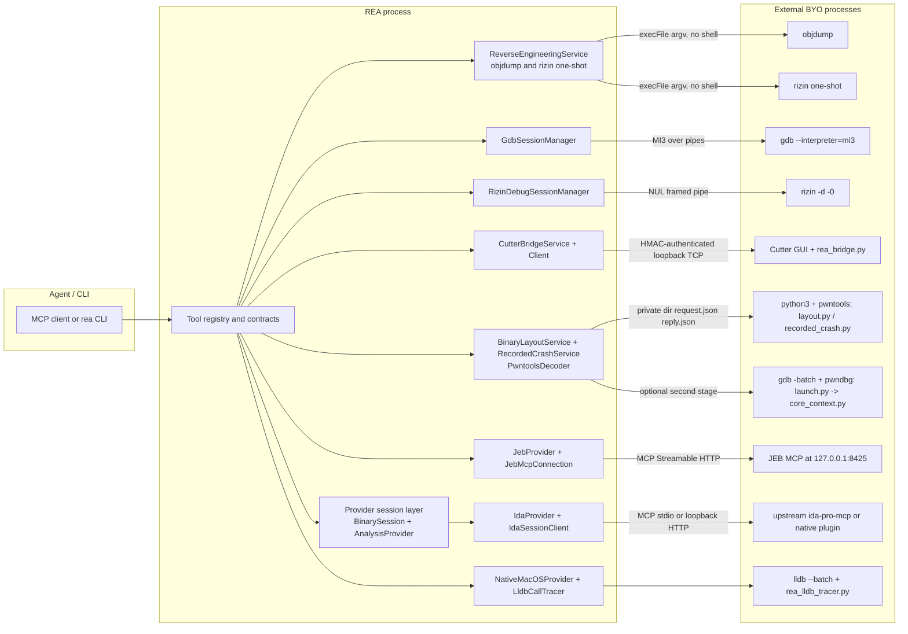
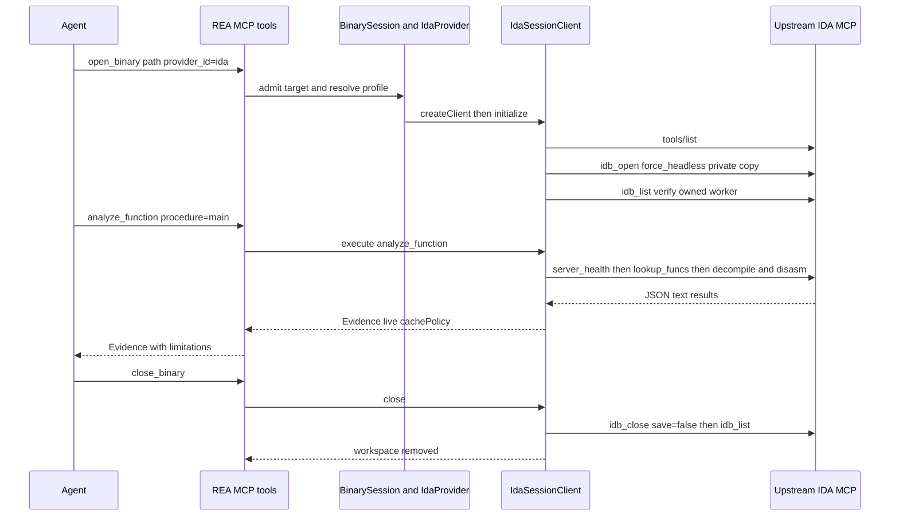
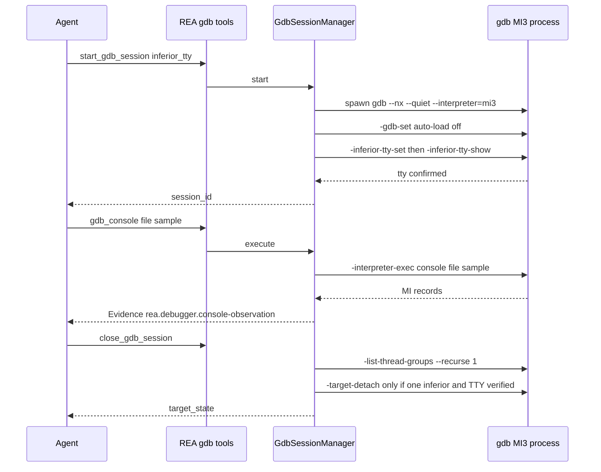
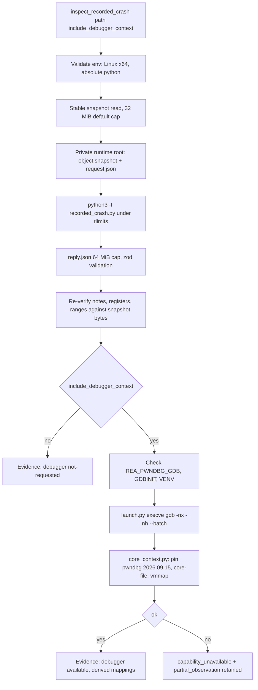

# 09 - Other native providers and bridges (IDA, Cutter, Rizin, GDB, objdump, pwntools/pwndbg, JEB, native-macOS, Windows native module)

Scope: every analysis/debugger backend other than Hopper (ch. 07) and Ghidra (ch. 08). Provider routing and the shared `AnalysisProvider` contract live in `06-provider-layer-and-session-routing.md`; the Evidence envelope in `10-evidence-model-ledger-unknowns-bundles.md`; the security posture in `21-security-model.md`. All paths are repo-relative to `/home/user/morluto/rea` (HEAD f75b1a4, REA 6.4.0). Line numbers were verified with `grep -n`/`sed -n`.

Labels used below: **RUN** = executed in this lab by the author of this chapter (or cited from `27-manual-test-log.md`); **DOC** = read from code/docs only, not executed (engine not installed, or wrong OS). **INFERRED** = deduction from code, flagged where used.

Lab facts for the RUN items: Linux x64 container, GNU objdump 2.42, `/usr/bin/gdb`, pwntools 4.15.0 / pyelftools 0.33 / unicorn 2.1.2 via `REA_PWNTOOLS_PYTHON=$(which python3)`; **not** installed: IDA, Cutter, Rizin, JEB, pwndbg, macOS, Windows. Samples are benign (`samples/c/t` is a C2-like ELF built from `t.c`: `ptrace(PTRACE_TRACEME)` anti-debug check, `socket/connect` to `198.51.100.7:4444`, `dup2`, `puts("/bin/sh -c id")`).

## 1. Taxonomy: three very different integration shapes

These backends do not share one mechanism. Reading the code shows exactly three shapes, and which shape a backend has decides its safety profile.

| Shape | Backends | How it plugs in | Mutation / execution of target |
|---|---|---|---|
| A. Session `AnalysisProvider` (read-only analyst operations, Evidence per op) | IDA (`src/ida/IdaProvider.ts:39`), JEB (not an AnalysisProvider; see B), Hopper, Ghidra | Selected per `open_binary`/`REA_ANALYSIS_PROVIDER`; implements `AnalysisProviderCandidate` (`identity/capabilities/inspectAvailability/inspectTargetSupport/resolveAnalysisProfile/createClient`) | IDA adapter advertises `mutatesArtifact:false` for every op (`src/ida/IdaProviderCapabilities.ts:78`); target never executed by REA; upstream engine analyzes it |
| B. Stand-alone tool families (own MCP tools + own service, no `BinarySession`) | JEB (4 tools), Cutter (2 tools), objdump (1), `execute_rizin_command` (1), GDB (4), Rizin debugger (4), pwntools layout/crash (2), native-macOS LLDB/UI (3+), PE resources | A service class under `src/application/**` or a manager class; contracts under `src/contracts/**`; registered in `src/server/**` | Varies from pure static parse (objdump, layout) to **unrestricted command channels that execute the target** (GDB, Rizin `-d`, LLDB tracer, Cutter) |
| C. Platform helper (not a tool at all) | Windows native Node-API addon (`native/windows`, `src/windows`) | Loaded lazily by other providers for private directories, Job Objects, DACLs | n/a (infrastructure, no analysis) |

Common thread: every backend is **bring-your-own** (BYO). REA never installs or licenses IDA/JEB/Cutter/Rizin/GDB (see `docs/ida-provider.md` intro; contract descriptions of each tool say "REA never installs or launches JEB" etc.).

Shared "shared MCP server" rule, repeated in the description of every unrestricted-command tool (`cutter_command`, `execute_rizin_command`, `gdb_console`, `rizin_debug_command`, the start/close tools): **admitting such a command closes any active binary-analysis session** (`BinarySession`); the agent must call `open_binary` again afterwards (`src/contracts/cutterToolContracts.ts`, `src/contracts/gdbToolContracts.ts`, `src/contracts/rizinDebugToolContracts.ts`, `src/contracts/reverseEngineeringToolContracts.ts`). The reason is that a free-form command can change the target the session's Evidence is bound to.


Figure 9.1 - Component map of the non-Hopper/Ghidra backends. Solid arrows are the transports named on the edges.

Walkthrough: the agent only ever sees MCP tools (or CLI commands). `ReverseEngineeringService` runs two fixed one-shot binaries with an argv array and no shell. `GdbSessionManager` and `RizinDebugSessionManager` own long-lived debugger processes and speak MI3 / NUL-framed text over their pipes. `CutterBridgeService` does not start Cutter at all: it connects to a TCP listener that a Python plugin inside an already-running Cutter GUI opened and advertised through a descriptor file. The pwntools/pwndbg adapters run fixed Python sibling scripts in a private runtime directory, passing data only as JSON files. JEB and IDA are reached as MCP *clients* of an upstream MCP server the user runs.

## 2. IDA provider (`src/ida`, `docs/ida-provider.md`) - shape A, DOC (IDA not installed)

### 2.1 Purpose and position
REA does not drive IDA directly. It is an **MCP client adapter** over a user-supplied IDA MCP server ("REA adapts an existing IDA MCP server into its native analysis tools", `docs/ida-provider.md:3`). It surfaces as the provider id `ida` (`src/ida/IdaProviderCapabilities.ts:8-12`), selected once through `REA_ANALYSIS_PROVIDER=ida`, CLI `--provider ida`, or `open_binary.provider_id` (`docs/ida-provider.md:7`). No startup occurs at discovery time; `REA_IDA_MCP_CONFIG` points at a JSON registration file.

### 2.2 Three compatibility profiles
`src/ida/IdaConfiguration.ts:53-54` selects the protocol: `config.protocol ?? (mode === "attached" ? "legacy" : "modern")`; `protocol:"native"` is only valid with `mode:"attached"`.

| Profile | `mode` | Upstream | Required tools (verbatim lists below) | Session lifecycle |
|---|---|---|---|---|
| legacy-1.4 | attached | mrexodia/ida-pro-mcp 1.4.0 GUI tools | `legacyTools` (`IdaSessionClient.ts:53-64`) | Binds to the already-open GUI database; REA never saves/closes it |
| database-supervisor | headless | builds exposing `idb_open/idb_list/idb_close` | `modernTools` (`IdaSessionClient.ts:65-77`) | REA copies the sample to a private dir, requests an owned worker, closes with `save:false` |
| native-ida-mcp | attached | ida-free-mcp native plugin (IDA Pro or Free) | `nativeTools` (`IdaNativeProtocol.ts:121-129`) | Attached only; headless rejected |

Verbatim registration contract (`src/ida/IdaConfiguration.ts:7-51`):

```ts
const common = {
  mode: z.enum(["attached", "headless"]).default("attached"),
  protocol: z.literal("native").optional(),
  timeoutMs: z.number().int().positive().max(2_147_483_647).default(300_000),
  workspaceRoot: z
    .string()
    .refine(isAbsolute, "workspaceRoot must be absolute on the REA host")
    .optional(),
};
const registrationSchema = z
  .union([
    z
      .object({
        ...common,
        type: z.literal("stdio").optional(),
        command: z.string().min(1),
        args: z.array(z.string()).default([]),
        env: z.record(z.string(), z.string()).default({}),
      })
      .strict(),
    z
      .object({
        ...common,
        type: z.literal("http").optional(),
        url: z.url().refine((value) => {
          const url = new URL(value);
          return (
            ["http:", "https:"].includes(url.protocol) &&
            ["localhost", "127.0.0.1", "[::1]"].includes(url.hostname) &&
            url.username === "" &&
            url.password === ""
          );
        }, "IDA MCP must use a local HTTP endpoint without URL credentials"),
        headers: z.record(z.string(), z.string()).default({}),
      })
      .strict(),
  ])
  .refine(
    (config) => config.protocol !== "native" || config.mode === "attached",
    "The native IDA MCP protocol requires attached mode",
  );
```

The file may be the bare registration or an `mcpServers["ida-pro-mcp"]` envelope; it is capped at 64 KiB (`IdaConfiguration.ts:60-66`).

### 2.3 Operations ("tools") exposed
IDA has no tools of its own: it implements the neutral operations that the common tools (`list_procedures`, `analyze_function`, `xrefs`, ...) call (`IdaProviderCapabilities.ts:14-30`):

```ts
export const IDA_OPERATIONS = Object.freeze([
  "list_procedures", "search_procedures", "list_strings", "search_strings",
  "procedure_address", "procedure_pseudo_code", "procedure_assembly",
  "procedure_callers", "procedure_callees", "read_function_instructions",
  "xrefs", "analyze_function", "resolve_containing_procedure", "list_documents",
] as const satisfies readonly Exclude<AnalysisOperation, "health">[]);
```
(wrapped one-per-line in the source). Profile gating: `resolve_containing_procedure` is headless-only (`:33-36`); `procedure_callers` is advertised `available:false` for headless and native because "code references [are reported] without proving direct call edges" (`:80-89`). Not covered at all: mutation (rename/retype/patch), debugging, arbitrary IDAPython, complete function bodies, typed references, CFG (`IDA_LIMITATIONS`, `:44-52`, and `docs/ida-provider.md:119`).

Upstream tool mapping (from `IdaOperationRunner.ts`): legacy `list_functions`, `get_function_by_name/address`, `decompile_function`, `disassemble_function`, `get_callers/callees`, `get_xrefs_to`; modern `list_funcs`, `lookup_funcs`, `find_regex`, `decompile`, `disasm`, `callees`/`callgraph` (processor-neutral, depth 0), `xrefs_to`, `survey_binary` (minimal, for segment containment); native uses the modern names (`IdaOperationRunner.ts:134-548`).

### 2.4 How REA launches and owns the process
- **Attached**: REA never launches IDA. For a stdio registration it spawns the *upstream proxy* (`StdioClientTransport`, `IdaMcpConnection.ts:402`) whose environment is rebuilt from a snapshot of REA's environment plus `IDA_MCP_MAX_WORKERS=1` plus the registration's `env` (`:405-417`); stderr is piped and kept as a bounded redacted tail; message size cap 64 MiB (`:68`). For HTTP it uses `StreamableHTTPClientTransport` with `redirect:"error"` (`:422-425`) - loopback hosts only (schema above).
- **Headless**: `IdaSessionClient.#initialize` (`:515-605`) (1) compares the live `tools/list` with the profile list and fails closed with `missing_tools` diagnostics; (2) `IdaWorkspace.allocate` makes a `PrivateRuntimeRoot` (prefix `rea-ida-`, owner-only; Windows uses the native private-DACL runtime) and `copyInput()` streams a copy while hashing, comparing the whole-source SHA-256 to the admitted target digest (`IdaWorkspace.ts:44-108`; Mach-O universal inputs are thinned to the selected slice); (3) calls upstream `idb_open` with exactly:

```ts
await this.connection.call("idb_open", {
  input_path: this.#workspace.inputPath,
  mode: "force_headless",
  run_auto_analysis: true,
  build_caches: true,
  init_hexrays: true,
  preferred_session_id: this.#workspace.sessionId,
});
```
(`IdaSessionClient.ts:554-561`), (4) requires the returned session id and input path to equal the private ones, then `idb_list` must show an `owned:true`, `backend:"worker"`, `is_active:true` entry for that private path - otherwise `AnalysisProtocolError` (`:566-597`). On close it issues `idb_close` with `save:false`, verifies absence via `idb_list`, then deletes the workspace; an unverifiable release **retains** the workspace and reports incomplete cleanup (`docs/ida-provider.md:79-83`). The sample is never executed or overwritten (`docs/ida-provider.md:77`).
- **Identity re-check around every request** (`#observe`, `:615-678`): attached compares IDA's recorded input SHA-256 to the target's, and `[path, sha256, base]` must not change; headless re-hashes the private input and requires `auto_analysis_ready`. A target switch fails with a recovery message.

### 2.5 Protocol
MCP JSON-RPC (stdio or Streamable HTTP) from REA to the upstream server; REA is the client (`new Client({ name: "rea-ida-provider", version: "1" })`, `IdaMcpConnection.ts:337`). Per-request timeout = registration `timeoutMs` (default 300 s). Busy workers: `readSettledHealth` re-polls `server_health` every 100 ms until ready or deadline (`src/ida/IdaBusyHealth.ts:40`). Transport-level truncated previews are rejected; native mode reads full JSON text rather than `structuredContent` (`docs/ida-provider.md:61`). Diagnostics are redacted (`IdaDiagnosticRedactor.ts:141`) before being surfaced.

### 2.6 Limits
Cancellation drains the in-flight upstream request; it does not prove IDA stopped working (`IDA_LIMITATIONS[3]`). Results are `cachePolicy:"live"` - never replayed from snapshots. Inputs: executables only (`inspectTargetSupport`, `IdaProvider.ts:107-145`): raw binaries rejected, ELF MIPS/RISC-V/PowerPC rejected (no verified lane), `.idb/.i64` rejected. Native MCP 1.1.2 listens on `0.0.0.0` (documented hazard, `docs/ida-provider.md:31`); REA's loopback check does not change that. Linux headless engine operation is explicitly unverified (`docs/ida-provider.md:158`).

### 2.7 Authority and effects
Capability descriptors (`IdaProviderCapabilities.ts:68-100`): `mutatesArtifact:false`, `changesPermissions:false`, `requiresRoot:false`, `mayAccessNetwork:true`, `launchesProcess:(stdio || headless)`, `mayWriteFilesystem:(stdio || headless)`, `mayShowUi` true for attached operations that move the GUI (pseudocode, assembly, instruction window, dossier; native: pseudocode, dossier). So IDA is **observation-only through REA**, but the *upstream engine* analyzes (and for IDA Free's cloud decompiler, may contact a network service) - that is an engine property, not an REA authority.

### 2.8 Evidence produced
Per-operation Evidence from `IdaSessionClient` via `createEvidence`, with an `AnalysisProfileCommitment` whose fields are (`IdaProvider.ts:154-171`): `version_scope:"rea-ida-adapter"`, `engine_version:null`, `upstream_distribution_version:null`, `mode`, `compatibility_profile` (`native-ida-mcp`/`legacy-1.4`/`database-supervisor`), `database_revision:null`, `cache_policy:"live"`, `registration_digest` = SHA-256 of the canonicalized registration. Provider identity is `{id:"ida", name:"IDA MCP adapter", version:"1"}` (version = adapter, not IDA). Facets the adapter cannot see are `unknown`, never "observed absence".

### 2.9 Doctor
`inspectIdaRegistration` (`IdaDoctor.ts:9-48`) validates the registration only ("no IDA process was launched") and, for headless, checks private-workspace capability. Status codes: `not_configured`, `invalid_configuration`, `open_options_invalid` (provider availability, `IdaProvider.ts:99-102`).

### 2.10 Malware/vuln relevance
IDA is the strongest decompiler path REA can reach, but only for pseudocode/assembly/xref/string reads. For malware triage the **headless** mode is preferable: it analyzes a private copy, never the original, and a sample never runs. Caveat: IDA itself parses the sample (parser exposure in a proprietary engine, plus loaders/plugins/auto-analysis) - run it in an isolated VM. Attached mode touches a live GUI database that may already hold analyst edits; REA cannot lock it.


Figure 9.2 - Headless IDA session (DOC). The tool-call chain is open_binary, analyze_function, close_binary; upstream calls are the engine-side effects. In attached mode the idb_* calls are replaced by get_metadata identity checks and nothing is closed.

## 3. Cutter (`src/cutter`, `bridge/cutter/rea_bridge.py`) - shape B, DOC (Cutter not installed)

### 3.1 Purpose
Drive a **live, user-opened Cutter GUI** (the Rizin front-end) to run arbitrary Rizin commands. Provider identity `{id:"cutter.python-plugin", name:"Cutter Python plugin"}` (`CutterBridgeClient.ts:32-36`). REA does not launch Cutter; a Python plugin (`create_cutter_plugin`, `rea_bridge.py:773`) inside Cutter exposes the session.

### 3.2 Tools
`list_cutter_sessions` (input `{}`) and `cutter_command`. Verbatim input contract (`src/contracts/cutterToolContracts.ts:11-24`):

```ts
export const cutterCommandInputSchema = z.strictObject({
  session_id: z.string().uuid(),
  expected_generation: z.number().int().nonnegative(),
  command: z
    .string()
    .min(1)
    .refine(
      (value) => !/[\r\n]/u.test(value),
      "A single Rizin command line is required",
    ),
  json: z.boolean().default(false),
});
```
Result schema `cutterCommandResultSchema` carries `execution_state: not_started|complete|failed|unknown`, `output_truncated`, `document_generation`, `identity_status: "partial"` (`cutterToolContracts.ts:34-45`). Discovery returns `discovery_status` in {sessions_found, no_live_bridge_found, bridge_directory_unavailable, bridge_directory_insecure, bridge_directory_capacity_exceeded} and `bridge_directory_security` in {private_verified, not_private, unverified_platform_acl, not_checked} (`:47-62`).

### 3.3 Discovery, ownership, protocol
- The plugin binds `127.0.0.1:0`, generates `session_id=uuid4` and a 256-bit `secrets.token_urlsafe(32)` token, and writes a descriptor `cutter-<pid>-<session>.json` (mode 0600) into a bridge directory made 0700 (`rea_bridge.py:468-483`, `:261-275`). Default directory: `REA_CUTTER_BRIDGE_DIR`, else `%LOCALAPPDATA%\REA\CutterBridge` on Windows, else `~/.cache/rea/cutter-bridge` (`CutterBridgeClient.ts:254-300`). On Windows the directory/descriptor are verified through the native addon (`cutter_bridge_verify_directory`, `cutter_bridge_read_descriptor`; section 10).
- The client enforces a descriptor cap (64 KiB each, at most 256 candidates = 16 MiB; read/probe concurrency 8) and returns `bridge_directory_capacity_exceeded` rather than "no sessions" when exceeded (`CutterBridgeClient.ts:70-74`, tool description).
- Wire protocol is newline-delimited JSON over loopback TCP with a mutual HMAC-SHA256 handshake `rea-auth-v2`: client nonce first (`CutterBridgeClient.ts:814`), server proof `HMAC(token, "rea-cutter-server-v2:<session>:<cn>:<sn>")`, client proof over the exact request bytes `"rea-cutter-client-v2:<session>:<cn>:<sn>:<request>"` verified with `hmac.compare_digest` (`rea_bridge.py:555-560`). Frames are capped at 16 MiB in both directions (`MAX_FRAME_BYTES`); oversized output is replaced by `output_truncated:true`.
- Request kinds handled by the Qt-thread dispatcher: `status`, `command`, `ack` (`rea_bridge.py:341-450`). The command is run with `cutter.cmdj(command)` when `json:true`, else `cutter.cmd(command)` (`:419`).

### 3.4 Stale-target protection and unknown-completion handling
`expected_generation` must equal the plugin's current document generation or the command is **not started** (`active-document-generation-changed`, `rea_bridge.py:393-399`). If a command raises or its completion can't be confirmed, state is `unknown`; REA then records a **pending cleanup** keyed by request id and refuses further Cutter commands until the dispatcher's completion receipt arrives (`CutterBridgeService.ts:59-79`, `:135-163`; plugin keeps at most 64 receipts, `rea_bridge.py:40`). The evidence limitation text says "do not retry automatically because the command may have produced partial or persistent effects".

### 3.5 Authority
Highest in this chapter: `cutter_command` is flagged `executesForeignCode, mutatesTarget, writesFilesystem, accessesNetwork, changesUiState, launchesProcess`, `destructiveHint:true` (catalog). Any Rizin command is allowed, including `!` shell escapes and plugin commands. Single-line only.

### 3.6 Evidence
Predicate `rea.cutter.command-observation`, operation `cutter_command`, parameters = session id, expected generation, command, json; result = output, execution_state, error, message, output_truncated, cutter_version, current_file, document_generation, identity_status (`CutterBridgeService.ts:101-130`). `subjectUnavailableReason`: "Cutter exposes no verified stable identity for the active unsaved document or tab." Limitations include that the IPC protocol "is implemented by REA and is not an upstream Cutter API".

### 3.7 Relevance
Low for automated malware triage (needs a human-opened GUI, arbitrary commands). Useful only when an analyst already has a database in Cutter. Treat as **unrestricted code execution on the analyst host**.

## 4. objdump (`src/objdump`) - shape B, RUN

### 4.1 Contract
Verbatim (`src/domain/reverseEngineering.ts:3-25`):

```ts
const objdumpArtifactInputSchema = z
  .object({
    path: z.string().min(1),
    operation: z.enum([
      "file_headers", "section_headers", "symbols", "relocations",
      "dwarf", "disassemble", "disassemble_all",
    ]),
    follow_debug_links: z.boolean().default(false),
  })
  .strict();
export const objdumpInputSchema = z.discriminatedUnion("operation", [
  objdumpArtifactInputSchema,
  z.strictObject({ operation: z.literal("architectures") }),
]);
```
Argv construction (`src/objdump/ObjdumpCommand.ts:12-24`), no shell:

| operation | argv |
|---|---|
| architectures | `-i` (no path; subjectless) |
| file_headers | `-f <abs path>` |
| section_headers | `-h` |
| symbols | `-t` |
| relocations | `-r` |
| dwarf | `-W -WN` (or `-W -WK` when `follow_debug_links`) |
| disassemble | `-d` |
| disassemble_all | `-D` |

Executable: `REA_OBJDUMP_COMMAND` or `objdump` (`src/composition/reverseEngineering.ts:18-27`), with `DEBUGINFOD_URLS=""` forced so DWARF processing cannot reach the network (`:26`). On win32 the executable is resolved with `resolveWindowsProviderExecutable`. CLI: `inspect-with-objdump <path> <operation> [--follow-debug-links]`, `list-objdump-architectures`.

### 4.2 Execution model and limits
`ReverseEngineeringService` (`src/application/reverse/ReverseEngineeringService.ts`) runs the argv through the owned-process runner: timeout 120 s (`:45`), combined stdout+stderr cap 16 MiB (`:46`), at most 8 concurrent operations (`:48`). The artifact is hashed **before and after** the run; `artifact_sha256_after` and `artifact_changed` are in the result (`:570`, verbatim result schema below). Invalid UTF-8 is replaced and flagged in limitations; truncation sets `output_truncated:true` and `completion_status:"unknown"`. Version is always reported unknown ("no reliable version probe was performed").

```ts
const commandObservationSchema = z.strictObject({
  stdout: z.string(),
  stderr: z.string(),
  exit_code: z.union([z.string(), z.number(), z.null()]),
  signal: z.string().nullable(),
  output_truncated: z.boolean(),
  completion_status: z.enum(["complete", "unknown"]),
  artifact_sha256_after: z.string().regex(/^[a-f0-9]{64}$/u).nullable(),
  artifact_changed: z.boolean().nullable(),
});
```
(`src/contracts/reverseEngineeringToolContracts.ts:11-23`, reflowed.)

### 4.3 Authority and safety
objdump only parses; it never executes the target. Effects flags: `launchesProcess` but not `executesForeignCode` (catalog). It is a **parser exposure**: a malicious ELF could attack a vulnerable binutils (CVE class) - run inside the lab VM.

### 4.4 RUN evidence (this chapter)
Command (from `/home/user/morluto/rea`):

```sh
node scripts/rea.mjs inspect-with-objdump <scratchpad>/samples/c/t disassemble --json
```
Observed (output saved to `scratchpad/out2/od-dis.json`): rc 0; Evidence keys `evidence_id, subject, provider, analysis_profile, predicate_type, operation, parameters, raw_result, normalized_result, confidence, authority, environment, limitations, relationship_coverage, locations, evidence_links`; provider `{id:"gnu.objdump", name:"GNU objdump", version:null}`; predicate `rea.reverse-engineering.command-observation`; `confidence:"observed"`, `authority:"shipped-artifact"`; subject digest `c9c84e17...3684`, `format:"unknown"`; `parameters.command_arguments = ["-d", "<abs path>"]`, `provider_executable:"objdump"`. Result: `exit_code 0`, `signal null`, `output_truncated false`, `completion_status "complete"`, `artifact_sha256_after` equal to the subject digest and `artifact_changed:false`; stdout 12,004 bytes. The `check()` function from `t.c` disassembles to the anti-debug primitive:

```
000000000000125b <main>:
    125b:  f3 0f 1e fa    endbr64
    ...
    127d:  e8 a7 ff ff ff  call   1229 <check>
    1282:  85 c0           test   %eax,%eax
    1284:  74 0a           je     1290 <main+0x35>
```
and (in the GDB run below, `disassemble check`) `call 0x1110 <ptrace@plt>` followed by `cmp $0xffffffffffffffff,%rax; sete %al`, i.e. `ptrace(PTRACE_TRACEME)==-1` detection. Earlier RUN (T8 in `27-manual-test-log.md`): `symbols` lists undefined `connect, ptrace, dup2, inet_pton, htons, puts`.

### 4.5 Relevance
Engine-free import and disassembly triage with SHA-256 binding and tamper detection. Good first pass for ELF/PE/Mach-O when no decompiler exists. Output is raw text (REA does "not claim a stable normalized format").

## 5. Rizin (`src/rizin`) - two separate surfaces

### 5.1 One-shot `execute_rizin_command` (RUN: not possible, Rizin not installed; code DOC)
Same service as objdump. argv (`src/rizin/RizinCommand.ts:12-18`): `["-N","-q","-c", <command>, <abs path>]` - `-N` suppresses user settings/scripts, plugins remain loaded. Executable `REA_RIZIN_COMMAND` or `rizin`. Input (`src/domain/reverseEngineering.ts:26-37`): `path` plus a single-line `command` (no CR/LF/NUL). Same 120 s / 16 MiB / pre- and post-hash envelope as objdump. Provider identity `{id:"rizin", name:"Rizin"}`. Effects flags: `executesForeignCode, mutatesTarget, writesFilesystem, accessesNetwork, mayDiscardData, destructiveHint:true` - because Rizin commands can `!`-shell out, load plugins, write files. Evidence limitation: "Rizin commands and retained plugins may read files or access network resources outside the selected artifact; those external inputs are not bound to Evidence" (`ReverseEngineeringService.ts:590`). Without `-d` Rizin does **not** launch the target; the risk is the command channel, not the target.

### 5.2 Rizin debugger (`src/rizin/RizinDebugSessionManager.ts`, 1,590 lines) - **executes the target**, DOC
Tools (verbatim contracts in `src/contracts/rizinDebugToolContracts.ts`):

| Tool | Input | Output |
|---|---|---|
| `start_rizin_debug_session` | `{path, inferior_tty, backend?}` strict | `{session_id, backend}` |
| `rizin_debug_command` | `{session_id, command}` (single line) | Evidence of `{command, output, output_scope:"command_and_interleaved_session_output", output_truncated, output_invalid_utf8?, completion_status, backend}` |
| `rizin_debug_session_status` | `{session_id}` | `{state ready/closed, inferior_tty, recent_output[], recent_output_truncated, diagnostics_truncated, output_invalid_utf8}` |
| `close_rizin_debug_session` | `{session_id}` | `{target_state:"unknown"}` |

CLI `debug-with-rizin` runs an ephemeral single-command session. Launch (`RizinDebugSessionManager.ts:386-398`):

```ts
const arguments_ = [
  "-N", "-0", "-d",
  "-R", `stdout=${ttyPath}`,
  "-R", `stderr=${ttyPath}`,
  "-e", "dbg.exitkills=false",
  ...(input.backend === undefined ? [] : ["-D", input.backend]),
  resolvedPath,
];
```
(one per line in source). `-d` starts the target under the debugger: **the sample is executed**. Output routing: the inferior's stdout/stderr are redirected to a caller-selected TTY so they cannot corrupt Rizin's NUL-framed (`-0`) control channel; `dbg.exitkills=false` is read back and the `/proc/<pid>/fd/N` descriptors are verified before detaching (`:1201-1250`); a process start time from `/proc/<pid>/stat` pins identity (`:1397`). Persistent sessions are Linux-only. Limits: 8 sessions, 16 pending commands, frame timeout 120 s, startup 30 s, frame 16 MiB, recent-output 16 KiB, diagnostics 64 KiB (`:34-46`). On command overflow/timeout the owned debugger is stopped and `completion_status:"unknown"` returned. REA "never signals an inferior based on PID or path"; close detaches only when the TTY sink is verified, else reports unknown. Evidence predicate `rea.debugger.command-observation` (`:80`), provider `{id:"rizin.debugger"}`, with the limitation "Launch provenance records the original and resolved startup paths; it does not establish the current target after unrestricted debugger commands".

**Safety**: treat as running malware on the host. Only inside a disposable VM, no network, snapshot restore.

## 6. GDB (`src/gdb/GdbSessionManager.ts`, 2,057 lines) - shape B, RUN (static use) / DOC (live debugging)

### 6.1 Tools
`start_gdb_session {inferior_tty?}` -> `{session_id, mi_version: mi3|mi2}`; `gdb_console {session_id, command}`; `gdb_session_status`; `close_gdb_session` -> `{target_state: none_observed|unknown}` (`src/contracts/gdbToolContracts.ts`). Verbatim result schema of a console command:

```ts
const gdbCommandResult = z.strictObject({
  command: z.string(),
  mi: z.string(),
  records: z.array(z.string()),
  console: z.string(),
  target: z.string(),
  log: z.string(),
  process_exit_observed: z.boolean().optional(),
  process_exit_code: z.number().int().nullable().optional(),
  process_exit_signal: z.string().nullable().optional(),
  output_truncated: z.boolean(),
  output_invalid_utf8: z.literal(true).optional(),
  completion_status: z.enum(["complete", "unknown"]),
});
```
CLI: `debug-with-gdb <command> --inferior-tty <tty>` (ephemeral session: start, execute, close).
**Discrepancy found (RUN):** `rea debug-with-gdb --help` lists `--inferior-tty` as an option, but invoking without it fails with `VALIDATION_ERROR ... path ["inferiorTty"] expected string` - the CLI zod option is required (`src/cli/reverseEngineeringCommands.ts:199-205`), whereas the MCP tool treats `inferior_tty` as optional. Also the one-shot CLI rejects commands that "can invalidate the verified inferior output route" (`gdbOneShotCommandMayInvalidateDetachProof`, `:218-232`).

### 6.2 Launch and protocol
- Executable `REA_GDB_COMMAND` or `gdb` (`GdbSessionManager.ts:349`). Spawn via `spawnOwnedProviderProcess` with args `["--nx","--quiet","--interpreter=mi3"]` (falls back to `mi2`; `:495`). `--nx` skips all gdbinit files. After the MI prompt (startup 10 s) REA sends `-gdb-set auto-load off` (`:628`), and if `inferior_tty` was given `-inferior-tty-set "<tty>"` then `-inferior-tty-show`, requiring the reported path to equal the request (`:642-660`), else startup fails.
- Every console command is wrapped: `-interpreter-exec console "<quoted command>"` (`:907`), with MI token correlation; output split into `records`, `console` (`~`), `target` (`@`), `log` (`&`). Limits: 120 s per command, 16 MiB / 16,384 records per command, 16 MiB per MI line, max 8 sessions, 16 pending commands, 64 KiB diagnostics (`:35-44`). A timeout preserves collected records with `completion_status:"unknown"` and **stops the owned debugger**.
- Close: `-list-thread-groups --recurse 1` (`:1554`). If there is no inferior -> `none_observed`. If exactly one live inferior and the TTY sink was verified at startup, REA verifies the output descriptors via `/proc`, then `-target-detach` (`:1599`), which "may resume target execution". Multiple inferiors, unsynchronized MI, or a missing durable sink make close fail rather than guess. `commandMayChangeInferiorOutput` clears the verified-TTY flag after commands such as `set inferior-tty` (`:2009`).

### 6.3 Authority
`gdb_console` is **unrestricted**: effects `executesForeignCode, mutatesTarget, writesFilesystem, accessesNetwork`, `destructiveHint:true`. `run`, `start`, `call`, `shell`, `python`, `attach`, `target remote` all work. `start_gdb_session` itself does not execute anything (flags: `launchesProcess, mutatesSession`).

### 6.4 Evidence
Predicate `rea.debugger.console-observation`, operation `gdb_console`, provider `{id:"gnu.gdb", name:"GNU GDB", version:null}` (`:880-925`). Limitations include "The active GDB inferior identity is not established by the debugger session identifier." Subject is null: GDB evidence is not bound to a file digest.

### 6.5 RUN (static inspection through a persistent session)
Driver: `docs/deep-dive/manual-tests/mcp-driver/drive.mjs` with steps (scratchpad `out2/gdb-steps.json`): `start_gdb_session {inferior_tty:"/dev/null"}`; `gdb_console "file <t>"`; `"info functions check"`; `"disassemble check"`; `gdb_session_status`; `close_gdb_session`. Observed:

```
start_gdb_session  -> {"session_id":"756fde7a-...","mi_version":"mi3"}          (112 ms)
gdb_console file   -> mi "4^done", console "Reading symbols from .../t... (No debugging symbols found in .../t)"
gdb_console info functions check -> "Non-debugging symbols: 0x0000000000001229  check"
gdb_console disassemble check    -> "<+33>: call 0x1110 <ptrace@plt>", "<+38>: cmp $0xffffffffffffffff,%rax", "<+42>: sete %al"
gdb_session_status -> state "ready", recent_mi_records[...] begins "=thread-group-added,id=\"i1\"", "3^done,inferior_tty_terminal=\"/dev/null\""
close_gdb_session  -> {"target_state":"none_observed"}
```
No `run` was issued, so the sample never executed. (`/dev/null` was accepted because GDB reported the same path back; the durable-sink check only matters when an inferior exists.) A first attempt `debug-with-gdb "info line main" --inferior-tty /dev/null` returned MI `4^error,msg="No symbol table is loaded. Use the \"file\" command."` with `completion_status:"complete"` - showing that each ephemeral CLI call starts empty; use the persistent MCP session for multi-step work.


Figure 9.3 - GDB session lifecycle (RUN for start, file, info, disassemble, status, close; detach path DOC). The same shape applies to the Rizin debugger with NUL framing instead of MI tokens.

### 6.6 Relevance
GDB is the only live debugger actually exercisable in a Linux lab. For malware it is dynamic analysis: it **runs the sample** the moment the agent issues `run`. Combine with the isolation rules in `21-security-model.md` and `23-defensive-malware-analysis-playbook.md`. Anti-debug samples (like `t`) will detect `ptrace` use.

## 7. pwntools / pwndbg bridges (`bridge/pwntools`, `bridge/pwndbg`, `src/native/pwntools`, `src/native/pwndbg`) - shape B, RUN (pwntools stage) and RUN-fail-closed (pwndbg stage)

### 7.1 Tools
- `inspect_binary_layout` (checksec-like read-out; static; ELF64 little-endian x86-64 only: EXEC/DYN/REL) - provider `{id:"pwntools-elf", name:"REA pwntools ELF adapter", version:"pwntools@4.15.0;pyelftools@0.33;unicorn@2.1.2"}` (`src/native/pwntools/PwntoolsRelease.ts:2-6`).
- `inspect_recorded_crash` (Linux ET_CORE, x86-64 or AArch64 LE; input `{path, include_debugger_context:false default}`, `src/domain/native/recordedCrash.ts:142-151`; CLI `inspect-recorded-crash <path> --debugger-context`). Note the CLI flag is `--debugger-context`, not `--include-debugger-context` (RUN: the latter gave `Unknown flag`).
- (Also grouped in `binaryDiagnosticsToolContracts.ts`: `inspect_pe_resources`, chapter 15.)

### 7.2 How the Python is launched and contained
`PwntoolsDecoder` (`src/native/pwntools/PwntoolsDecoder.ts`) implements one pattern for both tools:
1. Require Linux x64 host (`:56`), `REA_PWNTOOLS_PYTHON` an **absolute** executable regular file (`:211-235`), optional `REA_PWNTOOLS_MAX_INPUT_BYTES` (default 32 MiB, max 1 GiB; `PwntoolsInputLimit.ts`, `PwntoolsRelease.ts:13`).
2. Read the artifact as a *stable snapshot* (`readStableArtifact`), create a `PrivateRuntimeRoot` (`rea-recorded-crash-` etc.), write `object.snapshot` and `request.json` (`{snapshot_path, reply_path}`) with `wx` and mode 0600.
3. Run `python3 -I <bridge>/layout.py|recorded_crash.py <root>/resource.failure <root>/request.json` with `cwd=root`, environment = REA's plus `PWNLIB_NOTERM=1`, `OPENBLAS_NUM_THREADS=1`, `OMP_NUM_THREADS=1` (`:308-310`). `-I` isolates from user site/env. Caller data never reaches code: the bridge script is a fixed sibling; the sample bytes are data in the snapshot file.
4. The bridge lowers its own rlimits (`decoder_runtime.py:13-15`): address space 3 GiB, CPU 30 s, file size 64 MiB (`PWNTOOLS_LIMITS`, `PwntoolsRelease.ts:10-17`); wrapper scripts translate `MemoryError`/ENOMEM to reserved exit 75 and EFBIG to 76 with a marker file so the parent can classify resource failures (`layout.py`, `recorded_crash.py`).
5. The parent reads `reply.json` (bounded to 64 MiB), validates it with a zod schema (`ok:true,value` or `ok:false,reason` in {format, unsupported, unsupported-target, unavailable, resource-limit, output-limit, decoder}), then **re-verifies** the decoder's claims against the snapshot: for crashes, every raw note byte string, register value and source range is compared with `snapshot.bytes` (`PwntoolsRecordedCrashProvider.ts:69-130`, `RecordedCrashSourceBindings.ts`, `RecordedCrashStructureBindings.ts`).
Package pins are verified in-process: wrong pwntools/pyelftools/unicorn version -> `unsupported` (`layout_impl.py:109-113`, `recorded_crash_impl.py:38-44`). The ELF is parsed (pwntools `ELF(path, checksec=False)` subclass, `layout_impl.py:152-170`) and **never executed**; Unicorn is only pinned as part of the profile.

Verbatim bridge wrapper pattern (all three wrappers, e.g. `bridge/pwntools/layout.py:1-5`):

```py
"""Catch typed resource failures while loading or running the owned ELF adapter.

Only this package's fixed sibling is executed; caller input stays in request.json.
Interpreter startup failures before this boundary remain unclassified.
"""
```

### 7.3 Output fields
`inspect_binary_layout` normalized result keys (RUN, `samples/out/bl-weak.json`): `artifact, format, architecture, image_type, entry_point, runtime_load_base, sections, segments, symbols, relocations, packed_relative_relocations, relocation_inventory_completeness, linkage, mitigations, diagnostics, limitations`. Mitigation block, weak vs hardened (T9a/b):

```json
{"evidence_kind":"inferred","position_independent":false,"nx_indicator":null,"executable_stack_indicator":true,"stack_canary_indicator":false,"relro":null}
```
(weak) versus `position_independent:true, nx_indicator:true, executable_stack_indicator:false, stack_canary_indicator:true, relro:"Full"` (hardened). The Evidence is `confidence:"observed"` at envelope level but the mitigation block is explicitly `evidence_kind:"inferred"`: limitation text says these are "upstream static heuristics, not runtime protection" (`layout_impl.py:296`). `relro:null` is "no indicator", not "Partial".

`inspect_recorded_crash` normalized keys (RUN, `samples/out/crash.json`): `artifact{path,sha256,bytes}, format:"elf-core", architecture:"x86_64-little-endian", target_execution:"not-performed", live_process_identity:"unknown", segments, notes, note_padding, threads, signals, debugger, note_interpretation_completeness, decoder_diagnostics, diagnostics, limitations`. Example: thread 0 `historical_pid 428, recorded_current_signal 11`, registers each with `location{offset,bytes}` provenance (rbp `0x4141414141414141`, rip `0x4011b6` per T10), signal `{number:11, code:128, errno:0, fault_address:null, fault_address_meaning:"unknown", thread_association:"unknown"}`, `debugger:{status:"not-requested"}`. Envelope provider `pwntools-elf`, predicate `rea.analysis`. Honesty: historical PID is "recorded metadata, not current process identity or attach authority".

### 7.4 pwndbg second stage (`include_debugger_context:true`)
Env: `REA_PWNDBG_GDB` (default `/usr/bin/gdb`), `REA_PWNDBG_GDBINIT` (absolute, **required**), `REA_PWNDBG_VENV_PATH` (directory) (`PwndbgCoreContext.ts:68-87`). The launcher `bridge/pwndbg/launch_impl.py:26-28` replaces the owned Python with GDB via `os.execve`:

```py
os.execve(request["gdb"], [request["gdb"], "-nx", "-nh", "--batch", "--quiet",
                          "-iex", "set auto-load off", "-iex", "set debuginfod enabled off",
                          "-iex", "set auto-solib-add off", "-ex", command], environment)
```
where `command` is a fixed `python exec(compile(open(<core_context.py>...)))` string - the only text that reaches GDB's command language is fixed package code. `core_context.py` then (a) disables auto-load/debuginfod/history/pagination, sets sysroot and solib path to an empty dir `no-libraries`, (b) executes the selected pwndbg gdbinit, imports `pwndbg.aglib.vmmap`, (c) **pins the pwndbg version** to `2026.09.15` (`core_context.py:34`), (d) `core-file ../object.snapshot` using a fixed relative name so no caller path becomes GDB syntax, (e) requires `inferior.connection.type == "core"` and no program file, (f) returns `vmmap` pages as `{start,end,offset,reported_flags,permissions,pathname_display,current_file_identity:"unknown"}` with `confidence:"derived"`, `completeness:"unknown"`. Zero flags mean unknown permissions. No caller commands, no executable/library pairing, no PID lookup.

### 7.5 RUN results for this chapter
1. `inspect-binary-layout` weak/hard and `inspect-recorded-crash` basic: executed earlier (T9/T10, `27-manual-test-log.md`; outputs in `samples/out/`). Reproduced fields above.
2. **Recorded crash with debugger context, pwndbg absent** (this chapter, `REA_PWNTOOLS_PYTHON=$(which python3)`):
 - No pwndbg env: `node scripts/rea.mjs inspect-recorded-crash <core> --debugger-context --json` -> rc 1, `code:"capability_unavailable"`, `category:"unsupported_provider"`, message "REA_PWNDBG_GDBINIT is unavailable at : Expected an absolute caller-supplied path.. Configure the requested core-only context, or omit include_debugger_context for basic recorded evidence.", `details.provider_id:"pwndbg-core"`, and `details.partial_observation` still carries the full validated basic core evidence (artifact SHA-256 `8d42c079...873fe`, 462,848 bytes, segments...). **Fail-closed with the first stage retained.**
 - With a decoy gdbinit (empty file) and venv directory, `REA_PWNDBG_GDB=/usr/bin/gdb`: rc 1, message "Selected pwndbg could not initialize: No module named 'pwndbg'", `captured_output.stdout "[core decoder]\n\n[debugger]\n"`. This proves the real `/usr/bin/gdb` was launched through `launch.py`, loaded the Python bridge, executed the (empty) gdbinit and failed closed at the `import pwndbg` step. The version pin and `vmmap` stage could not be exercised (pwndbg is not installed); that part is DOC.


Figure 9.4 - Two-stage recorded crash pipeline. Stage 1 (decoder) was RUN; stage 2 reached the pwndbg import and failed closed (RUN); the success branch is DOC.

### 7.6 Relevance
Pure static, offline, no execution: `inspect_binary_layout` (hardening and risky-import triage; weak vs hardened diff is immediate) and `inspect_recorded_crash` (post-mortem of a crash/exploit-attempt core: registers like `rbp=0x4141414141414141` show stack smashing). For vuln research see `28-vulnerability-research-with-rea.md`.

## 8. JEB (`src/jeb`, `src/contracts/jeb`) - shape B, DOC (JEB not installed)

Tools (verbatim names in `src/contracts/jeb/jebToolContracts.ts`): `inspect_jeb_client`, `open_jeb_project {path}`, `list_jeb_units {filter?, parent?, offset/count}`, `decompile_jeb_item {item_address, item_kind: type|method, unit_path?}`. All `kind:"jeb-provider"`. Endpoint: `REA_JEB_MCP_URL`, default `http://127.0.0.1:8425/mcp` (`JebMcpEndpoint.ts:7`); only `http(s)`, literal loopback `127.0.0.1`/`[::1]`, no credentials, path exactly `/mcp` or `/mcp/`, no query/fragment (`:16-62`; note `localhost` is *not* accepted here, unlike IDA). Transport: `StreamableHTTPClientTransport` with `redirect:"error"` (`JebMcpConnection.ts:157`).

Upstream tool mapping: `get_client_information`, `open_project {file_path}`, `list_units`, `decompile_code_item {item_address,item_kind,unit_path?}` (`JebProvider.ts:225,279,312,351`). REA does **not** read or execute the file: "JEB resolves and analyzes the artifact on the engine host; REA did not open the target itself" (limitation text, `JebProvider.ts:300`). Paths therefore refer to the *engine host*. `open_jeb_project` fails if a project is already open. `list_jeb_units` pages are capped by the engine at 100; a full page reports `coverage:"partial"` (`:333`). `unit_path` omitted is recorded unknown (limitation in `#decompileItem`). Provider identity `{id:"jeb"}`; Evidence per call includes `engine` info (version, GUI/headless, startup time) via `#engine`. Effects: `accessesNetwork:true`, no execution flags; only `open_jeb_project` is non-idempotent.

Relevance: JEB is the Android/Dalvik/native decompiler alternative to JADX (ch. 19). JEB parses the sample itself on the engine host; run it in the analysis VM. REA offers no JEB-side mutation.

## 9. Native macOS (`src/native`, `bridge/native`) - DOC only (Linux lab)

Provider id `native-macos` (`LldbCallTracer.ts:52`, `NativeMacOSProvider.ts`, 1,172 lines). Tools in this family (catalog): `inspect_macho`, `inspect_signature` (static; shell out to Apple tools, chapter 14), `observe_native_ui`, `capture_native_ui_scenario`, `observe_native_calls`.

### 9.1 `observe_native_calls` - LLDB tracer (executes the target)
`LldbCallTracer` creates a `PrivateRuntimeRoot` (`rea-lldb-`), writes a JSON config (`:362-390`: executable, architecture, `expected_sha256`, arguments, environment, working directory, breakpoints, `duration_ms`, `max_events`, `argument_registers`, `backtrace_frames`, capture paths) and runs `lldb --batch --no-lldbinit --no-use-colors -o "command script import <bridge>/rea_lldb_tracer.py" ...` (`:393-399`). The bridge launches **one owned process** (`lldb.SBLaunchInfo`, `rea_lldb_tracer.py:527`, `target.Launch`, `:631`), sets breakpoints on exact functions/Objective-C methods, auto-continues on every hit, records entry registers/selectors/receiver class/backtrace "from registers and memory reads only", and kills the process at `max_events`/duration/exit/aggregate-limit; "No expression is evaluated and no target code runs on the tracer's behalf" (module docstring). Budgets: 1 MiB `MAX_OUTPUT_BYTES` (host), 8 MiB trace, 65,536 frames, 1 MiB target output (`rea_lldb_tracer.py:30-37`); deadline grace 60 s. A hardened-runtime target needs `get-task-allow`. Effects flags: `executesForeignCode, accessesNetwork, changesUiState, launchesProcess, writesFilesystem`, `destructiveHint:true`: the sample runs with the user's permissions.

### 9.2 `observe_native_ui` / `capture_native_ui_scenario`
A Swift helper `bridge/native/ReaNativeUI.swift` (AppKit, ApplicationServices, ScreenCaptureKit, CryptoKit) is compiled on demand by `NativeUiHelperRuntime` using `/usr/bin/xcrun swiftc` into a removable temp dir (`NativeUiHelperRuntime.ts:19-60`). `Request{pid, window_id, executable, sha256, launch_time, screenshot, accessibility, max_nodes, action}` selects one window of an already running app bound to the Mach-O target; requires OS Accessibility/Screen Recording permission, failing without broad capture if denied. `observe_native_ui` input is `{pid, window_id, accessibility=true, screenshot=true, max_nodes=500}`. `capture_native_ui_scenario` can press/scroll/set text (mutates the app and any data/network it touches, `mutatesTarget:true`).

### 9.3 Evidence and porting
Per call Evidence bound to the Mach-O's SHA-256 (the tracer checks `expected_sha256` at launch). `bridge/native/rea_lldb_tracer.py` is directly liftable (needs `lldb` Python). The UI helper is macOS-only Swift.

Relevance: dynamic API-call tracing of Mach-O malware (e.g. `open`, `NSURLSession`) is valuable but runs the sample - macOS VM with snapshot only.

## 10. Windows native module (`native/windows`, `src/windows`) - shape C, DOC (Windows only)

Not an analysis tool: infrastructure that makes other providers' process/file handling safe on Windows. One Windows x64 Node-API-8 addon `rea-windows-x64.node` built with MinGW (`native/windows/README.md`; sources `addon.cc, authority.hpp, filesystem.cc, process.cc`). Loader (`src/windows/WindowsNativeLoader.ts`): requires `win32/x64`, Node-API >= 8 (`:91-110`), a manifest with `packageVersion`, `abiVersion:1`, `nodeApiVersion:8`, artifact name and SHA-256 (`windowsNativeManifestSchema`, `:28-36`), compares the package version and the **artifact SHA-256** against the manifest, checks the PE header is x64, loads it, calls `inspect` and requires the self-test schema (`inspectionSchema` `:38-52`): `filesystem` identity (NTFS only: volume serial, 128-bit file id, final path, size), `privateDacl:true`, `privateBridgeDescriptorAccess:true`, `atomicJobAssignment:true`, `killOnOwnerClose:true`, optional `jobMemoryLimit`. "There is no environment override for loading an arbitrary native module."

Native operations used by TypeScript (`grep .call("`): `runtime_open/close/metadata`, `runtime_snapshot_cancel`, `process_spawn/poll/close/terminate/alive`, `process_stdin_write/close`, `cutter_bridge_verify_directory`, `cutter_bridge_read_descriptor`, `cutter_command(_status)`.

Consumers: `WindowsPrivateRuntime` (private directory with protected DACL for current user + SYSTEM, handle-based writes/snapshots/cleanup; `WindowsPrivateRuntime.ts:36`), `WindowsOwnedProcess` (child assigned atomically to an unnamed Job Object via `PROC_THREAD_ATTRIBUTE_JOB_LIST`, kill-on-close, breakaway disabled, optional job commit-memory limit, waits for all members and output at cleanup; `WindowsOwnedProcess.ts:56`), the Cutter bridge directory verifier, and IDA headless workspaces. Limits: local fixed NTFS volumes only; abrupt owner death kills the job but "other providers can leave private runtime files after owner death". A development tarball without the artifact reports Windows native controls unavailable.

Relevance to malware: this is the Windows analogue of the POSIX `PrivateRuntimeRoot` + process-group ownership; it is the part to port if the sub-tools must run on Windows analysis hosts. It is containment of REA's own helpers, **not** a sandbox for a hostile sample.

## 11. Cross-provider comparison

| Backend | Tools | Process owner | Transport | Executes target? | Mutates target/engine state? | Evidence predicate | Platform | Status here |
|---|---|---|---|---|---|---|---|---|
| IDA | via common ops (14) | Upstream; REA owns headless worker lifecycle | MCP stdio/HTTP | No (engine analyzes) | No via REA | provider-op Evidence, profile commitment | win/mac (Linux headless unverified) | DOC |
| Cutter | 2 | User's GUI | HMAC loopback TCP | Possible (arbitrary Rizin) | Yes | `rea.cutter.command-observation` | any with Cutter | DOC |
| objdump | 1 | REA one-shot | argv, no shell | No | No | `rea.reverse-engineering.command-observation` | any | RUN |
| Rizin one-shot | 1 | REA one-shot | argv | No (`-d` absent) | Yes via commands | same as objdump | any | DOC |
| Rizin debugger | 4 | REA persistent | NUL-framed pipes | **Yes** | Yes | `rea.debugger.command-observation` | Linux | DOC |
| GDB | 4 (+CLI) | REA persistent | MI3 pipes | **Yes** on `run` | Yes | `rea.debugger.console-observation` | Linux persistent | RUN (static) |
| pwntools layout | 1 | REA one-shot python | private dir JSON | No | No | observed + inferred mitigations | Linux x64 | RUN |
| recorded crash | 1 | REA one-shot python (+gdb stage) | private dir JSON | No | No | observed; debugger derived | Linux x64 | RUN (+fail-closed stage 2) |
| JEB | 4 | User's JEB | MCP HTTP loopback | No | Opens project on engine | per-op | any | DOC |
| native-macOS | 3 (+2 static) | REA (lldb) / helper | lldb batch / helper | **Yes** (tracer) | UI actions | per-op | macOS | DOC |
| Windows addon | none | REA | Node-API | n/a | n/a | n/a | win32 x64 | DOC |

## Porting notes

**(a) Separable units**
- `ReverseEngineeringService` + `objdumpCommand`/`rizinCommand` + `commandObservationSchema` (execFile with timeout, 16 MiB cap, pre/post digest) - a self-contained "run a fixed analyzer with tamper evidence" component.
- pwntools adapter: `bridge/pwntools/{layout,recorded_crash}*.py`, `decoder_runtime.py`, `PwntoolsDecoder.ts` (+failures/limits/input-limit), `RecordedCrash*Bindings.ts` - lifts as a Python-subprocess decoder harness (private dir, rlimits, reply validation, byte re-verification). `bridge/pwndbg/*` is a separate optional stage.
- `GdbSessionManager` (MI parser, command serialization, TTY/detach proofs) and `RizinDebugSessionManager` (NUL framing) - liftable as "owned debugger session" libraries; depend on `process/ownedDebuggerSession`, `ProviderProcess`, `PrivateRuntimeRoot`.
- Cutter bridge: `bridge/cutter/rea_bridge.py` (stand-alone Cutter plugin) + `CutterBridgeClient` (descriptor discovery + HMAC channel). The HMAC loopback RPC pattern is reusable for any GUI-embedded plugin.
- IDA/JEB MCP-client adapters: `IdaConfiguration`, `IdaWorkspace` (private copy + digest), `IdaSessionClient` lifecycle verification (ownership proof, `idb_close save:false`), `JebMcpEndpoint` (strict loopback URL validator).
- `bridge/native/rea_lldb_tracer.py` (no-eval entry tracer) and `WindowsNativeLoader` (hash-pinned native loader with self-test).

**(b) Dependencies**: zod; `@modelcontextprotocol` client SDK (IDA, JEB); `process/*` owned-process supervisor, `PrivateRuntimeRoot`, `readStableArtifact`, `createEvidence`/Evidence types, analysis error taxonomy (`domain/analysisErrorCore`); external: GNU binutils, Rizin, GDB, Python with pwntools 4.15.0/pyelftools 0.33/unicorn 2.1.2, pwndbg 2026.09.15 (optional), IDA + ida-pro-mcp or ida-free-mcp, Cutter, JEB, lldb, Xcode swiftc, MinGW for the Windows addon.

**(c) Re-implement when porting**: the neutral `AnalysisProvider` interface and capability descriptors if you do not keep REA's session layer; Evidence/limitation envelope (keep the "unknown vs absent" discipline); the `/proc`-based inferior identity and output-sink verification (Linux-specific); platform-specific containment (Job Objects on Windows, process groups on POSIX); version pins (pwndbg/pwntools/WABT-style) as fail-closed checks.

**(d) Malware-analysis relevance and sandbox rules**

| Class | Members | Rule |
|---|---|---|
| Static parse only (no execution) | objdump, `inspect_binary_layout`, `inspect_recorded_crash` stage 1 | Safe-ish; still parser exposure. Run in lab VM; outputs are bounded and hash-bound |
| Engine-analyzes (decompilers) | IDA (headless preferred), JEB | Sample is parsed by a large proprietary engine on the engine host; isolate the host; REA only reads |
| Unrestricted command channels (may or may not run target) | `execute_rizin_command`, `cutter_command` | Treat as arbitrary code execution on the analysis host (shell escapes, plugins) |
| **Execute the sample** | `gdb_console` (`run`), `start_rizin_debug_session` (`-d`), `observe_native_calls`, `capture_native_ui_scenario` | Disposable VM only, no outbound network, snapshot/restore, no real credentials; the TTY-routing and detach proofs protect REA's channel, not the host |
| Infrastructure | Windows addon, `PrivateRuntimeRoot` | Contains REA helpers, not hostile code |

Caveats: Evidence from GDB/Rizin/Cutter has no stable subject digest (`subject:null` for GDB) and cannot prove which binary the debugger is currently attached to; do not use it as ground truth about the original file without cross-checking against an objdump/layout Evidence of the same SHA-256. Discrepancies noted in this chapter: `debug-with-gdb --inferior-tty` shown as optional but required; `inspect-recorded-crash` uses `--debugger-context` (not `include-debugger-context`); JEB rejects `localhost` while IDA accepts it.
