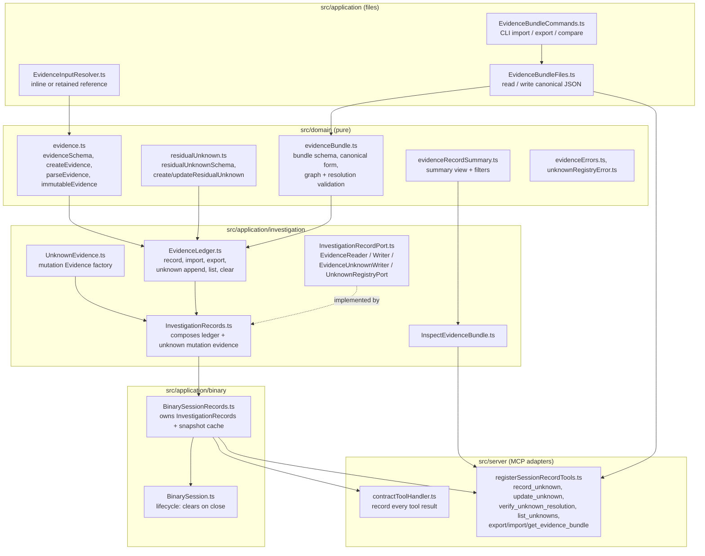
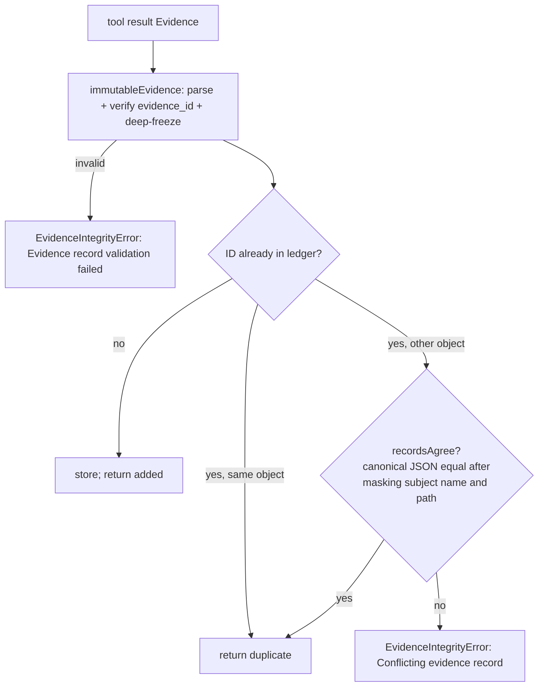
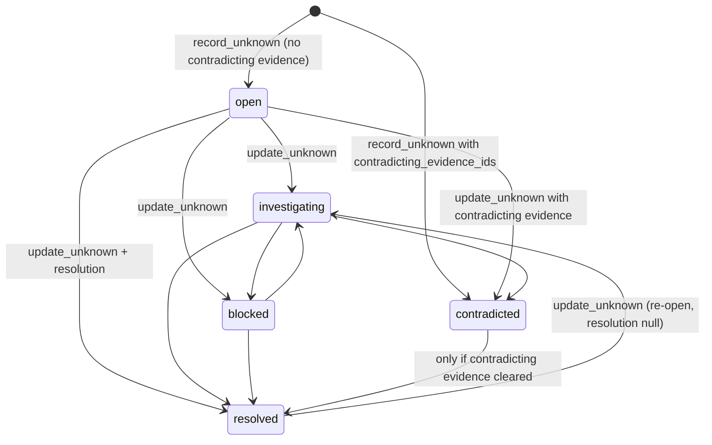
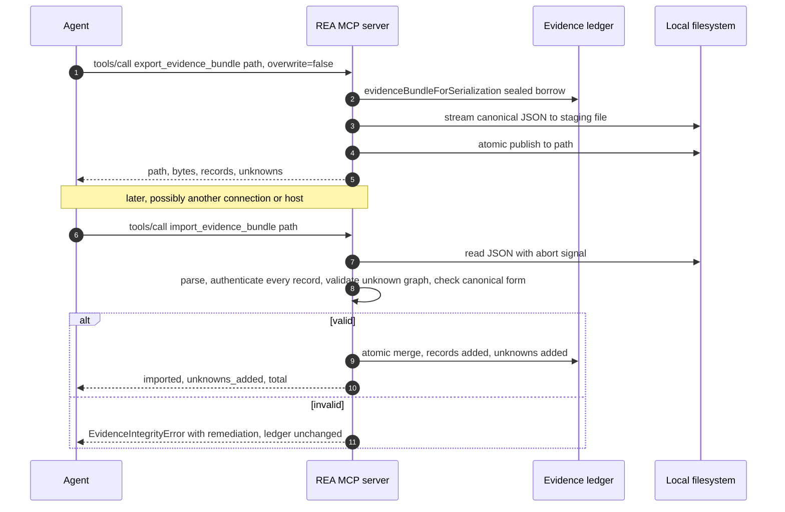
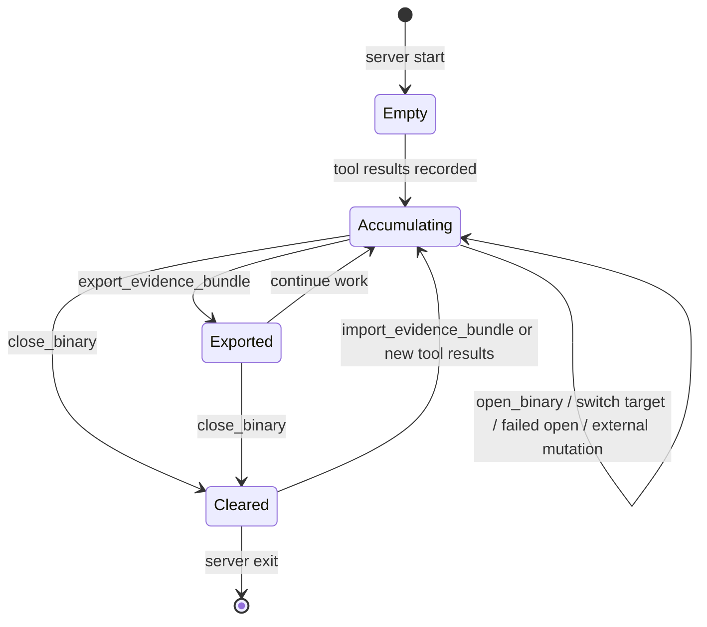
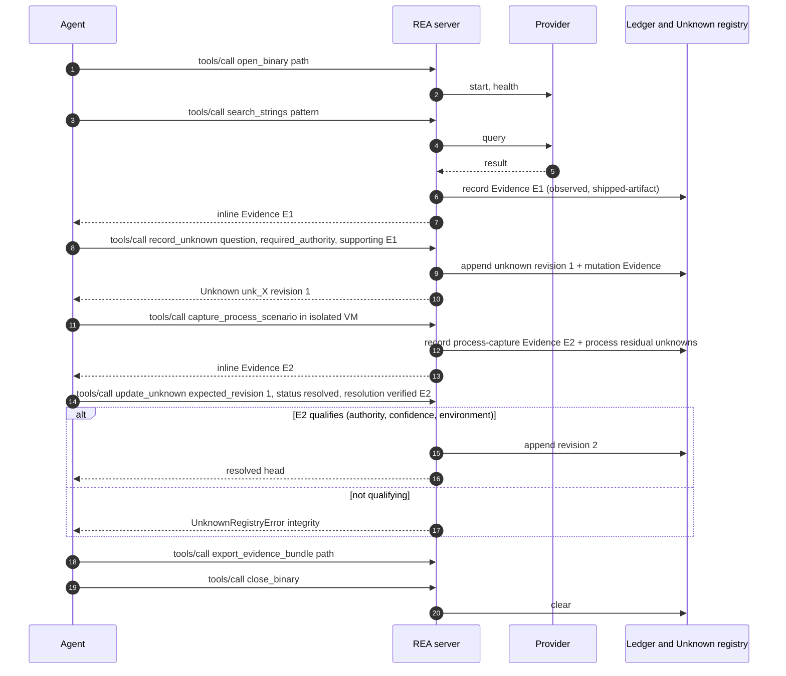

# 10. Evidence model, ledger, residual unknowns and evidence bundles

> Chapter 10 of the REA deep-dive. Source: `github.com/morluto/rea` at HEAD `f75b1a4` (npm `rea-agents` 6.4.0). All paths are repo-relative; line numbers were verified against the checkout. Code blocks marked with a path and a line range are **verbatim**.
>
> Related chapters: [03-mcp-server-runtime-and-contracts.md](03-mcp-server-runtime-and-contracts.md) (tool result delivery), [06-provider-layer-and-session-routing.md](06-provider-layer-and-session-routing.md) (provider identity, analysis profile), [11-comparison-snapshots-analysis-view-reconstruction.md](11-comparison-snapshots-analysis-view-reconstruction.md) (comparisons, snapshots, views), [12-ai-layer-prompts-and-skills.md](12-ai-layer-prompts-and-skills.md) (how agents are told to use Evidence), [18-process-capture-and-instrumentation.md](18-process-capture-and-instrumentation.md), [21-security-model.md](21-security-model.md), [23-defensive-malware-analysis-playbook.md](23-defensive-malware-analysis-playbook.md), [24-porting-blueprints.md](24-porting-blueprints.md).

## 10.1 Why this layer matters

Every successful analysis operation in REA returns an **Evidence record**: an immutable, self-authenticating JSON document that names *what was observed* (operation, parameters, result), *about what* (artifact subject with SHA-256), *by whom* (provider identity and analysis profile), *how sure* (`confidence`), *under what authority* (`authority`), *under what environment*, *with what limitations*, and *linked to which other Evidence*. A session keeps these records in an **Evidence ledger**; open questions are kept next to them as **residual Unknowns** with a revision chain; the whole set can be exported as a canonical **Evidence bundle** (RFC 8785 JSON) and re-imported or compared elsewhere.

This is the single most reusable idea in REA for malware work: it is a provenance model that forces separation of *observation*, *derivation* and *inference*, and records *what you still do not know* as first-class data.



*Figure 10.1 - Component and dependency map of the evidence subsystem.* Dependencies flow inward: pure schemas and canonicalization in `src/domain`; the ledger, unknown registry and port interfaces in `src/application/investigation`; file I/O in `src/application/EvidenceBundle*.ts`; session ownership in `src/application/binary`; MCP adapters in `src/server`. The domain layer imports no I/O. The ledger depends only on domain code, which is what makes the subsystem separable (see Porting notes).

## 10.2 The Evidence record contract

### 10.2.1 Zod schema (verbatim)

The record is defined by `evidenceBaseSchema` (strict object) plus a `superRefine` that checks the analysis-profile provider matches the evidence provider. Subject, location, authority and environment sub-schemas precede it.

`src/domain/evidence.ts:35-142`

```ts
/** Provider identity schema shared by evidence-bearing persistence formats. */
export const providerSchema = z.strictObject({
  id: z.string().min(1),
  name: z.string().min(1),
  version: z.string().nullable(),
});
const subjectFormatSchema = z.enum([
  "hopper",
  "analysis-database",
  "mach-o",
  "elf",
  "pe",
  "dos-mz",
  "dos-com",
  "raw-binary",
  "zip",
  "ipa",
  "apk",
  "msix",
  "appx",
  "hap",
  "hsp",
  "app-pack",
  "asar",
  "dmg",
  "pkg",
  "plist",
  "javascript",
  "source-map",
  "directory",
  "file",
  "unknown",
  "mach-o-universal",
  "javascript-bundle",
  "entitlements",
]);
const subjectBaseSchema = z.strictObject({
  name: z.string().min(1),
  digest: z.strictObject({ sha256: digestSchema }),
  local_path: nulFreeStringSchema,
});
// The format owns the architecture claim, including nested Evidence subjects.
const subjectSchema = z.discriminatedUnion("format", [
  subjectBaseSchema.extend({
    format: subjectFormatSchema.exclude(["raw-binary"]),
    architecture: z.enum(BINARY_ARCHITECTURES).exclude(["6502"]).nullable(),
  }),
  subjectBaseSchema.extend({
    format: z.literal("raw-binary"),
    architecture: z.enum(BINARY_ARCHITECTURES).nullable(),
  }),
]);
/** Source location attached to an evidence observation. */
/** Source-location schema shared by evidence-bearing persistence formats. */
export const evidenceLocationSchema = z.discriminatedUnion("kind", [
  z.strictObject({ kind: z.literal("address"), address: z.string().min(1) }),
  z.strictObject({
    kind: z.literal("address-range"),
    start: z.string().min(1),
    end: z.string().min(1),
  }),
  z.strictObject({ kind: z.literal("artifact-path"), path: z.string().min(1) }),
  z.strictObject({
    kind: z.literal("file-offset"),
    offset: z.number().int().min(0),
  }),
  z.strictObject({
    kind: z.literal("file-offset-range"),
    start: z.number().int().min(0),
    end: z.number().int().min(0),
  }),
]);

const evidenceAuthoritySchema = z.enum([
  "shipped-artifact",
  "controlled-replay",
  "historical-reference",
  "external-service",
  "analyst-inference",
]);

const executionEnvironmentSchema = z.strictObject({
  id: z.string().min(1),
  platform: z.string().min(1),
  architecture: z.string().min(1),
  isolation: z.enum(["none", "process", "container", "virtual-machine"]),
});

const evidenceBaseSchema = z
  .object({
    evidence_id: prefixedDigestSchema("ev"),
    subject: subjectSchema.nullable(),
    provider: providerSchema,
    analysis_profile: analysisProfileSchema.nullable(),
    predicate_type: z.string().min(1),
    operation: z.string().min(1),
    parameters: jsonObjectSchema,
    raw_result: jsonValueSchema.nullable(),
    normalized_result: jsonValueSchema,
    confidence: z.enum(["observed", "derived", "inferred"]),
    authority: evidenceAuthoritySchema,
    environment: executionEnvironmentSchema.nullable(),
    limitations: z.array(z.string()),
    relationship_coverage: relationshipCoverageSchema.nullable().default(null),
    locations: z.array(evidenceLocationSchema),
    evidence_links: z.array(prefixedDigestSchema("ev")),
  })
  .strict();
```

`src/domain/evidence.ts:144-197`

```ts
/** Require a reported analysis profile to identify the observation provider. */
export const validateAnalysisProfileProvider = (
  evidence: Pick<
    z.infer<typeof evidenceBaseSchema>,
    "analysis_profile" | "provider"
  >,
  context: z.RefinementCtx,
): void => {
  const profile = evidence.analysis_profile;
  if (
    profile !== null &&
    (profile.provider.id !== evidence.provider.id ||
      profile.provider.name !== evidence.provider.name ||
      profile.provider.version !== evidence.provider.version)
  )
    context.addIssue({
      code: "custom",
      path: ["analysis_profile", "provider"],
      message: "Analysis profile provider does not match Evidence provider",
    });
};

/** Strict, provider-neutral record for one successful public observation. */
export const evidenceSchema = evidenceBaseSchema.superRefine(
  validateAnalysisProfileProvider,
);

const authenticatedEvidenceSchema = evidenceSchema.superRefine(
  (evidence, context) => {
    const { evidence_id: evidenceId, ...withoutId } = evidence;
    if (computeEvidenceId(withoutId) !== evidenceId)
      context.addIssue({
        code: "custom",
        path: ["evidence_id"],
        message: "Evidence semantic identifier does not match its record",
      });
  },
);

/** Complete observation whose normalized payload retains its operation-specific type. */
type EvidenceSchemaValue = z.infer<typeof evidenceSchema>;
export type Evidence<Result extends JsonValue = JsonValue> =
  EvidenceSchemaValue & {
    readonly normalized_result: Result;
  };
const immutableEvidenceSnapshots = new WeakMap<object, Evidence>();
const immutableResultSchema = z
  .custom<JsonValue>(isImmutableJsonSnapshot)
  .superRefine((value, context) => {
    const issue = jsonValueValidationIssue(value);
    if (issue !== undefined)
      context.addIssue({ code: "custom", message: issue });
  });
export type EvidenceLocation = z.infer<typeof evidenceLocationSchema>;
```

**Field-by-field contract**

| Field | Type | Meaning / rule | Source |
| --- | --- | --- | --- |
| `evidence_id` | `ev_<64 lowercase hex>` | Semantic identity: SHA-256 over the canonical JSON projection of the record **excluding** `evidence_id`, `subject.name` and `subject.local_path`. Verified on every parse. | `evidence.ts:125,247-276` |
| `subject` | object or `null` | The artifact the observation is about: `name`, `digest.sha256`, `local_path`, `format` (28 values), `architecture`. `null` for derived/session Evidence with no single artifact (comparisons, unknown mutations); then a limitation string is added automatically. | `evidence.ts:41-86,389-398,422-428` |
| `provider` | `{id,name,version\|null}` | Who produced the observation (e.g. `ghidra`, `rea-artifact-comparison`, `rea-unknown-registry`). | `evidence.ts:36-40` |
| `analysis_profile` | profile or `null` | Canonical commitment `{provider:{id,name,version}, parameters, digest}`; `digest` = SHA-256 of the RFC 8785 JSON of provider+parameters; its provider must equal `provider`. Participates in identity either way. | `evidence.ts:128,144-164`; `src/domain/analysisProfile.ts:10-75` |
| `predicate_type` | string | Evidence kind namespace; default `rea.analysis`. Others seen in code: `rea.process-capture`, `rea.process-comparison`, `rea.artifact-comparison`, `rea.function-comparison`, `rea.bundle-comparison`, `rea.changed-behavior`, `rea.call-path`, `rea.static-runtime-correlation`, `rea.reconstruction-verification`, `rea.residual-unknown-mutation`, `rea.analysis-view`, `rea.reconstruction-obligation-ledger`. | `evidence.ts:129,414`; `src/server/registerInvestigationTools.ts` |
| `operation` | string | Tool/operation name (`analyze_function`, `search_strings`, ...). | `evidence.ts:130` |
| `parameters` | JSON object | The exact request that produced the observation (process capture records only counts/basename, not arguments or secrets: `src/application/process/ProcessEvidence.ts:12-23`). | `evidence.ts:131` |
| `raw_result` | JSON or `null` | Provider representation distinct from the normalized result (e.g. upstream tool report). | `evidence.ts:132` |
| `normalized_result` | JSON | Operation-specific payload; typed per operation. | `evidence.ts:133` |
| `confidence` | `observed` \| `derived` \| `inferred` | Epistemic grade; default `observed`. Rank used when qualifying resolutions: inferred 1 < derived 2 < observed 3. | `evidence.ts:134,419`; `evidenceBundle.ts:490-496` |
| `authority` | `shipped-artifact` \| `controlled-replay` \| `historical-reference` \| `external-service` \| `analyst-inference` | Where the truth comes from; default `shipped-artifact`. | `evidence.ts:108-114,420` |
| `environment` | `{id,platform,architecture,isolation}` or `null` | Execution environment; `isolation` is one of `none`/`process`/`container`/`virtual-machine`. | `evidence.ts:116-121` |
| `limitations` | string[] | Human/agent-readable caveats; never dropped across derivations (comparisons copy them). | `evidence.ts:137` |
| `relationship_coverage` | `complete`/`partial`/`unknown` or `null` | Whether a caller/callee set is complete; `null` is omitted from the identity projection. | `evidence.ts:138,267-269`; `src/domain/relationshipCoverage.ts` |
| `locations` | array | `address`, `address-range`, `artifact-path`, `file-offset`, `file-offset-range`. | `evidence.ts:89-106,139` |
| `evidence_links` | `ev_...`[] | Evidence this record is derived from (the provenance DAG). | `evidence.ts:140` |

**Not envelope fields (important for porting):** `parent_evidence_id` and `retention` do **not** exist on the Evidence envelope. `parent_evidence_id` is a field of the *normalized result of an analysis view* (`src/domain/analysisView/analysisView.ts:335-337`, `viewResultBase`) and is also copied into the view Evidence's `parameters.parent_evidence_id` and `evidence_links` (`src/application/analysisView/AnalysisViewService.ts:270-276`). `retention: "complete-record"` appears only in the bundle *summary* (`src/domain/evidenceRecordSummary.ts:73`) and in oversized-error details (`details.retention`). Where the brief asks for these in the "Evidence record contract", the code attaches them to views/summaries, not to the record.

### 10.2.2 JSON Schema of the record

Generated by calling `z.toJSONSchema(evidenceSchema, {io:"output", target:"draft-2020-12", unrepresentable:"any"})` on the compiled `dist/domain/evidence.js` (zod 4). This is an approximation of what the MCP output schemas advertise (the advertised per-tool schemas are produced by the orchestrator's catalog chapter); the semantic-ID check and the profile-provider equality are `superRefine` rules that JSON Schema cannot express.

```json
{
  "$schema": "https://json-schema.org/draft/2020-12/schema",
  "type": "object",
  "properties": {
    "evidence_id": {
      "type": "string",
      "pattern": "^ev_[a-f0-9]{64}$"
    },
    "subject": {
      "anyOf": [
        {
          "oneOf": [
            {
              "type": "object",
              "properties": {
                "name": {
                  "type": "string",
                  "minLength": 1
                },
                "digest": {
                  "type": "object",
                  "properties": {
                    "sha256": {
                      "type": "string",
                      "pattern": "^[a-f0-9]{64}$"
                    }
                  },
                  "required": [
                    "sha256"
                  ],
                  "additionalProperties": false
                },
                "local_path": {
                  "type": "string",
                  "pattern": "^[^\\x00]*$"
                },
                "format": {
                  "type": "string",
                  "enum": [
                    "hopper",
                    "analysis-database",
                    "mach-o",
                    "elf",
                    "pe",
                    "dos-mz",
                    "dos-com",
                    "zip",
                    "ipa",
                    "apk",
                    "msix",
                    "appx",
                    "hap",
                    "hsp",
                    "app-pack",
                    "asar",
                    "dmg",
                    "pkg",
                    "plist",
                    "javascript",
                    "source-map",
                    "directory",
                    "file",
                    "unknown",
                    "mach-o-universal",
                    "javascript-bundle",
                    "entitlements"
                  ]
                },
                "architecture": {
                  "anyOf": [
                    {
                      "type": "string",
                      "enum": [
                        "x86",
                        "x86_64",
                        "arm",
                        "arm64",
                        "mips",
                        "riscv",
                        "powerpc"
                      ]
                    },
                    {
                      "type": "null"
                    }
                  ]
                }
              },
              "required": [
                "name",
                "digest",
                "local_path",
                "format",
                "architecture"
              ],
              "additionalProperties": false
            },
            {
              "type": "object",
              "properties": {
                "name": {
                  "type": "string",
                  "minLength": 1
                },
                "digest": {
                  "type": "object",
                  "properties": {
                    "sha256": {
                      "type": "string",
                      "pattern": "^[a-f0-9]{64}$"
                    }
                  },
                  "required": [
                    "sha256"
                  ],
                  "additionalProperties": false
                },
                "local_path": {
                  "type": "string",
                  "pattern": "^[^\\x00]*$"
                },
                "format": {
                  "type": "string",
                  "const": "raw-binary"
                },
                "architecture": {
                  "anyOf": [
                    {
                      "type": "string",
                      "enum": [
                        "6502",
                        "x86",
                        "x86_64",
                        "arm",
                        "arm64",
                        "mips",
                        "riscv",
                        "powerpc"
                      ]
                    },
                    {
                      "type": "null"
                    }
                  ]
                }
              },
              "required": [
                "name",
                "digest",
                "local_path",
                "format",
                "architecture"
              ],
              "additionalProperties": false
            }
          ]
        },
        {
          "type": "null"
        }
      ]
    },
    "provider": {
      "type": "object",
      "properties": {
        "id": {
          "type": "string",
          "minLength": 1
        },
        "name": {
          "type": "string",
          "minLength": 1
        },
        "version": {
          "anyOf": [
            {
              "type": "string"
            },
            {
              "type": "null"
            }
          ]
        }
      },
      "required": [
        "id",
        "name",
        "version"
      ],
      "additionalProperties": false
    },
    "analysis_profile": {
      "anyOf": [
        {
          "type": "object",
          "properties": {
            "provider": {
              "type": "object",
              "properties": {
                "id": {
                  "type": "string",
                  "minLength": 1
                },
                "name": {
                  "type": "string",
                  "minLength": 1
                },
                "version": {
                  "type": "string",
                  "minLength": 1
                }
              },
              "required": [
                "id",
                "name",
                "version"
              ],
              "additionalProperties": false
            },
            "parameters": {
              "type": "object",
              "additionalProperties": {}
            },
            "digest": {
              "type": "string",
              "pattern": "^[a-f0-9]{64}$"
            }
          },
          "required": [
            "provider",
            "parameters",
            "digest"
          ],
          "additionalProperties": false
        },
        {
          "type": "null"
        }
      ]
    },
    "predicate_type": {
      "type": "string",
      "minLength": 1
    },
    "operation": {
      "type": "string",
      "minLength": 1
    },
    "parameters": {
      "type": "object",
      "additionalProperties": {}
    },
    "raw_result": {
      "anyOf": [
        {},
        {
          "type": "null"
        }
      ]
    },
    "normalized_result": {},
    "confidence": {
      "type": "string",
      "enum": [
        "observed",
        "derived",
        "inferred"
      ]
    },
    "authority": {
      "type": "string",
      "enum": [
        "shipped-artifact",
        "controlled-replay",
        "historical-reference",
        "external-service",
        "analyst-inference"
      ]
    },
    "environment": {
      "anyOf": [
        {
          "type": "object",
          "properties": {
            "id": {
              "type": "string",
              "minLength": 1
            },
            "platform": {
              "type": "string",
              "minLength": 1
            },
            "architecture": {
              "type": "string",
              "minLength": 1
            },
            "isolation": {
              "type": "string",
              "enum": [
                "none",
                "process",
                "container",
                "virtual-machine"
              ]
            }
          },
          "required": [
            "id",
            "platform",
            "architecture",
            "isolation"
          ],
          "additionalProperties": false
        },
        {
          "type": "null"
        }
      ]
    },
    "limitations": {
      "type": "array",
      "items": {
        "type": "string"
      }
    },
    "relationship_coverage": {
      "default": null,
      "anyOf": [
        {
          "oneOf": [
            {
              "type": "object",
              "properties": {
                "status": {
                  "type": "string",
                  "const": "complete"
                },
                "diagnostics": {
                  "minItems": 1,
                  "type": "array",
                  "items": {
                    "type": "string",
                    "minLength": 1
                  }
                }
              },
              "required": [
                "status"
              ],
              "additionalProperties": false
            },
            {
              "type": "object",
              "properties": {
                "status": {
                  "type": "string",
                  "const": "partial"
                },
                "limitations": {
                  "minItems": 1,
                  "type": "array",
                  "items": {
                    "type": "string",
                    "minLength": 1
                  }
                },
                "limited_directions": {
                  "anyOf": [
                    {
                      "type": "array",
                      "prefixItems": [
                        {
                          "type": "string",
                          "const": "callers"
                        }
                      ],
                      "minItems": 1,
                      "maxItems": 1
                    },
                    {
                      "type": "array",
                      "prefixItems": [
                        {
                          "type": "string",
                          "const": "callees"
                        }
                      ],
                      "minItems": 1,
                      "maxItems": 1
                    },
                    {
                      "type": "array",
                      "prefixItems": [
                        {
                          "type": "string",
                          "const": "callers"
                        },
                        {
                          "type": "string",
                          "const": "callees"
                        }
                      ],
                      "minItems": 2,
                      "maxItems": 2
                    }
                  ]
                },
                "diagnostics": {
                  "minItems": 1,
                  "type": "array",
                  "items": {
                    "type": "string",
                    "minLength": 1
                  }
                }
              },
              "required": [
                "status",
                "limitations"
              ],
              "additionalProperties": false
            },
            {
              "type": "object",
              "properties": {
                "status": {
                  "type": "string",
                  "const": "unknown"
                },
                "reason": {
                  "type": "string",
                  "minLength": 1
                },
                "limited_directions": {
                  "anyOf": [
                    {
                      "type": "array",
                      "prefixItems": [
                        {
                          "type": "string",
                          "const": "callers"
                        }
                      ],
                      "minItems": 1,
                      "maxItems": 1
                    },
                    {
                      "type": "array",
                      "prefixItems": [
                        {
                          "type": "string",
                          "const": "callees"
                        }
                      ],
                      "minItems": 1,
                      "maxItems": 1
                    },
                    {
                      "type": "array",
                      "prefixItems": [
                        {
                          "type": "string",
                          "const": "callers"
                        },
                        {
                          "type": "string",
                          "const": "callees"
                        }
                      ],
                      "minItems": 2,
                      "maxItems": 2
                    }
                  ]
                },
                "diagnostics": {
                  "minItems": 1,
                  "type": "array",
                  "items": {
                    "type": "string",
                    "minLength": 1
                  }
                }
              },
              "required": [
                "status",
                "reason"
              ],
              "additionalProperties": false
            }
          ]
        },
        {
          "type": "null"
        }
      ]
    },
    "locations": {
      "type": "array",
      "items": {
        "oneOf": [
          {
            "type": "object",
            "properties": {
              "kind": {
                "type": "string",
                "const": "address"
              },
              "address": {
                "type": "string",
                "minLength": 1
              }
            },
            "required": [
              "kind",
              "address"
            ],
            "additionalProperties": false
          },
          {
            "type": "object",
            "properties": {
              "kind": {
                "type": "string",
                "const": "address-range"
              },
              "start": {
                "type": "string",
                "minLength": 1
              },
              "end": {
                "type": "string",
                "minLength": 1
              }
            },
            "required": [
              "kind",
              "start",
              "end"
            ],
            "additionalProperties": false
          },
          {
            "type": "object",
            "properties": {
              "kind": {
                "type": "string",
                "const": "artifact-path"
              },
              "path": {
                "type": "string",
                "minLength": 1
              }
            },
            "required": [
              "kind",
              "path"
            ],
            "additionalProperties": false
          },
          {
            "type": "object",
            "properties": {
              "kind": {
                "type": "string",
                "const": "file-offset"
              },
              "offset": {
                "type": "integer",
                "minimum": 0,
                "maximum": 9007199254740991
              }
            },
            "required": [
              "kind",
              "offset"
            ],
            "additionalProperties": false
          },
          {
            "type": "object",
            "properties": {
              "kind": {
                "type": "string",
                "const": "file-offset-range"
              },
              "start": {
                "type": "integer",
                "minimum": 0,
                "maximum": 9007199254740991
              },
              "end": {
                "type": "integer",
                "minimum": 0,
                "maximum": 9007199254740991
              }
            },
            "required": [
              "kind",
              "start",
              "end"
            ],
            "additionalProperties": false
          }
        ]
      }
    },
    "evidence_links": {
      "type": "array",
      "items": {
        "type": "string",
        "pattern": "^ev_[a-f0-9]{64}$"
      }
    }
  },
  "required": [
    "evidence_id",
    "subject",
    "provider",
    "analysis_profile",
    "predicate_type",
    "operation",
    "parameters",
    "raw_result",
    "normalized_result",
    "confidence",
    "authority",
    "environment",
    "limitations",
    "relationship_coverage",
    "locations",
    "evidence_links"
  ],
  "additionalProperties": false
}```

### 10.2.3 Identity, construction and immutability (verbatim)

`createEvidence` normalizes an observation into a strict record and stamps its semantic ID. `parseEvidence` re-computes the ID and rejects tampering. `immutableEvidence` deep-freezes and registers the record in a `WeakMap` so later parses of the same object are zero-cost.

`src/domain/evidence.ts:245-355`

```ts
type EvidenceWithoutId = Omit<EvidenceSchemaValue, "evidence_id">;

const semanticProjection = (evidence: EvidenceWithoutId): JsonValue => ({
  subject:
    evidence.subject === null
      ? null
      : {
          digest: evidence.subject.digest,
          format: evidence.subject.format,
          architecture: evidence.subject.architecture,
        },
  provider: evidence.provider,
  analysis_profile: evidence.analysis_profile,
  predicate_type: evidence.predicate_type,
  operation: evidence.operation,
  parameters: evidence.parameters,
  raw_result: evidence.raw_result,
  normalized_result: evidence.normalized_result,
  confidence: evidence.confidence,
  authority: evidence.authority,
  environment: evidence.environment,
  limitations: evidence.limitations,
  ...(evidence.relationship_coverage === null
    ? {}
    : { relationship_coverage: evidence.relationship_coverage }),
  locations: evidence.locations,
  evidence_links: evidence.evidence_links,
});

/** Hash semantic content, including raw results and excluding display-subject fields. */
const computeEvidenceId = (evidence: EvidenceWithoutId): string =>
  `ev_${digestCanonicalValue(semanticProjection(evidence), "Evidence")}`;

/** Parse evidence and reject a syntactically valid but tampered semantic ID. */
export const parseEvidence = (input: unknown): Evidence => {
  const immutable =
    typeof input === "object" && input !== null
      ? immutableEvidenceSnapshots.get(input)
      : undefined;
  if (immutable !== undefined) return immutable;
  return authenticatedEvidenceSchema.parse(input);
};

/** Authenticate and seal a ledger-owned snapshot; external mutable values are copied first. */
export const immutableEvidence = (input: unknown): Evidence =>
  rememberImmutableEvidence(parseEvidence(input));

/** Rebind display path metadata when an authenticated record names this target. */
export const rebindEvidenceToTargetPath = (
  evidence: Evidence,
  target: EvidenceSubjectTarget,
): Evidence => {
  const subject = evidence.subject;
  if (subject === null) return evidence;
  const rebound = rebindEvidenceSubjectTargetPath(
    {
      path: subject.local_path,
      sha256: subject.digest.sha256,
      format: subject.format,
      ...(subject.architecture === null
        ? {}
        : { architecture: subject.architecture }),
    },
    target,
  );
  if (rebound.path === subject.local_path) return evidence;
  const reboundSubject = subjectSchema.parse({
    ...subject,
    name: basename(target.path) || "artifact",
    local_path: target.path,
  });
  const reboundEvidence = { ...evidence, subject: reboundSubject };
  if (!isImmutableEvidence(evidence)) return immutableEvidence(reboundEvidence);

  // The original authenticated Evidence owns immutable payloads. Only the
  // small display subject and envelope are new, so preserve those payloads
  // without reparsing a potentially large analysis result.
  Object.freeze(reboundSubject.digest);
  Object.freeze(reboundSubject);
  Object.freeze(reboundEvidence);
  immutableEvidenceSnapshots.set(reboundEvidence, reboundEvidence);
  return reboundEvidence;
};

/** Recognize authenticated Evidence whose complete reachable JSON data is immutable. */
export const isImmutableEvidence = (evidence: Evidence): boolean =>
  immutableEvidenceSnapshots.has(evidence);

const rememberImmutableEvidence = (evidence: Evidence): Evidence => {
  freezeJsonSnapshot(evidence);
  immutableEvidenceSnapshots.set(evidence, evidence);
  return evidence;
};

/** Build deterministic Evidence from an immutable artifact subject. */
export const createEvidence = (
  target: EvidenceSubjectTarget | BinaryTarget | undefined,
  provider: EvidenceProvider,
  observation: EvidenceObservation,
): Evidence => {
  const { normalized, sharedResult } = normalizeEvidenceObservation(
    target,
    provider,
    observation,
  );
  const evidence = {
    ...normalized,
    evidence_id: computeEvidenceId(normalized),
  };
  return sharedResult ? rememberImmutableEvidence(evidence) : evidence;
};
```

`src/domain/evidence.ts:384-453`

```ts
const normalizeEvidenceObservation = (
  target: EvidenceSubjectTarget | BinaryTarget | undefined,
  provider: EvidenceProvider,
  observation: EvidenceObservation,
) => {
  const subject =
    target === undefined
      ? null
      : {
          name: basename(target.path) || "artifact",
          digest: { sha256: target.sha256 },
          format: target.format,
          architecture: target.architecture ?? null,
          local_path: target.path,
        };
  const semantic = {
    subject:
      subject === null
        ? null
        : {
            digest: subject.digest,
            format: subject.format,
            architecture: subject.architecture,
          },
    provider: {
      id: provider.id,
      name: provider.name,
      version: provider.version,
    },
    analysis_profile: observation.analysisProfile ?? null,
    predicate_type: observation.predicateType ?? "rea.analysis",
    operation: observation.operation,
    parameters: observation.parameters,
    raw_result: observation.rawResult ?? null,
    normalized_result: observation.result,
    confidence: observation.confidence ?? "observed",
    authority: observation.authority ?? "shipped-artifact",
    environment: observation.environment ?? null,
    limitations: [
      ...(target === undefined
        ? [
            observation.subjectUnavailableReason ??
              "Artifact identity is unavailable for this observation.",
          ]
        : []),
      ...(observation.limitations ?? []),
    ],
    ...(observation.relationshipCoverage === undefined
      ? { relationship_coverage: null }
      : { relationship_coverage: observation.relationshipCoverage }),
    locations: [...(observation.locations ?? [])],
    evidence_links: [...(observation.evidenceLinks ?? [])],
  } satisfies JsonValue;
  const sharedResult =
    typeof observation.result === "object" &&
    observation.result !== null &&
    isImmutableJsonSnapshot(observation.result);
  const selectedSchema = sharedResult
    ? evidenceSchema.safeExtend({ normalized_result: immutableResultSchema })
    : evidenceSchema;
  const normalized = selectedSchema.parse({
    ...semantic,
    evidence_id: `ev_${"0".repeat(64)}`,
    subject,
  });
  // The envelope has already been parsed into an independent snapshot. Only
  // its derived identifier changes here; parsing again clones the full payload
  // and recomputes the same digest while the previous snapshot is still live.
  return { normalized, sharedResult };
};
```

Facts that follow from the code:

1. **Display fields are not identity.** `semanticProjection` copies `subject.digest`, `format`, `architecture` but not `name`/`local_path` (`evidence.ts:247-257`). The same bytes analysed from two paths yield the same `evidence_id`. `rebindEvidenceToTargetPath` (`:293-327`) rewrites only the display subject when SHA-256, format and architecture match.
2. **Tampering is detected at parse.** `authenticatedEvidenceSchema` (`:171-181`) recomputes the ID; a record whose payload was edited fails with "Evidence semantic identifier does not match its record".
3. **Unsupported fields are rejected** (`.strict()` at `:142`), so application metadata must live in `parameters`, `raw_result`, `normalized_result` or profile parameters (`docs/mcp-contracts.md`, "Tool results").
4. **Defaults**: `predicate_type: "rea.analysis"`, `confidence: "observed"`, `authority: "shipped-artifact"` (`:414,419,420`). A tool that does not set them is therefore claiming *observed* evidence from the *shipped artifact*; derived tools override both (see 10.2.4).

### 10.2.4 Which producers set which grade (fact, from the registrations)

| Producer (tool) | `predicate_type` | `confidence` | `authority` | `subject` | Source |
| --- | --- | --- | --- | --- | --- |
| Provider-backed analysis (session execute) | `rea.analysis` (default) | observed (default) | shipped-artifact (default) | the open target | `src/application/binary/BinarySession.ts:750-775` |
| `capture_process_scenario` | `rea.process-capture` | observed | **controlled-replay** | `null` | `src/application/process/ProcessEvidence.ts:28-54` |
| `compare_artifacts` | `rea.artifact-comparison` | derived | analyst-inference | `null` | `src/server/registerArtifactComparisonTool.ts:53-69` |
| `compare_functions` | `rea.function-comparison` | derived | analyst-inference | `null` | `src/server/registerFunctionComparisonTool.ts:86-100` |
| `compare_process_captures` | `rea.process-comparison` | derived | analyst-inference | `null` | `src/server/registerProcessComparisonTool.ts:147-170` |
| `compare_bundles` | `rea.bundle-comparison` | derived | analyst-inference | `null` | `src/server/registerBundleComparisonTool.ts:72-90` |
| `find_changed_behavior`, `build_call_path`, `verify_reconstruction` | `rea.changed-behavior` / `rea.call-path` / `rea.reconstruction-verification` | derived | analyst-inference | `null` | `src/server/registerInvestigationTools.ts:76-90,134-148,255-269` |
| `correlate_static_and_runtime` | `rea.static-runtime-correlation` | **inferred** | analyst-inference | `null` | `src/server/registerInvestigationTools.ts:196-209` |
| `inspect_analysis_view` | `rea.analysis-view` | derived (inferred for templated API surfaces) | copied from parent | parent's | `src/application/analysisView/AnalysisViewService.ts:221-262` |
| `record_unknown` / `update_unknown` mutation record | `rea.residual-unknown-mutation` | derived | analyst-inference | explicit target or `null` | `src/application/investigation/UnknownEvidence.ts:30-53` |
| `build_reconstruction_obligation_ledger` | `rea.reconstruction-obligation-ledger` | inferred | analyst-inference | `null` | `src/application/ReconstructionObligationLedgerService.ts:62-81` |

Practical reading for an analyst: **only `shipped-artifact`/`observed` (static, provider-observed) and `controlled-replay`/`observed` (process capture) records are observations; everything that REA computes *from* records is `derived`/`analyst-inference` or weaker.** This is why a verified resolution of an Unknown demands specific authority and confidence (10.4).

## 10.3 The EvidenceLedger

`EvidenceLedger` (`src/application/investigation/EvidenceLedger.ts`) is the session-owned store: a `Map<evidence_id, Evidence>`, a `Map<"unk_id:revision", ResidualUnknown>` of every revision and a `Map<unk_id, ResidualUnknown>` of current heads. It is in-memory only. Full source (verbatim):

`src/application/investigation/EvidenceLedger.ts:1-498`

```ts
import canonicalize from "canonicalize";

import {
  createEvidenceBundle,
  createImmutableEvidenceBundle,
  describeEvidenceBundleFailure,
  parseEvidenceBundle,
  validateResidualUnknownAddition,
  type EvidenceBundle,
} from "../../domain/evidenceBundle.js";
import { AnalysisInputError } from "../../domain/analysisErrorCore.js";
import { EvidenceIntegrityError } from "../../domain/evidenceErrors.js";
import { UnknownRegistryError } from "../../domain/unknownRegistryError.js";
import { immutableEvidence, type Evidence } from "../../domain/evidence.js";
import {
  createResidualUnknown,
  updateResidualUnknown,
  type RecordUnknownInput,
  type ResidualUnknown,
  type UnknownStatus,
  type UpdateUnknownInput,
} from "../../domain/residualUnknown.js";
import { err, ok, type Result } from "../../domain/result.js";
import { compareUnicodeCodePoints } from "../../domain/unicodeCodePointOrder.js";
import type { UnknownPage, UnknownQuery } from "./InvestigationRecordPort.js";

type EvidenceLedgerFailure = EvidenceIntegrityError;
type RecordResult = Result<"added" | "duplicate", EvidenceLedgerFailure>;

/** Describes the state changes made by one atomic bundle import. */
export interface EvidenceImportDelta {
  readonly recordsAdded: number;
  readonly unknownsAdded: number;
  readonly changed: boolean;
  readonly metadataChanged: boolean;
}

type ImportResult = Result<
  EvidenceImportDelta,
  EvidenceLedgerFailure | AnalysisInputError
>;

/** Session-owned set of immutable evidence records. */
export class EvidenceLedger {
  readonly #records = new Map<string, Evidence>();
  readonly #unknownRevisions = new Map<string, ResidualUnknown>();
  readonly #unknownHeads = new Map<string, ResidualUnknown>();
  /** Record evidence idempotently; conflicting content is rejected. */
  record(input: Evidence): RecordResult {
    let evidence: Evidence;
    try {
      evidence = immutableEvidence(input);
    } catch (cause: unknown) {
      return err(
        new EvidenceIntegrityError("Evidence record validation failed", {
          cause,
        }),
      );
    }
    const existing = this.#records.get(evidence.evidence_id);
    if (existing !== undefined) {
      // A borrowed record is already authenticated and deeply immutable. Its
      // identity cannot change between reads, so comparing document-sized
      // canonical strings again would add no integrity check.
      if (existing === evidence) return ok("duplicate");
      return recordsAgree(existing, evidence)
        ? ok("duplicate")
        : err(new EvidenceIntegrityError("Conflicting evidence record"));
    }
    this.#records.set(evidence.evidence_id, evidence);
    return ok("added");
  }

  /** Validate an entire bundle before atomically merging its records. */
  import(input: unknown): ImportResult {
    let bundle: EvidenceBundle;
    try {
      bundle = parseEvidenceBundle(input);
    } catch (cause: unknown) {
      const failure = describeEvidenceBundleFailure(input, cause);
      if (failure.kind === "single-record")
        return err(
          new AnalysisInputError("import_evidence_bundle", {
            cause,
            userMessage: failure.message,
          }),
        );
      return err(
        new EvidenceIntegrityError("Evidence bundle validation failed", {
          cause,
          userMessage: failure.message,
        }),
      );
    }
    // A record-only bundle cannot change the already-valid unknown graph. The
    // bundle parser has validated every incoming record and its manifests, so
    // checking ID conflicts and committing only the additions preserves the
    // atomic merge without rebuilding and reparsing the entire ledger.
    if (bundle.unknowns.length === 0) {
      const additions = new Map<string, Evidence>();
      const replacements = new Map<string, Evidence>();
      let metadataChanged = false;
      for (const evidence of bundle.records) {
        const existing = this.#records.get(evidence.evidence_id);
        if (existing !== undefined) {
          if (!recordsAgree(existing, evidence))
            return err(
              new EvidenceIntegrityError("Conflicting evidence record"),
            );
          if (canonicalize(existing) !== canonicalize(evidence)) {
            replacements.set(evidence.evidence_id, evidence);
            metadataChanged = true;
          }
          continue;
        }
        additions.set(evidence.evidence_id, evidence);
      }
      for (const [id, evidence] of replacements)
        this.#records.set(id, immutableEvidence(evidence));
      for (const [id, evidence] of additions)
        this.#records.set(id, immutableEvidence(evidence));
      return ok({
        recordsAdded: additions.size,
        unknownsAdded: 0,
        changed: additions.size > 0 || metadataChanged,
        metadataChanged,
      });
    }
    const pending = new Map(this.#records);
    let metadataChanged = false;
    for (const evidence of bundle.records) {
      const existing = pending.get(evidence.evidence_id);
      if (existing !== undefined && !recordsAgree(existing, evidence))
        return err(new EvidenceIntegrityError("Conflicting evidence record"));
      if (
        existing !== undefined &&
        canonicalize(existing) !== canonicalize(evidence)
      )
        metadataChanged = true;
      pending.set(evidence.evidence_id, evidence);
    }
    const pendingUnknowns = new Map(this.#unknownRevisions);
    let unknownsAdded = 0;
    for (const unknown of bundle.unknowns) {
      const key = unknownRevisionKey(unknown);
      const existing = pendingUnknowns.get(key);
      if (
        existing !== undefined &&
        existing.revision_digest !== unknown.revision_digest
      )
        return err(new EvidenceIntegrityError("Conflicting unknown revision"));
      pendingUnknowns.set(key, unknown);
      if (existing === undefined) unknownsAdded += 1;
    }
    const checked = this.#validateCandidate(pending, pendingUnknowns);
    if (!checked.ok) {
      if (checked.error instanceof UnknownRegistryError)
        return err(
          new EvidenceIntegrityError(
            "Evidence bundle unknown registry failed",
            {
              cause: checked.error,
            },
          ),
        );
      return err(checked.error);
    }
    const added = pending.size - this.#records.size;
    this.#commit(pending, pendingUnknowns);
    return ok({
      recordsAdded: added,
      unknownsAdded,
      changed: added > 0 || unknownsAdded > 0 || metadataChanged,
      metadataChanged,
    });
  }

  /** Export records in deterministic, semantically irrelevant ID order. */
  export(): EvidenceBundle {
    return structuredClone(
      createEvidenceBundle(
        [...this.#records.values()],
        [...this.#unknownRevisions.values()],
      ),
    );
  }

  /** Borrow a sealed canonical bundle for serialization without copying its records. */
  forSerialization(): EvidenceBundle {
    return createImmutableEvidenceBundle(
      [...this.#records.values()],
      [...this.#unknownRevisions.values()],
    );
  }

  /** Check whether one immutable Evidence ID is present in this ledger. */
  has(evidenceId: string): boolean {
    return this.#records.has(evidenceId);
  }

  /** Return a detached immutable Evidence value by semantic ID. */
  get(evidenceId: string): Evidence | undefined {
    const evidence = this.#records.get(evidenceId);
    return evidence === undefined ? undefined : structuredClone(evidence);
  }

  /** Borrow authenticated immutable Evidence for read-only analysis without a full clone. */
  forAnalysis(evidenceId: string): Evidence | undefined {
    return this.#records.get(evidenceId);
  }

  /** Create one approved unknown and atomically append its mutation evidence. */
  recordUnknown(
    input: RecordUnknownInput,
    mutationEvidence: Evidence,
  ): Result<ResidualUnknown, EvidenceIntegrityError | UnknownRegistryError> {
    let parsedMutation: Evidence;
    try {
      parsedMutation = immutableEvidence(mutationEvidence);
    } catch (cause: unknown) {
      return err(
        new EvidenceIntegrityError("Unknown mutation evidence is invalid", {
          cause,
        }),
      );
    }
    let unknown: ResidualUnknown;
    try {
      unknown = createResidualUnknown(
        input,
        parsedMutation.evidence_id,
        parsedMutation.subject?.digest.sha256 ?? null,
      );
    } catch (cause: unknown) {
      return err(new UnknownRegistryError("invalid-transition", { cause }));
    }
    if (this.#unknownHeads.has(unknown.unknown_id))
      return err(new UnknownRegistryError("already-exists"));
    return this.#appendUnknown(unknown, parsedMutation);
  }

  /** Atomically record derived Evidence and a linked residual unknown. */
  recordWithUnknown(
    evidenceInput: Evidence,
    input: RecordUnknownInput,
    mutationInput: Evidence,
  ): Result<
    ResidualUnknown | null,
    EvidenceIntegrityError | UnknownRegistryError
  > {
    let evidence: Evidence;
    let mutation: Evidence;
    try {
      evidence = immutableEvidence(evidenceInput);
      mutation = immutableEvidence(mutationInput);
    } catch (cause: unknown) {
      return err(
        new EvidenceIntegrityError("Atomic Evidence validation failed", {
          cause,
        }),
      );
    }
    const existingEvidence = this.#records.get(evidence.evidence_id);
    if (
      existingEvidence !== undefined &&
      !recordsAgree(existingEvidence, evidence)
    )
      return err(new EvidenceIntegrityError("Conflicting evidence record"));
    let unknown: ResidualUnknown;
    try {
      unknown = createResidualUnknown(
        input,
        mutation.evidence_id,
        mutation.subject?.digest.sha256 ?? null,
      );
    } catch (cause: unknown) {
      return err(new UnknownRegistryError("invalid-transition", { cause }));
    }
    const existingUnknown = this.#unknownHeads.get(unknown.unknown_id);
    if (existingUnknown !== undefined) {
      if (
        existingUnknown.revision !== 1 ||
        existingUnknown.revision_digest !== unknown.revision_digest
      )
        return err(new UnknownRegistryError("already-exists"));
      const checked = this.#appendIncremental([evidence]);
      if (!checked.ok) return checked;
      return ok(null);
    }
    const checked = this.#appendIncremental([evidence, mutation], unknown);
    if (!checked.ok) return checked;
    return ok(structuredClone(unknown));
  }

  /** Apply one approved full-state update using optimistic revision matching. */
  updateUnknown(
    input: UpdateUnknownInput,
    mutationEvidence: Evidence,
  ): Result<ResidualUnknown, EvidenceIntegrityError | UnknownRegistryError> {
    const current = this.#unknownHeads.get(input.unknown_id);
    if (current === undefined)
      return err(new UnknownRegistryError("not-found"));
    if (current.revision !== input.expected_revision)
      return err(new UnknownRegistryError("revision-conflict"));
    let unknown: ResidualUnknown;
    try {
      unknown = updateResidualUnknown(
        current,
        input,
        mutationEvidence.evidence_id,
      );
    } catch (cause: unknown) {
      return err(new UnknownRegistryError("invalid-transition", { cause }));
    }
    return this.#appendUnknown(unknown, mutationEvidence);
  }

  /** Query current heads in stable ID order. */
  listUnknowns(
    filters: {
      readonly status?: UnknownStatus;
      readonly severity?: ResidualUnknown["severity"];
      readonly domain?: string;
    } = {},
  ): ResidualUnknown[] {
    return this.listUnknownsPage(filters).items;
  }

  /** Select a stable page of current heads before detaching record payloads. */
  listUnknownsPage(query: UnknownQuery = {}): UnknownPage {
    const offset = query.offset ?? 0;
    const matching = [...this.#unknownHeads.values()]
      .filter(
        (unknown) =>
          (query.status === undefined || unknown.status === query.status) &&
          (query.severity === undefined ||
            unknown.severity === query.severity) &&
          (query.domain === undefined || unknown.domain === query.domain),
      )
      .sort((left, right) =>
        compareUnicodeCodePoints(left.unknown_id, right.unknown_id),
      );
    const start = Math.min(offset, matching.length);
    const end =
      query.limit === undefined
        ? undefined
        : start + Math.min(query.limit, matching.length - start);
    const page = matching.slice(start, end);
    const nextOffset =
      offset <= matching.length && start + page.length < matching.length
        ? start + page.length
        : null;
    return {
      items: page.map((unknown) => structuredClone(unknown)),
      total: matching.length,
      offset,
      next_offset: nextOffset,
    };
  }

  /** Return current resolution validity; imported invalid states are rejected. */
  verifyUnknownResolution(unknownId: string): Result<
    {
      readonly valid: boolean;
      readonly truthVerified: boolean;
      readonly unknown: ResidualUnknown;
    },
    UnknownRegistryError
  > {
    const unknown = this.#unknownHeads.get(unknownId);
    if (unknown === undefined)
      return err(new UnknownRegistryError("not-found"));
    return ok({
      valid: unknown.status === "resolved",
      truthVerified: unknown.resolution?.disposition === "verified",
      unknown: structuredClone(unknown),
    });
  }

  /** Clear records when the owning session closes. */
  clear(): void {
    this.#records.clear();
    this.#unknownRevisions.clear();
    this.#unknownHeads.clear();
  }

  #appendUnknown(
    unknown: ResidualUnknown,
    mutationEvidenceInput: Evidence,
  ): Result<ResidualUnknown, EvidenceIntegrityError | UnknownRegistryError> {
    let mutationEvidence: Evidence;
    try {
      mutationEvidence = immutableEvidence(mutationEvidenceInput);
    } catch (cause: unknown) {
      return err(
        new EvidenceIntegrityError("Unknown mutation evidence is invalid", {
          cause,
        }),
      );
    }
    const checked = this.#appendIncremental([mutationEvidence], unknown);
    if (!checked.ok) return checked;
    return ok(structuredClone(unknown));
  }

  #appendIncremental(
    records: readonly Evidence[],
    unknown?: ResidualUnknown,
  ): Result<void, EvidenceIntegrityError | UnknownRegistryError> {
    const additions = new Map<string, Evidence>();
    for (const evidence of records) {
      const existing =
        additions.get(evidence.evidence_id) ??
        this.#records.get(evidence.evidence_id);
      if (existing !== undefined) {
        if (!recordsAgree(existing, evidence))
          return err(new EvidenceIntegrityError("Conflicting evidence record"));
        continue;
      }
      additions.set(evidence.evidence_id, evidence);
    }
    const unknownKey =
      unknown === undefined ? undefined : unknownRevisionKey(unknown);
    if (unknownKey !== undefined && this.#unknownRevisions.has(unknownKey))
      return err(new UnknownRegistryError("integrity"));
    if (unknown !== undefined)
      try {
        validateResidualUnknownAddition(
          unknown,
          {
            get: (id) => additions.get(id) ?? this.#records.get(id),
            has: (id) => additions.has(id) || this.#records.has(id),
          },
          this.#unknownHeads,
        );
      } catch (cause: unknown) {
        return err(new UnknownRegistryError("integrity", { cause }));
      }
    for (const [id, evidence] of additions)
      this.#records.set(id, immutableEvidence(evidence));
    if (unknown !== undefined && unknownKey !== undefined) {
      this.#unknownRevisions.set(unknownKey, unknown);
      this.#unknownHeads.set(unknown.unknown_id, unknown);
    }
    return ok(undefined);
  }

  #validateCandidate(
    records: ReadonlyMap<string, Evidence>,
    unknowns: ReadonlyMap<string, ResidualUnknown>,
  ): Result<void, EvidenceIntegrityError | UnknownRegistryError> {
    try {
      createImmutableEvidenceBundle(
        [...records.values()],
        [...unknowns.values()],
      );
    } catch (cause: unknown) {
      return err(new UnknownRegistryError("integrity", { cause }));
    }
    return ok(undefined);
  }

  #commit(
    records: ReadonlyMap<string, Evidence>,
    unknowns: ReadonlyMap<string, ResidualUnknown>,
  ): void {
    this.#records.clear();
    for (const [id, evidence] of records)
      this.#records.set(id, immutableEvidence(evidence));
    this.#unknownRevisions.clear();
    this.#unknownHeads.clear();
    for (const [key, unknown] of unknowns) {
      this.#unknownRevisions.set(key, unknown);
      const head = this.#unknownHeads.get(unknown.unknown_id);
      if (head === undefined || head.revision < unknown.revision)
        this.#unknownHeads.set(unknown.unknown_id, unknown);
    }
  }
}

const unknownRevisionKey = (unknown: ResidualUnknown): string =>
  `${unknown.unknown_id}:${String(unknown.revision)}`;

const recordsAgree = (left: Evidence, right: Evidence): boolean =>
  canonicalize(withoutLocalPath(left)) ===
  canonicalize(withoutLocalPath(right));

const withoutLocalPath = (evidence: Evidence): Evidence => ({
  ...evidence,
  subject:
    evidence.subject === null
      ? null
      : {
          ...evidence.subject,
          name: "<non-identity-name>",
          local_path: "<non-identity-local-path>",
        },
});
```

Behavioural summary (fact):

| Operation | Semantics | Failure |
| --- | --- | --- |
| `record(evidence)` | Authenticate + seal; **idempotent**: same ID and agreeing content => `duplicate`; same ID with differing identity-relevant content => `Conflicting evidence record`. Agreement ignores `subject.name`/`local_path` (`recordsAgree`, lines 484-498). | `EvidenceIntegrityError` |
| `import(bundle)` | Parse + authenticate the **whole** bundle first; then merge atomically. Record-only bundles take a fast path (no graph rebuild); bundles with unknowns rebuild a candidate ledger, run the full bundle validator, then `#commit`. A record whose display metadata differs (`canonicalize(existing) !== canonicalize(evidence)`) is replaced and flagged `metadataChanged`. | `AnalysisInputError` (single record passed instead of bundle), `EvidenceIntegrityError` |
| `export()` / `forSerialization()` | Deterministic bundle (sorted by ID / by `unknown_id`,`revision`); `export` structured-clones, `forSerialization` returns a sealed borrow for zero-copy streaming. | - |
| `get` / `forAnalysis` | Detached clone vs borrowed immutable record. | - |
| `recordUnknown` / `updateUnknown` / `recordWithUnknown` | See 10.4. Mutation Evidence is appended atomically with the unknown revision. | `UnknownRegistryError` |
| `listUnknownsPage` | Filter (status, severity, domain) then stable page by `unknown_id` code-point order; returns `{items,total,offset,next_offset}`. | - |
| `clear()` | Drops all records, revisions and heads. Called only on session close (10.7). | - |



*Figure 10.2 - `EvidenceLedger.record` decision flow.* Because the ID is a content hash, a conflict can only arise from a hash collision, a tampered record whose ID was recomputed incorrectly (already rejected at step B), or a display-only difference (tolerated). Recording is therefore effectively idempotent and order-independent.

## 10.4 Residual Unknowns

A **residual unknown** is a durable record of a question that the evidence does not answer, *including what kind of evidence would answer it*. It is the product's mechanism for refusing to turn "not found" into "does not exist".

### 10.4.1 Schema (verbatim)

`src/domain/residualUnknown.ts:12-123`

```ts
const evidenceIdSchema = prefixedDigestSchema("ev");
const unknownIdSchema = prefixedDigestSchema("unk");
const text = z.string().trim().min(1);
const environmentRequirementSchema = z.strictObject({
  id: z.string().min(1).nullable(),
  platform: z.string().min(1).nullable(),
  architecture: z.string().min(1).nullable(),
  isolation: z
    .enum(["none", "process", "container", "virtual-machine"])
    .nullable(),
});
const stableUnknownId = (
  question: string,
  domain: string,
  scopeDigest: string | null,
  comparisonConclusionScope?: z.infer<typeof comparisonConclusionScopeSchema>,
): string =>
  `unk_${createHash("sha256")
    .update(
      canonicalJson({
        domain: domain.trim(),
        question: question.replace(/\s+/gu, " ").trim(),
        scope_digest: scopeDigest,
        ...(comparisonConclusionScope === undefined
          ? {}
          : { comparison_conclusion_scope: comparisonConclusionScope }),
      }),
    )
    .digest("hex")}`;

const probeSchema = z.strictObject({
  operation: z.string().min(1),
  rationale: text,
});
const comparisonConclusionScopeSchema = z
  .object({
    comparison_evidence_id: evidenceIdSchema,
    dimensions: z
      .array(
        z.union([z.literal("overall"), functionComparisonDimensionNameSchema]),
      )
      .min(1),
  })
  .strict()
  .superRefine(({ dimensions }, context) => {
    if (!sameOrderedValues(dimensions, sortedUnique(dimensions)))
      context.addIssue({
        code: "custom",
        message: "Comparison dimensions must be sorted and unique",
      });
  });
const relationshipSchema = z.strictObject({
  type: z.enum(["depends-on", "related-to", "contradicts"]),
  unknown_id: unknownIdSchema,
});
const resolutionSchema = z.discriminatedUnion("disposition", [
  z.strictObject({
    disposition: z.literal("verified"),
    rationale: text,
    evidence_ids: z.array(evidenceIdSchema).min(1),
  }),
  z.strictObject({
    disposition: z.enum(["withdrawn", "out-of-scope"]),
    rationale: text,
    evidence_ids: z.array(evidenceIdSchema),
  }),
]);

/** Strict durable record for one unresolved or evidence-qualified question. */
const residualUnknownObjectSchema = z.strictObject({
  unknown_id: unknownIdSchema,
  revision: z.number().int().min(1),
  previous_revision_digest: z
    .string()
    .regex(/^[a-f0-9]{64}$/u)
    .nullable(),
  revision_digest: z.string().regex(/^[a-f0-9]{64}$/u),
  scope_digest: z
    .string()
    .regex(/^[a-f0-9]{64}$/u)
    .nullable(),
  question: text,
  status: z.enum([
    "open",
    "investigating",
    "blocked",
    "contradicted",
    "resolved",
  ]),
  severity: z.enum(["low", "medium", "high", "critical"]),
  domain: text,
  comparison_conclusion_scope: comparisonConclusionScopeSchema.exactOptional(),
  supporting_evidence_ids: z.array(evidenceIdSchema),
  contradicting_evidence_ids: z.array(evidenceIdSchema),
  required_authority: z
    .enum([
      "shipped-artifact",
      "controlled-replay",
      "historical-reference",
      "external-service",
      "analyst-inference",
    ])
    .nullable(),
  required_confidence: z.enum(["observed", "derived", "inferred"]),
  required_environment: environmentRequirementSchema.nullable(),
  recommended_probes: z.array(probeSchema),
  relationships: z.array(relationshipSchema),
  resolution: resolutionSchema.nullable(),
  mutation_evidence_ids: z.array(evidenceIdSchema).min(1),
});

export type ResidualUnknown = z.infer<typeof residualUnknownSchema>;
```

Input contracts and revision construction (verbatim):

`src/domain/residualUnknown.ts:244-414`

```ts
export type UnknownStatus = ResidualUnknown["status"];

/** Input for deterministic creation of one residual unknown. */
export const recordUnknownInputSchema = residualUnknownObjectSchema
  .omit({
    unknown_id: true,
    revision: true,
    previous_revision_digest: true,
    revision_digest: true,
    scope_digest: true,
    status: true,
    supporting_evidence_ids: true,
    contradicting_evidence_ids: true,
    resolution: true,
    mutation_evidence_ids: true,
  })
  .extend({
    supporting_evidence_ids: z.array(evidenceIdSchema).default([]),
    contradicting_evidence_ids: z.array(evidenceIdSchema).default([]),
  })
  .strict();

export type RecordUnknownInput = z.infer<typeof recordUnknownInputSchema>;

/** Explicit optimistic-concurrency update command for one unknown. */
export const updateUnknownInputSchema = z.strictObject({
  unknown_id: unknownIdSchema,
  expected_revision: z.number().int().min(1),
  status: residualUnknownObjectSchema.shape.status,
  severity: residualUnknownObjectSchema.shape.severity,
  supporting_evidence_ids: z.array(evidenceIdSchema),
  contradicting_evidence_ids: z.array(evidenceIdSchema),
  required_authority: residualUnknownObjectSchema.shape.required_authority,
  required_confidence: residualUnknownObjectSchema.shape.required_confidence,
  required_environment: environmentRequirementSchema.nullable(),
  recommended_probes: z.array(probeSchema),
  relationships: z.array(relationshipSchema),
  resolution: resolutionSchema.nullable(),
});

export type UpdateUnknownInput = z.infer<typeof updateUnknownInputSchema>;

/** Create stable identity from immutable question and domain fields. */
export const createResidualUnknown = (
  input: RecordUnknownInput,
  mutationEvidenceId: string,
  scopeDigest: string | null,
): ResidualUnknown => {
  const question = input.question.replace(/\s+/gu, " ").trim();
  const domain = input.domain.trim();
  const comparisonConclusionScope =
    input.comparison_conclusion_scope === undefined
      ? undefined
      : {
          comparison_evidence_id:
            input.comparison_conclusion_scope.comparison_evidence_id,
          dimensions: input.comparison_conclusion_scope.dimensions,
        };
  const revision = {
    unknown_id: stableUnknownId(
      question,
      domain,
      scopeDigest,
      comparisonConclusionScope,
    ),
    revision: 1,
    previous_revision_digest: null,
    scope_digest: scopeDigest,
    question,
    status:
      input.contradicting_evidence_ids.length > 0 ? "contradicted" : "open",
    domain,
    ...(comparisonConclusionScope === undefined
      ? {}
      : { comparison_conclusion_scope: comparisonConclusionScope }),
    ...projectRevisionDetails(input),
    resolution: null,
    mutation_evidence_ids: [mutationEvidenceId],
  } satisfies Omit<ResidualUnknown, "revision_digest">;
  return createRevision(revision);
};

/** Apply a complete, revision-guarded replacement while preserving identity. */
export const updateResidualUnknown = (
  current: ResidualUnknown,
  input: UpdateUnknownInput,
  mutationEvidenceId: string,
): ResidualUnknown => {
  const revision = {
    unknown_id: current.unknown_id,
    revision: current.revision + 1,
    previous_revision_digest: current.revision_digest,
    scope_digest: current.scope_digest,
    question: current.question,
    status: input.status,
    domain: current.domain,
    ...(current.comparison_conclusion_scope === undefined
      ? {}
      : { comparison_conclusion_scope: current.comparison_conclusion_scope }),
    ...projectRevisionDetails(input),
    resolution: input.resolution,
    mutation_evidence_ids: sortedUnique([
      ...current.mutation_evidence_ids,
      mutationEvidenceId,
    ]),
  } satisfies Omit<ResidualUnknown, "revision_digest">;
  return createRevision(revision);
};

/** Validate and normalize owned revision fields before computing their digest. */
const createRevision = (value: UnknownRevision): ResidualUnknown => {
  const revision = generatedRevisionSchema.parse(value);
  return { ...revision, revision_digest: computeRevisionDigest(revision) };
};

type RevisionDetailsInput = Pick<
  ResidualUnknown,
  | "severity"
  | "supporting_evidence_ids"
  | "contradicting_evidence_ids"
  | "required_authority"
  | "required_confidence"
  | "required_environment"
  | "recommended_probes"
  | "relationships"
>;

const projectRevisionDetails = (input: RevisionDetailsInput) => ({
  severity: input.severity,
  supporting_evidence_ids: sortedUnique(input.supporting_evidence_ids),
  contradicting_evidence_ids: sortedUnique(input.contradicting_evidence_ids),
  required_authority: input.required_authority,
  required_confidence: input.required_confidence,
  required_environment: input.required_environment,
  recommended_probes: [...input.recommended_probes],
  relationships: sortedRelationships(input.relationships),
});

const computeRevisionDigest = (
  value: UnknownRevision | ResidualUnknown,
): string => {
  const { revision_digest: _revisionDigest, ...semantic } =
    "revision_digest" in value ? value : { ...value, revision_digest: "" };
  void _revisionDigest;
  return createHash("sha256").update(canonicalJson(semantic)).digest("hex");
};

const canonicalJson = (value: unknown): string => {
  const serialized = canonicalize(value);
  if (serialized === undefined) throw new TypeError("Unknown identity failed");
  return serialized;
};

const sortedUnique = (values: readonly string[]): string[] =>
  [...new Set(values)].sort(compareUnicodeCodePoints);
const sameOrderedValues = (
  left: readonly string[],
  right: readonly string[],
): boolean =>
  left.length === right.length &&
  left.every((value, index) => value === right[index]);

const sortedRelationships = (
  values: readonly z.infer<typeof relationshipSchema>[],
): z.infer<typeof relationshipSchema>[] =>
  [...values].sort((left, right) =>
    compareUnicodeCodePoints(
      compositeKey([left.type, left.unknown_id]),
      compositeKey([right.type, right.unknown_id]),
    ),
  );
```

**Invariants enforced by `refineRevision`** (`residualUnknown.ts:130-224`): ID = SHA-256 of `{domain, question (whitespace-collapsed), scope_digest, comparison_conclusion_scope?}`; only revision 1 has no predecessor; `status === "resolved"` iff `resolution !== null`; `contradicted` requires contradicting evidence; no self-relations; evidence ID lists unique and disjoint (an item cannot both support and contradict); `comparison_conclusion_scope` requires domain `function-comparison` and its comparison Evidence must be in the supporting/contradicting lists; relationships unique.

### 10.4.2 JSON Schemas (generated from the compiled zod)

`residualUnknownSchema` (stored record, with `revision_digest`):

```json
{
  "$schema": "https://json-schema.org/draft/2020-12/schema",
  "type": "object",
  "properties": {
    "unknown_id": {
      "type": "string",
      "pattern": "^unk_[a-f0-9]{64}$"
    },
    "revision": {
      "type": "integer",
      "minimum": 1,
      "maximum": 9007199254740991
    },
    "previous_revision_digest": {
      "anyOf": [
        {
          "type": "string",
          "pattern": "^[a-f0-9]{64}$"
        },
        {
          "type": "null"
        }
      ]
    },
    "revision_digest": {
      "type": "string",
      "pattern": "^[a-f0-9]{64}$"
    },
    "scope_digest": {
      "anyOf": [
        {
          "type": "string",
          "pattern": "^[a-f0-9]{64}$"
        },
        {
          "type": "null"
        }
      ]
    },
    "question": {
      "type": "string",
      "minLength": 1
    },
    "status": {
      "type": "string",
      "enum": [
        "open",
        "investigating",
        "blocked",
        "contradicted",
        "resolved"
      ]
    },
    "severity": {
      "type": "string",
      "enum": [
        "low",
        "medium",
        "high",
        "critical"
      ]
    },
    "domain": {
      "type": "string",
      "minLength": 1
    },
    "comparison_conclusion_scope": {
      "type": "object",
      "properties": {
        "comparison_evidence_id": {
          "type": "string",
          "pattern": "^ev_[a-f0-9]{64}$"
        },
        "dimensions": {
          "minItems": 1,
          "type": "array",
          "items": {
            "anyOf": [
              {
                "type": "string",
                "const": "overall"
              },
              {
                "type": "string",
                "enum": [
                  "identity",
                  "pseudocode",
                  "assembly",
                  "comments",
                  "calls",
                  "references",
                  "strings_names",
                  "cfg"
                ]
              }
            ]
          }
        }
      },
      "required": [
        "comparison_evidence_id",
        "dimensions"
      ],
      "additionalProperties": false
    },
    "supporting_evidence_ids": {
      "type": "array",
      "items": {
        "type": "string",
        "pattern": "^ev_[a-f0-9]{64}$"
      }
    },
    "contradicting_evidence_ids": {
      "type": "array",
      "items": {
        "type": "string",
        "pattern": "^ev_[a-f0-9]{64}$"
      }
    },
    "required_authority": {
      "anyOf": [
        {
          "type": "string",
          "enum": [
            "shipped-artifact",
            "controlled-replay",
            "historical-reference",
            "external-service",
            "analyst-inference"
          ]
        },
        {
          "type": "null"
        }
      ]
    },
    "required_confidence": {
      "type": "string",
      "enum": [
        "observed",
        "derived",
        "inferred"
      ]
    },
    "required_environment": {
      "anyOf": [
        {
          "type": "object",
          "properties": {
            "id": {
              "anyOf": [
                {
                  "type": "string",
                  "minLength": 1
                },
                {
                  "type": "null"
                }
              ]
            },
            "platform": {
              "anyOf": [
                {
                  "type": "string",
                  "minLength": 1
                },
                {
                  "type": "null"
                }
              ]
            },
            "architecture": {
              "anyOf": [
                {
                  "type": "string",
                  "minLength": 1
                },
                {
                  "type": "null"
                }
              ]
            },
            "isolation": {
              "anyOf": [
                {
                  "type": "string",
                  "enum": [
                    "none",
                    "process",
                    "container",
                    "virtual-machine"
                  ]
                },
                {
                  "type": "null"
                }
              ]
            }
          },
          "required": [
            "id",
            "platform",
            "architecture",
            "isolation"
          ],
          "additionalProperties": false
        },
        {
          "type": "null"
        }
      ]
    },
    "recommended_probes": {
      "type": "array",
      "items": {
        "type": "object",
        "properties": {
          "operation": {
            "type": "string",
            "minLength": 1
          },
          "rationale": {
            "type": "string",
            "minLength": 1
          }
        },
        "required": [
          "operation",
          "rationale"
        ],
        "additionalProperties": false
      }
    },
    "relationships": {
      "type": "array",
      "items": {
        "type": "object",
        "properties": {
          "type": {
            "type": "string",
            "enum": [
              "depends-on",
              "related-to",
              "contradicts"
            ]
          },
          "unknown_id": {
            "type": "string",
            "pattern": "^unk_[a-f0-9]{64}$"
          }
        },
        "required": [
          "type",
          "unknown_id"
        ],
        "additionalProperties": false
      }
    },
    "resolution": {
      "anyOf": [
        {
          "oneOf": [
            {
              "type": "object",
              "properties": {
                "disposition": {
                  "type": "string",
                  "const": "verified"
                },
                "rationale": {
                  "type": "string",
                  "minLength": 1
                },
                "evidence_ids": {
                  "minItems": 1,
                  "type": "array",
                  "items": {
                    "type": "string",
                    "pattern": "^ev_[a-f0-9]{64}$"
                  }
                }
              },
              "required": [
                "disposition",
                "rationale",
                "evidence_ids"
              ],
              "additionalProperties": false
            },
            {
              "type": "object",
              "properties": {
                "disposition": {
                  "type": "string",
                  "enum": [
                    "withdrawn",
                    "out-of-scope"
                  ]
                },
                "rationale": {
                  "type": "string",
                  "minLength": 1
                },
                "evidence_ids": {
                  "type": "array",
                  "items": {
                    "type": "string",
                    "pattern": "^ev_[a-f0-9]{64}$"
                  }
                }
              },
              "required": [
                "disposition",
                "rationale",
                "evidence_ids"
              ],
              "additionalProperties": false
            }
          ]
        },
        {
          "type": "null"
        }
      ]
    },
    "mutation_evidence_ids": {
      "minItems": 1,
      "type": "array",
      "items": {
        "type": "string",
        "pattern": "^ev_[a-f0-9]{64}$"
      }
    }
  },
  "required": [
    "unknown_id",
    "revision",
    "previous_revision_digest",
    "revision_digest",
    "scope_digest",
    "question",
    "status",
    "severity",
    "domain",
    "supporting_evidence_ids",
    "contradicting_evidence_ids",
    "required_authority",
    "required_confidence",
    "required_environment",
    "recommended_probes",
    "relationships",
    "resolution",
    "mutation_evidence_ids"
  ],
  "additionalProperties": false
}```

`recordUnknownInputSchema` (input of `record_unknown`; `io:"input"` so defaults appear optional):

```json
{
  "$schema": "https://json-schema.org/draft/2020-12/schema",
  "type": "object",
  "properties": {
    "question": {
      "type": "string",
      "minLength": 1
    },
    "severity": {
      "type": "string",
      "enum": [
        "low",
        "medium",
        "high",
        "critical"
      ]
    },
    "domain": {
      "type": "string",
      "minLength": 1
    },
    "comparison_conclusion_scope": {
      "type": "object",
      "properties": {
        "comparison_evidence_id": {
          "type": "string",
          "pattern": "^ev_[a-f0-9]{64}$"
        },
        "dimensions": {
          "minItems": 1,
          "type": "array",
          "items": {
            "anyOf": [
              {
                "type": "string",
                "const": "overall"
              },
              {
                "type": "string",
                "enum": [
                  "identity",
                  "pseudocode",
                  "assembly",
                  "comments",
                  "calls",
                  "references",
                  "strings_names",
                  "cfg"
                ]
              }
            ]
          }
        }
      },
      "required": [
        "comparison_evidence_id",
        "dimensions"
      ],
      "additionalProperties": false
    },
    "required_authority": {
      "anyOf": [
        {
          "type": "string",
          "enum": [
            "shipped-artifact",
            "controlled-replay",
            "historical-reference",
            "external-service",
            "analyst-inference"
          ]
        },
        {
          "type": "null"
        }
      ]
    },
    "required_confidence": {
      "type": "string",
      "enum": [
        "observed",
        "derived",
        "inferred"
      ]
    },
    "required_environment": {
      "anyOf": [
        {
          "type": "object",
          "properties": {
            "id": {
              "anyOf": [
                {
                  "type": "string",
                  "minLength": 1
                },
                {
                  "type": "null"
                }
              ]
            },
            "platform": {
              "anyOf": [
                {
                  "type": "string",
                  "minLength": 1
                },
                {
                  "type": "null"
                }
              ]
            },
            "architecture": {
              "anyOf": [
                {
                  "type": "string",
                  "minLength": 1
                },
                {
                  "type": "null"
                }
              ]
            },
            "isolation": {
              "anyOf": [
                {
                  "type": "string",
                  "enum": [
                    "none",
                    "process",
                    "container",
                    "virtual-machine"
                  ]
                },
                {
                  "type": "null"
                }
              ]
            }
          },
          "required": [
            "id",
            "platform",
            "architecture",
            "isolation"
          ],
          "additionalProperties": false
        },
        {
          "type": "null"
        }
      ]
    },
    "recommended_probes": {
      "type": "array",
      "items": {
        "type": "object",
        "properties": {
          "operation": {
            "type": "string",
            "minLength": 1
          },
          "rationale": {
            "type": "string",
            "minLength": 1
          }
        },
        "required": [
          "operation",
          "rationale"
        ],
        "additionalProperties": false
      }
    },
    "relationships": {
      "type": "array",
      "items": {
        "type": "object",
        "properties": {
          "type": {
            "type": "string",
            "enum": [
              "depends-on",
              "related-to",
              "contradicts"
            ]
          },
          "unknown_id": {
            "type": "string",
            "pattern": "^unk_[a-f0-9]{64}$"
          }
        },
        "required": [
          "type",
          "unknown_id"
        ],
        "additionalProperties": false
      }
    },
    "supporting_evidence_ids": {
      "default": [],
      "type": "array",
      "items": {
        "type": "string",
        "pattern": "^ev_[a-f0-9]{64}$"
      }
    },
    "contradicting_evidence_ids": {
      "default": [],
      "type": "array",
      "items": {
        "type": "string",
        "pattern": "^ev_[a-f0-9]{64}$"
      }
    }
  },
  "required": [
    "question",
    "severity",
    "domain",
    "required_authority",
    "required_confidence",
    "required_environment",
    "recommended_probes",
    "relationships"
  ],
  "additionalProperties": false
}```

`updateUnknownInputSchema` (input of `update_unknown`; a **full-state replacement**, not a patch):

```json
{
  "$schema": "https://json-schema.org/draft/2020-12/schema",
  "type": "object",
  "properties": {
    "unknown_id": {
      "type": "string",
      "pattern": "^unk_[a-f0-9]{64}$"
    },
    "expected_revision": {
      "type": "integer",
      "minimum": 1,
      "maximum": 9007199254740991
    },
    "status": {
      "type": "string",
      "enum": [
        "open",
        "investigating",
        "blocked",
        "contradicted",
        "resolved"
      ]
    },
    "severity": {
      "type": "string",
      "enum": [
        "low",
        "medium",
        "high",
        "critical"
      ]
    },
    "supporting_evidence_ids": {
      "type": "array",
      "items": {
        "type": "string",
        "pattern": "^ev_[a-f0-9]{64}$"
      }
    },
    "contradicting_evidence_ids": {
      "type": "array",
      "items": {
        "type": "string",
        "pattern": "^ev_[a-f0-9]{64}$"
      }
    },
    "required_authority": {
      "anyOf": [
        {
          "type": "string",
          "enum": [
            "shipped-artifact",
            "controlled-replay",
            "historical-reference",
            "external-service",
            "analyst-inference"
          ]
        },
        {
          "type": "null"
        }
      ]
    },
    "required_confidence": {
      "type": "string",
      "enum": [
        "observed",
        "derived",
        "inferred"
      ]
    },
    "required_environment": {
      "anyOf": [
        {
          "type": "object",
          "properties": {
            "id": {
              "anyOf": [
                {
                  "type": "string",
                  "minLength": 1
                },
                {
                  "type": "null"
                }
              ]
            },
            "platform": {
              "anyOf": [
                {
                  "type": "string",
                  "minLength": 1
                },
                {
                  "type": "null"
                }
              ]
            },
            "architecture": {
              "anyOf": [
                {
                  "type": "string",
                  "minLength": 1
                },
                {
                  "type": "null"
                }
              ]
            },
            "isolation": {
              "anyOf": [
                {
                  "type": "string",
                  "enum": [
                    "none",
                    "process",
                    "container",
                    "virtual-machine"
                  ]
                },
                {
                  "type": "null"
                }
              ]
            }
          },
          "required": [
            "id",
            "platform",
            "architecture",
            "isolation"
          ],
          "additionalProperties": false
        },
        {
          "type": "null"
        }
      ]
    },
    "recommended_probes": {
      "type": "array",
      "items": {
        "type": "object",
        "properties": {
          "operation": {
            "type": "string",
            "minLength": 1
          },
          "rationale": {
            "type": "string",
            "minLength": 1
          }
        },
        "required": [
          "operation",
          "rationale"
        ],
        "additionalProperties": false
      }
    },
    "relationships": {
      "type": "array",
      "items": {
        "type": "object",
        "properties": {
          "type": {
            "type": "string",
            "enum": [
              "depends-on",
              "related-to",
              "contradicts"
            ]
          },
          "unknown_id": {
            "type": "string",
            "pattern": "^unk_[a-f0-9]{64}$"
          }
        },
        "required": [
          "type",
          "unknown_id"
        ],
        "additionalProperties": false
      }
    },
    "resolution": {
      "anyOf": [
        {
          "oneOf": [
            {
              "type": "object",
              "properties": {
                "disposition": {
                  "type": "string",
                  "const": "verified"
                },
                "rationale": {
                  "type": "string",
                  "minLength": 1
                },
                "evidence_ids": {
                  "minItems": 1,
                  "type": "array",
                  "items": {
                    "type": "string",
                    "pattern": "^ev_[a-f0-9]{64}$"
                  }
                }
              },
              "required": [
                "disposition",
                "rationale",
                "evidence_ids"
              ],
              "additionalProperties": false
            },
            {
              "type": "object",
              "properties": {
                "disposition": {
                  "type": "string",
                  "enum": [
                    "withdrawn",
                    "out-of-scope"
                  ]
                },
                "rationale": {
                  "type": "string",
                  "minLength": 1
                },
                "evidence_ids": {
                  "type": "array",
                  "items": {
                    "type": "string",
                    "pattern": "^ev_[a-f0-9]{64}$"
                  }
                }
              },
              "required": [
                "disposition",
                "rationale",
                "evidence_ids"
              ],
              "additionalProperties": false
            }
          ]
        },
        {
          "type": "null"
        }
      ]
    }
  },
  "required": [
    "unknown_id",
    "expected_revision",
    "status",
    "severity",
    "supporting_evidence_ids",
    "contradicting_evidence_ids",
    "required_authority",
    "required_confidence",
    "required_environment",
    "recommended_probes",
    "relationships",
    "resolution"
  ],
  "additionalProperties": false
}```

### 10.4.3 Lifecycle and the rules that guard it



*Figure 10.3 - Residual-unknown status graph.* **INFERRED** from the schema: the code constrains *invariants* (`resolved` iff resolution present; `contradicted` iff contradicting evidence present at creation/status), not a transition table. `updateResidualUnknown` accepts any `status` and re-validates the whole revision (`residualUnknown.ts:326-351`), so every arrow above is "allowed if the invariants hold". `verified` resolution additionally requires qualifying evidence (below). The code names the registry failure reasons `not-found | already-exists | revision-conflict | invalid-transition | integrity | limit` (`src/domain/unknownRegistryError.ts:5-12`).

**Resolution dispositions.** `verified` (needs >=1 evidence ID), `withdrawn`, `out-of-scope` (evidence optional). Only `verified` is a truth claim: the ledger reports `truthVerified: resolution?.disposition === "verified"` (`EvidenceLedger.ts:373-377`).

**What qualifies a verified resolution** (verbatim, `src/domain/evidenceBundle.ts:384-405,481-508`):

`src/domain/evidenceBundle.ts:384-405`

```ts
const validateVerifiedResolution = (
  unknown: ResidualUnknown,
  evidenceById: Pick<ReadonlyMap<string, Evidence>, "get">,
): void => {
  if (unknown.contradicting_evidence_ids.length > 0)
    throw new TypeError(
      `Residual unknown ${unknown.unknown_id} retains contradicting evidence`,
    );
  const qualifies = unknown.resolution?.evidence_ids.some((evidenceId) => {
    const evidence = evidenceById.get(evidenceId);
    return (
      unknown.supporting_evidence_ids.includes(evidenceId) &&
      evidence !== undefined &&
      evidence.predicate_type !== "rea.residual-unknown-mutation" &&
      evidenceQualifies(unknown, evidence)
    );
  });
  if (qualifies !== true)
    throw new TypeError(
      `Residual unknown ${unknown.unknown_id} has no qualifying resolution evidence`,
    );
};
```


`src/domain/evidenceBundle.ts:481-508`

```ts
const evidenceQualifies = (
  unknown: ResidualUnknown,
  evidence: Evidence,
): boolean => {
  if (
    unknown.required_authority !== null &&
    evidence.authority !== unknown.required_authority
  )
    return false;
  const confidenceRank = { inferred: 1, derived: 2, observed: 3 } as const;
  if (
    confidenceRank[evidence.confidence] <
    confidenceRank[unknown.required_confidence]
  )
    return false;
  const requirement = unknown.required_environment;
  if (requirement === null) return true;
  if (evidence.environment === null) return false;
  return (
    (requirement.id === null || requirement.id === evidence.environment.id) &&
    (requirement.platform === null ||
      requirement.platform === evidence.environment.platform) &&
    (requirement.architecture === null ||
      requirement.architecture === evidence.environment.architecture) &&
    (requirement.isolation === null ||
      requirement.isolation === evidence.environment.isolation)
  );
};
```

Meaning: a `verified` resolution must (a) have **no** contradicting evidence, (b) cite at least one Evidence ID that is *also* in `supporting_evidence_ids`, is not a registry-mutation record, and (c) satisfies the unknown's `required_authority`, `required_confidence` (at least that rank) and, if set, every non-null field of `required_environment` against `evidence.environment`. Violations throw at append/import time, which the ledger surfaces as `UnknownRegistryError("integrity")` (cause message "has no qualifying resolution evidence").

**Consequence verified by execution** (script in the scratchpad, using the compiled `dist/`): an unknown requiring `controlled-replay` / `observed` cannot be closed with static `shipped-artifact` Evidence (see 10.4.5).

### 10.4.4 The four unknown tools (MCP + CLI)

From `.cache/mcp-tool-catalog.json` (description text is LLM-facing; full input/output JSON schemas are in the catalog chapter 13) and `src/server/registerSessionRecordTools.ts:155-235`:

| Tool | Annotations | Description (verbatim) | Handler |
| --- | --- | --- | --- |
| `record_unknown` | write, non-idempotent | "Create one deterministic residual unknown and immutable mutation evidence. Validates all evidence and relationship references, and rejects duplicate stable identity." | `session.recordUnknown(input)` |
| `update_unknown` | write, non-idempotent | "Append one immutable full-state revision and mutation evidence. Requires exact expected_revision; stale concurrent writers fail instead of overwriting newer analysis." | `session.updateUnknown(input)` |
| `verify_unknown_resolution` | read-only, idempotent | "Revalidate the current residual-unknown head against live bundled evidence, exact authority/confidence/environment requirements, and revision integrity. Withdrawn and out-of-scope dispositions are not truth claims." | `session.verifyUnknownResolution(unknown_id)` |
| `list_unknowns` | read-only, idempotent | "List current residual-unknown heads in deterministic ID order, with optional exact status, severity, and domain filters. Results are complete inline by default; supply offset and limit to page the filtered order. total is the matching-head count and next_offset is null when the page exhausts the result. ..." | `session.listUnknownsPage({...})` |

Behaviour note (fact + **INFERRED**): the `verify_unknown_resolution` description says it *revalidates* qualifying evidence, but the implementation (`EvidenceLedger.verifyUnknownResolution`, lines 362-378) only reads the current head and returns `{valid: status==="resolved", truthVerified, unknown}`. The qualifying-evidence check is performed when the revision is **appended or imported** (`validateResidualUnknownAddition` / `validateUnknownGraph`), so a head in the ledger is by construction already validated; `InvestigationRecords.verifyUnknownResolution`'s own doc comment says "Verify registry consistency without asserting the answer is true" (`InvestigationRecords.ts:223`).

Example inputs shipped with the contracts (`src/contracts/unknownContractExamples.ts:4-33`

```ts
export const UNKNOWN_CONTRACT_EXAMPLES = {
  list_unknowns: { offset: 0, limit: 50 },
  record_unknown: {
    question: "Does this branch require an unavailable external service?",
    severity: "medium",
    domain: "protocol",
    required_authority: "controlled-replay",
    required_confidence: "observed",
    required_environment: null,
    recommended_probes: [
      { operation: "capture_process_scenario", rationale: "Replay branch." },
    ],
    relationships: [],
  },
  update_unknown: {
    unknown_id: `unk_${"0".repeat(64)}`,
    expected_revision: 1,
    status: "investigating",
    severity: "medium",
    supporting_evidence_ids: [],
    contradicting_evidence_ids: [],
    required_authority: "controlled-replay",
    required_confidence: "observed",
    required_environment: null,
    recommended_probes: [],
    relationships: [],
    resolution: null,
  },
  verify_unknown_resolution: { unknown_id: `unk_${"0".repeat(64)}` },
} satisfies Readonly<Record<string, Readonly<Record<string, JsonValue>>>>;
```

`list_unknowns` paging: pages reflect current state; `next_offset` is `null` when exhausted; filters apply before paging (`EvidenceLedger.ts:330-359`; `docs/mcp-contracts.md` "list_unknowns returns every matching current head by default...").

### 10.4.5 Worked example (real execution)

The following was produced by running the compiled code (`dist/domain/evidence.js`, `dist/application/investigation/InvestigationRecords.js`) in a scratch script; the sample, hash and provider are fabricated, the record formats and outputs are exact. It shows: (1) creating Evidence, (2) recording it, (3) recording an Unknown that needs `controlled-replay` in a VM, (4) a successful update, (5) a **stale** update, (6) a **premature verified resolution** with static evidence being refused.

```text
{
  "evidence_id": "ev_3927aeff7193597edc938a9d22452b9ba2570058e6d2274a4a5de8d6bb8d30ac",
  "subject": {
    "name": "dropper.exe",
    "digest": {
      "sha256": "aaaaaaaaaaaaaaaaaaaaaaaaaaaaaaaaaaaaaaaaaaaaaaaaaaaaaaaaaaaaaaaa"
    },
    "local_path": "/samples/dropper.exe",
    "format": "pe",
    "architecture": "x86_64"
  },
  "provider": {
    "id": "ghidra",
    "name": "Ghidra",
    "version": "11.3"
  },
  "analysis_profile": null,
  "predicate_type": "rea.analysis",
  "operation": "search_strings",
  "parameters": {
    "pattern": "http"
  },
  "raw_result": null,
  "normalized_result": [
    {
      "address": "0x140003000",
      "value": "http://example.invalid/c2"
    }
  ],
  "confidence": "observed",
  "authority": "shipped-artifact",
  "environment": null,
  "limitations": [
    "String search covers defined strings only."
  ],
  "relationship_coverage": null,
  "locations": [
    {
      "kind": "address",
      "address": "0x140003000"
    }
  ],
  "evidence_links": []
}
record: {"ok":true,"value":"added"}
{
  "ok": true,
  "value": {
    "unknown_id": "unk_5df7c8777be9cc756ab01c9117e951633edabce1d3e67d33b6160b03d2a4e601",
    "revision": 1,
    "previous_revision_digest": null,
    "scope_digest": null,
    "question": "Does the sample contact the URL at runtime?",
    "status": "open",
    "severity": "high",
    "domain": "network",
    "supporting_evidence_ids": [
      "ev_3927aeff7193597edc938a9d22452b9ba2570058e6d2274a4a5de8d6bb8d30ac"
    ],
    "contradicting_evidence_ids": [],
    "required_authority": "controlled-replay",
    "required_confidence": "observed",
    "required_environment": {
      "id": null,
      "platform": null,
      "architecture": null,
      "isolation": "virtual-machine"
    },
    "recommended_probes": [
      {
        "operation": "capture_process_scenario",
        "rationale": "Run in isolated VM and observe egress."
      }
    ],
    "relationships": [],
    "resolution": null,
    "mutation_evidence_ids": [
      "ev_5187616ce8e6fb23d6d78e62599732659ada64db7742d61f3950eec8b40fa0b8"
    ],
    "revision_digest": "e9a31154d704f2aaaec8604f4cc1e24e658aa71e8249827747215223ba918e0c"
  }
}
verify: {"ok":true,"valid":false,"truthVerified":false}
update1: true 2
stale update: false revision-conflict / Residual unknown registry mutation failed: revision-conflict
premature verified: false integrity / Residual unknown registry mutation failed: integrity / cause=Residual unknown unk_5df7c8777be9cc756ab01c9117e951633edabce1d3e67d33b6160b03d2a4e601 has no qualifying resolution evidence
```

Observed facts from this run: (a) the first evidence has `subject.format:"pe"` and `authority:"shipped-artifact"`; (b) the unknown was recorded via `InvestigationRecords.recordUnknown(input, undefined)`, so `scope_digest` is `null` because no target was supplied (when called through a session with an open binary, `BinarySessionRecords.recordUnknown` passes the active target and the scope becomes the target SHA-256: `BinarySessionRecords.ts:320-327`); (c) `verify` returned `valid:false,truthVerified:false` for an open unknown; (d) the first `update_unknown` produced revision 2; (e) repeating the same update with `expected_revision:1` failed with `revision-conflict`; (f) trying to resolve as `verified` with the static string-search Evidence failed with `integrity` / "has no qualifying resolution evidence" because the Unknown required `controlled-replay` authority.

### 10.4.6 Unknowns created automatically by REA tools

Several tools record an Unknown on the agent's behalf when their result is incomplete (so the agent does not have to remember to). All use `required_authority`/`required_confidence` to say what evidence will close them.

| Trigger | Domain | `required_authority` / `required_confidence` | Recommended probe | Source |
| --- | --- | --- | --- | --- |
| Residual unknown inside a process capture | `process-<scope>` | controlled-replay / observed, `required_environment` = capture's environment | `capture_process_scenario` | `src/server/registerSessionTools.ts:43-76` |
| `compare_artifacts` not `unchanged` | `artifact-comparison` | shipped-artifact / observed | `inspect_artifact` | `src/server/registerArtifactComparisonTool.ts:89-119` |
| `compare_functions` not `unchanged` | `function-comparison` (+ `comparison_conclusion_scope`) | shipped-artifact / observed | `analyze_function` | `src/server/registerFunctionComparisonTool.ts:123-193` |
| `compare_process_captures` not `unchanged` | `process-comparison` | controlled-replay / observed | `capture_process_scenario` | `src/server/registerProcessComparisonTool.ts:196-239` |
| `find_changed_behavior` incomplete | `changed-behavior` | controlled-replay / observed | `capture_process_scenario` | `src/server/registerInvestigationTools.ts:88-107` |
| `build_call_path` status unknown | `call-path` | shipped-artifact / derived | `analyze_function` | `src/server/registerInvestigationTools.ts:147-166` |
| `correlate_static_and_runtime` unknown/truncated | `static-runtime-correlation` | null / derived | `capture_process_scenario` | `src/server/registerInvestigationTools.ts:211-232` |
| `verify_reconstruction` status unknown | `reconstruction-verification` | null / derived | probes from the result | `src/server/registerInvestigationTools.ts:271-282` |

All of them go through `recordDerivedEvidence` -> `session.recordEvidenceWithUnknown`, which appends the derived Evidence **and** the Unknown **atomically** (`src/server/recordDerivedEvidence.ts`; `EvidenceLedger.recordWithUnknown`, lines 243-293). Re-running the same comparison is idempotent: if the same Unknown (same revision-1 digest) already exists only the evidence is appended (lines 279-289).

**Malware-relevant caveat (fact):** process capture Evidence declares `environment.isolation: "process"` hard-coded (`ProcessEvidence.ts:43-48`). An Unknown created by a malware workflow with `required_environment.isolation: "virtual-machine"` (as in the worked example) can therefore **never** be closed by REA's own `capture_process_scenario` Evidence; closure would require Evidence carrying a VM environment, which the current capture code does not produce. Plan for this when encoding "ran in a VM" as a requirement (INFERRED from the code path: no code sets `isolation` other than `"process"` at that site; I did not search every producer).

## 10.5 `src/application/investigation`: records and narrow ports

The investigation layer deliberately splits "records" from "binary execution": `InvestigationRecords` owns Evidence + Unknown state with **no** knowledge of providers; `BinarySessionRecords` (an abstract base of `BinarySession`) composes it with the analysis-snapshot cache and emits change notifications.

### 10.5.1 Ports (verbatim)

`src/application/investigation/InvestigationRecordPort.ts:1-90`

```ts
import type { Evidence } from "../../domain/evidence.js";
import type { EvidenceBundle } from "../../domain/evidenceBundle.js";
import type { EvidenceIntegrityError } from "../../domain/evidenceErrors.js";
import type { AnalysisError } from "../../domain/analysisErrorBase.js";
import type { AnalysisInputError } from "../../domain/analysisErrorCore.js";
import type { UnknownRegistryError } from "../../domain/unknownRegistryError.js";
import type {
  RecordUnknownInput,
  ResidualUnknown,
  UnknownStatus,
  UpdateUnknownInput,
} from "../../domain/residualUnknown.js";
import type { Result } from "../../domain/result.js";

/** Detached investigation Evidence reads without target execution or lifecycle authority. */
export interface EvidenceReader {
  hasEvidence(evidenceId: string): boolean;
  evidenceById(evidenceId: string): Evidence | undefined;
  /** Optional immutable analysis read; older adapters can keep detached reads. */
  evidenceForAnalysis?(evidenceId: string): Evidence | undefined;
  /** Optional immutable bundle snapshot for complete serialization without graph copies. */
  evidenceBundleForSerialization?(): EvidenceBundle;
  exportEvidenceBundle(): EvidenceBundle;
}

/** Idempotent investigation Evidence writes without target execution. */
export interface EvidenceWriter {
  recordEvidence(
    evidence: Evidence,
  ): Result<"added" | "duplicate", EvidenceIntegrityError>;
}

/** Atomic derived Evidence and linked Unknown writes. */
export interface EvidenceUnknownWriter {
  recordEvidenceWithUnknown(
    evidence: Evidence,
    input: RecordUnknownInput,
  ): Result<ResidualUnknown | null, AnalysisError>;
}

export type UnknownPage = {
  readonly items: ResidualUnknown[];
  readonly total: number;
  readonly offset: number;
  readonly next_offset: number | null;
};

export interface UnknownQuery {
  readonly status?: UnknownStatus;
  readonly severity?: ResidualUnknown["severity"];
  readonly domain?: string;
  readonly offset?: number;
  readonly limit?: number;
}

/** Optimistic Unknown revisions and consistency verification. */
export interface UnknownRegistryPort {
  recordUnknown(
    input: RecordUnknownInput,
  ): Result<ResidualUnknown, AnalysisError>;
  updateUnknown(
    input: UpdateUnknownInput,
  ): Result<ResidualUnknown, AnalysisError>;
  listUnknowns(filters?: {
    readonly status?: UnknownStatus;
    readonly severity?: ResidualUnknown["severity"];
    readonly domain?: string;
  }): ResidualUnknown[];
  listUnknownsPage(query?: UnknownQuery): UnknownPage;
  verifyUnknownResolution(unknownId: string): Result<
    {
      readonly valid: boolean;
      readonly truthVerified: boolean;
      readonly unknown: ResidualUnknown;
    },
    UnknownRegistryError
  >;
}

/** Compatibility record surface; binary execution and snapshots remain separate. */
export interface InvestigationRecordPort
  extends
    EvidenceReader,
    EvidenceWriter,
    EvidenceUnknownWriter,
    UnknownRegistryPort {
  importEvidenceBundle(
    bundle: unknown,
  ): Result<number, EvidenceIntegrityError | AnalysisInputError>;
}
```

Port roles: `EvidenceReader` (read-only; used by MCP prompt completion and analysis views), `EvidenceWriter` (idempotent record), `EvidenceUnknownWriter` (atomic evidence+unknown), `UnknownRegistryPort` (optimistic revisions), and the aggregate `InvestigationRecordPort` (which also has `importEvidenceBundle`). Prompt completion depends only on `EvidenceReader` (`src/server/promptCompletion.ts:1,172-174`).

### 10.5.2 `InvestigationRecords` and mutation Evidence (verbatim)

`src/application/investigation/InvestigationRecords.ts:1-144`

```ts
import type { BinaryTarget } from "../../domain/binaryTargetTypes.js";
import type { Evidence } from "../../domain/evidence.js";
import type { EvidenceBundle } from "../../domain/evidenceBundle.js";
import type { EvidenceIntegrityError } from "../../domain/evidenceErrors.js";
import type { AnalysisError } from "../../domain/analysisErrorBase.js";
import type { AnalysisInputError } from "../../domain/analysisErrorCore.js";
import type { UnknownRegistryError } from "../../domain/unknownRegistryError.js";
import type {
  RecordUnknownInput,
  ResidualUnknown,
  UnknownStatus,
  UpdateUnknownInput,
} from "../../domain/residualUnknown.js";
import type { Result } from "../../domain/result.js";
import { EvidenceLedger, type EvidenceImportDelta } from "./EvidenceLedger.js";
import { unknownMutationEvidence } from "./UnknownEvidence.js";
import type {
  EvidenceReader,
  EvidenceWriter,
  EvidenceUnknownWriter,
  UnknownRegistryPort,
  UnknownPage,
  UnknownQuery,
} from "./InvestigationRecordPort.js";

/** One investigation's validated record owner, independent of binary execution. */
export class InvestigationRecords
  implements
    EvidenceReader,
    EvidenceWriter,
    EvidenceUnknownWriter,
    UnknownRegistryPort
{
  readonly #evidence = new EvidenceLedger();

  /** Record immutable Evidence idempotently; reject conflicting content. */
  recordEvidence(
    evidence: Evidence,
  ): Result<"added" | "duplicate", EvidenceIntegrityError> {
    return this.#evidence.record(evidence);
  }

  /** Check one semantic Evidence ID without exposing stored values. */
  hasEvidence(evidenceId: string): boolean {
    return this.#evidence.has(evidenceId);
  }

  /** Return a detached Evidence value for one semantic ID. */
  evidenceById(evidenceId: string): Evidence | undefined {
    return this.#evidence.get(evidenceId);
  }

  /** Borrow an immutable authenticated record for a read-only application workflow. */
  evidenceForAnalysis(evidenceId: string): Evidence | undefined {
    return this.#evidence.forAnalysis(evidenceId);
  }

  /** Export a detached deterministic bundle of Evidence and Unknown revisions. */
  exportEvidenceBundle(): EvidenceBundle {
    return this.#evidence.export();
  }

  /** Borrow a sealed bundle snapshot for complete JSON serialization. */
  evidenceBundleForSerialization(): EvidenceBundle {
    return this.#evidence.forSerialization();
  }

  /** Atomically merge a bundle and report changes for the owner's post-commit observers. */
  mergeEvidenceBundle(
    bundle: unknown,
  ): Result<EvidenceImportDelta, EvidenceIntegrityError | AnalysisInputError> {
    return this.#evidence.import(bundle);
  }

  /** Clear records when the owning runtime applies its existing lifecycle policy. */
  clear(): void {
    this.#evidence.clear();
  }

  /** Record an Unknown with an explicitly supplied Evidence subject, if any. */
  recordUnknown(
    input: RecordUnknownInput,
    target?: BinaryTarget,
  ): Result<ResidualUnknown, AnalysisError> {
    return this.#evidence.recordUnknown(
      input,
      unknownMutationEvidence(target, { operation: "record_unknown", input }),
    );
  }

  /** Commit derived Evidence and its Unknown atomically without an implicit subject. */
  recordEvidenceWithUnknown(
    evidence: Evidence,
    input: RecordUnknownInput,
  ): Result<ResidualUnknown | null, AnalysisError> {
    return this.#evidence.recordWithUnknown(
      evidence,
      input,
      unknownMutationEvidence(undefined, {
        operation: "record_unknown",
        input,
      }),
    );
  }

  /** Update an optimistic revision with an explicitly supplied Evidence subject. */
  updateUnknown(
    input: UpdateUnknownInput,
    target?: BinaryTarget,
  ): Result<ResidualUnknown, AnalysisError> {
    const evidence = unknownMutationEvidence(target, {
      operation: "update_unknown",
      input,
    });
    return this.#evidence.updateUnknown(input, evidence);
  }

  /** Return detached current Unknown revisions matching the selected filters. */
  listUnknowns(
    filters: {
      readonly status?: UnknownStatus;
      readonly severity?: ResidualUnknown["severity"];
      readonly domain?: string;
    } = {},
  ): ResidualUnknown[] {
    return this.#evidence.listUnknowns(filters);
  }

  listUnknownsPage(query: UnknownQuery = {}): UnknownPage {
    return this.#evidence.listUnknownsPage(query);
  }

  /** Verify registry consistency without asserting the answer is true. */
  verifyUnknownResolution(unknownId: string): Result<
    {
      readonly valid: boolean;
      readonly truthVerified: boolean;
      readonly unknown: ResidualUnknown;
    },
    UnknownRegistryError
  > {
    return this.#evidence.verifyUnknownResolution(unknownId);
  }
}
```

`src/application/investigation/UnknownEvidence.ts:1-60`

```ts
import type { BinaryTarget } from "../../domain/binaryTargetTypes.js";
import { createEvidence, type Evidence } from "../../domain/evidence.js";
import type {
  RecordUnknownInput,
  UpdateUnknownInput,
} from "../../domain/residualUnknown.js";
import type { ProviderIdentity } from "../AnalysisProvider.js";

/** Provider identity for analyst-authored residual-unknown mutations. */
const UNKNOWN_REGISTRY_PROVIDER: ProviderIdentity = {
  id: "rea-unknown-registry",
  name: "REA residual unknown registry",
  version: "1",
};

type UnknownMutation =
  | { readonly operation: "record_unknown"; readonly input: RecordUnknownInput }
  | {
      readonly operation: "update_unknown";
      readonly input: UpdateUnknownInput;
    };

/** Create immutable evidence for one approved residual-unknown mutation. */
export const unknownMutationEvidence = (
  target: BinaryTarget | undefined,
  mutation: UnknownMutation,
): Evidence =>
  createEvidence(target, UNKNOWN_REGISTRY_PROVIDER, {
    predicateType: "rea.residual-unknown-mutation",
    operation: mutation.operation,
    parameters: { ...mutation.input },
    result:
      mutation.operation === "record_unknown"
        ? {
            action: "record",
            question: mutation.input.question,
            required_authority: mutation.input.required_authority,
            required_confidence: mutation.input.required_confidence,
          }
        : { action: "update", status: mutation.input.status },
    confidence: "derived",
    authority: "analyst-inference",
    evidenceLinks: unknownEvidenceLinks(mutation.input),
    limitations: [
      "Registry mutation evidence records analyst intent, not proof of the answer.",
    ],
  });

/** Deduplicate evidence links carried by an unknown mutation. */
const unknownEvidenceLinks = (
  input: RecordUnknownInput | UpdateUnknownInput,
): string[] => [
  ...new Set([
    ...input.supporting_evidence_ids,
    ...input.contradicting_evidence_ids,
    ...("resolution" in input && input.resolution !== null
      ? input.resolution.evidence_ids
      : []),
  ]),
];
```

Every `record_unknown`/`update_unknown` call manufactures a **mutation Evidence** record (provider `rea-unknown-registry`, predicate `rea.residual-unknown-mutation`, confidence `derived`, authority `analyst-inference`, limitation "Registry mutation evidence records analyst intent, not proof of the answer."). It is appended to the ledger together with the new revision, and its ID is listed in `mutation_evidence_ids`. This makes the unknown registry itself auditable and exportable.

### 10.5.3 Session composition

`BinarySessionRecords` (`src/application/binary/BinarySessionRecords.ts:55-371`) wraps `InvestigationRecords` and, on every successful mutation, emits `#emitSnapshotChanged()` to observers (used for MCP resource updates). `recordUnknown`/`updateUnknown` pass the *active target* so the Unknown's `scope_digest` is the open binary's SHA-256 (lines 320-345). `importEvidenceBundle` merges via `mergeEvidenceBundle` and, if existing records' display metadata changed, **invalidates the analysis snapshot** (`:135-143`; see chapter 11).

## 10.6 Evidence bundles

An **Evidence bundle** is the portable, canonical form of a ledger.

### 10.6.1 Schema (verbatim)

`src/domain/evidenceBundle.ts:19-52`

```ts
const [detectedSubjectSchema, rawSubjectSchema] =
  evidenceSchema.shape.subject.unwrap().options;
const manifestFields = {
  digest: true,
  format: true,
  architecture: true,
} as const;
const artifactManifestSchema = z.discriminatedUnion("format", [
  detectedSubjectSchema.pick(manifestFields),
  rawSubjectSchema.pick(manifestFields),
]);
const providerManifestSchema = providerSchema;
const environmentManifestSchema = evidenceSchema.shape.environment.unwrap();
const scenarioManifestSchema = z.strictObject({
  evidence_id: evidenceSchema.shape.evidence_id,
  operation: z.string().min(1),
  authority: z.literal("controlled-replay"),
});
const captureManifestSchema = z.strictObject({
  evidence_id: evidenceSchema.shape.evidence_id,
  predicate_type: z.string().min(1),
});

export const evidenceBundleSchema = z.strictObject({
  artifacts: z.array(artifactManifestSchema),
  providers: z.array(providerManifestSchema),
  environments: z.array(environmentManifestSchema),
  scenarios: z.array(scenarioManifestSchema),
  captures: z.array(captureManifestSchema),
  unknowns: z.array(residualUnknownSchema),
  records: z.array(evidenceSchema),
});

export type EvidenceBundle = z.infer<typeof evidenceBundleSchema>;
```

`artifacts`, `providers`, `environments`, `scenarios` (controlled-replay records) and `captures` (`rea.process-capture` records) are **manifests derived from `records`**; they exist so a consumer can enumerate subjects/providers without scanning records. A bundle is valid only if it is **canonical**: re-deriving the manifests from `records` and re-sorting must reproduce the input byte-for-byte after JSON serialization.

### 10.6.2 Canonicalization and validation (verbatim)

`src/domain/evidenceBundle.ts:85-141`

```ts
/** Project records into a deterministic bundle whose order has no semantics. */
export const createEvidenceBundle = (
  records: readonly Evidence[],
  unknowns: readonly ResidualUnknown[] = [],
): EvidenceBundle => {
  const sortedRecords = [...records].sort((left, right) =>
    compareUnicodeCodePoints(left.evidence_id, right.evidence_id),
  );
  return {
    artifacts: uniqueSorted(
      sortedRecords.flatMap(({ subject }) =>
        subject === null
          ? []
          : [
              artifactManifestSchema.parse({
                digest: subject.digest,
                format: subject.format,
                architecture: subject.architecture,
              }),
            ],
      ),
    ),
    providers: uniqueSorted(sortedRecords.map(({ provider }) => provider)),
    environments: uniqueSorted(
      sortedRecords.flatMap(({ environment }) =>
        environment === null ? [] : [environment],
      ),
    ),
    scenarios: sortedRecords.flatMap((evidence) =>
      evidence.authority === "controlled-replay"
        ? [
            {
              evidence_id: evidence.evidence_id,
              operation: evidence.operation,
              authority: evidence.authority,
            },
          ]
        : [],
    ),
    captures: sortedRecords.flatMap((evidence) =>
      evidence.predicate_type === "rea.process-capture"
        ? [
            {
              evidence_id: evidence.evidence_id,
              predicate_type: evidence.predicate_type,
            },
          ]
        : [],
    ),
    unknowns: [...unknowns].sort(
      (left, right) =>
        compareUnicodeCodePoints(left.unknown_id, right.unknown_id) ||
        left.revision - right.revision,
    ),
    records: sortedRecords,
  };
};
```

`src/domain/evidenceBundle.ts:214-324`

```ts
const referencedEvidenceIds = (unknown: ResidualUnknown): readonly string[] => [
  ...unknown.supporting_evidence_ids,
  ...unknown.contradicting_evidence_ids,
  ...unknown.mutation_evidence_ids,
  ...(unknown.resolution?.evidence_ids ?? []),
];

/**
 * Name the bundle constraint that failed and how to recover. A single
 * Evidence record, such as one command result, is not a bundle.
 */
export type EvidenceBundleFailureDescription =
  | { readonly kind: "single-record"; readonly message: string }
  | { readonly kind: "invalid-bundle"; readonly message: string };

export const describeEvidenceBundleFailure = (
  input: unknown,
  cause: unknown,
): EvidenceBundleFailureDescription => {
  try {
    const record = parseEvidence(input);
    return {
      kind: "single-record",
      message: `Expected an Evidence bundle with records and manifest arrays, but this JSON is one Evidence record (${record.evidence_id}). Export a session bundle with the MCP export_evidence_bundle tool and supply that file.`,
    };
  } catch {
    return {
      kind: "invalid-bundle",
      message:
        cause instanceof z.ZodError
          ? `Evidence bundle does not match the bundle schema ${describeValidationFailure(cause)}. Supply an unmodified bundle written by export_evidence_bundle or rea evidence-export.`
          : `Evidence bundle validation failed: ${describeValidationFailure(cause)}. Recreate or re-export the bundle, then try again.`,
    };
  }
};

/** Locate the first schema issue, or keep a thrown constraint message. */
export const describeValidationFailure = (cause: unknown): string => {
  if (!(cause instanceof z.ZodError))
    return cause instanceof Error ? cause.message : String(cause);
  const [first, ...rest] = cause.issues;
  const location =
    first === undefined || first.path.length === 0
      ? "the document root"
      : first.path.map(String).join(".");
  return `at ${location}: ${first?.message ?? "invalid value"}${rest.length === 0 ? "" : ` (${String(rest.length)} more issues)`}`;
};

/** Parse records, verify semantic IDs, and reject inconsistent manifests. */
export const parseEvidenceBundle = (input: unknown): EvidenceBundle => {
  return parseBundle(input, false);
};

/** Authenticate and seal file-owned payloads once for downstream zero-copy reuse. */
export const parseImmutableEvidenceBundle = (
  input: unknown,
): EvidenceBundle => {
  return parseBundle(input, true);
};

const parseBundle = (input: unknown, seal: boolean): EvidenceBundle => {
  if (typeof input === "object" && input !== null) {
    const owned = immutableBundles.get(input);
    if (owned !== undefined) return owned;
  }
  return authenticateBundle(evidenceBundleSchema.parse(input), seal);
};

/** Authenticate evidence and bundle invariants after the bundle shape is parsed. */
export const authenticateParsedEvidenceBundle = (
  parsed: EvidenceBundle,
): EvidenceBundle => authenticateBundle(parsed, false);

const authenticateBundle = (
  parsed: EvidenceBundle,
  seal: boolean,
): EvidenceBundle => {
  const recordIds = parsed.records.map(({ evidence_id: id }) => id);
  if (new Set(recordIds).size !== recordIds.length)
    throw new TypeError("Evidence bundle contains duplicate record IDs");
  validateUnknownGraph(parsed.unknowns, parsed.records);
  const canonical = createEvidenceBundle(
    parsed.records.map((record, index) => {
      try {
        if (!seal) return parseEvidence(record);
        // Schema parsing gave this boundary exclusive ownership. Register only
        // validated payloads before authenticating the complete record envelope.
        record.normalized_result = freezeJsonSnapshot(record.normalized_result);
        record.raw_result = freezeJsonSnapshot(record.raw_result);
        return immutableEvidence(record);
      } catch (cause: unknown) {
        if (cause instanceof z.ZodError)
          throw new z.ZodError(
            cause.issues.map((issue) => ({
              ...issue,
              path: ["records", index, ...issue.path],
            })),
          );
        throw cause;
      }
    }),
    parsed.unknowns,
  );
  if (JSON.stringify(parsed) !== JSON.stringify(canonical))
    throw new NonCanonicalEvidenceBundleError();
  if (seal) {
    freezeJsonSnapshot(canonical);
    immutableBundles.set(canonical, canonical);
  }
  return canonical;
};
```

`src/domain/evidenceBundle.ts:326-383`

```ts
const validateUnknownGraph = (
  unknowns: readonly ResidualUnknown[],
  records: readonly Evidence[],
): void => {
  const evidenceById = new Map(
    records.map((record) => [record.evidence_id, record]),
  );
  const histories = new Map<string, ResidualUnknown[]>();
  for (const unknown of unknowns) {
    const history = histories.get(unknown.unknown_id) ?? [];
    history.push(unknown);
    histories.set(unknown.unknown_id, history);
  }
  const unknownById = new Map<string, ResidualUnknown>();
  for (const [id, unordered] of histories) {
    const history = [...unordered].sort(
      (left, right) => left.revision - right.revision,
    );
    for (const [index, revision] of history.entries()) {
      if (revision.revision !== index + 1)
        throw new TypeError(
          `Residual unknown ${id} revision history has a gap`,
        );
      if (
        index > 0 &&
        revision.previous_revision_digest !==
          history[index - 1]?.revision_digest
      )
        throw new TypeError(`Residual unknown ${id} revision chain is broken`);
    }
    const head = history.at(-1);
    if (head === undefined)
      throw new TypeError("Residual unknown revision history is empty");
    unknownById.set(id, head);
  }
  for (const unknown of unknowns) {
    const referencedEvidence = [
      ...unknown.supporting_evidence_ids,
      ...unknown.contradicting_evidence_ids,
      ...unknown.mutation_evidence_ids,
      ...(unknown.resolution?.evidence_ids ?? []),
    ];
    for (const evidenceId of referencedEvidence)
      if (!evidenceById.has(evidenceId))
        throw new TypeError(
          `Residual unknown references missing evidence ${evidenceId}`,
        );
    for (const relationship of unknown.relationships)
      if (!unknownById.has(relationship.unknown_id))
        throw new TypeError(
          `Residual unknown references missing unknown ${relationship.unknown_id}`,
        );
    if (unknown.resolution?.disposition === "verified")
      validateVerifiedResolution(unknown, evidenceById);
  }
  rejectDependencyCycles(unknownById);
};

```

`src/domain/evidenceBundle.ts:406-456`

```ts

/**
 * Validate one new residual-unknown revision against an already valid ledger.
 * This keeps ordinary mutations proportional to the affected revision while
 * full bundle imports continue to validate the complete graph.
 */
export const validateResidualUnknownAddition = (
  unknown: ResidualUnknown,
  evidenceById: Pick<ReadonlyMap<string, Evidence>, "get" | "has">,
  currentHeads: ReadonlyMap<string, ResidualUnknown>,
): void => {
  const current = currentHeads.get(unknown.unknown_id);
  if (
    current === undefined
      ? unknown.revision !== 1 || unknown.previous_revision_digest !== null
      : unknown.revision !== current.revision + 1 ||
        unknown.previous_revision_digest !== current.revision_digest
  )
    throw new TypeError(
      `Residual unknown ${unknown.unknown_id} revision chain is broken`,
    );
  for (const evidenceId of referencedEvidenceIds(unknown))
    if (!evidenceById.has(evidenceId))
      throw new TypeError(
        `Residual unknown references missing evidence ${evidenceId}`,
      );
  for (const relationship of unknown.relationships)
    if (
      relationship.unknown_id !== unknown.unknown_id &&
      !currentHeads.has(relationship.unknown_id)
    )
      throw new TypeError(
        `Residual unknown references missing unknown ${relationship.unknown_id}`,
      );
  if (unknown.resolution?.disposition === "verified")
    validateVerifiedResolution(unknown, evidenceById);
  // In a valid graph, no existing node can point to an absent ID. Since the
  // schema rejects self-relations, a new node's outgoing edges cannot close a
  // cycle; keep graph traversal for revisions of existing nodes only.
  if (current !== undefined) {
    const dependencies = unknown.relationships
      .filter((relationship) => relationship.type === "depends-on")
      .map(({ unknown_id }) => unknown_id);
    if (
      dependencies.length > 0 &&
      reachesUnknown(dependencies, unknown.unknown_id, currentHeads, unknown)
    )
      throw new TypeError("Residual unknown dependency graph contains a cycle");
  }
};

```


`src/domain/evidenceBundle.ts:567-573`

```ts
/** Encode a validated bundle as byte-stable RFC 8785 canonical JSON. */
export const serializeEvidenceBundle = (bundle: EvidenceBundle): string => {
  const serialized = canonicalize(parseEvidenceBundle(bundle));
  if (serialized === undefined)
    throw new TypeError("Evidence bundle canonicalization failed");
  return serialized;
};
```

Validation pipeline for any bundle input (`parseEvidenceBundle`, lines 263-266 and `authenticateBundle`, 287-324):

1. `evidenceBundleSchema.parse` - strict shape (rejects unknown fields in the envelope, manifests, records).
2. Duplicate `evidence_id`s rejected.
3. `validateUnknownGraph`: revisions contiguous from 1 with a hash chain (`previous_revision_digest` = previous `revision_digest`); every referenced evidence ID and related unknown ID exists; verified resolutions qualify; the `depends-on` graph is acyclic.
4. Every record re-parsed through `parseEvidence` (recomputes `evidence_id`; issue paths are prefixed with `records.<index>`).
5. Rebuild the canonical bundle and compare `JSON.stringify(parsed) === JSON.stringify(canonical)`; otherwise `NonCanonicalEvidenceBundleError` ("Evidence bundle manifests are not canonical").
6. When read from a file, every `rea.process-capture` record's `normalized_result` is additionally parsed as a process capture (`EvidenceBundleFiles.ts:201-213`).

Serialization (`serializeEvidenceBundle`, lines 567-573 above) is RFC 8785 canonical JSON, so equal bundles are byte-identical and can be hashed (used by bundle comparison: chapter 11).

`evidenceBundleForTarget(bundle, sha256)` (lines 144-214) filters a bundle to one target: it keeps records whose subject SHA-256 equals the target (plus mutation Evidence of retained unknowns) and keeps only **complete unknown histories** whose `scope_digest` and every referenced evidence belong to that target, pruning dependents transitively. It is used when exporting an analysis snapshot (chapter 11).

### 10.6.3 Summary view (verbatim)

`src/domain/evidenceRecordSummary.ts:7-79`

```ts
/** Exact retained-record selectors; selection never resolves a provider address. */
export const evidenceRecordFiltersSchema = z.strictObject({
  evidence_id: prefixedDigestSchema("ev").optional(),
  operation: z.string().min(1).optional(),
  target_sha256: digestSchema.optional(),
  analysis_profile_digest: digestSchema.optional(),
  procedure_address: z.string().min(1).optional(),
});
export type EvidenceRecordFilters = z.infer<typeof evidenceRecordFiltersSchema>;

const countSchema = z.number().int().nonnegative();
const nativeMetadataSchema = z.object({
  procedure: z.object({ address: z.string(), name: z.string().nullish() }),
  native_value_flow: z.unknown().optional(),
});
const valueFlowMetadataSchema = z.union([
  z.object({
    available: z.literal(true),
    truncated: z.boolean(),
    omitted_operations_lower_bound: countSchema.optional(),
    known_omitted_inputs: countSchema.optional(),
    known_omitted_edges: countSchema.optional(),
  }),
  z.object({ available: z.literal(false), reason: z.string() }),
]);

const nativeSummarySchema = z.discriminatedUnion("available", [
  z.strictObject({
    available: z.literal(true),
    procedure_address: z.string(),
    procedure_name: z.string().nullable(),
    value_flow: z.discriminatedUnion("status", [
      z.strictObject({
        status: z.literal("observed"),
        truncated: z.boolean(),
        omitted_operations_lower_bound: countSchema.nullable(),
        known_omitted_inputs: countSchema.nullable(),
        known_omitted_edges: countSchema.nullable(),
      }),
      z.strictObject({ status: z.literal("unavailable"), reason: z.string() }),
      z.strictObject({ status: z.literal("not-recorded") }),
      z.strictObject({ status: z.literal("unknown"), reason: z.string() }),
    ]),
  }),
  z.strictObject({
    available: z.literal(false),
    reason: z.enum(["different-operation", "not-recorded-or-incompatible"]),
  }),
]);

/** Metadata for complete retained records, independent of analysis completeness. */
export const evidenceBundleSummarySchema = z.strictObject({
  kind: z.literal("evidence-bundle-summary"),
  filters: z.record(z.string(), z.string()),
  total_retained_records: countSchema,
  matching_records: countSchema,
  unknown_revisions: countSchema,
  records: z.array(
    z.strictObject({
      evidence_id: evidenceSchema.shape.evidence_id,
      subject: evidenceSchema.shape.subject,
      provider: evidenceSchema.shape.provider,
      operation: evidenceSchema.shape.operation,
      confidence: evidenceSchema.shape.confidence,
      authority: evidenceSchema.shape.authority,
      analysis_profile_digest: digestSchema.nullable(),
      retention: z.literal("complete-record"),
      limitation_count: countSchema,
      native_dossier: nativeSummarySchema,
    }),
  ),
});
export type EvidenceBundleSummary = z.infer<typeof evidenceBundleSummarySchema>;
```

`src/domain/evidenceRecordSummary.ts:117-166`

```ts
/** Discover retained Evidence without reading or copying its complete payloads. */
export const summarizeEvidenceBundle = (
  bundle: EvidenceBundle,
  filters: EvidenceRecordFilters = {},
): EvidenceBundleSummary => {
  const selectedFilters: Record<string, string> = {};
  for (const [field, value] of Object.entries(filters))
    if (value !== undefined) selectedFilters[field] = value;
  const records: EvidenceBundleSummary["records"] = [];
  for (const evidence of bundle.records) {
    if (
      (filters.evidence_id !== undefined &&
        filters.evidence_id !== evidence.evidence_id) ||
      (filters.operation !== undefined &&
        filters.operation !== evidence.operation) ||
      (filters.target_sha256 !== undefined &&
        filters.target_sha256 !== evidence.subject?.digest.sha256) ||
      (filters.analysis_profile_digest !== undefined &&
        filters.analysis_profile_digest !== evidence.analysis_profile?.digest)
    )
      continue;
    const native = nativeSummary(evidence);
    if (
      filters.procedure_address !== undefined &&
      (!native.available ||
        filters.procedure_address !== native.procedure_address)
    )
      continue;
    records.push({
      evidence_id: evidence.evidence_id,
      subject: evidence.subject,
      provider: evidence.provider,
      operation: evidence.operation,
      confidence: evidence.confidence,
      authority: evidence.authority,
      analysis_profile_digest: evidence.analysis_profile?.digest ?? null,
      retention: "complete-record",
      limitation_count: evidence.limitations.length,
      native_dossier: native,
    });
  }
  return {
    kind: "evidence-bundle-summary",
    filters: selectedFilters,
    total_retained_records: bundle.records.length,
    matching_records: records.length,
    unknown_revisions: bundle.unknowns.length,
    records,
  };
};
```

`src/application/investigation/InspectEvidenceBundle.ts:1-35`

```ts
import type { EvidenceBundle } from "../../domain/evidenceBundle.js";
import { AnalysisInputError } from "../../domain/analysisErrorCore.js";
import { err, ok, type Result } from "../../domain/result.js";
import {
  summarizeEvidenceBundle,
  type EvidenceBundleSummary,
  type EvidenceRecordFilters,
} from "../../domain/evidenceRecordSummary.js";

/** Select complete bundle delivery or discovery metadata without analysis payloads. */
export const inspectEvidenceBundle = (
  bundle: EvidenceBundle,
  options: {
    readonly detail: "complete" | "summary";
    readonly filters?: EvidenceRecordFilters | undefined;
  },
): Result<EvidenceBundle | EvidenceBundleSummary, AnalysisInputError> => {
  if (options.detail === "complete" && options.filters !== undefined)
    return err(
      new AnalysisInputError("get_evidence_bundle", undefined, [
        {
          path: ["filters"],
          reason: "invalid_value",
          message:
            "Record filters require detail: summary; complete returns the canonical bundle.",
          expected: "detail: summary",
        },
      ]),
    );
  return ok(
    options.detail === "summary"
      ? summarizeEvidenceBundle(bundle, options.filters)
      : bundle,
  );
};
```

`retention: "complete-record"` is the **only** retention value and means "the whole Evidence record is stored in the session ledger". It says nothing about whether the analysis itself was complete, whether native value-flow was truncated (`native_dossier.value_flow`) or whether unknown metadata exists; those are reported separately (`docs/mcp-contracts.md`: "`retention: "complete-record"` describes stored Evidence, while `native_dossier.value_flow` independently reports truncation...").

Filters (`evidence_id`, `operation`, `target_sha256`, `analysis_profile_digest`, `procedure_address`) are exact-match and require `detail: "summary"`; `detail: "complete"` with filters is rejected with the message "Record filters require detail: summary; complete returns the canonical bundle." (`InspectEvidenceBundle.ts:312-323`).

Real output of `summarizeEvidenceBundle` for the worked example (filter `operation: "search_strings"`):

```json
{
  "kind": "evidence-bundle-summary",
  "filters": {
    "operation": "search_strings"
  },
  "total_retained_records": 3,
  "matching_records": 1,
  "unknown_revisions": 2,
  "records": [
    {
      "evidence_id": "ev_3927aeff7193597edc938a9d22452b9ba2570058e6d2274a4a5de8d6bb8d30ac",
      "subject": {
        "name": "dropper.exe",
        "digest": {
          "sha256": "aaaaaaaaaaaaaaaaaaaaaaaaaaaaaaaaaaaaaaaaaaaaaaaaaaaaaaaaaaaaaaaa"
        },
        "local_path": "/samples/dropper.exe",
        "format": "pe",
        "architecture": "x86_64"
      },
      "provider": {
        "id": "ghidra",
        "name": "Ghidra",
        "version": "11.3"
      },
      "operation": "search_strings",
      "confidence": "observed",
      "authority": "shipped-artifact",
      "analysis_profile_digest": null,
      "retention": "complete-record",
      "limitation_count": 1,
      "native_dossier": {
        "available": false,
        "reason": "different-operation"
      }
    }
  ]
}
```

JSON Schema of the summary (generated):

```json
{
  "$schema": "https://json-schema.org/draft/2020-12/schema",
  "type": "object",
  "properties": {
    "kind": {
      "type": "string",
      "const": "evidence-bundle-summary"
    },
    "filters": {
      "type": "object",
      "propertyNames": {
        "type": "string"
      },
      "additionalProperties": {
        "type": "string"
      }
    },
    "total_retained_records": {
      "type": "integer",
      "minimum": 0,
      "maximum": 9007199254740991
    },
    "matching_records": {
      "type": "integer",
      "minimum": 0,
      "maximum": 9007199254740991
    },
    "unknown_revisions": {
      "type": "integer",
      "minimum": 0,
      "maximum": 9007199254740991
    },
    "records": {
      "type": "array",
      "items": {
        "type": "object",
        "properties": {
          "evidence_id": {
            "type": "string",
            "pattern": "^ev_[a-f0-9]{64}$"
          },
          "subject": {
            "anyOf": [
              {
                "oneOf": [
                  {
                    "type": "object",
                    "properties": {
                      "name": {
                        "type": "string",
                        "minLength": 1
                      },
                      "digest": {
                        "type": "object",
                        "properties": {
                          "sha256": {
                            "type": "string",
                            "pattern": "^[a-f0-9]{64}$"
                          }
                        },
                        "required": [
                          "sha256"
                        ],
                        "additionalProperties": false
                      },
                      "local_path": {
                        "type": "string",
                        "pattern": "^[^\\x00]*$"
                      },
                      "format": {
                        "type": "string",
                        "enum": [
                          "hopper",
                          "analysis-database",
                          "mach-o",
                          "elf",
                          "pe",
                          "dos-mz",
                          "dos-com",
                          "zip",
                          "ipa",
                          "apk",
                          "msix",
                          "appx",
                          "hap",
                          "hsp",
                          "app-pack",
                          "asar",
                          "dmg",
                          "pkg",
                          "plist",
                          "javascript",
                          "source-map",
                          "directory",
                          "file",
                          "unknown",
                          "mach-o-universal",
                          "javascript-bundle",
                          "entitlements"
                        ]
                      },
                      "architecture": {
                        "anyOf": [
                          {
                            "type": "string",
                            "enum": [
                              "x86",
                              "x86_64",
                              "arm",
                              "arm64",
                              "mips",
                              "riscv",
                              "powerpc"
                            ]
                          },
                          {
                            "type": "null"
                          }
                        ]
                      }
                    },
                    "required": [
                      "name",
                      "digest",
                      "local_path",
                      "format",
                      "architecture"
                    ],
                    "additionalProperties": false
                  },
                  {
                    "type": "object",
                    "properties": {
                      "name": {
                        "type": "string",
                        "minLength": 1
                      },
                      "digest": {
                        "type": "object",
                        "properties": {
                          "sha256": {
                            "type": "string",
                            "pattern": "^[a-f0-9]{64}$"
                          }
                        },
                        "required": [
                          "sha256"
                        ],
                        "additionalProperties": false
                      },
                      "local_path": {
                        "type": "string",
                        "pattern": "^[^\\x00]*$"
                      },
                      "format": {
                        "type": "string",
                        "const": "raw-binary"
                      },
                      "architecture": {
                        "anyOf": [
                          {
                            "type": "string",
                            "enum": [
                              "6502",
                              "x86",
                              "x86_64",
                              "arm",
                              "arm64",
                              "mips",
                              "riscv",
                              "powerpc"
                            ]
                          },
                          {
                            "type": "null"
                          }
                        ]
                      }
                    },
                    "required": [
                      "name",
                      "digest",
                      "local_path",
                      "format",
                      "architecture"
                    ],
                    "additionalProperties": false
                  }
                ]
              },
              {
                "type": "null"
              }
            ]
          },
          "provider": {
            "type": "object",
            "properties": {
              "id": {
                "type": "string",
                "minLength": 1
              },
              "name": {
                "type": "string",
                "minLength": 1
              },
              "version": {
                "anyOf": [
                  {
                    "type": "string"
                  },
                  {
                    "type": "null"
                  }
                ]
              }
            },
            "required": [
              "id",
              "name",
              "version"
            ],
            "additionalProperties": false
          },
          "operation": {
            "type": "string",
            "minLength": 1
          },
          "confidence": {
            "type": "string",
            "enum": [
              "observed",
              "derived",
              "inferred"
            ]
          },
          "authority": {
            "type": "string",
            "enum": [
              "shipped-artifact",
              "controlled-replay",
              "historical-reference",
              "external-service",
              "analyst-inference"
            ]
          },
          "analysis_profile_digest": {
            "anyOf": [
              {
                "type": "string",
                "pattern": "^[a-f0-9]{64}$"
              },
              {
                "type": "null"
              }
            ]
          },
          "retention": {
            "type": "string",
            "const": "complete-record"
          },
          "limitation_count": {
            "type": "integer",
            "minimum": 0,
            "maximum": 9007199254740991
          },
          "native_dossier": {
            "oneOf": [
              {
                "type": "object",
                "properties": {
                  "available": {
                    "type": "boolean",
                    "const": true
                  },
                  "procedure_address": {
                    "type": "string"
                  },
                  "procedure_name": {
                    "anyOf": [
                      {
                        "type": "string"
                      },
                      {
                        "type": "null"
                      }
                    ]
                  },
                  "value_flow": {
                    "oneOf": [
                      {
                        "type": "object",
                        "properties": {
                          "status": {
                            "type": "string",
                            "const": "observed"
                          },
                          "truncated": {
                            "type": "boolean"
                          },
                          "omitted_operations_lower_bound": {
                            "anyOf": [
                              {
                                "type": "integer",
                                "minimum": 0,
                                "maximum": 9007199254740991
                              },
                              {
                                "type": "null"
                              }
                            ]
                          },
                          "known_omitted_inputs": {
                            "anyOf": [
                              {
                                "type": "integer",
                                "minimum": 0,
                                "maximum": 9007199254740991
                              },
                              {
                                "type": "null"
                              }
                            ]
                          },
                          "known_omitted_edges": {
                            "anyOf": [
                              {
                                "type": "integer",
                                "minimum": 0,
                                "maximum": 9007199254740991
                              },
                              {
                                "type": "null"
                              }
                            ]
                          }
                        },
                        "required": [
                          "status",
                          "truncated",
                          "omitted_operations_lower_bound",
                          "known_omitted_inputs",
                          "known_omitted_edges"
                        ],
                        "additionalProperties": false
                      },
                      {
                        "type": "object",
                        "properties": {
                          "status": {
                            "type": "string",
                            "const": "unavailable"
                          },
                          "reason": {
                            "type": "string"
                          }
                        },
                        "required": [
                          "status",
                          "reason"
                        ],
                        "additionalProperties": false
                      },
                      {
                        "type": "object",
                        "properties": {
                          "status": {
                            "type": "string",
                            "const": "not-recorded"
                          }
                        },
                        "required": [
                          "status"
                        ],
                        "additionalProperties": false
                      },
                      {
                        "type": "object",
                        "properties": {
                          "status": {
                            "type": "string",
                            "const": "unknown"
                          },
                          "reason": {
                            "type": "string"
                          }
                        },
                        "required": [
                          "status",
                          "reason"
                        ],
                        "additionalProperties": false
                      }
                    ]
                  }
                },
                "required": [
                  "available",
                  "procedure_address",
                  "procedure_name",
                  "value_flow"
                ],
                "additionalProperties": false
              },
              {
                "type": "object",
                "properties": {
                  "available": {
                    "type": "boolean",
                    "const": false
                  },
                  "reason": {
                    "type": "string",
                    "enum": [
                      "different-operation",
                      "not-recorded-or-incompatible"
                    ]
                  }
                },
                "required": [
                  "available",
                  "reason"
                ],
                "additionalProperties": false
              }
            ]
          }
        },
        "required": [
          "evidence_id",
          "subject",
          "provider",
          "operation",
          "confidence",
          "authority",
          "analysis_profile_digest",
          "retention",
          "limitation_count",
          "native_dossier"
        ],
        "additionalProperties": false
      }
    }
  },
  "required": [
    "kind",
    "filters",
    "total_retained_records",
    "matching_records",
    "unknown_revisions",
    "records"
  ],
  "additionalProperties": false
}```

JSON Schema of the bundle (generated; includes the nested Evidence and Unknown schemas):

```json
{
  "$schema": "https://json-schema.org/draft/2020-12/schema",
  "type": "object",
  "properties": {
    "artifacts": {
      "type": "array",
      "items": {
        "oneOf": [
          {
            "type": "object",
            "properties": {
              "digest": {
                "type": "object",
                "properties": {
                  "sha256": {
                    "type": "string",
                    "pattern": "^[a-f0-9]{64}$"
                  }
                },
                "required": [
                  "sha256"
                ],
                "additionalProperties": false
              },
              "format": {
                "type": "string",
                "enum": [
                  "hopper",
                  "analysis-database",
                  "mach-o",
                  "elf",
                  "pe",
                  "dos-mz",
                  "dos-com",
                  "zip",
                  "ipa",
                  "apk",
                  "msix",
                  "appx",
                  "hap",
                  "hsp",
                  "app-pack",
                  "asar",
                  "dmg",
                  "pkg",
                  "plist",
                  "javascript",
                  "source-map",
                  "directory",
                  "file",
                  "unknown",
                  "mach-o-universal",
                  "javascript-bundle",
                  "entitlements"
                ]
              },
              "architecture": {
                "anyOf": [
                  {
                    "type": "string",
                    "enum": [
                      "x86",
                      "x86_64",
                      "arm",
                      "arm64",
                      "mips",
                      "riscv",
                      "powerpc"
                    ]
                  },
                  {
                    "type": "null"
                  }
                ]
              }
            },
            "required": [
              "digest",
              "format",
              "architecture"
            ],
            "additionalProperties": false
          },
          {
            "type": "object",
            "properties": {
              "digest": {
                "type": "object",
                "properties": {
                  "sha256": {
                    "type": "string",
                    "pattern": "^[a-f0-9]{64}$"
                  }
                },
                "required": [
                  "sha256"
                ],
                "additionalProperties": false
              },
              "format": {
                "type": "string",
                "const": "raw-binary"
              },
              "architecture": {
                "anyOf": [
                  {
                    "type": "string",
                    "enum": [
                      "6502",
                      "x86",
                      "x86_64",
                      "arm",
                      "arm64",
                      "mips",
                      "riscv",
                      "powerpc"
                    ]
                  },
                  {
                    "type": "null"
                  }
                ]
              }
            },
            "required": [
              "digest",
              "format",
              "architecture"
            ],
            "additionalProperties": false
          }
        ]
      }
    },
    "providers": {
      "type": "array",
      "items": {
        "type": "object",
        "properties": {
          "id": {
            "type": "string",
            "minLength": 1
          },
          "name": {
            "type": "string",
            "minLength": 1
          },
          "version": {
            "anyOf": [
              {
                "type": "string"
              },
              {
                "type": "null"
              }
            ]
          }
        },
        "required": [
          "id",
          "name",
          "version"
        ],
        "additionalProperties": false
      }
    },
    "environments": {
      "type": "array",
      "items": {
        "type": "object",
        "properties": {
          "id": {
            "type": "string",
            "minLength": 1
          },
          "platform": {
            "type": "string",
            "minLength": 1
          },
          "architecture": {
            "type": "string",
            "minLength": 1
          },
          "isolation": {
            "type": "string",
            "enum": [
              "none",
              "process",
              "container",
              "virtual-machine"
            ]
          }
        },
        "required": [
          "id",
          "platform",
          "architecture",
          "isolation"
        ],
        "additionalProperties": false
      }
    },
    "scenarios": {
      "type": "array",
      "items": {
        "type": "object",
        "properties": {
          "evidence_id": {
            "type": "string",
            "pattern": "^ev_[a-f0-9]{64}$"
          },
          "operation": {
            "type": "string",
            "minLength": 1
          },
          "authority": {
            "type": "string",
            "const": "controlled-replay"
          }
        },
        "required": [
          "evidence_id",
          "operation",
          "authority"
        ],
        "additionalProperties": false
      }
    },
    "captures": {
      "type": "array",
      "items": {
        "type": "object",
        "properties": {
          "evidence_id": {
            "type": "string",
            "pattern": "^ev_[a-f0-9]{64}$"
          },
          "predicate_type": {
            "type": "string",
            "minLength": 1
          }
        },
        "required": [
          "evidence_id",
          "predicate_type"
        ],
        "additionalProperties": false
      }
    },
    "unknowns": {
      "type": "array",
      "items": {
        "type": "object",
        "properties": {
          "unknown_id": {
            "type": "string",
            "pattern": "^unk_[a-f0-9]{64}$"
          },
          "revision": {
            "type": "integer",
            "minimum": 1,
            "maximum": 9007199254740991
          },
          "previous_revision_digest": {
            "anyOf": [
              {
                "type": "string",
                "pattern": "^[a-f0-9]{64}$"
              },
              {
                "type": "null"
              }
            ]
          },
          "revision_digest": {
            "type": "string",
            "pattern": "^[a-f0-9]{64}$"
          },
          "scope_digest": {
            "anyOf": [
              {
                "type": "string",
                "pattern": "^[a-f0-9]{64}$"
              },
              {
                "type": "null"
              }
            ]
          },
          "question": {
            "type": "string",
            "minLength": 1
          },
          "status": {
            "type": "string",
            "enum": [
              "open",
              "investigating",
              "blocked",
              "contradicted",
              "resolved"
            ]
          },
          "severity": {
            "type": "string",
            "enum": [
              "low",
              "medium",
              "high",
              "critical"
            ]
          },
          "domain": {
            "type": "string",
            "minLength": 1
          },
          "comparison_conclusion_scope": {
            "type": "object",
            "properties": {
              "comparison_evidence_id": {
                "type": "string",
                "pattern": "^ev_[a-f0-9]{64}$"
              },
              "dimensions": {
                "minItems": 1,
                "type": "array",
                "items": {
                  "anyOf": [
                    {
                      "type": "string",
                      "const": "overall"
                    },
                    {
                      "type": "string",
                      "enum": [
                        "identity",
                        "pseudocode",
                        "assembly",
                        "comments",
                        "calls",
                        "references",
                        "strings_names",
                        "cfg"
                      ]
                    }
                  ]
                }
              }
            },
            "required": [
              "comparison_evidence_id",
              "dimensions"
            ],
            "additionalProperties": false
          },
          "supporting_evidence_ids": {
            "type": "array",
            "items": {
              "type": "string",
              "pattern": "^ev_[a-f0-9]{64}$"
            }
          },
          "contradicting_evidence_ids": {
            "type": "array",
            "items": {
              "type": "string",
              "pattern": "^ev_[a-f0-9]{64}$"
            }
          },
          "required_authority": {
            "anyOf": [
              {
                "type": "string",
                "enum": [
                  "shipped-artifact",
                  "controlled-replay",
                  "historical-reference",
                  "external-service",
                  "analyst-inference"
                ]
              },
              {
                "type": "null"
              }
            ]
          },
          "required_confidence": {
            "type": "string",
            "enum": [
              "observed",
              "derived",
              "inferred"
            ]
          },
          "required_environment": {
            "anyOf": [
              {
                "type": "object",
                "properties": {
                  "id": {
                    "anyOf": [
                      {
                        "type": "string",
                        "minLength": 1
                      },
                      {
                        "type": "null"
                      }
                    ]
                  },
                  "platform": {
                    "anyOf": [
                      {
                        "type": "string",
                        "minLength": 1
                      },
                      {
                        "type": "null"
                      }
                    ]
                  },
                  "architecture": {
                    "anyOf": [
                      {
                        "type": "string",
                        "minLength": 1
                      },
                      {
                        "type": "null"
                      }
                    ]
                  },
                  "isolation": {
                    "anyOf": [
                      {
                        "type": "string",
                        "enum": [
                          "none",
                          "process",
                          "container",
                          "virtual-machine"
                        ]
                      },
                      {
                        "type": "null"
                      }
                    ]
                  }
                },
                "required": [
                  "id",
                  "platform",
                  "architecture",
                  "isolation"
                ],
                "additionalProperties": false
              },
              {
                "type": "null"
              }
            ]
          },
          "recommended_probes": {
            "type": "array",
            "items": {
              "type": "object",
              "properties": {
                "operation": {
                  "type": "string",
                  "minLength": 1
                },
                "rationale": {
                  "type": "string",
                  "minLength": 1
                }
              },
              "required": [
                "operation",
                "rationale"
              ],
              "additionalProperties": false
            }
          },
          "relationships": {
            "type": "array",
            "items": {
              "type": "object",
              "properties": {
                "type": {
                  "type": "string",
                  "enum": [
                    "depends-on",
                    "related-to",
                    "contradicts"
                  ]
                },
                "unknown_id": {
                  "type": "string",
                  "pattern": "^unk_[a-f0-9]{64}$"
                }
              },
              "required": [
                "type",
                "unknown_id"
              ],
              "additionalProperties": false
            }
          },
          "resolution": {
            "anyOf": [
              {
                "oneOf": [
                  {
                    "type": "object",
                    "properties": {
                      "disposition": {
                        "type": "string",
                        "const": "verified"
                      },
                      "rationale": {
                        "type": "string",
                        "minLength": 1
                      },
                      "evidence_ids": {
                        "minItems": 1,
                        "type": "array",
                        "items": {
                          "type": "string",
                          "pattern": "^ev_[a-f0-9]{64}$"
                        }
                      }
                    },
                    "required": [
                      "disposition",
                      "rationale",
                      "evidence_ids"
                    ],
                    "additionalProperties": false
                  },
                  {
                    "type": "object",
                    "properties": {
                      "disposition": {
                        "type": "string",
                        "enum": [
                          "withdrawn",
                          "out-of-scope"
                        ]
                      },
                      "rationale": {
                        "type": "string",
                        "minLength": 1
                      },
                      "evidence_ids": {
                        "type": "array",
                        "items": {
                          "type": "string",
                          "pattern": "^ev_[a-f0-9]{64}$"
                        }
                      }
                    },
                    "required": [
                      "disposition",
                      "rationale",
                      "evidence_ids"
                    ],
                    "additionalProperties": false
                  }
                ]
              },
              {
                "type": "null"
              }
            ]
          },
          "mutation_evidence_ids": {
            "minItems": 1,
            "type": "array",
            "items": {
              "type": "string",
              "pattern": "^ev_[a-f0-9]{64}$"
            }
          }
        },
        "required": [
          "unknown_id",
          "revision",
          "previous_revision_digest",
          "revision_digest",
          "scope_digest",
          "question",
          "status",
          "severity",
          "domain",
          "supporting_evidence_ids",
          "contradicting_evidence_ids",
          "required_authority",
          "required_confidence",
          "required_environment",
          "recommended_probes",
          "relationships",
          "resolution",
          "mutation_evidence_ids"
        ],
        "additionalProperties": false
      }
    },
    "records": {
      "type": "array",
      "items": {
        "type": "object",
        "properties": {
          "evidence_id": {
            "type": "string",
            "pattern": "^ev_[a-f0-9]{64}$"
          },
          "subject": {
            "anyOf": [
              {
                "oneOf": [
                  {
                    "type": "object",
                    "properties": {
                      "name": {
                        "type": "string",
                        "minLength": 1
                      },
                      "digest": {
                        "type": "object",
                        "properties": {
                          "sha256": {
                            "type": "string",
                            "pattern": "^[a-f0-9]{64}$"
                          }
                        },
                        "required": [
                          "sha256"
                        ],
                        "additionalProperties": false
                      },
                      "local_path": {
                        "type": "string",
                        "pattern": "^[^\\x00]*$"
                      },
                      "format": {
                        "type": "string",
                        "enum": [
                          "hopper",
                          "analysis-database",
                          "mach-o",
                          "elf",
                          "pe",
                          "dos-mz",
                          "dos-com",
                          "zip",
                          "ipa",
                          "apk",
                          "msix",
                          "appx",
                          "hap",
                          "hsp",
                          "app-pack",
                          "asar",
                          "dmg",
                          "pkg",
                          "plist",
                          "javascript",
                          "source-map",
                          "directory",
                          "file",
                          "unknown",
                          "mach-o-universal",
                          "javascript-bundle",
                          "entitlements"
                        ]
                      },
                      "architecture": {
                        "anyOf": [
                          {
                            "type": "string",
                            "enum": [
                              "x86",
                              "x86_64",
                              "arm",
                              "arm64",
                              "mips",
                              "riscv",
                              "powerpc"
                            ]
                          },
                          {
                            "type": "null"
                          }
                        ]
                      }
                    },
                    "required": [
                      "name",
                      "digest",
                      "local_path",
                      "format",
                      "architecture"
                    ],
                    "additionalProperties": false
                  },
                  {
                    "type": "object",
                    "properties": {
                      "name": {
                        "type": "string",
                        "minLength": 1
                      },
                      "digest": {
                        "type": "object",
                        "properties": {
                          "sha256": {
                            "type": "string",
                            "pattern": "^[a-f0-9]{64}$"
                          }
                        },
                        "required": [
                          "sha256"
                        ],
                        "additionalProperties": false
                      },
                      "local_path": {
                        "type": "string",
                        "pattern": "^[^\\x00]*$"
                      },
                      "format": {
                        "type": "string",
                        "const": "raw-binary"
                      },
                      "architecture": {
                        "anyOf": [
                          {
                            "type": "string",
                            "enum": [
                              "6502",
                              "x86",
                              "x86_64",
                              "arm",
                              "arm64",
                              "mips",
                              "riscv",
                              "powerpc"
                            ]
                          },
                          {
                            "type": "null"
                          }
                        ]
                      }
                    },
                    "required": [
                      "name",
                      "digest",
                      "local_path",
                      "format",
                      "architecture"
                    ],
                    "additionalProperties": false
                  }
                ]
              },
              {
                "type": "null"
              }
            ]
          },
          "provider": {
            "type": "object",
            "properties": {
              "id": {
                "type": "string",
                "minLength": 1
              },
              "name": {
                "type": "string",
                "minLength": 1
              },
              "version": {
                "anyOf": [
                  {
                    "type": "string"
                  },
                  {
                    "type": "null"
                  }
                ]
              }
            },
            "required": [
              "id",
              "name",
              "version"
            ],
            "additionalProperties": false
          },
          "analysis_profile": {
            "anyOf": [
              {
                "type": "object",
                "properties": {
                  "provider": {
                    "type": "object",
                    "properties": {
                      "id": {
                        "type": "string",
                        "minLength": 1
                      },
                      "name": {
                        "type": "string",
                        "minLength": 1
                      },
                      "version": {
                        "type": "string",
                        "minLength": 1
                      }
                    },
                    "required": [
                      "id",
                      "name",
                      "version"
                    ],
                    "additionalProperties": false
                  },
                  "parameters": {
                    "type": "object",
                    "additionalProperties": {}
                  },
                  "digest": {
                    "type": "string",
                    "pattern": "^[a-f0-9]{64}$"
                  }
                },
                "required": [
                  "provider",
                  "parameters",
                  "digest"
                ],
                "additionalProperties": false
              },
              {
                "type": "null"
              }
            ]
          },
          "predicate_type": {
            "type": "string",
            "minLength": 1
          },
          "operation": {
            "type": "string",
            "minLength": 1
          },
          "parameters": {
            "type": "object",
            "additionalProperties": {}
          },
          "raw_result": {
            "anyOf": [
              {},
              {
                "type": "null"
              }
            ]
          },
          "normalized_result": {},
          "confidence": {
            "type": "string",
            "enum": [
              "observed",
              "derived",
              "inferred"
            ]
          },
          "authority": {
            "type": "string",
            "enum": [
              "shipped-artifact",
              "controlled-replay",
              "historical-reference",
              "external-service",
              "analyst-inference"
            ]
          },
          "environment": {
            "anyOf": [
              {
                "type": "object",
                "properties": {
                  "id": {
                    "type": "string",
                    "minLength": 1
                  },
                  "platform": {
                    "type": "string",
                    "minLength": 1
                  },
                  "architecture": {
                    "type": "string",
                    "minLength": 1
                  },
                  "isolation": {
                    "type": "string",
                    "enum": [
                      "none",
                      "process",
                      "container",
                      "virtual-machine"
                    ]
                  }
                },
                "required": [
                  "id",
                  "platform",
                  "architecture",
                  "isolation"
                ],
                "additionalProperties": false
              },
              {
                "type": "null"
              }
            ]
          },
          "limitations": {
            "type": "array",
            "items": {
              "type": "string"
            }
          },
          "relationship_coverage": {
            "default": null,
            "anyOf": [
              {
                "oneOf": [
                  {
                    "type": "object",
                    "properties": {
                      "status": {
                        "type": "string",
                        "const": "complete"
                      },
                      "diagnostics": {
                        "minItems": 1,
                        "type": "array",
                        "items": {
                          "type": "string",
                          "minLength": 1
                        }
                      }
                    },
                    "required": [
                      "status"
                    ],
                    "additionalProperties": false
                  },
                  {
                    "type": "object",
                    "properties": {
                      "status": {
                        "type": "string",
                        "const": "partial"
                      },
                      "limitations": {
                        "minItems": 1,
                        "type": "array",
                        "items": {
                          "type": "string",
                          "minLength": 1
                        }
                      },
                      "limited_directions": {
                        "anyOf": [
                          {
                            "type": "array",
                            "prefixItems": [
                              {
                                "type": "string",
                                "const": "callers"
                              }
                            ],
                            "minItems": 1,
                            "maxItems": 1
                          },
                          {
                            "type": "array",
                            "prefixItems": [
                              {
                                "type": "string",
                                "const": "callees"
                              }
                            ],
                            "minItems": 1,
                            "maxItems": 1
                          },
                          {
                            "type": "array",
                            "prefixItems": [
                              {
                                "type": "string",
                                "const": "callers"
                              },
                              {
                                "type": "string",
                                "const": "callees"
                              }
                            ],
                            "minItems": 2,
                            "maxItems": 2
                          }
                        ]
                      },
                      "diagnostics": {
                        "minItems": 1,
                        "type": "array",
                        "items": {
                          "type": "string",
                          "minLength": 1
                        }
                      }
                    },
                    "required": [
                      "status",
                      "limitations"
                    ],
                    "additionalProperties": false
                  },
                  {
                    "type": "object",
                    "properties": {
                      "status": {
                        "type": "string",
                        "const": "unknown"
                      },
                      "reason": {
                        "type": "string",
                        "minLength": 1
                      },
                      "limited_directions": {
                        "anyOf": [
                          {
                            "type": "array",
                            "prefixItems": [
                              {
                                "type": "string",
                                "const": "callers"
                              }
                            ],
                            "minItems": 1,
                            "maxItems": 1
                          },
                          {
                            "type": "array",
                            "prefixItems": [
                              {
                                "type": "string",
                                "const": "callees"
                              }
                            ],
                            "minItems": 1,
                            "maxItems": 1
                          },
                          {
                            "type": "array",
                            "prefixItems": [
                              {
                                "type": "string",
                                "const": "callers"
                              },
                              {
                                "type": "string",
                                "const": "callees"
                              }
                            ],
                            "minItems": 2,
                            "maxItems": 2
                          }
                        ]
                      },
                      "diagnostics": {
                        "minItems": 1,
                        "type": "array",
                        "items": {
                          "type": "string",
                          "minLength": 1
                        }
                      }
                    },
                    "required": [
                      "status",
                      "reason"
                    ],
                    "additionalProperties": false
                  }
                ]
              },
              {
                "type": "null"
              }
            ]
          },
          "locations": {
            "type": "array",
            "items": {
              "oneOf": [
                {
                  "type": "object",
                  "properties": {
                    "kind": {
                      "type": "string",
                      "const": "address"
                    },
                    "address": {
                      "type": "string",
                      "minLength": 1
                    }
                  },
                  "required": [
                    "kind",
                    "address"
                  ],
                  "additionalProperties": false
                },
                {
                  "type": "object",
                  "properties": {
                    "kind": {
                      "type": "string",
                      "const": "address-range"
                    },
                    "start": {
                      "type": "string",
                      "minLength": 1
                    },
                    "end": {
                      "type": "string",
                      "minLength": 1
                    }
                  },
                  "required": [
                    "kind",
                    "start",
                    "end"
                  ],
                  "additionalProperties": false
                },
                {
                  "type": "object",
                  "properties": {
                    "kind": {
                      "type": "string",
                      "const": "artifact-path"
                    },
                    "path": {
                      "type": "string",
                      "minLength": 1
                    }
                  },
                  "required": [
                    "kind",
                    "path"
                  ],
                  "additionalProperties": false
                },
                {
                  "type": "object",
                  "properties": {
                    "kind": {
                      "type": "string",
                      "const": "file-offset"
                    },
                    "offset": {
                      "type": "integer",
                      "minimum": 0,
                      "maximum": 9007199254740991
                    }
                  },
                  "required": [
                    "kind",
                    "offset"
                  ],
                  "additionalProperties": false
                },
                {
                  "type": "object",
                  "properties": {
                    "kind": {
                      "type": "string",
                      "const": "file-offset-range"
                    },
                    "start": {
                      "type": "integer",
                      "minimum": 0,
                      "maximum": 9007199254740991
                    },
                    "end": {
                      "type": "integer",
                      "minimum": 0,
                      "maximum": 9007199254740991
                    }
                  },
                  "required": [
                    "kind",
                    "start",
                    "end"
                  ],
                  "additionalProperties": false
                }
              ]
            }
          },
          "evidence_links": {
            "type": "array",
            "items": {
              "type": "string",
              "pattern": "^ev_[a-f0-9]{64}$"
            }
          }
        },
        "required": [
          "evidence_id",
          "subject",
          "provider",
          "analysis_profile",
          "predicate_type",
          "operation",
          "parameters",
          "raw_result",
          "normalized_result",
          "confidence",
          "authority",
          "environment",
          "limitations",
          "relationship_coverage",
          "locations",
          "evidence_links"
        ],
        "additionalProperties": false
      }
    }
  },
  "required": [
    "artifacts",
    "providers",
    "environments",
    "scenarios",
    "captures",
    "unknowns",
    "records"
  ],
  "additionalProperties": false
}```

### 10.6.4 Bundle files: reading and writing (verbatim)

`src/application/EvidenceBundleFiles.ts:1-148`

```ts
import { resolve } from "node:path";

import {
  describeEvidenceBundleFailure,
  describeValidationFailure,
  parseImmutableEvidenceBundle,
  parseEvidenceBundle,
  type EvidenceBundle,
} from "../domain/evidenceBundle.js";
import {
  EvidenceFileError,
  EvidenceIntegrityError,
} from "../domain/evidenceErrors.js";
import { err, ok, type Result } from "../domain/result.js";
import {
  AnalysisCancelledError,
  type AnalysisResourceConstraintError,
} from "../domain/analysisErrorCore.js";
import { parseProcessCapture } from "../domain/process/processCaptureParsing.js";
import {
  bufferedJsonParts,
  canonicalJsonParts,
} from "../domain/jsonSerialization.js";
import { readJsonFile, writeTextParts } from "./JsonFiles.js";
import { RegularFileCleanupFailure } from "./RegularFileRead.js";
import type { ArtifactResourceScope } from "../artifacts/ArtifactResourceScope.js";

type EvidenceReadFailure =
  | EvidenceFileError
  | EvidenceIntegrityError
  | AnalysisResourceConstraintError
  | AnalysisCancelledError;
type EvidenceWriteFailure =
  | EvidenceFileError
  | EvidenceIntegrityError
  | AnalysisCancelledError;

/** Read and validate an evidence bundle at the caller-supplied path. */
export const readEvidenceBundle = (
  path: string,
  signal?: AbortSignal,
  resources?: ArtifactResourceScope,
): Promise<Result<EvidenceBundle, EvidenceReadFailure>> =>
  readBundle(path, parseEvidenceBundle, signal, resources);

/** Read an authenticated immutable snapshot for a subsequent session import. */
export const readImmutableEvidenceBundle = (
  path: string,
  signal?: AbortSignal,
  resources?: ArtifactResourceScope,
): Promise<Result<EvidenceBundle, EvidenceReadFailure>> =>
  readBundle(path, parseImmutableEvidenceBundle, signal, resources);

const readBundle = async (
  path: string,
  parseBundle: (input: unknown) => EvidenceBundle,
  signal?: AbortSignal,
  resources?: ArtifactResourceScope,
): Promise<Result<EvidenceBundle, EvidenceReadFailure>> => {
  if (signal?.aborted)
    return err(new AnalysisCancelledError("import_evidence_bundle"));
  const loaded = await readJsonFile(path, signal, resources).catch(
    (cause: unknown) => {
      // A failed close transfers a live handle owner; preserve that failure.
      if (
        signal?.aborted === true &&
        !(cause instanceof RegularFileCleanupFailure)
      )
        return err(
          new AnalysisCancelledError("import_evidence_bundle", { cause }),
        );
      throw cause;
    },
  );
  if (!loaded.ok) return loaded;
  if (signal?.aborted)
    return err(new AnalysisCancelledError("import_evidence_bundle"));
  let bundle: EvidenceBundle;
  try {
    bundle = parseBundle(loaded.value);
  } catch (cause: unknown) {
    const failure = describeEvidenceBundleFailure(loaded.value, cause);
    if (failure.kind === "single-record")
      return err(
        new EvidenceFileError("read", "wrong-kind", {
          path: resolve(path),
          cause,
          userMessage: failure.message,
        }),
      );
    return err(
      new EvidenceIntegrityError("Evidence bundle validation failed", {
        cause,
        userMessage: failure.message,
      }),
    );
  }
  for (const record of bundle.records) {
    if (record.predicate_type !== "rea.process-capture") continue;
    try {
      parseProcessCapture(record.normalized_result);
    } catch (cause: unknown) {
      return err(
        new EvidenceIntegrityError("Evidence bundle validation failed", {
          cause,
          userMessage: `Process capture record ${record.evidence_id} has an invalid normalized_result (${describeValidationFailure(cause)}). Recreate or re-export the bundle, then try again.`,
        }),
      );
    }
  }
  return ok(bundle);
};

/** Atomically write deterministic evidence JSON at the caller-supplied path. */
export const writeEvidenceBundle = async (
  bundle: EvidenceBundle,
  path: string,
  overwrite: boolean,
  resources: ArtifactResourceScope,
  signal?: AbortSignal,
): Promise<
  Result<
    { readonly path: string; readonly bytes: number },
    EvidenceWriteFailure
  >
> => {
  if (signal?.aborted === true)
    return err(new AnalysisCancelledError("export_evidence_bundle"));
  let checked: EvidenceBundle;
  try {
    checked = parseEvidenceBundle(bundle);
  } catch (cause: unknown) {
    return err(
      new EvidenceIntegrityError("Evidence bundle validation failed", {
        cause,
      }),
    );
  }
  return writeTextParts(
    bufferedJsonParts(canonicalJsonParts(checked)),
    path,
    overwrite,
    resources,
    signal === undefined
      ? undefined
      : { signal, operation: "export_evidence_bundle" },
  );
};
```

`src/application/EvidenceBundleCommands.ts:1-103`

```ts
import {
  EvidenceFileError,
  EvidenceIntegrityError,
} from "../domain/evidenceErrors.js";
import type { AnalysisError } from "../domain/analysisErrorBase.js";
import type { EvidenceBundle } from "../domain/evidenceBundle.js";
import type { JsonValue } from "../domain/jsonValue.js";
import { jsonValueSchema } from "../domain/jsonValue.js";
import { err, ok, type Result } from "../domain/result.js";
import { compareBundles } from "../domain/bundleComparison.js";
import { ArtifactResourceScope } from "../artifacts/ArtifactResourceScope.js";
import {
  readEvidenceBundle,
  readImmutableEvidenceBundle,
  writeEvidenceBundle,
} from "./EvidenceBundleFiles.js";

/** Validate a standalone bundle and report its complete record/revision counts. */
export const importEvidenceBundleCommand = async (
  path: string,
): Promise<Result<JsonValue, AnalysisError>> => {
  const loaded = await readEvidenceBundle(path);
  if (!loaded.ok) return loaded;
  return ok({
    imported: loaded.value.records.length,
    unknowns_added: loaded.value.unknowns.length,
    total: loaded.value.records.length,
  });
};

/** Validate a source bundle and atomically export canonical bytes. */
export const exportEvidenceBundleCommand = async (
  sourcePath: string,
  outputPath: string,
  overwrite: boolean,
): Promise<Result<JsonValue, AnalysisError>> => {
  // The sealed snapshot lets the writer reuse this authentication.
  const loaded = await readImmutableEvidenceBundle(sourcePath);
  if (!loaded.ok) return loaded;
  const resources = new ArtifactResourceScope();
  const written = await writeEvidenceBundle(
    loaded.value,
    outputPath,
    overwrite,
    resources,
  );
  if (written.ok) return projectWrite(loaded.value, written);

  let cleanupSucceeded = false;
  try {
    await resources.close();
    cleanupSucceeded = true;
  } catch {
    // The original error cause retains the same staged-output owner for diagnostics.
  }
  if (
    cleanupSucceeded &&
    written.error instanceof EvidenceFileError &&
    written.error.published
  ) {
    return projectWrite(loaded.value, {
      ok: true,
      value: written.error.published,
    });
  }
  return written;
};

/** Compare two validated canonical Evidence bundles without session state. */
export const compareEvidenceBundlesCommand = async (input: {
  readonly leftPath: string;
  readonly rightPath: string;
}): Promise<Result<JsonValue, AnalysisError>> => {
  // Sealed snapshots let comparison and its bundle digests reuse this
  // authentication instead of re-validating every record twice more.
  const [left, right] = await Promise.all([
    readImmutableEvidenceBundle(input.leftPath),
    readImmutableEvidenceBundle(input.rightPath),
  ]);
  if (!left.ok) return left;
  if (!right.ok) return right;
  try {
    return ok(jsonValueSchema.parse(compareBundles(left.value, right.value)));
  } catch (cause: unknown) {
    return err(
      new EvidenceIntegrityError("Evidence bundle comparison failed", {
        cause,
      }),
    );
  }
};

const projectWrite = (
  bundle: EvidenceBundle,
  written: Awaited<ReturnType<typeof writeEvidenceBundle>>,
): Result<JsonValue, AnalysisError> =>
  written.ok
    ? ok({
        path: written.value.path,
        bytes: written.value.bytes,
        records: bundle.records.length,
      })
    : err(written.error);
```

Behaviour (fact): reads go through `readJsonFile` with an abort signal and an `ArtifactResourceScope` (bounded, no-follow file reads: chapter 21); writes stream canonical JSON parts into an **atomically published** file (`writeTextParts`; existing files require `overwrite`; cancellation removes the staging file; if publication succeeded but cleanup failed, an `EvidenceFileError` carries `published` receipt and `exportEvidenceBundleCommand` projects the write as success when cleanup then succeeds: `EvidenceBundleCommands.ts:47-66`). The error `EvidenceFileError.reason` is one of `not-file | exists | wrong-kind | invalid-json | missing | io` (`evidenceErrors.ts:55-74`). A single Evidence record passed where a bundle is expected yields a targeted message ("Expected an Evidence bundle with records and manifest arrays, but this JSON is one Evidence record (ev_...). Export a session bundle with the MCP export_evidence_bundle tool and supply that file." `evidenceBundle.ts:229-249`).

### 10.6.5 Tools and commands

| Surface | Name | Input | Result | Notes |
| --- | --- | --- | --- | --- |
| MCP | `export_evidence_bundle` | `path` (absolute), `overwrite` (default false) | `{path, bytes, records, unknowns}` | annotation `destructiveHint:true` (may overwrite); marked **not** `returnsTargetContent` (`docs/mcp-contracts.md`); `registerSessionRecordTools.ts:42-73` |
| MCP | `import_evidence_bundle` | `path` (absolute) | `{imported, unknowns_added, total}` | "Imported content is data only and is never executed." Runs under analysis admission; atomic merge; `registerSessionRecordTools.ts:91-146` |
| MCP | `get_evidence_bundle` | `detail` (`complete`\|`summary`, default complete), `filters` | canonical bundle or summary | read-only; `registerSessionRecordTools.ts:75-89` |
| CLI | `rea evidence-import <path>` | path | `{imported, unknowns_added, total}` (validates only; a CLI process has no session to merge into) | `src/cliEvidenceCommands.ts:20-30`, `EvidenceBundleCommands.ts:19-29` |
| CLI | `rea evidence-export <source> <output> [--overwrite]` | existing bundle -> canonical copy | `{path, bytes, records}` | `src/cliEvidenceCommands.ts:31-49` |
| CLI | `rea compare <left> <right>` (alias `compare-bundles`) | two bundle paths | bundle comparison result | `src/cliEvidenceCommands.ts:50-65` |
| CLI | `rea inspect-evidence-bundle '{"path":..., "detail":"summary", "filters":{...}}'` | JSON | summary/complete | `src/cli/analysisViewCommands.ts:25-63`; example in `docs/mcp-contracts.md` |

Error behaviour: imports leave retained session state unchanged when validation fails (`EvidenceLedger.import` builds `pending` maps and commits only after validation; `docs/mcp-contracts.md`: "Imports leave retained session state unchanged when validation fails").



*Figure 10.4 - Export/import sequence.* This is the supported way to keep an investigation across `close_binary` (which clears the ledger) and to move it to another connection; it is also how a case file is handed between analysts. Both calls are explicit paths chosen by the caller.

## 10.7 Using Evidence as input: inline vs retained references

Tools that consume Evidence accept either the **complete inline record** or an **exact retained reference**:

`src/contracts/evidenceInputContracts.ts:1-18`

```ts
import { z } from "zod";
import { evidenceSchema } from "../domain/evidence.js";
import { prefixedDigestSchema } from "../domain/digests.js";

/** Exact reference to Evidence already retained by the current session. */
export const retainedEvidenceReferenceSchema = z.strictObject({
  kind: z.literal("retained-evidence"),
  evidence_id: prefixedDigestSchema("ev"),
});

/** Portable inline Evidence or an exact, session-scoped reference. */
export const evidenceInputSchema = z.union([
  evidenceSchema,
  retainedEvidenceReferenceSchema,
]);

/** Evidence input after parsing the advertised boundary contract. */
export type EvidenceInput = z.output<typeof evidenceInputSchema>;
```

`src/application/EvidenceInputResolver.ts:1-70`

```ts
import type { EvidenceInput } from "../contracts/evidenceInputContracts.js";
import type { Evidence } from "../domain/evidence.js";
import { EvidenceReferenceError } from "../domain/evidenceErrors.js";
import { err, ok, type Result } from "../domain/result.js";

/** Read-only lookup supplied by the current investigation's Evidence ledger. */
export type EvidenceLookup = (evidenceId: string) => Evidence | undefined;

/** Resolve an exact reference without selecting a target or running analysis. */
export const resolveEvidenceInput = (
  input: EvidenceInput,
  lookup: EvidenceLookup | undefined,
): Result<Evidence, EvidenceReferenceError> => {
  if (!("kind" in input)) return ok(input);
  const record = lookup?.(input.evidence_id);
  if (record === undefined)
    return err(
      new EvidenceReferenceError(
        input.evidence_id,
        "missing",
        "Evidence retained in this session",
        null,
      ),
    );
  if (record.evidence_id !== input.evidence_id)
    return err(
      new EvidenceReferenceError(
        input.evidence_id,
        "identity_mismatch",
        input.evidence_id,
        record.evidence_id,
      ),
    );
  return ok(record);
};

/** Resolve an application's Evidence before its existing semantic validation. */
export const resolveApplicationEvidenceRequest = <
  T extends { readonly application: EvidenceInput },
>(
  input: T,
  lookup: EvidenceLookup | undefined,
): Result<
  Omit<T, "application"> & { readonly application: Evidence },
  EvidenceReferenceError
> => {
  const application = resolveEvidenceInput(input.application, lookup);
  if (!application.ok) return application;
  return ok({ ...input, application: application.value });
};

/** Resolve explicitly paired Evidence without guessing another session's record. */
export const resolvePairedEvidenceRequest = <
  T extends { readonly left: EvidenceInput; readonly right: EvidenceInput },
>(
  input: T,
  lookup: EvidenceLookup | undefined,
): Result<
  Omit<T, "left" | "right"> & {
    readonly left: Evidence;
    readonly right: Evidence;
  },
  EvidenceReferenceError
> => {
  const left = resolveEvidenceInput(input.left, lookup);
  if (!left.ok) return left;
  const right = resolveEvidenceInput(input.right, lookup);
  if (!right.ok) return right;
  return ok({ ...input, left: left.value, right: right.value });
};
```

Rules (fact; `docs/mcp-contracts.md` "Retained application Evidence inputs"): references belong to **the current connection's ledger**; a missing reference reports `details.reason: "missing"` and the server cannot tell whether it was never recorded, cleared or lives in another connection; the remedy text is "Use an exact Evidence reference retained by this session, supply the complete inline Evidence, re-run its producer, or import its Evidence bundle. close_binary clears retained records." (`src/domain/analysisErrorPresentation.ts:78-79`). Comparison tools that need *record* fields (`compare_functions`, `compare_artifacts`, `compare_process_captures`) take **inline** Evidence in their schema; retained references are accepted by the application-graph tools (`trace_application_feature`, `compare_application_versions`, `inspect_analysis_view`, ...).

## 10.8 Detail selection, summary views and paging

Several producers accept `detail: "complete" | "summary"` (`src/contracts/analysisDetail.ts:6-11`, verbatim):

`src/contracts/analysisDetail.ts:5-11`

```ts
/** Caller-selected delivery of completed analysis Evidence that supports retained views. */
export const analysisDetailSchema = z
  .enum(["complete", "summary"])
  .default("complete")
  .describe(
    "complete returns the complete analysis Evidence inline. summary retains that complete Evidence in this session and returns its inspect_analysis_view summary; inspect pages, items or facets through normalized_result.parent_evidence_id.",
  );
```

`summary` records the **complete** Evidence in the ledger, then returns the derived `inspect_analysis_view` summary whose `normalized_result.parent_evidence_id` names the retained source (`AnalysisViewService.summarizeRetainedAnalysis`, lines 137-156). A server without session retention refuses with `capability_unavailable` (`requireAnalysisViewRetention`, lines 113-135). Operations supporting `detail` (per `docs/mcp-contracts.md`): `analyze_javascript_application`, `inspect_binary_layout`, `inspect_artifact`, `inspect_wasm_artifact`, `inspect_macho`, `decode_interface_builder` (and later additions such as `inspect_pcap_capture`, `inspect_evm_interface` per their tool descriptions).

Paging conventions (fact):

| Surface | Params | Default | Coverage fields | Source |
| --- | --- | --- | --- | --- |
| `list_unknowns` | `offset`, `limit` | offset 0, no limit | `total`, `next_offset` (null when exhausted) | `EvidenceLedger.ts:330-359` |
| `inspect_analysis_view` pages | `offset`, `limit` | 0 / 64 for native & inventory | `coverage:{status: complete-within-view\|page\|empty, examined, total, next_offset, exhausted}` | `src/domain/analysisView/analysisViewCoverage.ts:5-30` |
| `get_evidence_bundle` summary | exact `filters` | all records | `total_retained_records`, `matching_records` (no paging; "Summary output carries every matching record") | `evidenceRecordSummary.ts:58-79` |
| Oversized MCP frame | n/a | 10 MiB response budget (`REA_MCP_MAX_RESPONSE_BYTES` >= 10485760) | `resource_constraint` with `details.resource:"transport"`, `reported_limits.evidence_reference`, `continuation` | `docs/mcp-contracts.md` "Tool results" |

When a successful tool result or an **error** is too large for the transport budget the server retains it as Evidence (`mcp_tool_error`, provider `rea-mcp`) and returns a bounded diagnostic with an `evidence_reference` plus remediation "Export the retained original error through export_evidence_bundle..." (`src/server/EvidenceMcpServer.ts:382-438`).

## 10.9 Session lifecycle: when the ledger is created, preserved and cleared

| Event | Effect on Evidence ledger and Unknowns | Effect on analysis snapshot cache | Source |
| --- | --- | --- | --- |
| Server start | Empty ledger (in-memory, per connection/process) | empty | `BinarySessionRecords.ts:62` |
| Tool returns Evidence | `recordEvidence` (idempotent) via `contractToolHandler` | provider calls additionally cached when cacheable | `src/server/contractToolHandler.ts:60-83`; `BinarySession.ts:750-775` |
| `open_binary` (new or switch target) | **Preserved** (docs: "Opening another target or restarting the current target preserves retained records, including when provider cleanup fails") | cache re-selected for new target/profile; mismatched entries dropped | `docs/mcp-contracts.md`; `BinarySession.ts:351-358` |
| Failed open / retire failure | **Preserved** ("A failed open retires the provider cache, not the investigation") | cleared | `BinarySession.ts:302-310` |
| External mutation tool (unrestricted Rizin/Cutter commands, GDB console, ...) | **Preserved** (`#closeActive({}, false)`) | invalidated; snapshot import/export disabled until reopen | `BinarySession.ts:405-430`; `docs/reverse-engineering-tools.md` |
| Provider operation that `mutatesArtifact` | preserved | invalidated before dispatch | `BinarySession.ts:709-711` |
| `close_binary` (even with no binary active) | **Cleared**: `clearSessionRecords()` empties ledger, revisions, heads, snapshot cache | cleared | `BinarySession.ts:473-500`; `docs/mcp-contracts.md` ("`close_binary` clears them, even when no binary is active") |
| `close_binary` with `snapshot_path` | Snapshot written first (target-scoped bundle subset included), then cleared | n/a | `registerCloseLifecycleTool.ts:74-95`; chapter 11 |
| MCP server process exit / new connection | A fresh connection has its own ledger | n/a | `docs/mcp-contracts.md` |

Therefore: **export a bundle before `close_binary`** if the investigation must survive. The skill tells agents exactly this (Part B of chapter 12, "Evidence workflows").



*Figure 10.5 - Ledger lifecycle.* Only `close_binary` (and process exit) discards the ledger; target switches do not. This is why comparison workflows (chapter 11) can hold Evidence from two different targets in one session even though only one target is *active*.

## 10.10 Sequence: how an agent builds, uses and closes the ledger



*Figure 10.6 - Typical agent flow (request -> MCP tool -> provider -> Evidence -> agent).* Evidence is recorded by the server, not by the agent; the agent only decides which questions become Unknowns and which Evidence IDs support or resolve them.

## 10.11 Worked example: verifying tamper detection (execution)

The compiled `parseEvidence` rejects an altered record. Sketch (not executed here beyond the earlier worked example; behaviour is fact from `evidence.ts:171-181`): change `normalized_result[0].value` in the record shown in 10.4.5 and call `parseEvidence` -> `ZodError` with message "Evidence semantic identifier does not match its record" at path `evidence_id`. Evidence bundles inherit this: any edited record in a bundle file fails import with the path prefix `records.<index>.evidence_id`.

## Porting notes

**(a) Separable units.**

1. *Evidence record kernel* (`src/domain/evidence.ts` + `digests.ts`, `canonicalDigest.ts`, `immutableJson.ts`, `jsonValue.ts`, `analysisProfile.ts`, `relationshipCoverage.ts`, `binaryTargetTypes.ts` enum constants): a self-authenticating provenance record. ~450 lines + small helpers.
2. *Residual-unknown kernel* (`src/domain/residualUnknown.ts`, `unicodeCodePointOrder.ts`, `functionComparisonSchemas.ts` for the dimension enum only): hash-chained, optimistic-concurrency question registry. ~410 lines.
3. *Bundle kernel* (`src/domain/evidenceBundle.ts`, `evidenceRecordSummary.ts`): canonicalization, graph validation, resolution-qualification rules.
4. *Ledger* (`EvidenceLedger.ts`, `InvestigationRecords.ts`, `UnknownEvidence.ts`, port interfaces): pure in-memory, depends only on 1-3 and `Result`/error classes.
5. *Bundle file I/O* (`EvidenceBundleFiles.ts`, `EvidenceBundleCommands.ts`, `JsonFiles.ts`, `ArtifactResourceScope`): bounded atomic JSON read/write.
6. *MCP/CLI adapters* (`registerSessionRecordTools.ts`, `cliEvidenceCommands.ts`).

**(b) Dependencies.** `zod` (v4 APIs: `strictObject`, `safeExtend`, `exactOptional`), `canonicalize` (RFC 8785), Node `crypto`; `result.ts`/`analysisError*` for typed failures; for file I/O the artifact resource scope and no-follow readers (chapter 21). The ledger needs no provider code.

**(c) What must be re-implemented.** Producer-side: the mapping from your tools' outputs to `normalized_result` schemas; your own provider identity and analysis-profile parameters; the `subject.format` enum if your artifact taxonomy differs; the `rea.*` predicate namespace; per-tool auto-unknown rules (10.4.6). If your platform is not TypeScript you must reproduce RFC 8785 canonical JSON + SHA-256 and the exact projection in `semanticProjection` (`evidence.ts:247-272`) to remain bundle-compatible.

**(d) Malware-analysis relevance and caveats.** Strongly relevant: SHA-256-bound subjects, `authority`/`confidence` grading, `limitations` carried through derivations, immutable hash-chained Unknowns and portable canonical bundles give a defensible, replayable case file. Caveats: (1) **Evidence authenticity is integrity, not trust**: the ID proves the record is internally consistent, not that the observation is true. An imported bundle is *data*, and its `normalized_result`, `limitations` or Unknown `question` text can contain attacker-controlled sample strings. REA marks results of tools that may carry target content with `_meta.provenance.untrusted_content` (`docs/mcp-contracts.md`, "Untrusted target content"); that document lists `export_evidence_bundle` and `record_unknown` as the only exceptions, and says `update_unknown` stays marked because it echoes the stored question/domain, which an imported bundle can supply. Treat everything read from an imported bundle as untrusted regardless of the marker. (2) Process-capture Evidence runs the sample (`capture_process_scenario`, flagged `executesForeignCode`): use only in an isolated VM; REA hard-codes `environment.isolation:"process"` so VM isolation cannot currently be asserted via Evidence (10.4.6). (3) The ledger is volatile: `close_binary` or process exit loses everything not exported. (4) `scope_digest` of an Unknown is the target SHA-256 only when recorded through an open session; recorded without a target it is `null` and the unknown is excluded from per-target filtered exports (`evidenceBundleForTarget` requires `scope_digest === sha256`).
