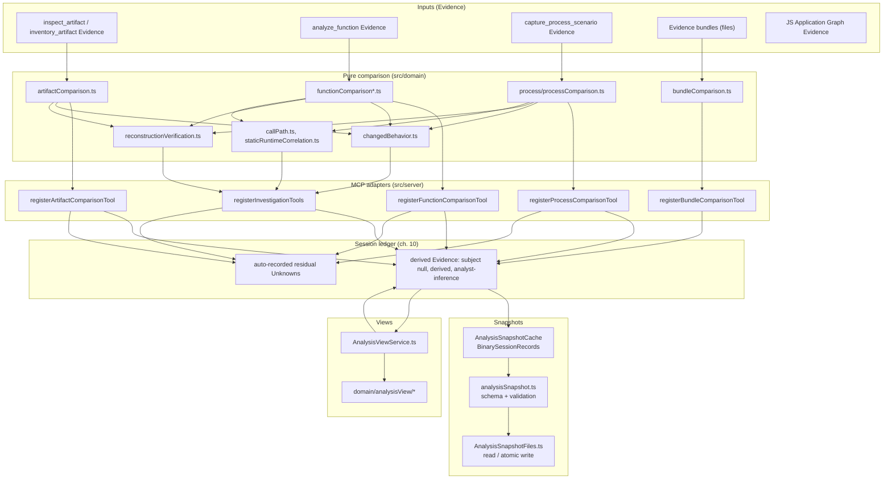
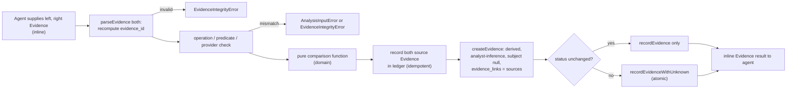
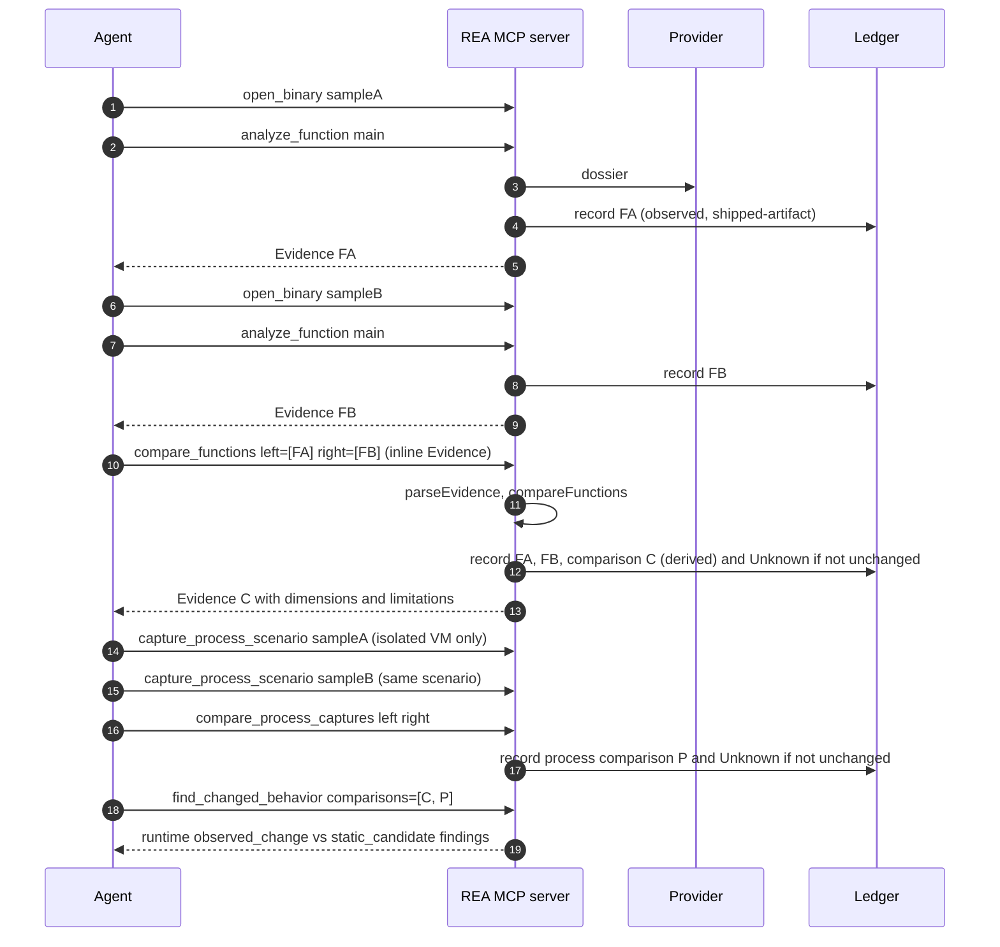
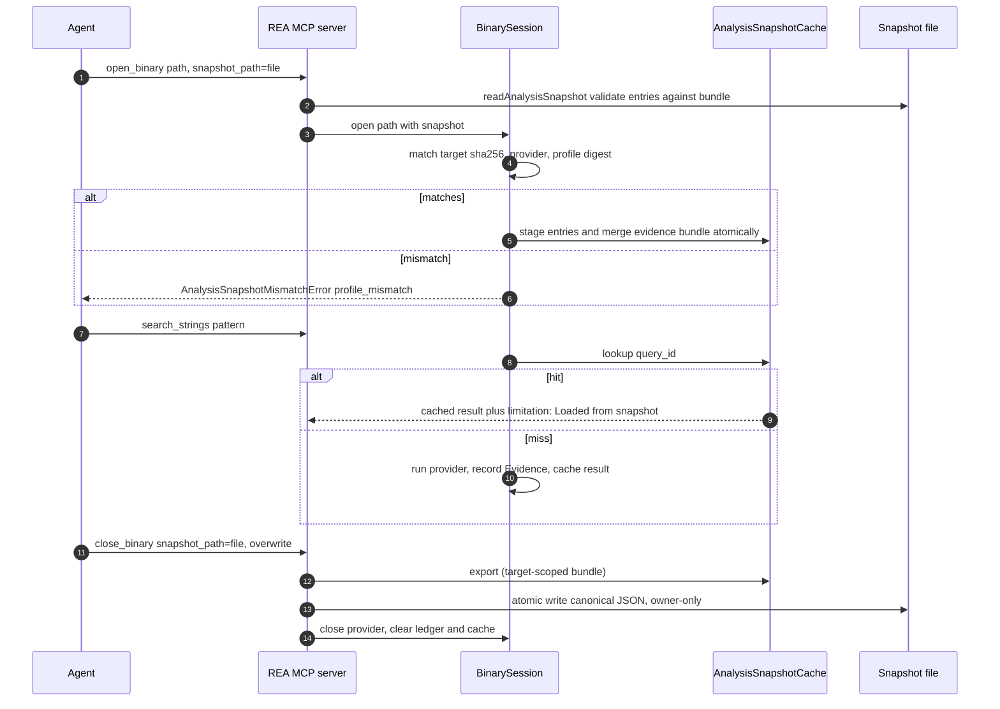
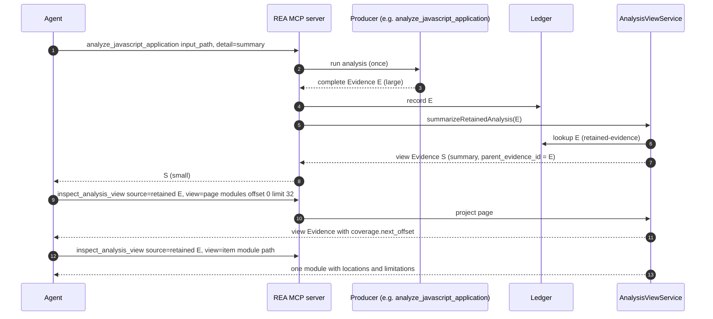
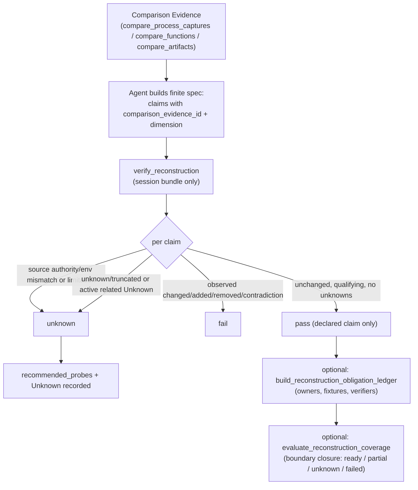
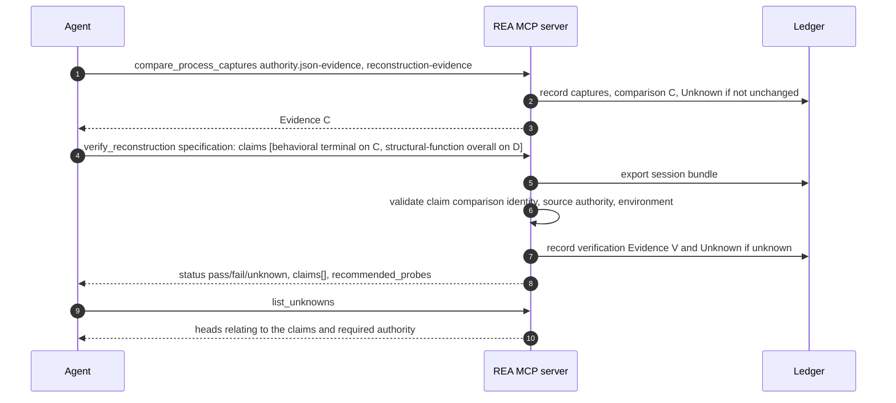

# 11. Comparison semantics, analysis snapshots, analysis views and reconstruction verification

> Chapter 11 of the REA deep-dive. Source: `github.com/morluto/rea` at HEAD `f75b1a4` (npm `rea-agents` 6.4.0). All paths are repo-relative; line numbers verified. Blocks with a path and line range are verbatim.
>
> Related chapters: [10-evidence-model-ledger-unknowns-bundles.md](10-evidence-model-ledger-unknowns-bundles.md) (Evidence, Unknowns, bundles - prerequisite), [12-ai-layer-prompts-and-skills.md](12-ai-layer-prompts-and-skills.md) (the prompts that chain these tools), [18-process-capture-and-instrumentation.md](18-process-capture-and-instrumentation.md) (capture_process_scenario), [16-javascript-electron-analysis.md](16-javascript-electron-analysis.md) (application graphs), [23-defensive-malware-analysis-playbook.md](23-defensive-malware-analysis-playbook.md), [24-porting-blueprints.md](24-porting-blueprints.md).

## 11.1 Scope and component map

This chapter covers four mechanisms that sit *on top of* the Evidence ledger:

1. **Comparison** - deterministic, evidence-citing diffs between two inputs (`compare_artifacts`, `compare_functions`, `compare_process_captures`, `compare_bundles`, `compare_application_versions` and siblings) and the aggregators over them (`find_changed_behavior`, `build_call_path`, `correlate_static_and_runtime`).
2. **Analysis snapshots** - a provider/profile-exact cache of successful immutable analysis calls, with import/export (`open_binary.snapshot_path`, `close_binary.snapshot_path`, CLI `--snapshot`).
3. **Analysis views** - `inspect_analysis_view`, which pages/selects from *already completed* Evidence without re-running anything.
4. **Reconstruction verification** - `verify_reconstruction`, `build_reconstruction_obligation_ledger`, `evaluate_reconstruction_coverage`, the non-public readiness conformance verifier, and the CLI-only reference-source import.



*Figure 11.1 - Component and dependency map.* Comparison logic is pure domain code (`src/domain`); MCP adapters in `src/server` parse/authenticate inputs, call the pure function, wrap the result as *derived* Evidence and record it (plus an auto Unknown where applicable) in the session ledger. Snapshots and views read from the ledger rather than re-running providers.

## 11.2 Common comparison semantics

Every comparison obeys the same contract (fact, verified in each module below and summarized in `docs/mcp-contracts.md` "Tool results" and `docs/tool-design.md`):

1. **Inputs are Evidence, authenticated.** Inline records are re-parsed with `parseEvidence` (semantic ID recomputed); the tool refuses inputs of the wrong `operation`/`predicate_type`/provider.
2. **Explicit pairing only.** There is no fuzzy whole-binary matching: `compare_functions` compares two *named* function Evidence sets; `compare_bundles` pairs only explicit `record_pairs`; `compare_application_versions` matches with unique-only exact tiers.
3. **Absence needs coverage.** An item is reported `added`/`removed` only when the inventory is *complete* (`absenceClaimable`, `src/domain/comparisonSemantics.ts:3-11`); otherwise `unknown` or `truncated`.
4. **Output is derived Evidence.** `createEvidence(undefined, <REA provider>, { confidence: "derived", authority: "analyst-inference", evidenceLinks: [both sources...] })` - `subject: null`, linked to both inputs (table in chapter 10, 10.2.4).
5. **Incomplete comparisons open an Unknown automatically** (chapter 10, 10.4.6), atomically with the Evidence.
6. **Static difference is a candidate, runtime difference is an observation**: `find_changed_behavior` keeps them in separate scopes.
7. **Equality never follows from missing data**: statuses `unknown`/`truncated` exist at every level.

`src/domain/comparisonSemantics.ts` (verbatim, whole file):


`src/domain/comparisonSemantics.ts:1-22`

```ts
import canonicalize from "canonicalize";

/** Whether an inventory can support a claim that an item is absent. */
export const absenceClaimable = (coverage: {
  readonly status: string;
  readonly truncated?: boolean;
  readonly omitted_count?: number | null;
}): boolean =>
  coverage.status === "complete" &&
  coverage.truncated !== true &&
  (coverage.omitted_count === undefined || coverage.omitted_count === 0);

/** Canonical JSON used for deterministic tie breaking and stable digests. */
export const canonicalJson = (
  value: unknown,
  context = "Comparison",
): string => {
  const encoded = canonicalize(value);
  if (encoded === undefined)
    throw new TypeError(`${context} could not canonicalize data`);
  return encoded;
};
```

### 11.2.1 Status vocabularies (each pipeline keeps its native enum)

| Tool | Top-level status values | Per-item / dimension values | Source |
| --- | --- | --- | --- |
| `compare_artifacts` | `unchanged, added, removed, changed, truncated, unknown, contradiction` | change `classification`: `added, removed, changed, unknown, contradiction`; `dimensions[]` in `content, kind, format, size, executable, relations, metadata, availability, integrity` | `src/domain/artifactComparison.ts:17-40` |
| `compare_functions` | `unchanged, changed, unknown` | 8 dimensions: `identity, pseudocode, assembly, comments, calls, references, strings_names, cfg`, each `unchanged/changed/unknown` with `conclusion_kind` in `derived_relationship, contradiction, unresolved_branch` | `src/domain/functionComparisonSchemas.ts:7-22,43-67` |
| `compare_process_captures` | `unchanged, added, removed, changed, truncated, unknown, contradiction` (derived: truncated > changed > unknown > unchanged) | dimensions `terminal, interaction, exit, filesystem, process` | `src/domain/process/processComparison.ts:27-60` |
| `compare_bundles` | `unchanged, changed, unknown` | change `classification`: `added, removed, changed, unknown, history_advanced, history_diverged`; `conclusion_kind`: `observed_change, contradiction, unresolved_branch` | `src/domain/bundleComparison.ts:17-25,44-48`; `comparisonStatus.ts` |
| `find_changed_behavior` | `behavior_status`: `observed_changed, observed_unchanged, unknown, truncated` | finding `scope`: `runtime, protocol, resource, static_candidate`; `classification`: `observed_change, derived_relationship, contradiction, unresolved_branch` | `src/domain/changedBehavior.ts:34-80` |
| `build_call_path` | `found, not_found, unknown` | - | `src/domain/callPath.ts:103-126` |
| `correlate_static_and_runtime` | `correlated, contradicted, unknown, truncated` | classification `hypothesis, contradiction, unresolved_branch` | `src/domain/staticRuntimeCorrelation.ts:121-128` |
| `verify_reconstruction` | `pass, fail, unknown` | per-claim `pass/fail/unknown` + `observed_status` (7-valued) | `src/domain/reconstructionVerificationSchemas.ts:12,77-97` |

The canonical shared triple `unchanged | changed | unknown` is `src/domain/comparisonStatus.ts:3-7` (verbatim):


`src/domain/comparisonStatus.ts:1-12`

```ts
import { z } from "zod";

/**
 * Canonical top-level comparison outcome shared by every comparison
 * pipeline. Pipeline-native detail enums keep their wire schemas, while
 * shared result contracts use this canonical triple.
 */
export const comparisonStatusSchema = z.enum([
  "unchanged",
  "changed",
  "unknown",
]);
```

### 11.2.2 The shared adapter pattern

Each adapter follows the same steps (e.g. `src/server/registerArtifactComparisonTool.ts:17-87`, verbatim):


`src/server/registerArtifactComparisonTool.ts:17-119`

```ts
export const registerArtifactComparisonTool = (
  server: EvidenceMcpServer,
  session: BinarySessionPort,
  contract: ReturnType<typeof toolContract<"compare_artifacts">>,
): void => {
  const admission = withAdmittedAnalysis({ kind: "session", session });
  server.registerTool(
    contract.name,
    toolRegistrationOptions(contract),
    async (input, context) =>
      runAdmittedToolOperation(
        server,
        admission,
        contract.name,
        context.mcpReq.signal,
        async () => {
          const computed = await runDerivedOperation(
            context,
            contract.name,
            () => {
              const left = parseEvidence(input.left);
              const right = parseEvidence(input.right);
              return { left, right, comparison: compareArtifacts(left, right) };
            },
          );
          if (!computed.ok)
            return server.delivery.toCallToolResult(computed, contract);
          const { left, right, comparison } = computed.value;
          const sources = [left, right];
          for (const source of sources) {
            const recordedSource = session.recordEvidence(source);
            if (!recordedSource.ok)
              return server.delivery.toCallToolResult(recordedSource, contract);
          }
          const leftEvidenceIds = [left.evidence_id];
          const rightEvidenceIds = [right.evidence_id];
          const evidence = createEvidence(
            undefined,
            ARTIFACT_COMPARISON_PROVIDER,
            {
              predicateType: "rea.artifact-comparison",
              operation: contract.name,
              parameters: {
                left_evidence_ids: leftEvidenceIds,
                right_evidence_ids: rightEvidenceIds,
              },
              result: jsonValueSchema.parse(comparison),
              confidence: "derived",
              authority: "analyst-inference",
              limitations: comparison.limitations,
              evidenceLinks: [...leftEvidenceIds, ...rightEvidenceIds],
            },
          );
          return server.delivery.toEvidenceToolResult(
            evidence,
            contract,
            recordDerivedEvidence(
              session,
              evidence,
              artifactUnknownInput(
                left,
                right,
                comparison.status,
                evidence.evidence_id,
              ),
            ),
          );
        },
      ),
  );
};

const artifactUnknownInput = (
  left: { readonly evidence_id: string },
  right: { readonly evidence_id: string },
  status: ReturnType<typeof compareArtifacts>["status"],
  comparisonEvidenceId: string,
): RecordUnknownInput | undefined => {
  if (status === "unchanged") return undefined;
  const contradictory =
    (status === "changed" || status === "contradiction") &&
    left.evidence_id !== right.evidence_id;
  return {
    question: `Artifact comparison is ${status} (comparison ${comparisonEvidenceId})`,
    severity:
      status === "unknown" || status === "truncated" ? "high" : "medium",
    domain: "artifact-comparison",
    supporting_evidence_ids: contradictory
      ? [left.evidence_id]
      : [...new Set([left.evidence_id, right.evidence_id])],
    contradicting_evidence_ids: contradictory ? [right.evidence_id] : [],
    required_authority: "shipped-artifact",
    required_confidence: "observed",
    required_environment: null,
    recommended_probes: [
      {
        operation: "inspect_artifact",
        rationale: "Inspect both artifacts and compare their complete graphs.",
      },
    ],
    relationships: [],
  };
};
```

and the atomic recorder (`src/server/recordDerivedEvidence.ts`, whole file, verbatim):


`src/server/recordDerivedEvidence.ts:1-19`

```ts
import type { BinarySessionPort } from "../application/binary/BinarySessionPort.js";
import type { AnalysisError } from "../domain/analysisErrorBase.js";
import type { Evidence } from "../domain/evidence.js";
import type { RecordUnknownInput } from "../domain/residualUnknown.js";
import { ok, type Result } from "../domain/result.js";

/** Atomically record derived Evidence with an optional supported unknown. */
export const recordDerivedEvidence = (
  session: BinarySessionPort,
  evidence: Evidence,
  unknown: RecordUnknownInput | undefined,
): Result<Evidence, AnalysisError> => {
  if (unknown !== undefined) {
    const recorded = session.recordEvidenceWithUnknown(evidence, unknown);
    return recorded.ok ? ok(evidence) : recorded;
  }
  const recorded = session.recordEvidence(evidence);
  return recorded.ok ? ok(evidence) : recorded;
};
```



*Figure 11.2 - Common comparison pipeline.* Source Evidence is recorded in the session so that the derived record's `evidence_links` never dangle (the ledger's closure checks in `evidenceClosure` reject dangling links: `src/server/registerInvestigationTools/helpers.ts:29-53`). The sources may come from another connection or a file; recording them is what lets a later `export_evidence_bundle` carry a self-contained case.

## 11.3 `compare_artifacts`

Compares two inventory Evidence records (from `inspect_artifact` or `inventory_artifact`) path by path.

### Schemas and algorithm (verbatim)


`src/domain/artifactComparison.ts:17-202`

```ts

const evidenceIdSchema = prefixedDigestSchema("ev");
const comparisonStatusSchema = z.enum([
  "unchanged",
  "added",
  "removed",
  "changed",
  "truncated",
  "unknown",
  "contradiction",
]);
const changeKindSchema = z.enum([
  "added",
  "removed",
  "changed",
  "unknown",
  "contradiction",
]);
const comparisonDimensionSchema = z.enum([
  "content",
  "kind",
  "format",
  "size",
  "executable",
  "relations",
  "metadata",
  "availability",
  "integrity",
]);
/** Strict Evidence-backed input for deterministic artifact comparison. */
export const artifactComparisonInputSchema = z.strictObject({
  left: evidenceSchema,
  right: evidenceSchema,
});

/** One path-classified artifact change with citations to both observations. */
const artifactChangeSchema = z.object({
  classification: changeKindSchema,
  logical_path: z.string().min(1),
  dimensions: z.array(comparisonDimensionSchema).min(1),
  left_occurrence_id: z
    .string()
    .regex(/^occ_[a-f0-9]{64}$/u)
    .nullable(),
  right_occurrence_id: z
    .string()
    .regex(/^occ_[a-f0-9]{64}$/u)
    .nullable(),
  left_artifact_id: z
    .string()
    .regex(/^art_[a-f0-9]{64}$/u)
    .nullable(),
  right_artifact_id: z
    .string()
    .regex(/^art_[a-f0-9]{64}$/u)
    .nullable(),
  evidence_links: z.array(evidenceIdSchema).min(2),
});

/** Deterministic artifact comparison with every change returned inline. */
export const artifactComparisonResultSchema = z.object({
  status: comparisonStatusSchema,
  left_manifest_id: prefixedDigestSchema("agm"),
  right_manifest_id: prefixedDigestSchema("agm"),
  summary: z.object({
    unchanged: z.number().int().min(0),
    added: z.number().int().min(0),
    removed: z.number().int().min(0),
    changed: z.number().int().min(0),
    unknown: z.number().int().min(0),
    contradiction: z.number().int().min(0).default(0),
  }),
  changes: z.array(artifactChangeSchema),
  limitations: z.array(z.string()),
});

export type ArtifactComparisonResult = z.infer<
  typeof artifactComparisonResultSchema
>;
type ArtifactChange = z.infer<typeof artifactChangeSchema>;

/** Compare complete inventory evidence without treating missing evidence as equality. */
export const compareArtifacts = (
  leftEvidence: unknown,
  rightEvidence: unknown,
): ArtifactComparisonResult => {
  const left = parseArtifactInventoryEvidence(leftEvidence);
  const right = parseArtifactInventoryEvidence(rightEvidence);
  const leftComplete = left.inventory.complete;
  const rightComplete = right.inventory.complete;
  const sameScope =
    left.inventory.coverage.scope === right.inventory.coverage.scope;
  const rootCoverageComplete =
    sameScope &&
    left.inventory.complete &&
    right.inventory.complete &&
    left.inventory.coverage.status === "complete" &&
    right.inventory.coverage.status === "complete";
  const entryCoverageComplete =
    rootCoverageComplete &&
    left.inventory.coverage.scope === "container-entries";
  const leftCovered =
    sameScope &&
    hasCompleteInventoryCoverage(left.inventory, left.inventory.coverage.scope);
  const rightCovered =
    sameScope &&
    hasCompleteInventoryCoverage(
      right.inventory,
      right.inventory.coverage.scope,
    );
  const fullyCovered =
    leftCovered &&
    rightCovered &&
    (entryCoverageComplete ||
      (rootCoverageComplete &&
        left.inventory.manifest.occurrence_count === 1 &&
        right.inventory.manifest.occurrence_count === 1));
  const leftOccurrencesByPath = occurrencesByPath(left.inventory.occurrences);
  const rightOccurrencesByPath = occurrencesByPath(right.inventory.occurrences);
  const comparison = compareOccurrences(
    left.inventory,
    right.inventory,
    leftOccurrencesByPath,
    rightOccurrencesByPath,
    [
      ...left.evidence.map(({ evidence_id: id }) => id),
      ...right.evidence.map(({ evidence_id: id }) => id),
    ],
    { root: rootCoverageComplete, entries: entryCoverageComplete },
  );
  const changes = comparison.changes;
  const limitations = [
    ...left.inventory.limitations.map((item) => `Left: ${item}`),
    ...right.inventory.limitations.map((item) => `Right: ${item}`),
    ...(leftComplete ? [] : ["Left artifact inventory is incomplete."]),
    ...(rightComplete ? [] : ["Right artifact inventory is incomplete."]),
    ...(sameScope ? [] : ["Artifact inventory scopes differ."]),
    ...(sameScope &&
    left.inventory.coverage.scope === "root" &&
    (left.inventory.manifest.occurrence_count > 1 ||
      right.inventory.manifest.occurrence_count > 1)
      ? ["Container entry coverage is unavailable for child paths."]
      : []),
    ...(left.inventory.coverage.status === "complete"
      ? []
      : ["Left artifact inventory traversal coverage is unknown."]),
    ...(right.inventory.coverage.status === "complete"
      ? []
      : ["Right artifact inventory traversal coverage is unknown."]),
    ...(comparison.hasAmbiguousDuplicatePaths
      ? [
          "Duplicate logical paths cannot be paired across inventories; comparisons for those paths are unknown.",
        ]
      : []),
  ];
  applyRootHashChange(left.inventory, right.inventory, changes, [
    ...left.evidence.map(({ evidence_id: id }) => id),
    ...right.evidence.map(({ evidence_id: id }) => id),
  ]);
  const summary = summarize(
    left.inventory,
    right.inventory,
    changes,
    fullyCovered,
  );
  return artifactComparisonResultSchema.parse({
    status:
      !leftComplete || !rightComplete
        ? "truncated"
        : changes.some(
              ({ classification }) => classification === "contradiction",
            )
          ? "contradiction"
          : !fullyCovered
            ? "unknown"
            : changes.some(({ classification }) => classification === "unknown")
              ? "unknown"
              : changes.length === 0
                ? "unchanged"
                : "changed",
    left_manifest_id: left.inventory.manifest.manifest_id,
    right_manifest_id: right.inventory.manifest.manifest_id,
    summary,
    changes,
    limitations: [...new Set(limitations)].sort(compareUnicodeCodePoints),
  });
```

Decision rules for the top-level status (lines 183-201 above): `truncated` if either inventory is incomplete; else `contradiction` if any path has an integrity (hash-status mismatch) contradiction; else `unknown` if coverage is not full (scopes differ, traversal status unknown, container-entry coverage unavailable) or any path is `unknown` (including duplicate logical paths that cannot be paired); else `unchanged` if no changes, else `changed`. `added`/`removed` classification at a path requires the relevant coverage (`classifyPresence`, lines 298-313 of the file); otherwise the path is `unknown` with dimension `availability`. The root path `.` uses root coverage, child paths use container-entry coverage.

Additional facts (`docs/mcp-contracts.md`, "Tool results"): inventories declare `coverage.scope` (`root`|`container-entries`) and `coverage.status` (`complete`|`unknown`); comparison requires matching scopes; case-distinct archive members remain separate; static equality "does not establish unchanged runtime behavior"; FIFO/socket/device entries are never opened.

## 11.4 `compare_functions`

Compares two explicit `analyze_function` Evidence records across 8 dimensions without fuzzy matching.

### Schemas (verbatim)


`src/domain/functionComparisonSchemas.ts:1-117`

```ts
import { z } from "zod";
import { overallStatus } from "./functionComparisonResults.js";
import { evidenceSchema } from "./evidence.js";
import { digestSchema } from "./../domain/digests.js";
import { prefixedDigestSchema } from "./../domain/digests.js";

const comparisonStatusSchema = z.enum(["unchanged", "changed", "unknown"]);
export const functionComparisonDimensionNameSchema = z.enum([
  "identity",
  "pseudocode",
  "assembly",
  "comments",
  "calls",
  "references",
  "strings_names",
  "cfg",
]);
const evidenceIdSchema = prefixedDigestSchema("ev");

/** Inputs for explicit function-to-function comparison. */
export const functionComparisonInputSchema = z.strictObject({
  left: evidenceSchema,
  right: evidenceSchema,
});

const textDeltaSchema = z.object({
  added_lines: z.number().int().min(0),
  removed_lines: z.number().int().min(0),
  hunks: z.number().int().min(0),
});

const functionDimensionContextShape = {
  dimension: functionComparisonDimensionNameSchema,
  left_count: z.number().int().min(0).nullable(),
  right_count: z.number().int().min(0).nullable(),
  evidence_links: z.array(evidenceIdSchema).min(2),
  limitations: z.array(z.string()),
};

const functionDimensionSchema = z.union([
  z.object({
    ...functionDimensionContextShape,
    status: z.literal("unchanged"),
    left_digest: digestSchema,
    right_digest: digestSchema,
    text_delta: textDeltaSchema.nullable(),
    conclusion_kind: z.literal("derived_relationship"),
  }),
  z.object({
    ...functionDimensionContextShape,
    status: z.literal("changed"),
    left_digest: digestSchema,
    right_digest: digestSchema,
    text_delta: textDeltaSchema.nullable(),
    conclusion_kind: z.enum(["derived_relationship", "contradiction"]),
  }),
  z.object({
    ...functionDimensionContextShape,
    status: z.literal("unknown"),
    left_digest: z.null(),
    right_digest: z.null(),
    text_delta: z.null(),
    conclusion_kind: z.literal("unresolved_branch"),
  }),
]);

const functionMatchSchema = z.union([
  z.object({
    status: z.literal("matched"),
    method: z.literal("symbol"),
    left_name: z.string(),
    right_name: z.string(),
  }),
  z.object({
    status: z.enum(["mismatched", "ambiguous"]),
    method: z.literal("explicit"),
    left_name: z.string(),
    right_name: z.string(),
  }),
]);

/** Deterministic dimension-classified function comparison Evidence payload. */
export const functionComparisonResultSchema = z
  .object({
    status: comparisonStatusSchema,
    function_match: functionMatchSchema,
    left_subject_sha256: digestSchema,
    right_subject_sha256: digestSchema,
    summary: z.object({
      unchanged: z.number().int().min(0),
      changed: z.number().int().min(0),
      unknown: z.number().int().min(0),
    }),
    dimensions: z.array(functionDimensionSchema).length(8),
    changes: z.array(functionDimensionSchema),
    limitations: z.array(z.string()),
  })
  .superRefine((result, context) => {
    if (
      result.status !==
      overallStatus(result.dimensions, result.function_match.status)
    )
      context.addIssue({
        code: "custom",
        path: ["status"],
        message:
          "Function comparison status contradicts its dimensions or function match.",
      });
  });

export type FunctionComparisonResult = z.infer<
  typeof functionComparisonResultSchema
>;
export type FunctionDimension = z.infer<typeof functionDimensionSchema>;
export type DimensionName = z.infer<
  typeof functionComparisonDimensionNameSchema
>;
```

### Overall-status and dimension logic (verbatim)


`src/domain/functionComparisonResults.ts:68-86`

```ts
export const overallStatus = (
  dimensions: readonly FunctionDimension[],
  match: FunctionComparisonResult["function_match"]["status"],
): FunctionComparisonResult["status"] => {
  if (match === "mismatched") return "changed";
  if (match === "ambiguous") return "unknown";
  if (dimensions.some(({ status }) => status === "changed")) return "changed";
  if (dimensions.some(({ status }) => status === "unknown")) return "unknown";
  return "unchanged";
};

export const summarize = (dimensions: readonly FunctionDimension[]) => ({
  unchanged: dimensions.filter(({ status }) => status === "unchanged").length,
  changed: dimensions.filter(({ status }) => status === "changed").length,
  unknown: dimensions.filter(({ status }) => status === "unknown").length,
});

const digest = (value: unknown): string =>
  digestCanonicalValue(value, "Function comparison");
```

`src/domain/functionComparisonDimensions.ts:31-177`

```ts
export const compareDimensions = (
  left: FunctionSnapshot,
  right: FunctionSnapshot,
  context: ComparisonContext,
): FunctionDimension[] => {
  return [
    compareIdentity(left, right, context),
    compareText(
      "pseudocode",
      left.dossier.pseudocode,
      right.dossier.pseudocode,
      context,
    ),
    compareText(
      "assembly",
      left.dossier.assembly.join("\n"),
      right.dossier.assembly.join("\n"),
      context,
    ),
    compareComments(left, right, context),
    compareCalls(left, right, context),
    compareReferences(left, right, context),
    compareStringsAndNames(left, right, context),
    compareCfg(left, right, context),
  ].map((result) => {
    const limitations = [
      ...facetLimitations(left, result.dimension).map(
        (reason) => `Left: ${reason}`,
      ),
      ...facetLimitations(right, result.dimension).map(
        (reason) => `Right: ${reason}`,
      ),
    ];
    return limitations.length === 0
      ? result
      : unresolvedDimension({
          dimension: result.dimension,
          links: context.links,
          leftCount: null,
          rightCount: null,
          limitations: [...result.limitations, ...limitations],
        });
  });
};

/** An empty undeclared facet is not evidence of observed absence. */
const facetLimitations = (
  snapshot: FunctionSnapshot,
  dimension: DimensionName,
): string[] => {
  const { dossier } = snapshot;
  const fields = {
    identity: [],
    pseudocode: [["pseudocode", dossier.pseudocode.length]],
    assembly: [["assembly", dossier.assembly.length]],
    comments: [["comments", dossier.comments.length]],
    calls: [
      ["callers", dossier.callers.length],
      ["callees", dossier.callees.length],
    ],
    references: [
      [
        "references",
        dossier.incoming_references.length + dossier.outgoing_references.length,
      ],
    ],
    strings_names: [
      [
        "strings_names",
        dossier.referenced_strings.length + dossier.referenced_names.length,
      ],
    ],
    cfg: [["cfg", dossier.basic_blocks.length]],
  } satisfies Record<
    DimensionName,
    [keyof NonNullable<typeof dossier.facet_availability>, number][]
  >;
  return fields[dimension].flatMap(([field, count]) => {
    const availability = dossier.facet_availability?.[field];
    if (availability?.available === false)
      return [`${field}: ${availability.reason}`];
    return availability === undefined && count === 0
      ? [`${field}: Provider did not declare coverage for this empty facet.`]
      : [];
  });
};

const compareText = (
  dimension: "pseudocode" | "assembly",
  left: string,
  right: string,
  context: ComparisonContext,
): FunctionDimension => {
  const limitations = [
    "Exact provider text is compared without address or generated-name normalization; layout-only differences do not establish a behavior change.",
    ...(dimension === "assembly"
      ? [
          "Assembly is opaque provider text; relocation normalization is unavailable.",
        ]
      : []),
  ];
  if (context.providersDiffer)
    return unresolvedDimension({
      dimension,
      links: context.links,
      leftCount: [...left].length,
      rightCount: [...right].length,
      limitations: [
        ...limitations,
        "Exact text comparison requires one provider identity.",
      ],
    });
  const changes = diffLines(left, right, {
    timeout: 100,
    maxEditLength: 10_000,
  });
  if (changes === undefined)
    return unresolvedDimension({
      dimension,
      links: context.links,
      leftCount: [...left].length,
      rightCount: [...right].length,
      limitations: [
        ...limitations,
        "Bounded line diff exceeded its time or edit-distance limit.",
      ],
    });
  const delta = changes.reduce(
    (summary, change) => ({
      added_lines:
        summary.added_lines + (change.added ? (change.count ?? 0) : 0),
      removed_lines:
        summary.removed_lines + (change.removed ? (change.count ?? 0) : 0),
      hunks: summary.hunks + (change.added || change.removed ? 1 : 0),
    }),
    { added_lines: 0, removed_lines: 0, hunks: 0 },
  );
  return dimensionResult({
    dimension,
    status: delta.hunks === 0 ? "unchanged" : "changed",
    left,
    right,
    ...context,
    leftCount: [...left].length,
    rightCount: [...right].length,
    textDelta: delta,
    limitations,
```

Key rules (fact): (1) a facet that the provider did not declare and that is empty is **unknown**, not "no calls"/"no strings" (`facetLimitations`, lines 77-116); (2) text dimensions (`pseudocode`, `assembly`) are compared as exact provider text with a bounded line diff (`diffLines`, timeout 100 ms, max edit length 10,000) and become `unknown` if the providers differ (e.g. Ghidra vs Hopper) or the diff budget is exceeded; (3) a `changed` dimension between *different* providers is typed `contradiction`, not `derived_relationship`; (4) `function_match.status` `mismatched` forces overall `changed`, `ambiguous` forces `unknown` (`overallStatus`); (5) address normalization applies to CFG topology and comments (`functionComparisonNormalization.ts`, not reproduced - see source).

The adapter (`src/server/registerFunctionComparisonTool.ts:40-193`) requires both inputs to be `operation: "analyze_function"`, `predicate_type: "rea.analysis"`; it records an Unknown with `comparison_conclusion_scope` listing the changed/unknown dimensions (so later `verify_reconstruction` claims on *other* dimensions are not blocked by it: `reconstructionClaimUnknowns`, `src/domain/reconstructionUnknowns.ts:27-83`).

## 11.5 `compare_process_captures` (behavioural comparison)

Compares two `capture_process_scenario` Evidence records. For malware work this is the "did the new sample/version behave differently in the same controlled scenario" primitive.

### Schema and derivation (verbatim)


`src/domain/process/processComparison.ts:26-105`

```ts
/** Comparison classification that never equates incomplete evidence. */
export const comparisonStatusSchema = z.enum([
  "unchanged",
  "added",
  "removed",
  "changed",
  "truncated",
  "unknown",
  "contradiction",
]);
type ComparisonStatus = z.infer<typeof comparisonStatusSchema>;

/** Canonical ordered dimensions that contribute to an overall process status. */
export const PROCESS_COMPARISON_DIMENSIONS = [
  "terminal",
  "interaction",
  "exit",
  "filesystem",
  "process",
] as const;

/** Derive the overall comparison status from every process dimension. */
export const deriveProcessComparisonStatus = (
  dimensions: readonly ComparisonStatus[],
): ComparisonStatus => {
  if (dimensions.includes("truncated")) return "truncated";
  if (
    dimensions.some((status) =>
      ["changed", "added", "removed"].includes(status),
    )
  )
    return "changed";
  return dimensions.includes("unknown") ? "unknown" : "unchanged";
};

/** Pure normalized comparison between two captures. */
export const processCaptureComparisonSchema = z
  .object({
    status: comparisonStatusSchema,
    terminal: comparisonStatusSchema,
    interaction: comparisonStatusSchema,
    exit: comparisonStatusSchema,
    filesystem: comparisonStatusSchema,
    process: comparisonStatusSchema,
    first_divergence: z.discriminatedUnion("status", [
      z.object({ status: z.literal("none") }),
      z.object({ status: z.literal("unknown"), reason: z.string() }),
      z.object({
        status: z.literal("found"),
        dimension: z.enum([
          "terminal",
          "interaction",
          "exit",
          "filesystem",
          "process",
        ]),
        index: z.number().int().nonnegative(),
        left_at_ms: z.number().int().nonnegative().nullable(),
        right_at_ms: z.number().int().nonnegative().nullable(),
        left: jsonValueSchema.nullable(),
        right: jsonValueSchema.nullable(),
      }),
    ]),
    trace: processTraceComparisonResultSchema.optional(),
    limitations: z.array(z.string()),
  })
  .superRefine((comparison, context) => {
    const expected = deriveProcessComparisonStatus(
      PROCESS_COMPARISON_DIMENSIONS.map((dimension) => comparison[dimension]),
    );
    if (comparison.status !== expected)
      context.addIssue({
        code: "custom",
        message: "Process comparison status contradicts its dimensions",
        path: ["status"],
      });
  });
export type ProcessCaptureComparison = z.infer<
  typeof processCaptureComparisonSchema
>;
```

### Comparability and freshness gate, and the comparison itself (verbatim)


`src/domain/process/processComparison.ts:243-290`

```ts
const assertComparable = (
  left: ProcessCapture,
  right: ProcessCapture,
  options: { readonly maxCaptureAgeMs?: number; readonly now?: () => number },
): void => {
  if (
    left.manifest.comparison_contract_sha256 !==
    right.manifest.comparison_contract_sha256
  ) {
    const fields = differingContractFields(
      left.manifest.comparison_contract,
      right.manifest.comparison_contract,
    );
    throw new AnalysisInputError(OPERATION, undefined, [
      {
        path: ["right"],
        reason: "invalid_value",
        message: `Process captures have incompatible comparison contracts${fields.length === 0 ? "" : `; these scenario fields differ: ${fields.join(", ")}`}. Capture both scenarios with the same values for these fields, then compare them.`,
        expected: fields,
      },
    ]);
  }
  if (options.maxCaptureAgeMs === undefined) return;
  const maxCaptureAgeMs = options.maxCaptureAgeMs;
  const now = (options.now ?? Date.now)();
  const stale = (
    [
      ["left", left],
      ["right", right],
    ] as const
  ).flatMap(([side, { manifest }]) => {
    const age = now - Date.parse(manifest.completed_at);
    return age > maxCaptureAgeMs
      ? [
          `${side} completed at ${manifest.completed_at} (${String(age)} ms ago)`,
        ]
      : [];
  });
  if (stale.length > 0)
    throw new AnalysisInputError(OPERATION, undefined, [
      {
        path: ["max_capture_age_ms"],
        reason: "out_of_range",
        message: `Process capture exceeds max_capture_age_ms ${String(maxCaptureAgeMs)}: ${stale.join("; ")}. Recapture the stale scenario or raise max_capture_age_ms.`,
      },
    ]);
};

```

`src/domain/process/processComparison.ts:385-531`

```ts
const compareDimensions = (
  left: ProcessCapture,
  right: ProcessCapture,
  sameNormalization: boolean,
): ComparisonDimensions => {
  const classify = (
    scope: ProcessCapture["residual_unknowns"][number]["scope"],
    leftValues: readonly unknown[],
    rightValues: readonly unknown[],
    source: ProcessObservationSource,
  ): ComparisonStatus =>
    !sameNormalization ||
    hasUnknown(left, scope) ||
    hasUnknown(right, scope) ||
    processSourceTruncated(left, source) ||
    processSourceTruncated(right, source)
      ? "unknown"
      : classifyCollection(leftValues, rightValues);
  return {
    terminal: classify(
      "terminal",
      terminalObservations(left),
      terminalObservations(right),
      "terminal_rendered",
    ),
    interaction: classify(
      "interaction",
      left.interaction_events,
      right.interaction_events,
      "interaction",
    ),
    exit:
      hasUnknown(left, "exit") || hasUnknown(right, "exit")
        ? "unknown"
        : sameJsonValue(
              { exit: left.exit, settlement: left.settlement },
              { exit: right.exit, settlement: right.settlement },
            )
          ? "unchanged"
          : "changed",
    filesystem: classify(
      "filesystem",
      filesystemObservations(left),
      filesystemObservations(right),
      "filesystem",
    ),
    process: classify(
      "process",
      left.process_samples,
      right.process_samples,
      "process",
    ),
  };
};

/**
 * Compare two process capture observations without treating absence as proof.
 *
 * Observed differences outrank residual unknowns. A capture may therefore be
 * definitively changed in one dimension while completeness remains unknown.
 */
export const compareProcessCaptures = (
  left: ProcessCapture,
  right: ProcessCapture,
  options: {
    readonly maxCaptureAgeMs?: number;
    readonly now?: () => number;
    readonly traceSpecification?: ProcessTraceSpecification;
  } = {},
): ProcessCaptureComparison => {
  assertComparable(left, right, options);
  const sameNormalization = sameJsonValue(
    left.normalization,
    right.normalization,
  );
  const exactDimensions = compareDimensions(left, right, sameNormalization);
  const trace =
    options.traceSpecification === undefined
      ? undefined
      : compareProcessTraces(left, right, options.traceSpecification);
  const dimensions =
    trace === undefined || options.traceSpecification === undefined
      ? exactDimensions
      : applyTraceVerdict(exactDimensions, options.traceSpecification, trace, [
          left,
          right,
        ]);
  const divergenceCandidates = PROCESS_COMPARISON_DIMENSIONS.map((dimension) =>
    dimensions[dimension] === "unknown"
      ? null
      : firstCollectionDivergence(
          dimension,
          processDimensionObservations(left, dimension),
          processDimensionObservations(right, dimension),
        ),
  );
  const observedFirstDivergence = chooseFirstDivergence(
    divergenceCandidates.map((candidate) =>
      candidate !== null &&
      trace?.verdict === "equivalent" &&
      dimensions[candidate.dimension] === "unchanged"
        ? null
        : candidate,
    ),
  );
  const firstDivergence =
    left.truncated || right.truncated
      ? ({
          status: "unknown",
          reason:
            "Incomplete observations prevent locating the first divergence; unaffected dimensions retain their comparisons.",
        } as const)
      : trace?.verdict === "equivalent" &&
          deriveProcessComparisonStatus(
            PROCESS_COMPARISON_DIMENSIONS.map(
              (dimension) => dimensions[dimension],
            ),
          ) === "unchanged"
        ? ({ status: "none" } as const)
        : observedFirstDivergence.status === "found"
          ? observedFirstDivergence
          : !sameNormalization ||
              left.residual_unknowns.length > 0 ||
              right.residual_unknowns.length > 0
            ? ({
                status: "unknown",
                reason:
                  "Residual unknowns prevent proving that no divergence occurred.",
              } as const)
            : observedFirstDivergence;
  const observedStatus = deriveProcessComparisonStatus(
    PROCESS_COMPARISON_DIMENSIONS.map((dimension) => dimensions[dimension]),
  );
  return {
    status: observedStatus,
    ...dimensions,
    first_divergence: firstDivergence,
    ...(trace === undefined ? {} : { trace }),
    limitations: [
      ...left.limitations,
      ...right.limitations,
      ...left.residual_unknowns.map(({ reason }) => reason),
      ...right.residual_unknowns.map(({ reason }) => reason),
      ...(sameNormalization ? [] : ["Capture normalization rules differ."]),
    ],
  };
};
```

Facts:

- **Same comparison contract required.** `manifest.comparison_contract_sha256` must match; the error names differing top-level fields (working directory, explicit environment, filesystem observation paths, terminal size, scripted events, timeouts, limits, normalization) and says "Capture both scenarios with the same values for these fields, then compare them." The executable and its arguments may differ (`docs/process-capture.md`, "Compare two captures").
- **Freshness**: optional `max_capture_age_ms` rejects captures whose `manifest.completed_at` is older than the bound.
- **Unknown propagation**: a dimension is `unknown` if the normalization rules differ, the capture has a residual unknown for that scope, or its source was truncated. "Observed differences outrank residual unknowns" - a capture can be definitively `changed` in one dimension while another is `unknown`.
- **Optional trace specification** (`trace_spec`): exact events with cardinality (`required`, `optional`, `exact`, `range`) and explicit partial-order constraints; "concurrency is never inferred from timestamps or broad sorting"; a capture lacking a complete event journal yields `unknown` (`src/domain/process/processTraceSpecification.ts`, `processTraceComparison.ts`; tool description).
- **`first_divergence`** localizes the first differing observation per dimension when complete.
- CLI: `rea compare-process-captures <left.json> <right.json> [trace-spec.json]` (`docs/process-capture.md`). MCP: `compare_process_captures`.
- The adapter records an Unknown (domain `process-comparison`, `required_authority: controlled-replay`) for any non-`unchanged` result; question text embeds the comparison Evidence ID so distinct pairs coexist (`registerProcessComparisonTool.ts:196-239`).

## 11.6 `compare_bundles`

Compares two canonical bundles by record membership, explicit one-to-one pairs and complete unknown revision histories (`src/domain/bundleComparison.ts`).

### Schemas and algorithm (verbatim)


`src/domain/bundleComparison.ts:16-330`

```ts
const evidenceIdSchema = prefixedDigestSchema("ev");
const classificationSchema = z.enum([
  "added",
  "removed",
  "changed",
  "unknown",
  "history_advanced",
  "history_diverged",
]);

/** Strict input for canonical Evidence bundle comparison. */
export const bundleComparisonInputSchema = z.strictObject({
  left_bundle_path: localPathStringSchema,
  right_bundle_path: localPathStringSchema,
  record_pairs: z
    .array(
      z.object({
        left_evidence_id: evidenceIdSchema,
        right_evidence_id: evidenceIdSchema,
      }),
    )
    .default([]),
});

const bundleChangeSchema = z.object({
  entity: z.enum(["evidence", "residual_unknown"]),
  key: z.string().min(1),
  classification: classificationSchema,
  conclusion_kind: z.enum([
    "observed_change",
    "contradiction",
    "unresolved_branch",
  ]),
  left_evidence_ids: z.array(evidenceIdSchema),
  right_evidence_ids: z.array(evidenceIdSchema),
  left_digest: digestSchema.nullable(),
  right_digest: digestSchema.nullable(),
  limitations: z.array(z.string()),
});

/** Deterministic classified delta between two canonical Evidence bundles. */
export const bundleComparisonResultSchema = z.object({
  status: comparisonStatusSchema,
  left_bundle_sha256: digestSchema,
  right_bundle_sha256: digestSchema,
  summary: z.object({
    records_unchanged: z.number().int().min(0),
    records_added: z.number().int().min(0),
    records_removed: z.number().int().min(0),
    records_changed: z.number().int().min(0),
    unknowns_unchanged: z.number().int().min(0),
    unknowns_added: z.number().int().min(0),
    unknowns_removed: z.number().int().min(0),
    unknowns_advanced: z.number().int().min(0),
    unknowns_diverged: z.number().int().min(0),
    unresolved: z.number().int().min(0),
  }),
  changes: z.array(bundleChangeSchema),
  limitations: z.array(z.string()),
});

export type BundleComparisonResult = z.infer<
  typeof bundleComparisonResultSchema
>;
type BundleChange = z.infer<typeof bundleChangeSchema>;
type RecordPair = z.infer<
  typeof bundleComparisonInputSchema
>["record_pairs"][number];

/** Compare canonical bundle membership and only explicitly paired observations. */
export const compareBundles = (
  leftInput: unknown,
  rightInput: unknown,
  recordPairs: readonly RecordPair[] = [],
): BundleComparisonResult => {
  const left = parseEvidenceBundle(leftInput);
  const right = parseEvidenceBundle(rightInput);
  const leftDigest = bundleDigest(left);
  const rightDigest = bundleDigest(right);
  const recordResult = compareRecords(left, right, recordPairs);
  const unknownResult = compareUnknowns(left, right);
  const changes = [...recordResult.changes, ...unknownResult.changes].sort(
    compareChanges,
  );
  const unresolved = changes.filter(
    ({ conclusion_kind: kind }) => kind !== "observed_change",
  ).length;
  return bundleComparisonResultSchema.parse({
    status:
      unresolved > 0 ? "unknown" : changes.length > 0 ? "changed" : "unchanged",
    left_bundle_sha256: leftDigest,
    right_bundle_sha256: rightDigest,
    summary: {
      ...recordResult.summary,
      ...unknownResult.summary,
      unresolved,
    },
    changes,
    limitations: changes.some(({ limitations }) => limitations.length > 0)
      ? [
          "EvidenceBundle has no inventory completeness marker; one-sided membership remains unknown.",
        ]
      : [],
  });
};

const compareRecords = (
  left: EvidenceBundle,
  right: EvidenceBundle,
  pairs: readonly RecordPair[],
) => {
  const leftIds = new Set(left.records.map(({ evidence_id: id }) => id));
  const rightIds = new Set(right.records.map(({ evidence_id: id }) => id));
  const pairedLeft = new Set<string>();
  const pairedRight = new Set<string>();
  const changes: BundleChange[] = [];
  let changed = 0;
  for (const pair of pairs) {
    if (!leftIds.has(pair.left_evidence_id))
      throw new TypeError(
        `Explicit pair references missing left evidence ${pair.left_evidence_id}`,
      );
    if (!rightIds.has(pair.right_evidence_id))
      throw new TypeError(
        `Explicit pair references missing right evidence ${pair.right_evidence_id}`,
      );
    if (
      pairedLeft.has(pair.left_evidence_id) ||
      pairedRight.has(pair.right_evidence_id)
    )
      throw new TypeError("Explicit evidence pairs must be one-to-one");
    pairedLeft.add(pair.left_evidence_id);
    pairedRight.add(pair.right_evidence_id);
    if (pair.left_evidence_id === pair.right_evidence_id) continue;
    changed += 1;
    changes.push({
      entity: "evidence",
      key: `pair:${pair.left_evidence_id}:${pair.right_evidence_id}`,
      classification: "changed",
      conclusion_kind: "observed_change",
      left_evidence_ids: [pair.left_evidence_id],
      right_evidence_ids: [pair.right_evidence_id],
      left_digest: pair.left_evidence_id.slice(3),
      right_digest: pair.right_evidence_id.slice(3),
      limitations: [],
    });
  }
  const common = [...leftIds].filter(
    (id) => rightIds.has(id) && !pairedLeft.has(id) && !pairedRight.has(id),
  );
  const removed = [...leftIds].filter(
    (id) => !pairedLeft.has(id) && (!rightIds.has(id) || pairedRight.has(id)),
  );
  const added = [...rightIds].filter(
    (id) => !pairedRight.has(id) && (!leftIds.has(id) || pairedLeft.has(id)),
  );
  for (const [ids, side] of [
    [removed, "left"],
    [added, "right"],
  ] as const)
    for (const id of ids)
      changes.push({
        entity: "evidence",
        key: id,
        classification: "unknown",
        conclusion_kind: "unresolved_branch",
        left_evidence_ids: side === "left" ? [id] : [],
        right_evidence_ids: side === "right" ? [id] : [],
        left_digest: side === "left" ? id.slice(3) : null,
        right_digest: side === "right" ? id.slice(3) : null,
        limitations: [
          "EvidenceBundle has no inventory completeness marker; one-sided membership may reflect incomplete capture.",
        ],
      });
  return {
    changes,
    summary: {
      records_unchanged: common.length + pairs.length - changed,
      records_added: 0,
      records_removed: 0,
      records_changed: changed,
    },
  };
};

const compareUnknowns = (left: EvidenceBundle, right: EvidenceBundle) => {
  const leftHistories = histories(left.unknowns);
  const rightHistories = histories(right.unknowns);
  const ids = [...new Set([...leftHistories.keys(), ...rightHistories.keys()])];
  const changes: BundleChange[] = [];
  const summary = {
    unknowns_unchanged: 0,
    unknowns_added: 0,
    unknowns_removed: 0,
    unknowns_advanced: 0,
    unknowns_diverged: 0,
  };
  for (const id of ids) {
    const leftHistory = leftHistories.get(id);
    const rightHistory = rightHistories.get(id);
    if (leftHistory === undefined || rightHistory === undefined) {
      changes.push(unknownChange(id, "unknown", leftHistory, rightHistory));
      continue;
    }
    const leftDigests = leftHistory.map(
      ({ revision_digest: digest }) => digest,
    );
    const rightDigests = rightHistory.map(
      ({ revision_digest: digest }) => digest,
    );
    if (same(leftDigests, rightDigests)) {
      summary.unknowns_unchanged += 1;
      continue;
    }
    const advanced =
      isPrefix(leftDigests, rightDigests) ||
      isPrefix(rightDigests, leftDigests);
    summary[advanced ? "unknowns_advanced" : "unknowns_diverged"] += 1;
    changes.push(
      unknownChange(
        id,
        advanced ? "history_advanced" : "history_diverged",
        leftHistory,
        rightHistory,
      ),
    );
  }
  return { changes, summary };
};

const unknownChange = (
  id: string,
  classification: BundleChange["classification"],
  left: readonly ResidualUnknown[] | undefined,
  right: readonly ResidualUnknown[] | undefined,
): BundleChange => ({
  entity: "residual_unknown",
  key: id,
  classification,
  conclusion_kind:
    classification === "history_diverged"
      ? "contradiction"
      : classification === "history_advanced"
        ? "observed_change"
        : "unresolved_branch",
  left_evidence_ids: historyEvidenceIds(left ?? []),
  right_evidence_ids: historyEvidenceIds(right ?? []),
  left_digest: left?.at(-1)?.revision_digest ?? null,
  right_digest: right?.at(-1)?.revision_digest ?? null,
  limitations:
    left === undefined || right === undefined
      ? [
          "EvidenceBundle has no inventory completeness marker; one-sided history membership remains unknown.",
        ]
      : [],
});

const histories = (unknowns: readonly ResidualUnknown[]) => {
  const output = new Map<string, ResidualUnknown[]>();
  for (const unknown of unknowns) {
    const history = output.get(unknown.unknown_id) ?? [];
    history.push(unknown);
    output.set(unknown.unknown_id, history);
  }
  return output;
};

const historyEvidenceIds = (history: readonly ResidualUnknown[]): string[] =>
  [
    ...new Set(
      history.flatMap((item) => [
        ...item.supporting_evidence_ids,
        ...item.contradicting_evidence_ids,
        ...item.mutation_evidence_ids,
        ...(item.resolution?.evidence_ids ?? []),
      ]),
    ),
  ].sort(ascii);

const bundleDigest = (bundle: EvidenceBundle): string =>
  createHash("sha256").update(serializeEvidenceBundle(bundle)).digest("hex");

const same = (left: readonly string[], right: readonly string[]): boolean =>
  left.length === right.length &&
  left.every((value, index) => value === right[index]);

const isPrefix = (
  shorter: readonly string[],
  longer: readonly string[],
): boolean =>
  shorter.length < longer.length &&
  shorter.every((value, index) => value === longer[index]);

const ascii = (left: string, right: string): number =>
  left < right ? -1 : left > right ? 1 : 0;

const compareChanges = (left: BundleChange, right: BundleChange): number =>
  ascii(
    [
      left.entity,
      left.key,
      left.classification,
      left.left_digest ?? "",
      left.right_digest ?? "",
    ].join("\u0000"),
    [
      right.entity,
      right.key,
      right.classification,
      right.left_digest ?? "",
      right.right_digest ?? "",
    ].join("\u0000"),
  );
```

Facts and quirks (from the code above):

- A record present on only one side is **`unknown`/`unresolved_branch`**, not `added`/`removed`, because "EvidenceBundle has no inventory completeness marker; one-sided membership may reflect incomplete capture." Hence the summary counters `records_added` and `records_removed` are hard-coded `0` in `compareRecords` (lines 190-198 of the file) and `unknowns_added`/`unknowns_removed` are never incremented in `compareUnknowns` (they stay at their initial 0): **the summary fields exist in the schema but are never non-zero in this implementation** (fact from reading the code; confirmed by the execution below).
- Pairs (`record_pairs`) must be one-to-one, reference existing IDs, and produce a `changed`/`observed_change` finding.
- Unknown histories compare by `revision_digest` chains: identical => unchanged; one a prefix of the other => `history_advanced` (observed change); otherwise `history_diverged` (`contradiction`).
- The result is anchored by `left_bundle_sha256`/`right_bundle_sha256` = SHA-256 of the canonical serialization.
- MCP `compare_bundles` takes two bundle **file paths** (`registerBundleComparisonTool.ts:20-101`), records all source records and the comparison Evidence (predicate `rea.bundle-comparison`) in the session; CLI `rea compare <left> <right>` (alias `compare-bundles`) does the same without a session (`EvidenceBundleCommands.ts:70-91`).

### Real execution: bundle comparison

Script run against the compiled code (two bundles: left has one record, right has two). Output verbatim:

```json

{
  "status": "unknown",
  "left_bundle_sha256": "0cdb97a61f3951ed4a1b5be100df8c1b063d0e1f36fe23c800a53e4dbaa35ec0",
  "right_bundle_sha256": "c16beee2536ea5f5eb435f043f0b8d83d9282dd4193bc13cae18d8ac652739f8",
  "summary": {
    "records_unchanged": 1,
    "records_added": 0,
    "records_removed": 0,
    "records_changed": 0,
    "unknowns_unchanged": 0,
    "unknowns_added": 0,
    "unknowns_removed": 0,
    "unknowns_advanced": 0,
    "unknowns_diverged": 0,
    "unresolved": 1
  },
  "changes": [
    {
      "entity": "evidence",
      "key": "ev_79141083c8cc4a0f46ad47ba251ed9ad9214ec20795f10e1afabd45bfc08e6b3",
      "classification": "unknown",
      "conclusion_kind": "unresolved_branch",
      "left_evidence_ids": [],
      "right_evidence_ids": [
        "ev_79141083c8cc4a0f46ad47ba251ed9ad9214ec20795f10e1afabd45bfc08e6b3"
      ],
      "left_digest": null,
      "right_digest": "79141083c8cc4a0f46ad47ba251ed9ad9214ec20795f10e1afabd45bfc08e6b3",
      "limitations": [
        "EvidenceBundle has no inventory completeness marker; one-sided membership may reflect incomplete capture."
      ]
    }
  ],
  "limitations": [
    "EvidenceBundle has no inventory completeness marker; one-sided membership remains unknown."
  ]
}

```

## 11.7 `find_changed_behavior`, `build_call_path`, `correlate_static_and_runtime`

### `find_changed_behavior` (verbatim core)


`src/domain/changedBehavior.ts:27-112`

```ts
const evidenceIdSchema = prefixedDigestSchema("ev");

/** Input for aggregating existing comparison Evidence. */
export const changedBehaviorInputSchema = z.strictObject({
  comparisons: z.array(evidenceSchema).min(1),
});

const findingSchema = z.object({
  scope: z.enum(["runtime", "protocol", "resource", "static_candidate"]),
  dimension: z.string().min(1),
  classification: z.enum([
    "observed_change",
    "derived_relationship",
    "contradiction",
    "unresolved_branch",
  ]),
  status: comparisonStatusSchema,
  source_comparison_id: evidenceIdSchema,
  evidence_links: z.array(evidenceIdSchema).min(2),
  limitations: z.array(z.string()),
});

/** Truthful aggregate: runtime observations remain separate from static candidates. */
export const changedBehaviorResultSchema = z
  .object({
    behavior_status: z.enum([
      "observed_changed",
      "observed_unchanged",
      "unknown",
      "truncated",
    ]),
    summary: z.object({
      observed_changes: z.number().int().min(0),
      static_candidates: z.number().int().min(0),
      contradictions: z.number().int().min(0),
      unresolved: z.number().int().min(0),
    }),
    findings: z.object({
      items: z.array(findingSchema),
    }),
    evidence_links: z.array(evidenceIdSchema).min(2),
    limitations: z.array(z.string()),
  })
  .superRefine((result, context) => {
    const summaryTotal = Object.values(result.summary).reduce(
      (total, count) => total + count,
      0,
    );
    if (summaryTotal !== result.findings.items.length)
      context.addIssue({
        code: "custom",
        message: "Finding classification counts must equal the finding total",
        path: ["summary"],
      });
    if (
      (result.behavior_status === "observed_changed" &&
        result.summary.observed_changes === 0) ||
      (result.behavior_status === "observed_unchanged" &&
        result.summary.observed_changes > 0)
    )
      context.addIssue({
        code: "custom",
        message: "Observed-change status must agree with runtime findings",
        path: ["behavior_status"],
      });
  });

export type ChangedBehaviorResult = z.infer<typeof changedBehaviorResultSchema>;
type Finding = z.infer<typeof findingSchema>;
type RuntimeStatus = z.infer<typeof processCaptureComparisonSchema>["status"];
type ParsedComparison =
  | {
      readonly operation: "compare_process_captures";
      readonly evidence: Evidence;
      readonly result: z.infer<typeof processCaptureComparisonSchema>;
    }
  | {
      readonly operation: "compare_functions";
      readonly evidence: Evidence;
      readonly result: z.infer<typeof functionComparisonResultSchema>;
    }
  | {
      readonly operation: "compare_artifacts";
      readonly evidence: Evidence;
      readonly result: z.infer<typeof artifactComparisonResultSchema>;
    };
```

`src/domain/changedBehavior.ts:145-201`

```ts
export const findChangedBehavior = (input: unknown): FoundChangedBehavior => {
  // The public input schema remains available to clients; this internal
  // admission only checks the list shape because parseEvidence below owns
  // validation and authentication of each retained Evidence item.
  const { comparisons } = z
    .strictObject({ comparisons: z.array(z.unknown()).min(1) })
    .parse(input);
  const evidence = comparisons.map(parseComparisonEvidence);
  assertUnique(
    evidence.map(({ evidence: { evidence_id: id } }) => id),
    "comparison Evidence",
  );
  const findings = evidence.flatMap(findingsFor).sort(compareFindings);
  const runtimeStatuses = evidence.flatMap((comparison) =>
    comparison.operation === "compare_process_captures"
      ? [comparison.result.status]
      : [],
  );
  const links = uniqueSorted(
    evidence.flatMap(({ evidence: item }) => [
      item.evidence_id,
      ...item.evidence_links,
    ]),
  );
  const result = changedBehaviorResultSchema.parse({
    behavior_status: behaviorStatus(runtimeStatuses),
    summary: {
      observed_changes: count(findings, "observed_change"),
      static_candidates: count(findings, "derived_relationship"),
      contradictions: count(findings, "contradiction"),
      unresolved: count(findings, "unresolved_branch"),
    },
    findings: {
      items: findings,
    },
    evidence_links: links,
    limitations: uniqueSorted([
      ...evidence.flatMap(({ evidence: item }) => item.limitations),
      ...(evidence.some(
        ({ operation }) => operation !== "compare_process_captures",
      )
        ? [
            "Static differences are behavior candidates, not runtime observations.",
          ]
        : []),
      ...(runtimeStatuses.length === 0
        ? ["No process comparison Evidence was supplied."]
        : []),
    ]),
  });
  return {
    result,
    comparisonEvidenceIds: evidence.map(
      ({ evidence: { evidence_id } }) => evidence_id,
    ),
  };
};
```

`src/domain/changedBehavior.ts:412-436`

```ts
const behaviorStatus = (
  statuses: readonly RuntimeStatus[],
): ChangedBehaviorResult["behavior_status"] => {
  if (statuses.length === 0) return "unknown";
  if (statuses.includes("truncated")) return "truncated";
  if (statuses.includes("unknown")) return "unknown";
  return statuses.some(isChange) ? "observed_changed" : "observed_unchanged";
};

const isChange = (status: RuntimeStatus): boolean =>
  status === "added" || status === "removed" || status === "changed";

const count = (
  findings: readonly Finding[],
  classification: Finding["classification"],
): number =>
  findings.filter((finding) => finding.classification === classification)
    .length;

const compareFindings = (left: Finding, right: Finding): number =>
  compareUnicodeCodePoints(
    compositeKey([left.scope, left.dimension, left.source_comparison_id]),
    compositeKey([right.scope, right.dimension, right.source_comparison_id]),
  );

```

Facts: input is a list of comparison Evidence (process, artifact, function) whose provider/predicate/confidence/authority are all checked (`parseComparisonEvidence`, lines 203-241); each comparison must cite both source observations. `behavior_status` is derived **only from process comparisons**: no process comparison => `unknown`; any `truncated` => `truncated`; any `unknown` => `unknown`; otherwise `observed_changed` if any dimension changed/added/removed else `observed_unchanged`. Function and artifact comparisons only contribute `static_candidate` findings ("Static differences are behavior candidates, not runtime observations."). The adapter records an Unknown (domain `changed-behavior`, controlled-replay/observed) when the status is `unknown`/`truncated` (`registerInvestigationTools.ts:47-110`).

### `build_call_path`

`src/domain/callPath.ts:81-128`: builds a call graph from **explicit** `analyze_function` Evidence records of one artifact/provider and returns every shortest direct-callee path using exact canonical addresses; `status`: `found` / `not_found` (only when the search was exhaustive) / `unknown` (missing dossiers, provider mixing or incomplete caller/callee coverage keep the frontier open). Unknown status records a `call-path` Unknown (`required_authority: shipped-artifact`).

### `correlate_static_and_runtime`

`src/domain/staticRuntimeCorrelation.ts`: takes **caller-declared hypotheses** (`mappings[]` each pairing a static comparison finding with a runtime comparison dimension and an `expected_pattern`) and classifies each as `hypothesis`, `contradiction` or `unresolved_branch`; "Mappings are caller-declared hypotheses; consistency does not establish causality." Its Evidence is `confidence: "inferred"` (the weakest grade in the system; `registerInvestigationTools.ts:196-209`).

### Sequence: a variant-diff flow with comparison tools



*Figure 11.3 - Agent flow for version/variant comparison (request -> MCP tool -> provider -> Evidence -> agent).* The agent passes the full inline Evidence returned by earlier calls as inputs; it does not need retained references for these three tools. `capture_process_scenario` executes the sample (flagged `executesForeignCode`): isolate it.

## 11.8 Application-level comparison siblings

These follow the same discipline but operate on specialised graph Evidence. Descriptions are verbatim from `.cache/mcp-tool-catalog.json`; implementations are in the cited chapters.

| Tool | Inputs | Matching rules (from description) | Chapter |
| --- | --- | --- | --- |
| `compare_application_versions` | Two JavaScript Application Graph Evidence (inline or retained reference) | "Uses unique-only exact digest, module source digest, source-map identity, structural fingerprint, and non-module semantic-key tiers. Reports added, removed, changed, ambiguous, and unknown entities plus the complete matching changed_from graph without fuzzy or module-ordinal pairing." | 16 |
| `compare_source_to_bundle` | Committed HistoricalSourceGraph + application graph Evidence | "explicit exact-digest, source-map path, current-path, suffix, and basename signals with stable weights. Classifies unchanged, modified, removed, split, merged, duplicated, and unknown; incomplete coverage and ambiguous weak signals never become absence or forced matches." | 16, 11.11 |
| `compare_javascript_export_shapes` | Two application graphs + module/export selector | Static return-shape comparison; "Reports JSON Pointer changes without executing JavaScript" | 16 |
| `compare_wasm_interfaces` | Two `inspect_wasm_artifact` Evidence | typed import/export names, kinds, signatures; duplicates/unsupported remain unknown | 15 |
| `compare_managed_members` | Two `inspect_managed_members` Evidence | unique-only tiers on declared type, name, CIL/signature; "Names alone are never a matching basis" | 15 |
| `compare_web_captures`, `compare_web_screenshots` | passive web captures / scenario captures | aligns exact step IDs; "Missing or truncated evidence never proves equality." | 17 |

**CLI/MCP availability (fact, `src/cliCommandNames.ts:160-245`):** `compare_artifacts`, `compare_functions`, `find_changed_behavior`, `build_call_path`, `correlate_static_and_runtime`, `verify_reconstruction`, `list_unknowns`, `record_unknown`, `update_unknown`, `verify_unknown_resolution`, `get_evidence_bundle` are listed in `MCP_TOOLS_WITHOUT_DEDICATED_CLI` - **they exist only in the MCP server** (they need the session ledger). CLI equivalents exist for `compare-process-captures`, `compare` (bundles), `compare-application-versions`, `compare-source-to-bundle`, `compare-javascript-export-shapes`, `compare-wasm-interfaces`, `compare-managed-members`, `compare-web-captures`, `compare-web-screenshots`, `build-reconstruction-obligation-ledger`, `evaluate-reconstruction-coverage`, `inspect-analysis-view`, `inspect-evidence-bundle`.

## 11.9 Analysis snapshots: cache and file format

### 11.9.1 What a snapshot is

A snapshot is a **local file holding (a) cached results of successful immutable provider calls, (b) cached composed-workflow results, and (c) the canonical Evidence bundle for the target**, all bound to one **target identity** and one **provider/analysis-profile**. It is not a saved provider database (`docs/cli.md`: "These are cached observations, not a saved provider database").

### 11.9.2 Schema (verbatim)


`src/domain/analysisSnapshot.ts:53-182`

```ts
const architectureSchema = z.enum(BINARY_ARCHITECTURES);
const formatSchema = z.enum([
  "analysis-database",
  "mach-o",
  "mach-o-universal",
  "elf",
  "pe",
  "dos-mz",
  "dos-com",
  "raw-binary",
  "zip",
  "ipa",
  "apk",
  "msix",
  "appx",
  "hap",
  "hsp",
  "app-pack",
  "asar",
  "dmg",
  "pkg",
  "plist",
  "javascript",
  "source-map",
]);
const kindSchema = z.enum(["executable", "database", "archive", "artifact"]);
const subjectBaseSchema = z.object({
  path: localPathStringSchema,
  sha256: digestSchema,
});
const subjectFormatSchema = z.enum([
  ...formatSchema.options,
  "hopper",
  "directory",
  "file",
  "unknown",
  "javascript-bundle",
  "entitlements",
]);
// Snapshot entries retain the same raw-only architecture boundary as targets.
const subjectSchema = z.discriminatedUnion("format", [
  subjectBaseSchema.extend({
    format: subjectFormatSchema.exclude(["raw-binary"]),
    architecture: architectureSchema.exclude(["6502"]).nullable(),
  }),
  subjectBaseSchema.extend({
    format: z.literal("raw-binary"),
    architecture: architectureSchema.nullable(),
  }),
]);
const targetIdentitySchema = z.object({
  sha256: digestSchema,
  kind: kindSchema,
  architecture: architectureSchema.nullable(),
});
const targetSchema = z.discriminatedUnion("format", [
  targetIdentitySchema.extend({
    format: z.enum(
      formatSchema.options.filter((format) => format !== "raw-binary"),
    ),
    architecture: architectureSchema.exclude(["6502"]).nullable(),
  }),
  targetIdentitySchema.extend({
    format: z.literal("raw-binary"),
    kind: z.literal("executable"),
    architecture: binaryArchitectureSchema,
    entry_point: rawBinaryEntryPointSchema,
  }),
]);
const bindingSchema = z
  .object({
    provider: committedProviderSchema,
    analysis_profile: analysisProfileSchema,
  })
  .superRefine((binding, context) => {
    if (
      binding.provider.id !== binding.analysis_profile.provider.id ||
      binding.provider.name !== binding.analysis_profile.provider.name ||
      binding.provider.version !== binding.analysis_profile.provider.version
    )
      context.addIssue({
        code: "custom",
        path: ["provider"],
        message: "Snapshot binding provider does not match analysis profile",
      });
  });
const entrySchema = z.object({
  query_id: prefixedDigestSchema("query"),
  operation: z.string().min(1),
  parameters: jsonObjectSchema,
  execution: z.object({
    result: jsonValueSchema,
    raw_result: jsonValueSchema.nullable(),
    provider: committedProviderSchema,
    limitations: z.array(z.string()),
    relationship_coverage: relationshipCoverageSchema.nullable().default(null),
    locations: z.array(evidenceLocationSchema),
    subject: subjectSchema.nullable(),
  }),
});
const workflowEntrySchema = z.object({
  query_id: prefixedDigestSchema("query"),
  operation: z.string().min(1),
  parameters: jsonObjectSchema,
  execution: z.object({
    result: jsonValueSchema,
    raw_result: jsonValueSchema.nullable(),
    provider: committedProviderSchema,
    analysis_profile: analysisProfileSchema,
    limitations: z.array(z.string()),
    relationship_coverage: relationshipCoverageSchema.nullable().default(null),
    locations: z.array(evidenceLocationSchema),
    subject: subjectSchema.nullable(),
  }),
});

/** Provider- and profile-exact cache of successful immutable analysis calls. */
export const analysisSnapshotSchema = z.object({
  target: targetSchema,
  binding: bindingSchema,
  entries: z.array(entrySchema),
  workflow_entries: z.array(workflowEntrySchema),
  evidence_bundle: evidenceBundleSchema,
});

export type AnalysisSnapshot = z.infer<typeof analysisSnapshotSchema>;
export type AnalysisSnapshotEntry = z.infer<typeof entrySchema>;
export type AnalysisSnapshotWorkflowEntry = z.infer<typeof workflowEntrySchema>;
export type AnalysisSnapshotTarget = z.infer<typeof targetSchema>;
export type AnalysisSnapshotBinding = z.infer<typeof bindingSchema>;
```

### 11.9.3 Cache keys

A cache key is the **query ID**, `query_<sha256>` of the RFC 8785 canonical JSON of `{target, binding, operation, parameters}` (verbatim):


`src/domain/analysisSnapshot.ts:351-408`

```ts
export const snapshotTarget = (target: BinaryTarget): AnalysisSnapshotTarget =>
  target.format === "raw-binary"
    ? {
        sha256: target.sha256,
        kind: target.kind,
        architecture: target.architecture,
        format: target.format,
        entry_point: target.entryPoint,
      }
    : {
        sha256: target.sha256,
        kind: target.kind,
        architecture: target.architecture ?? null,
        format: target.format,
      };

/** Build the immutable provider/profile binding used by a cached snapshot. */
export const snapshotBinding = (
  profile: AnalysisProfileCommitment,
): AnalysisSnapshotBinding =>
  bindingSchema.parse({
    provider: profile.provider,
    analysis_profile: profile,
  });

/** Compare an open binary with the immutable target identity in a snapshot. */
export const snapshotMatchesTarget = (
  snapshot: AnalysisSnapshotTarget,
  target: BinaryTarget,
): boolean =>
  snapshot.sha256 === target.sha256 &&
  snapshot.kind === target.kind &&
  snapshot.format === target.format &&
  snapshot.architecture === (target.architecture ?? null) &&
  (snapshot.format !== "raw-binary" ||
    (target.format === "raw-binary" &&
      snapshot.entry_point === target.entryPoint));

/** Compare a snapshot binding with the selected concrete analysis profile. */
export const snapshotMatchesProfile = (
  binding: AnalysisSnapshotBinding,
  profile: AnalysisProfileCommitment,
): boolean =>
  binding.provider.id === profile.provider.id &&
  binding.provider.name === profile.provider.name &&
  binding.provider.version === profile.provider.version &&
  analysisProfilesEqual(binding.analysis_profile, profile);

/** Require an exact target and selected provider/profile cache partition. */
export const snapshotMatchesBinding = (
  snapshot: Pick<AnalysisSnapshot, "target" | "binding">,
  target: BinaryTarget,
  profile: AnalysisProfileCommitment,
): boolean =>
  snapshotMatchesTarget(snapshot.target, target) &&
  snapshotMatchesProfile(snapshot.binding, profile);

/** Find exact persisted CLI Evidence without starting an analysis provider. */
```

`src/domain/analysisSnapshot.ts:517-527`

```ts
export const analysisQueryId = (
  target: AnalysisSnapshotTarget,
  binding: AnalysisSnapshotBinding,
  operation: string,
  parameters: Readonly<Record<string, JsonValue>>,
): string =>
  `query_${createHash("sha256")
    .update(canonicalJson({ target, binding, operation, parameters }))
    .digest("hex")}`;

/** Create one serializable snapshot entry from a successful provider call. */
```

Key components and what invalidates them:

| Component | Content | Changes when |
| --- | --- | --- |
| `target` (path-free identity) | `sha256`, `kind`, `architecture`, `format` (+ `entry_point` for raw binaries) | the target bytes or load configuration change; paths are **not** part of the key, so a renamed copy of the same bytes reuses the cache |
| `binding.provider` | provider `id`, `name`, `version` | provider upgraded or another provider selected |
| `binding.analysis_profile` | profile `{provider, parameters, digest}` | any analysis-affecting setting changes (the profile versions declarations: `docs/mcp-contracts.md`: "Analysis profiles version these declarations so older snapshots are not reused as current results") |
| `operation`, `parameters` | exact request | any parameter differs (no normalization or subsumption) |

### 11.9.4 The cache class and cacheability predicate (verbatim)


`src/application/binary/AnalysisSnapshotCache.ts:1-383`

```ts
import type { BinaryTarget } from "../../domain/binaryTargetTypes.js";
import type { AnalysisProfileCommitment } from "../../domain/analysisProfile.js";
import type { JsonValue } from "../../domain/jsonValue.js";
import type { EvidenceBundle } from "../../domain/evidenceBundle.js";
import {
  EvidenceIntegrityError,
  AnalysisSnapshotMismatchError,
} from "../../domain/evidenceErrors.js";
import { NoBinaryOpenError } from "../../domain/configurationErrors.js";
import type { AnalysisError } from "../../domain/analysisErrorBase.js";
import type { AnalysisInputError } from "../../domain/analysisErrorCore.js";
import { rebindEvidenceSubjectTargetPath } from "../../domain/evidence.js";
import { err, ok, type Result } from "../../domain/result.js";
import {
  analysisQueryId,
  createAnalysisSnapshotEntry,
  createAnalysisSnapshotWorkflowEntry,
  snapshotBinding,
  snapshotMatchesProfile,
  snapshotMatchesTarget,
  snapshotTarget,
  parseAnalysisSnapshot,
  immutableAnalysisSnapshot,
  type AnalysisSnapshot,
  type AnalysisSnapshotEntry,
  type AnalysisSnapshotWorkflowEntry,
  type AnalysisSnapshotBinding,
  type AnalysisSnapshotTarget,
} from "../../domain/analysisSnapshot.js";
import type {
  AnalysisExecution,
  AnalysisOperation,
  CapabilityDescriptor,
} from "../AnalysisProvider.js";
import { OFFICIAL_TOOL_CONTRACTS } from "../../contracts/officialToolContracts.js";
import { compareUnicodeCodePoints } from "../../domain/unicodeCodePointOrder.js";

const RELATIONSHIP_OPERATIONS: ReadonlySet<AnalysisOperation> = new Set([
  "procedure_callers",
  "procedure_callees",
]);

const STATEFUL_OPERATIONS: ReadonlySet<AnalysisOperation> = new Set([
  "health",
  "current_address",
  "current_procedure",
  "current_document",
  "goto_address",
  "list_documents",
]);

const CURSOR_DEFAULT_OPERATIONS: ReadonlySet<AnalysisOperation> = new Set([
  "address_name",
  "comment",
  "inline_comment",
  "next_address",
  "prev_address",
  "xrefs",
]);

const DOCUMENT_SCOPED_OPERATIONS: ReadonlySet<string> = new Set(
  OFFICIAL_TOOL_CONTRACTS.map(({ name }) => name).filter(
    (name) => name !== "current_document" && name !== "list_documents",
  ),
);

/** Maximum duplicated result bindings retained across direct and workflow queries. */
export const SNAPSHOT_CACHE_ENTRY_CEILING = 10_000;

/** Whether an operation is immutable and independent of provider UI state. */
export const isSnapshotCacheable = (
  operation: AnalysisOperation,
  descriptor: CapabilityDescriptor | undefined,
  parameters: Readonly<Record<string, JsonValue>>,
): descriptor is CapabilityDescriptor =>
  !STATEFUL_OPERATIONS.has(operation) &&
  (!DOCUMENT_SCOPED_OPERATIONS.has(operation) ||
    typeof parameters.document === "string") &&
  (!CURSOR_DEFAULT_OPERATIONS.has(operation) ||
    typeof parameters.address === "string") &&
  descriptor?.effects.mutatesArtifact === false &&
  descriptor.cachePolicy !== "live" &&
  (descriptor.cachePolicy === "snapshot" ||
    descriptor.effects.mayWriteFilesystem === false) &&
  descriptor.effects.changesPermissions === false;

/** Windows Ghidra must admit the selected source through its native snapshot owner. */
export const requiresNativeSourceAdmissionBeforeReplay = (
  providerId: string | undefined,
): boolean => process.platform === "win32" && providerId === "ghidra";

/** Bounded in-memory cache for one immutable binary identity. */
export class AnalysisSnapshotCache {
  readonly #entries = new Map<string, AnalysisSnapshotEntry>();
  readonly #workflowEntries = new Map<string, AnalysisSnapshotWorkflowEntry>();
  #target: AnalysisSnapshotTarget | undefined;
  #binding: AnalysisSnapshotBinding | undefined;

  /** Whether staged entries belong to the supplied target and profile. */
  matches(
    target: BinaryTarget,
    profile: AnalysisProfileCommitment | undefined,
  ): boolean {
    return (
      (this.#target === undefined && this.#binding === undefined) ||
      (this.#target !== undefined &&
        this.#binding !== undefined &&
        profile !== undefined &&
        snapshotMatchesTarget(this.#target, target) &&
        snapshotMatchesProfile(this.#binding, profile))
    );
  }

  /** Replace cache state when the target or selected profile changes. */
  select(target: BinaryTarget, profile: AnalysisProfileCommitment): void {
    if (!this.matches(target, profile)) this.#clearEntries();
    this.#target = snapshotTarget(target);
    this.#binding = snapshotBinding(profile);
  }

  /** Merge already-validated entries and return the new-entry count. */
  stage(snapshot: AnalysisSnapshot): number {
    snapshot = immutableAnalysisSnapshot(snapshot);
    if (
      (this.#target !== undefined &&
        JSON.stringify(this.#target) !== JSON.stringify(snapshot.target)) ||
      (this.#binding !== undefined &&
        !snapshotMatchesProfile(
          this.#binding,
          snapshot.binding.analysis_profile,
        ))
    )
      this.#clearEntries();
    this.#target = structuredClone(snapshot.target);
    this.#binding = structuredClone(snapshot.binding);
    let imported = 0;
    for (const entry of snapshot.entries) {
      if (!this.#entries.has(entry.query_id) && !this.#hasCapacity()) continue;
      if (!this.#entries.has(entry.query_id)) imported += 1;
      this.#entries.set(entry.query_id, entry);
    }
    for (const entry of snapshot.workflow_entries) {
      if (!this.#workflowEntries.has(entry.query_id) && !this.#hasCapacity())
        continue;
      this.#workflowEntries.set(entry.query_id, entry);
    }
    return imported;
  }

  /** Build a complete snapshot for an active target. */
  export(
    target: BinaryTarget | undefined,
    profile: AnalysisProfileCommitment | undefined,
    evidenceBundle: EvidenceBundle,
  ): Result<AnalysisSnapshot, AnalysisError> {
    if (target === undefined || profile === undefined)
      return err(new NoBinaryOpenError());
    try {
      const snapshotTargetIdentity = snapshotTarget(target);
      const binding = snapshotBinding(profile);
      const entries = [...this.#entries.values()].sort((left, right) =>
        compareUnicodeCodePoints(left.query_id, right.query_id),
      );
      const workflows = [...this.#workflowEntries.values()].sort(
        (left, right) =>
          compareUnicodeCodePoints(left.query_id, right.query_id),
      );
      // Parsing owns the returned JSON and metadata; pre-cloning the same
      // payloads here only adds another full materialization.
      return ok(
        parseAnalysisSnapshot({
          target: snapshotTargetIdentity,
          binding,
          entries,
          workflow_entries: workflows,
          evidence_bundle: evidenceBundle,
        }),
      );
    } catch (cause: unknown) {
      return err(
        new EvidenceIntegrityError("Analysis snapshot validation failed", {
          cause,
        }),
      );
    }
  }

  /** Validate target identity, merge evidence atomically, then stage entries. */
  import(
    snapshot: AnalysisSnapshot,
    active:
      | {
          readonly target: BinaryTarget;
          readonly profile: AnalysisProfileCommitment;
        }
      | undefined,
    mergeEvidence: (
      bundle: EvidenceBundle,
    ) => Result<number, EvidenceIntegrityError | AnalysisInputError>,
  ): Result<number, AnalysisError> {
    let validated: AnalysisSnapshot;
    try {
      validated = immutableAnalysisSnapshot(snapshot);
    } catch (cause: unknown) {
      return err(
        new EvidenceIntegrityError("Analysis snapshot validation failed", {
          cause,
        }),
      );
    }
    if (
      active !== undefined &&
      (!snapshotMatchesTarget(validated.target, active.target) ||
        !snapshotMatchesProfile(validated.binding, active.profile))
    )
      return err(
        new AnalysisSnapshotMismatchError(
          "Analysis snapshot profile_mismatch: target, provider, or analysis profile does not match the active binary",
        ),
      );
    const importedEvidence = mergeEvidence(validated.evidence_bundle);
    return importedEvidence.ok ? ok(this.stage(validated)) : importedEvidence;
  }

  /** Return canonical entries for persistence. */
  entries(): AnalysisSnapshotEntry[] {
    return [...this.#entries.values()]
      .sort((left, right) =>
        compareUnicodeCodePoints(left.query_id, right.query_id),
      )
      .map((entry) => structuredClone(entry));
  }

  /** Return canonical composed-workflow entries for persistence. */
  workflowEntries(): AnalysisSnapshotWorkflowEntry[] {
    return [...this.#workflowEntries.values()]
      .sort((left, right) =>
        compareUnicodeCodePoints(left.query_id, right.query_id),
      )
      .map((entry) => structuredClone(entry));
  }

  /** Record one exact derived workflow result unless the shared cache is full. */
  recordWorkflow(input: {
    readonly target: BinaryTarget;
    readonly profile: AnalysisProfileCommitment;
    readonly operation: string;
    readonly parameters: Readonly<Record<string, JsonValue>>;
    readonly execution: {
      readonly result: JsonValue;
      readonly rawResult: JsonValue | null;
      readonly provider: AnalysisExecution["provider"];
      readonly analysisProfile: AnalysisProfileCommitment;
      readonly limitations: readonly string[];
      readonly relationshipCoverage?: AnalysisExecution["relationshipCoverage"];
      readonly locations: AnalysisExecution["locations"];
      readonly subject: AnalysisExecution["subject"];
    };
  }): void {
    this.select(input.target, input.profile);
    const queryId = analysisQueryId(
      snapshotTarget(input.target),
      snapshotBinding(input.profile),
      input.operation,
      input.parameters,
    );
    if (!this.#workflowEntries.has(queryId) && !this.#hasCapacity()) return;
    const entry = createAnalysisSnapshotWorkflowEntry({
      target: snapshotTarget(input.target),
      binding: snapshotBinding(input.profile),
      operation: input.operation,
      parameters: input.parameters,
      execution: input.execution,
    });
    this.#workflowEntries.set(entry.query_id, entry);
  }

  /** Replay an exact provider-specific query, marking its cached provenance. */
  lookup(
    target: BinaryTarget,
    profile: AnalysisProfileCommitment,
    operation: AnalysisOperation,
    parameters: Readonly<Record<string, JsonValue>>,
  ): AnalysisExecution | undefined {
    const queryId = analysisQueryId(
      snapshotTarget(target),
      snapshotBinding(profile),
      operation,
      parameters,
    );
    const cached = this.#entries.get(queryId);
    if (cached === undefined) return undefined;
    const cachedSubject = cached.execution.subject;
    const subject =
      cachedSubject === null
        ? null
        : rebindEvidenceSubjectTargetPath(
            {
              path: cachedSubject.path,
              sha256: cachedSubject.sha256,
              format: cachedSubject.format,
              ...(cachedSubject.architecture === null
                ? {}
                : { architecture: cachedSubject.architecture }),
            },
            target,
          );
    return structuredClone({
      result: cached.execution.result,
      rawResult: cached.execution.raw_result,
      provider: cached.execution.provider,
      analysisProfile: structuredClone(profile),
      limitations: [
        ...cached.execution.limitations,
        "Loaded from a local REA analysis snapshot; this call did not re-run the provider.",
      ],
      ...(cached.execution.relationship_coverage === null &&
      RELATIONSHIP_OPERATIONS.has(operation)
        ? {
            relationshipCoverage: {
              status: "unknown",
              reason: "Snapshot entry does not report relationship coverage.",
            },
          }
        : cached.execution.relationship_coverage === null
          ? {}
          : {
              relationshipCoverage: cached.execution.relationship_coverage,
            }),
      locations: cached.execution.locations,
      subject,
    });
  }

  /** Record one successful immutable call unless the cache is full. */
  record(input: {
    readonly target: BinaryTarget;
    readonly profile: AnalysisProfileCommitment;
    readonly operation: AnalysisOperation;
    readonly parameters: Readonly<Record<string, JsonValue>>;
    readonly execution: AnalysisExecution;
  }): void {
    const { target, profile, operation, parameters, execution } = input;
    this.select(target, profile);
    // The snapshot format does not carry reference truncation; a replay would
    // present a capped read as complete, so it is not recorded.
    if (execution.referencesTruncated === true) return;
    const queryId = analysisQueryId(
      snapshotTarget(target),
      snapshotBinding(profile),
      operation,
      parameters,
    );
    if (!this.#entries.has(queryId) && !this.#hasCapacity()) return;
    const entry = createAnalysisSnapshotEntry({
      target: snapshotTarget(target),
      binding: snapshotBinding(profile),
      operation,
      parameters,
      execution,
    });
    this.#entries.set(entry.query_id, entry);
  }

  /** Forget all target-bound entries. */
  clear(): void {
    this.#clearEntries();
    this.#target = undefined;
    this.#binding = undefined;
  }

  #clearEntries(): void {
    this.#entries.clear();
    this.#workflowEntries.clear();
  }

  #hasCapacity(): boolean {
    return (
      this.#entries.size + this.#workflowEntries.size <
      SNAPSHOT_CACHE_ENTRY_CEILING
    );
  }
}
```

Cacheability (fact, `isSnapshotCacheable`, lines 71-85): an operation is cacheable only if it is not in the stateful set (`health, current_address, current_procedure, current_document, goto_address, list_documents`), has explicit `document` when document-scoped and explicit `address` when cursor-defaulted, its capability descriptor has `effects.mutatesArtifact === false`, `changesPermissions === false`, `cachePolicy !== "live"`, and (`cachePolicy === "snapshot"` or `mayWriteFilesystem === false`). Reference reads whose output was truncated (`referencesTruncated`) are **not** recorded (line 347) because the format cannot carry truncation. The cache is bounded: `SNAPSHOT_CACHE_ENTRY_CEILING = 10_000` entries across provider and workflow entries (line 68); entries beyond the ceiling are silently not cached. On replay the result is returned with an added limitation: "Loaded from a local REA analysis snapshot; this call did not re-run the provider." and, for caller/callee reads without stored coverage, `relationshipCoverage: unknown`.

### 11.9.5 Session ownership, lifecycle and invalidation

`BinarySessionRecords` owns the cache (`src/application/binary/BinarySessionRecords.ts`); the relevant verbatim code:


`src/application/binary/BinarySessionRecords.ts:37-60`

```ts
const SNAPSHOT_MUTATION_RECOVERY =
  "Export session observations through export_evidence_bundle if needed. Close the active target without saving a snapshot, then reopen it before importing or saving a snapshot.";

export interface ActiveAnalysisBinding {
  readonly target: BinaryTarget;
  readonly profile: AnalysisProfileCommitment | null;
}

/** Validated composed-workflow payload bound to the active target and profile. */
export interface WorkflowSnapshotRecordInput {
  readonly operation: AnalysisOperation;
  readonly parameters: Readonly<Record<string, JsonValue>>;
  readonly execution: Parameters<
    AnalysisSnapshotCache["recordWorkflow"]
  >[0]["execution"];
}

/** Own binary snapshots and coordinate the composed investigation records. */
export abstract class BinarySessionRecords {
  readonly #records: InvestigationRecords;
  readonly #writeResources = new ArtifactResourceScope();
  readonly #snapshot = new AnalysisSnapshotCache();
  #snapshotInvalidated = false;
  readonly #snapshotListeners = new Set<() => void | Promise<void>>();
```

`src/application/binary/BinarySessionRecords.ts:135-301`

```ts
  importEvidenceBundle(
    bundle: unknown,
  ): Result<number, EvidenceIntegrityError | AnalysisInputError> {
    const imported = this.#records.mergeEvidenceBundle(bundle);
    if (!imported.ok) return imported;
    if (imported.value.metadataChanged) this.invalidateSnapshot();
    else if (imported.value.changed) this.#emitSnapshotChanged();
    return ok(imported.value.recordsAdded);
  }

  protected abstract activeAnalysisBinding(): ActiveAnalysisBinding | undefined;

  exportAnalysisSnapshot(): Result<AnalysisSnapshot, AnalysisError> {
    const active = this.activeAnalysisBinding();
    if (this.#snapshotInvalidated)
      return err(
        new EvidenceIntegrityError(
          "Analysis snapshots are unavailable because analysis metadata may have changed",
          {
            userMessage: `Analysis snapshots are unavailable because analysis metadata may have changed. ${SNAPSHOT_MUTATION_RECOVERY}`,
          },
        ),
      );
    const target = active?.target;
    const profile = active?.profile ?? undefined;
    if (target !== undefined && profile === undefined)
      return err(
        new EvidenceIntegrityError(
          "Analysis snapshots require a concrete provider analysis profile",
        ),
      );
    return this.#snapshot.export(
      target,
      profile,
      target === undefined
        ? this.#records.exportEvidenceBundle()
        : evidenceBundleForTarget(
            this.#records.exportEvidenceBundle(),
            target.sha256,
          ),
    );
  }

  importAnalysisSnapshot(
    snapshot: AnalysisSnapshot,
  ): Result<number, AnalysisError> {
    const active = this.activeAnalysisBinding();
    if (active !== undefined && this.#snapshotInvalidated)
      return err(
        new EvidenceIntegrityError(
          "Analysis snapshots cannot be imported because analysis metadata may have changed",
          {
            userMessage: `Analysis snapshots cannot be imported because analysis metadata may have changed. ${SNAPSHOT_MUTATION_RECOVERY}`,
          },
        ),
      );
    if (active?.profile === null)
      return err(
        new AnalysisSnapshotMismatchError(
          "Analysis snapshot profile_mismatch: the active target has no concrete analysis profile",
        ),
      );
    const imported = this.#snapshot.import(
      snapshot,
      active === undefined
        ? undefined
        : { target: active.target, profile: active.profile },
      (bundle) => {
        const imported = this.#records.mergeEvidenceBundle(bundle);
        return imported.ok ? ok(imported.value.recordsAdded) : imported;
      },
    );
    if (imported.ok) this.#emitSnapshotChanged();
    return imported;
  }

  protected matchesSnapshot(
    target: BinaryTarget,
    profile: AnalysisProfileCommitment | null,
  ): boolean {
    return this.#snapshot.matches(target, profile ?? undefined);
  }

  protected selectSnapshot(
    target: BinaryTarget,
    profile: AnalysisProfileCommitment,
  ): void {
    this.#snapshot.select(target, profile);
    this.#emitSnapshotChanged();
  }

  protected lookupSnapshot(
    target: BinaryTarget,
    profile: AnalysisProfileCommitment,
    operation: AnalysisOperation,
    parameters: Readonly<
      Record<string, import("../../domain/jsonValue.js").JsonValue>
    >,
  ): AnalysisExecution | undefined {
    if (this.#snapshotInvalidated) return undefined;
    return this.#snapshot.lookup(target, profile, operation, parameters);
  }

  protected recordSnapshot(
    input: Parameters<AnalysisSnapshotCache["record"]>[0],
  ): void {
    if (this.#snapshotInvalidated) return;
    this.#snapshot.record(input);
    this.#emitSnapshotChanged();
  }

  /** Retain one derived workflow result alongside its provider cache entries. */
  recordWorkflowSnapshot(
    input: WorkflowSnapshotRecordInput,
  ): Result<null, EvidenceIntegrityError> {
    const active = this.activeAnalysisBinding();
    if (active === undefined || active.profile === null)
      return err(
        new EvidenceIntegrityError(
          "Workflow snapshot entries require an active concrete provider profile",
        ),
      );
    if (this.#snapshotInvalidated) return ok(null);
    try {
      this.#snapshot.recordWorkflow({
        target: active.target,
        profile: active.profile,
        ...input,
      });
      this.#emitSnapshotChanged();
      return ok(null);
    } catch (cause: unknown) {
      return err(
        new EvidenceIntegrityError(
          cause instanceof Error
            ? cause.message
            : "Workflow snapshot entry validation failed",
          { cause },
        ),
      );
    }
  }

  protected invalidateSnapshot(): void {
    this.#snapshot.clear();
    this.#snapshotInvalidated = true;
    this.#emitSnapshotChanged();
  }

  protected resetSnapshotInvalidation(): void {
    if (!this.#snapshotInvalidated) return;
    this.#snapshot.clear();
    this.#snapshotInvalidated = false;
    this.#emitSnapshotChanged();
  }

  protected clearSnapshot(): void {
    this.#snapshot.clear();
    this.#emitSnapshotChanged();
  }

  protected clearSessionRecords(): void {
    this.#records.clear();
    this.#snapshot.clear();
    this.#snapshotInvalidated = false;
    this.#emitSnapshotChanged();
  }
```

| Event | Cache effect | Source |
| --- | --- | --- |
| Provider call succeeds and is cacheable | `recordSnapshot` after `recordEvidence` of the same observation | `BinarySession.ts:750-775` |
| Open a target | `resetSnapshotInvalidation`; cache re-selected for (target, profile) or cleared if profile unknown; `snapshot` option imported atomically | `BinarySession.ts:351-358` |
| Open target switch | entries for other (target, profile) dropped (`select` -> `#clearEntries`) | `AnalysisSnapshotCache.ts:115-119` |
| Failed open / provider retire failure | cache cleared, **Evidence kept** | `BinarySession.ts:302-310` |
| Provider operation with `mutatesArtifact` (metadata write) | `invalidateSnapshot()` **before dispatch**, even if the reply fails ("the provider may already have applied the write") | `BinarySession.ts:709-711`; `docs/cli.md` |
| External-mutation tool (unrestricted Rizin/Cutter, GDB console) | invalidate, then retire active target without clearing records | `BinarySession.ts:405-430` |
| Import of an Evidence bundle that changes existing records' display metadata | `invalidateSnapshot()` | `BinarySessionRecords.ts:135-143` |
| `close_binary` | records and cache cleared | `BinarySession.ts:473-500` |
| While invalidated | `exportAnalysisSnapshot` and `importAnalysisSnapshot` return `EvidenceIntegrityError` with recovery text: "Export session observations through export_evidence_bundle if needed. Close the active target without saving a snapshot, then reopen it before importing or saving a snapshot." | `BinarySessionRecords.ts:37-38,147-192` |

### 11.9.6 Import and export (MCP and CLI)

| Surface | Parameter | Behaviour |
| --- | --- | --- |
| MCP `open_binary` | `snapshot_path` (absolute) | Reads the file (`readAnalysisSnapshot`), validates, imports atomically for the matching target; "must match the binary identity, concrete provider, and canonical analysis profile exactly"; a provider may still start before returning a cached result (`registerSessionTools.ts:199-246`) |
| MCP `close_binary` | `snapshot_path`, `overwrite` | Drains earlier requests, exports target-scoped snapshot, writes atomically, then closes; "a failed save leaves the session open"; receipt reports `primitive_entries`, `workflow_entries`, `evidence_records` (`registerCloseLifecycleTool.ts:74-95`; `BinarySession.ts:455-470`) |
| CLI | `--snapshot <path>` on analysis commands (`analyze`, `inspect`, `function`, `search`, ...) | If file exists, read it and answer exact repeat queries from the cache before starting a provider; otherwise run and write/update it (`src/application/DirectAnalysis.ts:516-560`, `:354-380`; `docs/cli.md` "Save and reuse analysis snapshots") |

Files are local, owner-only, canonical JSON with a trailing newline (`serializeAnalysisSnapshot`, `analysisSnapshot.ts:892-893`); reading streams the JSON object members and prepares entries without retaining duplicate payloads (`AnalysisSnapshotFiles.ts:25-87`).

### 11.9.7 Validation on load (verbatim)

A snapshot is accepted only if **every cached entry is corroborated by an Evidence record in its own bundle**, so a hand-edited result cannot be replayed:


`src/domain/analysisSnapshot.ts:571-751`

```ts
export const parseAnalysisSnapshot = (input: unknown): AnalysisSnapshot => {
  if (typeof input === "object" && input !== null) {
    const owned = validatedSnapshots.get(input);
    if (owned !== undefined) return owned;
  }
  const parsed = analysisSnapshotSchema.parse(input);
  restoreSnapshot(
    parsed,
    parseEvidenceBundle(parsed.evidence_bundle),
    parsed.entries.map((entry) => ({
      kind: "provider",
      entry,
      digest: snapshotContentDigest(
        entry.execution.result,
        entry.execution.raw_result,
        entry.execution,
      ),
    })),
    parsed.workflow_entries.map((entry) => ({
      kind: "workflow",
      entry,
      digest: snapshotContentDigest(
        entry.execution.result,
        entry.execution.raw_result,
        entry.execution,
      ),
    })),
  );
  return parsed;
};

/** Own an authenticated immutable cache while preserving mutable caller exports. */
export const immutableAnalysisSnapshot = (input: unknown): AnalysisSnapshot =>
  sealSnapshot(parseAnalysisSnapshot(input));

const sealSnapshot = (snapshot: AnalysisSnapshot): AnalysisSnapshot => {
  for (const entry of [...snapshot.entries, ...snapshot.workflow_entries]) {
    freezeJsonSnapshot(entry.execution.result);
    freezeJsonSnapshot(entry.execution.raw_result);
  }
  freezeJsonSnapshot(snapshot);
  validatedSnapshots.set(snapshot, snapshot);
  return snapshot;
};

const restoreSnapshot = (
  header: Pick<AnalysisSnapshot, "target" | "binding">,
  bundle: AnalysisSnapshot["evidence_bundle"],
  providerRows: readonly Extract<PreparedEntry, { kind: "provider" }>[],
  workflowRows: readonly Extract<PreparedEntry, { kind: "workflow" }>[],
): AnalysisSnapshot => {
  const scopedEvidence = evidenceBundleForTarget(bundle, header.target.sha256);
  if (
    scopedEvidence.records.length !== bundle.records.length ||
    scopedEvidence.unknowns.length !== bundle.unknowns.length
  )
    throw new TypeError(
      "Analysis snapshot evidence contains records for another target",
    );
  if (!hasCanonicalQueryOrder(providerRows.map(({ entry }) => entry)))
    throw new TypeError("Analysis snapshot entries are not canonical");
  if (!hasCanonicalQueryOrder(workflowRows.map(({ entry }) => entry)))
    throw new TypeError("Analysis snapshot workflow entries are not canonical");
  const ids = new Set<string>();
  const corresponding = new Set<string>();
  const matching = new Map<string, Evidence>();
  for (const evidence of bundle.records) {
    if (
      evidence.predicate_type !== "rea.analysis" ||
      evidence.authority !== "shipped-artifact" ||
      evidence.subject?.digest.sha256 !== header.target.sha256 ||
      evidence.analysis_profile === null ||
      (evidence.confidence !== "observed" && evidence.confidence !== "derived")
    )
      continue;
    if (
      evidence.confidence === "observed" &&
      !isCorrespondingEvidence(evidence, header)
    )
      continue;
    const query = compositeKey([
      evidence.confidence,
      evidenceQueryKey(evidence),
    ]);
    corresponding.add(query);
    matching.set(
      compositeKey([query, evidenceContentDigest(evidence)]),
      evidence,
    );
  }
  const find = (
    query: string,
    digest: string,
    label: string,
    operation: string,
  ): Evidence => {
    const evidence = matching.get(compositeKey([query, digest]));
    if (evidence !== undefined) return evidence;
    throw new TypeError(
      corresponding.has(query)
        ? `Analysis snapshot ${label} ${operation} differs from its Evidence record`
        : `Analysis snapshot ${label} ${operation} has no profile-bound Evidence record`,
    );
  };
  const checkId = (
    entry: EntryMetadata | WorkflowMetadata,
    workflow: boolean,
  ): void => {
    const expected = analysisQueryId(
      header.target,
      header.binding,
      entry.operation,
      entry.parameters,
    );
    if (entry.query_id !== expected)
      throw new TypeError(
        workflow
          ? "Analysis snapshot workflow query identifier does not match"
          : "Analysis snapshot query identifier does not match",
      );
    if (ids.has(entry.query_id))
      throw new TypeError("Analysis snapshot contains duplicate queries");
    ids.add(entry.query_id);
  };
  const entries = providerRows.map(({ entry, digest }) => {
    if (
      entry.execution.provider.id !== header.binding.provider.id ||
      entry.execution.provider.name !== header.binding.provider.name ||
      entry.execution.provider.version !== header.binding.provider.version
    )
      throw new TypeError("Analysis snapshot entry provider does not match");
    checkId(entry, false);
    const evidence = find(
      compositeKey(["observed", entryQueryKey(entry, header.binding)]),
      digest,
      "entry",
      entry.operation,
    );
    return {
      ...entry,
      execution: {
        ...entry.execution,
        result: evidence.normalized_result,
        raw_result: evidence.raw_result,
      },
    };
  });
  const workflow_entries = workflowRows.map(({ entry, digest }) => {
    const provider = entry.execution.analysis_profile.provider;
    if (
      entry.execution.provider.id !== provider.id ||
      entry.execution.provider.name !== provider.name ||
      entry.execution.provider.version !== provider.version
    )
      throw new TypeError(
        "Analysis snapshot workflow entry provider does not match its profile",
      );
    checkId(entry, true);
    const evidence = find(
      compositeKey(["derived", workflowEntryQueryKey(entry)]),
      digest,
      "workflow entry",
      entry.operation,
    );
    return {
      ...entry,
      execution: {
        ...entry.execution,
        result: evidence.normalized_result,
        raw_result: evidence.raw_result,
      },
    };
  });
  return {
    target: header.target,
    binding: header.binding,
    entries,
    workflow_entries,
    evidence_bundle: bundle,
  };
};
```

Rules (fact): all bundle evidence must belong to the snapshot's target (`evidenceBundleForTarget` counts must equal the full bundle); entries must be in canonical query-ID order; each `query_id` must equal the recomputed `analysisQueryId`; no duplicate queries; each entry's provider must equal the binding's; each entry's result must have a *matching* Evidence (same target, `rea.analysis` predicate, `shipped-artifact` authority, same profile, same parameters, same content digest) or the load fails with "Analysis snapshot entry <op> differs from its Evidence record" / "has no profile-bound Evidence record".

### 11.9.8 Real execution: record, export, replay, tamper, mismatch

Script (scratchpad, uses `dist/`): create two Evidence records and an `AnalysisSnapshotCache`, export, look up, tamper, import into a mismatching target. Output:

```text

bytes 3497
{
  "target": {
    "architecture": "x86_64",
    "format": "pe",
    "kind": "executable",
    "sha256": "aaaaaaaaaaaaaaaaaaaaaaaaaaaaaaaaaaaaaaaaaaaaaaaaaaaaaaaaaaaaaaaa"
  },
  "binding": {
    "analysis_profile": {
      "digest": "d458fdbb82e6299a90463cc750dc1e31afb0f53dbe630c187e11440c86810fce",
      "parameters": {
        "analysis": "default"
      },
      "provider": {
        "id": "ghidra",
        "name": "Ghidra",
        "version": "11.3"
      }
    },
    "provider": {
      "id": "ghidra",
      "name": "Ghidra",
      "version": "11.3"
    }
  },
  "entries": [
    {
      "query_id": "query_5d2c7fd5c438761c93e24ac85db936930df3642aba002fcad167a7e7d76f227f",
      "operation": "list_procedures",
      "parameters": {},
      "execution": {
        "provider": {
          "id": "ghidra",
          "name": "Ghidra",
          "version": "11.3"
        },
        "limitations": [],
        "subject": {
          "architecture": "x86_64",
          "format": "pe",
          "path": "/samples/dropper.exe",
          "sha256": "aaaaaaaaaaaaaaaaaaaaaaaaaaaaaaaaaaaaaaaaaaaaaaaaaaaaaaaaaaaaaaaa"
        },
        "result": "<elided in this document>"
      }
    },
    {
      "query_id": "query_ef2808aced4cd4a464c2ffca12d1f68c5dd7a460218ca5653467d679663256ff",
      "operation": "search_strings",
      "parameters": {
        "pattern": "http"
      },
      "execution": {
        "provider": {
          "id": "ghidra",
          "name": "Ghidra",
          "version": "11.3"
        },
        "limitations": [],
        "subject": {
          "architecture": "x86_64",
          "format": "pe",
          "path": "/samples/dropper.exe",
          "sha256": "aaaaaaaaaaaaaaaaaaaaaaaaaaaaaaaaaaaaaaaaaaaaaaaaaaaaaaaaaaaaaaaa"
        },
        "result": "<elided in this document>"
      }
    }
  ],
  "workflow_entries": [],
  "evidence_bundle": "<canonical bundle of the 2 records>"
}
lookup hit limitations: ["Loaded from a local REA analysis snapshot; this call did not re-run the provider."]
lookup miss: undefined
tamper rejected: Analysis snapshot entry list_procedures differs from its Evidence record
import mismatch: false AnalysisSnapshotMismatchError: Analysis snapshot profile_mismatch: target, provider, or analysis profile does not match the active binary
import ok: true 2

```

(The elided `result` fields hold the exact normalized results. The `limitations` array is empty in the stored entry; the "Loaded from a local REA analysis snapshot" limitation is added only on replay, as shown by the `lookup hit` line.)



*Figure 11.4 - Snapshot import/export lifecycle in an MCP session.* Replay avoids re-running a (possibly slow) provider such as Ghidra for identical queries; the replayed result is labelled as cached in `limitations`, so an agent can tell replay from fresh observation. Live provider state (IDA, current cursor/document) is never replayed.

## 11.10 `inspect_analysis_view`

### 11.10.1 Purpose and contract

`inspect_analysis_view` projects a **caller-selected view of already completed Evidence** (summary, one section/symbol/module, a stable page, an inventory collection, a native facet...) without re-running the producer or touching the provider. It exists to keep large results out of the model's context and to survive transport limits: producers with `detail: "summary"` retain the full record and return only the summary view, whose `normalized_result.parent_evidence_id` points at the retained source.

Tool description (verbatim; this is the longest LLM-facing tool description in the catalog, 5,781 characters; also reproduced in chapter 12 appendix):

```text

Inspect selected views of completed binary-layout, JavaScript application, native analyze_function, inspect_artifact, inventory_artifact, inspect_wasm_artifact, inspect_macho, decode_interface_builder, inspect_evm_interface, inspect_managed_artifact, inspect_managed_members, inspect_android_package, inspect_dart_aot or inspect_web_network_capture Evidence without repeating analysis. Historical capture summaries return identity and counts without bodies or archive inventories. Capture views page retained records: view {kind: "capture", detail: "preview" | "complete", offset: 0, limit: 20}; preview selects recorded headline fields and binary descriptors, complete returns exact records with all sidecars. Offsets follow the selected parent record order, preserving original producer ordinals. Paging never reopens the source or reruns the decoder. For inspect_pcap_capture parents, kind pcap pages endpoints, dns-queries, tls-sni, protocols, http-uris or unattributed-addresses. Select an exact query for dns-addresses, or a tshark/capinfos stream for UTF-16 diagnostics text. Page totals count retained facts; source coverage remains explicit. Qlog summaries keep profile/scope and counts; kind qlog pages traces, streams, loss-declarations, incomplete-records, contributions, ranges or final-sizes. Except traces, select trace_index; stream-specific facets also require exact stream_id and direction. Facts retain all-recorded-events-before-selection scope, and interval overlap or endpoint loss declarations do not prove retransmission or network loss. The api-surface view groups retained HAR requests by method, origin and format-rule path template; templated segments are inferences. It reads no headers or bodies and reports no query values. For a retained record use source: {kind: "retained-evidence", evidence_id: "<parent_evidence_id>"}. Use normalized_result.parent_evidence_id from a summary receipt. Source kind is required. Portable source uses {kind: "inline", evidence: <complete Evidence>}. For layout, JavaScript, inventory, WASM, Mach-O, Interface Builder, EVM, managed artifact, Android package and Dart AOT sources, request a summary with view: {kind: "summary"}; summary is a view kind and has no facet. The WASM summary gives validation, counts, WAT digest/length, tool profile and execution/network states without reading WAT text. Select a layout mitigations/linkage facet, one section/symbol/module, or a stable page. Module pages include assets, bundled and source modules; use node_id for ambiguous or unavailable paths. Inventory uses view: {kind: "inventory", collection: "occurrences", logical_paths: ["package.json"], offset: 0, limit: 64}. Inventory views page nodes, occurrences, edges or integrity contradictions; occurrence logical_paths matches exact recorded strings (omitted means all available, [] means none). source_complete distinguishes complete inventories from partial source records; page exhaustion does not prove absence in a partial source. WASM views use kind wasm and facet sections/imports/exports/candidates/glue/wat/headers/details/tool_profile; text facets use UTF-16 code units and source forms remain exact. Mach-O views use kind macho and facet entrypoints/architectures/build_metadata/load_commands/dependencies/imports/exports/segments/provenance; source_exhaustive false means unreturned rows may exist. Interface Builder views use kind interface-builder and collection documents/nodes/edges/coverage; nodes and edges accept an exact document relative_path. EVM summary returns all inferred interface candidates, carrier/decoded identities and explicit unknowns without hex or duplicate stdout. EVM views use kind evm and facet functions/bytecode_hex/stdout/stderr; function pages preserve the original candidate rows, and text offsets/limits count UTF-16 code units (hex has two characters per decoded byte). Exhausting candidate pages does not establish global interface completeness. Managed artifact summaries preserve complete identity/classification, metadata status, module/MVID, frameworks, coverage and limitations without unrelated inventories. Managed pages use kind managed and collection references/resources/attributes, retaining source coverage and build-local token scope; page exhaustion does not establish complete metadata. Managed member summaries keep identity, selection with unmatched names, coverage and per-collection counts; managed-members pages use collection types/exported_types/fields/methods/member_refs/call_edges/field_accesses/user_strings and carry the source selection and coverage. Android package summaries retain all declarations, engine identity and counts without decoded manifest text. Android manifest pages use kind android, facet manifest, offset and limit in UTF-16 code units; source_status preserves partial decoded coverage even when the retained text page is exhausted. Dart AOT summary preserves target/ABI/library identity, snapshot headers and pool lower bounds. String pages use kind dart-aot, collection package_uris/dart_uris/class_like_tokens; source coverage remains partial when the producer says partial. Native function Evidence requires kind native: view: {kind: "native", facet: "procedure"}. Facets select procedure, pseudocode, assembly, basic blocks, comments, callers/callees, references, unresolved calls, referenced strings/names, native API and high-pcode. Use nonnegative offset and a positive caller-selected limit (defaults 0 and 64); pseudocode uses UTF-16 code units, other native pages use rows. Returns artifact identity, parent Evidence ID, a distinct view digest, coverage, limitations and unknowns. Actual serialized size determines MCP transport admission; choose a smaller page or export the complete retained Evidence if needed.
```

### 11.10.2 Input schema (verbatim)


`src/domain/analysisView/analysisView.ts:113-260`

```ts
const summaryViewSchema = z.strictObject({ kind: z.literal("summary") });
const facetViewSchema = z.strictObject({
  kind: z.literal("facet"),
  facet: z.enum(["mitigations", "linkage"]),
});
const indexSelectorSchema = z.strictObject({
  index: z.number().int().nonnegative(),
});
const nameSelectorSchema = z.strictObject({ name: z.string() });
const pathSelectorSchema = z.strictObject({
  path: z
    .string()
    .describe(
      "Exact observed module path or original source-map reference from a module page; an empty reference is valid.",
    ),
});
const nodeIdSelectorSchema = z.strictObject({
  node_id: prefixedDigestSchema("jag_node"),
});
const moduleItemViewSchema = z.strictObject({
  kind: z.literal("item"),
  collection: z.literal("modules"),
  selector: z.union([pathSelectorSchema, nodeIdSelectorSchema]),
});
const sectionOrSymbolItemViewSchema = z.strictObject({
  kind: z.literal("item"),
  collection: z.enum(["sections", "symbols"]),
  selector: z.union([indexSelectorSchema, nameSelectorSchema]),
});
/**
 * The collection-specific selector alternatives are expressed in the owning
 * contract so the advertised JSON Schema preserves them: modules accept
 * path/node_id, sections and symbols accept index/name. Refinement-only
 * constraints do not survive JSON Schema conversion, so the advertised
 * schema previously accepted combinations that runtime input validation
 * rejects.
 */
const itemViewSchema = z.discriminatedUnion("collection", [
  moduleItemViewSchema,
  sectionOrSymbolItemViewSchema,
]);
const pageViewSchema = z.strictObject({
  kind: z.literal("page"),
  collection: z.enum(["sections", "symbols", "modules"]),
  offset: z.number().int().nonnegative(),
  limit: z.number().int().positive(),
});

/** Bounded native function facets of already authenticated analyze_function Evidence. */
const nativeViewSchema = z.strictObject({
  kind: z.literal("native"),
  facet: z.enum([
    "procedure",
    "pseudocode",
    "assembly",
    "basic_blocks",
    "comments",
    "callers",
    "callees",
    "incoming_references",
    "outgoing_references",
    "unresolved_calls",
    "referenced_strings",
    "referenced_names",
    "swift_string_literals",
    "swift_string_literal_omissions",
    "native_api",
    "value_flow_summary",
    "value_flow_operations",
    "value_flow_def_use",
    "value_flow_effects",
    "value_flow_parameters",
    "value_flow_parameter_uses",
  ]),
  offset: z.number().int().nonnegative().default(0),
  limit: z.number().int().positive().default(64),
});

/** Original inventory records in stable order, optionally matching exact paths. */
const inventoryViewSchema = z.discriminatedUnion("collection", [
  z.strictObject({
    kind: z.literal("inventory"),
    collection: z.literal("occurrences"),
    logical_paths: z
      .array(z.string())
      .optional()
      .describe(
        "Exact recorded logical paths. Omitted selects all available occurrences; an empty array selects none. This does not resolve filesystem paths.",
      ),
    offset: z.number().int().nonnegative().default(0),
    limit: z.number().int().positive().default(64),
  }),
  z.strictObject({
    kind: z.literal("inventory"),
    collection: z.enum(["nodes", "edges", "integrity_contradictions"]),
    offset: z.number().int().nonnegative().default(0),
    limit: z.number().int().positive().default(64),
  }),
]);

/** Caller-selected projection of already completed analysis Evidence. */
export const analysisViewRequestSchema = z.discriminatedUnion("kind", [
  summaryViewSchema,
  facetViewSchema,
  itemViewSchema,
  pageViewSchema,
  nativeViewSchema,
  inventoryViewSchema,
  wasmViewRequestSchema,
  machoViewRequestSchema,
  interfaceBuilderViewRequestSchema,
  evmViewRequestSchema,
  managedViewRequestSchema,
  managedMembersViewRequestSchema,
  androidViewRequestSchema,
  apiSurfaceViewSchema,
  captureViewRequestSchema,
  qlogViewRequestSchema,
  pcapViewRequestSchema,
  dartAotViewRequestSchema,
]);

// The application owns admission and authenticated Evidence parsing. SDK and
// CLI envelope parsing must borrow this unknown value rather than clone it
// before admission. Advertise the owning Evidence contract in both dialects.
const inlineEvidenceInputSchema = z.unknown().nonoptional();
inlineEvidenceInputSchema._zod.processJSONSchema =
  evidenceSchema._zod.processJSONSchema;

/** Unauthenticated inline input or an exact same-session retained reference. */
export const analysisViewSourceSchema = z.discriminatedUnion("kind", [
  z.strictObject({
    kind: z.literal("retained-evidence"),
    evidence_id: prefixedDigestSchema("ev"),
  }),
  z.strictObject({
    kind: z.literal("inline"),
    evidence: inlineEvidenceInputSchema,
  }),
]);

/** Public inspect_analysis_view input. */
export const inspectAnalysisViewInputSchema = z.strictObject({
  source: analysisViewSourceSchema,
  view: analysisViewRequestSchema,
});

const coverageSchema = z.strictObject({
```

### 11.10.3 View kinds and supported parent operations

| View `kind` | Parent `operation` | Selects | Source |
| --- | --- | --- | --- |
| `summary` | all supported parents | counts, identity, coverage; per-parent summary schema | `analysisView.ts:113,363-460` |
| `facet` | `inspect_binary_layout` | `mitigations`, `linkage` | `analysisView.ts:114-118` |
| `item` | layout / JS application | one section, symbol (`index`/`name`) or module (`path`/`node_id`) | `:133-154` |
| `page` | layout / JS application | stable page of `sections`, `symbols`, `modules` | `:154-160` |
| `native` | `analyze_function` | 21 facets: `procedure, pseudocode, assembly, basic_blocks, comments, callers, callees, incoming_references, outgoing_references, unresolved_calls, referenced_strings, referenced_names, swift_string_literals, swift_string_literal_omissions, native_api, value_flow_*` | `:162-190` |
| `inventory` | `inspect_artifact`, `inventory_artifact` | `nodes, occurrences (+logical_paths), edges, integrity_contradictions` | `:192-212` |
| `wasm`, `macho`, `interface-builder`, `evm`, `managed`, `managed-members`, `android`, `dart-aot` | the matching producer | per-format facets (see tool description) | `analysisView.ts:459-600` (result union) |
| `api-surface`, `capture`, `qlog`, `pcap` | `inspect_web_network_capture`, `inspect_pcap_capture` | HAR request grouping, retained capture records, QUIC qlog and pcap facts | `:459-520` (result union) |

Dispatch (`projectAnalysisView`, `analysisView.ts:756-851`): specific parents are routed first (`api-surface`, web network capture, pcap, layout, JavaScript application, `analyze_function`), then a `Map` of retained-view projectors for WASM, Mach-O, Interface Builder, EVM, managed, managed members, Android, Dart AOT, artifact inventory/inventory_artifact; any other parent operation fails with "Parent Evidence operation ... does not support analysis views."

### 11.10.4 Service, parent resolution and view Evidence (verbatim)


`src/application/analysisView/AnalysisViewService.ts:24-156`

```ts
  type InspectAnalysisViewInput,
} from "../../domain/analysisView/analysisView.js";
import { jsonValueSchema } from "../../domain/jsonValue.js";
import { isImmutableJsonSnapshot } from "../../domain/immutableJson.js";
import { err, ok, type Result } from "../../domain/result.js";
import { WebNetworkApiSurfaceAccumulator } from "../../domain/analysisView/WebNetworkApiSurfaceAccumulator.js";

/** Authenticate a selected-view request and project already completed Evidence. */
export const inspectAnalysisView = (
  rawInput: unknown,
  lookup?: EvidenceLookup,
): Result<Evidence, AnalysisError> => {
  const parsed = inspectAnalysisViewInputSchema.safeParse(rawInput);
  if (!parsed.success)
    return err(
      analysisInputErrorFromIssues(
        INSPECT_ANALYSIS_VIEW_OPERATION,
        parsed.error.issues,
        rawInput,
        { cause: parsed.error },
      ),
    );
  return inspectAnalysisViewValidated(parsed.data, lookup);
};

/** Authenticate borrowed inline Evidence after adapter envelope validation. */
export const inspectAnalysisViewValidated = (
  input: InspectAnalysisViewInput,
  lookup?: EvidenceLookup,
): Result<Evidence, AnalysisError> => {
  const accumulator =
    input.view.kind === "api-surface"
      ? new WebNetworkApiSurfaceAccumulator(
          undefined,
          input.view.include_query_parameter_names === true,
        )
      : undefined;
  if (input.source.kind === "inline" && accumulator !== undefined) {
    const admitted = accumulator.admitInlineEvidence(input.source.evidence);
    if (!admitted.ok) return admitted;
  }
  const resolved = resolveAnalysisViewSource(input.source, lookup);
  if (!resolved.ok) return resolved;
  const parent = resolved.value;
  const projected = projectAnalysisView(
    {
      evidenceId: parent.evidence_id,
      operation: parent.operation,
      normalizedResult: parent.normalized_result,
      // Sealing an Evidence root deep-freezes it; only the root is registered.
      sealedResult: isImmutableJsonSnapshot(parent),
      subject: parent.subject,
      limitations: parent.limitations,
      parameters: parent.parameters,
      artifact:
        parent.subject === null
          ? null
          : {
              path: parent.subject.local_path,
              sha256: parent.subject.digest.sha256,
            },
    },
    input.view,
    accumulator,
  );
  if (!projected.ok) return projected;
  if (
    parent.subject !== null &&
    parent.subject.digest.sha256 !== projected.value.artifact.sha256
  )
    return err(
      new EvidenceIntegrityError(
        `Parent subject SHA-256 ${parent.subject.digest.sha256} differs from analysis artifact SHA-256 ${projected.value.artifact.sha256}.`,
      ),
    );
  return ok(createAnalysisViewEvidence(input, parent, projected.value));
};

/** Session Evidence ownership required to deliver a view instead of a complete record. */
export interface AnalysisViewRetention {
  readonly evidenceById: EvidenceLookup | undefined;
  readonly recordEvidence: EvidenceWriter["recordEvidence"] | undefined;
}

/** Fail before analysis when selected delivery cannot keep its complete source. */
export const requireAnalysisViewRetention = (
  operation: string,
  retention: AnalysisViewRetention,
): Result<
  {
    readonly evidenceById: EvidenceLookup;
    readonly recordEvidence: EvidenceWriter["recordEvidence"];
  },
  AnalysisError
> => {
  if (
    retention.recordEvidence === undefined ||
    retention.evidenceById === undefined
  )
    return err(
      new AnalysisCapabilityUnavailableError(
        ANALYSIS_VIEW_PROVIDER.id,
        operation,
        "summary detail requires a server session that retains Evidence for later views",
        {
          userMessage:
            "This server does not retain Evidence. Select detail complete to receive the complete analysis inline.",
        },
      ),
    );
  return ok({
    evidenceById: retention.evidenceById,
    recordEvidence: retention.recordEvidence,
  });
};

/**
 * Retain complete analysis Evidence in the session, then project its summary
 * view from the retained record. Callers page or select the rest through
 * inspect_analysis_view with the view's parent Evidence ID.
 */
export const summarizeRetainedAnalysis = (
  evidence: Evidence,
  retention: AnalysisViewRetention,
): Result<Evidence, AnalysisError> => {
  const ready = requireAnalysisViewRetention(evidence.operation, retention);
  if (!ready.ok) return ready;
  const recorded = ready.value.recordEvidence(evidence);
  if (!recorded.ok) return recorded;
  return inspectAnalysisViewValidated(
    {
      source: { kind: "retained-evidence", evidence_id: evidence.evidence_id },
      view: { kind: "summary" },
```

`src/application/analysisView/AnalysisViewService.ts:253-297`

```ts
const createAnalysisViewEvidence = (
  input: InspectAnalysisViewInput,
  parent: Evidence,
  result: AnalysisViewResult,
): Evidence => {
  const target =
    parent.subject === null
      ? undefined
      : {
          path: parent.subject.local_path,
          sha256: parent.subject.digest.sha256,
          format: parent.subject.format,
          ...(parent.subject.architecture === null
            ? {}
            : { architecture: parent.subject.architecture }),
        };
  return createEvidence(target, ANALYSIS_VIEW_PROVIDER, {
    predicateType: "rea.analysis-view",
    operation: INSPECT_ANALYSIS_VIEW_OPERATION,
    parameters: {
      parent_evidence_id: parent.evidence_id,
      view: jsonValueSchema.parse(input.view),
    },
    result: jsonValueSchema.parse(result),
    rawResult: null,
    confidence:
      // Paging follows the full grouping, so any templated group makes every page inferred.
      result.kind === "api-surface" && result.templated_groups > 0
        ? "inferred"
        : "derived",
    authority: parent.authority,
    limitations: result.limitations,
    locations: [
      ...(result.artifact.path.length > 0
        ? [{ kind: "artifact-path" as const, path: result.artifact.path }]
        : []),
      ...(result.kind === "native" &&
      result.procedure_address !== null &&
      result.procedure_address.length > 0
        ? [{ kind: "address" as const, address: result.procedure_address }]
        : []),
    ],
    evidenceLinks: [parent.evidence_id],
  });
};
```

### 11.10.5 Coverage and paging (verbatim)


`src/domain/analysisView/analysisViewCoverage.ts:1-72`

```ts
import { uniqueSorted } from "../canonicalOrdering.js";
import type { AnalysisViewCoverage } from "./analysisView.js";

/** Coverage for a summary, facet, or single selected object. */
export const completeWithinViewCoverage = (
  examined: number,
  total: number,
): AnalysisViewCoverage => ({
  status: "complete-within-view",
  examined,
  total,
  next_offset: null,
  exhausted: true,
});

/** Coverage for a stable page, including an offset past the collection. */
export const pageViewCoverage = (
  offset: number,
  examined: number,
  total: number,
): AnalysisViewCoverage => {
  const exhausted = offset >= total || offset + examined >= total;
  return {
    status: examined === 0 ? "empty" : "page",
    examined,
    total,
    next_offset: exhausted ? null : offset + examined,
    exhausted,
  };
};

/** Per-field repeated MCP message budget, independent of the selected page. */
export const ANALYSIS_VIEW_MESSAGE_BYTE_LIMIT = 256 * 1024;

// A UTF-16 unit needs at most six JSON bytes, or twelve when that JSON is
// escaped into MCP text. Reserve both forms across three Evidence projections.
// This upper bound rejects giant messages without allocating their JSON copies.
const messageWireBytes = (value: string): number => (value.length * 18 + 6) * 3;

/** Deduplicate and bound messages by count and repeated serialized bytes. */
export const boundedViewMessages = (
  values: readonly string[],
  parentEvidenceId: string,
  field: "limitations" | "unknowns",
  required: readonly string[] = [],
): string[] => {
  const priority = uniqueSorted(required);
  const unique = uniqueSorted([...priority, ...values]);
  const notice = (omitted: number): string =>
    `${String(omitted)} additional ${field} omitted from this view; consult source parent Evidence ${parentEvidenceId} for the complete list (the caller-supplied record, or its retaining session).`;
  const totalBytes = unique.reduce(
    (total, value) => total + messageWireBytes(value),
    0,
  );
  if (totalBytes <= ANALYSIS_VIEW_MESSAGE_BYTE_LIMIT) return unique;

  // Reserve notice space only after proving the complete source set does not fit.
  let remaining =
    ANALYSIS_VIEW_MESSAGE_BYTE_LIMIT - messageWireBytes(notice(unique.length));
  const retained = new Set<string>();
  for (const value of [...priority, ...unique]) {
    if (retained.has(value)) continue;
    const bytes = messageWireBytes(value);
    if (bytes > remaining) continue;
    retained.add(value);
    remaining -= bytes;
  }
  const omitted = unique.length - retained.size;
  return omitted === 0
    ? unique
    : [...uniqueSorted([...retained]), notice(omitted)];
};
```

Facts:

- The **view Evidence** has `predicate_type: "rea.analysis-view"`, provider `rea-analysis-view`, the parent's `subject` and `authority` (preserved, so a view of shipped-artifact analysis stays shipped-artifact), `confidence` `derived` (or `inferred` for templated API-surface groups), `evidence_links: [parent_evidence_id]` and `parameters.parent_evidence_id` (`AnalysisViewService.ts:253-297`).
- Every result carries `parent_evidence_id`, `parent_digest`, `view_digest` (a SHA-256 of the projected facts), `coverage` and `limitations`/`unknowns` (bounded to 256 KiB serialized, with an explicit "N additional limitations omitted" notice: `analysisViewCoverage.ts:35-72`).
- **Coverage vs completeness**: `coverage.exhausted` means *this view's collection was exhausted*, not that the source analysis was complete; `source_complete` (inventory) and per-view `source_coverage` carry the latter. "Exhausting a page from a partial source does not establish that unreturned paths are absent." (`docs/mcp-contracts.md`).
- The subject SHA-256 of the parent must equal the artifact SHA in the projected view (`AnalysisViewService.ts:96-104`).
- Inline source Evidence must be plain JSON data (no accessors/cycles, `inlineEvidenceInvalidDataPath`), then authenticated with `parseEvidence`.



*Figure 11.5 - Summary-first flow with retained parent.* The producer runs once; all later reads are projections of retained Evidence. The agent skill (chapter 12 Part B, "Work summary-first") prescribes exactly this sequence, including recovery from `resource_constraint`/`transport` by calling `inspect_analysis_view` with the reported `evidence_reference`.

## 11.11 Reference-source import (historical source)

`rea import-reference-source <root> [--detail full|summary] [--outline-depth N]` imports a **source tree as historical reference only** (`src/cli/utilityCommands.ts:233-300`). There is **no MCP tool** for it (no matching name in the 207-tool catalog); the output feeds `compare_source_to_bundle` (which does exist as MCP tool and CLI command).

Behaviour (fact, `src/application/ReferenceSourceImport.ts:201-310` and doc comment lines 194-200): deterministic, parallel-safe, "never executes source, hooks, git subprocesses, or network requests"; path exclusion via a secret-pattern matcher (`REA_REFERENCE_SECRET_PATTERNS_JSON`, `src/config/environment.ts:77`) plus default/project ignore rules (`DEFAULT_REFERENCE_SOURCE_IGNORE_PATTERNS`, starting with `.git/`) and caller exclusions; result is a `HistoricalSourceGraph` with `authority: "historical-reference"`, `root_alias: "$REFERENCE_ROOT"`, entries, relationships, parse failures, exclusions, languages, manifests, VCS facts, provenance, and `inventory_state` in `complete | partial | unknown` (`deriveInventoryState`, lines 96-135: partial when any exclusion, parse failure, limitation, non-hashed file, non-enumerated directory, non-internal symlink or unresolved relationship exists). Failure codes: `cancelled`, `invalid-root`, `unsupported` (safe no-follow opens unavailable on this host: Linux/WSL/macOS only), `io`, `parse` (`ReferenceSourceImportTypes.ts:6-39`). Excluded secret paths are recorded as exclusions with reason `configured-secret`; the summary view is "a presentation view, not a graph accepted by source-to-bundle comparison" (`docs/cli.md`).

Malware relevance: this is the "I have an older/clean source or sample tree; compare it with a newly shipped JavaScript bundle" workflow; it never runs anything from the tree. It is limited to JavaScript application graph comparison via `compare_source_to_bundle`.

## 11.12 Reconstruction verification

"Reconstruction" in REA means: someone (an agent) has built a replacement implementation and wants *evidence-backed claims* that it matches the original. The verification layer is deliberately **finite and claim-based**: no global equivalence is ever asserted.

### 11.12.1 `verify_reconstruction` schemas (verbatim)


`src/domain/reconstructionVerificationSchemas.ts:1-165`

```ts
import { z } from "zod";

import { IDENTIFIER_PATTERN } from "./stringPatterns.js";
import { digestSchema } from "./../domain/digests.js";
import { prefixedDigestSchema } from "./../domain/digests.js";
import { PROCESS_COMPARISON_DIMENSIONS } from "./process/processComparison.js";

const evidenceIdSchema = prefixedDigestSchema("ev");
const unknownIdSchema = prefixedDigestSchema("unk");
const claimIdSchema = z.string().regex(IDENTIFIER_PATTERN);
const titleSchema = z.string().trim().min(1);
const verificationStatusSchema = z.enum(["pass", "fail", "unknown"]);
const commonClaim = {
  claim_id: claimIdSchema,
  title: titleSchema,
  comparison_evidence_id: evidenceIdSchema,
};

const behavioralClaimSchema = z.object({
  ...commonClaim,
  kind: z.literal("behavioral"),
  dimension: z.enum(["overall", ...PROCESS_COMPARISON_DIMENSIONS]),
});
const functionClaimSchema = z.object({
  ...commonClaim,
  kind: z.literal("structural-function"),
  dimension: z.enum([
    "overall",
    "identity",
    "pseudocode",
    "assembly",
    "comments",
    "calls",
    "references",
    "strings_names",
    "cfg",
  ]),
});
const artifactClaimSchema = z.object({
  ...commonClaim,
  kind: z.literal("structural-artifact"),
  dimension: z.literal("overall"),
});

const reconstructionClaimSchema = z.discriminatedUnion("kind", [
  behavioralClaimSchema,
  functionClaimSchema,
  artifactClaimSchema,
]);

/** Finite, typed behavioral and structural specification. */
export const reconstructionSpecificationSchema = z
  .object({
    name: z.string().trim().min(1),
    claims: z.array(reconstructionClaimSchema).min(1),
  })
  .superRefine((value, context) => {
    const ids = value.claims.map(({ claim_id: id }) => id);
    if (new Set(ids).size !== ids.length)
      context.addIssue({ code: "custom", message: "Claim IDs must be unique" });
    const selectors = value.claims.map(
      ({ kind, comparison_evidence_id: id, dimension }) =>
        `${kind}:${id}:${dimension}`,
    );
    if (new Set(selectors).size !== selectors.length)
      context.addIssue({
        code: "custom",
        message: "Claim comparison selectors must be unique",
      });
  });

/** Reconstruction-verification input. */
export const reconstructionVerificationInputSchema = z.strictObject({
  specification: reconstructionSpecificationSchema,
});

export const reconstructionClaimResultSchema = z.object({
  claim_id: claimIdSchema,
  kind: z.enum(["behavioral", "structural-function", "structural-artifact"]),
  dimension: z.string().min(1),
  status: verificationStatusSchema,
  observed_status: z.enum([
    "unchanged",
    "added",
    "removed",
    "changed",
    "truncated",
    "unknown",
    "contradiction",
  ]),
  comparison_evidence_id: evidenceIdSchema,
  left_evidence_ids: z.array(evidenceIdSchema).min(1),
  right_evidence_ids: z.array(evidenceIdSchema).min(1),
  evidence_links: z.array(evidenceIdSchema).min(2),
  unknown_ids: z.array(unknownIdSchema),
  limitations: z.array(z.string()),
});

/** Evidence-cited result over every declared claim. */
export const reconstructionVerificationResultSchema = z
  .object({
    status: verificationStatusSchema,
    specification_sha256: digestSchema,
    summary: z.object({
      total: z.number().int().min(1),
      passed: z.number().int().min(0),
      failed: z.number().int().min(0),
      unknown: z.number().int().min(0),
      behavioral: z.number().int().min(0),
      structural: z.number().int().min(0),
    }),
    claims: z.object({
      items: z.array(reconstructionClaimResultSchema),
    }),
    recommended_probes: z.array(
      z.object({
        operation: z.string().min(1),
        rationale: z.string().min(1),
        claim_ids: z.array(claimIdSchema).min(1),
        unknown_ids: z.array(unknownIdSchema),
      }),
    ),
    evidence_links: z.array(evidenceIdSchema).min(2),
    limitations: z.array(z.string()),
  })
  .superRefine((result, context) => {
    const { summary } = result;
    const expectedStatus =
      summary.failed > 0 ? "fail" : summary.unknown > 0 ? "unknown" : "pass";
    const issues = [
      [
        summary.total !== summary.passed + summary.failed + summary.unknown,
        "Claim status counts must equal the summary total",
        ["summary", "total"],
      ],
      [
        summary.total !== summary.behavioral + summary.structural,
        "Claim kind counts must equal the summary total",
        ["summary", "total"],
      ],
      [
        result.claims.items.length !== summary.total,
        "Retained claims must equal the summary total",
        ["claims", "items"],
      ],
      [
        result.status !== expectedStatus,
        "Verification status must summarize claim statuses",
        ["status"],
      ],
    ] as const;
    for (const [invalid, message, path] of issues)
      if (invalid)
        context.addIssue({ code: "custom", message, path: [...path] });
  });

export type ReconstructionClaim = z.infer<typeof reconstructionClaimSchema>;
export type ReconstructionClaimResult = z.infer<
  typeof reconstructionClaimResultSchema
>;
export type ReconstructionVerificationResult = z.infer<
  typeof reconstructionVerificationResultSchema
>;
export type ReconstructionObservedStatus =
  ReconstructionClaimResult["observed_status"];
```

### 11.12.2 Evaluation logic (verbatim)


`src/domain/reconstructionVerification.ts:45-190`

```ts
const providers = {
  behavioral: {
    operation: "compare_process_captures",
    predicates: ["rea.process-comparison"],
    ...PROCESS_PROVIDER,
  },
  "structural-function": {
    operation: "compare_functions",
    predicates: ["rea.function-comparison"],
    id: "rea-function-comparison",
    name: "REA function comparison",
  },
  "structural-artifact": {
    operation: "compare_artifacts",
    predicates: ["rea.artifact-comparison"],
    id: "rea-artifact-comparison",
    name: "REA artifact comparison",
  },
} as const;

interface FunctionSourceFacts {
  readonly evidence_id: string;
  readonly callCoverageLimitations: readonly string[];
}

const acceptsPredicate = (
  expected: readonly string[],
  actual: string,
): boolean => expected.some((predicate) => predicate === actual);

/** Verify only explicitly declared claims; no global equivalence is inferred. */
export const verifyReconstruction = (
  specificationInput: unknown,
  bundleInput: unknown,
): ReconstructionVerificationResult => {
  const specification =
    reconstructionSpecificationSchema.parse(specificationInput);
  const bundle = parseEvidenceBundle(bundleInput);
  const records = new Map(
    bundle.records.map((item) => [item.evidence_id, item]),
  );
  const heads = reconstructionUnknownHeads(bundle.unknowns);
  const results = specification.claims
    .map((claim) => evaluateClaim(claim, records, heads))
    .sort((left, right) =>
      compareUnicodeCodePoints(left.claim_id, right.claim_id),
    );
  const failed = count(results, "fail");
  const unresolved = count(results, "unknown");
  const probes = reconstructionProbes(results, heads);
  const evidenceLinks = uniqueSorted(
    results.flatMap(({ evidence_links: links }) => links),
  );
  const output = {
    status: failed > 0 ? "fail" : unresolved > 0 ? "unknown" : "pass",
    specification_sha256: digest({
      ...specification,
      claims: [...specification.claims].sort((left, right) =>
        compareUnicodeCodePoints(left.claim_id, right.claim_id),
      ),
    }),
    summary: {
      total: results.length,
      passed: count(results, "pass"),
      failed,
      unknown: unresolved,
      behavioral: results.filter(({ kind }) => kind === "behavioral").length,
      structural: results.filter(({ kind }) => kind !== "behavioral").length,
    },
    claims: {
      items: results,
    },
    recommended_probes: probes,
    evidence_links: evidenceLinks,
    limitations: [
      "Pass means every declared claim passed; it does not establish global implementation equivalence.",
    ],
  };
  return reconstructionVerificationResultSchema.parse(output);
};

const evaluateClaim = (
  claim: Claim,
  records: ReadonlyMap<string, Evidence>,
  heads: ReadonlyMap<string, ResidualUnknown>,
): ClaimResult => {
  const comparison = records.get(claim.comparison_evidence_id);
  if (comparison === undefined)
    throw new TypeError(
      `Missing comparison Evidence ${claim.comparison_evidence_id}`,
    );
  validateComparisonIdentity(claim, comparison);
  const sides = comparisonSourceEvidenceSides(comparison);
  const allSourceIds = uniqueSorted([...sides.left, ...sides.right]);
  if (!sameSet(comparison.evidence_links, allSourceIds))
    throw new TypeError(
      "Comparison Evidence closure disagrees with its parameters",
    );
  const sources = allSourceIds.map((id) => {
    const source = records.get(id);
    if (source === undefined)
      throw new TypeError(`Missing source Evidence ${id}`);
    return source;
  });
  const functionSourceFacts = readValidatedSourceFacts(claim, sources);
  const observation = comparisonObservation(claim, comparison);
  const observed = observation.status;
  const limitations = [
    ...authorityLimitations(claim, sources, sides),
    ...sourceCallCoverageLimitations(
      claim,
      functionSourceFacts,
      observation.hasIndependentFunctionChange === true,
    ),
  ];
  const relatedUnknowns = reconstructionClaimUnknowns(
    heads,
    comparison.evidence_id,
    allSourceIds,
    claim.dimension,
  );
  const relevantUnknowns = relatedUnknowns;
  const status = classify(observed, limitations, relevantUnknowns);
  const displayedUnknowns = relevantUnknowns;
  return reconstructionClaimResultSchema.parse({
    claim_id: claim.claim_id,
    kind: claim.kind,
    dimension: claim.dimension,
    status,
    observed_status: observed,
    comparison_evidence_id: comparison.evidence_id,
    left_evidence_ids: sides.left,
    right_evidence_ids: sides.right,
    evidence_links: uniqueSorted([comparison.evidence_id, ...allSourceIds]),
    unknown_ids: displayedUnknowns.map(({ unknown_id: id }) => id),
    limitations: uniqueSorted([
      ...comparison.limitations,
      ...observation.limitations,
      ...limitations,
      ...displayedUnknowns.map(
        ({ question }) => `Residual unknown: ${question}`,
      ),
    ]),
  });
};

```

`src/domain/reconstructionVerification.ts:229-246`

```ts
const validateComparisonIdentity = (claim: Claim, evidence: Evidence): void => {
  parseEvidence(evidence);
  const expected = providers[claim.kind];
  if (
    evidence.operation !== expected.operation ||
    !acceptsPredicate(expected.predicates, evidence.predicate_type) ||
    (claim.kind === "behavioral"
      ? !isProcessEvidenceProvider(evidence.provider)
      : evidence.provider.id !== expected.id ||
        evidence.provider.name !== expected.name ||
        evidence.provider.version !== "1") ||
    evidence.confidence !== "derived" ||
    evidence.authority !== "analyst-inference" ||
    evidence.subject !== null
  )
    throw new TypeError("Comparison Evidence identity or authority disagrees");
};

```

`src/domain/reconstructionVerification.ts:319-397`

```ts
const authorityLimitations = (
  claim: Claim,
  sources: readonly Evidence[],
  sides: {
    readonly left: readonly string[];
    readonly right: readonly string[];
  },
): string[] => {
  const requiredAuthority =
    claim.kind === "behavioral" ? "controlled-replay" : "shipped-artifact";
  const limitations: string[] = [];
  if (sides.left.some((id) => sides.right.includes(id)))
    limitations.push(
      "A source observation appears on both comparison sides; independent original and reconstruction observations are unavailable.",
    );
  if (
    sources.some(
      (source) =>
        source.authority !== requiredAuthority ||
        (claim.kind === "structural-function"
          ? source.confidence === "inferred"
          : source.confidence !== "observed"),
    )
  )
    limitations.push(
      `Source Evidence lacks qualifying ${requiredAuthority} authority.`,
    );
  if (
    claim.kind !== "behavioral" &&
    sources.some(({ subject }) => subject === null)
  )
    limitations.push("Structural source artifact identity is unavailable.");
  if (claim.kind === "behavioral") {
    const referenceEnvironment = sources[0]?.environment;
    if (
      referenceEnvironment === null ||
      referenceEnvironment === undefined ||
      sources.some(
        ({ environment }) =>
          environment === null ||
          JSON.stringify(environment) !== JSON.stringify(referenceEnvironment),
      )
    )
      limitations.push(
        "Controlled replay environments are unavailable or incompatible.",
      );
  }
  return limitations;
};

const sourceCallCoverageLimitations = (
  claim: Claim,
  functionSources: readonly FunctionSourceFacts[],
  hasIndependentFunctionChange: boolean,
): string[] => {
  if (
    claim.kind !== "structural-function" ||
    (claim.dimension !== "calls" &&
      !(claim.dimension === "overall" && !hasIndependentFunctionChange))
  )
    return [];
  return functionSources.flatMap(({ evidence_id, callCoverageLimitations }) =>
    callCoverageLimitations.map((reason) => `Source ${evidence_id}: ${reason}`),
  );
};

const classify = (
  observed: ObservedStatus,
  limitations: readonly string[],
  unknowns: readonly ResidualUnknown[],
): ClaimResult["status"] => {
  if (limitations.length > 0) return "unknown";
  if (["changed", "added", "removed", "contradiction"].includes(observed))
    return "fail";
  if (observed === "unknown" || observed === "truncated" || unknowns.length > 0)
    return "unknown";
  return "pass";
};

```

Rules (fact): a claim cites exactly one **comparison Evidence** (process comparison for `behavioral`, function comparison for `structural-function`, artifact comparison for `structural-artifact`) and a `dimension`. The comparison's source Evidence must have the right operation/predicate and a closure that matches the comparison's parameters; sources must carry **qualifying authority** (`controlled-replay` for behavioral, `shipped-artifact` for structural, with `observed` confidence - `inferred` is rejected for structural-function) and, for behavioral claims, an identical `environment` on every source; the same source observation on both comparison sides makes independence unavailable. Any limitation => `unknown`; `changed/added/removed/contradiction` => `fail`; `unknown/truncated` or an active related Unknown => `unknown`; else `pass`. Overall `fail` > `unknown` > `pass`; the result states "Pass means every declared claim passed; it does not establish global implementation equivalence." Unknown heads relevant to a claim (supporting/contradicting the comparison or its sources, honoring `comparison_conclusion_scope`, following `depends-on` relationships) are attached as `unknown_ids` and probes (`reconstructionUnknowns.ts`). The adapter feeds the verifier the **session's own bundle** (`session.exportEvidenceBundle()`), so only Evidence in the ledger can be cited (`registerInvestigationTools.ts:255-282`).

### 11.12.3 Obligation ledger (`build_reconstruction_obligation_ledger`)

A deterministic ledger of *obligations* (claims about layers `cli, protocol, electron, persistence, process, runtime, packaging, native-abi, application, other`) derived from an Evidence bundle (static Application Graph facts create **candidates** only), reviewed obligations, and a reconstruction **manifest** binding each obligation to an owner (module path + symbol + SHA-256), parser/type, fixtures per case kind (`positive, negative, malformed, cancellation, teardown`) and a verifier. Status per obligation: `unowned, characterized, implemented, verified, contradicted, blocked, out-of-scope, unknown`. Closure requires unique owner, required parser type, every required case fixture, and a passing verifier whose authority is comparable to the original observation. Full prose and JSON examples: `docs/reconstruction-obligation-ledgers.md` (read that file for all five complete `reviewed_obligations` examples and the manifest binding example). Schemas (verbatim excerpt):


`src/domain/reconstructionObligationLedgerSchemas.ts:33-140`

```ts
  }
  for (const value of expected) {
    const key = canonicalJson(value, "Reconstruction obligation ledger");
    const count = counts.get(key);
    if (count === undefined) return false;
    if (count === 1) counts.delete(key);
    else counts.set(key, count - 1);
  }
  return counts.size === 0;
};

export const obligationStatusSchema = z.enum([
  "unowned",
  "characterized",
  "implemented",
  "verified",
  "contradicted",
  "blocked",
  "out-of-scope",
  "unknown",
]);

export const obligationLayerSchema = z.enum([
  "cli",
  "protocol",
  "electron",
  "persistence",
  "process",
  "runtime",
  "packaging",
  "native-abi",
  "application",
  "other",
]);

export const obligationCaseKindSchema = z.enum([
  "positive",
  "negative",
  "malformed",
  "cancellation",
  "teardown",
]);

export const obligationProofAuthoritySchema = z.enum([
  "unit",
  "integration",
  "protocol",
  "renderer",
  "packaged-process",
  "native-abi",
  "live-observation",
  "external",
]);

export const obligationOriginalAuthoritySchema = z.enum([
  "static",
  "runtime",
  "process",
  "external",
]);

const obligationTargetSchema = z.strictObject({
  artifact_sha256: digestSchema.nullable(),
  application_node_id: z
    .string()
    .regex(/^jag_node_[a-f0-9]{64}$/u)
    .nullable(),
  semantic_node_id: z
    .string()
    .regex(/^jsrg_node_[a-f0-9]{64}$/u)
    .nullable(),
  location: textSchema,
});

const authorityReferenceSchema = z.strictObject({
  evidence_id: evidenceIdSchema,
  authority: z.enum([
    "shipped-artifact",
    "controlled-replay",
    "historical-reference",
    "external-service",
    "analyst-inference",
  ]),
  state: z.enum(["candidate", "observed", "reviewed", "unknown"]),
  location: textSchema,
});

const observedCaseSchema = z.strictObject({
  kind: obligationCaseKindSchema,
  evidence_id: evidenceIdSchema,
  location: textSchema,
});

const ownerBindingSchema = z.strictObject({
  module_path: textSchema,
  symbol: textSchema,
  owner_sha256: digestSchema,
});

const parserTypeBindingSchema = z.strictObject({
  parser: textSchema,
  schema: textSchema,
  domain_type: textSchema,
});

const fixtureBindingSchema = z.strictObject({
  fixture_id: stableIdSchema,
  case_kind: obligationCaseKindSchema,
```

Authority comparability (verbatim, `src/application/ReconstructionObligationAuthority.ts:1-109`):


`src/application/ReconstructionObligationAuthority.ts:1-109`

```ts
import type { Evidence } from "../domain/evidence.js";
import type { ReconstructionObligation } from "../domain/reconstructionObligationLedgerSchemas.js";

type ProofAuthority = ReconstructionObligation["required_fixture_authority"];
type OriginalAuthority =
  ReconstructionObligation["required_original_authority"];
interface ExpectedProof {
  readonly obligationId: string;
  readonly fixtureId?: string;
  readonly caseKind?: string;
  readonly verifierId?: string;
  readonly claimId?: string;
}

const proofEvidenceAuthorities: Readonly<
  Record<ProofAuthority, readonly Evidence["authority"][]>
> = {
  unit: ["shipped-artifact", "controlled-replay"],
  integration: ["controlled-replay"],
  protocol: ["controlled-replay", "external-service"],
  renderer: ["controlled-replay", "external-service"],
  "packaged-process": ["controlled-replay"],
  "native-abi": ["shipped-artifact", "controlled-replay"],
  "live-observation": ["controlled-replay", "external-service"],
  external: ["external-service"],
};

/** Return whether an actual reconstruction proof is comparable to a requirement. */
export const proofAuthoritySatisfies = (
  actual: ProofAuthority,
  required: ProofAuthority,
): boolean => {
  const accepted: Readonly<Record<ProofAuthority, readonly ProofAuthority[]>> =
    {
      unit: [
        "unit",
        "integration",
        "protocol",
        "renderer",
        "packaged-process",
        "native-abi",
        "live-observation",
        "external",
      ],
      integration: [
        "integration",
        "protocol",
        "renderer",
        "packaged-process",
        "native-abi",
        "live-observation",
      ],
      protocol: ["protocol", "packaged-process", "live-observation"],
      renderer: ["renderer", "packaged-process", "live-observation"],
      "packaged-process": ["packaged-process", "live-observation"],
      "native-abi": ["native-abi"],
      "live-observation": ["live-observation"],
      external: ["external"],
    };
  return accepted[required].includes(actual);
};

/** Check that Evidence can authenticate the declared reconstruction authority. */
export const evidenceAuthoritySupportsProof = (
  evidence: Evidence,
  authority: ProofAuthority,
  expected: ExpectedProof,
): boolean => {
  if (
    evidence.confidence !== "observed" ||
    !proofEvidenceAuthorities[authority].includes(evidence.authority) ||
    evidence.predicate_type !== "rea.reconstruction-proof" ||
    evidence.operation !== "verify_reconstruction_obligations"
  )
    return false;
  const result = evidence.normalized_result;
  if (typeof result !== "object" || result === null || Array.isArray(result))
    return false;
  const includes = (key: string, value: string | undefined): boolean =>
    value === undefined ||
    (Array.isArray(result[key]) && result[key].includes(value));
  return (
    result.passed === true &&
    includes("obligation_ids", expected.obligationId) &&
    includes("fixture_ids", expected.fixtureId) &&
    includes("case_kinds", expected.caseKind) &&
    includes("verifier_ids", expected.verifierId) &&
    includes("claim_ids", expected.claimId)
  );
};

/** Check that Evidence observes the original at the required boundary. */
export const evidenceSupportsOriginalAuthority = (
  evidence: Evidence,
  authority: OriginalAuthority,
): boolean => {
  if (evidence.confidence !== "observed") return false;
  if (authority === "static") return evidence.authority === "shipped-artifact";
  if (authority === "runtime")
    return ["controlled-replay", "external-service"].includes(
      evidence.authority,
    );
  if (authority === "process")
    return (
      evidence.operation === "capture_process_scenario" &&
      evidence.predicate_type === "rea.process-capture"
    );
  return evidence.authority === "external-service";
};
```

The service (`src/application/ReconstructionObligationLedgerService.ts:46-81`) wraps the ledger as Evidence: predicate `rea.reconstruction-obligation-ledger`, **`confidence: "inferred"`**, `authority: "analyst-inference"`, `parameters: {ledger_id, closure_digest}`, `evidence_links` from the ledger. MCP tool `build_reconstruction_obligation_ledger` and CLI `rea build-reconstruction-obligation-ledger` share this code (`docs/reconstruction-obligation-ledgers.md`).

Real execution (empty request from the docs; first 24 lines of the result):

```json

{
  "predicate_type": "rea.reconstruction-obligation-ledger",
  "confidence": "inferred",
  "authority": "analyst-inference",
  "limitations": [
    "Artifact identity is unavailable for this observation.",
    "No reconstruction obligations were derived; closure cannot be claimed."
  ],
  "result": {
    "schema": "ReconstructionObligationLedger",
    "ledger_id": "rol_7a0c240d63fae197409ba84cd77e8f4eb3665bfbc30600812ed15580421e6dd5",
    "closure_digest": "a90262ad35191c45b79d3531dad5520fb6d56900a9404daacd9c3669253b0430",
    "status": "unknown",
    "coverage": {
      "status": "partial"
    },
    "summary": {
      "total": 0,
      "required": 0,
      "verified": 0,
      "required_open": 0,
      "by_status": [
        {
          "key": "unowned",
          "count": 0
        },
        {
          "key": "characterized",
  ...
```

The empty request is valid and returns `status: "unknown"` with zero obligations and the limitation "No reconstruction obligations were derived; closure cannot be claimed." - "absence of source Evidence never claims closure".

### 11.12.4 Coverage evaluation (`evaluate_reconstruction_coverage`)

Evaluates an inline coverage workspace (artifacts, surfaces, owners, claims, verifier contracts and results, contradictions, package proofs, named boundaries) against **one named boundary**, fail-closed. Entry: `src/application/ReconstructionCoverageService.ts` -> `evaluateReconstructionClosure` (`src/domain/reconstructionCoverage.ts:270-308`). Verbatim:


`src/domain/reconstructionCoverage.ts:200-308`

```ts
const closureReasonSchema = z.strictObject({
  code: z.enum([
    "surface-missing",
    "owner-missing",
    "owner-duplicate",
    "owner-path-missing",
    "owner-path-unknown",
    "owner-undistributed",
    "owner-distribution-unknown",
    "authority-routing-detected",
    "authority-routing-unknown",
    "disposition-not-allowed",
    "dependency-surface-missing",
    "claim-missing",
    "verifier-missing",
    "verifier-duplicate",
    "verifier-result-missing",
    "verifier-result-stale",
    "verifier-result-incompatible",
    "verifier-result-ambiguous",
    "verifier-failed",
    "verifier-unknown",
    "active-unknown",
    "active-contradiction",
    "package-proof-missing",
    "package-proof-failed",
    "package-proof-unknown",
  ]),
  subject_id: stableIdSchema,
  detail: boundedTextSchema,
});

export const reconstructionClosureResultSchema = z.strictObject({
  boundary_id: stableIdSchema,
  status: z.enum(["partial", "failed", "unknown", "ready"]),
  summary: z.strictObject({
    required_surfaces: z.number().int().min(0),
    required_claims: z.number().int().min(0),
    reasons: z.number().int().min(0),
  }),
  reasons: z.array(closureReasonSchema),
  recommended_probes: z.array(
    z.strictObject({
      operation: stableIdSchema,
      subject_id: stableIdSchema,
      rationale: boundedTextSchema,
    }),
  ),
  evidence_ids: z.array(evidenceIdSchema),
});

export type ReconstructionClosureResult = z.infer<
  typeof reconstructionClosureResultSchema
>;

type CoverageData = z.infer<typeof reconstructionCoverageDataSchema>;
type ClosureReason = z.infer<typeof closureReasonSchema>;

/** Build a verifier contract whose digest prevents retrospective coverage edits. */
export const createReconstructionVerifierContract = (
  input: z.input<typeof verifierContractBaseSchema>,
): ReconstructionVerifierContract => {
  const parsed = verifierContractBaseSchema.parse(input);
  return verifierContractSchema.parse({
    ...parsed,
    contract_sha256: digest(parsed),
  });
};

/** Evaluate inline coverage data against one named fail-closed boundary. */
export const evaluateReconstructionClosure = (
  coverageInput: unknown,
  boundaryId: string,
  nowEpochMs: number,
): ReconstructionClosureResult => {
  const coverage = createReconstructionCoverageData(coverageInput);
  const boundary = coverage.boundaries.find(
    ({ boundary_id: id }) => id === boundaryId,
  );
  if (boundary === undefined)
    throw new TypeError(`Unknown reconstruction boundary: ${boundaryId}`);
  const nowInstant = offsetDateTimeInstantFromEpochMilliseconds(nowEpochMs);
  const context: ReconstructionEvaluationContext = {
    coverage,
    boundary,
    nowEpochMs,
    nowInstant,
    reasons: [],
    evidenceIds: new Set<string>(),
  };
  evaluateReconstructionSurfaces(context);
  evaluateReconstructionClaims(context);
  evaluateReconstructionCoverageRisks(context);
  evaluateReconstructionPackageProofs(context);
  const reasons = [...context.reasons].sort(reasonOrder);
  return reconstructionClosureResultSchema.parse({
    boundary_id: boundary.boundary_id,
    status: closureStatus(reasons),
    summary: {
      required_surfaces: boundary.required_surface_ids.length,
      required_claims: boundary.required_claim_ids.length,
      reasons: reasons.length,
    },
    reasons,
    recommended_probes: recommendedReconstructionProbes(reasons),
    evidence_ids: [...context.evidenceIds].sort(),
  });
};

```

`src/domain/reconstructionCoverage.ts:381-416`

```ts
const closureStatus = (
  reasons: readonly ClosureReason[],
): ReconstructionClosureResult["status"] => {
  if (reasons.length === 0) return "ready";
  if (
    reasons.some(({ code }) =>
      [
        "verifier-failed",
        "active-contradiction",
        "authority-routing-detected",
        "owner-path-missing",
        "owner-undistributed",
        "package-proof-failed",
      ].includes(code),
    )
  )
    return "failed";
  if (
    reasons.some(({ code }) =>
      [
        "verifier-result-stale",
        "verifier-result-incompatible",
        "verifier-result-ambiguous",
        "verifier-unknown",
        "active-unknown",
        "owner-path-unknown",
        "owner-distribution-unknown",
        "authority-routing-unknown",
        "package-proof-unknown",
      ].includes(code),
    )
  )
    return "unknown";
  return "partial";
};

```

Status derivation: `ready` only with zero reasons; `failed` for `verifier-failed, active-contradiction, authority-routing-detected, owner-path-missing, owner-undistributed, package-proof-failed`; `unknown` for stale/incompatible/ambiguous verifier results, unknown verifier, active unknown, unknown owner path/distribution/routing, unknown package proof; otherwise `partial`. Verifier results are tied to **contract digests** (`contract_sha256` = SHA-256 of the canonical verifier contract, preventing retrospective edits), carry `max_age_ms` (staleness), `minimum_repeats`, `normalization_sha256` and `normalization_removes_dimensions: false`. Tool description: "Missing ownership or inventory is partial; stale, weak, truncated, skipped, unresolved, or conflicting tied verifier proof is unknown; contradictions, failed proof, missing owners, and authority routing fail closed."

### 11.12.5 Readiness conformance (project verifier, not a public tool)

`npm run verify:readiness` (`docs/reconstruction-readiness.md`) is a **repository conformance gate**, not an MCP tool or CLI command: it builds fixtures, runs the CLI and MCP flows, and evaluates a nine-stage report (`discover-classify, diagnose-environment, acquire-authority, static-analysis, reactive-scenarios, compare-authority-candidate, preserve-contradictions, verify-reconstruction-closure, export-replay`). Every stage/check must occur exactly once and link to Evidence in the embedded bundle; `fail, unknown, unsupported, truncated, skipped` never aggregate to `pass`. The domain code is `src/domain/reconstructionReadiness*.ts` (schemas, findings); the public typed example is `RECONSTRUCTION_READINESS_EXAMPLE` (`src/contracts/reconstructionReadinessExample.ts`). For porting, treat it as a **test oracle** for your own port, not as runtime functionality.



*Figure 11.6 - Reconstruction verification pipeline.* Three increasingly strict layers: per-claim verification against comparison Evidence (`verify_reconstruction`), obligation-by-obligation closure with owners and fixtures (`build_reconstruction_obligation_ledger`), and boundary-level closure with package proofs (`evaluate_reconstruction_coverage`). Only the first needs the live session.



*Figure 11.7 - Agent flow for `verify_reconstruction` (request -> tool -> ledger -> Evidence -> agent).* Matches the prompt `verify_reconstruction` in chapter 12.

## 11.13 Worked example summary table

| Example | Where | What it demonstrates |
| --- | --- | --- |
| Evidence + Unknown lifecycle incl. stale and premature-resolution refusals | chapter 10, 10.4.5 | ledger, CAS, qualifying-evidence rule |
| Bundle comparison (one-sided membership -> `unknown`) | 11.6 | no inventory completeness marker => unknown, not removed |
| Snapshot export/replay/tamper/mismatch | 11.9.8 | key derivation, integrity of cached entries, target/profile binding |
| Empty obligation ledger | 11.12.3 | absence never claims closure |

## Porting notes

**(a) Separable units.**

1. *Comparison kernels*: `artifactComparison.ts`, `functionComparison*.ts` (+ `functionDossierEvidence.ts`, `functionCallCoverage.ts`), `process/processComparison.ts` (+ `processTrace*.ts`, `processCaptureParsing.ts`), `bundleComparison.ts`, `changedBehavior.ts`, `callPath.ts`, `staticRuntimeCorrelation.ts`, `reconstructionVerification.ts`. All pure functions over Evidence; dependencies: the Evidence kernel (chapter 10), `diff` (line diff), `canonicalize`, `zod`, small ordering utilities.
2. *Snapshot cache + file format*: `analysisSnapshot.ts`, `AnalysisSnapshotCache.ts`, `AnalysisSnapshotFiles.ts` (+ streaming JSON member reader `JsonInputFile.ts`). Needs `BinaryTarget`, `AnalysisProfileCommitment`, `CapabilityDescriptor.cachePolicy/effects`.
3. *Analysis view service*: `AnalysisViewService.ts` + `domain/analysisView/*` (one projector per producer format; each depends on that producer's result schema).
4. *Reconstruction verification*: `reconstructionVerification*.ts`, `reconstructionCoverage*.ts`, `ReconstructionObligation*.ts` (heavily tied to JavaScript Application Graph candidates and process-capture authority).
5. *Reference-source import*: `ReferenceSourceImport*.ts`, `src/reference/ReferenceSourceReader*.ts`, `domain/referenceSource*.ts` (no-follow reads; needs Linux/macOS).

**(b) Dependencies.** Chapter 10's Evidence/Unknown/bundle kernel; per-producer result schemas for views and function/artifact/process comparisons; Node `crypto`; `diff`; `canonicalize`; `zod` 4. The MCP adapters depend on `EvidenceMcpServer`, `BinarySessionPort`, `toolRegistrationOptions`, `runDerivedOperation` (cancellable cooperative execution).

**(c) Must be re-implemented.** Provider-specific dossier/inventory normalization (what your analyzer emits), the `facet_availability` declarations (without them, empty facets compare as `unknown`), the status vocabulary mapping if you merge pipelines, snapshot `cachePolicy`/`effects` metadata for your own operations, and the auto-Unknown rules (chapter 10 table). The statuses must keep `unknown`/`truncated`; flattening them to equal/different would destroy the product's main guarantee.

**(d) Malware-analysis relevance and caveats.**

- *Variant / family comparison*: `compare_artifacts` (package inventories), `compare_functions` (single-function diff across versions - requires one provider on both sides for text dimensions), `compare_managed_members` (.NET), `compare_application_versions` (Electron/JS), then `find_changed_behavior`. Static diffs are *candidates*; the output tells the analyst this explicitly.
- *Behavioural diff*: `compare_process_captures` requires **executing both samples** via `capture_process_scenario` (flagged `executesForeignCode`, `launchesProcess`, `accessesNetwork`, `writesFilesystem`). REA is "not a security sandbox" (skill `evidence-workflows.md`); run only in an isolated, egress-controlled VM. Both captures must share the comparison contract (same cwd, env, observation paths, limits, normalization) which suits detonation harnesses.
- *Snapshots*: useful to avoid re-running Ghidra on a large sample; replayed results are flagged. Snapshot files contain Evidence about the sample (strings, decompilation) - treat as sensitive and as untrusted data on load.
- *`inspect_analysis_view`* is the main defence against context blow-up when triaging large packers/bundles and should be ported with the producers.
- *Reconstruction tooling* (obligation ledger, coverage, readiness) targets re-implementing application behaviour; for defensive malware work it is relevant mainly to *clean-room re-implementation of a protocol/config parser* for detection engineering, not to triage.
- Several tools are **MCP-only** and need the live session (`compare_artifacts`, `compare_functions`, `find_changed_behavior`, `build_call_path`, `correlate_static_and_runtime`, `verify_reconstruction`); a port must provide its own ledger first.

## Discrepancies and unverified items

- `bundleComparison` summary counters `records_added/removed` and `unknowns_added/removed` are never non-zero (see 11.6); tool descriptions do not mention this.
- `docs/mcp-contracts.md` describes `comparisonStatus` as the canonical triple shared by "every comparison pipeline", but `compare_artifacts`, `compare_process_captures` and the reconstruction `observed_status` keep a 7-valued enum (11.2.1); `comparisonStatus.ts`' own comment says pipeline-native enums keep their wire schemas.
- `functionComparisonNormalization.ts`, `functionDossierEvidence.ts`, `processTraceComparison.ts` and per-format view projectors were read only at their interfaces; their internals are summarised from tool descriptions and docs, not reproduced here.
- I did not run `compare_functions`, `compare_process_captures` or `verify_reconstruction` end-to-end (they need real analyze_function/capture Evidence); their behaviour is described from source.
