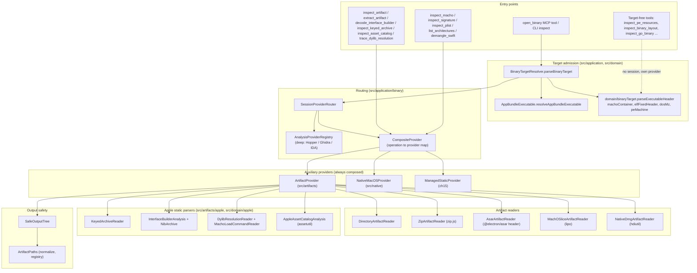
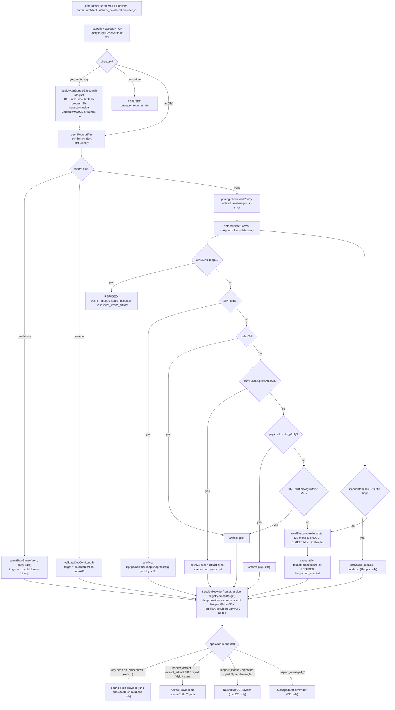
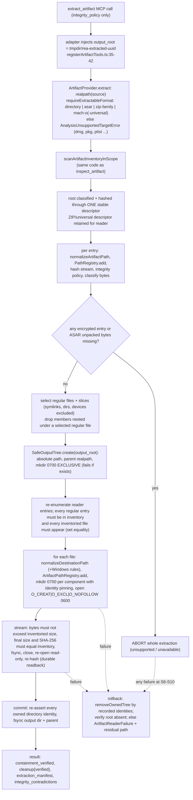
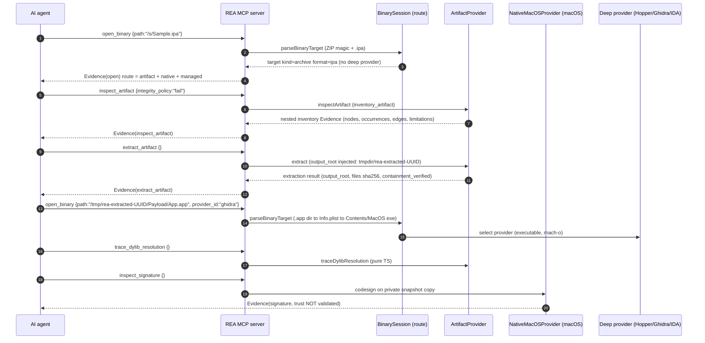
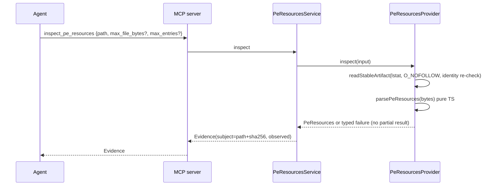

# 14 — File types: native executables, Apple artifacts, archives and containers

Scope: how REA (`rea-agents` 6.4.0, source HEAD `f75b1a4`) **detects, routes, parses, bounds and reports** native executable
formats (Mach-O thin/fat, ELF, PE, DOS MZ/COM, headerless raw binaries), Apple bundle artifacts (`.app`, plists, compiled
Interface Builder, asset catalogs, keyed archives, dyld resolution, code signatures, ObjC/Swift metadata), and container formats
(directories, ZIP/APK/IPA/MSIX/AppX/HAP, ASAR, DMG/PKG, `.hop`). It ends with the **archive-extraction flow** and its
zip-slip / size-bomb / symlink protections, because those matter directly for handling malware samples.

Sibling chapters: provider routing in [06-provider-layer-and-session-routing.md](06-provider-layer-and-session-routing.md);
Hopper/Ghidra/other deep providers in [07](07-hopper-provider.md), [08](08-ghidra-provider.md), [09](09-other-native-providers.md);
Evidence envelopes in [10](10-evidence-model-ledger-unknowns-bundles.md); managed/.NET, firmware, WASM, Go/Rust/SQLite, EVM and
diagnostics in [15-filetypes-managed-firmware-wasm-evm-misc.md](15-filetypes-managed-firmware-wasm-evm-misc.md);
JavaScript/Electron (ASAR contents) in [16](16-javascript-electron-analysis.md); Android/APK analysis in [19](19-android-mobile.md);
the security model in [21](21-security-model.md).

All paths below are repo-relative to `/home/user/morluto/rea`. Line numbers were verified against HEAD `f75b1a4`.

---

## 0. Execution-safety classification (read this first)

For malware work the most important property of each capability is **whether the sample's bytes are interpreted only by REA's
own parser, by a host Apple/Xcode tool, or by executing the sample**. This chapter's capabilities fall into four classes.

| Class | Meaning | Capabilities in this chapter |
|---|---|---|
| **S — Static, in-process TypeScript** | Bytes are parsed by REA code in the Node process. No child process, no target execution. Works on any host OS. | Target admission/classification (`parseBinaryTarget`), `inspect_artifact` / `extract_artifact` for directory, ZIP-family, ASAR; `inspect_pe_resources`; `decode_interface_builder`; `inspect_keyed_archive`; `trace_dylib_resolution`; `inspect_native_dispatch_metadata` (binary decode path, macOS-gated capability); raw-binary / dos-com admission |
| **H — Host tool, read-only inspection (macOS)** | REA spawns an allow-listed Apple tool (`lipo`, `otool`, `nm`, `dyld_info`, `dwarfdump`, `vtool`, `codesign`, `plutil`, `file`, `strings`, `swift-demangle`, `assetutil`, `hdiutil`) over the sample as *data*. Tool vulnerabilities are the attack surface; the sample is never launched. macOS only. | `inspect_macho`, `list_architectures`, `inspect_signature`, `inspect_plist`, `demangle_swift`, `inspect_asset_catalog`, universal-Mach-O child inventory/extraction (`lipo`) |
| **M — Mount** | A filesystem image is mounted by the host kernel/`hdiutil` (read-only, no-browse). Parsing of the DMG filesystem is done by macOS, not REA. | DMG child inventory (`NativeDmgArtifactReader`) |
| **X — Executes the target** | The sample (or its code) runs. **Requires isolation.** | `observe_native_calls` (LLDB launches the Mach-O), `observe_native_ui`/`capture_native_ui_scenario` (drive an already running/owned app) — documented in [18](18-process-capture-and-instrumentation.md); *not* parsed by this chapter beyond their effect flags |

Effect flags are declared per operation in `src/artifacts/ArtifactProviderMetadata.ts:16-27` (artifact operations) and
`src/native/NativeMacOSProviderMetadata.ts:36-52` (native operations). `launchesProcess` is `false` for
`decode_interface_builder`, `inspect_keyed_archive` and `trace_dylib_resolution`, and `false` for
`inspect_native_dispatch_metadata`; every other native-macOS operation is `launchesProcess: true`
(`src/native/NativeMacOSProviderMetadata.ts:42`). `OWNED_PROCESS_OPERATIONS` = `capture_native_ui_scenario`, `observe_native_calls`
(`src/native/NativeMacOSProviderMetadata.ts:14-17`) are the ones flagged `mayShowUi`/`mayAccessNetwork`/`mayWriteFilesystem`.

---

## 1. Component map



*Figure 1 — Component/dependency map.* Entry tools either open a session target (left path through `parseBinaryTarget`) or run
target-free (dotted). Auxiliary providers are composed into **every** session route regardless of the deep provider
(`src/composition/auxiliaryAnalysisProviders.ts:17-52`), so artifact, native-macOS and managed operations are always *declared*;
whether each is *available* is decided per host/target at call time (section 2.4).

Walkthrough: `parseBinaryTarget` (`src/application/BinaryTargetResolver.ts:74-236`) is the single admission gate for session
targets; it classifies bytes, hashes the file and returns a `BinaryTarget` variant. The router then selects at most one deep
provider (Hopper/Ghidra/IDA) via `AnalysisProviderRegistry` and *always* adds the three auxiliary providers through
`CompositeProvider`, which maps each operation name to exactly one provider
(`src/application/binary/CompositeProvider.ts:120-140`; duplicate operation names throw a `TypeError` at construction).

---

## 2. Detection and routing

### 2.1 The two classifiers (they are deliberately different)

REA has **two independent byte classifiers**, which is a frequent source of confusion:

1. **Target admission** — `parseBinaryTarget` + `parseExecutableHeader` — decides *how to open* a user-selected path in a session
   and yields the `BinaryTarget` union (kind `executable | database | archive | artifact`). It reads a 4096-byte prefix
   (`src/application/BinaryTargetResolver.ts:301,459`) and checks header commitments against the **whole file size**.
2. **Inventory classification** — `classifyRootFormat` / `classifyArtifactBytes` — labels every file *inside* a container and the
   root in the artifact graph (`ArtifactOccurrence.artifact_format`). It reads an 8 192-byte prefix
   (`ARTIFACT_CLASSIFICATION_PREFIX_BYTES`, `src/artifacts/ArtifactHash.ts:19`), widened up to 1 MiB only to finish an XML-plist probe.

The `BinaryTarget` contract (verbatim, `src/domain/binaryTargetTypes.ts:139-190` abridged to the discriminating members):

```ts
export type BinaryTarget =
  | (BinaryTargetIdentity & { readonly kind: "executable"; readonly format: "elf"; readonly architecture: "mips"; ... readonly mips: MipsElfMetadata; })
  | (BinaryTargetIdentity & { readonly kind: "executable"; readonly format: "elf"; readonly architecture: "riscv"; ... readonly riscv: RiscvElfMetadata; })
  | (BinaryTargetIdentity & { readonly kind: "executable"; readonly format: "elf"; readonly architecture: "powerpc"; ... readonly powerpc: PowerPcElfMetadata; })
  | (ExecutableTarget & { readonly format: "mach-o" | "elf" | "dos-mz" | "dos-com"; readonly universalSlice?: never; ... })
  | (ExecutableTarget & { readonly format: "mach-o-universal";
      /** Selected slice range a provider must analyze instead of the container. */
      readonly universalSlice: UniversalMachOSlice; ... })
  | (BinaryTargetIdentity & { readonly kind: "executable"; readonly format: "raw-binary";
      readonly architecture: Exclude<BinaryArchitecture, ElfMetadataArchitecture>;
      readonly entryPoint: string; readonly entryPointSource: string; ... })
  | (ExecutableTarget & { readonly format: "pe";
      readonly executableRole: "application" | "shared-library" | "non-executable";
      readonly managed: boolean;
      readonly codeView?: PeCodeViewRecord; })
  | (BinaryTargetIdentity & NonExecutableMetadata & { readonly kind: "database"; readonly format: "analysis-database"; })
  | (BinaryTargetIdentity & NonExecutableMetadata & { readonly kind: "archive"; readonly format: ZipPackageFormat | "asar" | "dmg" | "pkg"; })
  | (BinaryTargetIdentity & NonExecutableMetadata & { readonly kind: "artifact"; readonly format: "plist" | "javascript" | "source-map"; });
```

with `BinaryTargetIdentity = { path; sourcePath?; bundleInfoPlist?; sha256 }` (`src/domain/binaryTargetTypes.ts:114-119`) and
`BINARY_ARCHITECTURES = ["x86","x86_64","arm","arm64","mips","6502","riscv","powerpc"]` (`:4-13`).

### 2.2 Detection table — magic / extension / sniffing

| Format | Detected by (target admission) | Detected by (inventory classifier) | Code |
|---|---|---|---|
| **ELF** | `7f 45 4c 46`; fixed header validated by `readElfFixedHeader`; machine → arch map 3 x86, 62 x86_64, 8 mips, 20 powerpc, 40 arm, 183 arm64, 243 riscv; other machine ⇒ `unsupported ELF architecture` | `7f 45 4c 46` ⇒ `elf` | `src/domain/binaryTarget.ts:200-251,543-563`; `src/domain/elfFixedHeader.ts:16-55`; `ArtifactGraphConstruction.ts:533-572` |
| **Mach-O thin** | BE-read magic ∈ {`feedface`,`feedfacf`,`cefaedfe`,`cffaedfe`}; CPU type map 7 x86, `0x01000007` x86_64, 12 arm, `0x0100000c` arm64; load-command extent must fit the file | same four magics ⇒ `mach-o` | `binaryTarget.ts:91-117,529-541`; `ArtifactGraphConstruction.ts:550-556` |
| **Mach-O fat/universal** | `cafebabe`/`cafebabf`/`bebafeca`/`bfbafeca`; ≤128 arches; table must fit file; identity confirmed by a known CPU type or an observed slice magic; host-compatible slice selected | same ⇒ `mach-o-universal` (or `unknown` when slice identity cannot be established) | `src/domain/apple/machoContainer.ts:48-144`; `binaryTarget.ts:119-161`; `ArtifactGraphConstruction.ts:574-589` |
| **PE** | `MZ` + `e_lfanew` (u32 at 0x3C) pointing at `PE\0\0`; COFF machine decoded (x86 `0x014c`, x64 `0x8664`, ARM `0x01c0/1c2/1c4`, ARM64 `0xaa64`, plus ReadyToRun OS-override XOR constants); optional header ≤ 4096 bytes; **managed** = non-zero CLI data-directory (#14) | `MZ` + declared `PE` signature inside the 8 KiB prefix ⇒ `pe` | `binaryTarget.ts:253-332,500-527`; `src/domain/peMachine.ts:34-50`; `BinaryTargetResolver.ts:569-613` |
| **DOS MZ** | `MZ` with no Windows new-header; `parseDosMzHeader` validates page counts, header size, relocation table, entry inside load module | `MZ` + valid DOS header ⇒ `dos-mz` else `unknown` | `src/domain/dosMz.ts:32-168` |
| **DOS COM** | **Never sniffed.** Only with `format=dos-com`; length must be 1..65 280 bytes | not classified (plain `file`) | `src/domain/dosCom.ts:10-15`; `BinaryTargetResolver.ts:149-174` |
| **raw-binary** | **Never sniffed.** Only with `format=raw-binary` + `architecture` + `entry_point` | not classified | `src/domain/rawBinary.ts:85-136`; `BinaryTargetResolver.ts:106-148` |
| **ZIP family** | `PK\x03\x04`, `PK\x05\x06` (empty) or `PK\x07\x08` (split) magic; *then* the **suffix** picks the family: `.zip` zip, `.ipa`, `.apk`, `.msix/.msixbundle`, `.appx/.appxbundle`, `.hap`, `.hsp`; root `.app` ⇒ `app-pack` | same magic; suffix only after magic matched | `src/domain/zipPackageFormat.ts:2-60`; `BinaryTargetResolver.ts:313-319`; `classify.ts:149-198` |
| **ASAR** | Target admission: **suffix `.asar` alone** (`namedArtifactFormat`). Inventory: header pickle must validate (`hasAsarHeader`) and `.asar` suffix | pickle layout: u32(4), u32 headerSize ≥ 16, u32 payloadSize = headerSize−4, u32 stringLength ≥ 2 **and ≤ payloadSize−4**, byte 16 = `{` (`hasAsarHeader`, `ArtifactGraphConstruction.ts:500-509`) | `BinaryTargetResolver.ts:376-383`; `ArtifactGraphConstruction.ts:495-509` |
| **DMG** | suffix `.dmg` **and** `koly` at `size-512` | same (root only) | `BinaryTargetResolver.ts:330-343`; `classify.ts:199-207` |
| **PKG** | suffix `.pkg` **and** `xar!` magic | same (root hash only) | `BinaryTargetResolver.ts:324-329`; `classify.ts:158-162` |
| **Plist (binary)** | `bplist00` (8-byte) regardless of extension | same ⇒ `plist` | `src/domain/apple/appleArchiveFormat.ts:10-11` |
| **Plist (XML)** | bounded streaming prolog scanner (skips comments/PIs, requires `<!DOCTYPE plist` or `<plist`; BOM/UTF-16 aware); probe cap 1 MiB; also suffix `.plist` | same probe | `appleArchiveFormat.ts:7,16-110,215`; `BinaryTargetResolver.ts:344-373` |
| **NIBArchive** | magic `NIBArchive` (10 bytes), only consumed by IB/keyed-archive readers | n/a | `appleArchiveFormat.ts:2-4,215-216` |
| **WASM** | `00 61 73 6d 01 00 00 00` ⇒ **refused by `open_binary`** (`wasm_requires_static_inspection`) before any other sniffing | n/a | `BinaryTargetResolver.ts:304-312` |
| **`.hop`** | suffix `.hop` with no explicit kind (database kind) — checked **after** the WASM probe, so a renamed WASM is still refused; but an explicit `kind=database` **skips** the artifact/WASM probe entirely (RUN: a `.wasm` opened with `targetKind: database` is admitted as `analysis-database`), and a ZIP-magic file named `.hop` becomes `database` (the suffix route returns before the archive classification is used; RUN) | n/a | `BinaryTargetResolver.ts:175-193` |
| **directory** | `.app` suffix directory ⇒ app bundle resolution; any other directory refused (`directory_requires_file`) for session targets; inventory treats any directory root as `directory` | `entry_kind: directory` | `BinaryTargetResolver.ts:435-451`; `classify.ts:84-93` |
| **JS / source map** | suffix only: `.js/.mjs/.cjs`, `.map` | path-role hint (`classifyArtifactPath`) | `BinaryTargetResolver.ts:376-383`; `ArtifactGraphConstruction.ts:445-468` |

Notable detection facts:

* **Path suffix is never trusted alone for containers in the inventory.** `createOccurrence` starts a member named like a container
  (`.asar`/`.zip`/…) as `unknown` format until its bytes are read (`ArtifactGraphConstruction.ts:72-125`), and a limitation is
  recorded if the bytes were never read (`noteUnreadContainerSuffix`, `:116-126`). In contrast, **target admission trusts the `.asar`
  suffix** (`namedArtifactFormat`, `BinaryTargetResolver.ts:376-383`); the ASAR header is validated later when the reader opens it
  (`admitAsarHeader`, `src/artifacts/AsarHeader.ts:10-48`) — extraction of a fake `.asar` fails there with reason `format`, whereas `inspect_artifact` on the same file does **not** fail: the inventory classifier requires a valid header, so the root is recorded as `file` with `node_count: 1` and the limitation "Artifact has no child container entries." (RUN, `fake.asar` = 25 junk bytes).
* **Plist/ASAR/JS interplay.** `classifyArtifactContent` keeps a path role (`javascript`, `source-map`, `entitlements`) over an
  XML-plist byte match, because XML-ish text can legitimately sit in those files (`ArtifactGraphConstruction.ts:470-498`).
* **Mach-O header commitments use the full file size**, not the 4 KiB prefix (e.g. `headerSize + commandBytes > fileSize` ⇒
  `truncated Mach-O load commands`), `binaryTarget.ts:107-113`.

### 2.3 Routing decision flowchart — `open_binary`, `inspect_artifact`, `extract_artifact`



*Figure 2 — Detection and routing decision flow.* Walkthrough:

1. **Path resolution.** `realpath` canonicalises the path; `sourcePath` is the canonical path (or the caller path on Windows)
   (`BinaryTargetResolver.ts:85-89`). A directory must end in `.app`, otherwise the open is refused with constraint
   `directory_requires_file` (`:435-451`). An `.app` is resolved to its program file (section 3.5).
2. **Regular-file open.** The program file is opened with `symlinks: "reject"` (`:98-101`) — a symlinked target is refused; the
   `sha256Handle` helper hashes the file in 64 KiB chunks and re-`stat`s it, failing with `target changed while being read` /
   `target grew while being read` if the file mutates (`:400-433`).
3. **Hints first.** `raw-binary` and `dos-com` are explicit interpretations and bypass sniffing entirely (`:106-174`). Passing
   `architecture` or `entry_point` without `format=raw-binary` is an error (`rawBinarySelectionError`, `src/domain/rawBinary.ts:138-153`).
4. **Artifact probe before executable probe.** `detectArtifactFormat` (`:281-374`) runs *before* the executable header parser, so
   a ZIP-magic file is an *archive* even if named `.exe`. WASM is rejected first (`:301-312`).
5. **Executable parse.** `readExecutableMetadata` (`:453-567`) widens reads for large FAT tables (`count <= 128`, `:528`), MZ
   relocation tables, and PE headers (+ CodeView debug record), then calls the pure `parseExecutableHeader`.
6. **Routing.** The router picks deep provider support per target. Hopper supports `executable` and `database` targets
   (refuses `archive`/`artifact`, raw-binary, DOS, and MIPS/RISC-V/PowerPC ELF) — `src/hopper/HopperProvider.ts:104-155`;
   Ghidra supports `executable` only (`src/ghidra/GhidraProvider.ts:161-181`, universal Mach-O with >1 arch is unsupported,
   `:196-207`); IDA supports `executable`, refuses raw-binary (`src/ida/IdaProvider.ts:128-145`). **Archive and artifact targets
   therefore have no deep provider by design** — only the three auxiliary providers serve them. The auxiliary providers are
   appended to the route unconditionally (`SessionProviderRouter.selectableRoute`, `src/application/binary/SessionProviderRouter.ts:112-145`).
7. **Capability gate.** Before any call, `prepareSessionExecution` requires `capability.available === true` for the
   operation in the *active route*; otherwise it returns `AnalysisCapabilityUnavailableError` (or a selection error)
   (`src/application/binary/BinarySessionExecution.ts:66-80`). This is how off-macOS hosts report that Apple-tool operations
   are unavailable, and what lets `inspectNativeDispatch` fall back to the deep provider's name inventory
   (`src/application/native/NativeDispatchMetadataInspection.ts:13-35`).

`inspect_artifact` / `extract_artifact` do **not** require a particular target kind: `ArtifactClient.execute` always inventories
`this.target.sourcePath ?? this.target.path` (`src/artifacts/ArtifactProvider.ts:190,204,386-402`). For a Mach-O app bundle target
that is the **bundle directory**; for an IPA/ZIP it is the archive file. The CLI one-shot forms (`rea inspect-artifact`,
`rea extract-artifact`) go through `runProviderAnalysis` (`src/cli/artifactCommands.ts:193-248`).

### 2.4 Platform availability matrix

| Capability | Linux/Windows | macOS | Source |
|---|---|---|---|
| Target admission, all formats | yes | yes | S |
| `inspect_artifact` (directory, ZIP-family, ASAR) | yes | yes | `src/artifacts/inventory/reader.ts:20-43` |
| `inspect_artifact` universal Mach-O slices | **no** (coverage `unknown`: "require the native macOS lipo adapter") | yes (`lipo`) | `reader.ts:34-36,72-79` |
| `inspect_artifact` DMG children | **no** (root hash only) | yes (`hdiutil attach`) | `reader.ts:37-39,64-71` |
| `inspect_artifact` PKG children | no (root hash only on every OS) | no | `reader.ts:64-71` |
| `extract_artifact` | directory, ASAR, ZIP-family | + thin/universal Mach-O slices | `ArtifactExtraction.ts:409-427` |
| `decode_interface_builder`, `inspect_keyed_archive`, `trace_dylib_resolution` | yes | yes | `ArtifactProvider.ts:104-185` |
| `inspect_asset_catalog` | no (`unsupported_host`) | yes (`/usr/bin/assetutil`) | `ArtifactProviderMetadata.ts:36-41`; `AppleAssetCatalogAnalysis.ts:17,35-38` |
| `inspect_macho`, `inspect_signature`, `inspect_plist`, `list_architectures`, `demangle_swift`, `inspect_native_dispatch_metadata` | no (`unsupported_host`) | yes | `NativeMacOSProviderMetadata.ts:30-35` |
| `inspect_pe_resources` | yes (target-free) | yes | `src/composition/binaryDiagnostics.ts:9-11` |

---

## 3. Per-format reference

Each subsection lists: **Detect → Route → Parse → Limits → Output → Failure modes**.

### 3.1 Mach-O (thin and fat/universal)

**Detect.** Section 2.2. For a *universal* binary the admission step picks **one** host-compatible slice and records its byte
range: `fatHostArchitecture` maps Node `process.arch` `arm64→arm64`, `x64→x86_64`, `ia32→x86`, `arm→arm`, anything else ⇒ error
(`src/domain/binaryTarget.ts:163-176`). If the host's architecture is absent the open fails: `FAT binary has no host-compatible <host> architecture` where `<host>` is Node's `process.arch` spelling (RUN: `x64`, `ia32`, `riscv64`)
(`:150-153`). A slice shorter than its Mach-O header is rejected (`:154-158`). **Implication for triage:** opening an
`x86_64`-only universal slice on an arm64 host fails at admission; analyse with `inspect_artifact`/`extract_artifact` (macOS) or
`list_architectures`/`inspect_macho` instead.

FAT table parsing is shared (`src/domain/apple/machoContainer.ts`): `MAX_FAT_ARCHITECTURES = 128` (`:48`); `count === 0` is `malformed`; `count > 128` or a table
beyond EOF returns `not-fat` (`:76-84`) — *not* an error; `inspectFatSliceRange` rejects slices before the table end, beyond EOF,
alignment exponent >52, or misaligned offsets (`:210-246`). `classifyFatContainerIdentity` requires either a known Mach-O CPU type
(`KNOWN_MACHO_CPU_TYPES`, `:49-51`) or an observed Mach-O magic at a slice start — this prevents Java class files (which share
`cafebabe`) from being classed as universal Mach-O.

**Route.** Deep providers: Hopper, Ghidra (thin only: "analyze a thinned Mach-O slice instead"), IDA. Static Apple tools:
`NativeMacOSProvider` (section 3.19–3.22). Slice enumeration inside the artifact graph: `MachOSliceArtifactReader`.

**Parse — `MachOSliceArtifactReader`** (macOS only). Runs `lipo -detailed_info <path>` via the allow-listed runner and then
*independently* parses the FAT table in TypeScript (`readStructuralSlices`), and requires them to agree: count mismatch ⇒
`lipo architecture count disagrees with the Mach-O FAT table`; per-slice mismatch ⇒ integrity failure
(`src/artifacts/MachOSliceArtifactReader.ts:58-160`). Each slice becomes an occurrence of `entry_kind: "slice"`,
`artifact_kind: "universal-slice"`, `format: "mach-o"` (`scanReader.ts:318-320`), read by byte range from the already-open file
descriptor (no `lipo -thin` temp files). This defends against a tool/parser discrepancy being used to hide a slice.

**Limits.** Load-command region ≤ 16 MiB in the dylib reader (`MAX_LOAD_COMMAND_BYTES`, `src/artifacts/apple/MachoLoadCommandReader.ts:18`);
dispatch-metadata decoder: file ≤ 64 MiB, ≤4096 load commands (`src/native/AppleDispatchMetadata.ts:191`,
`src/native/AppleMachoSelection.ts:174`); big-endian Mach-O refused by the dylib reader (`MachoLoadCommandReader.ts:180-188`) and
by the dispatch decoder (little-endian 64-bit only, `AppleMachoSelection.ts:160-164`). Native-tool runs: 60 s timeout and 64 MiB
combined output per command (`src/native/CommandRunner.ts:21,23`).

**Output.** Target: `{kind:"executable", format:"mach-o"|"mach-o-universal", architecture, availableArchitectures, universalSlice?}`.
Graph occurrences for slices carry `source_location {offset,length}` (`ArtifactGraphConstruction.ts:107-110`).

**Failure modes.** Truncated header/load commands (`binaryTarget.ts:100-114`), unsupported CPU (e.g. PowerPC slice ⇒ element
skipped in `availableArchitectures`; a lone unsupported CPU ⇒ `unsupported Mach-O architecture`, `:108`), host-incompatible fat,
non-macOS host for slice inventory (coverage `unknown`).

### 3.2 ELF

**Detect/parse (target admission).** `readElfFixedHeader` validates ident class (1/2), data encoding (1/2), ident version (=1),
`e_version` (=1), `e_ehsize` within `[52|64 .. fileSize]`, bytes ≥ minimum header (`src/domain/elfFixedHeader.ts:16-55`).
`parseElf` maps `e_machine` and, for MIPS/RISC-V/PowerPC, retains `{elfClass, byteOrder, type, flags}` as `ElfFamilyMetadata`
(`binaryTarget.ts:200-251`) because "ISA and ABI are not established by the family name alone"
(`src/domain/binaryTargetTypes.ts:15-25`). For 32-bit MIPS the resolver additionally reads ABI-flags/GNU-attribute/dynamic-REL
declarations through `readMipsElfMetadata` (`BinaryTargetResolver.ts:541-566`; `src/application/MipsElfMetadata.ts`).

**Route.** Deep providers only (Hopper refuses MIPS/RISC-V/PowerPC, Ghidra has per-family profiles — see [08](08-ghidra-provider.md)).
Static ELF *layout/mitigation* inspection is a separate target-free tool (`inspect_binary_layout`, pwntools; chapter 15
section on binary diagnostics). There is **no pure-TypeScript ELF section/symbol parser** in this chapter's scope; the in-process
ELF readers are the Go/Rust/Flutter readers ([15](15-filetypes-managed-firmware-wasm-evm-misc.md)).

**Limits/Failure.** `unsupported ELF architecture`, `unsupported ELF class/endianness/identification version`, truncated headers
(`elfFixedHeader.ts:21-43`).

### 3.3 PE (including `inspect_pe_resources`)

**Detect.** `MZ`; `observeMzWindowsHeader` decides whether the u32 at 0x3C is a real `e_lfanew` (full DOS headers always declare;
for short headers only an observed `PE`/`NE`/`LE`/`LX` signature confirms) (`src/domain/dosMz.ts:32-87`). `NE/LE/LX` ⇒
`unsupported <sig> executable in MZ image` (`binaryTarget.ts:271-275`; `BinaryTargetResolver.ts:594-595`). `parsePeRecord` requires
`PE\0\0`, a supported COFF machine, optional header ≤ 4096 bytes, optional-header magic matching the architecture
(`0x20b` for x64/arm64, `0x10b` otherwise), a complete data-directory table; `managed = CLI directory (#14) non-zero`
(`binaryTarget.ts:294-332,500-527`). ReadyToRun images for non-Windows OSes store the machine XOR an OS constant; they are decoded by
`decodePeMachine` but rejected unless the image is managed (`src/domain/peMachine.ts:34-50`; `binaryTarget.ts:316-317`).
`executableRole` is derived from COFF characteristics: not `0x0002` ⇒ `non-executable`; else `0x2000` set ⇒ `shared-library`;
else `application` (`binaryTarget.ts:323-329`). CodeView (RSDS/NB10) PDB path/GUID/age is read from the debug directory
(≤ 96 sections, debug blob ≤ 4096 bytes) (`BinaryTargetResolver.ts:615-692`; `binaryTarget.ts:335-398`).

**Route.** Native PE (`managed:false`) → deep providers (Ghidra on Windows P0 admits "native PE applications/DLLs" only,
`docs/raw-binary.md` last section). Managed PE (`managed:true`) → `ManagedStaticProvider` (chapter 15), and the deep provider
support function reports `managed_target_unsupported` for providers that cannot analyse managed code.

**`inspect_pe_resources`** (target-free, **class S**). Contract (verbatim, `src/domain/native/peResources.ts:19-45`):

```ts
export const inspectPeResourcesInputSchema = z.strictObject({
  path: localPathStringSchema.describe("Absolute filesystem path to a PE image"),
  max_file_bytes: z.number().int().min(64).max(536870912).default(67108864)
    .describe("Maximum stable artifact bytes to read (default 64 MiB)"),
  max_entries: z.number().int().min(1).max(65536).default(16384)
    .describe("Maximum resource directory entries to examine; exceeding the budget fails without partial success"),
});
```

Pipeline: `PeResourcesProvider.inspect` → `readStableArtifact` (lstat → reject symlink/non-regular → `O_NOFOLLOW|O_NONBLOCK` open →
identity (dev/ino/size/mtime/ctime) re-check before/after, size ≤ `max_file_bytes`) (`src/native/pe/PeResourcesProvider.ts:24-52`;
`src/artifacts/readStableArtifact.ts:44-141`) → `parsePeResources` (`src/native/pe/PeResourceParser.ts:36-300`). The parser walks the
three-level type/name/language tree, rejecting: cycles, unaligned directories/names (4-/2-byte), name/ID count disagreements,
duplicate sibling identities, trees deeper/shallower than 3 levels, unbacked/ambiguous RVA mappings, and **non-identical overlapping
byte ranges** (`rejectOverlappingRanges`, `:302-319`). Budget: 8 MiB of retained result metadata (`METADATA_BYTES`, `:20`),
entry budget `max_entries`; exceeding either ⇒ `limit` failure with **no partial inventory**. Each payload gets its own SHA-256,
`RT_GROUP_ICON` descriptors are joined to `RT_ICON` candidates by numeric id and language (static relationships only).
Output fields (`peResourcesSchema`, `peResources.ts:49-111`): `artifact{path,sha256,bytes}`, `format pe32|pe32-plus`, `machine`,
`directory{rva,location,data_directory_location}|null`, `directories[]`, `resources[]{index,type,name,language (id|name+utf16le_hex),entry_locations[3],data_entry_location,code_page,reserved,payload{rva,location,sha256}}`,
`icon_groups[]`, `coverage{status:"complete",examined_entries,resources}`, `limitations`. Failure mapping: `ArtifactReaderFailure`
`integrity`→`AnalysisArtifactChangedError`, `limit`→`AnalysisResourceConstraintError`, `path|format`→`AnalysisInputError`
(`PeResourcesProvider.ts:58-120`). Malware relevance: resource-section payload hashes (embedded droppers/icons) without loading
the PE; **the whole file (≤512 MiB) is buffered in memory**.

### 3.4 DOS MZ and COM, and headerless raw binaries (docs/raw-binary.md)

* **DOS MZ** is sniffed (section 2.2). `parseDosMzHeader` (`dosMz.ts:90-168`) validates pages/last-page, header size (≥ 28 and < image),
  `imageBytes ≤ fileSize`, relocation table within the header and within the bounded prefix, every relocation target inside the load
  module, and entry point inside the initialized module; overlay bytes (`fileSize − imageBytes`) are retained as separate facts.
  Only **Ghidra** (16-bit real mode `MzLoader`) analyses it (`HopperProvider.ts:153-160`; `docs/ghidra-dos.md`).
* **DOS COM** has no signature: admitted only with `format=dos-com`, 1..65 280 bytes (`dosCom.ts:10-15`), target
  `{format:"dos-com", architecture:"x86"}` (`BinaryTargetResolver.ts:166-174`).
* **raw-binary** (`docs/raw-binary.md`; code `src/domain/rawBinary.ts`). Schema (verbatim, `rawBinary.ts:11-22`):

```ts
export const BINARY_ARCHITECTURES = ["x86","x86_64","arm","arm64","6502"] as const satisfies readonly BinaryArchitecture[];
export const binaryArchitectureSchema = z.enum(BINARY_ARCHITECTURES);
const RAW_BINARY_ENTRY_POINT = /^0x[0-9A-Fa-f]{1,16}$/u;
```

  `admitRawBinary` (`:85-136`) enforces: architecture ∈ the five; `entry_point` matches the hex regex; ARM/AArch64 entry 4-byte aligned;
  file ≥1 byte; `entry + size − 1` fits the CPU address width (6502 ⇒ 0xFFFF, 32-bit ⇒ 0xFFFFFFFF, 64-bit ⇒ 2^64−1,
  `:77-83`). Errors carry `constraint: load_selection_rejected` (caller input) or `file_format_rejected` (file). Hopper and IDA
  refuse raw-binary; only Ghidra's `BinaryLoader` accepts it with fixed language IDs (`docs/raw-binary.md` table: x86 `x86:LE:32:default/gcc`,
  x86_64 `x86:LE:64:default/gcc`, arm `ARM:LE:32:v7`, arm64 `AARCH64:LE:64:v8A`, 6502 `6502:LE:16:default`). The architecture
  and entry are committed in the analysis profile (`language_selection: caller-supplied-v1`), so a different entry is a
  different profile. **Nothing is guessed**: no reset-vector inference, no suffix-based admission, no emulation. Worked example in section 8.

### 3.5 `.app` bundles

**Detect/resolve.** A directory whose lower-cased extension is `.app` (`BinaryTargetResolver.ts:435-451`).
`resolveAppBundleExecutable` (`src/application/AppBundleExecutable.ts:60-91`) tries two layouts in order
(`BUNDLE_LAYOUTS`, `:28-41`): macOS `Contents/Info.plist` + `Contents/MacOS/<CFBundleExecutable>`, then iOS-style root `Info.plist` +
bundle-root program; failing both it looks for an iOS-on-Mac `Wrapper/<X>.app` — it **lists** `Wrapper` and requires exactly one `.app`
directory, never following `WrappedBundle` (`:156-172`). The plist is decoded in-process (binary plists via the `plist` package after a
16 MiB decode-budget preflight, `:19,266-269`; XML via the hardened XML path). Safety checks: `CFBundleExecutable` must be a plain file
name (no `/`, `\`, NUL, `.`, `..`; `isSafeExecutableName`, `:273-278`) and the **realpath of the program must stay inside the programs
directory** (`isPathWithinRoot`, `:227-236`) — a bundle whose executable symlinks out is refused ("app program file leaves Contents/MacOS").
`BinaryTarget.path` becomes the program file; `sourcePath` stays the bundle; `bundleInfoPlist` records the plist actually used.

**Route.** Deep providers analyse `path` (the main Mach-O). Bundle-wide operations (`decode_interface_builder`,
`inspect_asset_catalog`, `inspect_keyed_archive`, `trace_dylib_resolution`, `inspect_artifact`) use `sourcePath`; the first two
require `sourcePath` ending `.app` (`ArtifactProvider.ts:104-116,265-280`). The Apple anatomy projection
(`project_apple_application_graph`, `src/domain/apple/appleBundleAnatomy.ts`, `docs/apple-application-analysis.md`) classifies nested bundles by
path convention (`role_basis: "path-convention"`), never by reading plists.

**Failure modes.** Missing/unreadable plist, malformed plist, missing `CFBundleExecutable`, unsafe name, executable outside the
programs dir, permission denied, ambiguous wrapper — all `BinaryTargetError`.

### 3.6 `.hop` (Hopper analysis database)

`kind:"database"`, `format:"analysis-database"` when `targetKind==="database"` or (no kind **and** the path ends `.hop`)
(`BinaryTargetResolver.ts:175-193`), after the WASM refusal. Only **Hopper** supports database targets, and on **macOS the launcher
cannot start REA's bridge on a saved database** so Hopper reports `target_kind_unsupported` there
(`src/hopper/HopperProvider.ts:117-124`). No REA parser reads `.hop` contents. Treat `.hop` as an *analyst work product*, not a
malware sample format.

### 3.7 Directories

Used as the root of an inventory (`.app` or any directory passed to `inspect_artifact` by path) and as the on-disk form of nested
content. `DirectoryArtifactReader` (`src/artifacts/DirectoryArtifactReader.ts`): realpath'd root with captured `{dev,ino}` identity;
iterative traversal; **never follows symlinks** — `lstat` per entry, symlink entries get `kind:"symlink"` with the limitation "Symlink target was
not followed or disclosed" (`:295-324`); FIFOs/sockets/devices are recorded as omissions, not read
(`ArtifactTraversalOmission`, `ArtifactReader.ts:96-110`; `DirectoryArtifactReader.ts:124-133`); `assertContainedDirectory` is re-run around
every directory read to detect a swapped directory (`:54-68`); `open()` uses `O_RDONLY|O_NOFOLLOW|O_NONBLOCK`, requires the opened
descriptor to be a regular file whose `{dev,ino,size,mode,mtimeNs,ctimeNs}` equals the identity captured at traversal, else
`Directory entry changed before open` (`:171-206`, `sameArtifactSourceIdentity`, `ArtifactReader.ts:41-60`).
Output: occurrences (+ directory nodes with a content-address over their sorted child list, `materializeDirectoryNodes`,
`ArtifactGraphConstruction.ts:135-174`). Directory nodes have `content_state:"virtual"`, root dir node `materialized`.

### 3.8 ZIP (generic)

**Detect.** Section 2.2. **Reader.** `ZipArtifactReader` wraps `@zip.js/zip.js` (`src/artifacts/ZipArtifactReader.ts:154-259`):
`checkSignature: true`, `checkOverlappingEntry: true` (rejects overlapping entry data ranges), tolerant filename validation (so
REA's own `normalizeArtifactPath` produces the typed failure) and legacy CP437 decoding unless the UTF-8 flag/valid Info-ZIP Unicode Path
field is present; invalid UTF-8 in flagged names or the Unicode Path field ⇒ `format` failure (`:168-181,278-322`). The root file
descriptor classified during inventory is **retained and reused** for the ZIP reader (`classify.ts:121-133`; `reader.ts:20-24`) so the
bytes read are the bytes hashed (TOCTOU defence); `NodeFileReader` re-`stat`s and compares to the admitted identity
(`ZipArtifactReader.ts:76-121`).
Enumeration is **central-directory only** — local headers/slack bytes/APK signing block/comments are not occurrences
(`ZIP_NON_ENTRY_LIMITATION`, `src/domain/zipPackageFormat.ts:49-55`). Member kinds: directory flag ⇒ `directory`; Unix mode
`S_IFLNK` ⇒ `symlink` (target **not read**, `:261-276,420-422`); else `file`. Encrypted members are listed but never decrypted/hashed
(`hash_status: "unavailable"`, `ArtifactGraphConstruction.ts:106`; `open()` rejects with `unavailable`, `ZipArtifactReader.ts:237-246`).
CRC is verified on every read (`checkSignature:true`); `ERR_*` zip.js messages are mapped to typed `format`/`unavailable` failures
(`:370-410`). Entries sharing a path are retained as duplicates with ordinals (`occurrenceCountByPath`, `scanReader.ts:189-191`;
`rekeyOccurrences`, `ArtifactGraphConstruction.ts:259-286`); `adapterKey: "zip-entry:<index>"` binds a later `open()` to the exact
enumerated entry (identity mismatch ⇒ integrity failure, `:209-216,229-233`).

**Size-bomb defence.** Aggregate decompression budget `max(256 MiB, 500 × archive size)` over declared uncompressed sizes of
non-encrypted file entries (`src/domain/artifactDecompressionBudget.ts:19-32`; enforced during enumeration, `ZipArtifactReader.ts:195-210`):
exceeding it throws `limit` *before any member is decompressed*. zip.js separately enforces each member's declared output size while
streaming. Rationale (verbatim from the module comment): ratio 500 sits above real-world 3:1–15:1 (~350:1 pure text) and below the DEFLATE
~1030:1 single-entry bomb ceiling.

**Nested archives are not recursively expanded.** Only ASAR files found in **filesystem-backed** inventories (directory/DMG) are expanded
(`isExpandableAsar`, requires an absolute `adapterKey`, `scanReader.ts:333-336`); a ZIP inside a ZIP stays an opaque file node. This
limits recursion/bomb depth to one level by construction.

**Failure modes (hostile ZIPs).** Any member whose logical path is absolute (`/…`), contains NUL, has a drive prefix (`C:`), has an
empty/`.`/`..` segment, or is non-normalized causes `normalizeArtifactPath` to throw `ArtifactReaderFailure("path")`
(`src/artifacts/ArtifactPaths.ts:24-42`). That call sits inside `visitArtifactEntries`' loop (`scanReader.ts:179-182`), so
**the whole inventory (and `inspect_artifact`) fails with reason `path`** rather than skipping the bad member — a zip-slip sample
cannot be inventoried by REA at all. Overlap ⇒ `format`; truncated/corrupt/unsupported compression ⇒ `format`/`unavailable`;
oversize ⇒ `limit`. Backslashes are **literal** name characters, not separators (`ArtifactPaths.ts:22`): `..\..\x` is one
component and is materialised on POSIX as a single file named with backslashes (tests: `tests/boundary/filesystem/artifactLiteralBackslash.test.ts`).

### 3.9 APK

Detected as ZIP + suffix `.apk` (`zipPackageFormatForPath`, `zipPackageFormat.ts:44-47`; comment: "An Android App Bundle is a ZIP archive, not
a standalone APK"). Inventory/extraction identical to section 3.8. The **APK Signing Block** (before the central directory) is not
an occurrence (`ZIP_NON_ENTRY_LIMITATION`). DEX/manifest/resource analysis, JADX/apktool, ADB are separate providers —
[19-android-mobile.md](19-android-mobile.md). `project_android_application_graph` consumes the inventory Evidence. Flutter detection
reads `lib/<abi>/libapp.so` from the APK — [15](15-filetypes-managed-firmware-wasm-evm-misc.md).

### 3.10 IPA

ZIP + `.ipa`. Application roots are `Payload/<Name>.app`; the Apple anatomy projection pairs JavaScript/native components within each root
and keeps archive components outside roots (e.g. `SwiftSupport/`) listed (`docs/apple-application-analysis.md`, "Application roots").
A nested `.app` directory inside an IPA keeps the generic classification (the `app-pack` suffix rule applies only to **root** inputs,
`zipPackageFormat.ts:30-38`, `BinaryTargetResolver.ts:313-319`). To run `inspect_macho` etc. on the contents you must
`extract_artifact` the IPA, then `open_binary` on the extracted `.app` directory (section 5 and the sequence in section 6).

### 3.11 MSIX / AppX (and `.msixbundle` / `.appxbundle`)

ZIP + suffix; `msix` for `.msix/.msixbundle`, `appx` for `.appx/.appxbundle` (`zipPackageFormat.ts:44-45`). **REA reads no
manifest, block map or signature** for these (INFERRED from absence: `grep AppxManifest src` returns only Android/APK-related files). Inventory
yields paths, sizes, content hashes and formats of `AppxManifest.xml`, `AppxBlockMap.xml`, `AppxSignature.p7x`, `.exe`, `.dll`
(PE detected by bytes) etc. Not to be confused with `src/application/MsixPackageStorage.ts`, which is about Windows MCP-client
**configuration paths** under an MSIX-packaged Claude Desktop ([05](05-setup-doctor-update-uninstall-clients.md)), not about analysing
MSIX packages. HarmonyOS `.hap/.hsp/.app` are handled the same way ([15](15-filetypes-managed-firmware-wasm-evm-misc.md), Harmony).

### 3.12 ASAR (Electron archives) and integrity verification

**Detect.** Section 2.2. **Reader.** `AsarArtifactReader` (`src/artifacts/AsarArtifactReader.ts`) first **snapshots the container** into a
private `mkdtemp(tmpdir()/rea-asar-snapshot-)` file (mode 0600, exclusive `wx`) while streaming a SHA-256 (`:317-359`), and verifies the
snapshot hash equals the hash computed at classification time (`prepareContainer(expectedSha256)` ⇒ `ASAR container changed before
interpretation`, `:277-296`) — all later parsing uses those exact bytes. The header is admitted *before* the upstream decoder allocates
(`admitAsarHeader`, `src/artifacts/AsarHeader.ts:10-48`): size pickle must be `u32=4`, `headerBytes ≥ 8 && ≤ size−8`,
`payload = header−4`, `jsonBytes ≤ payload−4`, and `headerBytes ≤ MAX_ASAR_HEADER_BYTES = 16 MiB` (`:7`). The JSON header is then decoded by
`@electron/asar` `getRawHeader` and expanded **iteratively** with: per-component rejection of `""`, `.`, `..`, `/`, NUL (and `\` on Windows)
(`AsarListing.ts:70-79`), a 64 MiB representation budget charged per occurrence (`units*2+256` bytes, `MAX_LISTING_BYTES`, `:8,81-86`),
a schema requiring files/link/size, and own-property-only iteration (prototype-pollution safe, `:30-33`). Entries: `files` ⇒ directory,
`link` ⇒ symlink (target **never followed**), else file; `unpacked:true` entries live beside the archive at `<archive>.unpacked/`.

**Integrity verification.** Each file entry's header `integrity` is used only if `algorithm==="SHA256"` and the hash is 64 lowercase hex
(`AsarArtifactReader.ts:102-107`); it becomes `declaredSha256`. During inventory every readable entry is hashed and compared
(`scanReader.ts:274-331`). Policy (`artifact integrity policy`, `src/domain/artifactIntegrityPolicy.ts`; schema `z.enum(["fail","record-and-continue"]).default("fail")`):
`fail` ⇒ `ArtifactReaderFailure("integrity", …)` carrying `{logicalPath, declaredSha256, calculatedSha256, unpacked}` (`scanReader.ts:297-311`);
`record-and-continue` ⇒ occurrence `hash_status:"mismatched"` plus an `IntegrityContradiction{trust:"observed-untrusted",
provenance:"container-integrity-metadata-versus-observed-bytes"}` (`scanCanonical.ts:301-330`; schema `artifactGraph.ts:143-155`) and the
mismatching bytes are **not** treated as expanded containers (`scanReader.ts:233-239`). Packed members stream by byte range with
`readValidatedAsarEntry` enforcing `observed ≤ declared` and `observed == declared` (`AsarEntryStream.ts:15-78`). Unpacked members:
the `.unpacked` root must be a real directory (not symlink); `realpath(candidate)` must stay inside `realpath(unpackedRoot)`
("ASAR unpacked entry escaped its companion directory"); the candidate must be a regular non-symlink file whose opened `{dev,ino}` equals
the `lstat` (`AsarArtifactReader.ts:437-522`). If the companion is missing the occurrence is `hash_status:"unavailable"` with the limitation
"ASAR unpacked companion bytes were unavailable"; `extract_artifact` then refuses the whole extraction rather than invent bytes
(`ArtifactExtraction.ts:147-162`). Embedded-integrity *fuses* and header-hash checks inside the Electron binary are a different feature
([16](16-javascript-electron-analysis.md), `inspect_electron_fuses`). **Caveat:** REA verifies per-file SHA-256 only, not ASAR `blocks`
(no `blockSize` handling in `src/artifacts/Asar*.ts`).

### 3.13 DMG (and PKG)

**Detect.** `.dmg` + `koly` trailer at `size−512` (`classify.ts:199-207`). **Reader (macOS only, class M).** `NativeDmgArtifactReader`
(`src/artifacts/NativeDmgArtifactReader.ts`) runs `/usr/bin/hdiutil attach -readonly -nobrowse -plist -mountroot <owned-private-dir> <dmg>`
(`:383-396`, 120 s timeout `:25`), parses the plist output, determines **ownership** of the attached devices (baseline device set vs.
`hdiutil info`, `NativeDmgOwnership.ts`), reads the mounted tree with `DirectoryArtifactReader`, and on `close()` detaches in reverse order
(`hdiutil detach`) with retries, then removes the private mount root. Any uncertainty about whether a device was attached keeps the reader
in a "cleanup incomplete" state that is reported as `ProviderCleanupError` (`:226-253`). Paths are prefixed with the image basename.
**Security note:** mounting hands the filesystem parse to the macOS kernel/`diskimages`; `-readonly -nobrowse` avoid Finder
integration and writes, but this is **not** a sandbox. Do not run on untrusted DMGs outside an isolated macOS VM. `extract_artifact`
**does not support DMG or PKG** (`requireExtractableFormat` only allows directory/ASAR/ZIP-family/Mach-O, `ArtifactExtraction.ts:409-427`).
Off macOS, or for PKG anywhere, inventory records the root hash with coverage `unknown` and the limitation
"`DMG root hash is observed; child inventory requires a native macOS adapter.`" (`reader.ts:64-71`).

### 3.14 Property lists (binary / XML) — `inspect_plist`

Two code paths:

* **In-process, class S, all hosts** — used inside other readers: `resolveAppBundleExecutable` (CFBundleExecutable), `inspect_keyed_archive`,
  `decode_interface_builder`. Binary plists: `plist.parseBinary` after `estimateBinaryPlistExpansion` preflight (the library recurses per
  object reference and copies shared containers, so a few hundred bytes can exhaust memory; the estimator accounts for expansion and detects
  cycles) (`src/artifacts/apple/InterfaceBuilderDecodeBudget.ts:93-120,231+`, comment at `KeyedArchiveReader.ts:52-57`). XML plists: xmldom-based
  parser (`parseXmlPropertyList`, `src/domain/propertyListKeys.ts`), UTF-8/UTF-16/BOM aware (`decodeXmlPlistText`), `__proto__` keys
  stripped and counted into a limitation (`omittedPrototypeKeysLimitation`, `propertyListKeys.ts:20-25`), non-finite reals reported as
  `{"$plist_type":"real","value":null}`, numeric literal fidelity via `PlistNumberLiterals`.
* **`inspect_plist` tool, class H, macOS only** (`src/native/NativeMacOSProvider.ts:757-836`): runs `file -b <plist>` (format label),
  `plutil -convert json -o - -- <plist>` and, when JSON cannot represent the plist or integral reals would be ambiguous,
  `plutil -convert xml1 -o - -- <plist>`. Default path = `target.bundleInfoPlist ?? <root>/Contents/Info.plist`; an absolute `path` is accepted and
  resolved as given (`resolvePlistPath`, `:1153-1172`) — **any local file path**, so the operation can read arbitrary local plists. Output
  (`inspectPlistSchema`, `src/domain/native/nativeInspection.ts:162-175`): `format xml|binary|json|unknown`, `value`, `bundle{identifier,executable,name,version,short_version}`,
  `source_path`, `provenance[]` (tool, command with `$ARTIFACT`/`$PLIST` aliasing, tool version, executable SHA-256, exit, stdout/stderr byte counts), `limitations`.

### 3.15 Compiled Interface Builder — `decode_interface_builder`

Class **S**, all hosts. Contract (`src/contracts/artifactToolContracts.ts:56-77`; limits schema `interfaceBuilderLimitsSchema`, `interfaceBuilderGraph.ts:570-575`):

```ts
z.strictObject({
  max_documents: z.number().int().min(1).max(64).default(64),
  max_objects: z.number().int().min(1).max(20_000).default(20_000),
  max_connections: z.number().int().min(1).max(40_000).default(40_000),
  detail: analysisDetailSchema.unwrap().optional()...
})
```

Requires an active `.app` bundle target (`ArtifactProvider.ts:104-116`). Flow (`src/artifacts/apple/InterfaceBuilderAnalysis.ts:46-188`): walk the bundle with the
non-following `DirectoryArtifactReader`; select lexically-first documents (storyboardc/nib archives) up to `max_documents` independent of host
traversal order (`selectInterfaceBuilderCandidates`, `:190`); for each, read bytes under an aggregate **32 MiB input** cap
(`MAX_AGGREGATE_INPUT_BYTES`, `:41`) and a shared **256 MiB decode-representation** budget (`MAX_AGGREGATE_DECODE_BYTES`, `:42`,
`InterfaceBuilderDecodeBudget`) that reserves bytes *before* allocation for projected strings/property names/base64/object tables; NIBArchive
(`NibArchive.ts`, magic + format-version check, table-range/overlap/UTF-8/varint validation, "no runtime object creation") or plist
(`preflightPropertyListDecode`) decoding; then `buildInterfaceBuilderAnalysis` projects documents/objects/connections into a
`nativeInvestigationGraphSchema` graph with per-facet `coverage {status complete|partial|unsupported|not_requested, reason, examined, omitted}`
(`interfaceBuilderGraph.ts:46-130`). Budget exhaustion is *not* an error: the archive is omitted with reason
`aggregate_decode_budget_exhausted`/`max_documents` (first 64 reported; the rest counted, `MAX_REPORTED_OMITTED_ARCHIVES`, `:43`); decode errors go to
`invalid[]`. Tool version string `rea-interface-builder/1` (`:173`). Note: a comment in `interfaceBuilderGraph.ts:15` still says "projected from
ibtool output" — **stale**; no `ibtool` is invoked (the allow-list has no such tool, `CommandRunner.ts:279-291`). Output: `{target_sha256, documents[]{relative_path, archive_sha256, document_kind nib|storyboard_scene, object_count, connection_count, hierarchy_complete}, graph, limitations}`
(`interfaceBuilderGraph.ts:16-33`). CLI: `decode-interface-builder --max-documents --max-objects --max-connections` (`src/cli/artifactCommands.ts:150-186`).
Malware relevance: UI-level indicators (storyboard connections to selectors) for macOS/iOS apps without running them.

### 3.16 Apple asset catalogs — `inspect_asset_catalog`

Class **H**, macOS only. Requires an active `.app` target. Collects `Assets.car` files via the bundle walk, enforces `MAX_CATALOG_BYTES = 64 MiB` per catalog and
64 MiB combined metadata (`AppleAssetCatalogAnalysis.ts:18-19,139-143,291-310`), runs `/usr/bin/assetutil --info <catalog>` (60 s timeout, 64 MiB max
buffer, `:257-262`) over the *file path inside the bundle*, parses the JSON records, and (concurrently) runs the Interface Builder analysis only to join
resource keys (`image`, `imageName`, `assetName`, `UIImageName`, `NSImageName`… `appleAssetCatalog.ts:5-16`) to renditions with status
`matched|ambiguous|unmatched`. Input: `{offset≥0=0, limit 1..10000=1000}` (`appleAssetCatalog.ts:30-33`). **Rendition bytes are not extracted** — only
metadata and catalog digests. `ENOENT` ⇒ `unavailable`; `ETIMEDOUT`/`maxBuffer` ⇒ `limit`.

### 3.17 Keyed archives — `inspect_keyed_archive`

Class **S**. Target: an active `.app` (path relative to the bundle) **or** an active standalone plist (path = its basename) (`ArtifactProvider.ts:131-182`).
Contract input (verbatim `src/domain/apple/keyedArchive.ts:22-27`):

```ts
export const keyedArchiveInputSchema = z.strictObject({
  path: z.string().min(1).default("."),
  root: z.string().optional(),
  offset: z.number().int().min(0).default(0),
  limit: z.number().int().min(1).max(20_000).default(20_000),
});
```

`inspectBundleKeyedArchive` (`KeyedArchiveReader.ts:135-248`) requires a **canonical relative path** (no leading `/`, empty, `.` or `..` segments), finds the
entry by NFC-normalised comparison through the non-following reader (ambiguous Unicode-equivalent matches are rejected), enforces **64 MiB** file size and
**8 × 64 MiB decode budget** (`:36-38`), streams the bytes, hashes them, and decodes. Decoder (`keyedArchive.ts:98-237`) never instantiates classes; it requires
`$archiver == "NSKeyedArchiver"`, an `$objects` array (≤200 000 entries), a non-empty `$top`; scans references iteratively with ≤200 000 values per
object, ≤128 nesting levels and ≤200 000 reference edges; UIDs are `UID` (binary) or `CF$UID` (XML) one-key dictionaries; each object gets
`kind nil|scalar|array|dictionary|class-descriptor|archived-object`, `status observed|unknown-class|unresolved-class|nil`, `class_name` from the `$class` descriptor.
A compiled NIBArchive is refused with a typed `KeyedArchiveKindError("nib-archive")` pointing to `decode_interface_builder`. For standalone plists the archive
digest must equal the session target digest (`ArtifactProvider.ts:164-170`). Output = `keyedArchiveResultSchema` (`keyedArchive.ts:36-61`): `roots, objects[], references[]{source,path,target,status resolved|nil|unresolved|malformed,raw}, total_objects, total_references, offset, next_offset, truncated, limitations`.

### 3.18 dyld/dylib resolution — `trace_dylib_resolution`

Class **S**, any OS ("Nothing is executed and no Apple tool is required"). Input (verbatim `src/domain/apple/dylibResolution.ts:38-41`):

```ts
export const dylibResolutionInputSchema = z.strictObject({
  roots: z.array(rootRelativePathSchema).min(1).optional(),
  architecture: z.enum(["arm64", "arm64e", "x86_64"]).optional(),
});
```

`rootRelativePathSchema` forbids leading/trailing `/`, `//`, `.`/`..` segments, backslash and NUL (regex `:27-35`). Requires the active target to be a
Mach-O (`ArtifactProvider.ts:297-330`); if it was opened from an app bundle (`bundleInfoPlist` present) the analysed root is the bundle and **every executable
Mach-O in it** becomes its own process root (`executableRoots`, `DylibResolutionReader.ts:183-215`; magic reads overlap the walk, concurrency 8); otherwise the
root is the target's directory. Pipeline: `FilesystemTreeView` (lazy, `lstat`-based, symlink-preserving, `O_NOFOLLOW` image opens, identity recorded per parsed
file, `:32-83,258,291`) → `readMachoImage` (pure header parse of every slice's `LC_LOAD*_DYLIB`/`LC_REEXPORT`/`LC_LAZY_LOAD`/`LC_LOAD_UPWARD`, `LC_RPATH`,
`LC_DYLD_ENVIRONMENT`, `LC_ID_DYLIB`, `LC_BUILD_VERSION`/`LC_VERSION_MIN_*`, `LC_CODE_SIGNATURE` presence; `dylib_use_command` flags weak/reexport/upward/delayed-init;
strict cmdsize/alignment/sizeofcmds validation; `MachoLoadCommandReader.ts:131-355`) → `traceDylibLoading` (dependents-first, per-process load once, `@executable_path/@loader_path/@rpath`
expansion through the LC_RPATH stack, graded architecture matching, embedded `DYLD_*` overrides from the **main executable only**, `dyldEnvironment.ts:10-60`) → file
SHA-256 for each traced image with a **before/after identity check** ("changed while its dyld load commands were traced") and a final check that the active target
digest equals the session digest (`DylibResolutionReader.ts:123-153`).
Output (`dylibResolutionResultSchema`, `dylibResolution.ts:179-198`): `root_path, target_sha256, roots[], images[]{path,sha256,parse_status,reason,slices[]}, edges[]{root,architecture,loader,via[],command,encoding,install_name,weak,upward,reexport,delayed_init,versions,candidates[]{path,source,rpath,rpath_owner,outcome,resolved_path},resolution{status resolved|conditional|unresolved|undetermined,image},install_name_matches,loader_conditional}, findings[], coverage{status complete|partial,unparsed_images,roots_without_architecture}, limitations`.
Candidate outcomes: `resolved, absent, not-mach-o, malformed, unsupported, architecture-missing, not-loadable, platform-mismatch, outside-target, escapes-target, undetermined`.
Derived findings (`dylibResolutionFindings.ts:13-98`): `required-load-unresolved`, `weak-load-unresolved`, `lazy-load-unresolved`, `earlier-rpath-candidate-absent` (a *planting* hint: an earlier @rpath candidate is absent so a compatible Mach-O placed there could win), `dyld-environment-present`.
Fixed limitations (8 strings, `:89-98`) state what is **not** modeled: absolute/system paths (dyld shared cache), library validation/hardened runtime, compatibility-version checks, DYLD_* env at launch, lazy-load traversal. Malware relevance: dylib-hijack and rpath-planting triage on macOS samples **without executing them**.

### 3.19 Mach-O inspection — `inspect_macho`, `list_architectures`

Class **H**. `list_architectures`: `lipo -detailed_info <path>` parsed by `parseLipoOutput` into `architectures{items,total,exhaustive,limitations}` + provenance
(`NativeMacOSProvider.ts:490-530`). `inspect_macho` (`NativeMachoInspection.ts:62-196`): `lipo -detailed_info` for slice discovery, a **slice selection** that refuses to read another slice
if the target architecture is absent (`:82-88`), then in parallel `otool -h -l`, `nm -gjU --no-dyldinfo`, `dyld_info -imports`, `dyld_info -exports`, `dwarfdump --uuid`
(and optional `vtool -show-build`), with `-arch`/`--arch=` selection; if the symbol table omits names that the export trie has (stripped binaries) it re-runs `nm -gjU` with the dyld-info pass
(`:127-133`). Normalised result (`inspectMachoSchema`, `nativeInspection.ts:100-144`): `format:"mach-o"`, `selected_architecture{name,container_file_offset}`, `endian`, `word_size`, `file_type`, `flags[]`, `uuid`,
`entrypoints`, `architectures`, `build_metadata`, `load_commands`, `dependencies`, `imports`, `exports`, `segments{…,sections}` — every collection is `{items,total,exhaustive,limitations}` and file offsets
are slice-relative with `file-offset`/`file-offset-range` evidence locations projected relative to the container (`fileOffsetLocations`, `:376-402`). `detail:"summary"` retains the complete Evidence and returns an
`inspect_analysis_view` summary for megabyte-scale framework symbol tables. Allowed tool set is fixed
(`CommandRunner.ts:279-291`): `codesign dyld_info dwarfdump file lipo nm otool plutil strings swift-demangle vtool`; tools are located with `/usr/bin/xcrun --find` and their executable SHA-256 is recorded in provenance
(`:294-330`); child env is `LC_ALL=C LANG=C` (`:436-440`); no shell. `inspect_macho` provenance (tool, exact argv with `$ARTIFACT`, version, exe hash, exit, byte counts) is part of the Evidence.

### 3.20 Code signatures — `inspect_signature`

Class **H**, macOS, Mach-O targets only (a pkg/xar or other container is refused so that "unsigned" is never claimed for an unevaluated layer, `NativeMacOSProvider.ts:565-588`).
It does **not** run `codesign` on the user's file in place: `withSignatureTarget` copies the target into a **private runtime root** (`rea-signature-` prefix), verifies the copy's digest equals the registered session
digest, and runs `codesign` on that snapshot, re-verifying target identity before and after every capture (`src/native/SignatureTargetBinding.ts:75-169`; `NativeMacOSProvider.ts:590-674`).
Commands: `codesign -d --verbose=4`, `codesign -d -r-` (designated requirement), `codesign -d --entitlements :-` (XML entitlements), plus per-architecture `-a <arch>` captures when slices have mixed signing states
(`:590-674,676-717`). "not signed at all"/"code object is not signed" with non-zero exit is parsed as **unsigned**, other non-zero exits are failures. Output (`inspectSignatureSchema`, `nativeInspection.ts:146-160`): `signed, identifier, team_identifier, format, cdhashes[], hash_algorithms[], authorities[], designated_requirement, entitlements (JSON from XML plist), timestamp, hardened_runtime, provenance[], limitations[]`.
Fixed limitation: "Inspected a digest-verified Mach-O byte snapshot; filesystem-bound signing context and **trust validation are not examined**" — i.e. `signed:true` does **not** mean the signature validates (no `codesign --verify`, no notarization/revocation).

### 3.21 ObjC/Swift dispatch metadata, `analyze_swift_types`, `demangle_swift`

* **`inspect_native_dispatch_metadata`** (enhanced tool; input `max_records` default 5000, max 20 000). `inspectNativeDispatch` first calls the **native-macOS** operation (binary decode, class S inside a macOS-gated capability);
  if the capability is unavailable (`AnalysisCapabilityUnavailableError`, e.g. off-macOS) it **falls back to the bound deep provider's `list_names`** and returns symbol-level facets only
  (`NativeDispatchMetadataInspection.ts:13-72`). The tool description in the catalog describes only the fallback ("symbol-level evidence"); the code first attempts true metadata decoding — a description/behaviour gap (flag in [25](25-gaps-risks-assumptions.md)).
  Binary decode (`AppleDispatchMetadata.ts`): reads the target (file ≤ **64 MiB** via bounded stable read; digest must equal the session digest) then `decodeAppleDispatchMetadata` → `parseMachoLayout` (slice selection by architecture policy; **little-endian 64-bit only**; ≤4096 load commands; segments, sections, chained-fixup/dyld-info rebase+bind decoding via `AppleMachoFixups`), ObjC class/category/protocol/property facets (`AppleObjc*`), Swift type/protocol/conformance facets and class vtables (`AppleSwift*`, `__swift5_types`), each decoded string ≤4096 bytes UTF-8-fatal, record budget `max_records` with explicit `truncated` coverage (`pushDispatchCoverage`). Never loads or executes target code.
* **`analyze_swift_types`** (enhanced; Hopper/Ghidra/IDA name inventory): `categorizeSwiftTypes` over `list_procedures` + `list_names` demangled names into classes/structs/enums/protocols/extensions/other; counts are procedure-name counts, not unique types (`src/application/EnhancedTools.ts:557-585`). Requires a deep provider.
* **`demangle_swift`** (class H, macOS): `swift-demangle --compact -- <symbols…>`; symbols must be single-line, NUL-free (`--` stops option injection); status per symbol `demangled|unchanged|invalid` via `parseDemangledSymbols` (`NativeMacOSProvider.ts:532-563`; `src/native/parsers/demangle.ts:15-44`).

---

## 4. Provider contract surface for artifact operations

`ARTIFACT_ANALYSIS_OPERATIONS = ["inventory_artifact", ...ARTIFACT_TOOL_CONTRACTS.names]` (`src/contracts/artifactToolContracts.ts:123-126`), i.e. `inventory_artifact` (internal primitive; also the
nested Evidence inside `inspect_artifact`), `inspect_artifact`, `extract_artifact`, `decode_interface_builder`, `inspect_keyed_archive`, `inspect_asset_catalog`, `trace_dylib_resolution`.
Inputs (verbatim, `artifactToolContracts.ts:14-39`):

```ts
export const artifactInventoryInputSchema = z.strictObject({
  integrity_policy: artifactIntegrityPolicySchema,
});
export const artifactInspectionInputSchema = artifactInventoryInputSchema.extend({
  detail: analysisDetailSchema.unwrap().optional()...,
});
export const artifactExtractionInputSchema = z.strictObject({
  integrity_policy: artifactIntegrityPolicySchema,
});
/** Provider input containing the destination chosen by the local adapter. */
export const artifactExtractionExecutionSchema = artifactExtractionInputSchema.extend({
  output_root: z.string().min(1),
});
```

`extract_artifact` takes **no caller-controlled destination**: the MCP adapter injects `output_root = join(tmpdir(), "rea-extracted-" + randomUUID())` right before execution
(`src/server/registerArtifactTools.ts:35-42`; `src/application/artifacts/ArtifactExtractionDestination.ts:6-7`; CLI: `artifactCommands.ts:207-213`). The caller therefore cannot direct extraction into an existing or sensitive directory.
(`extract_firmware`, by contrast, takes a caller-supplied absent destination — chapter 15.)

Graph schema (verbatim excerpts, `src/domain/artifactGraph.ts`):

```ts
export const artifactOccurrenceSchema = z.object({
  occurrence_id: occurrenceIdSchema,
  artifact_id: artifactIdSchema.nullable(),
  parent_occurrence_id: occurrenceIdSchema.nullable(),
  logical_path: boundedRelativePathSchema,
  entry_kind: z.enum(["file", "directory", "symlink", "slice"]),
  artifact_kind: artifactKindSchema,
  artifact_format: artifactFormatSchema,
  declared_size: z.number().int().min(0).max(Number.MAX_SAFE_INTEGER).nullable(),
  compressed_size: z.number().int().min(0).max(Number.MAX_SAFE_INTEGER).nullable(),
  executable: z.boolean(),
  encrypted: z.boolean(),
  hash_status: z.enum(["verified", "mismatched", "not-hashed", "unavailable"]),
  source_location: artifactByteRangeSchema.nullable(),
  limitations: z.array(z.string()),
});
export const artifactEdgeSchema = z.object({
  edge_id: edgeIdSchema, ordinal: z.number().int().min(0), parent_artifact_id: artifactIdSchema,
  relation: z.enum(["contains","extracts","slice-of","embeds","loads","maps-source","derived-from"]),
  occurrence_id: occurrenceIdSchema, producer: artifactCommandSchema.nullable(),
});
export const artifactInventoryCoverageSchema = z.strictObject({
  scope: z.enum(["root", "container-entries"]),
  status: z.enum(["complete", "unknown"]),
});
export const artifactExtractionResultSchema = z.object({
  manifest: artifactGraphManifestSchema,
  extraction_manifest: artifactExtractionManifestSchema,   // {extraction_id, source_manifest_id, selected_occurrence_ids, files_sha256, output_root_alias:"$OUTPUT_ROOT"}
  output_root: z.string().min(1),
  artifacts: z.array(extractedArtifactSchema),            // {artifact_id, relative_path, sha256, bytes_written, created}
  containment_verified: z.boolean(),
  cleanup: z.object({ attempted: z.boolean(), verified: z.boolean(), residual_paths: z.array(boundedRelativePathSchema) }),
  provenance: z.array(artifactCommandSchema),
  integrity_contradictions: z.array(integrityContradictionSchema),
  limitations: z.array(z.string()),
});
```

`artifact_format` enum (verbatim, `artifactGraph.ts:39-67`): `dmg zip pkg asar javascript-bundle source-map mach-o-universal mach-o elf pe dos-mz dos-com raw-binary hopper analysis-database ipa apk msix appx hap hsp app-pack plist entitlements directory file unknown`.
Node format is the narrower `artifactContentFormatSchema` (`zip mach-o-universal mach-o elf pe dos-mz plist directory file unknown`, `:70-81`): a *content* identity, so identical bytes at different paths share a node while each **occurrence** keeps its own role.
Identity: `artifact_id = art_<sha256-prefixed digest>`, occurrence ids are digests of `{rootArtifactId, logicalPath, entryKind, duplicateOrdinal}` (`ArtifactGraphConstruction.ts:259-286`), the graph is committed by `graph_sha256` + `manifest_id` (`scanCanonical.ts:265-270,379-395`).
Roots/inventory are determinism-sorted by code-point order (`compareUnicodeCodePoints`), never host locale.

---

## 5. Archive-extraction flow and protections (malware-handling view)



*Figure 3 — Extraction flow.* Walkthrough with code anchors:

1. **No caller path.** Destination is chosen by the adapter (above). `SafeOutputTree.create` requires an **absolute** path, `basename` not `.`/`..`, resolves the parent with `realpath`,
   then `mkdir(canonical, {mode:0o700})` — **`EEXIST` ⇒ refusal** "Extraction output root already exists" (never overwrite/merge) (`SafeOutputTree.ts:86-165`, esp. `:93,109-116`). It records the root's `{dev,ino}`
   identity and `fchmod`s 0700 through a directory descriptor on POSIX (`:121-146`).
2. **Inventory first, extract second.** Extraction re-uses the full inventory scan so every limit/validation in section 3 applies (`ArtifactExtraction.ts:60-83`). Encrypted entries abort the entire extraction (`:139-147`);
   ASAR unpacked-but-missing bytes abort (`:147-162`); selection keeps only `file` and `slice` occurrences — **symlinks, directories, FIFOs/sockets/devices are never materialised** (`:102-105`); members nested
   under another selected regular file (e.g. contents of an expanded ASAR) are not extracted individually (`:109-122`) — "nested archive contents remain represented by their containing file" (limitation text, `:389`).
3. **Path validation (zip-slip).** Two layers. (a) `normalizeArtifactPath` at *inventory* (absolute path, drive prefix, NUL, empty/`.`/`..` segments, `posix.normalize` mismatch ⇒ `path` failure; NFC normalisation;
   trailing slashes stripped) (`ArtifactPaths.ts:24-42`). (b) `normalizeDestinationPath` at *write* repeats it and on Windows additionally rejects backslashes, `:` (NTFS alternate data streams) and U+0001–U+001F
   (`SafeOutputTree.ts:578-599`). (c) `ArtifactPathRegistry` rejects exact-path collisions, file-vs-directory aliasing and prefix conflicts (a file `a` and a file `a/b`) (`ArtifactPaths.ts:45-85`), applied both at inventory
   (`scanReader.ts:185-188`) and at write (`SafeOutputTree.ts:195`). (d) Case-folding collisions (`en-US` fold) are recorded as inventory limitations and, at extraction, a destination that already holds a *different-case spelling*
   fails with "Destination filesystem cannot store both …" (`ArtifactPaths.ts:104-122,155-174`; `SafeOutputTree.ts:618-632`; test `artifactProvider.archiveSafety.test.ts:82`).
4. **Symlink-escape resistance.** Output directories are created component-by-component with `mkdir(…,0o700)`; each created directory's `{dev,ino}` identity is stored and **re-asserted before and after every step** and again at commit
   (`#prepareParent` `:416-463`, `#assertLineage`, `#assertOwnedDirectories`); a pre-existing path component is accepted only if this operation created it (`identity === undefined ⇒ replacedDirectory`). Files are opened with
   `O_CREAT|O_EXCL|O_WRONLY|O_NOFOLLOW` mode 0600 (`:203-215`), then `readFileIdentity`/`assertFilePathIdentity` pin the inode. Because archive symlinks are never written, no extracted entry can later be a symlink that redirects a subsequent write.
   **Residual risk (stated in code):** "Node has no portable descriptor-relative traversal; a syscall-boundary pathname race remains" (`SafeOutputTree.ts:53-57`) — an attacker with concurrent write access to the private temp
   tree could race; the tree is 0700 under `tmpdir()`.
5. **Size-bomb protection.** ZIP: aggregate declared-size budget `max(256 MiB, 500×archive)` (section 3.8), checked in enumeration before decompression; each write is hard-capped to the **inventoried** size (`chunk.length > expected.bytes − bytes ⇒ integrity failure`, `:230-236`) and must equal
   inventoried size and SHA-256 (`:239-262`) — an archive that inflates differently the second time is rejected. ASAR: 16 MiB header, 64 MiB listing, per-member declared-size enforcement (3.12). Directory: no size cap (reads real files).
   **There is no explicit total-extracted-bytes or file-count cap for ASAR/directory/Mach-O sources** (INFERRED from absence of such constants in `src/artifacts/**`); the ZIP ratio budget is the only aggregate decompression bound, and extraction writes only what inventory already hashed.
6. **Integrity.** `integrity_policy` default `fail`: a declared-vs-observed hash mismatch aborts; `record-and-continue` extracts observed bytes and lists `integrity_contradictions` (trust `observed-untrusted`). Extracted files are verified against the inventory
   (path-independent `extraction_manifest.files_sha256`) and **read back from disk** (`hashOutputFile`, `SafeOutputTreeReadback.ts`) after `fsync`.
7. **Permissions.** Files are created 0600 and directories 0700; **executable bits are not reproduced** (the `executable` flag stays only in the inventory). Extracted malware therefore cannot be executed accidentally with `./file`; but anything that later copies it elsewhere inherits no protection.
8. **Cleanup and lifetime.** Failure ⇒ `releaseExtractionOwners` → `SafeOutputTree.rollback` → `removeOwnedTree` deletes only entries with recorded identities and verifies absence; failure to verify becomes `ArtifactReaderFailure` with `cleanup.resources=[root]`.
   **Success ⇒ the tree is kept** ("keeps committed files after the owning client closes", `tests/boundary/providers/native/artifactProvider.extraction.test.ts:17`). The extraction directory under `tmpdir()` is **not auto-deleted**; plan for disposal and AV exposure.
   `ArtifactResourceScope` serialises and tracks readers/handles/trees per client and retries failed releases on `close_binary` (`src/artifacts/ArtifactResourceScope.ts`; `ArtifactProvider.ts:231-258`).
9. **Handoff to analysis.** The result lists `output_root` (aliased as `$OUTPUT_ROOT` in the digest). To analyse a child, `open_binary` it (kind `executable` for a real binary, or an `.app` directory) — each child gets its own
   admission/hash/routing, so archive extraction never "trusts" file names; the path is just a location.

Fail-closed summary table:

| Threat | Defence | Result for the sample | Code |
|---|---|---|---|
| `../../x` / absolute / drive-letter member name | `normalizeArtifactPath` | **inventory + extraction fail** (`path`) | `ArtifactPaths.ts:24-42` |
| Backslash traversal (`..\..\x`) on POSIX | backslash is a literal character | one oddly-named file, inside root | `ArtifactPaths.ts:22`; tests `artifactLiteralBackslash.test.ts` |
| Duplicate names / file-vs-dir clash / case clash | registry + collision limitations + `O_EXCL` | inventory keeps occurrences; extraction **fails** on exact-path and file-vs-directory clashes, but a case-only clash (`A.txt` vs `a.txt`) fails only when the destination filesystem is case-insensitive (RUN on Linux: both files were extracted, inventory carried the en-US case-fold limitation) | `ArtifactPaths.ts:45-174`; `SafeOutputTree.ts:203-215` |
| Symlink members | never extracted, never followed; flagged `symlink` | listed, not written | `ZipArtifactReader.ts:261-276`; `DirectoryArtifactReader.ts:295-324`; `ArtifactExtraction.ts:102-105` |
| Symlinked source root / target | `O_NOFOLLOW`, `lstat`, realpath, `symlinks:"reject"` | open refused | `BinaryTargetResolver.ts:98-101`; `readStableArtifact.ts:49-52` |
| ZIP bomb | ratio budget + declared size cap + inventory hash pass | `limit` failure | `artifactDecompressionBudget.ts:19-32` |
| Zip overlap / "quine" / local-header lies | `checkOverlappingEntry`, CRC, size checks | `format` failure | `ZipArtifactReader.ts:171-176,360-366` |
| Encrypted member | never decrypted | extraction refused; inventory lists as unavailable | `ArtifactExtraction.ts:139-147` |
| TOCTOU file swap during read | stable descriptor + identity re-check (dev/ino/size/mtime/ctime) | `integrity` failure | `readStableArtifact.ts:92-125`; `scanCanonical.ts:335-362` |
| Nested bundle bomb | only ASAR (filesystem-backed) expanded; ZIP-in-ZIP opaque | bounded depth | `scanReader.ts:333-336` |
| Hostile ASAR header | 16 MiB header, 64 MiB listing, unsafe-component rejection, hash/size verification | `format`/`limit`/`integrity` | `AsarHeader.ts`; `AsarListing.ts`; `AsarEntryStream.ts` |
| DMG with malicious filesystem | **not mitigated by REA** (host mounts it) | host-kernel exposure | `NativeDmgArtifactReader.ts:383-396` |

---

## 6. Agent flows (sequence diagrams)

### 6.1 Triage an IPA/ZIP malware sample, then drill into a Mach-O child



*Figure 4 — Agent-driven archive triage.* Every arrow into MCP is a tool call; every response is an Evidence record added to the session ledger ([10](10-evidence-model-ledger-unknowns-bundles.md)).
Steps 7–9 show that extraction output is a *new target* opened with fresh admission. Steps 12–13 run on **macOS only**; elsewhere the capability gate returns `AnalysisCapabilityUnavailableError` (section 2.3 step 7).

### 6.2 Target-free PE resource triage



*Figure 5 — Target-free flow.* No session, no deep provider, no child process.

---

## 7. Failure-mode catalogue (error classes surfaced to agents)

| Condition | Error type / reason | Where |
|---|---|---|
| Unreadable/unsupported target header | `BinaryTargetError` constraint `file_format_rejected` | `BinaryTargetResolver.ts:207-213` |
| Raw selection problems (and DOS COM selection pairing) | `BinaryTargetError` constraint `load_selection_rejected`; a DOS COM file outside 1..65 280 bytes is `file_format_rejected` (RUN) | `:106-148,153-173` |
| WASM passed to `open_binary` | `BinaryTargetError` constraint `wasm_requires_static_inspection` ⇒ `target_unavailable/unsupported_target` | `:304-312` |
| Directory that is not `.app` | `BinaryTargetError` `directory_requires_file` | `:435-451` |
| Target changed while hashing | `BinaryTargetError` "target changed/grew while being read" | `:400-433` |
| Artifact operation failure | `ArtifactOperationError(operation, reason ∈ path|format|limit|integrity|unavailable|cancelled|io)` with optional `cleanup`/`partialObservation` | `ArtifactProvider.ts:406-430` |
| Operation unavailable (host/target) | `AnalysisCapabilityUnavailableError` | `BinarySessionExecution.ts:66-80` |
| Unsupported target for `extract_artifact`, `decode_interface_builder`, `inspect_asset_catalog`, `inspect_keyed_archive`, `trace_dylib_resolution` | `AnalysisUnsupportedTargetError` | `ArtifactProvider.ts:104-116,131-182,265-330`; `ArtifactExtraction.ts:409-427` |
| Native Apple tool missing/timeout/output over 64 MiB | `AnalysisCapabilityUnavailableError` / `AnalysisTimeoutError` (60 s) / `AnalysisResourceConstraintError` | `NativeMacOSProvider.ts:924-985` (`translateCommandFailure`) |
| Cleanup could not be verified | `ProviderCleanupError` with `resources` | `ArtifactProvider.ts:231-258` |

---

## 8. Worked examples (from repo docs/fixtures)

**Raw-binary open (docs/raw-binary.md):**

```json
{
  "name": "open_binary",
  "arguments": {
    "path": "/absolute/path/to/ecu.bin",
    "format": "raw-binary",
    "architecture": "arm",
    "entry_point": "0x8000000",
    "provider_id": "ghidra"
  }
}
```

CLI: `rea inspect /absolute/path/to/ecu.bin --target-format raw-binary --architecture arm --entry-point 0x8000000 --provider ghidra --json`.
Rejected variants (all from `rawBinary.ts`): missing `architecture`/`entry_point` with `format=raw-binary`; `entry_point` not matching `^0x[0-9A-Fa-f]{1,16}$`; unaligned ARM entry;
image that would cross the CPU address width (e.g. a 6502 image crossing `0xffff`).

**Dylib resolution (docs/apple-application-analysis.md, `src/contracts/artifactToolContracts.ts:41-48`):**

```sh
rea trace-dylib-resolution MyApp.app --json
rea trace-dylib-resolution MyApp.app --root Contents/MacOS/MyApp --architecture arm64 --json
```
```json
{ "name": "trace_dylib_resolution", "arguments": { "roots": ["Contents/MacOS/MyApp"], "architecture": "arm64" } }
```

**Keyed archive / asset catalog examples** (`artifactToolContracts.ts:41-48`): `{"path":"Contents/Resources/Model.plist"}`; `{"offset":0,"limit":1000}`.

**PE resources (docs/binary-diagnostics.md):** `rea inspect-pe-resources ./selected.exe --json`; `{"name":"inspect_pe_resources","arguments":{"path":"/artifacts/selected.exe"}}`; CLI flags `--max-file-bytes`, `--max-entries`.

## 8.1 Lab verification (RUN on Linux x64, `parseBinaryTarget` from `dist/` and the `rea` CLI)

Fixtures were synthesised (thin and fat Mach-O headers, ELF machine patches, ZIP variants, ASAR pickles, `koly` trailer) next to the demo samples. Results confirming section 2.2:

| Input | Result |
|---|---|
| ELF x86_64 (`c/t`, `go/beacon`, crash `core`) | `executable elf x86_64` (the core file is admitted as ELF) |
| ELF with `e_machine` patched to 8 / 20 / 40 / 243 / 0x1234 | `mips` / `powerpc` / `arm` / `riscv` / `unsupported ELF architecture` |
| PE `pe/demo.exe` / `dn/out/Stager.dll` | `pe x86_64 application managed=false` / `pe x86 application managed=true` |
| Thin Mach-O x86_64 / arm64 (header only) | `mach-o x86_64` / `mach-o arm64` |
| Fat Mach-O (x86_64 + arm64) with host x64 / arm64 | `mach-o-universal x86_64` (`universalSlice` offset 4096) / `arm64`; arm64-only fat on x64 host, or host `ia32`/`riscv64`: `file_format_rejected` |
| Java `.class` (`cafebabe`), SQLite, firmware blob, plain text | `file_format_rejected` (not mistaken for fat Mach-O) |
| WASM (`m.wasm`, renamed `.hop`) | `wasm_requires_static_inspection` |
| ZIP magic with suffix `.zip .ipa .apk .msix .msixbundle .appx .hap`, `.exe`, `.app` (file) | `archive` zip / ipa / apk / msix / msix / appx / hap / zip / app-pack |
| `.asar` (real pickle header / junk) , `.dmg` with `koly` at size-512 / without, `.pkg` with `xar!`, `.js`, `.js.map`, bplist, XML plist (any suffix) | `archive asar` (both: suffix only at admission) / `archive dmg` / `file_format_rejected` / `archive pkg` / `artifact javascript` / `source-map` / `plist` / `plist` |
| `.hop` | `database analysis-database` |
| Directory not `.app` / `.app` whose `CFBundleExecutable` is `../../../etc/passwd` / `.app` whose executable symlinks to `/bin/ls` | `directory_requires_file` / `app has an unsafe CFBundleExecutable` / `app program file leaves Contents/MacOS` |
| Raw: `raw-binary x86_64 0x400000` / ARM entry `0x8001` / 6502 at `0xfffc` / entry `8000` / architecture without `format` | admitted / `must be 4-byte aligned` / `must fit in the 6502 address width` / `must be a hexadecimal address` / `apply only with format=raw-binary` (all `load_selection_rejected`) |
| DOS COM 65 280 / 65 281 bytes | admitted / `file_format_rejected` |
| `inspect-artifact` on ZIP with `../../evil.txt` / `/etc/evil` | `artifact_operation_failed`, reason `path` (whole inventory fails) |
| ZIP member named `..\..\x` | inventoried and extracted as a literal file name inside the root |
| ZIP symlink member + `0755` member | symlink listed (`not-hashed`, "target was not read") and not extracted; `run.sh` flagged `executable: true` but extracted mode `0600` |
| ZIP of 600 MiB zeros (611 640 bytes) | `limit` / `truncated`: "declare 629145600 uncompressed bytes, exceeding this archive's 305820000-byte" budget (500 x archive size) |
| Nested ZIP | inner archive stays one `zip` file occurrence |
| `extract-artifact` | output `/tmp/rea-extracted-<uuid>`, mode `0700`, files `0600`, `containment_verified: true`, tree kept; DMG: `unsupported_target` "no extraction reader: dmg" |
| `inspect-pe-resources demo.exe` | `pe32-plus`, coverage `complete`, 6 entries examined, 2 resources (`RCDATA/PAYLOAD`, `RT_GROUP_ICON`); `--max-file-bytes 100` -> `resource_constraint`; an ELF input -> `invalid_request` |
| `trace-dylib-resolution My.app` (synthetic) | runs on Linux, coverage `complete`, 8 fixed limitations |
| `inspect-macho`, `inspect-asset-catalog` | `capability_unavailable` on Linux |

---

## Porting notes

**(a) Separable units** (each has a narrow interface and no dependency on MCP/session code):

| Unit | Files | Interface |
|---|---|---|
| Executable header classifier | `src/domain/binaryTarget.ts`, `elfFixedHeader.ts`, `dosMz.ts`, `dosCom.ts`, `peMachine.ts`, `apple/machoContainer.ts`, `rawBinary.ts` | `parseExecutableHeader(Buffer, hostArch, fileSize, mzSig?) → Result<ExecutableMetadata,string>` — pure, no I/O. Best first lift. |
| Container-format sniffers | `appleArchiveFormat.ts` (bplist/XML-plist/NIB probes), `zipPackageFormat.ts`, `classifyArtifactBytes`/`hasAsarHeader` | pure byte predicates |
| Artifact graph + readers | `src/artifacts/**`, `src/domain/artifactGraph.ts`, `artifactIdentity.ts`, `artifactDecompressionBudget.ts` | `ArtifactReader {entries(), open(), close(), provenance()}` (`ArtifactReader.ts`); `scanArtifactInventory(path, {resourceScope, integrity, environment})` |
| Safe extractor | `SafeOutputTree.ts` (+Identity/Readback/Cleanup), `ArtifactPaths.ts`, `extraction/ArtifactExtraction.ts`, `OwnedFileHandle`, `ArtifactResourceScope` | `SafeOutputTree.create/write/commit/rollback` — the highest-value, most security-critical piece |
| Apple static parsers | `artifacts/apple/*` + `domain/apple/*` (keyed archive, NIBArchive/IB, dyld resolution, bundle anatomy) | `decodeKeyedArchiveBytes(Buffer, selection)`, `readMachoImage(readAt,size)`, `traceDylibLoading(view, req)`, `analyzeInterfaceBuilderBundle` |
| PE resource parser | `src/native/pe/*`, `domain/native/peResources.ts` | `parsePeResources(Buffer, artifact, input)` |
| ObjC/Swift metadata decoder | `src/native/AppleDispatchMetadata.ts`, `AppleMachoSelection/Fixups/Objc*/Swift*` | `decodeAppleDispatchMetadata(Buffer, maxRecords, provenance, arch)` |
| macOS tool wrapper | `src/native/CommandRunner.ts`, `NativeMachoInspection.ts`, `parsers/*`, `SignatureTargetBinding.ts` | allow-listed `NativeCommandRunner`; parsers are text parsers over Apple tool output |

**(b) Dependencies.** npm: `@zip.js/zip.js` (ZIP), `@electron/asar` (`getRawHeader`, `uncache`), `plist` (parse/parseBinary), `@xmldom/xmldom`, `zod` (all contracts); Node built-ins (`fs/promises` with `O_NOFOLLOW`, `crypto`, `stream`).
In-repo shared infra to carry along: `src/filesystem/*` (regular-file admission, `OwnedFileHandle`), `src/process/*` (`runOwnedCommand`, `PrivateRuntimeRoot`, `snapshotEnvironment`), `domain/result.ts` (`Result`), `domain/analysisError*` (typed errors), `domain/canonicalDigest.ts`/`unicodeCodePointOrder.ts` (deterministic IDs/order).
macOS adapters need Xcode CLT (`xcrun`, `lipo`, `otool`, `nm`, `dyld_info`, `dwarfdump`, `vtool`, `codesign`, `plutil`, `file`, `strings`, `swift-demangle`, `assetutil`, `hdiutil`).

**(c) What must be re-implemented elsewhere.** Anything pure-TS can be ported 1:1; for other languages the *behavioural* contracts to re-create are: (1) the two-classifier split and "path suffix is a role hint, bytes decide container family"; (2) the stable-descriptor discipline (open once with no-follow, hash and parse the same descriptor, compare `dev/ino/size/mtime/ctime` after); (3) the extraction invariants listed in section 5 (exclusive new root, per-component identity pinning, `O_EXCL|O_NOFOLLOW`, size+hash equal to inventory, durable readback, rollback by recorded identities); (4) the decompression-ratio budget; (5) typed `limit/integrity/path/format/unavailable` failure taxonomy; (6) Evidence/`limitations` honesty (e.g. unsigned vs "signature layer not evaluated").
Replace Node-specific pieces: Windows reparse-point handling (`BinaryTargetResolver` uses the caller path on win32, `:85-89`), directory-relative `openat` (Node lacks it — a native port can remove the residual path-race documented at `SafeOutputTree.ts:53-57`).

**(d) Malware-analysis relevance and caveats.**
* **Safe for hostile samples (class S, no execution, no child process):** target admission, ZIP/APK/IPA/MSIX/ASAR/directory inventory+extraction, `inspect_pe_resources`, `decode_interface_builder`, `inspect_keyed_archive`, `trace_dylib_resolution`, binary ObjC/Swift metadata decode. Residual risk is parser bugs in Node, `@zip.js/zip.js`, `plist`, `@xmldom/xmldom`, `@electron/asar` and Node resource exhaustion (all inputs are bounded as documented above, but V8 heap is not hard-capped).
* **Host-tool operations (class H):** `inspect_macho`, `list_architectures`, `inspect_signature`, `inspect_plist`, `demangle_swift`, `inspect_asset_catalog`, universal-Mach-O slice reading: macOS only; they treat the sample as data but exercise Apple tool parsers (`otool`, `nm`, `dyld_info`, `assetutil`, `plutil`). Use a disposable macOS VM for hostile samples.
* **DMG (class M):** the host mounts the image. **Do not run on untrusted DMGs outside an isolated macOS environment.** PKG is hash-only.
* **Executing operations (class X):** `observe_native_calls` launches the Mach-O under LLDB with the user's privileges (see the tool description in `src/contracts/native/nativeToolContracts.ts:88-93`: "may change files, show UI or use the network"); `capture_native_ui_scenario` drives a real app and can change state. **These require a sandbox VM; REA provides none** ([21](21-security-model.md)).
* **Behaviours that matter to a malware pipeline:** (i) a zip-slip/absolute-path member makes the *whole* inventory fail (reason `path`) — pre-screen with another tool or catch the error and quarantine; (ii) extraction output persists in `tmpdir()/rea-extracted-<uuid>` with 0600/0700 and no exec bits — you must delete it yourself and expect AV to scan it; (iii) `inspect_signature` does not validate trust, so "signed" is a *claim*; (iv) `extract_artifact` has no DMG/PKG support and no caller-chosen destination; (v) `.app` target admission follows `CFBundleExecutable` from the sample's own Info.plist but confines it to the programs directory; (vi) universal-Mach-O inventory is macOS-only and open fails when the host arch is absent from the fat file.
