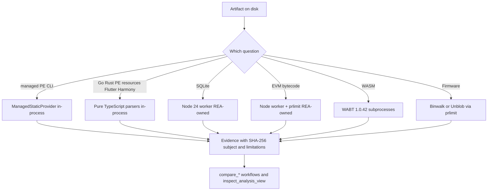
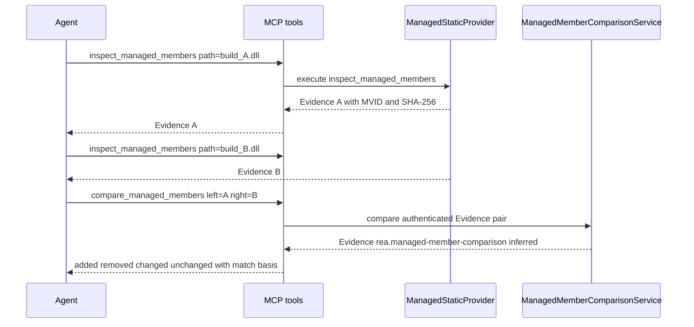
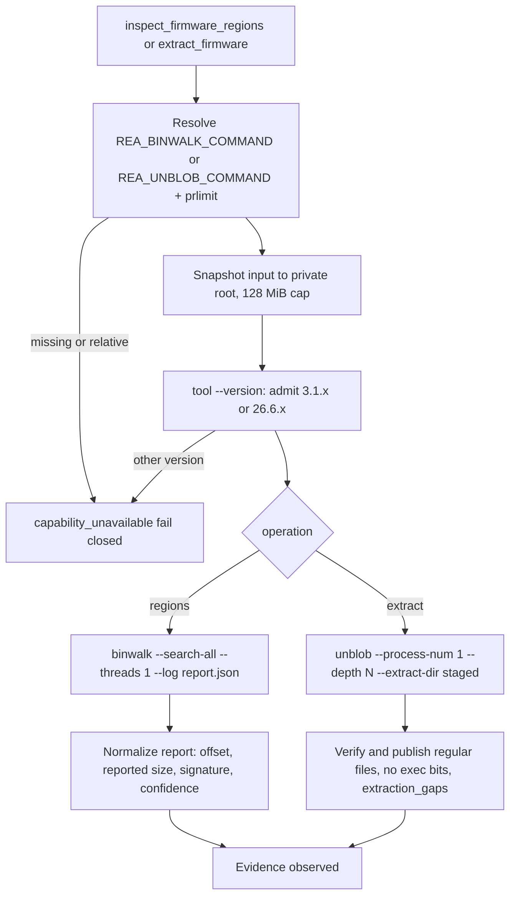
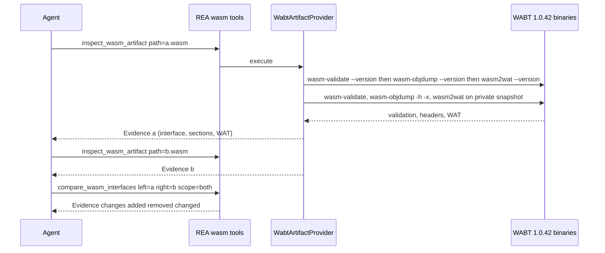

# 15 - File types: .NET/managed, NativeAOT boundary, firmware, Go, Rust, SQLite, WASM, EVM, Flutter/Dart, Harmony, PE resources, reference source

Scope: the "artifact-provider" family that REA runs *without* a disassembler session: per-format parsers and thin wrappers around a few external tools. Native ELF/Mach-O/Apple/archives are in `14-filetypes-native-apple-archives.md`; JavaScript/Electron in `16-javascript-electron-analysis.md`; Android in `19-android-mobile.md`; the pwntools layout/crash tools in `09-other-native-providers.md`; Evidence structure in `10-evidence-model-ledger-unknowns-bundles.md`; the cross-cutting safety model in `21-security-model.md`.

Paths are repo-relative to `/home/user/morluto/rea` (HEAD f75b1a4, REA 6.4.0), line numbers verified. **RUN** = executed in this lab (commands and observed values given); **DOC** = read from code/docs only. Lab: Linux x64, Node 22 (default) plus Node 24 at `/opt/lab/node24`, WABT 1.0.42, binwalk 3.1.0, .NET SDK 8.0.131, Rust 1.97 + cargo-auditable 0.7.7 (installed this session into the scratchpad), `unblob` **absent**. All samples are benign; `samples/dn` is a stager-shaped .NET assembly (HttpClient download, `Process.Start("cmd.exe")`, `VirtualAlloc` P/Invoke).

## 1. The big picture: which of these touch the sample, and how

The single most important property for a malware team is whether a tool runs a third-party engine, runs a REA-owned helper, or just parses bytes in the REA process.

| Format / tool | MCP tool(s) | Implementation | Spawns a process? | Executes the sample? | Needs external install |
|---|---|---|---|---|---|
| .NET PE/CLI | `inspect_managed_artifact`, `inspect_managed_members`, `inspect_managed_native_boundaries` (+ `compare_managed_members`, `verify_managed_native_boundaries`, `import_managed_reconstruction`, `project_managed_application_graph`) | Pure TypeScript PE + ECMA-335 metadata + CIL decoder (`src/dotnet`) | No (`launchesProcess:false`, `mayAccessNetwork:false`, `mayWriteFilesystem:false`, `src/dotnet/ManagedStaticProviderMetadata.ts:14-23`) | No, "never loads the target assembly, resolves dependencies through a CLR" | None |
| Go | `inspect_go_binary` | Pure TS build-info reader (`src/go`) | No | No | None |
| Rust | `inspect_rust_binary` | Pure TS `.dep-v0` zlib/JSON reader (`src/rust`) | No | No | None |
| PE resources | `inspect_pe_resources` | Pure TS resource tree parser (`src/native/pe`) | No | No | None |
| Flutter / Dart AOT | `identify_flutter_build`, `inspect_dart_aot` | Pure TS ZIP+ELF parser (`src/flutter`) | No | No | None |
| Harmony | `project_harmony_application_graph` | Projection over existing inventory Evidence (`src/application/harmony`) | No | No | None |
| Reference source | `rea import-reference-source` (CLI) | In-process directory walk + isomorphic-git (`src/application/ReferenceSourceImport*.ts`, `src/reference`) | No git subprocess | No | None |
| SQLite | `inspect_sqlite_database` | REA-owned Node worker using `node:sqlite` (`src/sqlite`) | **Yes**: REA's own Node (`process.execPath --max-old-space-size=256 SqliteDatabaseWorker.js`) | No (SQL engine reads a private copy, no extensions) | Node >= 24.15 |
| EVM | `inspect_evm_interface` | REA-owned Node worker running `evmole@0.9.3` WASM under `prlimit` (`src/evm`) | **Yes**: REA's own Node via `prlimit` | No ("no target execution or chain/RPC access") | `prlimit` (util-linux) |
| WASM | `inspect_wasm_artifact` (+ `compare_wasm_interfaces`) | Wrapper over **WABT 1.0.42** (`wasm-validate`, `wasm-objdump`, `wasm2wat`) | **Yes**: third-party binaries | No (parse/validate/print only) | WABT at `REA_WABT_BIN_DIRECTORY` |
| Firmware | `inspect_firmware_regions` (Binwalk 3.1.x), `extract_firmware` (Unblob 26.6.x) | Wrapper over third-party tools via `prlimit` | **Yes**: Binwalk/Unblob (+ unblob's format extractors) | No ("Extracted code is never executed") | `REA_BINWALK_COMMAND` / `REA_UNBLOB_COMMAND`, `prlimit` |
| NativeAOT | (part of Ghidra provider) | Built-in TS parser for x64 PE RTR 9.1; optional Java extension in headless Ghidra | Only via Ghidra | No | Ghidra (optional jar) |


Figure 15.1 - Execution tiers. Left column items are pure parsers in the REA process; middle items run REA-owned helper code in a child process; the last two execute third-party tools. None executes the sample.

Walkthrough: the first branch point is *what kind of artifact the agent hands over*, not a global router - each tool takes an explicit path and decides itself (section 2 to 12). Every tier returns Evidence bound to the artifact SHA-256 and a limitations list. Comparison and view workflows consume that Evidence and never re-read the file (they are "application" kind tools: `compare_managed_members`, `compare_wasm_interfaces`, `inspect_analysis_view`).

Common mechanics across the family: each tool reads the artifact through a *stable snapshot* reader (`readStableArtifact`, size-capped), uses a `PrivateRuntimeRoot` for any helper files, runs helpers through the owned-process supervisor (timeout, output budget, cleanup verification), validates helper output with zod, and **fails closed**: "malformed, unsupported and oversized inputs receive typed failures rather than partial success" (Rust/PE contract text). Exceptions where partial output is intentionally retained are marked below.

## 2. .NET / managed (`src/dotnet`, `src/domain/managed`, `src/application/managed`, `src/contracts/managed`)

### 2.1 Purpose, detection, routing
Execution-free static inspection of PE/CLI assemblies: identity, metadata inventory, types/fields/methods/signatures, CIL anchors, `ldstr` user strings, call edges, field accesses, P/Invoke declarations. It is a *session* auxiliary provider (`ManagedStaticProvider implements AnalysisProvider`, `src/dotnet/ManagedStaticProvider.ts:50`) with identity `{id:"rea-dotnet-static", name:"REA managed static analysis provider", version:"1"}` (`src/application/InvestigationProviders.ts:38-42`). The tool takes an optional absolute `path`; omitted means "reuse the previously selected managed target". Routing gate: `this.target.format !== "pe"` -> `AnalysisCapabilityUnavailableError` "Managed static triage requires a PE target; observed <format>" (`ManagedStaticProvider.ts:88-96`). Detection of managed-ness is inside the parser: classification `status` in {managed, not-managed, malformed}; `runtime_family` in {dotnet-framework, modern-dotnet, unity-mono, mixed-clr-native, unknown}; `implementation` in {cil, cil-and-ready-to-run, cpp-cli-mixed, metadata-only, not-managed, unknown}; `managed_architecture` in {anycpu, anycpu-prefer-32, x86, x86_64, arm, arm64, unknown} (`src/domain/managed/managedArtifact.ts:380-405`). Each classification carries `evidence[]` items such as `cli-header-observed`, `target-framework-observed`, `managed-architecture-derived` with file offsets. Not handled: .NET single-file bundles and IL2CPP ("does not unpack .NET single-file hosts or decode IL2CPP metadata", `docs/cli.md:60-62`); NativeAOT/ReadyToRun native bodies need native-provider Evidence.

Verbatim input contracts (`src/contracts/managed/managedToolContracts.ts:12-49`):

```ts
export const managedTargetInputSchema = z.strictObject({
  path: localPathStringSchema
    .refine(isAbsolute, { message: "path must be an absolute local filesystem path (for example /tmp/Example.dll or C:\\Example.dll)" })
    .describe("Explicit absolute managed PE/CLI path; omit to reuse the previously selected managed target")
    .optional(),
});
export const managedArtifactInputSchema = managedTargetInputSchema.extend({
  detail: analysisDetailSchema.unwrap().optional(),
});
export const managedMembersInputSchema = managedArtifactInputSchema.extend({
  type_names: z.array(z.string().min(1)).min(1)
    .refine((names) => new Set(names).size === names.length, { message: "type_names must not repeat a name" })
    .meta({ uniqueItems: true })
    .optional(),   // exact declaring-type full_name; nested types by bare name
});
```
(descriptions abbreviated here; full text in the source.) CLI: `inspect-managed-artifact <path>`, `inspect-managed-members <path> [--type <name>...]`, `inspect-managed-native-boundaries <path>`, `compare-managed-members <left> <right>`.

### 2.2 Parser pipeline and bounds
`ManagedSnapshot` reads at most `MAX_MANAGED_SNAPSHOT_BYTES = 128 MiB` (`ManagedSnapshot.ts:25`) and hashes it. `ManagedPeReader` validates DOS/PE/COFF headers, section table and RVA ranges (`requireRange`, section count checks, `ManagedPeReader.ts:296-361`) and locates the CLI header. `ManagedMetadataLayout` decodes the `#~` tables (supported-table mask, coded indexes, row sizes), `ManagedMetadataHeaps` the `#Strings/#US/#Blob/#GUID` heaps, `ManagedMetadataInventory*` the row inventories, `ManagedMemberRows`/`ManagedTypeMemberLists` ownership of fields/methods by range lists, `ManagedMethodBodyReader` tiny/fat headers and exception regions, `ManagedMemberInstructionDecoder` (649 lines) the CIL opcodes, `ManagedUserStrings` the `ldstr` literals. A shared `ManagedDecodeBudget` caps eagerly retained metadata and its JSON projection at 64 MiB (`ManagedDecodeBudget.ts:7`), and signature blobs have structural caps (e.g. `MAX_ARRAY_RANK = 32`, `ManagedMemberInspectorCore.ts:387`). Unsupported or malformed rows become explicit issues (`parse_status: decoded|partial|unsupported|malformed`) rather than guesses, and coverage objects (`{state:"complete"|..., issues:[]}`) accompany every collection.

### 2.3 Output fields (RUN, `samples/dn/out/Stager.dll`, built from `Program.cs` by `dotnet build`)
`inspect_managed_artifact` normalized keys: `artifact, pe, classification, metadata, module, assembly, target_frameworks, references, resources, attributes, coverage, limitations`. Observed: PE machine 0x14c (`x86` optional header pe32), CLI `runtime_version 2.5`, flags `il-only`, entry point token `0x06000004`, metadata RVA 8396 size 1976, `ready_to_run_signature:false`, classification `managed / modern-dotnet / cil / anycpu` with offset-bearing evidence; 5,120-byte file, SHA-256 `9ef335ee...fa54`, module MVID `55e7a7ba-4e80-47f5-b068-102679d41e01`. Metadata `v4.0.30319`, streams `#Blob #GUID #Strings #US #~`; table row counts TypeDef 3, MethodDef 5, MemberRef 21, ImplMap 1, ModuleRef 1, AssemblyRef 3.

`inspect_managed_members` keys: `artifact, module, metadata, identity_scope, types, exported_types, fields, methods, member_refs, call_edges, field_accesses, user_strings, selection, coverage, limitations`. `identity_scope` is the crucial contract: `{token_identity:"build-local", requires_artifact_sha256, requires_mvid}` - metadata tokens (e.g. `0x06000004`) are only meaningful together with that SHA-256 and MVID. For the rebuilt variant (RUN), `user_strings` recovered:

```json
{"state":"complete","literals":[
 {"token":"0x70000001","offset":2381,"value":"schtasks.exe"},
 {"token":"0x7000001b","offset":2407,"value":"/create /tn Updater"},
 {"token":"0x70000043","offset":2447,"value":"https://c2.example.invalid/stage3"},
 {"token":"0x70000087","offset":2515,"value":"cmd.exe"},
 {"token":"0x70000097","offset":2531,"value":"/c "}],"issues":[]}
```
and `call_edges` such as `{"caller":"Demo.Stager.Loader.Decode","opcode":"call","target_name":"FromBase64String","target_declaring_type":"System.Convert"}`: C2 URL, process execution, persistence primitive and base64 decode are readable with no execution.

`inspect_managed_native_boundaries` keys: `artifact, module, metadata, identity_scope, cli_native, module_refs, pinvoke_imports, native_implementations, summary, coverage, limitations`. Original: `module_refs[0] = kernel32.dll`, `pinvoke_imports` with `VirtualAlloc` (`mapping_flags 0x0100`, member token `0x06000001`); rebuild: `VirtualAlloc` and `CreateRemoteThread`, summary `{module_ref_count:1, pinvoke_import_count:2, native_implementation_count:2, ready_to_run:false, mixed_mode_or_native_header:false}`. Limitation text: "P/Invoke rows prove managed import declarations only; this inspection does not verify that a native library, export, thunk, or provider-qualified function exists" and "ReadyToRun, NativeAOT, C++/CLI, and IL2CPP native semantics require separately selected native-provider evidence".

Evidence envelope: provider `rea-dotnet-static`, predicate `rea.analysis`, `confidence:"observed"`, limitation "Static inspection did not load the assembly, resolve dependencies through a CLR, decompile C#, or execute target code."

### 2.4 Comparing builds: `compare_managed_members` (RUN)
Application workflow (`src/application/managed/ManagedMemberComparisonService.ts`, schemas `src/domain/managed/managedMemberComparison*.ts`) consuming two authenticated `inspect_managed_members` Evidence records. Algorithm identity (RUN output): `{name:"rea-managed-member-comparison", token_identity:"build-local", name_matching:"exact-signature-fallback"}` (`managedMemberComparison.ts:155-157`). Tiers: exact declared type+name+CIL/signature; exact type+name+raw signature; exact type+name+decoded structural shape; then CIL/signature or shape alone across names/types, never taking a member whose own type/name remain unpaired, never using names alone.

Command executed (rebuild = `Program.cs` edited: URL `stage2`->`stage3`, `Decode(string)`->`Decode(string,bool)`, new `Persist()` calling `schtasks.exe`, new P/Invoke `CreateRemoteThread`; built by `dotnet build -c Release` in a scratch dir, 3 s):

```sh
node scripts/rea.mjs compare-managed-members <orig>/Stager.dll <rebuild>/Stager.dll --json
```
Observed (`rc 0`, provider `rea-dotnet-workflows`, predicate `rea.managed-member-comparison`, `confidence:"inferred"`, authority `analyst-inference`): left 5 methods/1 field, right 7 methods/1 field, both `metadata_status:"complete"`, different MVIDs; `summary {unchanged:4, changed:1, added:3, removed:1, unknown:0}`; `matching {exact_il_signature:2, exact_signature:2, structural_method_shape:0, field_signature:1, ambiguous:0, unmatched:4}`; coverage `complete-within-inputs`. Per-member results:

| Member | Status | Basis | Dimensions |
|---|---|---|---|
| `Native..ctor`, `Loader..ctor` | unchanged | exact-il-signature | - |
| `Native.VirtualAlloc` | unchanged | exact-signature | - |
| `Loader.Main` | **changed** | exact-signature | `cil, opcode-shape, call-shape` |
| `Loader.Decode(string)` | removed | none (unknown match) | availability |
| `Loader.Decode(string,bool)` | added | none | availability |
| `Native.CreateRemoteThread` | added | none | availability |
| `Loader.Persist` | added | none | availability |

Reading: a changed *overload signature* is reported as removed+added, because signature is part of identity ("names alone never form a match"); the changed method body shows as `changed` with the exact dimensions that differ. Metadata tokens shifted (`.ctor` token `0x06000002` -> `0x06000003`) yet matched as remaps, "not persistent identities". Limitation worth remembering for malware diffs: **"`ldstr` literals are not compared; normalized CIL keeps #US tokens rather than decoded text, so an unchanged method does not establish unchanged string literals."** - the C2 URL change `stage2`->`stage3` lives in the `Main` body's #US token and the heap, so use `user_strings` of both builds side by side as well.


Figure 15.2 - Cross-build managed diff. The CLI performs both inspections internally (RUN used the CLI with two paths); over MCP the agent passes retained references or inline Evidence. The comparison never re-reads the DLLs.

### 2.5 The other managed workflows (DOC)
`verify_managed_native_boundaries` matches P/Invoke declarations to *supplied* native export/function Evidence and keeps declaration-only / verified / inferred / contradicted / unresolved states (`src/application/managed/ManagedNativeVerificationService.ts`). `import_managed_reconstruction` locks decompiler output (e.g. from ILSpy) to artifact SHA-256, MVID, token, signature hash and decoded-IL tuple hash and labels C# as analyst inference (`ManagedReconstructionService.ts`). `project_managed_application_graph` projects managed Evidence into the provider-neutral application graph (`ManagedApplicationGraphService.ts`).

### 2.6 NativeAOT boundary
A NativeAOT binary is a *native* PE with an embedded ReadyToRun-style header, not a CLI image, so `inspect_managed_artifact` classifies it `not-managed`/unknown and refers to native analysis (`docs/ghidra-nativeaot.md:28`: "A PE/CLI or ReadyToRun assembly should use `inspect_managed_artifact`; it is not NativeAOT."). Two layers exist inside the **Ghidra** provider (ch. 08), not as separate tools: (1) a built-in read-only TypeScript parser for x64 PE32+ with .NET 8 RTR 9.1 metadata that reads the exact Ghidra session snapshot and keeps rehydrated metadata in an in-memory overlay (`src/domain/native/nativeAotPe.ts`, `GhidraProviderClient.ts:83-135`); it handles DEHYDRATED_DATA, MethodTable relationships, virtual slots and frozen strings and reports other RTR versions/architectures as unsupported or partial; (2) an optional headless Java extension adapted from Washi1337/ghidra-nativeaot at a pinned commit (`bridge/nativeaot/NativeAotExtension.java`: "Optional headless facade over the unchanged upstream analysis primitives", plus `NativeAotDirectory`, `NativeAotMethodConventions`, `NativeAotTypeMetadata`), enabled with `REA_GHIDRA_NATIVEAOT_JAR`; only that adapter writes rehydrated bytes into the Ghidra database (`docs/ghidra-nativeaot.md`). DOC only (no Ghidra NativeAOT sample built).

### 2.7 Safety and malware relevance
Pure parser, no CLR: safe to run on live malware from a memory-safety-of-REA viewpoint (JS parser, bounded). It can answer: which APIs/URLs/commands are referenced, which native functions are imported by P/Invoke, whether the assembly changed between campaign waves. It cannot deobfuscate (ConfuserEx-style encrypted strings stay opaque, `ldstr` literals only show what is in #US), unpack single-file/NativeAOT, or resolve reflection-based calls. Failure modes: not a PE, truncated headers, RVA overflow, unsupported metadata tables, decode-budget exceed (64 MiB), file over 128 MiB - all typed failures; partially decodable bodies appear as `partial`/`unsupported` with issues.

## 3. Firmware (`src/firmware`, `src/application/firmware`)

### 3.1 Tools and external engines
`inspect_firmware_regions` (Binwalk 3.1.x, "verified with 3.1.0") scans a file for signatures without extracting; `extract_firmware` (Unblob 26.6.x, "verified with 26.6.4") extracts into an **absent** output directory. Audited releases are pinned in `src/firmware/FirmwareRelease.ts:1-16` (binwalk 3.1.0 revision `4fdab3d4...`, unblob 26.6.4 revision `1fcc7a0a...`); installed bytes are fingerprinted separately. Limits (`FirmwareRelease.ts:29-35`):

```ts
export const FIRMWARE_LIMITS = {
  inputBytes: 128 * 1024 * 1024,
  reportBytes: 8 * 1024 * 1024,
  diagnosticBytes: 8 * 1024 * 1024,
  addressSpaceBytes: 1024 * 1024 * 1024,
  timeoutMs: 120_000,
} as const;
```
Environment: `REA_BINWALK_COMMAND`, `REA_UNBLOB_COMMAND` (absolute, caller-supplied; resolved with `realpath`, must be a regular executable, SHA-256 of the launcher recorded) and `REA_FIRMWARE_PRLIMIT_COMMAND` (default `/usr/bin/prlimit`, absolute) - `src/firmware/FirmwareCommand.ts:43-102`. Linux only ("This integration requires Linux and an absolute REA_..._COMMAND path").

### 3.2 Flow
`FirmwareProvider.#execute` (`src/firmware/FirmwareProvider.ts:223-380`): deadline 120 s; resolve the command; create `PrivateRuntimeRoot("rea-firmware-")`; snapshot the input (or the selected `--offset/--length` slice) into it; run `<tool> --version` and require a banner <= 1 KiB admitted by `admitFirmwareVersion` (`FirmwareVersion.ts`) to the verified release line (`Binwalk 3.1.x`/`Unblob 26.6.x`; others "unsupported"/"unresolved" fail); then
- Binwalk: `binwalk --quiet --search-all --threads 1 --log <root>/report.json <snapshot>` -> parse JSON report -> `normalizeBinwalkReport` -> regions;
- Unblob: `unblob --process-num 1 --depth <max_depth> --randomness-depth 0 --report report.json --log unblob.log --extract-dir <root>/extracted <snapshot>` with a polled output budget (`max_output_bytes` default 256 MiB, `max_output_files` default 10,000), then `FirmwarePublication` verifies and publishes **regular files only, without executable permission bits**, preserves links as metadata, rolls back failed writes, and returns `extraction_gaps` with `continuation_id` recovery instructions (missing extractor dependencies, unknown chunks, depth limit).


Figure 15.3 - Firmware pipeline. Both engines run under `prlimit` (address space 1 GiB, one worker, 120 s deadline); the sample is never executed and extracted files are published non-executable.

### 3.3 Output and RUN
`inspect_firmware_regions` result (RUN, `samples/fw/firmware.bin`, 8,192 bytes, `REA_BINWALK_COMMAND=/opt/lab/binwalk3/bin/binwalk`): provider `binwalk 3.1.0`, `confidence:"observed"`, `engine{name,version,executable_path,executable_sha256:"910af83f...f341",source_revision:null,worker_count:1}`, `input_size 8192`, one region `{provider_id, offset:4096, reported_size:2986, signature:"squashfs", description:"SquashFS file system, little endian, version: 4.0, compression: gzip, inode count: 4, block size: 131072...", reported_confidence:250, size_basis:"provider_reported_validation_unknown"}`, `coverage:"signature_scan"`. Limitations: signature matches/reported sizes "do not establish partition validity, encryption or runtime mappings"; limits are "not aggregate process-memory or filesystem quotas"; "source revision remains unknown for caller-supplied builds".

`extract_firmware` (RUN, fail-closed): `node scripts/rea.mjs extract-firmware <fw> <absent-dir> --json` with only Binwalk configured returned rc 1, `code:"capability_unavailable"`, `category:"unsupported_provider"`, message "This integration requires Linux and an absolute REA_UNBLOB_COMMAND path to the caller-supplied tool", `details{provider_id:"unblob", operation:"extract_firmware"}`; the output directory was **not created**. Options: `--offset/--length` (must be given together), `--max-depth` (3), `--max-output-bytes` (268435456), `--max-output-files` (10000). Unblob's own sandbox stays enabled (`FirmwareProvider.ts:99` limitation text).

### 3.4 Malware relevance
Binwalk signature scan is a cheap triage for embedded payload offsets (and for dropper blobs); extraction hands you files to feed back to REA (`open_binary` / `inspect_*`). Risks: Binwalk/Unblob parse hostile data with large codebases and external extractors (7z, squashfs-tools, ...). Parser exposure only, but run in the lab VM. Decompressed offsets are not original-file addresses (tool description).

## 4. Go (`src/go`)

`inspect_go_binary` (provider `{id:"go-build-info", name:"REA Go build-information reader", version:"1"}`, `GoBinaryProvider.ts:33-37`). Detection by container: ELF (`GoElfImage`), PE (`GoPeImage`), thin Mach-O (`GoMachoImage`), built on `GoBinaryContainer`/`GoBinaryImage`; build-info is located from the ELF `.go.buildinfo` section (`GoElfImage.ts:174`), the Mach-O `__go_buildinfo` section (`GoMachoImage.ts:129`) or the PE first initialized readable/writable data section, mirroring Go's `debug/buildinfo` (`GoPeImage.ts:133`); both inline and historical pointer encodings are read; module text parsed by `GoModuleText`. Bounds: file 256 MiB (`INPUT_BYTES`, `GoBinaryProvider.ts:39`), report 8 MiB (`:40`), cumulative header search 256 MiB, embedded strings 1 MiB, structural tables 16 MiB (limitation text `:197`). Pure in-process; no `go` toolchain, no network, no temp files.

RUN (T6, `27-manual-test-log.md`; output `samples/out/go.json`): `format elf, architecture amd64, bits 64, byte_order little`, `build_info{header_offset 5435392, encoding "inline", go_version "go1.24.7", version_location{offset 5435425,bytes 8}, module_location{offset 5435435,bytes 254}, module_text, module_bytes_base64, module{path "beacon", main{path "beacon", version "(devel)"}, dependencies [], settings[-buildmode=exe, -compiler=gc, CGO_ENABLED=1, ..., GOARCH=amd64, GOOS=linux, GOAMD64=v1]}}`, SHA-256 `774c4cc4...b263` (8,460,290 bytes), `confidence:"observed"`, `authority:"shipped-artifact"`. Raw framed bytes and exact source ranges are preserved. Missing metadata means unknown, "not proof that an image is not Go"; stripped or garble-obfuscated Go may lack/alter it; function names, source mappings and types are **not** recovered. Malware use: Go version + module path + dependency list (with replacements) fingerprint a toolchain/campaign and expose vendored C2 libraries; paired with objdump/Ghidra for function recovery.

## 5. Rust (`src/rust`)

`inspect_rust_binary` reads the **cargo-auditable** dependency section: provider `{id:"rust-auditable", name:"REA Rust dependency reader", version:"1"}` (`RustBinaryProvider.ts:32-36`). Section `.dep-v0` (ELF/PE) or `__DATA,.dep-v0` (Mach-O, `RustBinaryImage.ts:72-77`); duplicate sections fail. Bounds (`RustAuditableReader.ts:9-18`): file 256 MiB, compressed section 1 MiB, inflated JSON min(8 MiB, 64x compressed), report 8 MiB, JSON depth 32, at most 64 distinct `/rustc/<40-hex>/` hashes. The rustc commit is reported only as an *inference* (`rustc_commit.evidence_kind:"inferred"`). Pure TS, zlib inflate, no `rustc`/`cargo`.

RUN (this chapter; cargo-auditable 0.7.7 installed to the scratchpad with `cargo install cargo-auditable --root ...`; tiny crate `tinybeacon` depending on `itoa = "1"`):

```sh
cargo auditable build --release          # -> aud   (446,472 bytes)
cargo build --release --target-dir t2    # -> plain (446,224 bytes)
node scripts/rea.mjs inspect-rust-binary aud --json
node scripts/rea.mjs inspect-rust-binary plain --json
```
`aud`: `auditable_metadata{section_name ".dep-v0", file_offset 340920, section_bytes 124, compressed_bytes 124, uncompressed_bytes 169, format_version 1, packages [{itoa 1.0.18 crates.io, dependencies []}, {tinybeacon 0.1.0 local, dependencies [0], root true}], root_package_index 1, dependency_edges [{from_index 1,to_index 0}], cyclic_dependency_indices []}`, `rustc_commit{evidence_kind:"inferred", hashes:[{hash "2d8144b7880597b6e6d3dfd63a9a9efae3f533d3", file_offset 19085}]}`. `plain`: `auditable_metadata:null`, same rustc hash, limitation "No .dep-v0 section was found. Absence of .dep-v0 does not mean the binary has no dependencies." Both `confidence:"observed"`, authority `shipped-artifact`. Limitation: embedded metadata is file content and "does not authenticate package names, versions, sources, or the compiler". Malware relevance: most Rust malware is not built with cargo-auditable, so expect the `null` branch; when present it gives the full crate list (e.g. networking/crypto crates). The always-present rustc path hash is the more portable signal. DOC fact: Ghidra "may omit packed or undefined literals, including Rust strings" (tool description of `search_strings`).

## 6. SQLite (`src/sqlite`, `src/application/sqlite`)

`inspect_sqlite_database`: snapshot-based, read-only schema inventory and bounded row sampling. Provider `{id:"sqlite", name:"REA SQLite database inspector", version:"SQLite 3.53.4"}` (RUN value). Requirements: Node 24.x >= 24.15 or 26+ with native `DatabaseSync.limits` (checked by `sqliteDatabaseCapability(process.versions.node)`, `src/application/sqlite/SqliteDatabaseCapability.ts:9`, and again in the worker, `SqliteDatabaseInspection.ts:~498-516`). Limits (`src/sqlite/SqliteDatabaseLimits.ts:2-8`): 2 concurrent inspections, input 256 MiB (database + WAL combined), output 16 MiB, 30 s timeout, diagnostics 1 MiB.

Mechanics: `SqliteDatabaseSnapshot` (`:189-276`) stat/identity-checks `path`, `path-wal` and `path-journal` (refusing symlinks and active/unclean rollback journals: "Rollback journal may require recovery ... Supply a clean offline snapshot"), copies the DB and existing WAL into a private root, re-checks identity, hashes both. A REA-owned Node child (`process.execPath --max-old-space-size=256 SqliteDatabaseWorker.js <request.json>`, `NODE_OPTIONS` stripped, `SqliteDatabaseWorkerExecution.ts:132-147`) opens the *copy*:

```ts
const db = new DatabaseSync(snapshotPath, {
  readOnly: true,
  allowExtension: false,
  readBigInts: true,
  enableDoubleQuotedStringLiterals: false,
  timeout: 0,
  limits: { length: SQLITE_DATABASE_LIMITS.outputBytes, sqlLength: SQLITE_DATABASE_LIMITS.outputBytes },
});
```
(`src/sqlite/SqliteDatabaseInspection.ts:485-497`). No caller SQL, no extensions, no virtual rows: only REA's fixed queries. Failure reasons: format, selection, column-selection, unsupported, unavailable, output-limit, memory. Output: `artifact{path,sha256,bytes}`, `wal` (null or identity), `engine{name,version}`, `database_encoding`, `schema{scope inventory|selected_table|database, completeness, tables[{name, root_page, kind, without_rowid, strict, column_count, columns...}], indexes, views, triggers}`, `rows`. Selecting a table (`--table NAME --row-limit 20`) adds `columns[{cid,name,declared_type,not_null,default_sql,primary_key_position,hidden}]` and rows retaining 64-bit integers, text bytes and blobs with explicit truncation.

RUN (earlier, node24): `/opt/lab/node24/node_modules/node/bin/node scripts/rea.mjs inspect-sqlite-database samples/db/app.sqlite --json` -> database 12,288 bytes SHA-256 `370a106a...a819`, tables `cookies`, `settings` (root pages 2,3), `wal:null`, `completeness:"complete"`; with table selection `cookies(host text, name text, value text)` and sampled rows. Limitations: offline stable file set only - "do not establish an atomic snapshot of an actively changing database"; deleted records, uncommitted/invalid WAL tails, encrypted databases and forensic recovery are out of scope. Malware relevance: browser/stealer artifact databases (cookies, Login Data) can be examined without opening them in a live SQLite client - but this tool will happily print credential values from the sample rows, so sanitize outputs. The copy in a private root is deleted after inspection.

## 7. WASM (`src/wasm`, `src/application`/contracts `wasm`)

### 7.1 `inspect_wasm_artifact`
Wraps **WABT 1.0.42 exactly** (`WABT_PROVIDER_IDENTITY = {id:"wabt-artifact", version:"wabt@1.0.42"}`, `src/wasm/WabtRelease.ts:2-6`). Env `REA_WABT_BIN_DIRECTORY` (absolute directory); three tools are resolved with `realpath`, hashed (`<= 64 MiB` each), and each must print `--version` = `1.0.42` with empty stderr or the call fails ("Unsupported ... version banner; expected 1.0.42", `WabtArtifactProvider.ts:221-232`). Lab note: apt's WABT 1.0.34 is rejected by this pin. Commands run in a private root against a snapshot `module.wasm` (re-hashed before/after each call; tool hash re-checked after, `:160-210`): `wasm-validate --enable-all module.wasm` (non-zero exit accepted, `acceptNonZeroExit=true` at `WabtArtifactProvider.ts:300`, mapped to the `validation` field), `wasm-objdump -h -x module.wasm`, `wasm2wat --enable-all module.wasm`. Limits (`WabtRelease.ts:7-12`): input 8 MiB, tool 64 MiB, output 32 MiB combined, 30 s per process. Inputs: `path`, optional `glue_paths` (JavaScript glue files examined by AST for static literal references), optional `candidate_paths` (other wasm files for association).

Result keys (RUN, `samples/wasm/m.wasm`, 95 bytes, SHA-256 `ded968d0...0998`): `artifact, validation:"valid", sections[{kind,start,end,bytes,description}], interface{state:"complete", entries[...], issues}, imports[], exports[], headers, details, wat, tool_profile, candidates, glue, runtime_execution, network_fetch, limitations`. Interface entries carry typed signatures, e.g. import `env.send` `{kind:"func", params:["i32","i32"], results:[]}`, export `memory` `{kind:"memory", page_size:"65536", address_type:"i32", minimum:"1", maximum:null, shared:false}`, with the exact top-level WAT form (`(import "env" "send" (func (;0;) (type 0)))`). `runtime_execution`/`network_fetch` fields record that neither happened. Limitations: WAT is a decoded representation "not original source or proof of runtime behavior"; "No target execution or implicit fetch. WABT tools are trusted caller-supplied executables; SHA-256 identifies their bytes, not publisher authenticity. No OS memory sandbox is claimed."; oversized output fails rather than truncating.

### 7.2 `compare_wasm_interfaces` (RUN)
Verbatim result schema (`src/contracts/wasm/wasmComparisonContracts.ts:8-54`): input `{left, right, scope: "imports"|"exports"|"both"}` (Evidence inline or retained reference); output `{left{evidence_id,artifact}, right{...}, scope, coverage: "complete-within-inputs"|"partial"|"unknown", changes[{direction, module|null, name, state: added|removed|changed|unchanged|unknown, left, right, reason}], summary{added,removed,changed,unchanged,unknown}, limitations}`.

Built two modules with WABT 1.0.42 `wat2wasm` from WAT (a = `samples/wasm/m.wat`: import `env.send(i32,i32)`, export `memory`, `beacon`, data "198.51.100.7"; b = import `env.send(i32,i32,i32)`, new import `env.recv(i32)->i32`, exports `memory`, `beacon`, new `exfil`, data "198.51.100.9"), inspected both (`inspect-wasm-artifact`) and compared:

```sh
node scripts/rea.mjs compare-wasm-interfaces cmp-in.json --json    # {"left":<Evidence a>,"right":<Evidence b>,"scope":"both"}
```
Observed: provider `rea-artifact-comparison`, predicate `rea.wasm-interface-comparison`, `confidence:"derived"`, `coverage:"complete-within-inputs"`, `summary {added:2, removed:0, changed:1, unchanged:2, unknown:0}`; changes: export `beacon` unchanged, export `exfil` **added**, export `memory` unchanged, import `env.recv` **added**, import `env.send` **changed** (signature arity). Observation: the *data segment* change (IP address .7 -> .9) and the changed body of `beacon` are invisible to the interface diff - by design it compares "names, kinds and exact signatures" only, and its limitation says equality "is not runtime/ABI compatibility, successful linking or original-source identity". For malware: diff `wat` text or `wasm-objdump -s` data separately.


Figure 15.4 - WASM inspect and compare (RUN, CLI instead of MCP). Only the first two calls spawn processes; the comparison is pure.

## 8. EVM bytecode (`src/evm`)

`inspect_evm_interface`: explicit local bytecode (`encoding` "raw" or "hex" must be chosen; hex requires complete byte pairs, optional `0x`, no interior separators - `EvmBytecodeCarrier.ts:1-25`). Provider `{id:"evmole-interface", name:"REA EVM interface adapter", version:"evmole@0.9.3"}` (`src/evm/EvmoleRelease.ts:2-6`). Limits (`EvmoleRelease.ts:10-16`): input 4 MiB, output 16 MiB, 30 s, diagnostics 1 MiB, address space 3 GiB. Execution: `prlimit --as=<n>: --fsize=<n>: --core=0: --cpu=<n>: -- <node> --max-old-space-size=256 --v8-pool-size=1 <worker>` (`EvmoleInterfaceProvider.ts:285-296`; `REA_EVM_PRLIMIT_COMMAND` default `/usr/bin/prlimit`); worker limits are selected from the host's `/proc` limits but never above the caps (`EvmWorkerLimits.ts`, tighter inherited limits kept). The worker loads `evmole/no_tla` WASM (`EvmoleInterfaceWorker.ts:40-51`); `SolidityMetadata.ts` additionally decodes a terminal CBOR metadata map under profile `terminal-cbor-scalars-v1` (tags/floats rejected).

RUN (T11, `samples/evm/c.hex`, 62 file bytes -> 31 bytecode bytes `60003560e01c8063a9059cbb14601657806370a0823114601857005b005b00`): `confidence:"inferred"`, `evidence_kind:"inferred"`, `functions[{selector "0x70a08231", bytecode_offset 24, dispatch "abi", inferred_arguments "", inferred_state_mutability "payable"}, {selector "0xa9059cbb", bytecode_offset 22, ...}]`, `discovery_completeness:"unknown"`, `runtime_execution:"not-performed"`, `bytecode.metadata{profile, status:"unavailable", diagnostic "No plausible terminal CBOR map was identified; Solidity origin and metadata absence remain unknown."}`, `deployment_authenticity:"unknown"`, `hardfork:"unknown"`, limitations including the configured worker soft limits (address space 3,221,225,472 B, CPU 30 s, file size 16,777,216 B) and "Recovered selectors, argument strings and mutability are upstream inferences, not verified ABI signatures or names. Empty results do not prove the absence of callable dispatch." Selectors `0xa9059cbb`/`0x70a08231` are ERC-20 `transfer`/`balanceOf`; REA performs no 4byte lookup. Malware relevance: contract drainers - extract selectors from deployed bytecode offline; no chain/RPC access, no EVM execution.

## 9. Flutter / Dart AOT (`src/flutter`) - DOC (no Flutter APK in the lab)

Two tools, kind `flutter-provider`, "by pure parsing ... No engine, no execution, no external tools":
- `identify_flutter_build` (input: an APK path): for every `lib/<abi>/libapp.so`, reads the Dart AOT snapshot sections (VM and isolate), cross-checks the **snapshot hash** (the key that maps to a Dart SDK release through an external dataset; REA performs no lookup), per-ABI library digests, `libflutter.so` GNU build-id, and any labeled Dart version/toolchain strings.
- `inspect_dart_aot` (APK + ABI): locates the four snapshot symbols through the ELF dynamic symbol table with offsets/sizes and section headers (Dart magic `f5 f5 dc dc`, kind, length; kind 3 = FullAOT in the supported layout, `DartElf.ts:467-491`), the snapshot hash, and a bounded string-pool projection (package: URIs, dart: URIs, identifier-like tokens) from the isolate data section. Strings are "byte-pattern observations, not deserialized cluster semantics"; typed class/function recovery needs an SDK-specific parser. `detail:"summary"` retains full Evidence and returns a linked `inspect_analysis_view` of kind `dart-aot` with collections `package_uris`, `dart_uris`, `class_like_tokens`.
Bounds (`FlutterBuildProvider.ts:61-76`): APK <= 2 GiB, each library <= 256 MiB, total extraction 768 MiB, metadata reads 8 MiB, at most 32 ABIs, library paths 1,024 bytes, pool 500 URIs / 2,000 tokens. Uses the shared `ZipArtifactReader`; ELF load maps in `ElfLoadMap.ts`; build-id in `ElfBuildId.ts`; payload scanning in `FlutterPayloadScan.ts`. Malware relevance: Flutter-built Android malware hides logic in `libapp.so`; this gives the dependency/URL structure and an SDK fingerprint but not code.

## 10. HarmonyOS (`src/application/harmony`, `src/domain/harmony`) - DOC

`project_harmony_application_graph` is a **projection** over authenticated inventory Evidence (pages from `inventory_artifact`/`inspect_artifact` of a `hap`, `hsp` or `app-pack` root; `HARMONY_ROOT_FORMATS = ["hap","hsp","app-pack"]`, `harmonyApplication.ts:28`). Input `{root_format, source_evidence_ids[min 1], ...}`; provider `{id:"rea-harmony-application", version:"1"}` (`InvestigationProviders.ts:73-77`); predicate `rea.harmony-application-graph`. It reports a packaging model by *path presence only* ("Stage" if `module.json`, "FA" if `config.json`; "path-presence heuristic", `harmonyApplication.ts:105,163-166`), component paths and hashes (manifests, Ark bytecode `*.abc`/`*.pa`, resources, `libs/<abi>/lib*.so` native libraries, JavaScript, signing files), App Pack child packages, runtime-family hints in {ark, native, javascript, react-native, flutter, unity}, and path-based N-API bridge *hypotheses*. It does **not** decode Ark bytecode, parse manifest semantics, or claim observed runtime calls; coverage is `complete-within-inventory` or `partial`. No process, no file read beyond the Evidence. Malware use: inventory of a HAP before any deeper tool exists.

## 11. PE resources (`src/native/pe`, `src/application/binaryDiagnostics/PeResourcesService.ts`) - RUN

`inspect_pe_resources` parses the complete PE resource tree of PE32/PE32+ files; pure TS, "portable ... no Windows SDK". Verbatim input (`src/domain/native/peResources.ts:18-48`): `{path, max_file_bytes: 64 MiB default (64..536,870,912), max_entries: 16384 default (1..65,536)}`; exceeding the entry or 8 MiB metadata budget fails "without partial success" (`PeResourceParser.ts:20-22,254`). Provider `{id:"rea-pe-resources", name:"REA PE resource parser", version:"1"}`.

RUN (`samples/pe/demo.exe`, 120,249 bytes, PE32+ machine 34404 = AMD64): `directory{rva 45056, location{offset 14848,bytes 624}}`, `directories[...]` (5 nested directory headers with named/id entry counts), `resources[0] = {type{id:10 (RT_RCDATA)}, name{kind:"name", name:"PAYLOAD", utf16le_hex:"5000410059004c004f0041004400"}, language{id:1033}, data_entry_location, payload{rva 45232, location{offset 15024,bytes 33}, sha256 7694ba85...b4f1}}`, `resources[1] = {type id 16 (RT_VERSION), payload offset 15064 bytes 408}`, `icon_groups: []`, `coverage{status:"complete", examined_entries:6, resources:2}`. Independent check: `dd` of file bytes 15024..15056 yields `MZ-fake-embedded-payload-for-test` whose SHA-256 equals the reported digest. Original UTF-16 names are preserved (hex), numeric id vs name distinguished, every structure has file offset + length, overlapping non-identical ranges are rejected. Malware relevance: the classic dropper-with-embedded-PE-in-resources pattern; REA gives the exact file range and hash, but does **not** carve, decrypt or classify payloads ("payloads other than RT_GROUP_ICON remain opaque"), nor decode icon images.

## 12. Reference / historical source import (`src/application/ReferenceSourceImport*.ts`, `src/reference`, `src/domain/referenceSource*.ts`)

CLI-only (`rea import-reference-source <root> [--detail full|summary] [--outline-depth N]`, `src/cli/utilityCommands.ts:238-300`) - no MCP tool; its output feeds `compare_source_to_bundle` (ch. 16). It indexes a local source tree as **historical reference only** (authority `"historical-reference"`), never executed. Safety design: root resolved and realpath-checked, safe no-follow opens ("unsupported" on hosts lacking them, failure guidance in `ReferenceSourceImportTypes.ts`), default ignore patterns (`.git/`, `.git/hooks/`, `node_modules/`, `dist/`, `build/`, `coverage/`, `htmlcov/`, `.coverage`, `*.log`, lines 79-89), project `.gitignore` handling via the `ignore` package, secret-pattern redaction (`ReferenceSourcePolicy.secretPatterns`; content state `redacted-secret`), caller `excludePaths`. VCS state is read by isomorphic-git from the local `.git` store with **no git subprocess and no network** (`ReferenceSourceVcsAdapter.ts:24-54`); packed refs/worktree pointers handled.

RUN (`rea import-reference-source samples/jsapp --detail summary --json`): schema `HistoricalSourceSummary`, `authority:"historical-reference"`, `root_alias:"$REFERENCE_ROOT"`, manifest `{manifest_id, graph_sha256, root_sha256, inventory_state:"partial", entry_count:7, relationship_count:8}`, provenance `{importer:"rea-agents", importer_version:"6.4.0", caller:"rea-cli"}`, `vcs:{kind:"none"}`, languages HTML/JSON/JavaScript, manifests `package.json`, counts files 6 / dirs 1 / parse failures 0, all 6 file contents `hashed`, `file_sizes.known_bytes:"1349"`, limitation "a syscall-boundary pathname race remains" (Node lacks portable descriptor-relative openat). `inventory_state:"partial"` here is conservative state, not an error. Malware relevance: baseline source for diffing a trojanized build against its upstream (e.g. supply-chain tampering): see `compare_source_to_bundle`.

## 13. Cross-format failure model

| Failure | Where | Surface |
|---|---|---|
| Missing/relative tool path or wrong version | firmware, WASM, EVM prlimit, pwntools | `capability_unavailable` (RUN: `REA_UNBLOB_COMMAND`, `REA_PWNDBG_GDBINIT`), nothing created |
| Artifact over size cap | all (128 MiB managed, 256 MiB Go/Rust/SQLite, 128 MiB firmware, 8 MiB WASM, 4 MiB EVM, 64 MiB PE default) | typed resource failure with `reported_limits`, no partial success |
| Malformed structure | managed (typed issues), Go/Rust/PE (`ArtifactReaderFailure`) | typed failure or `partial/malformed` state with issues, never invented data |
| Artifact changed during read | all stable-snapshot readers; WASM re-hash; objdump pre/post digest | `AnalysisArtifactChangedError` / `artifact_changed:true` |
| Tool output too large / timeout | firmware, WASM, SQLite, EVM | failure (WASM: "Oversized output fails instead of producing truncated success"); helper cleanup verified, otherwise cleanup-incomplete state blocks reuse |
| Runtime too old | SQLite (Node < 24.15) | `unavailable`, capability reported disabled in inventory |

## Porting notes

**(a) Separable units** (each is self-contained and testable on bytes):
- `src/dotnet/*` (PE reader, metadata layout/heaps/rows, CIL decoder, native boundary inspector) + `src/domain/managed/*` schemas + `ManagedMemberComparisonService` - an execution-free .NET triage library; the strongest port candidate.
- `src/go/*`, `src/rust/*`, `src/native/pe/*`, `src/flutter/*` - four small independent byte parsers (container readers duplicated across Go/Rust; share ELF/PE/Mach-O section enumeration).
- `src/sqlite/*` - snapshot + worker pattern (copy to private dir, identity checks, read-only `DatabaseSync` with limits).
- `src/evm/*` - worker + prlimit + evmole WASM; `SolidityMetadata.ts` CBOR profile is reusable alone.
- `src/wasm/*` - WABT wrapper (version pin, tool hashing, snapshot re-hash) and `compare_wasm_interfaces`.
- `src/firmware/*` - binwalk/unblob wrapper (`FirmwareCommand`, `FirmwareVersion`, `FirmwareReports`, `FirmwarePublication`).
- `src/application/ReferenceSourceImport*` + `src/reference/*` - safe tree indexer.

**(b) Dependencies**: zod, `ArtifactReader`/`readStableArtifact`/`ArtifactResourceScope`, `PrivateRuntimeRoot`, `OwnedCommand` (owned-process supervisor with cleanup verification), Evidence builders (`createEvidence`, `createAnalysisExecution`), `AnalysisError` taxonomy; external: Node >= 24.15 (SQLite), WABT 1.0.42, Binwalk 3.1.x, Unblob 26.6.x, util-linux `prlimit`, npm `evmole@0.9.3`, `cborg`, `isomorphic-git`, `ignore`; for the optional NativeAOT lane: Ghidra + JDK + `REA_GHIDRA_NATIVEAOT_JAR`.

**(c) Re-implement or replace**: the process supervision layer if not keeping REA's (timeouts, process-group kill, output budgets, cleanup receipts); fail-closed version pinning; the `ZipArtifactReader`/ELF utilities used by Flutter; Linux `/proc` limit reading in EVM; Node-specific `node:sqlite` if porting to another runtime (any read-only SQLite with extension loading disabled works).

**(d) Malware-analysis relevance and sandbox classification**

| Class | Tools | Rule |
|---|---|---|
| Pure in-process parsers | managed, Go, Rust, PE resources, Flutter, Harmony, reference import, all `compare_*` | Safest; still parse hostile bytes in the REA process (bounded, typed failures). No sandbox needed for sample execution because none occurs; keep REA itself unprivileged |
| REA-owned worker | SQLite (Node worker), EVM (Node worker + prlimit) | Child process runs REA code over a private copy; extension loading disabled / WASM only. Low risk |
| Third-party engine on hostile input | WASM (WABT), firmware (Binwalk, Unblob and its extractors) | Parser attack surface of external C/Rust tools; run in an isolated analysis VM; pin tool versions (REA fail-closes on mismatch); note `prlimit` is a resource guard, not a sandbox |

Malware triage value ranking from this chapter: managed (strings, P/Invoke, build diffs) > PE resources (embedded payloads) > firmware regions (embedded blobs) > Go/Rust fingerprinting > WASM interface/EVM selectors > SQLite artifact databases > Flutter/Harmony inventory. None of these tools deobfuscates, unpacks packers, or emulates; absence of a finding is never proof of absence (every tool's limitations say so) - preserve that discipline in any port. Discrepancies/notes: `inspect_sqlite_database` and `inspect_evm_interface` are flagged `launchesProcess:true`/`writesFilesystem:true` in the catalog although they run REA's own helper, not an external engine; `import-reference-source` has no MCP tool; Harmony and Flutter/Dart AOT were not executed here (no samples).
