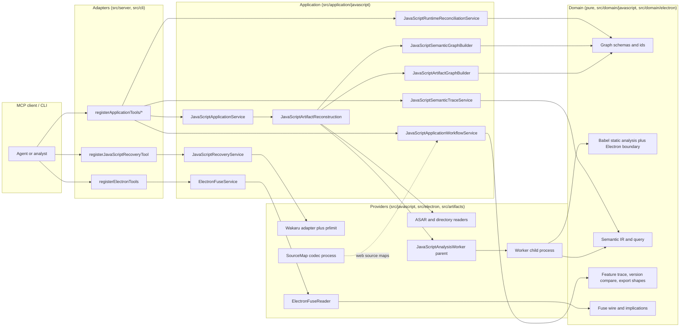
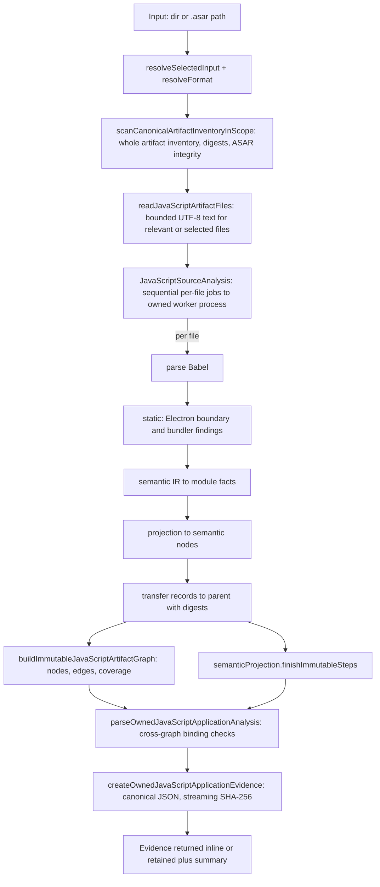
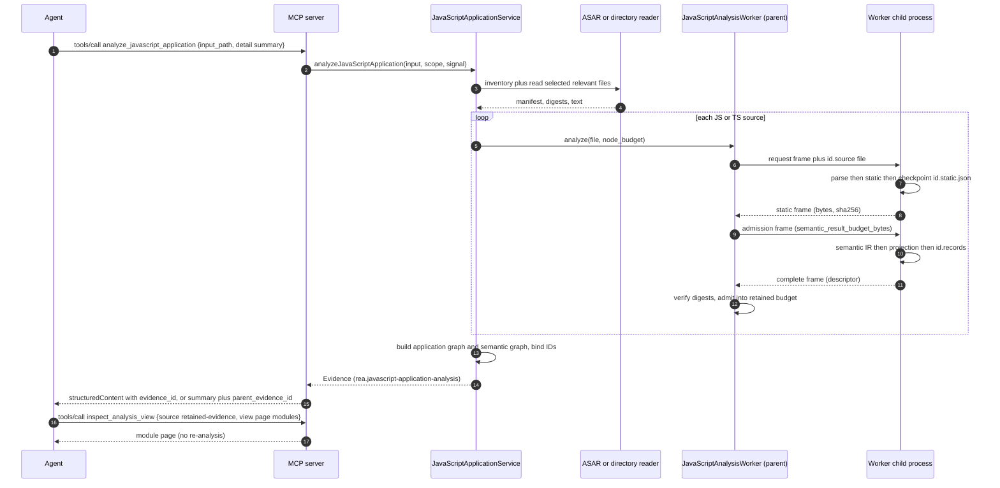
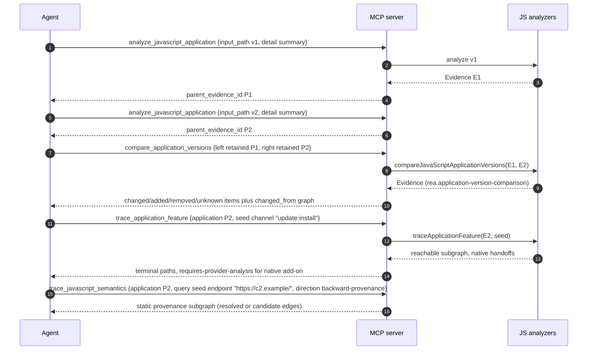
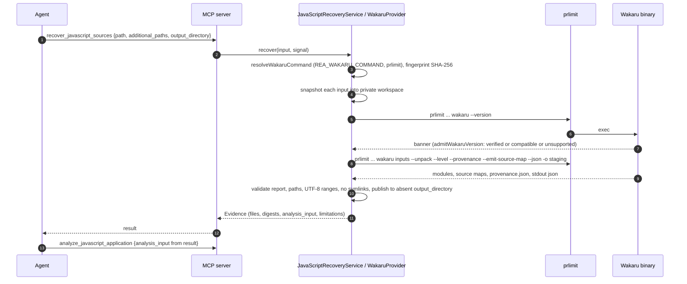
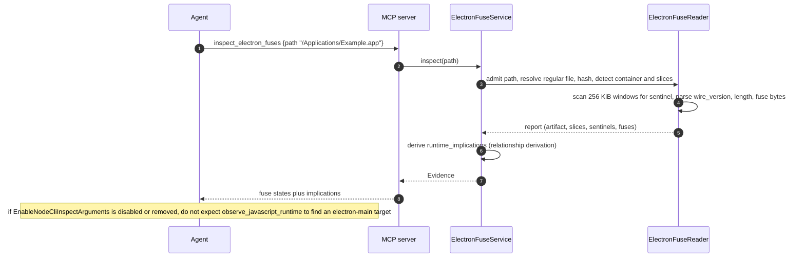

# 16 - JavaScript and Electron static analysis

Scope of this chapter: REA's **execution-free** analyzers for JavaScript/TypeScript applications, Electron packages (ASAR or extracted directories), source maps, and packaged Electron fuse bytes, plus the graph/trace/compare workflows that sit on top of them.
The *runtime* counterparts (CDP, V8 Inspector, Electron launch) are in [17-browser-and-web-observation.md](17-browser-and-web-observation.md). Mobile/ZIP-based projections are in [19-android-mobile.md](19-android-mobile.md). The shared Evidence model is in [10-evidence-model-ledger-unknowns-bundles.md](10-evidence-model-ledger-unknowns-bundles.md); the MCP runtime in [03-mcp-server-runtime-and-contracts.md](03-mcp-server-runtime-and-contracts.md); the security model in [21-security-model.md](21-security-model.md).

Repo-relative paths below refer to the REA checkout at HEAD `f75b1a4` (npm `rea-agents` 6.4.0). Statements without a label are **fact** traced to the cited code or doc; anything the code does not state outright is labelled **INFERRED**.

## 16.1 What this subsystem is, in one paragraph

Given a directory or `.asar`, `analyze_javascript_application` builds a provider-neutral **JavaScript Application Graph** (entities such as packages, ASAR entries, bundles/modules, source maps, BrowserWindows, preloads, contextBridge APIs, IPC channels/handlers, endpoints, storage, native add-ons) and a companion **semantic relation graph** (static data-flow / call / closure / event / child-process / config / request relations). It never evaluates the target code: source is parsed as inert text with Babel in a separate, memory-capped worker process (`docs/javascript-artifact-reconstruction.md:482-486`, `src/composition/javascriptAnalysisWorkerProcess.ts:22-88`). Downstream tools (`trace_application_feature`, `trace_javascript_semantics`, `compare_application_versions`, `compare_source_to_bundle`, `compare_javascript_export_shapes`, `reconcile_javascript_runtime`) consume the retained Evidence *only*; none of them re-read the artifact (`docs/javascript-application-workflows.md:10-17`). Separate tools recover minified bundles via an external engine (Wakaru, `recover_javascript_sources`) and read Electron fuse bytes (`inspect_electron_fuses`).

## 16.2 Source map of the subsystem

| Area | Path | Files (non-test unless noted) | Role |
|---|---|---|---|
| Domain (pure) | `src/domain/javascript/` | 199 files total incl. tests | Graph schemas, identities, Babel-AST static analysis, Electron boundary extraction, semantic IR, trace/compare algorithms. No I/O. |
| Domain (fuses) | `src/domain/electron/electronFuses.ts` | 1 | Fuse wire constants, report schema, derivation of runtime implications |
| Application | `src/application/javascript/` | 66 files total | Orchestration: reconstruction pipeline, graph builder, Evidence construction, workflow services, runtime reconciliation service |
| Application (fuses) | `src/application/electron/ElectronFuseService.ts` | 1 | Fuse service |
| Worker + sourcemap + recovery adapters | `src/javascript/{analysis,sourceMaps,recovery}/` | 20 non-test files (29 with tests; verified by `find`) | Isolated worker process protocol; source-map codec process; Wakaru adapter |
| Fuse adapter | `src/electron/` | 3 non-test files (4 with the provider test) | Binary reader (`ElectronFuseReader.ts`), path admission (`ElectronFusePath.ts`), provider |
| Artifact readers | `src/artifacts/` (`AsarArtifactReader.ts`, `AsarHeader.ts`, `DirectoryArtifactReader.ts`, `inventory/`, `javascript/`) | - | Hardened ASAR/directory inventory and bounded file reads |
| Composition | `src/composition/javascriptAnalysisWorkerProcess.ts` (the **worker entry point**), `javascriptRecovery.ts`, `electronFuses.ts`, `electronObservation.ts`, `electronScenario.ts`, `javascriptRuntimeObservation.ts` | - | Wires ports to adapters (`package.json` maps `#javascript-analysis-worker` to `./dist/composition/javascriptAnalysisWorkerProcess.js`, `package.json:37-39`) |
| MCP registration | `src/server/registerApplicationTools/{traceFeature,traceSemantics,compareVersions,compareSourceToBundle,compareExportShapes}.ts`, `registerJavaScriptRecoveryTool.ts`, `registerElectronTools.ts` | - | Tool handlers bound to named contracts |
| Contracts | `src/contracts/javascript/*.ts`, `src/contracts/toolEffects.ts` | - | Tool contracts and effect audit |
| CLI | `src/cli/javascriptApplicationAnalysis.ts`, `javascriptRecoveryCommands.ts`, `electronCommands.ts`, `applicationCommands.ts` | - | `rea analyze-javascript-application`, `recover-javascript-sources`, `inspect-electron-fuses`, ... |
| Docs | `docs/javascript-application-graph.md`, `javascript-application-workflows.md`, `javascript-artifact-reconstruction.md`, `javascript-recovery.md`, `javascript-runtime-reconciliation.md`, `electron-fuses.md` | - | Authoritative narrative |

## 16.3 Tool surface

Effects come from `TOOL_EFFECTS` (`src/contracts/toolEffects.ts:55-`) and the generated catalog (`.cache/mcp-tool-catalog.json`). Flag legend for all tables in this chapter: **T** mutatesTarget, **S** mutatesSession (records Evidence), **F** writesFilesystem, **P** launchesProcess, **N** accessesNetwork, **U** changesUiState, **D** mayDiscardData, **X** executesForeignCode, **V** mutatesDevice, **i** idempotent (see 21 for definitions, `src/contracts/toolEffects.ts:1-22`).

| MCP tool | CLI | Input (key fields) | Effects | Evidence predicate / authority | Notes |
|---|---|---|---|---|---|
| `analyze_javascript_application` | `analyze-javascript-application` | `input_path` (abs), `format` auto/asar/directory, `integrity_policy` fail/record-and-continue, `source_paths[]`, `detail` complete/summary, `max_heap_mb`, `analysis_timeout_ms`, `max_semantic_nodes[_per_file]` | `-S-------i` | `rea.javascript-application-analysis`, confidence `derived`, authority `shipped-artifact` (`src/application/javascript/JavaScriptApplicationEvidence.ts:73-86`) | Spawns REA's own worker process; does not count as foreign code |
| `inspect_analysis_view` | `inspect-analysis-view` | `source` retained/inline Evidence; `view` summary/page/item/facet | `-S-------i` | provider `rea-analysis-view` | Pages module inventory without re-analysis |
| `trace_application_feature` | `trace-application-feature` | `application`, `seed`, `direction`, `native_observations[]` | `-S-------i` | `rea.application-feature-trace`, `inferred`, authority `analyst-inference` (`JavaScriptApplicationWorkflowEvidence.ts:19-30`) | |
| `trace_javascript_semantics` | `trace-javascript-semantics` | `application`, `query{seed,direction,allowed_relations,include_ambiguous_dynamic_edges,expected}` | `-S-------i` | `rea.javascript-semantic-trace`, `inferred` | |
| `compare_application_versions` | `compare-application-versions` | `left`, `right`, optional native observations | `-S-------i` | `rea.application-version-comparison` | |
| `compare_source_to_bundle` | `compare-source-to-bundle` | `application`, `reference` (HistoricalSourceGraph) | `-S-------i` | `rea.source-to-bundle-comparison` | |
| `compare_javascript_export_shapes` | `compare-javascript-export-shapes` | `left/right`, `*_module_path`, `*_export_name` | `-S-------i` | `rea.javascript-export-shape-comparison` | |
| `reconcile_javascript_runtime` | `reconcile-javascript-runtime` | `static_layers[]`, `runtime_observations[]` | `-S-------i` | `rea.javascript-runtime-reconciliation` | See 16.11 |
| `recover_javascript_sources` | `recover-javascript-sources` | `path`, `additional_paths[<=16]`, `output_directory` (absent), `extraction_mode`, `rewrite_level` | `-SFP------` (not idempotent) | derived | Runs **Wakaru** (external binary) on the selected files; writes a directory tree |
| `inspect_electron_fuses` | `inspect-electron-fuses` | `path` (abs) | `-S-------i` | provider-specific (not traced) | Pure byte read |
| `export_web_scripts` | `export-web-scripts` | `capture_path`, `output_directory` | `-SF-------` | provider `rea-web-script-export` (`InvestigationProviders.ts`) | Bridge from browser captures (17) into this chapter's analyzer |
| `trace_web_source_location` | `trace-web-source-location` | manifest, script index, map path+URL, generated position | `-SFP-----i` | not traced | Source-map codec subprocess (16.10) |
| `trace_web_module_imports` | `trace-web-module-imports` | manifest, script index, importer URL, import map | `-SFPN----i` | not traced | Uses a Chromium (see 17.9) |

All of the tools above return `normalized_result.evidence_id`; large results can be requested as `detail: "summary"` and paged with `inspect_analysis_view` (`docs/javascript-artifact-reconstruction.md:103-130`).

> `compare_*`/`trace_*` tools accept either **inline complete Evidence** or `{"kind":"retained-evidence","evidence_id":"..."}` (connection-scoped). `close_binary` clears retained references; export a bundle first (`docs/javascript-application-workflows.md:300-305`).

## 16.4 Component diagram



*Caption: dependency flow for the static JS/Electron subsystem. Dependencies point inward to the pure domain; the only process boundaries are the analysis worker (P3), Wakaru (P4) and the source-map codec (P6).*

Walkthrough: every public tool is registered in `src/server/*`, parses input with the contract's zod schema, and calls an application service. Only `analyze_javascript_application` touches the filesystem (through `src/artifacts` readers) and the worker; all other workflow tools are pure functions over Evidence that was previously produced (`docs/javascript-application-workflows.md:10-17`). The domain layer has no I/O (`docs/javascript-application-graph.md:9-12`).

## 16.5 The analysis pipeline (`analyze_javascript_application`)

### 16.5.1 Input contract (verbatim)

`src/domain/javascript/javascriptApplicationAnalysis.ts:27-33`:

```ts
export const analyzeJavaScriptApplicationInputSchema = z.strictObject({
  input_path: localPathStringSchema,
  format: z.enum(["auto", "asar", "directory"]).default("auto"),
  integrity_policy: artifactIntegrityPolicySchema,
  source_paths: javaScriptSourcePathsSchema.optional(),
  ...javaScriptAnalysisResourceControlsSchema.shape,
});
```

Resource controls (`src/domain/javascript/javascriptAnalysisResourceControls.ts:6-14,43-80`):

```ts
export const JAVASCRIPT_ANALYSIS_RESOURCE_DEFAULTS = {
  heapMb: 1024,
  timeoutMs: 300_000,
  semanticNodes: 100_000,
  semanticNodesPerFile: 20_000,
} as const;

/** Maximum caller-selected node capacity; heap and transfer admission still apply. */
export const JAVASCRIPT_SEMANTIC_NODE_MAXIMUM = 1_000_000;
```

`max_heap_mb`: int 128..16384; `analysis_timeout_ms`: int 1..2147483647; `max_semantic_nodes[_per_file]`: int 1..1000000. The MCP schema additionally has `detail: complete|summary` (see catalog schema `.cache/mcp-tool-catalog.json`, tool `analyze_javascript_application`). The MCP examples (catalog `examples`):

```json
{"format":"auto","input_path":"/Applications/Example.app/Contents/Resources/app.asar","integrity_policy":"fail"}
{"detail":"summary","input_path":"/Applications/Example.app/Contents/Resources/app.asar","source_paths":["package.json","main.js","preload.js"]}
```

CLI options mapped in `src/cli/electronCommands.ts:230-268`: `--artifact-format`, `--integrity-policy`, `--source-path` (repeatable), `--max-heap-mb`, `--analysis-timeout-ms`, `--max-semantic-nodes`, `--max-semantic-nodes-per-file`. `rea analyze <dir|.asar>` auto-routes to this analyzer when neither `--provider` nor `--snapshot` is given (`docs/javascript-artifact-reconstruction.md:23-30`).

### 16.5.2 Result shape

`src/domain/javascript/javascriptApplicationAnalysis.ts:72-85` (verbatim shape of the Evidence `normalized_result`):

```ts
const applicationAnalysisResultShape = z.strictObject({
  input_path: z.string().min(1),
  format: z.enum(["asar", "directory"]),
  root_artifact_sha256: digestSchema,
  inventory_manifest_id: prefixedDigestSchema("agm"),
  inventory_graph_sha256: digestSchema,
  integrity_contradictions: z.array(integrityContradictionSchema),
  source_selection: javaScriptSourceSelectionSchema.exactOptional(),
  graph: javascriptApplicationGraphSchema,
  summary: electronBoundarySummarySchema,
  statistics: reconstructionStatisticsSchema,
  limitations: z.array(z.string().min(1)),
  semantic_graph: javaScriptSemanticGraphSchema,
});
```

`summary` (`electronBoundarySummarySchema`, lines 36-58) counts: `browser_windows`, `explicit_web_preferences`, `preload_entrypoints`, `context_bridge_apis`, `exposed_api_members`, `ipc{operations, literal_channels, dynamic_channel_operations, renderer_transmissions, renderer_listeners, main_handlers, paired_renderer_transmissions, ambiguous_renderer_transmissions, unpaired_literal_renderer_transmissions}`, `sender_validation_observations`, `utility_processes`, `resolved_utility_entrypoints`, `native_addon_bindings`, `resolved_native_addon_bindings`.
`statistics` (lines 60-70): `relevant_files, nested_asar_containers, text_bytes_read, invalid_utf8_files, parsed_javascript_files, visited_ast_nodes, findings, modules, parse_failures`.

### 16.5.3 Stage-by-stage



*Caption: end-to-end flow for one analysis. The three application-level phases `analyze_javascript_application`, `validate_javascript_application_result`, `create_javascript_application_evidence` come from `options.progress.report` in `src/application/javascript/JavaScriptApplicationService.ts:57-106`; a real CLI run (RUN, see Verification note at the end) emits a longer `rea_progress` sequence on stderr: `analyze_javascript_application`, `read_javascript_artifacts`, `parse_javascript_sources`, `parse_javascript_source`, `build_javascript_application_graph`, `seal_javascript_application_graph`, `build_javascript_semantic_graph`, `seal_javascript_semantic_graph`, `seal_javascript_application_result`, `validate_javascript_application_result`, `create_javascript_application_evidence`, `hash_javascript_application_evidence`, `validate_javascript_application_evidence` (the extra phases are emitted by the reconstruction/graph/evidence helpers, not by this file).*

Walkthrough (code anchors):

1. **Entry** - `analyzeJavaScriptApplication` parses raw input with the schema above and returns `analysisInputErrorFromIssues` on failure (`JavaScriptApplicationService.ts:33-44`). `…Validated` runs the stages and reports progress phases `analyze_javascript_application`, `validate_javascript_application_result`, `create_javascript_application_evidence` (`:47-106`).
2. **Reconstruct** - `reconstructJavaScriptArtifact` (`JavaScriptArtifactReconstruction.ts:68-322`) resolves the path (`realpath`, `:330-353`), decides format (`lstat`, `:355-385`), takes a canonical **inventory snapshot** (`scanCanonicalArtifactInventoryInScope`, `:91`), creates an ASAR/directory reader (`:101`), reads relevant files (`readJavaScriptArtifactFiles`, `:119`), creates the per-run semantic projection (`createJavaScriptSemanticGraphProjection`, `:142`) and the worker-backed source analysis (`createJavaScriptSourceAnalysis`, `:150`). Cleanup of the reader is retried/reported (`scope.release`, `:127,183,300`).
3. **Worker** - see 16.5.4.
4. **Graph build** - `buildImmutableJavaScriptArtifactGraphSteps` (`:216`) builds the application graph; `semanticProjection.finishImmutableSteps` (`:232`) builds the companion semantic graph. Steps are generator "Steps" functions run cooperatively through `completeJavaScriptAnalysisSteps` so cancellation can interrupt them (`JavaScriptApplicationService.ts:78-85`).
5. **Validation** - `parseOwnedJavaScriptApplicationAnalysisSteps` rebinds the result to both graph IDs and the root artifact digest (`:78-85`).
6. **Evidence** - `createOwnedJavaScriptApplicationEvidenceCooperatively` (`JavaScriptApplicationEvidence.ts:17-56`) canonicalises and hashes incrementally (no whole-document string; regression `npm run verify:javascript:digests`, `docs/javascript-artifact-reconstruction.md:458-466`).
7. **Partial results** - on cancellation after reconstruction began, completed facts are returned as `partial_observation` (`JavaScriptApplicationService.ts:109-140`).

### 16.5.4 The analysis worker process (the "analysis worker")

The parser/semantic extractor runs in a **separate Node process** so that a pathological source cannot take down the MCP server. Parent: `src/javascript/analysis/JavaScriptAnalysisWorker.ts`; child entry: `src/composition/javascriptAnalysisWorkerProcess.ts`; protocol: `JavaScriptAnalysisWorkerProtocol.ts`, server loop `JavaScriptAnalysisWorkerServer.ts`.

Spawn (`JavaScriptAnalysisWorker.ts:451-482`): private runtime root (`PrivateRuntimeRoot.create({prefix:"rea-javascript-analysis-"})`, `:455`), environment `{...process.env, UV_THREADPOOL_SIZE:"1"}` with `NODE_OPTIONS` deleted (`:458-462`), then `spawnOwnedProviderProcess` with:

```ts
arguments: [
  `--max-old-space-size=${String(this.limits.heapMb)}`,
  "--max-semi-space-size=8",
  "--v8-pool-size=1",
  "--expose-gc",
  "--stack_size=2048",
  fileURLToPath(import.meta.resolve("#javascript-analysis-worker")),
],
cwd: this.#root.path, stdin: "pipe", ...
```

The process is process-group-owned and token-verified for cleanup (see 18.7). Under Bun the V8 heap flags are ignored; on Windows a Job Object commit limit of `heapMb + 512 MiB` is used (`src/process/JavaScriptWorkerMemoryLimit.ts:16-41`); elsewhere on Bun there is **no** enforced limit (`docs/javascript-artifact-reconstruction.md:488-495`).

Protocol (control frames on stdout, 64 KiB max; bulk data through private files):

`src/javascript/analysis/JavaScriptAnalysisWorkerProtocol.ts:11-73` (verbatim, abridged to the load-bearing parts):

```ts
export const JAVASCRIPT_ANALYSIS_WORKER_DEFAULTS = {
  ...JAVASCRIPT_ANALYSIS_RESOURCE_DEFAULTS,
  checkpointBytes: 8 * 1024 * 1024,
  protocolBytes: 64 * 1024,
} as const;

export const javaScriptWorkerRequestSchema = z.strictObject({
  id: z.uuid(),
  node_budget: z.number().int().min(0).max(JAVASCRIPT_SEMANTIC_NODE_MAXIMUM),
  text_sha256: digestSchema,
  file: z.strictObject({
    path: z.string(),
    sha256: digestSchema,
    container_sha256: digestSchema,
    bytes: z.number().int().nonnegative(),
    inventory_artifact_id: z.string(),
    kind: z.literal("javascript"),
    unpacked: z.boolean(),
  }),
});

export const javaScriptWorkerAdmissionSchema = z.strictObject({
  id: z.uuid(),
  semantic_result_budget_bytes: z.number().int().nonnegative(),
});

export const javaScriptWorkerMessageSchema = z.discriminatedUnion("kind", [
  z.strictObject({ kind: z.literal("ready"), heap_limit_bytes: z.number().int().positive().nullable() }),
  z.strictObject({ kind: z.literal("phase"), ...identity, phase: z.enum(["parse", "static", "semantic", "projection", "transfer"]) }),
  z.strictObject({ kind: z.literal("static"), ...identity, bytes: z.number().int().nonnegative(), sha256: digestSchema }),
  z.strictObject({ kind: z.literal("complete"), ...identity, descriptor: javaScriptAnalysisTransferDescriptorSchema.nullable() }),
  z.strictObject({ kind: z.literal("failure"), ...identity, reason: z.enum(["resource", "output", "io"]), resource: z.enum(ANALYSIS_RESOURCE_KINDS).nullable(), limits: z.record(z.string(), jsonValueSchema).nullable(), message: z.string() }),
]);
```

Per-source handshake (`JavaScriptAnalysisWorkerServer.ts:94-200`): parent writes `<id>.source` into the worker's cwd; worker re-hashes it against `text_sha256` (`:102-108`), runs the analyzer, **checkpoints static facts** by writing `<id>.static.json` with `flag:"wx", mode:0o600` (`:131-134`), sends a `static` frame, then **blocks** until the parent replies with an *admission* frame carrying `semantic_result_budget_bytes` (`:141-156`). If the parent has no result capacity left, the worker throws a resource error and static facts are retained (`composition/javascriptAnalysisWorkerProcess.ts:48-54`). Semantic IR and projection records are then written to `<id>.records` (`writeJavaScriptAnalysisTransfer`, `:164-169`) and a `complete` frame carries a descriptor. A heap above half the limit triggers `global.gc?.()` between jobs (`:83-88`).

The worker's analyzer body (`src/composition/javascriptAnalysisWorkerProcess.ts:22-88`): `parseJavaScriptSource` -> `classifyParsedJavaScriptOpenReceiversSteps` -> `analyzeParsedJavaScriptStaticSourceSteps` (static facts incl. Electron boundary) -> checkpoint -> `analyzeParsedJavaScriptSemanticsSteps` (IR) -> `projectJavaScriptModuleSemantics` -> measure transfer -> `projectJavaScriptSemanticFileSteps` (semantic nodes). The AST is dropped (`parsed = null`, `:62`) before projection.



*Caption: agent-visible chain for a summary-detail analysis. Tool-call chain: `analyze_javascript_application` -> (internal worker protocol) -> Evidence -> `inspect_analysis_view`.*

Walkthrough: the agent only sees two MCP calls; steps 5-11 happen inside REA. The worker never receives anything but a text file and a request frame; it cannot reach back to the parent except through the validated frames (all frames are zod-parsed on both sides, `JavaScriptAnalysisWorker.ts:90-115`, `JavaScriptAnalysisWorkerServer.ts:42-54`). A worker crash/OOM is converted to a typed resource failure and the run continues with the next file; the failed file becomes an `analyze-javascript-source` unknown scope and coverage becomes partial (`docs/javascript-artifact-reconstruction.md:515-526`).

### 16.5.5 Resource and bound summary (analysis)

| Bound | Value | Source |
|---|---|---|
| Worker V8 old-space | default 1024 MiB, 128..16384 | `javascriptAnalysisResourceControls.ts:6-12,63-71` |
| Per-source deadline (startup + analysis + transfer) | default 300000 ms | same `:72-80` |
| Control frame | 64 KiB | `JavaScriptAnalysisWorkerProtocol.ts:14` |
| Static checkpoint | 8 MiB | `:13` (+ `JavaScriptAnalysisWorkerServer.ts:117-130`) |
| Streamed transfer | default allowance 512 MiB, up to 2 GiB with parent budget | `docs/javascript-artifact-reconstruction.md:505-513` |
| Semantic nodes | 100000 app / 20000 per file, max 1,000,000 | `javascriptAnalysisResourceControls.ts:6-14` |
| Expression evaluation | 256 candidates, 1 MiB worst-case JSON string bytes, 256 nesting levels | `docs/javascript-artifact-reconstruction.md:421-428` |
| Wrapper expansion | 1,000,000 visits, 128 nested substitutions | `docs/javascript-artifact-reconstruction.md:336-338` |
| ASAR header | 16 MiB | `src/artifacts/AsarHeader.ts:7` |

## 16.6 The JavaScript Application Graph

Defined as a **pure domain contract** (`docs/javascript-application-graph.md:1-12`): it validates facts, derives IDs, enforces integrity, serialises RFC 8785 canonical JSON, and performs no I/O.

### 16.6.1 Stored record

```text
schema: "JavaScriptApplicationGraph"
graph_id: jag_<sha256 of normalized graph semantics>
root_node_ids: jag_node_<sha256>[]
nodes: application entities with one or more observations
edges: directed evidence-bearing relationships
coverage: complete, partial, unknown, or unavailable
limitations: explicit graph-wide constraints
```
(`docs/javascript-application-graph.md:35-47`). Parsing rejects unknown fields, non-canonical ordering, duplicate IDs, stale commitments, missing roots, dangling endpoints, self-edges and `changed_from` edges between unlike kinds.

### 16.6.2 Node kinds and relations (verbatim)

`src/domain/javascript/javascriptApplicationGraphSchemas.ts:15-52,57-72`:

```ts
export const JAVASCRIPT_APPLICATION_NODE_KINDS = [
  "package","installer","artifact","asar-entry",
  "electron-main","electron-preload","electron-renderer","electron-utility",
  "javascript-asset","javascript-chunk","javascript-module","javascript-expression",
  "source-map","source-module",
  "browser-window","frame","target",
  "context-bridge-api","ipc-channel","ipc-handler",
  "worker","service-worker","endpoint","storage",
  "native-addon","native-export",
  "managed-assembly","managed-module","managed-type","managed-method","managed-field",
  "managed-pinvoke-import","managed-native-implementation",
  "runtime-script-instance","unknown",
] as const;

export const JAVASCRIPT_APPLICATION_RELATIONS = [
  "contains","loads","imports","maps_to","exposes","sends","invokes",
  "handles","calls","persists_to","observed_as","changed_from",
] as const;
```

(Formatting condensed; ordering is as in source.) **Discrepancy to flag:** `docs/javascript-application-graph.md:56-74` lists only the JS/Electron vocabulary; the code enum also admits the seven `managed-*` kinds, because the same graph is reused by the .NET project graph (`project_managed_application_graph`, see 15). A porter implementing only the JS subset can drop them.

### 16.6.3 Identity strategies (verbatim)

`src/domain/javascript/javascriptApplicationEvidenceSchemas.ts:420-480`:

```ts
export const applicationNodeIdentitySchema = z.discriminatedUnion("strategy", [
  z.strictObject({ strategy: z.literal("content-digest"), stability: z.literal("global-exact"), sha256: digestSchema }),
  z.strictObject({ strategy: z.literal("source-map-original"), stability: z.literal("source-map-exact"),
    source_map_sha256: digestSchema, original_source: z.string(), source_root: z.string().nullable(), source_sha256: digestSchema.nullable() }),
  z.strictObject({ strategy: z.literal("canonical-path"), stability: z.literal("artifact-version"), artifact_sha256: digestSchema, path: relativePathSchema }),
  z.strictObject({ strategy: z.literal("structural-fingerprint"), stability: z.literal("cross-version-inference"),
    algorithm: z.string().min(1), fingerprint_sha256: digestSchema,
    basis: z.array(z.enum(["syntax-tree","control-flow","imports","exports","literals","api-usage"])).min(1) }),
  z.strictObject({ strategy: z.literal("artifact-local-key"), stability: z.literal("artifact-version"), artifact_sha256: digestSchema, namespace: boundedKeySchema, key: z.string() }),
  z.strictObject({ strategy: z.literal("runtime-instance"), stability: z.literal("capture-only"), capture_sha256: digestSchema, runtime_key: boundedTextSchema }),
  z.strictObject({ strategy: z.literal("observation-fingerprint"), stability: z.literal("observation-only"), observation_sha256: digestSchema, scope: boundedTextSchema }),
]);
```

(Whitespace condensed; fields and literals verbatim.)

### 16.6.4 Node ID derivation (what a porter must reproduce)

`src/domain/javascript/javascriptApplicationGraph.ts:77-102`:

```ts
const nodeId = (node) => `jag_node_${digestCanonicalValue({kind: node.kind, identity: node.identity}, "JavaScript Application Graph")}`;
const observationId = (nodeIdentifier, observation) =>
  `jag_observation_${digestCanonicalValue({ node_id: nodeIdentifier, ...observation })}`;
const edgeId = (edge) => `jag_edge_${digestCanonicalValue(edge, "JavaScript Application Graph")}`;
```
(Types elided for brevity; the semantic body is verbatim.) Graph ID: `jag_${digest(content)}` (`:450,532,617`; the last one streams via `canonicalJsonDigestSteps`). `digestCanonicalValue` is SHA-256 over RFC 8785 canonical JSON (`canonicalize` package). **Node IDs depend only on `(kind, identity)`**; labels, extractors and Evidence changes alter *observation* IDs but not node IDs (`docs/javascript-application-graph.md:155-158`). Semantic-graph IDs use the prefixes `jsrg_`, `jsrg_node_`, `jsrg_relation_`, `jsrg_unknown_`, queries `jsrq_` (`javascriptSemanticGraphSchemas.ts:8-20`, `javascriptSemanticQuerySchemas.ts`). Feature-trace paths are `jatp_...` (`javascriptFeatureTraceSchemas.ts`).

Identity-requirement rules (`docs/javascript-application-graph.md:153-180`): runtime identities commit the capture digest; canonical-path and artifact-local identities commit the containing artifact digest; structural fingerprints require an inferred supporting observation and never claim exact cross-version identity; `content-digest` and `source-map-original` require an observation with the same artifact digest. Consumers must read IDs from the returned graph - literal/endpoint/event role keys use `value-sha256:<digest>` when shorter than the value, so *role keys must not be decoded* (`docs/javascript-application-workflows.md:98-144`).

### 16.6.5 Evidence/authority on every fact (verbatim enums)

`src/domain/javascript/javascriptApplicationEvidenceSchemas.ts:21-52,260-270`:

```ts
const applicationEvidenceAuthoritySchema = z.enum([
  "artifact-bytes","ast-static-analysis","static-relationship-inference","passive-cdp-runtime",
  "cross-layer-reconciliation","cross-version-comparison","controlled-replay",
  "native-analysis-provider","managed-static-analysis","historical-reference","user-assertion","unknown",
]);
const applicationFactStateSchema = z.enum(["observed","inferred","unknown","unavailable"]);
const applicationConfidenceSchema = z.enum(["exact","high","medium","low","unknown"]);

const applicationGraphEvidenceBaseSchema = z.strictObject({
  authority: applicationEvidenceAuthoritySchema,
  state: applicationFactStateSchema,
  confidence: applicationConfidenceSchema,
  artifact: applicationArtifactReferenceSchema,
  location: applicationLocationReferenceSchema,
  extractor: applicationExtractorSchema,
  coverage: applicationCoverageSchema,
  limitations: z.array(boundedTextSchema),
  evidence_ids: z.array(prefixedDigestSchema("ev")),
});
```

Refinement rules (`:285-360`, doc `docs/javascript-application-graph.md:116-151`): `static-relationship-inference`, `cross-layer-reconciliation` and `cross-version-comparison` may only produce `inferred`; `unknown` authority cannot claim an observed fact; unknown/unavailable facts need unknown confidence **and** a limitation; `exact` confidence only for observed; inferred requires high/medium/low; truncated coverage must be partial, name the limiting bound, and not claim zero omissions.

**Why this matters for malware triage:** an agent can never silently promote "the AST contains `ipcMain.handle('x')`" (observed) or "renderer `invoke('x')` pairs with it" (inferred, `static-relationship-inference`) to "this code path executes" - the schema forbids it.

## 16.7 What the Electron/JS boundary extractor recovers

From `docs/javascript-artifact-reconstruction.md:192-300` (backed by `src/domain/javascript/electronStaticAnalysis*.ts`, `javascriptStaticAnalysis*.ts`, `JavaScriptArtifactGraph*.ts`, `ElectronBoundaryGraph*.ts`):

- `package.json` metadata, main/renderer entries. The package root is the shallowest `package.json` outside `node_modules` (ties by code-point order); dependency manifests never declare Electron entries (`docs/javascript-artifact-reconstruction.md:58-62`).
- `BrowserWindow` options and `webPreferences` **only when explicitly present** (REA substitutes **no** version-dependent Electron defaults for omitted options, `docs/javascript-artifact-reconstruction.md:313-318`); preload paths; renderer HTML scripts.
- `contextBridge.exposeInMainWorld` / `exposeInIsolatedWorld` API keys and literal member paths.
- IPC: renderer `invoke/send/postMessage`, main `ipcMain.handle/handleOnce/on/once/addListener`, literal vs dynamic channels, handler locations, sender/frame/URL/origin validation *candidates*. Pairing rule (`docs/javascript-artifact-reconstruction.md:383-389`): renderer `invoke` pairs only with exactly one `ipcMain.handle`/`handleOnce` of the same literal channel; renderer `send` only with exactly one `on/once/addListener`; dynamic channels never pair; multiple handlers => ambiguous, no edge.
- Webpack/Rspack chunk registrations and module factories as AST literals; static/dynamic imports, `require`, workers, service workers; routes, endpoints (including tRPC `trpc:procedure:*`, `trpc:link:*` and GraphQL operations - `docs/javascript-artifact-reconstruction.md:244-300`); storage markers; vendor markers.
- Source-map declarations: original source names and content digests (not raw `sourcesContent`).
- Utility-process entrypoints; native `.node` binding *requests* (never parsed or loaded; "requested by JavaScript syntax", not verified exports, `docs/javascript-artifact-reconstruction.md:390-393`).
- Module-resolution fidelity: Node import/require conditions, package `exports`/`imports` (`#alias`), TypeScript emitted-extension fallback, HTML script base/URL rules (`docs/javascript-artifact-reconstruction.md:571-640`). Inline `<script>` bodies in HTML are **not** analysed; they become `parse-html-inline-scripts` unknown scopes (`docs/javascript-artifact-reconstruction.md:633-640`).

Hermetic-safety statement: "The reconstruction path never uses `eval`, `Function`, `vm.runInContext`, a DOM, bundle `push` handlers, or application bootstrap code" and a test fixture that mutates a global and throws if executed proves it (`docs/javascript-artifact-reconstruction.md:399-410`). Directory readers do not follow symlinks; ASAR entry bytes are rechecked against inventory digests before parsing (`docs/javascript-artifact-reconstruction.md:406-410`).

Worked (fixture) graph path, verbatim from `docs/javascript-application-graph.md:88-98`:

```text
package contains app.asar
main asset contains BrowserWindow
BrowserWindow loads preload role
preload asset exposes contextBridge API
preload asset invokes uniquely matched main-process IPC handler
main-process IPC handler handles literal IPC channel
JavaScript asset imports requested native binding
resolved native add-on exposes requested binding (not a verified binary export)
```

## 16.8 ASAR handling and integrity

- `AsarArtifactReader` (`src/artifacts/AsarArtifactReader.ts:36-`) range-streams entries; header bounded at 16 MiB (`AsarHeader.ts:7`). Direct ASAR inputs and filesystem-backed ASARs nested under a directory are supported; mismatched nested ASARs stay opaque.
- **Unpacked entries are not an integrity exemption**: companion bytes in `<archive>.unpacked` are hashed against the declared integrity (`AsarArtifactReader.ts:36-41`).
- `integrity_policy: fail` (default) returns a failure with logical path, declared vs calculated SHA-256; `record-and-continue` analyses observed bytes, records each contradiction in `normalized_result.integrity_contradictions[]` with `trust: "observed-untrusted"` (plus declared/observed SHA-256 and `provenance: container-integrity-metadata-versus-observed-bytes`), sets graph coverage `partial` and lists every contradicted path in limitations (`docs/javascript-artifact-reconstruction.md:146-163`). **RUN:** on `samples/jsapp` packed into an ASAR with `@electron/asar` 4.2.0 the default policy exits 1 with `code: artifact_integrity_mismatch` and `details {logical_path, declared_sha256, calculated_sha256, unpacked}`; `--integrity-policy record-and-continue` succeeds with coverage `partial` and the limitation `Artifact integrity metadata contradicts observed bytes at src/net.js; the observed bytes are untrusted.`
- Missing unpacked companions remain `unavailable` (`hash_status: unavailable`), with no content-addressed child artifact invented.

*Malware relevance:* `record-and-continue` is the correct mode for tampered/trojanised Electron installers (modified `app.asar` with stale integrity metadata), but the contradiction records carry `trust: observed-untrusted` (the string does not appear inside graph node observations in a RUN of this mode - graph facts keep their normal authority/state values) and coverage is partial by construction. See 23 for playbook use.

## 16.9 Semantic relation graph and `trace_javascript_semantics`

The semantic graph is built per file in the worker (`JavaScriptSemanticGraph*Projection.ts` in `src/application/javascript`, IR in `src/domain/javascript/javascriptSemantic*.ts`), bound to the same root artifact digest and structural graph ID, and stored inside the same Evidence (`docs/javascript-application-workflows.md:19-27`). Wire format stores shared non-location provenance once in `evidence_contexts` and facts reference `evidence.context_id` (`docs/javascript-application-workflows.md:28-34`).

Node kinds and relation vocabulary (verbatim, `src/domain/javascript/javascriptSemanticGraphSchemas.ts:37-62,65-78,81-128`):

```ts
export const JAVASCRIPT_SEMANTIC_NODE_KINDS = [
  "module","function","parameter","binding","expression","literal","property-slot",
  "call-site","return-site","closure-capture","promise","task","event","listener","timer",
  "child-process","stdio","signal","config-source","request","response","boundary","resource",
  "unknown-frontier",
] as const;

export const JAVASCRIPT_SEMANTIC_RELATION_FAMILIES = [
  "boundary","call-flow","child-process","closure","configuration","data-flow","event",
  "object-flow","promise-ownership","request","resource-lifecycle","timer",
] as const;

export const JAVASCRIPT_SEMANTIC_RELATIONS = [
  "acquires","aggregates","aliases","argument-to-parameter","awaits","calls","cancels-timer",
  "captures","chains","coerces","connects-stdio","consumed-by","constructs-request",
  "creates-promise","defaults","defines","destructures","detaches-task","dispatches-candidate",
  "forwards-signal","listens-error","listens-exit","owns","overrides","parses","reads",
  "reads-argv","reads-config","reads-environment","reads-property","registers-listener",
  "releases","removes-listener","returns-task","returns-to-call","schedules-timer","spawns",
  "spreads","supplies-argv","supplies-env","supplies-request-field","validates","writes","writes-property",
] as const;
```

Query contract (verbatim, `src/domain/javascript/javascriptSemanticQuerySchemas.ts:28-83`):

```ts
export const javaScriptSemanticQuerySeedSchema = z.discriminatedUnion("kind", [
  z.strictObject({ kind: z.literal("semantic-node"), node_id: semanticNodeIdSchema }),
  z.strictObject({ kind: z.literal("application-node"), node_id: prefixedDigestSchema("jag_node") }),
  literalSeedSchema,                                   // {kind:"literal", value: string|number|boolean|null}
  z.strictObject({ kind: z.literal("function"), fingerprint_sha256: digestSchema }),
  z.strictObject({ kind: z.literal("property"), name: z.string().min(1) }),
  z.strictObject({ kind: z.literal("endpoint"), value: z.string().min(1) }),
  z.strictObject({ kind: z.literal("event"), name: z.string().min(1) }),
  z.strictObject({ kind: z.literal("boundary-field"), field: z.string().min(1) }),
]);

export const javaScriptSemanticQueryInputSchema = z.strictObject({
  seed: javaScriptSemanticQuerySeedSchema,
  direction: z.enum(["backward-provenance","forward-influence","callers","ownership"]),
  allowed_relations: z.array(z.enum(JAVASCRIPT_SEMANTIC_RELATIONS)).min(1).optional(),
  include_ambiguous_dynamic_edges: z.boolean().default(false),
  expected: z.strictObject({
      role: z.enum(["source","sink"]),
      classes: z.array(z.enum(JAVASCRIPT_SEMANTIC_NODE_KINDS)).min(1),
    }).nullable().default(null),
});
```

Properties (`docs/javascript-application-workflows.md:58-97`): no caller-chosen depth/page budgets; returns *every* matching seed and the complete reachable subgraph; candidate (ambiguous/dynamic) edges excluded by default and, if opted in, keep the result ambiguous; `resolved` means unique static target, **not** executed. Function fingerprints commit normalised syntax, control-flow shape, relation shape, literal sets, arity and detected effects (no local names/offsets); equal duplicates stay ambiguous; they are "static candidates, not behavioral-equivalence proofs". Mutation tracking is conservative: calls invalidate exposed mutable references; callee bodies and built-ins (`Object.assign`, `Reflect.set`...) are not interpreted.

For defensive use the child-process, request, config-source, environment and timer families are the most useful: `spawns`, `supplies-argv`, `supplies-env`, `reads-environment`, `constructs-request`, `supplies-request-field`, `schedules-timer`, `connects-stdio` let an analyst ask "which literal reaches `child_process.spawn` argv / which string becomes a request URL" statically.

## 16.10 Feature trace, version comparison, source-to-bundle, export shapes

### 16.10.1 `trace_application_feature`

Seed contract (verbatim, `src/domain/javascript/javascriptFeatureTraceSchemas.ts:57-80,105-111`):

```ts
export const applicationFeatureSeedSchema = z.union([
  z.strictObject({
    kind: z.enum(["node-id","route","string","channel","module","native-export"]),
    value: boundedTextSchema,
    match: z.enum(["exact","contains"]).nullable().default(null),
    case_sensitive: z.boolean().default(false),
  }),
  z.strictObject({
    kind: z.enum(["route","string","channel","module","native-export"]),
    value: z.literal(""), match: z.literal("exact"), case_sensitive: z.boolean().default(false),
  }),
  apiSeedSchema,       // kind:"api", value, match, case_sensitive  (+ empty-exact variant)
  apiPathSeedSchema,   // same + entry_path: string[] (min 1)
]);

export const traceApplicationFeatureInputSchema = z
  .strictObject({
    application: evidenceSchema,
    native_observations: z.array(evidenceSchema).default([]),
    seed: applicationFeatureSeedSchema,
    direction: z.enum(["outgoing","incoming","both"]).default("both"),
  })
  .superRefine(validateApplicationTraceIdentities);
```

Matching mode default: exact except `string` => contains (`featureSeedMatchMode`, `:14-18`); regexes and predicates are never accepted; empty value must be an explicit exact literal (an empty contains would select every node). Seed matching bases: `node-id`, `label`, `identity`, `property` (`javascriptFeatureSeed.ts`, `javascriptFeatureTraceSchemas.ts:100-107`). Result: matching basis, complete reachable subgraph, terminal paths (`jatp_`), authority summaries, **native handoffs** - `buildJavaScriptNativeHandoffs` binds the exact native-artifact digest and requested exports; existing Hopper/Ghidra Evidence is linked only on exact subject digest; otherwise `requires-provider-analysis` and recommended provider-neutral follow-ups, never an implicit provider start (`docs/javascript-application-workflows.md:43-57`, `src/domain/javascript/javascriptNativeHandoff.ts:12`).

### 16.10.2 `compare_application_versions`

Unique-only tiered matching (`javascriptApplicationVersionComparison.ts:30`; doc `docs/javascript-application-workflows.md:146-168`): exact content digest -> exact module-source digest -> exact node identity -> source-map identity -> structural fingerprint -> semantic key for non-module entities. Lower tiers never override a higher unique match; module ordinals, minified names, fuzzy text similarity are never identities. Each item is `unchanged|added|removed|changed|unknown`; one-sided absence is `added/removed` only when the opposite graph's coverage is complete (else `unknown`). Output includes a `changed_from` graph of all compared nodes. Unresolved items are recorded as residual unknowns when run in a live session.

### 16.10.3 `compare_source_to_bundle`

Compares a `HistoricalSourceGraph` (produced by `import-reference-source`, cf. 10/14) with application Evidence using weighted signals: exact source digest, source-map original path, exact current path, path suffix, Unicode-equivalent path, basename, extension. Classification: `unchanged|modified|removed|split|merged|duplicated|unknown`; `removed` requires complete inventories; weak signals never force a mapping (`docs/javascript-application-workflows.md:169-191`).

### 16.10.4 `compare_javascript_export_shapes`

Exact module path + export name per side (no fuzzy selector). Return expressions are evaluated through an **execution-free value lattice**; pairing of return variants only by reciprocal unique literal discriminant (e.g. `/type`); changes are JSON-Pointer paths with `added/removed/changed/unknown` and a separate `presence` of `present|absent|unknown-coverage` (`docs/javascript-application-workflows.md:192-250`). Mutation/escape uncertainty rules are extensive (aliases, spread, rest, getter receivers); the summary rule: anything reachable by call, dynamic spread, computed key, or later write stays partial/unknown.

### 16.10.5 Sequence: agent triages a bundle across two versions



*Caption: typical multi-tool chain. Retained references are scoped to one MCP connection (16.3 note).*

Walkthrough: steps 1-6 produce two independent Evidence records; step 7 consumes only Evidence; steps 9-10 and 11-12 query the retained graph without re-reading either application directory.

## 16.11 `recover_javascript_sources` (Wakaru)

**This tool executes an external binary (Wakaru) on the selected script files, but never executes the scripts.** It is flagged `-SFP------` in `TOOL_EFFECTS` (writes filesystem, launches process; *not* `executesForeignCode`, because Wakaru is an operator-configured analysis engine, `src/contracts/toolEffects.ts:12-17`).

Contract facts:

- Engine: caller-supplied **Wakaru `^1.13.0`, Linux x64 only** (verified 1.14.0) via absolute `REA_WAKARU_COMMAND`; resource limiter util-linux `prlimit` (default `/usr/bin/prlimit`, override absolute `REA_JAVASCRIPT_PRLIMIT_COMMAND`). Not installed by REA; checked only at call time (`docs/javascript-recovery.md:8-30`, `src/javascript/recovery/WakaruCommand.ts:62-100`).
- Pinned identity (`src/javascript/recovery/WakaruRelease.ts:1-40`, verbatim):

```ts
export const WAKARU_RELEASE = {
  version: "1.14.0",
  revision: "8219bf5016a063d7fb215101a8c45d5959ec733f",
  repository: "https://github.com/pionxzh/wakaru",
} as const;
export const WAKARU_ACCEPTED_RANGE = "^1.13.0";
export const RECOVERY_LIMITS = {
  inputBytes: 64 * 1024 * 1024,
  outputBytes: 128 * 1024 * 1024,
  outputEntries: 10000,
  reportBytes: 8 * 1024 * 1024,
  addressSpaceBytes: 1024 * 1024 * 1024,
  timeoutMs: 120000,
} as const;
```

- The executed binary's path, SHA-256 and observed version are reported; `executed_source_revision` is `null` because a version banner cannot prove source (`docs/javascript-recovery.md:22-28`).
- Invocation (`WakaruExecution.ts:30-34,80-92`; limiter `WakaruCommand.ts:118-134`):

```text
prlimit --as=1073741824 --fsize=134217728 --core=0 --cpu=120 -- <wakaru> --version
prlimit ... -- <wakaru> <snapshot paths...> --unpack=<strict|auto|inspect> --level=<minimal|standard|aggressive> --provenance --emit-source-map --json -o <staging>
```

with env `TMPDIR=<private root>`, `RAYON_NUM_THREADS=1`, `NO_COLOR=1`, plus the inherited host environment (`WakaruCommand.ts:130-134`; `hostEnvironment: context.environment`). `extraction_mode`: `structural`->`strict` (default), `heuristic`->`auto`, `inspection`->`inspect`.
- Output directory must be **absent**, absolute, with an existing parent; the result is written to an exclusively-owned tree and rolled back on failure; the original source and engine bytes are re-verified before commit. Layout: `inputs/`, `modules/`, `reports/stdout.json`, `reports/provenance.json`, `manifest.json` (`docs/javascript-recovery.md:77-108`).
- Evidence confidence `derived`; ranges are half-open UTF-8 byte offsets in the original snapshot; `analysis_input` in the result is directly usable as `analyze_javascript_application` arguments.



*Caption: recovery chain. The tool call is followed by an analysis call on the recovered tree.*

Walkthrough: REA treats Wakaru as an untrusted transformer of untrusted text: it only reads bytes out of its staging directory after path/symlink/range validation and only publishes through an exclusive output tree. **However** the Wakaru process itself is launched with the full inherited host environment and a plain `prlimit` (no filesystem/network namespace) - for hostile samples, wrap the REA process (or the Wakaru binary) in your own sandbox (see Porting notes and 21).

`WakaruProvider` gating: availability is evaluated when recovery is requested; other tools stay available without it (`docs/javascript-recovery.md:8-14`).

## 16.12 Source maps and captured scripts (static side)

- `trace_web_source_location` decodes a **local** source map paired with a script from an `export_web_scripts` manifest, verifying manifest/script/map byte identities, using the locked `@jridgewell/trace-mapping` 0.3.31 inside an owned Node child (`src/javascript/sourceMaps/SourceMapCommand.ts`, `SourceMapCodecProcess.ts`, `TraceSourceMap.ts`). Limits: 4 MiB map, 32 MiB reply, 262144 decoded rows/segments, 64 nested section levels, 192 MiB old-space, 20 s (`docs/web-source-location.md:55-95`; constants `WEB_SOURCE_MAP_LIMITS` in `src/domain/webSourceLocation.ts`). It acquires no browser, fetches nothing, executes nothing. Positions: one-based lines, zero-based UTF-16 columns; lookup returns the greatest generated position <= the requested one and **all** mappings at that position (ECMA-426 GetOriginalPositions).
- In application analysis, source-map *declarations* and original-source names/digests become `source-map` and `source-module` nodes with `maps_to` edges (`resolved_path`, `declared_url_sha256`; full URL only in the node observation, `docs/javascript-application-graph.md:76-86`). Raw `sourcesContent` text is not stored (`docs/javascript-artifact-reconstruction.md:311`).
- The browser-side acquisition and export (`export_web_scripts`) are in 17.8.

## 16.13 `inspect_electron_fuses`

Pure binary read of the Electron fuse wire; **no launch, no modification, no network** (`docs/electron-fuses.md:1-8`).

Constants (verbatim, `src/domain/electron/electronFuses.ts:7-29`):

```ts
export const ELECTRON_FUSE_SENTINEL = "dL7pKGdnNz796PbbjQWNKmHXBZaB9tsX";
export const ELECTRON_FUSE_STATE_BYTES = { disabled: 0x30, enabled: 0x31, removed: 0x72 } as const;
export const ELECTRON_FUSE_V1_NAMES = [
  "RunAsNode","EnableCookieEncryption","EnableNodeOptionsEnvironmentVariable",
  "EnableNodeCliInspectArguments","EnableEmbeddedAsarIntegrityValidation","OnlyLoadAppFromAsar",
  "LoadBrowserProcessSpecificV8Snapshot","GrantFileProtocolExtraPrivileges","WasmTrapHandlers",
] as const;
```

Derived implications (`:31-56`): fuse 3 -> `node_cli_inspect_arguments` honored/not_honored; fuse 0 -> `electron_run_as_node`; fuse 4 -> `embedded_asar_integrity_validation` enforced/not_enforced (**only macOS and Windows** compile it; Linux ELF => outcome `unknown`); fuse 5 -> `only_load_app_from_asar`.

Reader bounds (`src/electron/ElectronFuseReader.ts:24-29`): max file 1 GiB, 256 KiB search windows, max 32 sentinels per slice, max PE header offset 1 MiB. Supported containers: `mach-o`, `mach-o-universal`, `pe`, `elf`; macOS `.app` bundles and framework binaries are resolved with symlinks followed only inside `Electron Framework.framework`. Semantics: **no sentinel => state unknown** (not disabled); wire truncated by the slice => only the bytes present; two or more sentinels are all reported (none chosen); removed != enabled.



*Caption: fuse inspection chain; it should precede any passive V8 Inspector attach (17.7).*

## 16.14 Static/runtime reconciliation (`reconcile_javascript_runtime`)

Combines an application-analysis Evidence with passive runtime Evidence (`inspect_web_page`, `inspect_electron_page`, `observe_javascript_runtime`, `capture_electron_scenario`); performs **no I/O** (`docs/javascript-runtime-reconciliation.md:6-14`). It accepts only *semantically verified* Evidence (provider identity, predicate type, subject digest, parameters and normalized-result schemas are checked; operation name alone is insufficient).

Input shape (verbatim, `docs/javascript-runtime-reconciliation.md:40-62`):

```json
{
  "static_layers": [
    {
      "role": "application",
      "analysis": "ANALYZE_JAVASCRIPT_APPLICATION_EVIDENCE",
      "runtime_mappings": [
        { "kind": "url-prefix", "prefix": "https://example.test/assets/", "artifact_prefix": "dist" }
      ]
    }
  ],
  "runtime_observations": ["INSPECT_WEB_PAGE_EVIDENCE"]
}
```

`static_layers` needs exactly one `application` role (+ optional `cache`, `assets`); mappings `file-root` / `url-prefix` are caller-declared inference inputs and cannot add CDP origins, read files, or authorise source-map access. Matching rules (`docs/javascript-runtime-reconciliation.md:87-111`): (1) captured-source SHA-256 + one mapped location => content-and-location match; (2) one unique exact content digest matches even without a mapping; (3) without captured bytes, one unique mapped path => medium-confidence location match; (4) multiple candidates => `ambiguous`, no `observed_as` edge; (5) a bytes-vs-path disagreement => explicit mismatch (digest beats path); (6) missing authorization/truncation => unknown. Every `observed_as` edge has `authority: cross-layer-reconciliation, state: inferred`. Load states: `loaded`, `resident-in-loaded-asset`, `not-observed-in-capture` (never "globally unloaded"), `unknown`.

Core function: `reconcileJavaScriptRuntime` (`src/domain/javascript/javascriptRuntimeReconciliation.ts:37`); service wrapper `reconcileJavaScriptRuntimeEvidence` (`src/application/javascript/JavaScriptRuntimeReconciliationService.ts:20`). V8 Inspector observations attach only to the runtime target (no authenticated frames), supply no bytes, and give weaker location-only matches (`docs/javascript-runtime-reconciliation.md:133-151`).

## 16.15 Worked examples

1. **CLI static triage of an Electron app** (`docs/javascript-artifact-reconstruction.md:13-30`):
   ```sh
   rea analyze /absolute/path/to/apps/app.asar --json
   rea analyze-javascript-application /absolute/path/to/apps/app.asar --integrity-policy record-and-continue --json
   ```
2. **Source-selected analysis** (`docs/javascript-artifact-reconstruction.md:64-90`): `rea analyze /absolute/path/to/app.asar --source-path package.json --source-path main.js --json` - inventories/verifies all bytes, parses only the selected files; unselected relevant files get `text_status: "outside-analysis-scope"` and coverage is partial.
3. **Page module identities via MCP SDK** (`docs/javascript-artifact-reconstruction.md:103-130`): `analyze_javascript_application` with `detail:"summary"`, read `structuredContent.normalized_result.parent_evidence_id`, then `inspect_analysis_view` with `{"source":{"kind":"retained-evidence","evidence_id":parentId},"view":{"kind":"page","collection":"modules","offset":0,"limit":16}}`.
4. **CLI literal trace** (`docs/javascript-application-workflows.md:281-299`): analyze to `application-evidence.json`, build `{application, seed:{kind:"string",value:"search-result"}, direction:"both"}`, run `rea trace-application-feature ./trace-input.json --json`.
5. **Two-version verifier**: `npm run verify:application-workflows -- --left /abs/v1 --right /abs/v2` prints graph/Evidence IDs and statistics only, no source text (`docs/javascript-application-workflows.md:306-327`).
6. **Recovery then analysis** (`docs/javascript-recovery.md:50-70`):
   ```sh
   rea recover-javascript-sources /tmp/web-scripts/app.js /tmp/recovered-app --json
   rea analyze-javascript-application /tmp/recovered-app/modules --json
   ```
7. **Fuse check** (`docs/electron-fuses.md:10-12`): `rea inspect-electron-fuses /Applications/Example.app --json`.

## 16.16 Fact / inference / discrepancies

- **Fact:** the worker is a *separate process* launched with `process.execPath` and `--max-old-space-size`; the parent communicates by newline-delimited JSON on stdio and files in a private runtime dir (`JavaScriptAnalysisWorker.ts:463-480`, `…Server.ts:60-92`).
- **Fact:** `trace_*`/`compare_*` do not touch the filesystem or a provider (`docs/javascript-application-workflows.md:10-17`).
- **INFERRED:** On non-Node runtimes (Bun) outside Windows there is no enforced worker memory ceiling; stated by docs (`docs/javascript-artifact-reconstruction.md:488-495`), so a hostile huge input can exhaust host memory under Bun.
- **INFERRED:** `recover_javascript_sources` passes the full host environment into Wakaru (`hostEnvironment: context.environment`, `WakaruCommand.ts:132`), which means API keys in the environment are visible to that third-party binary; the docs do not mention this. Evidence: only `TMPDIR/RAYON_NUM_THREADS/NO_COLOR` are added.
- **Discrepancy:** brief/docs call the graph "JS/Electron only"; the code enum also holds `managed-*` kinds (16.6.2).
- **Discrepancy (house-rules doc vs code):** the user's attached CLAUDE.md mentions only Hopper/Ghidra; this whole subsystem and `third_party/wakaru` post-date it.
- `docs/javascript-application-graph.md:3-8` says the graph is "not ... a new CLI/MCP tool": true of the *domain model*; the tools in 16.3 are separate services over it.

## 16.17 Verification run status (RUN / DOC)

| Flow | Status | What was observed |
|---|---|---|
| `analyze-javascript-application` on `samples/jsapp` (directory) | RUN | exit 0 in about 3 s; `provider.id=rea-javascript-application`, `predicate_type=rea.javascript-application-analysis`, `confidence=derived`, `authority=shipped-artifact`; `summary` shows 1 BrowserWindow, 1 preload, 1 contextBridge API, 2 IPC operations with 1 paired renderer transmission and 1 main handler; `statistics` 6 relevant files, 4 parsed, 274 AST nodes, 0 parse failures; graph 36 nodes / 48 edges, coverage `complete` |
| Same on `samples/jsapp2`, then `compare-application-versions` / `trace-application-feature` (seed `channel` `run-task`) / `trace-javascript-semantics` (seed `endpoint` `http`) | RUN | comparison Evidence `rea.application-version-comparison`, `inferred`, `analyst-inference` (summary unchanged 17 / added 16 / removed 16 / changed 3 / unknown 0); feature trace matched the `ipc-channel` node by `label`; semantic query with seed `http` matched nothing (`status: partial`, `seed_node_ids: []`) |
| MCP path: `analyze_javascript_application {detail: summary}` then `inspect_analysis_view` (retained-evidence page of `modules`) and `trace_application_feature` on the same connection | RUN | summary result carries `normalized_result.kind = "summary"` and `parent_evidence_id`; the retained id was accepted by both follow-up tools |
| `--source-path package.json --source-path src/main.js` | RUN | `source_selection.requested_paths` 2, `unselected_files` 4, only 1 JS file parsed (113 AST nodes) |
| ASAR analysis and integrity (`app.asar` built with `@electron/asar`, then one byte flipped inside `src/net.js`) | RUN | clean ASAR: `format: asar`, `integrity_contradictions: []`, coverage `complete`; tampered: default `fail` exits 1 with `artifact_integrity_mismatch` (path plus both hashes); `record-and-continue` returns one contradiction with `trust: observed-untrusted`, coverage `partial` |
| `inspect-electron-fuses` on an ELF without a sentinel and on a hand-made ELF carrying the sentinel and 9 fuse bytes | RUN | no sentinel gives `sentinel_count: 0`, `runtime_implications: []` and the limitation that state is unknown, not disabled; the fabricated wire (`wire_version 1`, `declared_length 9`) yields per-fuse `state` (`disabled`/`enabled`/`removed`, raw bytes 48/49/114) and derived implications; with fuse 4 enabled on an ELF the `embedded_asar_integrity_validation` outcome is `unknown`, as documented |
| `recover-javascript-sources` | RUN (negative) | Wakaru is not installed; the tool fails with `code: capability_unavailable` and the message "Provide an absolute REA_WAKARU_COMMAND pointing to a Wakaru ^1.13.0 Linux x64 binary ..." (`/usr/bin/prlimit` is present). The successful path, its prlimit invocation and output tree layout are therefore DOC only |
| `reconcile_javascript_runtime` | DOC | not executed here |

## Porting notes

**(a) Separable units**

| Unit | Entry points | Standalone? |
|---|---|---|
| Graph contract + ID derivation | `src/domain/javascript/javascriptApplicationGraph*.ts`, `javascriptApplicationEvidenceSchemas.ts` | Yes - pure TS + `zod` + RFC 8785 `canonicalize`; no I/O. Highest-value, lowest-risk lift for a normalized "application inventory" sidecar |
| Babel-based static analyser + Electron boundary extractor | `src/domain/javascript/javascriptStaticAnalysis*.ts`, `electronStaticAnalysis*.ts`, `javascriptModule*.ts`, semantic IR `javascriptSemantic*.ts` | Yes - pure functions over a parsed Babel AST; depends on `@babel/parser` 8.0.4 and `@babel/types` 8.0.4 (`package.json` dependencies; `@babel/traverse` is **not** a dependency, so REA performs its own tree walks - INFERRED from the dependency list) + REA's `Result`/error types and `jsonValue` helpers |
| Worker process harness | `src/javascript/analysis/*`, `src/composition/javascriptAnalysisWorkerProcess.ts` | Mostly - depends on `src/process/ProviderProcess.ts` (owned process, ownership tokens, `PrivateRuntimeRoot`) which is a larger shared subsystem (18.7) |
| ASAR/directory inventory + hardened readers | `src/artifacts/*` | Partly - tied to `ArtifactResourceScope`, inventory graph, `SafeOutputTree` |
| Trace/compare engines | `javascriptFeatureTrace*.ts`, `javascriptSemanticQuery*.ts`, `javascriptApplicationVersionComparison*.ts`, `javascriptExportShapeComparison*.ts` | Yes over serialized graphs (input = Evidence JSON) |
| Fuse reader | `src/electron/ElectronFuseReader.ts`, `src/domain/electron/electronFuses.ts` | Yes - ~600 lines, no runtime deps besides Node fs; trivially re-implementable (sentinel + wire parse) |
| Wakaru adapter | `src/javascript/recovery/*` | Needs the external Wakaru binary + prlimit; re-implement the *sandboxing* yourself |
| Source-map decoder | `src/javascript/sourceMaps/*` | Yes; wraps `@jridgewell/trace-mapping` |

**(b) Dependencies.** Node `^22.19.0 || ^24.11.0 || >=26.0.0` (`package.json:44-46`), `zod` 4.4.3, `canonicalize` 3.0.0, `@babel/parser`+`@babel/types` 8.0.4, `@electron/asar` 4.2.0, `semver`, `@jridgewell/trace-mapping` 0.3.31, `pino` (logging) - versions from `package.json` dependencies. Worker needs `process.execPath` + `--expose-gc`. Wakaru (Apache-2.0, pinned submodule `third_party/wakaru`) is optional and external. For fuses: none.

**(c) What must be re-implemented when lifting out.** (1) The MCP/Evidence envelope (`Evidence`, `createEvidence`, retained-reference store) - lift `src/domain/evidence.ts` or define a thin equivalent; (2) the `ArtifactResourceScope` / process-ownership primitives if you keep the worker model - otherwise run the pure analyser in-process under your own container limits; (3) CLI wrapper and progress reporter (`rea_progress` JSON lines on stderr, `src/application/ProgressReporter.ts`); (4) the Wakaru wrapper's sandbox (it uses only `prlimit`).

**(d) Malware-analysis relevance and caveats.**
- *High value, low risk:* static graph + trace tools never execute the sample, so they can run in a triage sandbox with no network. They answer "which IPC channels/BrowserWindow/preload/native add-ons/endpoints/child_process spawns exist and how are they connected", "did the loaded bundle change between versions" (supply-chain/trojaned update detection: use `compare_application_versions` with `integrity_policy: record-and-continue`), and "does this ASAR's integrity metadata match its bytes".
- *Limits:* inline `<script>` bodies are not analysed; dynamic IPC channels do not pair; obfuscated/`eval`-built code stays `unknown` (never "absent"); heavily packed bundles will not be unpacked (REA ships no deobfuscator beyond Wakaru's webpack/esbuild-style unpacking); coverage is "partial" whenever any file is outside scope or a parser safety bound is hit - treat partial as "cannot conclude absence".
- *Not execution-free:* `recover_javascript_sources` runs a third-party Rust binary on the sample's text (memory-unsafe parsing risk is theirs); `trace_web_module_imports` launches a Chromium (17.9). Neither executes the sample's JavaScript, but both should run inside the lab sandbox.
- Bound by the repository's own policy: "Static protection detection is distinct from defeating that protection" (`CONTRIBUTING.md`, contribution scope) - REA deliberately has no unpacker for commercial protectors.
