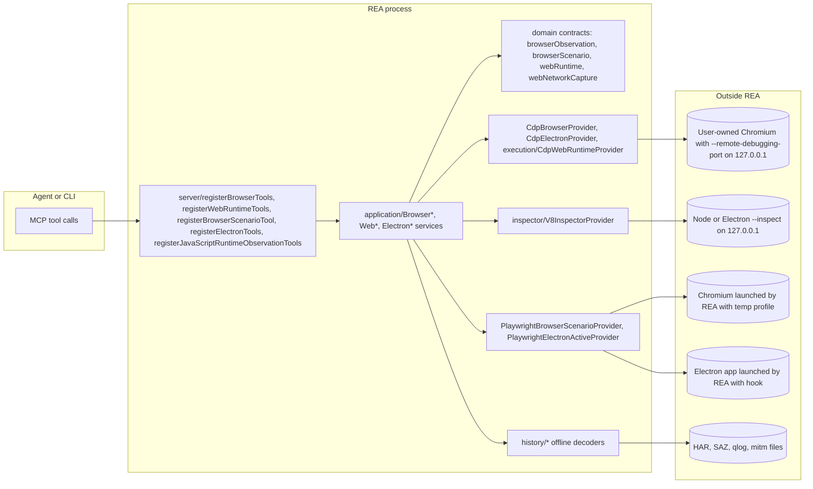
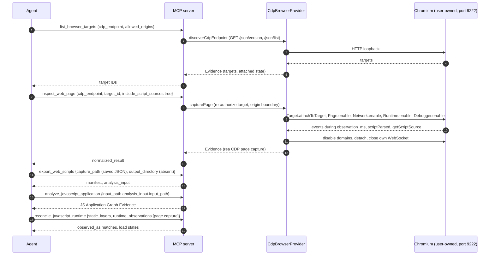
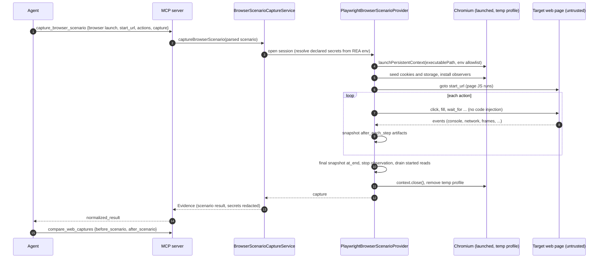
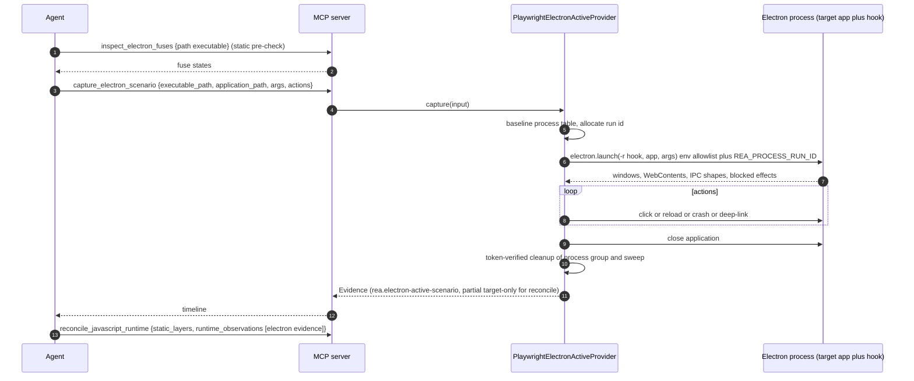

# 17 - Browser and web observation (CDP, Playwright scenarios, Electron, V8 Inspector, captures)

This chapter covers everything in REA that looks at a web page or a running JavaScript runtime: the `browser`, `electron` and `javascript-runtime` tool families (20 tools), the offline HAR/SAZ/mitmproxy/qlog reader that lives in the `browser` family, WebMCP discovery, V8 coverage attribution, and the script-export bridge into the static analyzer of [16-javascript-electron-analysis.md](16-javascript-electron-analysis.md).
Network *capture-file* parsing is shared with [20-network-and-signal-captures.md](20-network-and-signal-captures.md); the security model is in [21-security-model.md](21-security-model.md); process ownership primitives used by launched browsers are in [18-process-capture-and-instrumentation.md](18-process-capture-and-instrumentation.md).

Labels: unlabelled statements are traced to cited code/docs; **INFERRED** is marked with its evidence.

## 17.1 The central design idea: two authorities, never merged

`docs/browser-observation.md:67-76`:

> "CDP page capture, V8 Inspector observation, and Playwright scenarios stay separate providers because their authorities differ: CDP and V8 attach to an already-running target and never launch, drive, evaluate, or mutate it, while Playwright providers own and drive the runtime (launch browsers, run actions, capture step snapshots)."

| Authority | Providers (identity) | Tools | Process model | Executes page code? |
|---|---|---|---|---|
| **Passive attach (CDP)** | `rea-cdp-browser` v2, `rea-cdp-electron` v1 (`src/browser/providerIdentities.ts:4-24`) | `list_browser_targets`, `inspect_web_page`, `analyze_web_bundle`, `observe_web_session`, `discover_webmcp_tools`, `capture_web_screenshot`, `list_electron_targets`, `inspect_electron_page` | Attaches to a *user-owned* browser already running with a loopback debug port. REA owns only its own WebSocket. | The page keeps running as it was; REA sends no evaluate/navigate/input commands (17.4) |
| **Passive attach with side effect on timing** | CDP | `observe_web_execution`, `inspect_web_event_listeners` | same | `observe_web_execution` enables *precise coverage*, which resets counters and disables optimized execution while armed (flagged `mutatesTarget`+`mayDiscardData`) |
| **Passive V8 Inspector** | `src/inspector/providerIdentity.ts` | `list_javascript_runtime_targets`, `observe_javascript_runtime` | Attach-only to a Node/Electron `--inspect` target; sends only `Runtime.enable`, `Debugger.enable` | No |
| **Owned/driven (Playwright)** | `rea-playwright-browser-scenario` v1, `rea-playwright-electron-active` v1 | `capture_browser_scenario`, `capture_electron_scenario` | **REA launches** the browser/Electron (or connects to a loopback CDP browser) and drives it | **Yes - the loaded pages/app run.** Flagged `executesForeignCode`, destructive |
| **Offline** | HAR/SAZ/qlog adapters (Node child), mitmproxy adapter (Python in `mitmdump`) | `inspect_web_network_capture`, `export_web_scripts`, `trace_web_source_location`, `trace_web_module_imports`, `compare_web_captures`, `compare_web_screenshots` | No browser or network (except `trace_web_module_imports`, which launches a Chromium to use its native module resolver) | No |

Effects (from `TOOL_EFFECTS`, `src/contracts/toolEffects.ts`; legend T=mutatesTarget S=mutatesSession F=writesFilesystem P=launchesProcess N=accessesNetwork U=changesUiState D=mayDiscardData X=executesForeignCode, `i`=idempotent; annotations are `readOnly/destructive/openWorld`):

| Tool | Family | Effects | Annotations |
|---|---|---|---|
| `list_browser_targets` | browser | `-S--N----i` | false/false/true |
| `inspect_web_page` | browser | `-S--N----i` | false/false/true |
| `analyze_web_bundle` | browser | `-S--N----i` | false/false/true |
| `observe_web_session` | browser | `-S--N----i` | false/false/true |
| `discover_webmcp_tools` | browser | `-S--N----i` | false/false/true |
| `capture_web_screenshot` | browser | `-S--N----i` | false/false/true |
| `inspect_web_event_listeners` | browser | `-S--N----i` | false/false/true |
| `observe_web_execution` | browser | `TS--N-D---` | false/**true**/true |
| `compare_web_captures` | browser | `-S-------i` | false/false/false |
| `compare_web_screenshots` | browser | `-S-------i` | false/false/false |
| `inspect_web_network_capture` | browser | `-SFP-----i` | false/false/true |
| `capture_browser_scenario` | browser | `TSFPNUDX--` | false/**true**/true |
| `list_electron_targets`, `inspect_electron_page` | electron | `-S--N----i` | false/false/true |
| `capture_electron_scenario` | electron | `TSFPNUDX--` | false/**true**/true |
| `analyze_javascript_application`, `inspect_electron_fuses`, `reconcile_javascript_runtime` | electron (family label) | `-S-------i` | false/false/false |
| `list_javascript_runtime_targets`, `observe_javascript_runtime` | javascript-runtime | `-S--N----i` | false/false/true |

(Source: `.cache/mcp-tool-catalog.json`; the product catalog places the three static tools in family `electron` - they are described in Chapter 16.)

Note `accessesNetwork` on the passive tools reflects the loopback WebSocket/HTTP to the debug port (and, for `analyze_web_bundle --fetch_source_maps`, HTTP fetches), not necessarily the internet.

## 17.2 Source map

| Path | Files | Role |
|---|---|---|
| `src/browser/Cdp*.ts` | 43 (34 non-test) | CDP endpoint/discovery, WebSocket connection, target authorization, page capture (DOM, a11y, storage, network, console, WebSocket frames, scripts, workers), screenshot, WebMCP, Electron file-page inspection |
| `src/browser/Playwright*.ts` | 23 (12 non-test) | Scenario provider/session/actions/events/storage/service workers; Electron active provider |
| `src/browser/execution/` | 13 (12 non-test) | V8 precise coverage, request initiators, event listeners, runtime sources (`observe_web_execution`, `inspect_web_event_listeners`) |
| `src/browser/history/` | 23 (17 non-test) | Offline HAR/SAZ/qlog/mitmproxy decoders, redaction, capture decode process |
| `src/browser/assets/`, `modules/`, `network/` | - | Script export/publication, native module resolver, Playwright network content |
| `src/inspector/` | 5 | V8 Inspector endpoint/provider/projection (`V8InspectorProvider.ts:79` "Attach-only provider; sends only Runtime.enable and Debugger.enable") |
| `src/domain/browser*.ts`, `web*.ts` | 55 (42 non-test) | Contracts: observation schemas, scenario contract, capture diff, web runtime, web network capture, source location, script export |
| `src/application/Browser*.ts`, `Web*.ts` | - | Services (`BrowserObservationService.ts`, `BrowserScenarioCaptureService.ts`, `WebRuntimeService.ts`, `WebNetworkCaptureService.ts`, `WebScriptExportService.ts`, `WebSourceLocationService.ts`, `WebModuleTraceService.ts`) |
| `src/composition/{browserObservation,browserScenario,electronObservation,electronScenario,javascriptRuntimeObservation,webRuntime,webModules,webSourceLocations,webNetworkCaptures}.ts` | - | Lazy provider construction ("without opening a target or acquiring an engine") |
| `scripts/electron-active-hook.cjs`, `electron-active-hook-boundaries.cjs` | 2 (1068 lines) | In-process preload hook injected into the launched Electron (`-r`), records and blocks effects |
| Docs | `docs/browser-observation.md`, `browser-scenario-contract.md`, `electron-observation.md`, `javascript-runtime-observation.md`, `web-runtime.md`, `web-source-location.md`, `website-script-export.md`, `website-module-trace.md`, `web-network-captures.md` | Authoritative narrative |

## 17.3 Component diagram



*Caption: attach-only providers (CDP, V8) talk to externally owned loopback targets; Playwright providers own the process; offline decoders touch only files.*

Walkthrough: all providers are constructed lazily by `src/composition/*` so MCP startup never loads Playwright or opens a target. The same application service backs the CLI and MCP tool (`docs/browser-observation.md:37`).

## 17.4 Passive CDP observation: boundary, protocol, minimization

### 17.4.1 Endpoint and target boundary (code)

- Accepted CDP endpoints (verbatim, `src/domain/browserObservation.ts:44-62,81-94`):

```ts
export const isLiteralLoopbackHostname = (hostname: string): boolean =>
  hostname === "127.0.0.1" || hostname === "[::1]" || hostname === "::1";

const httpDiscoveryOrigin = (url: URL): string | undefined =>
  url.protocol === "http:" &&
  isLiteralLoopbackHostname(url.hostname) &&
  url.port !== "" &&
  url.username === "" &&
  url.password === "" &&
  url.pathname === "/" &&
  !urlDeclaresQueryOrFragment(url)
    ? url.origin
    : undefined;
```

  plus `ws://127.0.0.1:PORT/devtools/browser/ID` (browser socket; identifier redacted in Evidence as `[REDACTED]`, `:65-78,107-137`). `localhost`, HTTPS, `wss:`, credentials, implicit ports, any other path are rejected. Only six tools accept a browser socket: `list_browser_targets`, `inspect_web_page`, `analyze_web_bundle`, `observe_web_session`, `discover_webmcp_tools`, `capture_web_screenshot` (`docs/browser-observation.md:140-143`).
- Discovery reads `/json/version` and `/json/list` over `node:http`, 8 MiB per response, 10 s, redirects not followed (`src/browser/CdpEndpoint.ts:33-37,98-113`).
- Each call re-authorizes the target immediately before attach and establishes a **main-frame origin boundary** before enabling `Runtime`/`Debugger`/`Network`; if the main frame navigates during final capture, the mixed result is discarded with `target_changed` (`docs/browser-observation.md:273`; `CdpAuthorizedTarget.ts`, `CdpAuthorizedMainFrame.ts`).
- WebSocket payload limit: 64 MiB (`WEB_RUNTIME_LIMITS.protocolBytes`, `src/domain/webRuntime.ts:89-95`), enforced by the `ws` library's `maxPayload` (`src/browser/CdpConnection.ts:10-13,69-85`). Other web-runtime bounds (verbatim):

```ts
export const WEB_RUNTIME_LIMITS = {
  protocolBytes: 64 * 1024 * 1024,
  retainedEventBytes: 8 * 1024 * 1024,
  sourceBytes: 32 * 1024 * 1024,
  commandTimeoutMs: 20_000,
  cleanupTimeoutMs: 5_000,
} as const;
```

### 17.4.2 CDP methods the code actually uses

A grep of every CDP method literal in `src/browser/Cdp*.ts` and `src/browser/execution/*.ts` (non-test) yields exactly: `Page.{enable,getFrameTree,getResourceTree,setLifecycleEventsEnabled,captureScreenshot}`, `Network.{enable,getCookies,getResponseBody}`, `Runtime.{enable,releaseObjectGroup,...events}`, `Debugger.{enable,getScriptSource}`, `Profiler.{start,take,stop}PreciseCoverage`, `DOM.{getDocument,querySelector,describeNode,resolveNode}`, `DOMSnapshot.captureSnapshot`, `DOMDebugger.getEventListeners`, `DOMStorage.getDOMStorageItems`, `IndexedDB.{requestDatabaseNames,requestDatabase,requestData}`, `CacheStorage.{requestCacheNames,requestEntries,requestCachedResponse}`, `Storage.getUsageAndQuota`, `Accessibility.getFullAXTree`, `Target.{getTargets,attachToTarget,detachFromTarget}`, `Browser.getVersion`, `WebMCP.enable` (+ events `toolsAdded/toolsRemoved`). **There is no `Runtime.evaluate`, `Runtime.callFunctionOn`, `Page.navigate`, `Input.*`, or `Fetch.*` in these providers** (verified by grep; the only "navigate" strings are *events* such as `Page.navigatedWithinDocument`). `Network.getResponseBody` is sent only when JSON body-shape capture is selected (`docs/browser-observation.md:283`).
  *Subtle point:* the storage fingerprinting path (`IndexedDB.requestData`, `CacheStorage.requestCachedResponse`) reads stored values from the page's profile to hash them; they are not returned (`docs/browser-observation.md:286`: "Storage observations always redact values").

### 17.4.3 What each passive tool returns

| Tool | Returns (bounded) | Key options |
|---|---|---|
| `list_browser_targets` | all eligible page targets; optional exact-origin filter | `cdp_endpoint`, `allowed_origins[]` |
| `inspect_web_page` | frames, DOM structure (types/names/lengths only), accessibility structure, scripts, resources, attach-window network + console metadata, WebSocket frame sizes, workers, quota, storage names/fingerprints | `observation_ms` (default 500), `include_accessibility_text`, `include_console_text`, `include_json_body_shapes`, `include_websocket_shapes`, `include_script_sources`, `include_storage_keys`, `include_storage_fingerprints` |
| `analyze_web_bundle` | everything above with script sources, then static chunk graph, routes/endpoints, vendor fingerprints, static WebMCP declarations, optional source maps | `fetch_source_maps` (exact-origin fetch, no credentials/cookies/referrer, 30 s, 64 MiB aggregate) |
| `observe_web_session` | ordered reload/SPA-navigation/redirect/failure/lifecycle/termination metadata over a window while a *human* acts | `observation_ms` (default 10000) |
| `discover_webmcp_tools` | every in-scope WebMCP registration, full declared `input_schema` + `input_schema_sha256`, annotation hints | `observation_ms` default 100 |
| `capture_web_screenshot` | content-addressed visible-viewport PNG | - |
| `observe_web_execution` | V8 precise coverage (nested UTF-16 ranges/counts), script inventory with hashes, request initiators | `observation_ms` default 10000 |
| `inspect_web_event_listeners` | listeners registered directly on first CSS match, callback locations, script text/digest | `selector` |

Verbatim MCP schema examples for the common three-field input (`docs/browser-observation.md:258-263`):

```json
{
  "cdp_endpoint": "http://127.0.0.1:9222",
  "target_id": "TARGET_ID_FROM_LIST_BROWSER_TARGETS"
}
```

### 17.4.4 Data minimisation rules (they matter for what an analyst can and cannot recover)

From `docs/browser-observation.md:275-295`: only URL userinfo, explicitly declared scenario secrets, and structured credential/storage fields are redacted; URLs keep query values and fragments (analyst-useful, but may hold secrets); DOM snapshots keep node types/names/value *lengths*/attribute *names*, not text; a11y names/descriptions require `include_accessibility_text`; headers are discarded after an allowlisted projection and **cookies/authorization headers are never retained**; request/response bodies are not read unless selected, and then only allowed-origin JSON, converted at once to value-free typed paths; console text only primitive values already delivered; WebSocket payloads only size (and optional value-free shape); storage values always redacted (key names and fingerprints opt-in); script content only when selected, returned inline with SHA-256. **Retained script sources can contain secrets** (`docs/browser-observation.md:247`).

Completeness vocabulary: `complete_within_window`, `policy_filtered`, `attach_limited`, `truncated`; `prior_activity_available` is always `false` - absence from network/console arrays never proves an event did not happen (`docs/browser-observation.md:330`).

### 17.4.5 Sequence: passive inspection of a user-owned browser, then static analysis



*Caption: tool-call chain for web-page triage. The last three calls cross into Chapter 16.*

Walkthrough: steps 1-4 never touch the page except to read target metadata; steps 5-10 attach for a bounded window; step 11 turns retained debugger sources into files; steps 13-16 are fully offline. The agent must itself save the capture JSON to disk before `export_web_scripts` (the tool reads a *local capture file*; `docs/website-script-export.md:13-22`).

## 17.5 Browser scenarios (`capture_browser_scenario`)

**This tool launches a browser (or attaches to one) and drives pages through declared actions. The visited page's own JavaScript runs.** It is the only way in this family to execute web content. Effects `TSFPNUDX--`, destructive/open-world annotations. "The request itself defines the operation; there is no additional REA grant step. The browser and host still enforce their own access and process rules." (`docs/browser-scenario-contract.md:208-213`).

### 17.5.1 The scenario contract (verbatim)

`src/domain/browserScenario.ts:16-36` and `134-136`:

```ts
export const browserScenarioInputSchema = z.strictObject({
  browser: browserScenarioBrowserSchema.describe(
    "Required launch/connect selection. Launch uses the selected executable and an owned temporary profile; connect uses one loopback CDP endpoint and target.",
  ),
  start_url: browserScenarioUrlSchema.describe(
    "Required initial HTTP(S) URL. Query values must be declared separately as public literals or secret references.",
  ),
  environment: browserScenarioEnvironmentSchema,
  actions: z
    .array(browserScenarioActionSchema)
    .min(1)
    .describe("Required sequence of explicit browser actions."),
  storage: browserScenarioStorageSchema,
  secrets: z
    .array(browserScenarioSecretSchema)
    .default([])
    .describe(
      "Optional environment-variable references for values used in actions, URLs, storage, or replay, and for redacting matching observed text. Secret values are never supplied inline.",
    ),
  capture: browserScenarioCaptureSchema,
});

export const browserScenarioSchema = browserScenarioInputSchema.superRefine(
  validateBrowserScenario,
);
```

`validateBrowserScenario` (`src/domain/browserScenario.ts:104-132`) requires unique action `step_id`s, unique `secret_id`s, unique secret `environment_variable`s, and that every `secret` reference (in actions, `start_url`, goto destinations, cookie/local/session storage) is declared.

`src/domain/browserScenarioValues.ts` (verbatim, the load-bearing parts):

```ts
// :22-47  URL admission
const browserScenarioBaseUrlSchema = z.string().min(1).transform((value, context) => {
    let url: URL;
    try { url = new URL(value); } catch (cause: unknown) { /* issue: Invalid browser URL */ return z.NEVER; }
    if ((url.protocol !== "http:" && url.protocol !== "https:") || url.username !== "" || url.password !== "") {
      context.addIssue({ code: "custom", message: "Browser URLs must be HTTP(S) and omit credentials" });
      return z.NEVER;
    }
    return url.toString();
  });

// :49-71
export const browserScenarioValueSchema = z.discriminatedUnion("source", [
  z.strictObject({ source: z.literal("literal"), value: z.string() }),
  z.strictObject({ source: z.literal("secret"), secret_id: scenarioIdentifierSchema }),
]);
const queryEntrySchema = z.strictObject({ name: z.string().min(1), value: browserScenarioValueSchema });
export const browserScenarioUrlSchema = z.strictObject({
  url: browserScenarioBaseUrlSchema,
  query: z.array(queryEntrySchema).default([]),
});

// :73-91
export const browserScenarioBrowserSchema = z.discriminatedUnion("mode", [
  z.strictObject({
    mode: z.literal("launch"),
    executable_path: browserExecutablePathSchema.describe("Absolute local filesystem path for the browser executable; relative paths are rejected."),
    headless: z.boolean().default(true).describe("Run without a visible browser window; defaults to true and can be disabled when the host supports a display."),
  }),
  z.strictObject({
    mode: z.literal("connect"),
    cdp_endpoint: browserEndpointSchema,
    target_id: z.string().trim().min(1),
  }),
]);

// :93-126  environment defaults
viewport {width 1280, height 720, device_scale_factor 1}; locale "en-US"; timezone "UTC";
color_scheme "light"|"dark"|"no-preference" default "light";
reduced_motion "reduce"|"no-preference" default "reduce";
service_workers "allow"|"block" default "block"

// :128-157  locators: {kind:"test_id",value} | {kind:"role", role in [button,checkbox,combobox,dialog,link,listbox,menuitem,option,radio,slider,spinbutton,switch,tab,textbox], name} | {kind:"css", selector}

// :159-226  actions (discriminated by `action`), each with step_id (IDENTIFIER_PATTERN) and optional timeout_ms (int >= 1)
goto{destination, wait_until: commit|domcontentloaded|load} | click{locator, button left|middle|right =left, click_count int>0 =1}
| fill{locator, value} | press{locator, key} | select_option{locator, value} | check|uncheck{locator}
| wait_for{locator, state: attached|detached|visible|hidden} | wait_for_timeout{step_id, duration_ms int>=1}

// :233-267  storage (default empty)
cookies[{name, value, destination(url+query), http_only, secure, same_site Strict|Lax|None}],
local_storage[{origin, entries[{name,value}]}], session_storage[{origin, entries[...]}]

// :269-278
export const browserScenarioSecretSchema = z.strictObject({
  secret_id: scenarioIdentifierSchema,
  environment_variable: z.string().min(1).refine((name) => !name.includes("=") && !name.includes("\0"), "Environment variable names cannot contain '=' or NUL"),
});

// :280-309  capture
snapshotKind = screenshot|dom|accessibility|url|history|storage
capture = { after_each_step: snapshotKind[]=[], at_end: snapshotKind[]=["url"],
            events: ("console"|"page-errors"|"network"|"websockets"|"frames"|"workers"|"popups"|"downloads")[]=[],
            network: {request_body:false, response_body:false, header_values:false} }
```

(Condensed with comments where the source is plain zod boilerplate; every enum value, default and literal above is exactly as in the code. The event-family enum is `src/domain/browserScenarioCaptureValues.ts:123-132`.)

There is **no caller-controlled limits object**: duration/action/navigation timeouts are provider-owned liveness limits; counts are uncapped (`docs/browser-scenario-contract.md:24-28`). There is also **no origin allowlist or request-interception layer**: "Navigations follow the destinations named by the scenario and the page's ordinary browser requests" (`docs/browser-scenario-contract.md:9-16`), i.e. a page that redirects or issues sub-requests anywhere will do so.

Minimal request (verbatim, `docs/browser-scenario-contract.md:30-45`):

```json
{
  "browser": { "mode": "launch", "executable_path": "/absolute/path/to/chromium" },
  "start_url": { "url": "http://127.0.0.1:3000" },
  "actions": [
    { "step_id": "settle", "action": "wait_for_timeout", "duration_ms": 100 }
  ]
}
```

Interaction request (verbatim, `docs/browser-scenario-contract.md:63-97` - click Search, wait until `#results[data-state='ready']`, capture DOM+accessibility+URL):

```json
{
  "browser": { "mode": "launch", "executable_path": "/absolute/path/to/chromium" },
  "start_url": { "url": "http://127.0.0.1:3000" },
  "actions": [
    { "step_id": "search", "action": "click", "locator": { "kind": "css", "selector": "#search" }, "timeout_ms": 10000 },
    { "step_id": "results-ready", "action": "wait_for", "locator": { "kind": "css", "selector": "#results[data-state='ready']" }, "state": "visible", "timeout_ms": 10000 }
  ],
  "capture": { "at_end": ["dom", "accessibility", "url"] }
}
```

Network-content request (`docs/browser-scenario-contract.md:215-250`): `"capture": {"network": {"request_body": true, "response_body": true, "header_values": true}}`.

### 17.5.2 Launch mode vs connect mode, and process environment

- **Launch** (`src/browser/PlaywrightScenarioBrowser.ts:489-520`): `mkdtemp(tmpdir()/rea-browser-scenario-*)` as the persistent-context profile, `chromium.launchPersistentContext(profilePath, {executablePath: resolve(...), headless, acceptDownloads:false, viewport, deviceScaleFactor, locale, timezoneId, colorScheme, reducedMotion, serviceWorkers, env: allowedBrowserEnvironment(env), handleSIGHUP/INT/TERM:false, timeout:0, args: platform==="android" ? ["--no-sandbox","--single-process"] : []})`. The profile is removed on cleanup (`:532-537`). **REA itself passes no `--no-sandbox` on desktop (only the Android/Termux args), but this does NOT mean Chromium's sandbox is on:** REA never sets `chromiumSandbox: true` (no match in `src/`), and Playwright's `chromium.launch*` adds `--no-sandbox` whenever `options.chromiumSandbox !== true` (`node_modules/playwright-core/lib/server/chromium/chromium.js:291-292`, playwright-core 1.58.2). Effective behaviour: the scenario browser and the module-resolver browser run with the Chromium sandbox disabled (RUN: the scenario launched fine as root in the lab container). *Corrected in verification; the original text claimed the sandbox applied.*
- **Browser environment allowlist** (`:257-280`): only `DBUS_SESSION_BUS_ADDRESS, DISPLAY, HOME, LANG, LD_LIBRARY_PATH, PATH, SystemRoot, TEMP, TMP, TMPDIR, WAYLAND_DISPLAY, XAUTHORITY, XDG_RUNTIME_DIR` are passed (+ Termux preload on Android). So host secrets in other env vars do not reach the launched browser.
- **Connect**: loopback CDP endpoint + target; the page is driven through `connectOverCDP`; REA never closes the external browser, only disconnects; concurrent attach scenarios to the same target are serialized (`PlaywrightScenarioBrowser.ts:~200-250` admission waiters). With `service_workers: "block"` an attached page already controlled by / registered with a service worker is *rejected*; "Navigation can run destination code before a newly discovered worker is rejected; that rejection does not roll back browser effects" (`docs/browser-scenario-contract.md:17-23`).
- **Declarative actions only**: `performPlaywrightScenarioAction` ("Execute one admitted declarative action with no caller-supplied code", `src/browser/PlaywrightScenarioActions.ts:~40-90`) maps each action to a Playwright locator call; there is no `evaluate` action.
- **Secrets**: `BrowserScenarioSecrets.resolve` reads declared environment variables from the REA process environment (`src/browser/BrowserScenarioSecrets.ts:259-270`); values are never in the request, are substituted for `secret` sources, and observed text/URLs are redacted of those literals (and URI/form/JSON-escaped spellings). Durable results replace values with secret references. Authorization/Proxy-Authorization/Cookie/Set-Cookie header values are null with `redacted:true`.

### 17.5.3 Evidence produced and how it is compared

The result is Evidence with an initial state plus one record per action (status, elapsed time, sanitized URLs, event bounds, independently typed capture states for screenshot/DOM/a11y/URL/history/storage), events attributed to steps, `not_requested` for unselected artifacts (REA "did not look" != "page had nothing"). Attach captures declare the pre-attach event gap; popups reduce equality eligibility (`docs/browser-scenario-contract.md:177-214`).

`compare_web_captures` aligns steps only by exact unique `step_id`, records the full normalization commitment + digest (elapsed/sequence excluded; screenshots by digest; DOM/a11y by normalized text; network events grouped by transaction without capture-local IDs and compared as an unordered collection with redirect ancestry fingerprinted as SHA-256 of `{events, redirected_from}`); caller rules are bounded exact-literal replacements. Missing/truncated/mismatched coverage => `unknown`, never equal (`docs/browser-scenario-contract.md:304-351`).

### 17.5.4 Sequence: owned scenario



*Caption: owned-browser flow. `PG` is attacker-controlled when used on malware infrastructure.*

Walkthrough: REA's controls are (a) the declarative action vocabulary, (b) the environment allowlist, (c) temp-profile lifecycle with verified cleanup, (d) secret redaction and (e) bounded timeouts. REA does **not** add network egress filtering or OS isolation (see 17.9).

## 17.6 Electron

### 17.6.1 Passive: `list_electron_targets`, `inspect_electron_page`

Attach to a loopback CDP endpoint of an Electron app started with a debugging port; only local hostless `file://` pages resolving to regular files (including inside `app.asar`, canonicalised to archive path + member) are admitted; remote hosts, encoded separators, ASAR directories/links, missing paths are rejected. No DOM values retained; no evaluate/navigate/IPC. Worker/service-worker/shared-worker targets inventoried by metadata with opener/parent IDs (`docs/electron-observation.md:18-66`). Provider `rea-cdp-electron`.

### 17.6.2 Active: `capture_electron_scenario`

**Launches the Electron executable with the target application and drives it. Executes the application.** Input contract (verbatim, `src/domain/javascript/electronActiveObservation.ts:36-88`):

```ts
const actionSchema = z.discriminatedUnion("kind", [
  z.strictObject({ step_id: z.string().min(1), kind: z.literal("click"), selector: z.string().min(1), window_index: windowIndexSchema.default(0) }),
  z.strictObject({ step_id: z.string().min(1), kind: z.literal("wait"), duration_ms: z.number().int().min(0), window_index: windowIndexSchema.optional() }),
  z.strictObject({ step_id: z.string().min(1), kind: z.literal("renderer-reload"), window_index: windowIndexSchema.default(0) }),
  z.strictObject({ step_id: z.string().min(1), kind: z.literal("renderer-crash"), window_index: windowIndexSchema.default(0) }),
  z.strictObject({ step_id: z.string().min(1), kind: z.literal("deep-link"), delivery: z.enum(["open-url", "second-instance"]), url: deepLinkUrlSchema }),
]);

export const electronActiveObservationInputSchema = z.strictObject({
  executable_path: pathInputSchema,   // absolute
  application_path: pathInputSchema,  // absolute
  application_root: pathInputSchema.optional(),
  args: z.array(z.string().regex(/^[^\x00]*$/u, "Electron arguments must not contain NUL")).default([]),
  actions: z.array(actionSchema).default([]),
});
```

Launch (`src/browser/PlaywrightElectronActiveProvider.ts:99-107`): `electron.launch({executablePath, cwd: root, env: safeElectronEnvironment(...), args: ["-r", hookPath, application, ...args], timeout})` where `hookPath = scripts/electron-active-hook.cjs`. The environment allowlist (`:365-405`) is `HOME, LANG, PATH, TMP, TMPDIR, USER, DISPLAY, WAYLAND_DISPLAY` (+ Windows system variables) plus `REA_PROCESS_RUN_ID`. Startup deadline 60 s (`:41`). Ownership: leader PID/process group + `sweepTokenOwnedProcesses` + pre-launch baseline (`:112-125`); cleanup that cannot be verified keeps collected observations in `details.partial_observation` and marks cleanup `unverified`.

The preloaded hook (`scripts/electron-active-hook*.cjs`) patches `ipcRenderer`, `contextBridge`, sessions, `webContents`, `shell`, `app` and records window/WebContents/preload/session/navigation/permission/popup/download/protocol/native-addon/process/IPC events *by shape* (channels and argument lengths; "payload values are never retained", `docs/electron-observation.md:92-104`). It **blocks and records** external `loadURL` to non-allowed destinations, `will-navigate`/`will-redirect`, `shell.*`, permission requests/checks, certificate verification, `window.open` handlers, downloads and certain `app` effects (`electron-active-hook.cjs:395-399,521-524`; `electron-active-hook-boundaries.cjs:110,121-150,176-191,223-227,343-348`). **INFERRED:** the hook is in-process JavaScript running with the target's privileges, so a malicious Electron app can bypass it (e.g. spawn a child process, use Node `net`/`https` directly); it is observation hygiene, not containment. The docs state the same bottom line: "The owned process keeps normal host filesystem and network privileges, so lifecycle ownership does not make it a sandbox." (`docs/electron-observation.md:79-87`).



*Caption: active Electron observation. The Evidence is explicitly partial and "target-only" when used for reconciliation (it does not establish script coverage).*

Walkthrough: the fuse pre-check tells whether `--inspect` flags or `ELECTRON_RUN_AS_NODE` would be honored; the scenario launch is the only moment application code runs. See `docs/electron-observation.md:67-132`.

## 17.7 Node/Electron V8 Inspector (`list_javascript_runtime_targets`, `observe_javascript_runtime`)

Attach-only to a caller-owned `node --inspect=127.0.0.1:9229` (or Electron main/preload/renderer inspector). Protocol (`src/inspector/V8InspectorProvider.ts:79,191-192`): **exactly two commands** - `Runtime.enable`, `Debugger.enable` - never `Runtime.evaluate`, source reads, breakpoints, pause/resume, `Runtime.runIfWaitingForDebugger`. Retains `Debugger.scriptParsed`, `scriptFailedToParse` (count), execution-context lifecycle. Caller declares `runtime_kind` ∈ `node|electron-main|electron-preload|electron-renderer`; role authority is recorded `caller-declared-unverified`. Targets explicitly `attached:true` are rejected (no displacing another debugger); Node's `/json/list` omits attachment so `attached:null` + a limitation. Budget: 8 MiB retained metadata, 16 MiB per message; overflow => `events_dropped`, `truncated:true` (`docs/javascript-runtime-observation.md:130-141`). `--inspect-brk` targets stay paused (REA never resumes).

Prerequisite for Electron mains: run `inspect_electron_fuses` first (`EnableNodeCliInspectArguments` disabled/removed => Electron ignores `--inspect`).

## 17.8 Web script export, module tracing, source locations, network captures

| Tool | Input | Output | Boundary |
|---|---|---|---|
| `export_web_scripts` | `capture_path` (saved `inspect_web_page` or scenario capture, Evidence or normalized result), `output_directory` (absent, absolute) | `manifest.json` + `files/` tree + inline `analysis_input` | No refetch, no execution; digest-verified write with rollback; passive sources = Debugger text as UTF-8; scenario sources = Playwright `Response.body()` bytes (which "may load the request URL again with credentials when CDP has no response body", so identity to the original transaction is not verified, `docs/website-script-export.md:51-56`) |
| `trace_web_module_imports` | manifest, script index, `importer_url`, optional `import_map{path,base_url}` | native ES import/re-export edges with resolved URL or exact rejection; every matching capture candidate | Needs absolute `REA_BROWSER_EXECUTABLE` supporting `import.meta.resolve` for literal imports (RUN: a script with zero imports traced successfully with the variable unset; the resolver is only started when needed, `src/contracts/webScriptToolContracts.ts:47`); owned temporary browser with page requests fulfilled by REA's stub or blocked; flags `--disable-dev-shm-usage --disable-background-networking --renderer-process-limit=1 --js-flags=--max-old-space-size=128` (+`--no-sandbox` only if `REA_BROWSER_NO_SANDBOX=true`) (`src/browser/modules/NativeModuleResolver.ts:120-130`); 20 s deadline; limits 32 MiB manifest/16 MiB source/4 MiB map. The selected application is parsed as data and not executed |
| `trace_web_source_location` | manifest, script index, map path + URL context, 1-based line/0-based column | all equal-position mappings + embedded source | Local map only; codec in owned Node child (see 16.12) |
| `inspect_web_network_capture` | `capture_path`, `format` har/mitmproxy/saz/qlog, `record_ordinals[]`, `detail`, `sensitive_values[]` | records with original ordinals, pointers, byte sidecars | Offline - see Chapter 20 |
| `compare_web_screenshots` | two self-verifying PNG artifacts | changed-pixel ratios | Pure local; 256 MiB estimated working-memory admission before inflating (`docs/browser-observation.md:42-62`) |

`observe_web_execution` details (`docs/web-runtime.md`): starts precise coverage (`Profiler.startPreciseCoverage` with call counts and detailed ranges), takes one resetting sample, stops coverage, disables domains and detaches; it "changes timing/JIT behavior"; results keep exact script IDs, producer hash plus independently computed UTF-8 digest, initiator stacks, and the position-conversion rules to feed `trace_web_source_location` (external script: `line = line_number + 1`; inline: subtract `resource_start.line_number`, column only on first line). Per-command 20 s, cleanup 5 s, message 64 MiB, retained 8 MiB/32 MiB. Real workflow verified on Linux x64 / Chrome 153 / Node 24 only (`docs/web-runtime.md:57-58`).

## 17.9 Policy and safety: launching and driving pages

| Concern | What the code/docs do | What they do **not** do |
|---|---|---|
| Who can reach the debug port | Loopback-literal only (`127.0.0.1`, `::1`), explicit port, no credentials (17.4.1) | Authenticate the debugger or the browser; any local user process that can reach the port is outside the boundary ("treat other same-user processes as outside this boundary", `docs/browser-observation.md:349`) |
| What passive tools send | Allowlisted CDP methods only (17.4.2); main-frame origin boundary; domains disabled and session detached at the end | Sandbox the *page*: "The attached page and browser continue running with their existing privileges and may make external requests independently of REA" (`docs/browser-observation.md:349`) |
| Origin scope | Default = selected page's current origin; `allowed_origins` = exact scheme+host+port; out-of-scope frames/resources/scripts/workers counted but not exposed | Wildcards, paths |
| Owned browser (scenario) | Operator-chosen executable only (`executable_path` absolute); fresh temp profile; env allowlist; no downloads accepted; declarative actions only; service workers blocked by default; owned-process cleanup | Egress filtering, request interception/allowlist, OS sandbox, memory/CPU cgroup limits ("provider-owned liveness limits"), REA's own code adds `--no-sandbox` only on Android/Termux or for the module resolver when `REA_BROWSER_NO_SANDBOX=true`, **but Playwright adds `--no-sandbox` itself unless `chromiumSandbox: true` is passed, which REA never does** (`playwright-core/lib/server/chromium/chromium.js:291-292`) - so assume the launched Chromium has no sandbox |
| Owned Electron | Env allowlist, hook that blocks external navigation/shell/permission/popup/download/updater effects, token-verified process cleanup, 60 s startup | Contain the app (it is the target's own code with user privileges) |
| Untrusted content | Page-derived strings, script bodies, WebMCP declarations are **data**. MCP results carry `_meta.provenance.untrusted_content=true` and the server instructions tell the model not to follow directives found in target content (`src/server/createServer.ts:147`, `src/server/toolResultEncoding.ts:20-45`). `discover_webmcp_tools` returns "page-declared-untrusted" metadata, never registers/invokes tools (`WebMCP.invokeTool` is never called, `CdpWebMcpDiscovery.ts:51`) | Neutralize prompt injection embedded in captured text; it only labels it |
| Secrets | Scenario secrets come from env var names, never from the request; redacted in Evidence; header auth values null; storage values always redacted | Detect secrets by pattern: "do not infer secrecy from names or text patterns" (`AGENTS.md`); script sources/URL query values are retained verbatim |
| Consent | Operation request = authorization; no per-call confirmation gate in REA (`docs/browser-scenario-contract.md:211`); MCP annotations mark scenario/electron/coverage tools destructive+open-world so a *client* can gate them | A server-side approval step |

**Malware-lab requirement for the owned/driven tools** (`capture_browser_scenario`, `capture_electron_scenario`, `trace_web_module_imports`): run REA inside a disposable VM/container with no route to production networks (or with an explicit egress proxy such as the lab in Chapter 20), a profile-less browser build you control, and no secrets in the environment (and remember the owned Chromium runs with its sandbox disabled by Playwright's default); assume the page can attempt browser exploits, tracking beacons, downloads (disabled), and local-network probing. REA gives you cleanup and evidence, not isolation. Passive tools are safe only with respect to *REA's own* behavior - the target page keeps running and is reachable by whatever the page already reaches.

## 17.10 Worked examples (from the docs)

1. Start a dedicated browser (`docs/browser-observation.md:83-92`): `google-chrome --remote-debugging-port=9222 --user-data-dir=/tmp/rea-browser-profile http://127.0.0.1:3000`. Then:
   ```bash
   rea list-browser-targets http://127.0.0.1:9222 --json
   rea inspect-web-page http://127.0.0.1:9222 TARGET_ID --observation-ms 1000 --json
   rea analyze-web-bundle http://127.0.0.1:9222 TARGET_ID --json
   rea observe-web-session http://127.0.0.1:9222 TARGET_ID --observation-ms 10000 --json
   rea discover-webmcp-tools http://127.0.0.1:9222 TARGET_ID --json
   ```
2. Selected content (`docs/browser-observation.md:234-244`): `rea inspect-web-page ... --include-accessibility-text --include-console-text --include-json-body-shapes --include-websocket-shapes --include-script-sources --include-storage-keys --include-storage-fingerprints --json`.
3. Browser socket form (`docs/browser-observation.md:133`): `rea list-browser-targets ws://127.0.0.1:9222/devtools/browser/<id>`.
4. Script export chain (`docs/website-script-export.md:18-21`): `rea export-web-scripts /analysis/capture.json /analysis/exported-scripts --json` then `rea analyze-javascript-application /analysis/exported-scripts/files --json`.
5. Source location (`docs/web-source-location.md:9-26`): `rea trace-web-source-location /analysis/scripts/manifest.json 0 /analysis/app.js.map 'https://example.test/maps/app.js.map?v=7#context' 1 25 --json`.
6. Module imports (`docs/website-module-trace.md:14-26`): `REA_BROWSER_EXECUTABLE=/absolute/path/to/chrome rea trace-web-module-imports /analysis/export/manifest.json 0 --importer-url 'https://example.test/app/main.js?build=2#entry' --import-map-path /analysis/import-map.json --import-map-base-url https://example.test/maps/ --json`.
7. Web execution (`docs/web-runtime.md:7-10`): `rea observe-web-execution http://127.0.0.1:9222 TARGET_ID --observation-ms 10000 --json`; listeners: `rea inspect-web-event-listeners http://127.0.0.1:9222 TARGET_ID '#submit' --json`.
8. Electron passive (`docs/electron-observation.md:36-41`): `rea list-electron-targets http://127.0.0.1:9223 --json`, `rea inspect-electron-page http://127.0.0.1:9223 TARGET_ID --observation-ms 100 --json`; active: `rea capture-electron-scenario scenario.json --json` (verifier: `REA_ELECTRON_EXECUTABLE=/absolute/path/to/electron npm run verify:electron`).
9. V8 Inspector (`docs/javascript-runtime-observation.md:15-26`): `node --inspect=127.0.0.1:9229 ./app.mjs`; `rea list-javascript-runtime-targets http://127.0.0.1:9229 --json`; `rea observe-javascript-runtime http://127.0.0.1:9229 TARGET_ID --runtime-kind node --json`.

## 17.11 Environment variables and host prerequisites (this chapter)

| Variable | Used by | Meaning |
|---|---|---|
| `REA_BROWSER_EXECUTABLE` | `trace_web_module_imports` (`NativeModuleResolver.ts:80`, capability probe `src/server/createServer.ts:212`) | Absolute path to a Chromium with `import.meta.resolve` |
| `REA_BROWSER_NO_SANDBOX` | same (`:128`) | `"true"` adds `--no-sandbox` for the module-resolver browser (redundant in practice: Playwright already adds it unless `chromiumSandbox: true`) |
| `REA_ELECTRON_EXECUTABLE` | `npm run verify:electron` only (docs) | Test lane executable |
| `REA_MITMDUMP_COMMAND` | mitmproxy capture decoding (Ch. 20) | Absolute mitmdump 12.2.3 |
| `REA_BROWSER_EXECUTABLE` also used by `verify:browser:*` lanes | docs | Test lanes |
| scenario-declared `secrets[].environment_variable` | `BrowserScenarioSecrets` | Any env var name chosen by the scenario author |

Linux Chromium startup hints (headless Xvfb needs GLES/EGL/Mesa; `--password-store=basic` for locked keyrings): `docs/browser-observation.md:110-120`.

## 17.12 Fact / inference / discrepancies

- **Fact:** no evaluate/navigate/input CDP method exists in the passive providers (grep, 17.4.2). **Fact:** V8 provider sends exactly two commands.
- **Fact (doc vs code):** `docs/browser-observation.md` says CDP WebSocket messages are limited to 64 MiB; code constant `MAX_WEBSOCKET_PAYLOAD_BYTES` (0x7fffffff) is only the *ceiling* for the configurable limit, while the default comes from `WEB_RUNTIME_LIMITS.protocolBytes` = 64 MiB (`CdpConnection.ts:66-69`). V8 Inspector uses a 16 MiB limit (`docs/javascript-runtime-observation.md:130-132`).
- **INFERRED:** `inspect_web_page` with `include_storage_fingerprints` reads stored values through the page's profile (IndexedDB/Cache reads) - these are bounded and never returned, but they do touch data in the user's browser profile; use a dedicated profile.
- **INFERRED:** a hostile page can detect an attached CDP client (e.g. via timing or `Runtime.enable` side effects) and behave differently; REA makes no anti-evasion claims (and CONTRIBUTING excludes anti-anti-debugging workflows).
- **Doc caveat:** several real-browser lanes are verified only on Linux x64 / specific Chrome builds (`docs/web-runtime.md:57-58`, `docs/website-module-trace.md`); other hosts "unverified".

## 17.13 Verification run status (RUN / DOC)

Lab setup: Playwright's Chromium (`/opt/pw-browsers/chromium-1194/chrome-linux/chrome`, Chromium 141.0.7390.37) started headless with `--remote-debugging-port=9222 --user-data-dir=<scratch>` (`--no-sandbox` because the container runs as root; the REA-launched browsers below needed no flag from us because Playwright supplies it), serving a local `python3 -m http.server` page (`index.html` plus `app.js` with a click listener, a `fetch`, a `localStorage.setItem` and a `sourceMappingURL` comment). Note: docs/web-runtime.md:57-58 says real coverage is Chrome 153 / Node 24; this run used Chromium 141, so it is outside the documented verified matrix.

| Flow | Status | What was observed |
|---|---|---|
| `list_browser_targets` (CLI and MCP) | RUN | `rea-cdp-browser` v2, predicate `rea.browser-target-list`, `confidence: observed`, `authority: external-service`; both page targets listed with `attached: null` and the limitation that CDP discovery omitted attachment state; result carries `_meta.provenance.untrusted_content: true` |
| Endpoint boundary | RUN | `http://localhost:9222` and `http://127.0.0.1` (no port) are rejected with `invalid_request` ("CDP endpoint must be an explicit-port HTTP URL on 127.0.0.1 or ::1") |
| `inspect_web_page` (1000 ms, with script sources, storage keys and fingerprints, console text) | RUN | sections `frames, dom, accessibility, scripts, resources, network, console, workers, metadata, storage`; accessibility text `not_approved`; completeness `policy_filtered` with `attach_limited` network/console; `network.requests` empty and `prior_activity_available: false` for a page loaded before attach while `scripts` still listed `app.js` with CDP hash, UTF-8 digest, `source_map_url` and inline source; `storage` returned `local_storage_keys: ["k"]` plus a SHA-256 `value_sha256` fingerprint and `values_redacted: true` |
| `observe_web_session` (3500 ms while a reload and a navigation were driven externally) | RUN | predicate `rea.web-observation-session`, ordered `timeline` with lifecycle events (`commit`, `domcontentloaded`, `load`, `networkidle`, ...) |
| `observe_web_execution` | RUN | `instrumentation: {resets_execution_counters: true, disables_optimized_execution: true, takes_one_resetting_sample: true, executes_selected_code: false, cleanup: "confirmed", page_ownership: "external"}` |
| `inspect_web_event_listeners` (`#b`) | RUN | one `click` listener with script location (`app.js` line 0 column 54), `execution: "unknown"`; the first attempt returned `[]` only because my test page's head script threw before attaching the handler (page bug, not REA) |
| `discover_webmcp_tools`, `capture_web_screenshot`, `analyze_web_bundle` | RUN | all succeeded (`rea.webmcp-discovery`, `rea.web-screenshot`, `rea.web-bundle-analysis`, `confidence: observed`); analyze_web_bundle reported 1 script observed and analyzed |
| `export_web_scripts` then `analyze-javascript-application` on `files/` | RUN | manifest.json plus `files/origins/<sha>/app.js` written to an absent output directory; the exported tree analyzed as `format: directory`, 1 file, 78 AST nodes |
| `trace_web_module_imports` | RUN (no imports) | succeeded for the exported `app.js` (no literal imports, so no browser acquisition was required); the resolver path with an import-bearing script was not exercised |
| `capture_browser_scenario` (launch mode, click plus `wait_for_timeout`, capture dom/url, events console/network) | RUN | launched Chromium as root with no `--no-sandbox` from REA (Playwright appends it by default, see 17.5.2), `process_ownership: provider-owned`, `cleanup: terminated-owned-process`; parameters echoed the documented defaults (1280x720, `en-US`, `UTC`, `light`, reduced motion `reduce`, service workers `block`); network events recorded header names only; the temp profile directory was removed |
| `trace_web_source_location`, `compare_web_captures`, `compare_web_screenshots`, `inspect_web_network_capture` | DOC | not executed |
| `capture_electron_scenario`, `list_electron_targets`, `inspect_electron_page`, `list_javascript_runtime_targets`, `observe_javascript_runtime` | DOC | no Electron executable or `--inspect` target in the lab; the Electron active path in particular was not run |

## Porting notes

**(a) Separable units**

| Unit | Where | Notes |
|---|---|---|
| Loopback CDP endpoint validator + discovery | `src/domain/browserObservation.ts:44-137`, `src/browser/CdpEndpoint.ts` | Tiny; re-implement in any language |
| CDP connection with payload cap + poison-on-malformed | `src/browser/CdpConnection.ts` | `ws`-based, ~390 lines |
| Page capture/minimization pipeline | `src/browser/CdpPageCapture.ts`, `CdpCapture*.ts`, `CdpSafeMetadata.ts`, `domain/browserObservation*.ts` | Largest valuable module: encodes "what to keep" (value-free DOM/network/storage) - a good reference spec for a privacy-preserving crawler |
| Scenario contract + diff engine | `src/domain/browserScenario*.ts`, `browserScenarioDiff*.ts`, `browserScenarioNormalization.ts`, `webCaptureDiff*.ts` | Pure zod + canonical-JSON hashing; reusable for "differential page behavior" |
| Secrets resolver/redactor | `src/browser/BrowserScenarioSecrets.ts` | Standalone; includes allocation-cost preflight |
| Playwright driver | `src/browser/Playwright*.ts` | Depends on `playwright-core` 1.58.2 and REA's owned-process/cleanup abstractions |
| V8 coverage/initiator attribution | `src/browser/execution/*` | CDP-only; useful for "which script executed" |
| Offline HAR/SAZ/qlog/mitmproxy decoders | `src/browser/history/*`, `bridge/mitmproxy/capture.py` | See Chapter 20 |
| Electron active hook | `scripts/electron-active-hook*.cjs` | Self-contained CJS; reusable as an observation shim for Electron malware in a lab |

**(b) Dependencies.** `ws` 8.21.0, `playwright-core` 1.58.2 (lazy-imported), `zod` 4.4.3, `canonicalize`, `parse5`, `pino`; for offline decoders `har-schema`, `ajv`, `jsonc-parser`, `lossless-json`, `@zip.js/zip.js`, `@xmldom/xmldom` (all in `package.json`); optional `mitmproxy` 12.2.3 and a caller-supplied Chromium.

**(c) Re-implement.** The Evidence envelope and retained-reference store (to keep provenance semantics), the owned-process cleanup layer (18.7) used for launched browsers/Electron, and - essential for a malware lab - **real isolation** (network namespace/egress proxy, filesystem jail, seccomp/AppArmor, resource cgroups), since REA provides none.

**(d) Malware-analysis relevance.**
- Passive attach tools are good for **observing a detonation you run yourself** (e.g. a phishing kit or a malicious Electron app already running in a VM): capture scripts with hashes, endpoints, WebSocket shapes, storage key names, listeners, V8 coverage, then diff two runs with `compare_web_captures`. Retained evidence is value-free by design - you will *not* get DOM text, response bodies (unless selected) or storage values; plan captures with the options in 17.4.3.
- `capture_browser_scenario` / `capture_electron_scenario` **execute hostile code**. They require the sandbox described in 17.9. Prefer attach mode into a browser you have already contained.
- `discover_webmcp_tools` is directly relevant to AI-agent threat modeling: it inventories tools a page exposes to agents, with schemas and annotation hints, as untrusted data (but see the prompt-injection caveat: descriptions are attacker-controlled text).
- Do not rely on `prior_activity_available: false` limitations - a page that already ran before attach is partially invisible (network/console), though scripts remain visible.
- Limits: no TLS interception (that is mitmproxy territory, Chapter 20), no full-body capture by default, hosts verified only on Linux x64 for several lanes, and Chrome-family only.
