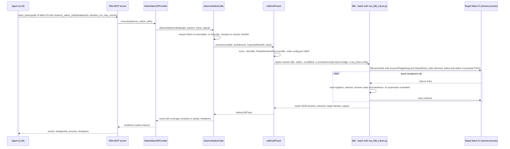
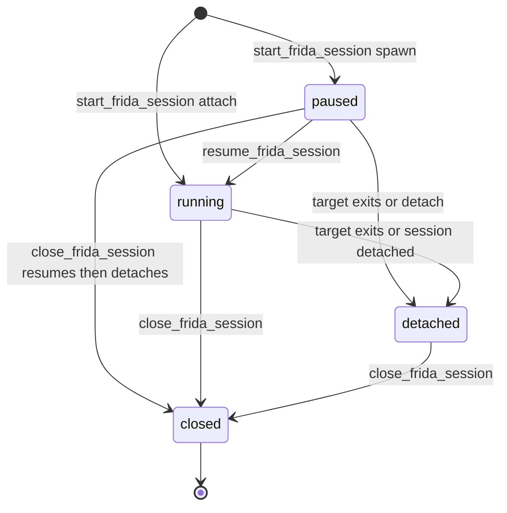
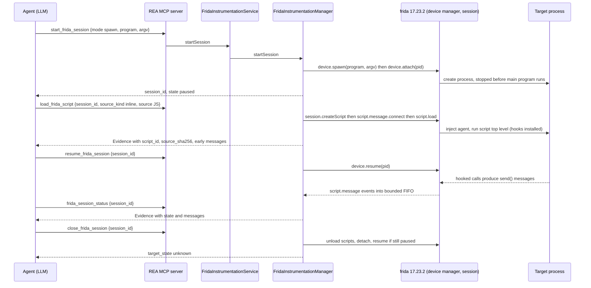

# 18 (part B). Native call tracer, Frida instrumentation, sandboxing and porting notes

> Continuation of [18-process-capture-and-instrumentation.md](18-process-capture-and-instrumentation.md) (sections 1-3: Process Capture and comparison). Same conventions: **RUN** = executed in this lab, **DOC** = read from code/docs only; paths are repo-relative at HEAD `f75b1a4`.

## 4. Native call tracer: `observe_native_calls` (LLDB) — **DOC on Linux**

### 4.1 What it does

"Launch the active Mach-O as an owned process under LLDB and record each entry into caller-selected functions or Objective-C methods: thread, module, symbol, load and file address, raw argument registers, selector, receiver class and optional caller frames. Every hit auto-continues. No expression is evaluated and no other process is attached. The process is killed when max_events or duration_ms is reached" (tool description, catalog). It is a *provider operation* of `native-macos` (`src/native/NativeMacOSProvider.ts:238-253`), available only when `platform === "darwin"` (`src/native/NativeMacOSProviderMetadata.ts:20-33`) and only for a bound **Mach-O executable** target (`src/native/NativeCallObservation.ts:46-55`).

**RUN (refusal on this Linux lab).** `node scripts/rea.mjs observe-native-calls samples/vuln/hard onc.json --json` with `{"breakpoints":[{"kind":"function","name":"open"}]}` returns `capability_unavailable ... "reason":"Native macOS utilities require macOS."`. Everything below is therefore **DOC**.

### 4.2 Contract

Input (verbatim):

`src/domain/native/nativeCallObservation.ts:33-104`

```ts
export const nativeCallBreakpointSchema = z.discriminatedUnion("kind", [
  z.strictObject({
    ...functionBreakpoint,
    module: nativeString
      .min(1)
      .optional()
      .describe(
        "Image file name that defines the symbol, such as `libsystem_kernel.dylib`; omit to match every image.",
      ),
  }),
  z.strictObject({
    ...objcMethodBreakpoint,
    class_name: objcName
      .optional()
      .describe("Implementing class; omit to match every class."),
    method_type: z.enum(["instance", "class", "any"]).default("any"),
  }),
]);

/**
 * Launch the active Mach-O as an owned process under LLDB and observe calls.
 * Duration and event bounds keep runtime observation finite.
 */
export const nativeCallObservationInputSchema = z.strictObject({
  breakpoints: z.array(nativeCallBreakpointSchema).min(1),
  arguments: z.array(nativeString).default([]),
  environment: z
    .record(
      z
        .string()
        .min(1)
        .regex(/^[^=\x00]+$/u, "Environment names cannot contain '=' or NUL"),
      z.string().regex(/^[^\x00]*$/u, "Environment values cannot contain NUL"),
    )
    .default({})
    .describe("Overrides on top of the environment REA runs with."),
  working_directory: localPathStringSchema.optional(),
  duration_ms: z
    .number()
    .int()
    .min(100)
    .max(600_000)
    .default(10_000)
    .describe(
      "Observation window; the process is killed if it is still running.",
    ),
  max_events: z
    .number()
    .int()
    .min(1)
    .max(100_000)
    .default(1_000)
    .describe(
      "Stop observing and kill the process after this many recorded entries.",
    ),
  argument_registers: z
    .number()
    .int()
    .min(0)
    .max(8)
    .default(4)
    .describe(
      "Integer argument registers to record per entry (arm64 has 8, x86_64 has 6).",
    ),
  backtrace_frames: z
    .number()
    .int()
    .min(0)
    .max(64)
    .default(0)
    .describe("Caller frames to record per entry."),
});
```

Fixed limitations REA attaches to every result (verbatim):

`src/native/NativeCallObservation.ts:29-36`

```ts
export const NATIVE_CALL_OBSERVATION_LIMITATIONS = [
  "Only entries are observed; return values, floating-point and stack-passed arguments are not captured.",
  "Registers are the raw integer argument registers at entry. For Objective-C methods the first two hold the receiver and the selector.",
  "Receiver classes come from LLDB's Objective-C runtime reader without running target code; they are null for class methods and for receivers LLDB cannot classify.",
  "Calls that never reach a symbol's entry, such as inlined code or objc_direct methods called directly, are not observed.",
  "The target is launched directly under LLDB, not through LaunchServices; LLDB disables ASLR for it, so load addresses can equal file addresses.",
  "The observation window is checked about once a second, and recording pauses the process at every entry, which slows it.",
] as const;
```

### 4.3 Flow



*Figure 5. LLDB call-trace flow (DOC). Anchors: digest re-check `NativeCallObservation.ts:59-87`; lldb argv `LldbCallTracer.ts:392-404`; bridge docstring `bridge/native/rea_lldb_tracer.py:1-12`; launch flags `:90-95`; launch info `:526-539`.*

Key properties (all from code):

* **Target identity.** The tracer re-hashes the path before launch and aborts with `EvidenceIntegrityError` if it differs from the session digest (`NativeCallObservation.ts:73-79`); the bridge compares module identity around launch and reports `loaded_image_sha256: null` always, i.e. "no immutable executable snapshot" (limitation text in `projectNativeCalls`, `:155-160` region).
* **Execution control.** `eLaunchFlagDebug | eLaunchFlagStopAtEntry`; stdin is `/dev/null`; stdout/stderr go to bounded FIFOs (1 MiB per stream kept, rest counted) (`rea_lldb_tracer.py:20-40, 526-539`); trace payload budget 8 MiB / 65,536 frames (`:30-33`).
* **Termination.** Process killed at `max_events`, `duration_ms` (100 ms to 600,000 ms), the aggregate resource limit, or repeated non-breakpoint stops (`outcome` enum in `LldbCallTracer.ts:73-80`). Deadline for LLDB itself is `duration_ms + 60 s` (`:58, 404`). Cleanup uses the same owned-process supervisor and identity-checked kill as capture; an unverifiable exit is surfaced in the result and retained as pending cleanup for the next call (`:226-300`).
* **No Linux equivalent here.** `src/process/ownedDebuggerSession.ts` is the GDB-provider session supervisor ("Stop only the directly owned debugger process, never its process group or target", `:174-176`), not a call tracer. On Linux the comparable capability is Frida (section 5).
* **Hardened runtime.** A hardened-runtime target needs `com.apple.security.get-task-allow`; `ATTACH_REMEDIATION` points to `DevToolsSecurity -enable` / `_developer` group (`LldbCallTracer.ts:166-168`).

**Malware relevance.** On a macOS analysis host this is a *scoped* dynamic tracer (named functions only, entries only, no return values, no memory writes) — safer in intent than free-form Frida JS, but it still **runs the sample**, with REA's environment plus caller overrides, in the user's session (may show UI, touch files, use network; the tool description says so).

---

## 5. Frida instrumentation (`src/frida`)

### 5.1 Components

| Piece | File | Role |
|---|---|---|
| Tool contracts | `src/contracts/fridaToolContracts.ts:1-327` | zod input/output schemas for the 9 tools |
| Remote address validator | `src/contracts/fridaRemoteAddress.ts:1-21` | host[:port] only: no scheme, path, query, credentials |
| Port | `src/application/frida/FridaInstrumentationPort.ts:1-136` | provider-neutral interface (`startSession`, `loadScript`, `resumeSession`, `unloadScript`, `status`, `closeSession`, `closeAll`) |
| Service | `src/application/frida/FridaInstrumentationService.ts:85-420` | shared CLI/MCP workflows incl. one-shot `instrument()`; Evidence creation (`:370-390`) |
| Manager | `src/frida/FridaInstrumentationManager.ts` (1507 lines) | owns device manager, sessions, scripts, message FIFOs, remote leases, cleanup |
| Binding types | `src/frida/frida-bindings.d.ts:1-81` | the subset of the `frida` Node API REA uses |
| MCP registrar | `src/server/registerFridaTools.ts:36-358` | 9 `registerTool` calls |
| CLI | `src/cli/fridaCommands.ts` | `list-frida-devices`, `list-frida-processes`, `instrument-with-frida` (+ remote options) |
| Dependency | `package.json:389` `"frida": "17.23.2"` | optional; dynamically imported on first use (`FridaInstrumentationManager.ts:129`) |

Note the MCP `instrument_with_frida` tool exists (contract `fridaToolContracts.ts:263-327`) although `docs/frida-instrumentation.md` says the one-shot is "the one-shot CLI command"; the tool catalog and registrar (`registerFridaTools.ts:244+`) expose it over MCP as well (9 tools, not 8).

### 5.2 The nine tools

Effect flags are from the audited `TOOL_EFFECTS` (`src/contracts/toolEffects.ts`) as exported in `.cache/mcp-tool-catalog.json`. Common to all nine: `accessesNetwork`, `launchesProcess` = true (Frida device/Helper machinery). `E` = `executesForeignCode`, `T` = `mutatesTarget`, `S` = `mutatesSession`.

| Tool | Input (key fields) | What it does to host/target | E | T | S |
|---|---|---|---|---|---|
| `list_frida_devices` | `remote?` | enumerate devices; remote endpoint connected for the call only | | | |
| `list_frida_processes` | `device_id` xor `remote` | `device.enumerateProcesses()` | | | |
| `start_frida_session` | `mode` attach/spawn, `pid` or `program`+`argv` | attach, or **spawn the program (paused)** and attach | | yes | yes |
| `load_frida_script` | `session_id`, `source_kind` inline/file, `source`/`path` | inject JS into the target (runs with the target's authority) | **yes** | yes | yes |
| `resume_frida_session` | `session_id` | `device.resume(pid)` of a paused spawn | **yes** | yes | yes |
| `unload_frida_script` | `session_id`, `script_id` | unload one script | | yes | yes |
| `frida_session_status` | `session_id` | return state + bounded queued messages (no native call) | | | |
| `close_frida_session` | `session_id` | unload scripts, detach; **resume a still-paused spawn first**; never kills the target | | yes | yes |
| `instrument_with_frida` | `mode`, target, script, `duration_ms` 0..60,000 (default 1000) | start -> load -> (resume) -> wait -> close in one call | **yes** | yes | yes |

Contracts verbatim: input/output zod for `start_frida_session`, `load_frida_script` and `instrument_with_frida` (the three that matter most):

`src/contracts/fridaToolContracts.ts:114-148`

```ts
  {
    name: "start_frida_session",
    ...toolContractMetadata("start_frida_session"),
    kind: "native-provider",
    description:
      "Attach Frida to one selected process or spawn one selected target. Spawned targets remain paused until resume_frida_session, allowing scripts to load before execution. Closing a session detaches instrumentation; it does not kill the target.",
    inputSchema: z
      .strictObject({
        mode: z.enum(["attach", "spawn"]),
        ...deviceSelector.shape,
        pid: z.number().int().positive().optional(),
        program: z.string().min(1).optional(),
        argv: z.array(z.string()).optional(),
      })
      .refine(
        (value) =>
          ((value.mode === "attach" &&
            value.pid !== undefined &&
            value.program === undefined &&
            value.argv === undefined) ||
            (value.mode === "spawn" &&
              value.program !== undefined &&
              value.pid === undefined)) &&
          !(value.device_id !== undefined && value.remote !== undefined),
        "Select one device; attach requires pid; spawn requires program and rejects pid",
      ),
    outputSchema: sessionOutput,
    examples: [
      {
        title: "Attach to a process",
        input: { mode: "attach", device_id: "local", pid: 1234 },
      },
    ],
  },
  {
```

`src/contracts/fridaToolContracts.ts:263-327`

```ts
  {
    name: "instrument_with_frida",
    ...toolContractMetadata("instrument_with_frida"),
    kind: "native-provider",
    description:
      "Run one caller-authored Frida script against an explicitly selected process and detach when the observation window ends. The CLI and MCP share this ephemeral workflow; use MCP session operations for persistent sessions. Remote authentication is used only for this call and excluded from Evidence.",
    inputSchema: z
      .strictObject({
        mode: z.enum(["attach", "spawn"]),
        ...deviceSelector.shape,
        pid: z.number().int().positive().optional(),
        program: z.string().min(1).optional(),
        argv: z.array(z.string()).optional(),
        source_kind: z.enum(["inline", "file"]),
        source: z.string().optional(),
        path: z.string().min(1).optional(),
        duration_ms: z.number().int().min(0).max(60_000).default(1_000),
      })
      .refine(
        (value) =>
          !(value.device_id !== undefined && value.remote !== undefined) &&
          ((value.mode === "attach" &&
            value.pid !== undefined &&
            value.program === undefined &&
            value.argv === undefined) ||
            (value.mode === "spawn" &&
              value.program !== undefined &&
              value.pid === undefined)) &&
          ((value.source_kind === "inline" &&
            value.source !== undefined &&
            value.path === undefined) ||
            (value.source_kind === "file" &&
              value.path !== undefined &&
              value.source === undefined)),
        "Select one device and provide fields matching the mode and source_kind",
      ),
    outputSchema: evidenceResultOf(
      z.strictObject({
        ...sessionOutput.shape,
        scripts: z.array(
          z.strictObject({ script_id: sessionId, name: z.string() }),
        ),
        messages: z.array(z.unknown()),
        messages_truncated: z.boolean(),
        source_kind: z.enum(["inline", "file"]),
        source_path: z.string().nullable(),
        source_sha256: z.string().regex(/^[a-f0-9]{64}$/u),
        cleanup_error: z.string().nullable(),
      }),
    ),
    examples: [
      {
        title: "Instrument a selected process briefly",
        input: {
          mode: "attach",
          device_id: "local",
          pid: 1234,
          source_kind: "inline",
          source: "send(Process.id);",
          duration_ms: 1_000,
        },
      },
    ],
  },
] as const satisfies readonly ToolContract[];
```

Remote connection object and device selector:

`src/contracts/fridaToolContracts.ts:11-44`

```ts
const remoteConnection = z.strictObject({
  address: z.string().min(1).max(2048).refine(isValidFridaRemoteAddress, {
    message: "Expected a Frida host address, optionally followed by a port",
  }),
  token: z.string().min(1).optional(),
  certificate: z.string().min(1).optional(),
  origin: z.string().min(1).optional(),
  keepalive_interval: z
    .number()
    .int()
    .positive()
    .describe(FRIDA_KEEPALIVE_INTERVAL_DESCRIPTION)
    .optional(),
});

const deviceSelector = z.strictObject({
  device_id: z.string().min(1).optional(),
  remote: remoteConnection.optional(),
});

const exclusiveDeviceSelector = <Schema extends z.ZodTypeAny>(schema: Schema) =>
  schema.refine(
    (value) =>
      !(
        typeof value === "object" &&
        value !== null &&
        "device_id" in value &&
        "remote" in value &&
        value.device_id !== undefined &&
        value.remote !== undefined
      ),
    "Choose either device_id or remote, not both",
  );

```

### 5.3 Session lifecycle



*Figure 6. Session states reported by the tools (`paused | running | detached`, `FridaInstrumentationPort.ts:47-54`); `closed` means removed from the manager map (`FridaInstrumentationManager.ts:735`). A detached session cannot be resumed or loaded into (it reports "No open Frida session ..."), but can still be closed — RUN confirmed (resume after the target exited: `isError`, `details.issues[0].message = "No open Frida session ...; start one with start_frida_session."`).*

Details from the manager:

* **Start.** `getDeviceManager()` loads `frida` lazily (`:129`); device selected with `getDeviceById(id, 1000 ms)` (`:1080-1090`); `spawn` passes `argv: [program, ...argv]` — **`argv` must therefore exclude `argv[0]`** (`:287-292`) — and no `env`, `cwd` or `stdio` options; then `device.attach(pid)` (`:296`). Initial state is `paused` for spawn, `running` for attach (`:312`). `session.detached` flips the state (`:319-321`).
* **Failure cleanup.** If anything fails after a spawn/attach/remote-lease, a `PendingStartupCleanup` retains the handles; cleanup resumes a paused spawn only after instrumentation is released, otherwise leaves it paused and records the error (`:340-372, 786-815`).
* **Load.** Reads the file (or takes inline), computes SHA-256 of the source, creates `rea-<uuid>` script, connects the message handler **before** `load()` (`:376-470`). Sources are never stored in Evidence — only `source_kind`, `source_path`, `source_sha256`.
* **Resume.** Refused for attach sessions or non-paused states; refused while a script is in `cleanup-pending` (`:502-545`).
* **Close.** Unload scripts, detach, resume a still-paused spawn **after** detach; a spawn that could not be resumed stays paused (`resumeAfterDetachPending`) and the cleanup error is reported; closes remote lease last (`:653-737`).
* **Concurrency.** Per-session promise queue (`#withSessionLock`, `:880-900`), per-remote queue; `closeAll` blocks new operations and joins in-flight ones (`:739-785`).
* **Messages.** `#recordMessage` (`:901-1055`) bounds everything: 16 MiB per session (`MAX_SESSION_CAPTURE_BYTES`), 128 KiB metadata reserve, 4 KiB type, 32 KiB each of description/stack/file name, 250,000 JSON nodes (`:41-48`). Oldest messages are evicted FIFO and `messages_truncated` is set. Tokens/certificates of a remote connection are redacted from message text and binary payloads (`secrets` list, `:903-908, 957-990`). Binary `data` is returned as `data_base64`.

### 5.4 Evidence

`fridaEvidence` (`FridaInstrumentationService.ts:365-385`): provider `{id:"frida", name:"Frida", version:null}`, `predicate_type: "rea.frida.instrumentation-observation"`, `confidence: "observed"`, `authority: "external-service"`, `environment: null`, limitation "The target operating system and architecture were not reported by this observation." (plus "Artifact identity is unavailable for this observation." in RUN output). **Target identity (hash of the instrumented binary) is not recorded**, only pid/program text.

### 5.5 Agent flow (sequence)



*Figure 7. Spawn-mode instrumentation (RUN with `hard`, see 5.7). `instrument_with_frida` performs the same chain internally with `delay(duration_ms)` between resume and close (`FridaInstrumentationService.ts:283-340`).*

### 5.6 CLI

`list-frida-devices`, `list-frida-processes`, `instrument-with-frida <attach|spawn> <pid|program> [--script|--script-file] [--argument ARG]... [--duration-ms N] [--device-id ID] [--remote-address HOST[:PORT]] ...` (`src/cli/fridaCommands.ts:170-296`). Exactly one of `--script` / `--script-file` is required (`:216-232`); attach needs a positive integer PID (`:235-247`); `--argument` is repeatable and maps to the tool's `argv` (**not including** the program).

### 5.7 RUN results and the working recipe

Environment: Frida 17.23.2 native binding built in the lab; devices reported by `list_frida_devices`: `local` ("Local System"), `socket` ("Local Socket"), `barebone` ("GDB Remote Stub") (`mcp/t4.json`). `list_frida_processes {device_id:"local"}` returned the container's process table (names + pids; `identifier: null` on Linux).

| # | Mode | Script | Result |
|---|---|---|---|
| 1 | spawn `hard` (one-shot) | `Module.findExportByName(null,'__printf_chk')` | **Script error**: `TypeError: not a function` — the Frida 17 JS API removed `Module.findExportByName`/`getExportByName` (both `typeof === "undefined"`, RUN `api.json`). |
| 2 | attach to running `sh` | hook `write`, `fork`, `vfork`, `execve`, ... with `Module.getGlobalExportByName` | **Works**: messages `{attached:7748}`, `{call:"write"}`, `{call:"vfork"}`, `{call:"execve"}` (`mcp/t9.json`). |
| 3 | spawn `hard`, MCP start/load/resume/status/close (transcripts `t6`/`t7`) | printf/write/exit hooks | `hooked` message delivered, **no call messages**. |
| 4 | **same flows re-run with the corrected `argv`** | same scripts | **Works**: `{printf_fmt:"hello %s\n", arg:"hello"}`; `{call:"__printf_chk", s:"hello %s\n"}`; sometimes also `exit`/`write`. |

**Root cause of the earlier "spawn hooks don't deliver" observation (resolved).** The earlier transcripts passed `argv: ["<program path>", "hello"]`. The manager *prepends the program* (`FridaInstrumentationManager.ts:287-292`), so the target actually ran as `hard <path> hello`: `argv[1]` was the 90-character program path, which overflowed `greet()`'s 32-byte buffer; the FORTIFY-hardened build aborted with `*** buffer overflow detected ***: terminated` (exit 134, reproduced directly: `hard $PWD/hard hello`) **before** reaching `__printf_chk`/`exit`. Hooks were installed correctly; the target simply never executed those calls. It is *not* a Frida pre-resume limitation: module enumeration in a paused spawn already contains `libc.so.6` and `ld-linux-x86-64.so.2` (RUN: `mods` array above), so `Module.getGlobalExportByName('write')` resolves before `resume`.

**Working recipe (spawn, hooks before first instruction of main):**

1. `start_frida_session {"device_id":"local","mode":"spawn","program":"/abs/path/target","argv":["arg1","arg2"]}` — `argv` **excludes** argv[0].
2. `load_frida_script` with Frida 17 API:

```js
// Frida 17: use Module.getGlobalExportByName (throws if absent) or Module.findGlobalExportByName (returns null).
for (const n of ['write', '__printf_chk', 'execve', 'openat']) {
  const f = Module.findGlobalExportByName(n);
  if (f === null) { send({missing: n}); continue; }
  Interceptor.attach(f, { onEnter(args) { send({call: n, a0: args[0].toString()}); } });
}
send('hooked');
```

3. `resume_frida_session`. 4. Wait (or poll `frida_session_status`; messages accumulate). 5. `close_frida_session` (target state `unknown`).

RUN verification of the API facts (`api.json`): `findGlobalExportByName('definitely_not_a_symbol') === null`; `getGlobalExportByName(...)` throws `Error: unable to find global export '...'`; `Process.mainModule.name === "hard"`.

**Caveats found while testing (all RUN):**

* **Message loss near process exit.** For a ~10 ms target, repeated runs delivered 2-4 of the expected 3-4 messages (e.g. `exit` and `write` missing in some runs, present in others, same script and args). Calls that happen in the last milliseconds before the target exits can be lost (INFERRED: agent torn down before the last `send()` flushes). Evidence of absence is therefore weak; for short-lived samples keep the target alive (e.g. hook an early function and `Thread.sleep`-style delay, or attach to a long-running instance).
* **Target stdout/stderr are not captured** by the Frida lane and do not appear in REA's stdout/stderr either (RUN: a spawned `sh -c 'echo STDOUT-LINE; echo STDERR-LINE >&2'` produced nothing in REA's captured streams). Use Process Capture when the target's terminal output matters.
* **cwd and environment of a spawned target are REA's, not the caller's** (RUN: `Process.getCurrentDir()` = REA's cwd; `spawn()` is called without `cwd`/`env`/`stdio`, `FridaInstrumentationManager.ts:287-292`).
* A spawned session whose target ran to completion is `detached`; `frida_session_status` still returns the captured messages; `resume` then fails with `No open Frida session`.
* Script runtime errors are returned **as messages** (`type:"error"`, `description`, `stack`, `file_name:"/rea-<script_id>.js"`, `line_number`) in the same Evidence, not as a failed tool call (RUN).
* `unload_frida_script` removes the script from `status.scripts` while the session stays `paused` (RUN: `scripts after unload: []`).

---

## 6. Resource, failure and cleanup contracts (summary)

| Subsystem | On timeout | On cancellation | On cleanup failure |
|---|---|---|---|
| Process Capture | `exit.reason` timeout/idle_timeout; SIGKILL (or SIGTERM + finalization) | immediate SIGKILL; result is an error with partial observations | typed `ProcessCaptureError` with `cleanup` states `cleaned | failed | unverified`; resources retained in `ProcessCaptureResourceScope` for retry |
| LLDB tracer | process killed at `duration_ms` | tracer aborts, owned cleanup | `ProviderCleanupError` with partial observation; pending cleanup retried on next call |
| Frida | no automatic timeout except the one-shot `duration_ms` | waits for the in-flight native call to return, closes session, returns partial observation | error keeps `cleanup.resources`; paused target remains paused until released; **target is never killed** |

---

## 7. Malware-lab sandboxing: what REA does **not** isolate

REA's design is "local-only" and "bounded", not "contained". Concretely, for the three executing lanes:

| Concern | Process Capture | `observe_native_calls` | Frida | Evidence |
|---|---|---|---|---|
| Filesystem write access | Full, as the REA user. `filesystem_observation_paths` only chooses what is *snapshotted* | Full | Full (script runs inside the target) | `docs/process-capture.md:9-13` |
| Filesystem read access / secrets | Full; inherited environment (tokens, `AWS_*`, etc.) is **passed to the child** and not recorded | Same (REA environment plus overrides) | Target inherits REA's env/cwd (RUN) | `ProcessCaptureEnvironment.ts:10-24` |
| Network | **Unrestricted**; capture explicitly records "Network activity is not observed" as a residual unknown | Unrestricted; the tool description says "may ... use the network" | Unrestricted; for remote devices REA itself connects out | `ProcessCaptureLifecycle.ts:376-379` |
| Syscall / API control | None (no seccomp, no ptrace policy, no namespace) | Breakpoints only; the target runs natively | Script can call any API in the target | code review |
| CPU/memory/time limits | Wall/idle timeouts only; **no rlimit/cgroup** on the child (limits bound *REA's retained observations*, not the child's consumption). `LinuxResourceLimits.ts` (`prlimit` `--as/--fsize/--cpu/--core=0`) is used for REA's bounded *producers* (`BOUNDED_PRODUCER_LIMITS`), not for captured targets | Duration and event caps | None | `LinuxResourceLimits.ts:19-40` |
| Process containment | Process-group + run-token **cleanup**, not containment: a child can already have done damage; escapees that `setsid`/double-fork are found only if they keep the token (a child that `exec`s with a scrubbed environment loses it — INFERRED, token is an environment variable) | Owned process | Frida never kills the target | `ProcessOwnership.ts:240-330` |
| Terminal injection | Escape sequences are interpreted only inside headless xterm; no host terminal is attached | LLDB output returned as text | n/a | `TerminalRenderer.ts` |
| Isolation label in Evidence | `environment.isolation: "process"` (informational) | provider evidence | `environment: null` | `ProcessEvidence.ts:37-43` |
| Windows | Capture refused; Job Objects are used elsewhere (JADX, Ghidra providers) but "do not establish PTY capture support" | macOS only | Frida (Windows path DOC) | `docs/process-capture.md:16-27` |
| Prompt injection from target output | Results carry `_meta.provenance.untrusted_content` and server instructions tell the agent to treat target text as data | same | same | MCP initialize `instructions` (RUN transcript `t4.json`) |
| Persistence | Temp root removed; but anything the child wrote outside it persists (as in RUN: the `dropped.txt` dropper file was *created* in the observed directory and stayed) | same | same | RUN sc1 |

Recommended lab posture (guidance, not REA behavior): run REA itself inside a disposable VM or container with no route to production networks, no credentials in the environment, a throwaway home directory, and snapshot/revert between samples; give `capture_process_scenario` an explicit `environment` but remember it is **additive** over the inherited one — there is no "clean environment" option, so scrub the host environment before starting the MCP server.

---

## 8. Porting notes

**(a) Separable units**

1. *Capture scenario + Evidence schemas* (`src/domain/process/processScenario.ts`, `processCapture.ts`, `processCaptureValidation.ts`, `processCaptureCoverage.ts`): pure zod + `canonicalize`; portable as a "behavior-run record" format.
2. *Comparison engine* (`processComparison.ts`, `processTrace*.ts`, `processObservation.ts`): pure functions over two captures; the trace-language checker (partial order + finite traces, cardinalities, ignore-fields) is a self-contained, reusable differential-testing component.
3. *Owned-process layer* (`src/process/ProcessOwnership*.ts`, `ProviderProcess.ts`, `OwnedCommand.ts`, `PrivateRuntimeRoot.ts`): the run-token + start-identity + baseline design for safe cleanup; reusable by any tool that launches untrusted children.
4. *Capture harness* (`src/process/capture/*`): PTY spawn, bounded frame retention, headless-xterm rendering, filesystem snapshot with hash budgets and symlink handling (`FilesystemSnapshot.ts`), sampler.
5. *Frida manager* (`src/frida/*` + port/service): session/script lifecycle with cleanup guarantees and bounded message capture; independent of the rest of REA apart from `Result`, `AnalysisError` and `createEvidence`.
6. *LLDB bridge* (`bridge/native/rea_lldb_tracer.py`): standalone LLDB-embedded Python; the TS wrapper adds lifecycle only.

**(b) Dependencies:** `zod`, `canonicalize`, `@lydell/node-pty` 1.1.0, `@xterm/headless` 6.0.0 + `@xterm/addon-serialize` 0.14.0, `frida` 17.23.2 (optional native), Node >= 22 (project engine; ESM), procps `ps` (Linux), Swift toolchain via `xcrun` (macOS). Internal glue to carry: `domain/result.ts`, `analysisError*`, `jsonValue`, `evidence.ts` (see chapter 10), `ProgressReporter`.

**(c) What must be re-implemented elsewhere:** the host seam `ProcessOwnershipHost` (Windows: Job Objects; macOS: the Swift token reader); PTY on Windows (ConPTY) with *verified* descendant cleanup (REA refuses this today); a real containment layer (namespaces/seccomp/cgroups/VM) — REA has none; network observation (REA records only "not observed"); syscall-level filesystem tracing (REA only snapshots); a way to drop the inherited environment.

**(d) Relevance to malware analysis**

* Process Capture is a **detonation-lite harness**: scripted keystrokes/resizes/signals, bounded output, filesystem before/after with SHA-256, sampled process tree, forced cleanup of escapees. Good for "what does this installer drop and does it persist a child". Useless against anything that needs network emulation, uses raw syscalls the sampler can't see, or sleeps beyond `timeout_ms`.
* The comparison engine is built for "authority build vs reconstruction" parity; for malware family diffing, use it with a `trace_spec`, **not** the default compare (default always reports `changed`/`unknown`; section 3.5).
* Frida is the strongest tool here and the most dangerous: JS runs in the sample. Use the spawn recipe (section 5.7), hook early, and assume message loss at process exit.
* **Sandbox requirement: every executing tool in this chapter requires a disposable, network-contained VM.** `capture_process_scenario`, `observe_native_calls`, `start_frida_session` (spawn), `load_frida_script`, `resume_frida_session` and `instrument_with_frida` all have `executesForeignCode`/`launchesProcess` effects.

---

## 9. Discrepancies and open questions

| # | Item | Evidence |
|---|---|---|
| 1 | `compare_process_captures` description claims "command-shim, HTTP, and WebSocket evidence"; the pure comparison implements five dimensions (terminal, interaction, exit, filesystem, process). Those other kinds belong to browser/web scenario comparisons (see chapter 17) | `sessionToolContracts.ts:102` vs `processComparison.ts:39-45` |
| 2 | `docs/frida-instrumentation.md` lists 8 MCP tools and calls `instrument-with-frida` a CLI-only command; the contract/registrar expose a 9th MCP tool `instrument_with_frida` | `fridaToolContracts.ts:263-327`, `registerFridaTools.ts:244` |
| 3 | Docs describe `time_bucket_ms` as timestamp normalization; it does not cover exit, interaction dispatch or filesystem checkpoint timestamps, and the trace layer cannot cover filesystem; aggregate `unchanged` is unreachable for real captures | section 3.5 |
| 4 | Sensitive input redaction does not cover PTY echo | RUN sc1 |
| 5 | MCP `argv` semantic for Frida (excludes argv[0]) is not stated in the tool description | `fridaToolContracts.ts:114-148`, manager `:287-292` |
| 6 | `observe_native_calls` and macOS ownership (Swift helper) unverified here (macOS only) | DOC |
| 7 | Frida remote device flows (`remote.address`, token, certificate) not exercised (no remote frida-server) | DOC; docs `npm run verify:frida -- --address HOST:PORT --pid PID` |
| 8 | The user's older house-rules CLAUDE.md predates all of this (it mentions only Hopper/Ghidra) | brief |
