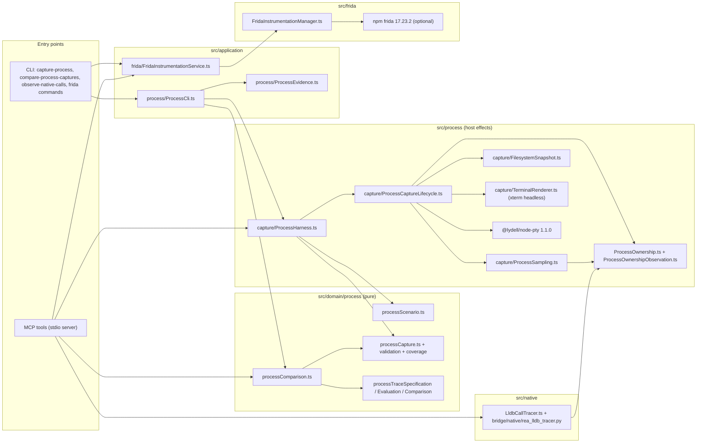
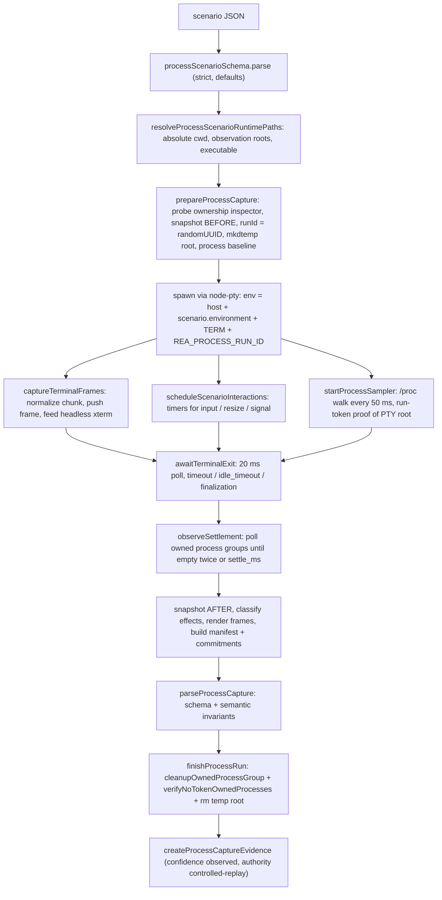
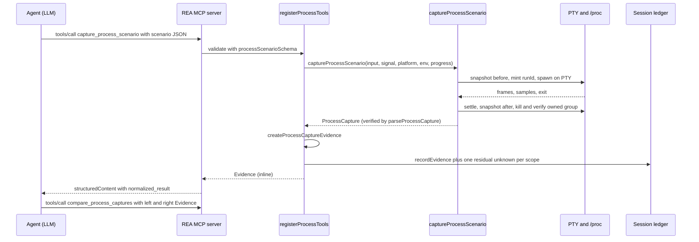
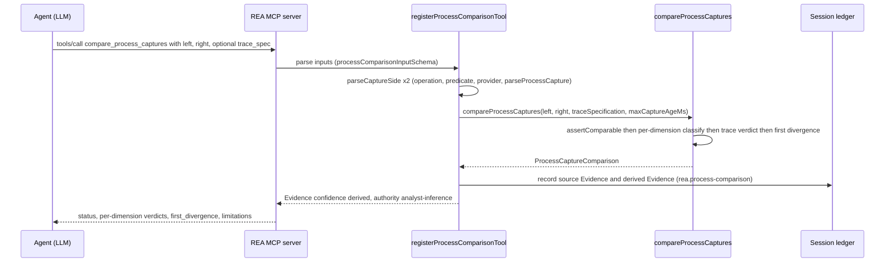

# 18. Process capture, native call tracing and Frida instrumentation

> Scope: the subsystems that **run** a target (or attach to a running one) and record what it did.
> Source checkout: `github.com/morluto/rea` at HEAD `f75b1a4`, `rea-agents` 6.4.0. Paths are repo-relative.
> Every flow is marked **RUN** (executed in this lab, on benign demo samples) or **DOC** (read from code and docs, not executed).
> Related chapters: [10-evidence-model-ledger-unknowns-bundles.md](10-evidence-model-ledger-unknowns-bundles.md), [11-comparison-snapshots-analysis-view-reconstruction.md](11-comparison-snapshots-analysis-view-reconstruction.md), [21-security-model.md](21-security-model.md), [23-defensive-malware-analysis-playbook.md](23-defensive-malware-analysis-playbook.md), [24-porting-blueprints.md](24-porting-blueprints.md), [19-android-mobile.md](19-android-mobile.md).

**Safety headline for a malware team.** Everything in this chapter executes foreign code with the **current user's permissions on the REA host**. REA's own wording is: "The target runs with the current user's permissions; this is not a security sandbox" (`src/contracts/sessionToolContracts.ts:97`). Section 7 lists exactly what is *not* isolated. Use a disposable VM/container (as this lab does) for any real sample.

---

## 1. Inventory and status

| Subsystem | Tools / commands | Code | Executes target? | Lab status |
|---|---|---|---|---|
| Process Capture | MCP `capture_process_scenario`, CLI `capture-process` | `src/process/capture/*`, `src/application/process/*`, `src/domain/process/*` | **Yes** (PTY child) | **RUN** (Linux x64) |
| Capture comparison | MCP `compare_process_captures`, CLI `compare-process-captures` | `src/domain/process/processComparison.ts`, `processTrace*.ts` | No | **RUN** |
| Owned-process machinery | (internal; used by capture and by providers) | `src/process/ProcessOwnership*.ts`, `ProviderProcess.ts`, `OwnedCommand.ts` | n/a | **RUN** indirectly (cleanup of a `setsid` descendant) |
| Native call tracer | MCP `observe_native_calls`, CLI `observe-native-calls` | `src/native/LldbCallTracer.ts`, `NativeCallObservation.ts`, `bridge/native/rea_lldb_tracer.py` | **Yes** (Mach-O under LLDB) | **DOC** (macOS only). Refusal on Linux: **RUN** |
| Frida | 9 MCP tools, 4 CLI commands | `src/frida/*`, `src/application/frida/*`, `src/contracts/fridaToolContracts.ts` | **Yes** (injects JS into target) | **RUN** (Frida 17.23.2, local device, Linux) |

Differences from the older house-rules description are noted in section 9.

### 1.1 Component and dependency diagram



*Figure 1. Dependency map. The domain layer (`src/domain/process`) is pure TypeScript over zod and `canonicalize`; every host effect (PTY, `/proc`, `ps`, filesystem walks, signals) is in `src/process`. Frida and the LLDB tracer are separate execution lanes that share only the Evidence model and, for LLDB, the owned-process supervisor.*

Reading the diagram: the capture workflow is `ProcessCli`/MCP registrar -> `captureProcessScenario` (`ProcessHarness.ts`) -> lifecycle helpers that own the PTY, the headless terminal renderer, the 50 ms process sampler and the before/after filesystem snapshots. The result is validated by the domain schema (`parseProcessCapture`) and wrapped into Evidence by `createProcessCaptureEvidence`. Comparison never touches the host: it takes two Evidence records and calls the pure `compareProcessCaptures`.

---

## 2. Process Capture

### 2.1 What it is

`docs/process-capture.md` states the contract: "Process Capture runs one caller-selected command and records bounded evidence about its terminal behavior, scheduled interactions, process lifetime, and selected filesystem state... It does not replay a previous execution or emulate dependencies." and "The command runs with the current user's permissions and inherits the host environment before applying the scenario's explicit overrides. This is not a sandbox. Filesystem observation paths select what REA snapshots; they do not restrict what the process can read or write." (`docs/process-capture.md:1-14`).

Host support (`docs/process-capture.md:15-39`, `src/process/capture/ProcessCaptureCapability.ts:13-18`): Linux and macOS with a working native PTY; **native Windows capture is refused** because "this adapter does not yet verify descendant cleanup". macOS additionally needs `xcrun swiftc` to compile a small run-token reader (`src/process/DarwinProcessRunTokenReader.ts`). Linux needs a procps-compatible `ps` on `PATH` (`src/process/ProcessOwnershipObservation.ts:376`).

### 2.2 The scenario contract (input)

`processScenarioSchema` is also the MCP input schema of `capture_process_scenario` (`src/contracts/sessionToolContracts.ts:96-99`). Verbatim:

`src/domain/process/processScenario.ts:151-247`

```ts
export const processScenarioSchema = z
  .strictObject({
    executable: childProcessString.min(1),
    arguments: z.array(childProcessString).default([]),
    working_directory: childProcessString.default("."),
    environment: z.record(environmentName, childProcessString).default({}),
    filesystem_observation_paths: z
      .array(childProcessString.min(1))
      .default([]),
    terminal: z
      .strictObject({
        columns: z.number().int().min(1).max(65_535).default(80),
        rows: z.number().int().min(1).max(65_535).default(24),
        scrollback: z.number().int().safe().nonnegative().default(1_000),
      })
      .describe(
        "The visible terminal and scrollback together must use at most 1,000,000 xterm renderer cells: columns × (rows + scrollback). Resize events use the same scrollback and limit.",
      )
      .default({ columns: 80, rows: 24, scrollback: 1_000 }),
    events: z
      .array(
        z.discriminatedUnion("type", [
          z.strictObject({
            ...timedEventBase,
            type: z.literal("input"),
            data: z.string(),
            sensitive: z.boolean().default(false),
          }),
          z.strictObject({
            ...timedEventBase,
            type: z.literal("resize"),
            columns: z.number().int().min(1).max(65_535),
            rows: z.number().int().min(1).max(65_535),
          }),
          z.strictObject({
            ...timedEventBase,
            type: z.literal("signal"),
            signal: z.enum(["SIGINT", "SIGTERM", "SIGKILL"]),
          }),
        ]),
      )
      .default([]),
    timeout_ms: positiveBudget.default(30_000),
    idle_timeout_ms: positiveBudget.default(30_000),
    settle_ms: z.number().int().safe().nonnegative().default(100),
    finalization_ms: z
      .number()
      .int()
      .safe()
      .nonnegative()
      .default(0)
      .describe(
        "Milliseconds a target may keep running after SIGTERM when timeout_ms or idle_timeout_ms fires, before SIGKILL; 0 sends SIGKILL immediately. Both signals reach the captured root only while its launch-time start identity still matches; cancellation ends the run at once.",
      ),
    limits: z
      .strictObject({
        output_bytes: positiveBudget.default(1_000_000),
        files: positiveBudget.default(10_000),
        file_bytes: positiveBudget.default(10_000_000),
        processes: positiveBudget.default(1_000),
        filesystem_depth: z.number().int().safe().nonnegative().default(16),
      })
      .strict()
      .default({
        output_bytes: 1_000_000,
        files: 10_000,
        file_bytes: 10_000_000,
        processes: 1_000,
        filesystem_depth: 16,
      }),
    normalization: z
      .strictObject({
        paths: z.boolean().default(false),
        pids: z.boolean().default(true),
        ports: z.boolean().default(true),
        time_bucket_ms: positiveBudget.default(10),
        patterns: z
          .array(
            z.strictObject({
              pattern: z
                .string()
                .describe(
                  "Literal text to replace in captured output; not a regular expression.",
                ),
              replacement: z.string(),
            }),
          )
          .default([]),
      })
      .default({
        paths: false,
        pids: true,
        ports: true,
        time_bucket_ms: 10,
        patterns: [],
      }),
  })
```

Cross-field rules (`superRefine`) — verbatim:

`src/domain/process/processScenario.ts:248-306`

```ts
  .superRefine((scenario, context) => {
    // Each budget is a safe integer, but their sum is not checked anywhere
    // else. BigInt keeps the comparison exact beyond the representable range.
    const lifecycleBudget =
      BigInt(scenario.timeout_ms) +
      BigInt(scenario.finalization_ms) +
      BigInt(scenario.settle_ms);
    if (lifecycleBudget > BigInt(Number.MAX_SAFE_INTEGER))
      context.addIssue({
        code: "custom",
        message: `timeout_ms + finalization_ms + settle_ms must stay at or below ${String(Number.MAX_SAFE_INTEGER)} ms, the largest total exactly representable as a JavaScript number`,
        path: ["timeout_ms"],
      });
    if (
      !fitsProcessTerminalCellBudget(
        scenario.terminal.columns,
        scenario.terminal.rows,
        scenario.terminal.scrollback,
      )
    )
      context.addIssue({
        code: "custom",
        path: ["terminal"],
        message: `terminal columns × (rows + scrollback) must not exceed ${String(PROCESS_TERMINAL_CELL_BUDGET)} renderer cells`,
      });
    for (let index = 1; index < scenario.events.length; index += 1) {
      const event = scenario.events[index];
      const previous = scenario.events[index - 1];
      if (eventsOutOfOrder(event, previous)) {
        context.addIssue({
          code: "custom",
          message: "events must be ordered by at_ms",
          path: ["events", index],
        });
      }
    }
    for (const [index, event] of scenario.events.entries()) {
      if (
        event.type === "resize" &&
        !fitsProcessTerminalCellBudget(
          event.columns,
          event.rows,
          scenario.terminal.scrollback,
        )
      )
        context.addIssue({
          code: "custom",
          path: ["events", index],
          message: `resize event at ${String(event.at_ms)} ms exceeds the ${String(PROCESS_TERMINAL_CELL_BUDGET)}-cell renderer budget with the selected scrollback`,
        });
      if (event.at_ms > scenario.timeout_ms) {
        context.addIssue({
          code: "custom",
          message: "event occurs after the scenario timeout",
          path: ["events"],
        });
      }
    }
  });
```

The normalization sub-schema and the reserved environment name:

`src/domain/process/processScenario.ts:62-73`

```ts
export const normalizationSchema = z.object({
  paths: z.boolean(),
  pids: z.boolean(),
  ports: z.boolean(),
  time_bucket_ms: positiveBudget,
  patterns: z.array(
    z.object({
      pattern: z.string(),
      replacement: z.string(),
    }),
  ),
});
```

`REA_PROCESS_RUN_ID` is rejected as an environment key by a regex built without look-around (`processScenario.ts:17-47`) because "RE2 and Rust schema validators reject look-around and would refuse every tool in the advertised catalog" (comment at `processScenario.ts:20-25`) — i.e. the MCP catalog is meant to be consumable by non-JS schema validators.

#### Limits and defaults (consolidated)

| Field | Default | Meaning / enforcement | Source |
|---|---|---|---|
| `limits.output_bytes` | 1,000,000 | Budget for retained raw PTY chunks **and** (separately) normalized text **and** rendered frames; whole chunks are kept or dropped | `processScenario.ts:207`, `ProcessCaptureLifecycle.ts:1305-1360` |
| `limits.files` | 10,000 | Max filesystem entries enumerated per checkpoint | `processScenario.ts:208`, `FilesystemSnapshot.ts:183+` |
| `limits.file_bytes` | 10,000,000 | Whole-file **hashing** budget per checkpoint (fresh at each checkpoint; not per-file) | `processScenario.ts:209`, docs |
| `limits.processes` | 1,000 | Max retained process samples | `ProcessSampling.ts:453-560` |
| `limits.filesystem_depth` | 16 | Directory depth | `processScenario.ts:211` |
| `terminal` | 80 x 24, scrollback 1000 | `columns x (rows + scrollback) <= 1,000,000` (xterm cells) | `processScenario.ts:15`, `:261-272` |
| `timeout_ms` / `idle_timeout_ms` | 30,000 / 30,000 | Wall deadline / no-output deadline; checked every 20 ms | `processScenario.ts:193-194`, `ProcessCaptureLifecycle.ts:961-990` |
| `settle_ms` | 100 | Post-exit window for the sampled process group to quiesce | `ProcessCaptureLifecycle.ts:660-730` |
| `finalization_ms` | 0 | 0: SIGKILL at the deadline; >0: SIGTERM, keep observing, SIGKILL once | `processScenario.ts:196-204` |
| `normalization.time_bucket_ms` | 10 | Floor-bucket for **selected** timestamps (see 3.3) | `ProcessNormalization.ts:166-169` |
| sampler period | 50 ms | `setInterval(sample, 50)`; one in-flight sample at a time | `ProcessSampling.ts:539` |
| cleanup verification grace | 1000 ms | Wait for signal-delivery results / token-owned processes to disappear | `ProcessCaptureLifecycle.ts:1004-1005` |
| progress interval | 100 ms | Min spacing of stderr `rea_progress` lines (CLI) | `ProcessCli.ts:67-72` |

### 2.3 Capture pipeline



*Figure 2. Capture pipeline (RUN). Steps B to N map to `ProcessHarness.ts:626-831` (`runProcessScenario`) and `ProcessHarness.ts:833-913` (`captureProcessScenario`).*

Walkthrough with anchors:

1. **Capability gate.** `captureProcessScenario` first calls `processCaptureOwnershipUnavailableReason(platform)` and returns a typed `AnalysisCapabilityUnavailableError` on Windows (`ProcessHarness.ts:833-856`).
2. **Path resolution.** `resolveProcessScenarioRuntimePaths` (`src/process/capture/ProcessScenarioRuntimeValidation.ts`) makes the working directory, executable and observation paths absolute before anything runs. A bare command name resolves "through the inherited PATH" (tool description, `sessionToolContracts.ts:97`).
3. **Prepare.** `prepareProcessCapture` (`ProcessCaptureLifecycle.ts:1521-1574`): prepare the ownership inspector, take the **before** filesystem snapshot, mint `runId = randomUUID()` (`:1537`), create a private temp root and record a **process baseline** (PID + start identity of every live process) so later sweeps can tell pre-existing processes from new ones.
4. **Spawn.** `spawn(scenario.executable, [...scenario.arguments], {cwd, env, cols, rows, name: "xterm-256color"})` from `@lydell/node-pty` (`ProcessHarness.ts:288-294`). There is no shell: `arguments` go to `execvp` as an argv array.
5. **Streams.** `captureTerminalFrames` (`ProcessCaptureLifecycle.ts:1305-1360`) normalizes each PTY chunk (bounded), drops whole chunks that exceed the remaining `output_bytes`, stamps `at_ms` with `normalizeProcessElapsedTime(monotonic - started, time_bucket_ms)` and writes the *original* chunk into the headless terminal.
6. **Interactions.** `scheduleScenarioInteractions` (`ProcessCaptureJournal.ts:50-110`) arms one timer per scenario event; `input` is written to the PTY, `resize` calls `terminal.resize` plus `renderer.resize`, `signal` calls `terminal.kill(signal)`. The record keeps `scheduled_at_ms`, the **raw** `dispatched_at_ms`, and an outcome (`dispatched` / `target_exited` / `failed`). Sensitive input is stored as `<redacted-input:N-bytes>`.
7. **Deadline loop.** `awaitTerminalExit` (`ProcessCaptureLifecycle.ts:750-990`) polls every 20 ms: cancellation -> immediate SIGKILL; `timeout_ms` -> `reason="timeout"`; `idle_timeout_ms` -> `reason="idle_timeout"`; with `finalization_ms>0` SIGTERM goes through the identity-checked signaller first (section 2.6).
8. **Settlement.** `observeSettlement` (`:660-730`) repeatedly lists owned process groups until two consecutive empty observations (`quiesced`), `settle_ms` passes with live members (`alive_at_deadline`) or liveness cannot be established (`unverifiable`).
9. **After-snapshot and result.** `completeCapture` (`ProcessHarness.ts:457-604`) takes the second snapshot, renders frames, builds the manifest (scenario commitments, executable digest) and `buildCaptureResult` (`ProcessCaptureLifecycle.ts:287-400`) assembles the capture and its `limitations` / `residual_unknowns`.
10. **Cleanup.** `finishProcessRun` (`ProcessHarness.ts:363-455`) runs `releaseProcessResources` (`ProcessCaptureLifecycle.ts:1206`): kill the owned groups, verify no token-owned process survives, dispose renderer, remove the temp root. Failures become a typed `ProcessCaptureError` with `partial observations` instead of a capture.

### 2.4 The Evidence shape (output)

The capture is wrapped by `createProcessCaptureEvidence` (verbatim):

`src/application/process/ProcessEvidence.ts:10-45`

```ts
/** Project one process scenario into secret-free Evidence parameters. */
const processEvidenceParameters = (
  scenario: ProcessScenario,
  platform: ProcessCapture["manifest"]["platform"],
): Readonly<Record<string, JsonValue>> => ({
  executable_name: (platform === "win32" ? win32 : posix).basename(
    scenario.executable,
  ),
  argument_count: scenario.arguments.length,
  event_count: scenario.events.length,
  filesystem_observation_path_count:
    scenario.filesystem_observation_paths.length,
  normalization: scenario.normalization,
});

/** Create one canonical observed process capture Evidence record. */
export const createProcessCaptureEvidence = (
  scenario: ProcessScenario,
  capture: ProcessCapture,
) => {
  return createEvidence(undefined, PROCESS_PROVIDER, {
    predicateType: "rea.process-capture",
    operation: "capture_process_scenario",
    parameters: processEvidenceParameters(scenario, capture.manifest.platform),
    result: jsonValueSchema.parse(capture),
    confidence: "observed",
    authority: "controlled-replay",
    environment: {
      id: `${capture.manifest.platform}-${capture.manifest.architecture}`,
      platform: capture.manifest.platform,
      architecture: capture.manifest.architecture,
      isolation: "process",
    },
    limitations: capture.limitations,
  });
};
```

Provider identity:

`src/domain/process/processEvidenceProvider.ts:1-17`

```ts
import type { EvidenceProvider } from "../evidence.js";

/** Canonical provider identity for controlled process capture Evidence. */
export const PROCESS_PROVIDER = {
  id: "rea-process",
  name: "REA process capture",
  version: "3",
} as const;

/** Admit current and previously emitted names for the same v3 process provider. */
export const isProcessEvidenceProvider = (
  provider: EvidenceProvider,
): boolean =>
  provider.id === PROCESS_PROVIDER.id &&
  provider.version === PROCESS_PROVIDER.version &&
  (provider.name === PROCESS_PROVIDER.name ||
    provider.name === "REA deterministic process harness");
```

Note `environment.isolation: "process"` is an **Evidence label, not a sandbox claim**; nothing in the capture code creates a namespace, container or VM (section 7).

The capture itself (`UnverifiedProcessCapture`), verbatim from the domain:

`src/domain/process/processCapture.ts:195-266`

```ts
/**
 * Process capture observation set.
 *
 * `truncated` and `residual_unknowns` are semantic evidence: consumers must not
 * infer equivalence from matching bounded observations when either is present.
 */
export interface UnverifiedProcessCapture {
  readonly manifest: {
    readonly rea_version: string;
    readonly provider_version: string;
    readonly platform: string;
    readonly architecture: string;
    readonly pty_backend: "node-pty";
    readonly started_at: string;
    readonly completed_at: string;
    readonly scenario: Readonly<Record<string, unknown>>;
    readonly comparison_contract: Readonly<Record<string, unknown>>;
    readonly full_scenario_sha256: string;
    readonly comparison_contract_sha256: string;
    /** Digest of the selected file sampled before spawn, when readable. */
    readonly selected_executable_sha256: string | null;
    /** Digest associated with the launch only when path metadata stayed stable across spawn. */
    readonly executable_sha256: string | null;
    readonly executable_identity: {
      readonly state: "path_metadata_unchanged" | "unknown";
      readonly reason: string | null;
    };
    readonly normalization_sha256: string;
  };
  readonly normalization: z.infer<typeof normalizationSchema>;
  readonly frames: readonly TerminalFrame[];
  readonly rendered_frames: readonly RenderedTerminalFrame[];
  readonly interaction_events: readonly InteractionEvent[];
  readonly exit: {
    readonly code: number | null;
    readonly signal: number | null;
    readonly reason: "exited" | "timeout" | "idle_timeout";
    readonly finalization?: ProcessCaptureFinalization | undefined;
  };
  readonly settlement: VerifiedProcessSettlement;
  readonly process_samples: readonly ProcessSample[];
  readonly filesystem_checkpoints: readonly FilesystemCheckpoint[];
  /** Global observation order across independently recorded collections. */
  readonly event_journal: readonly ProcessCaptureEventJournalEntry[];
  readonly files_before: readonly FileState[];
  readonly files_after: readonly FileState[];
  readonly filesystem_effects: readonly FileEffect[];
  readonly truncated: boolean;
  /** Per-source accounting for the producer's actual capture coverage. */
  readonly truncation_details: ProcessCaptureTruncationDetails;
  readonly limitations: readonly string[];
  readonly residual_unknowns: readonly {
    readonly scope:
      | "terminal"
      | "interaction"
      | "exit"
      | "process"
      | "filesystem"
      | "cleanup"
      | "network"
      | "environment";
    readonly reason: string;
  }[];
  readonly cleanup: {
    readonly owned_process_group: "verified";
    readonly temporary_root: "removed";
    /** Unrelated processes whose ownership token the host could not expose. */
    readonly unverified_processes?:
      | readonly UnverifiedCleanupProcess[]
      | undefined;
  };
}
```

Supporting record types (frames, rendered frames, interaction events, finalization, file states, samples, checkpoints):

`src/domain/process/processCapture.ts:18-63`

```ts
/** Normalized raw PTY chunk, preserving transport-level output differences. */
export interface TerminalFrame {
  readonly sequence: number;
  readonly at_ms: number;
  readonly data: string;
  /** Original PTY text when normalization changed it; older captures may omit it. */
  readonly raw_data?: string | undefined;
}

/** Serialized terminal state after interpreting control and resize sequences. */
export interface RenderedTerminalFrame {
  readonly sequence: number;
  readonly at_ms: number;
  readonly columns: number;
  readonly rows: number;
  readonly cursor_x: number;
  readonly cursor_y: number;
  readonly active_buffer: "normal" | "alternate";
  readonly lines: readonly string[];
  readonly serialized_state: string;
}

/** Scheduled terminal interaction with its observed dispatch outcome. */
export interface InteractionEvent {
  readonly sequence: number;
  readonly scheduled_at_ms: number;
  readonly dispatched_at_ms: number;
  readonly type: "input" | "resize" | "signal";
  readonly data: string;
  readonly outcome: "dispatched" | "target_exited" | "failed";
}

/** Observed finalization attempts after a deadline fired. */
export interface ProcessCaptureFinalization {
  readonly requested_ms: number;
  readonly elapsed_ms: number | null;
  /** Code the PTY reported for an exit not caused by a signal; otherwise null. */
  readonly exit_code: number | null;
  readonly signals: readonly {
    readonly signal: "SIGTERM" | "SIGKILL";
    readonly sent_at_ms: number;
    readonly delivery: "signaled" | "gone" | "identity-changed" | "unverified";
    /** Why delivery could not be verified; present only for unverified attempts. */
    readonly reason?: string | undefined;
  }[];
}
```

`src/domain/process/processCapture.ts:129-193`

```ts
/** A sampled owned-process observation; sampling cannot prove syscall completeness. */
export interface ProcessSample {
  readonly at_ms: number;
  readonly pid: number;
  readonly parent_pid: number;
  readonly command: string;
  readonly process_group_id: number | null;
  readonly session_id: number | null;
}

/** Initial or final filesystem snapshot selected for observation. */
export interface FilesystemCheckpoint {
  readonly name: string;
  readonly at_ms: number;
  readonly files: readonly FileState[];
  readonly effects: readonly FileEffect[];
  readonly truncated: boolean;
}

/** Capture collection whose members participate in global observation order. */
export const PROCESS_CAPTURE_EVENT_COLLECTIONS = [
  "frames",
  "rendered_frames",
  "interaction_events",
  "lifecycle",
  "process_samples",
  "filesystem_checkpoints",
] as const;

export type ProcessCaptureEventCollection =
  (typeof PROCESS_CAPTURE_EVENT_COLLECTIONS)[number];

/** One reference from global observation order into a capture collection. */
export interface ProcessCaptureEventJournalEntry {
  readonly capture_order: number;
  readonly collection: ProcessCaptureEventCollection;
  readonly index: number;
}

/** Shared observation callback used by every process-capture producer. */
export type RecordProcessCaptureEvent = (
  collection: ProcessCaptureEventCollection,
  index: number,
) => void;

/** Observed process-tree settlement and the cleanup required by that state. */
export type ProcessSettlement =
  | VerifiedProcessSettlement
  | {
      readonly state: "quiesced";
      readonly elapsed_ms: number;
      readonly cleanup_outcome: "failed";
    };

export type VerifiedProcessSettlement =
  | {
      readonly state: "quiesced";
      readonly elapsed_ms: number;
      readonly cleanup_outcome: "not_required";
    }
  | {
      readonly state: "alive_at_deadline" | "unverifiable";
      readonly elapsed_ms: number;
      readonly cleanup_outcome: "cleaned" | "failed";
    };
```

The serialized shape is enforced by `processCaptureShapeSchema` (strict objects, hex digests, ISO timestamps) and `processCaptureSchema` adds invariants through `collectProcessCaptureIssues` (`src/domain/process/processCaptureValidation.ts`, 416 lines: finalization consistency, journal consistency, effect/file agreement, settlement vs. cleanup). The top of the wire schema:

`src/domain/process/processCapture.ts:451-480`

```ts
const processCaptureShapeSchema = z.strictObject({
  manifest: z.strictObject({
    rea_version: z.string().min(1),
    provider_version: z.string().min(1),
    platform: z.string().min(1),
    architecture: z.string().min(1),
    pty_backend: z.literal("node-pty"),
    started_at: z.iso.datetime(),
    completed_at: z.iso.datetime(),
    scenario: z.record(z.string(), jsonValueSchema),
    comparison_contract: z.record(z.string(), jsonValueSchema),
    full_scenario_sha256: z.string().regex(/^[a-f0-9]{64}$/u),
    comparison_contract_sha256: z.string().regex(/^[a-f0-9]{64}$/u),
    selected_executable_sha256: z
      .string()
      .regex(/^[a-f0-9]{64}$/u)
      .nullable(),
    executable_sha256: z
      .string()
      .regex(/^[a-f0-9]{64}$/u)
      .nullable(),
    executable_identity: z.strictObject({
      state: z.enum(["path_metadata_unchanged", "unknown"]),
      reason: z.string().nullable(),
    }),
    normalization_sha256: z.string().regex(/^[a-f0-9]{64}$/u),
  }),
  normalization: normalizationSchema,
  frames: z.array(
    z.object({
```

and the capture-level validator:

`src/domain/process/processCapture.ts:804-818`

```ts
export const processCaptureSchema = processCaptureShapeSchema
  .superRefine((capture, context) => {
    if (capture.settlement.cleanup_outcome === "failed")
      context.addIssue({
        code: "custom",
        path: ["settlement", "cleanup_outcome"],
        message: "verified captures cannot contain failed cleanup",
      });
    for (const issue of collectProcessCaptureIssues(capture))
      context.addIssue({
        code: "custom",
        path: issue.path.split("."),
        message: issue.message,
      });
  })
```

The truncation accounting that makes "incomplete" first-class (verbatim):

`src/domain/process/processCaptureCoverage.ts:15-105`

```ts
export const filesystemCoverageSchema = z.strictObject({
  files_limit: z.number().int().nonnegative(),
  depth_limit: z.number().int().nonnegative(),
  enumeration_truncated: z.boolean(),
  enumeration_reasons: z.array(
    z.enum([
      "files_limit",
      "depth_limit",
      "identity_changed",
      "directory_unavailable",
    ]),
  ),
  enumeration_omissions: z.array(
    z.strictObject({
      path: z.string(),
      reason: z.literal("directory_unavailable"),
      system_code: z.string().nullable(),
    }),
  ),
  hash_budget_bytes: z.number().int().nonnegative(),
  hashed_bytes: z.number().int().nonnegative(),
  hash_omissions: z.array(
    z.strictObject({
      path: z.string(),
      size_bytes: z.number().int().nonnegative(),
      remaining_budget_bytes: z.number().int().nonnegative(),
      reason: z.enum([
        "file_bytes_budget",
        "file_changed_or_short_read",
        "file_unavailable",
      ]),
      system_code: z.string().nullable(),
    }),
  ),
});
export type FilesystemCoverage = z.infer<typeof filesystemCoverageSchema>;

/** Actual budget accounting; rendered bytes count state and visible lines, not JSON. */
export const processCaptureTruncationDetailsSchema = z.strictObject({
  raw_terminal: byteRetentionSchema.describe(
    "UTF-8 bytes of original PTY chunks; whole chunks are retained or omitted.",
  ),
  rendered_terminal: byteRetentionSchema.describe(
    "Cumulative UTF-8 bytes of serialized state plus visible lines, evaluated from retained PTY input; whole frames are retained or omitted. When normalization exceeds a bound before the frame size is known, observed_bytes contains the exact total for size-known frames and unknown_size_frames counts the other omissions.",
  ),
  normalized_terminal: z
    .strictObject({
      budget_bytes: z.number().int().nonnegative(),
      retained_bytes: z.number().int().nonnegative(),
      omitted_frames: z.number().int().nonnegative(),
    })
    .optional()
    .describe(
      "UTF-8 bytes of normalized raw-chunk text retained under output_bytes; omitted frames can have unknown final size when normalization exceeded an intermediate bound.",
    ),
  filesystem_before: filesystemCoverageSchema,
  filesystem_after: filesystemCoverageSchema,
  process: z.strictObject({
    sample_limit: z.number().int().nonnegative(),
    sampling_partial: z.boolean(),
    retained_samples: z.number().int().nonnegative(),
    sample_limit_reached: z.boolean(),
    sampling_failures: z.number().int().nonnegative(),
    first_sampling_failure: z.string().nullable(),
    coverage: z.literal("sampled"),
  }),
});
export type ProcessCaptureTruncationDetails = z.infer<
  typeof processCaptureTruncationDetailsSchema
>;
export type TerminalRetention = ProcessCaptureTruncationDetails["raw_terminal"];
export type NormalizedTerminalRetention = NonNullable<
  ProcessCaptureTruncationDetails["normalized_terminal"]
>;
export type ProcessSamplingCoverage =
  ProcessCaptureTruncationDetails["process"];

const omitted = (retention: TerminalRetention): boolean =>
  retention.observed_frames > retention.retained_frames;
const filesystemTruncated = (coverage: FilesystemCoverage): boolean =>
  coverage.enumeration_truncated ||
  coverage.enumeration_omissions.length > 0 ||
  coverage.hash_omissions.length > 0;

/** Derive the aggregate truncation flag from independent producer observations. */
export const hasCaptureTruncation = (
  details: ProcessCaptureTruncationDetails,
): boolean =>
  omitted(details.raw_terminal) ||
  omitted(details.rendered_terminal) ||
  (details.normalized_terminal?.omitted_frames ?? 0) > 0 ||
```

How truncation maps onto comparison sources (verbatim):

`src/domain/process/processCaptureCoverage.ts:107-135`

```ts
  filesystemTruncated(details.filesystem_before) ||
  filesystemTruncated(details.filesystem_after) ||
  details.process.sampling_partial;

/** Whether producer accounting reports a gap in the selected observation source. */
export const processSourceTruncated = (
  capture: UnverifiedProcessCapture,
  source: ProcessObservationSource,
): boolean => {
  const details = capture.truncation_details;
  switch (source) {
    case "terminal_raw":
      return omitted(details.raw_terminal);
    case "terminal_rendered":
      return (
        omitted(details.raw_terminal) || omitted(details.rendered_terminal)
      );
    case "filesystem":
      return (
        filesystemTruncated(details.filesystem_before) ||
        filesystemTruncated(details.filesystem_after)
      );
    case "process":
      return details.process.sampling_partial;
    case "interaction":
    case "lifecycle":
      return false;
  }
};
```

**Residual unknowns are always present.** `buildCaptureResult` unconditionally emits four residual unknowns (process sampling, executable-image binding, inherited environment, network) plus conditional filesystem/interaction/terminal ones (`ProcessCaptureLifecycle.ts:361-400`):

`src/process/capture/ProcessCaptureLifecycle.ts:361-380`

```ts
    residual_unknowns: [
      {
        scope: "process",
        reason:
          "Process trees are sampled and may omit short-lived descendants.",
      },
      {
        scope: "process",
        reason:
          "The executable digest is a prelaunch file sample; operating-system image binding is not atomically observed.",
      },
      {
        scope: "environment",
        reason: "Inherited host environment variables are not recorded.",
      },
      {
        scope: "network",
        reason: "Network activity is not observed by this capture.",
      },
      ...(!hasFilesystemObservations
```

This has a large downstream effect on comparison (section 3.5).

#### Example (RUN): the real capture of `samples/vuln/hard`

Scenario (`samples/out/cap-ok.json` in the lab scratchpad):

```json
{"executable":".../samples/vuln/hard","arguments":["hello"],"working_directory":".../samples/core","timeout_ms":10000,"filesystem_observation_paths":[".../samples/core"]}
```

Command: `node scripts/rea.mjs capture-process cap-ok.json --json > capture-ok.json` (stderr = progress lines). Abridged result (`capture-ok.json`, `.normalized_result`):

```json
{
  "manifest": { "rea_version": "6.4.0", "provider_version": "3", "platform": "linux", "architecture": "x64",
    "pty_backend": "node-pty",
    "full_scenario_sha256": "47134bb4...fc8", "comparison_contract_sha256": "07987001...e41",
    "executable_sha256": "79fbb363...e2c", "executable_identity": {"state": "path_metadata_unchanged", "reason": null},
    "normalization_sha256": "5c58aa1a...a87" },
  "frames": [{"sequence": 0, "at_ms": 20, "data": "hello hello\r\n"}],
  "rendered_frames": [{"sequence": 0, "at_ms": 20, "columns": 80, "rows": 24, "cursor_x": 0, "cursor_y": 1,
                       "active_buffer": "normal", "lines": ["hello hello", "", "..."], "serialized_state": "hello hello\u001b[1B\u001b[11D"}],
  "exit": {"code": 0, "signal": 0, "reason": "exited"},
  "settlement": {"state": "quiesced", "elapsed_ms": 79, "cleanup_outcome": "not_required"},
  "process_samples": [],
  "filesystem_checkpoints": [{"name": "before", "at_ms": 0, "...": "..."}, {"name": "after_settlement", "at_ms": 143, "...": "..."}],
  "event_journal": [{"capture_order":0,"collection":"filesystem_checkpoints","index":0}, {"capture_order":1,"collection":"frames","index":0}, "..."],
  "truncated": false,
  "cleanup": {"owned_process_group": "verified", "temporary_root": "removed"}
}
```

stderr progress (same run, `capture-ok.err`): `prepare` -> `running (elapsed_ms=334)` -> terminal `cleanup ... disposition=exited owned_process_group=cleaned terminal_renderer=cleaned temporary_root=cleaned`. `process_samples` is empty because the program lived about 10 ms, shorter than the first 50 ms sampler tick (INFERRED from the 79 ms settle and the empty array).

The `weak` sample with a 200-byte argument (`cap-crash.json`) produced the same shape with the unbounded `strcpy` output `hello AAAA...`; see [28-vulnerability-research-with-rea.md](28-vulnerability-research-with-rea.md).

### 2.5 Normalization (what "the same behavior" means)

Normalization is applied **at capture time** to retained text, so the committed `normalization_sha256` and the retained `data` already reflect it (`ProcessNormalization.ts`). Order of stages in `createBoundedProcessTextNormalizer` (`:204-280`): paths, then ports, then pids, then literal `patterns`. Each stage is bounded: if a stage would exceed the remaining `output_bytes` the frame is omitted whole and counted as `normalized_terminal.omitted_frames`.

| Rule | Default | Behavior | Source |
|---|---|---|---|
| `paths` | false | Replace the temp root, working directory, executable and each observation root by aliases `<temporary-root>`, `<working-directory>`, `<executable>`, `<filesystem-root-N>`; longest original path wins | `ProcessNormalization.ts:290-330` |
| `ports` | true | Contextual endpoint ports -> `<port>`: URL authorities, IP/`localhost` endpoints, fields named `port`, `tcp_port`, `udp_port`, `listen`; sentence-final period handled; per-chunk (a port whose period ends the chunk is left alone) | `ProcessNormalization.ts:332-380`, `docs/process-capture.md` |
| `pids` | true | The root PID (and, for samples, every PID) -> `<pid>` / dense renumbering (root = 1) | `ProcessNormalization.ts:191-200, 382-433` |
| `patterns` | [] | **Literal** replace-all; `$&` etc. are not special | `ProcessNormalization.ts:258-270` |
| `time_bucket_ms` | 10 | `floor(elapsed/bucket)*bucket` for terminal frame / resize / process-sample timestamps **only** | `ProcessNormalization.ts:166-169` |

Verbatim: normalization-versions are written into the comparison contract so semantics cannot silently drift:

`src/domain/process/processScenario.ts:98-145`

```ts
/** Build the caller-selected scenario projection committed by process-capture Evidence. */
export const processScenarioCommitment = (
  scenario: ProcessScenario,
  executableSha256?: string,
): Readonly<Record<string, unknown>> => {
  // A zero interval is today's immediate kill; leaving it out keeps the
  // committed identity of every scenario that predates the field unchanged.
  const { finalization_ms: finalizationMs, ...committed } = scenario;
  return {
    ...committed,
    ...(finalizationMs > 0 ? { finalization_ms: finalizationMs } : {}),
    events: committedScenarioEvents(scenario.events, true),
    executable_sha256: executableSha256 ?? null,
  };
};

/** Project observation settings shared by capture and reconstruction. */
export const processComparisonContract = (
  scenario: ProcessScenario,
): Readonly<Record<string, unknown>> => ({
  working_directory: scenario.working_directory,
  environment: scenario.environment,
  ambient_environment: "unknown",
  filesystem_observation_paths: scenario.filesystem_observation_paths,
  terminal: scenario.terminal,
  // Input bytes are intentionally absent from compatibility identity. Their
  // redacted observations remain unknown, so equal commitments never imply
  // that two secret values were the same.
  events: committedScenarioEvents(scenario.events, false),
  timeout_ms: scenario.timeout_ms,
  idle_timeout_ms: scenario.idle_timeout_ms,
  settle_ms: scenario.settle_ms,
  ...(scenario.finalization_ms > 0
    ? { finalization_ms: scenario.finalization_ms }
    : {}),
  limits: scenario.limits,
  normalization: scenario.normalization,
  ...(scenario.normalization.paths
    ? { path_normalization_version: "longest-original-paths-v1" }
    : {}),
  ...(scenario.normalization.ports
    ? { port_normalization_version: "contextual-endpoints-v2" }
    : {}),
  ...(scenario.normalization.patterns.length > 0
    ? { pattern_normalization_version: "literal-replacements-v1" }
    : {}),
  rendered_line_format: "trailing-spaces-trimmed-v1",
});
```

Two commitments result: `full_scenario_sha256` (the whole scenario, with sensitive input length) and `comparison_contract_sha256` (the observation settings; **executable and arguments are deliberately excluded**, and sensitive input bytes are excluded, so "equal commitments never imply that two secret values were the same", `processScenario.ts:123-126`). `digestProcessCommitment` canonicalizes with `canonicalize` (RFC 8785-style key ordering) then SHA-256 (`:75-81`).

### 2.6 Process identity, ownership, run tokens and cleanup

This is the most reusable engineering in the subsystem. The design goal: **never signal a PID unless it is provably ours**, and **never claim cleanup success unless every token-bearing process is gone**.

| Concept | Mechanism | Source |
|---|---|---|
| Run token | A UUID placed in the child environment as `REA_PROCESS_RUN_ID` (host env + scenario env + TERM + token; the token is last, so it cannot be overridden) | `ProcessCaptureEnvironment.ts:10-24`, `ProviderProcess.ts:200-206` |
| Reading a token | Linux: `/proc/<pid>/environ` parsed NUL-delimited; macOS: Swift helper over `KERN_PROCARGS2`; fallback `ps eww` | `ProcessOwnershipObservation.ts:182-195, 387-420` |
| Start identity | Linux: field 22 of `/proc/<pid>/stat` (`starttime`) formatted `linux-starttime:<n>`; macOS: helper | `ProcessOwnershipObservation.ts:196-210, 280-310` |
| Identity-checked signalling | Observe identity, compare to the launch-time identity, only then `process.kill(pid, sig)`; results `signaled | gone | identity-changed | unverified`; no bare-PID fallback | `ProcessOwnershipObservation.ts:530-552` |
| Baseline | Snapshot of (pid, identity) before launch so the post-run sweep ignores pre-existing processes | `ProcessOwnership.ts:35-39`, `ProcessCaptureLifecycle.ts:1541-1544` |
| PTY root proof | The sampler refuses to trust the root until: pid==group==session leader, same start time before/after, and the **observed run token equals the expected one** | `ProcessSampling.ts:38-60, 348-380` |
| Group cleanup | Token-validate every rooted POSIX process group, then `process.kill(-pgid, "SIGKILL")`; processes in sampled groups need token proof too | `ProcessOwnership.ts:240-298`, `ProcessOwnershipObservation.ts:451` |
| Token sweep | `verifyNoTokenOwnedProcesses` scans **all** live processes for the token (catches `setsid`/double-fork escapees) | `ProcessOwnership.ts:301-330` |
| Unreadable tokens | Unrelated processes whose token the OS withholds are recorded in `cleanup.unverified_processes`, not touched; related-or-unexplained unreadable ones make cleanup fail closed | `docs/process-capture.md` (end), `ProcessOwnership.ts:134-146, 885-900` |

The interface that carries the proof (verbatim):

`src/process/ProcessOwnership.ts:15-33`

```ts
/** Identity proof required before REA may signal an owned process group. */
export interface OwnedProcessGroup {
  readonly runId: string;
  readonly leaderPid: number;
  readonly processGroupId: number;
  /** Expected launcher identity, checked only while the leader exists. */
  readonly expectedCommand?: string;
  /** Expected launcher parent, checked only while the leader exists. */
  readonly expectedParentPid?: number;
  /** Scan all live processes for this run token during cleanup. */
  readonly sweepTokenOwnedProcesses?: boolean;
  /** Prelaunch process identities for this capture; absent on generic callers. */
  readonly captureBaseline?: ProcessOwnershipBaseline;
  /**
   * Groups observed in capture samples. Observation adds cleanup candidates but
   * does not authorize signaling; every live member still needs token proof.
   */
  readonly sampledProcessGroupIds?: readonly number[];
}
```

The host seam (what must be re-implemented per OS):

`src/process/ProcessOwnership.ts:86-112`

```ts
/** Narrow operating-system seam used to inspect processes and signal groups. */
export interface ProcessOwnershipHost {
  readonly platform?: NodeJS.Platform;
  /** Prepare required native identity inspection before launching a child. */
  prepare?(signal?: AbortSignal): Promise<void>;
  /** Release owned native inspection helpers and their temporary files. */
  close?(): Promise<void>;
  /** List current processes; startup inspection may be cancelled by the caller. */
  listProcesses(signal?: AbortSignal): Promise<readonly ProcessTableEntry[]>;
  environment(
    pid: number,
    signal?: AbortSignal,
  ): Promise<Readonly<Record<string, string>>>;
  /** Read only run-token values in one host operation when the OS supports it. */
  runTokens?(
    processes: readonly ProcessTableEntry[],
    signal?: AbortSignal,
  ): Promise<ReadonlyMap<number, ProcessRunTokenObservation>>;
  /** Read stable identities; omit the signal during cleanup so it can finish. */
  processIdentities?(
    processes: readonly ProcessTableEntry[],
    signal?: AbortSignal,
  ): Promise<ReadonlyMap<number, ProcessIdentityObservation>>;
  /** Snapshot identities before launch, honoring startup cancellation. */
  captureBaseline?(signal?: AbortSignal): Promise<ProcessOwnershipBaseline>;
  signalGroup(processGroupId: number, signal: NodeJS.Signals): void;
}
```

The Linux implementation reads `/proc` and uses `ps` for the table. Key lines: environment `ProcessOwnershipObservation.ts:387-392`, start time `:288-305`, group signal `:450-452`.

**RUN evidence 1: `setsid` escapee is found and killed.** Scenario `sc3.json`:

```json
{"executable":"/bin/sh","arguments":["-c","setsid sleep 120 </dev/null >/dev/null 2>&1 & echo started-detached; sleep 0.2; echo done"],
 "timeout_ms":5000,"settle_ms":500}
```

Result: `exit {code:0, reason:"exited"}` but `settlement {state:"alive_at_deadline", elapsed_ms:540, cleanup_outcome:"cleaned"}`; the sampler caught `sleep 120` in its **own** group/session (`process_group_id:3, session_id:3` after PID renumbering) with `parent_pid:1`; afterwards `ps` showed **no** `sleep 120` process. The progress line: `disposition=exited owned_process_group=cleaned`. So a daemonizing child that outlives its parent is detected (settlement state) and removed via the token sweep.

**RUN evidence 2: finalization (graceful stop).** `sc2.json` (`timeout_ms:600, finalization_ms:1500`, shell traps SIGTERM and exits 3):

```json
"exit": {"code": null, "signal": 0, "reason": "timeout",
         "finalization": {"requested_ms": 1500, "elapsed_ms": 106, "exit_code": 3,
                          "signals": [{"signal": "SIGTERM", "sent_at_ms": 0, "delivery": "signaled"}]}}
```

The target's trap handler output `term-received` appears in `frames` at `at_ms 690`, i.e. after the 600 ms deadline — proof the capture kept observing during finalization. No SIGKILL was needed.

**RUN evidence 3: sensitive input.** `sc1.json` sends `hunter2\r` with `"sensitive": true`. The interaction record shows `"data":"<redacted-input:8-bytes>"`, **but the terminal frames contain `hunter2\r\n` and `got:hunter2`** (the PTY line discipline echoes the keystrokes; the target also prints them). Redaction covers the scenario record and commitment only, **not the echo** (INFERRED root cause: the redaction code path is `ProcessCaptureJournal.ts:92-95`; frames are filled from raw PTY output in `captureTerminalFrames`). Treat secrets typed into a captured process as disclosed in the Evidence unless the target disables echo.

### 2.7 The PTY backend

| Aspect | Fact | Source |
|---|---|---|
| Library | `@lydell/node-pty` 1.1.0 (prebuilt N-API PTY), dynamically imported at spawn time | `package.json:320`, `ProcessHarness.ts:270` |
| TERM | `xterm-256color` unless overridden in `scenario.environment.TERM` or host `TERM` | `ProcessCaptureEnvironment.ts:19-22` |
| Terminal model | `@xterm/headless` 6.0.0 + `@xterm/addon-serialize` 0.14.0; frames serialize the visible screen after control-sequence handling, trailing spaces trimmed | `TerminalRenderer.ts:1-60`, `package.json:324-325` |
| Probe | `probeProcessCaptureCapability` spawns `/bin/sh -c "exit 0"` through the real PTY and waits for exit; classifies failures: missing module, Node ABI mismatch, `ERR_DLOPEN_FAILED` | `ProcessCaptureCapability.ts:28-103` |
| stdout/stderr | Merged by the PTY: a pty has one output stream, so stderr and stdout are **indistinguishable** in frames | PTY semantics (INFERRED from design; no separate stderr field exists in the capture schema) |
| Child session | `forkpty` makes the child a session and group leader; the sampler verifies this before trusting the root | `ProcessSampling.ts:38-60` |

### 2.8 Progress channel

CLI emits one JSON object per line on **stderr**, stdout stays the Evidence document (`ProcessCli.ts:67-72`, `docs/process-capture.md`, "Progress"). Phases: `prepare`, `running`, `settling`, `cleanup`; terminal line has `terminal:true` and `disposition=<exited|timeout|idle_timeout|cancelled|failed>`. MCP uses `mcpProgressReporter` (`src/server/registerSessionTools.ts:107`).

### 2.9 Agent flow (sequence)



*Figure 3. Agent-driven capture (DOC for the MCP path, RUN for the CLI path that shares `captureProcessScenario`). `registerSessionTools.ts:89-135` records Evidence and, via `recordProcessResidualUnknowns` (`:43-87`), one ledger unknown per residual scope ("Was `<scope>` behavior fully observed during capture?", severity medium, recommended probe `capture_process_scenario`).*

The tool-call chain an agent would run: `capture_process_scenario` (authority run) -> `capture_process_scenario` (reconstruction run, same cwd/observation paths) -> `compare_process_captures {left, right, trace_spec?}` -> optionally `find_changed_behavior`. The server registers the comparison at `src/server/registerProcessComparisonTool.ts:106-200`, requiring operation `capture_process_scenario`, predicate `rea.process-capture` and an accepted provider identity on both sides (`:48-104`).

---

## 3. Comparison semantics

### 3.1 Inputs and gatekeeping

`compare_process_captures` input (verbatim, `src/contracts/sessionToolSchemas.ts:41-46`):

`src/contracts/sessionToolSchemas.ts:41-46`

```ts
export const processComparisonInputSchema = z.strictObject({
  left: evidenceSchema,
  right: evidenceSchema,
  trace_spec: processTraceSpecificationSchema.optional(),
  max_capture_age_ms: z.number().int().nonnegative().optional(),
});
```

Preconditions enforced before any comparison (`processComparison.ts:243-289`): equal `comparison_contract_sha256` — otherwise an `AnalysisInputError` naming the differing top-level contract fields; optional `max_capture_age_ms` staleness check against `manifest.completed_at`. The executable path and arguments are *not* part of the contract (that is the point: compare authority vs reconstruction). The CLI variant takes capture **Evidence files** (not bare captures) and a third optional `trace_spec` file (`ProcessCli.ts:99-190`).

### 3.2 Statuses and derivation

`src/domain/process/processComparison.ts:26-59`

```ts
/** Comparison classification that never equates incomplete evidence. */
export const comparisonStatusSchema = z.enum([
  "unchanged",
  "added",
  "removed",
  "changed",
  "truncated",
  "unknown",
  "contradiction",
]);
type ComparisonStatus = z.infer<typeof comparisonStatusSchema>;

/** Canonical ordered dimensions that contribute to an overall process status. */
export const PROCESS_COMPARISON_DIMENSIONS = [
  "terminal",
  "interaction",
  "exit",
  "filesystem",
  "process",
] as const;

/** Derive the overall comparison status from every process dimension. */
export const deriveProcessComparisonStatus = (
  dimensions: readonly ComparisonStatus[],
): ComparisonStatus => {
  if (dimensions.includes("truncated")) return "truncated";
  if (
    dimensions.some((status) =>
      ["changed", "added", "removed"].includes(status),
    )
  )
    return "changed";
  return dimensions.includes("unknown") ? "unknown" : "unchanged";
};
```

Overall status is derived by `deriveProcessComparisonStatus`: any `truncated` -> `truncated`; else any `changed|added|removed` -> `changed`; else any `unknown` -> `unknown`; else `unchanged`. The result schema re-derives it and rejects a contradiction (`:92-102`).

### 3.3 What each dimension actually compares

`src/domain/process/processComparison.ts:107-149`

```ts
const terminalObservations = (capture: ProcessCapture): readonly unknown[] =>
  [
    ...capture.frames.map((frame) => ({
      kind: "raw" as const,
      ...comparableTerminalFrame(frame),
    })),
    ...capture.rendered_frames.map((frame) => ({
      kind: "rendered" as const,
      ...frame,
    })),
  ].sort((left, right) => {
    const time = left.at_ms - right.at_ms;
    if (time !== 0) return time;
    if (left.kind !== right.kind) return left.kind === "raw" ? -1 : 1;
    return left.sequence - right.sequence;
  });

const filesystemObservations = (capture: ProcessCapture): readonly unknown[] =>
  capture.filesystem_checkpoints;

const sameJsonValue = (left: unknown, right: unknown): boolean => {
  const encodedLeft = canonicalize(left);
  return encodedLeft !== undefined && encodedLeft === canonicalize(right);
};

/** Canonical observations for one process-comparison dimension. */
export const processDimensionObservations = (
  capture: ProcessCapture,
  dimension: (typeof PROCESS_COMPARISON_DIMENSIONS)[number],
): readonly unknown[] => {
  switch (dimension) {
    case "terminal":
      return terminalObservations(capture);
    case "interaction":
      return capture.interaction_events;
    case "exit":
      return [{ ...capture.exit, settlement: capture.settlement }];
    case "filesystem":
      return filesystemObservations(capture);
    case "process":
      return capture.process_samples;
  }
};
```

`src/domain/process/processComparison.ts:385-438`

```ts
const compareDimensions = (
  left: ProcessCapture,
  right: ProcessCapture,
  sameNormalization: boolean,
): ComparisonDimensions => {
  const classify = (
    scope: ProcessCapture["residual_unknowns"][number]["scope"],
    leftValues: readonly unknown[],
    rightValues: readonly unknown[],
    source: ProcessObservationSource,
  ): ComparisonStatus =>
    !sameNormalization ||
    hasUnknown(left, scope) ||
    hasUnknown(right, scope) ||
    processSourceTruncated(left, source) ||
    processSourceTruncated(right, source)
      ? "unknown"
      : classifyCollection(leftValues, rightValues);
  return {
    terminal: classify(
      "terminal",
      terminalObservations(left),
      terminalObservations(right),
      "terminal_rendered",
    ),
    interaction: classify(
      "interaction",
      left.interaction_events,
      right.interaction_events,
      "interaction",
    ),
    exit:
      hasUnknown(left, "exit") || hasUnknown(right, "exit")
        ? "unknown"
        : sameJsonValue(
              { exit: left.exit, settlement: left.settlement },
              { exit: right.exit, settlement: right.settlement },
            )
          ? "unchanged"
          : "changed",
    filesystem: classify(
      "filesystem",
      filesystemObservations(left),
      filesystemObservations(right),
      "filesystem",
    ),
    process: classify(
      "process",
      left.process_samples,
      right.process_samples,
      "process",
    ),
  };
};
```

| Dimension | Compared value | Timestamp inside the compared value | Bucketed by `time_bucket_ms`? | Goes `unknown` when |
|---|---|---|---|---|
| `terminal` | raw frames `{kind:"raw", sequence, at_ms, data}` + rendered frames (entire object) merged and sorted by `(at_ms, kind, sequence)` | `at_ms` | **Yes** (`ProcessCaptureLifecycle.ts:1339-1343`) | normalization differs; residual `terminal`; raw or rendered source truncated |
| `interaction` | `interaction_events` | `scheduled_at_ms` (scenario), **`dispatched_at_ms` (wall clock)** | **No** (`ProcessCaptureJournal.ts:59-62`) | normalization differs; residual `interaction` (sensitive input!) |
| `exit` | `{exit (code, signal, reason, finalization?), settlement}` | **`settlement.elapsed_ms`**, `finalization.elapsed_ms`, `sent_at_ms` | **No** | residual `exit` only (no truncation check) |
| `filesystem` | `filesystem_checkpoints` (names, file lists, effects, truncated flag) | **`at_ms` of `after_settlement`** | **No** (`ProcessHarness.ts:558`) | no observation paths selected (residual), normalization differs, filesystem truncated |
| `process` | `process_samples` | `at_ms` | Yes (`ProcessNormalization.ts:413-417`) | **always, for real captures** (residual `process` is unconditional) |

### 3.4 First divergence

`firstCollectionDivergence` walks each dimension in order and returns the first index where canonical JSON differs, with `left_at_ms/right_at_ms` from the dimension's time field (`processComparison.ts:171-216`); `chooseFirstDivergence` picks the candidate with the smallest timestamp across dimensions (`:218-241`). Dimensions that are `unknown` are skipped; if either capture is `truncated` the answer is `unknown` (`:490-496`).

### 3.5 Investigation: why two identical-scenario captures compare as `changed`

**Observation (RUN).** `samples/out/cmp-ok-ok2.json`: captures `capture-ok.json` and `capture-ok2.json` (same scenario, same binary `hard`, same args) -> `status: changed; terminal: changed; exit: changed; filesystem: changed; process: unknown; first_divergence: terminal #0, left_at_ms 20, right_at_ms 10, data identical ("hello hello\r\n")`. Re-capturing with `normalization.time_bucket_ms: 1000` (`capturen-a/b`, `cmp-norm.json`) turned `terminal` to `unchanged` but `exit` and `filesystem` stayed `changed`, `first_divergence` = filesystem checkpoint `after_settlement` at_ms 129 vs 118.

**Root causes (each verified in code, then re-verified by experiment):**

1. *Terminal.* The data are identical; the **bucketed** `at_ms` differs: the first chunk arrived at ~20 ms in one run and ~10 ms in the other. With a 10 ms bucket, ordinary scheduling jitter crosses a bucket boundary. `time_bucket_ms` coarsens but does not remove the dependency (floor-bucketing has boundary effects). With 1000 ms the frames land in bucket 0 in both runs (RUN: `terminal: unchanged`).
2. *Exit.* The compared object is `{exit, settlement}` and `settlement.elapsed_ms` is a **raw monotonic duration** (`ProcessCaptureLifecycle.ts:695-725`, never bucketed). RUN: 88 ms vs 96 ms (`nf-a.json` vs `nf-b.json`, bucket 1000) -> `exit: changed`. The docs state this on purpose: "`elapsed_ms` and `sent_at_ms` are timing data and take part in exit comparison like `settlement.elapsed_ms`" (`docs/process-capture.md:380-381`).
3. *Filesystem.* The compared checkpoint contains `at_ms` and the **after-checkpoint time is raw** (`Math.max(0, monotonicProcessCaptureClock() - runtime.started)`, `ProcessHarness.ts:558`). 129 vs 118 differ even though `files` and `effects` are byte-identical (verified by diffing the two JSON blocks in `cmp-norm.json`). Filesystem went `unknown` (not `changed`) in the no-observation-path runs because the residual "No filesystem observation paths were selected" applies.
4. *Process.* Always `unknown` — `classify` returns `unknown` as soon as the capture has *any* residual unknown in that scope (`processComparison.ts:395-402`), and `buildCaptureResult` always adds two `process` residuals (`ProcessCaptureLifecycle.ts:361-370`). Consequently the `process` dimension can never be `changed` for a real capture either: sampled-tree differences are **not surfaced** by `compare_process_captures` unless a `trace_spec` declares `process` events (see 3.6).
5. *Overall status.* Because `process` is always `unknown`, the aggregate can never be `unchanged` for two real captures; the best attainable verdict is `unknown` (RUN: `nf-cmp-trace.json` -> `status: unknown`). The unit tests obtain `unchanged` only through the fixture `accountFullyObservedProcessCapture` that removes residual unknowns (`src/domain/process/processCapture.fixture.ts:20+`, used by `processCapture.comparison.test.ts:9-18`) and use identical `at_ms` on both sides (`:195-266`).

**Bug or design?** My assessment:

* Timing fields participating in equality is **by design** and documented (above). The module header of comparison states "Compare two captures without treating absence as proof" (`processComparison.ts:440-445`): the project prefers false "changed" over false "same".
* The **residual-unknown rule making the aggregate unreachable-as-unchanged** is also design-consistent (equivalence is never claimed over sampled/ambient-environment/network-blind evidence), and the tool description says as much ("Missing, journal-free, or truncated observations are never treated as equivalent", `sessionToolContracts.ts:102`).
* What I classify as an **unintended usability gap (INFERRED; the code contains no comment justifying it)**: (a) `time_bucket_ms` is documented as normalization but covers only 3 of the timestamp-bearing record types, so it cannot make two honest runs agree on `exit`/`filesystem`/`interaction`; (b) the trace layer can neutralize timestamps for `lifecycle`, `terminal_*`, `interaction` and `process` (via `ignore_fields`) but **not for `filesystem`**: `traceCoversObservedDimension` hard-codes `case "filesystem": return false` (`processTraceDimensionProjection.ts:48-49`). Hence with `filesystem_observation_paths` set there is **no supported way** to get a non-`changed` comparison of two real runs (RUN below), while omitting the paths yields `unknown`.
* The docs example for the 2-capture comparison workflow (`docs/process-capture.md:68-98`) does not warn about this; and the MCP description advertises "command-shim, HTTP, and WebSocket evidence" comparison (`sessionToolContracts.ts:102`) which the code in `processComparison.ts` does not implement (only five dimensions) — see section 9.

### 3.6 `trace_spec`: declared-event comparison

A trace specification names exact events and the allowed orderings; it never infers concurrency from timestamps.

| Schema piece | Verbatim source |
|---|---|
| Cardinality | `processTraceSpecification.ts:23-40` |
| Event declaration | `processTraceSpecification.ts:42-61` |
| Partial-order language | `processTraceSpecification.ts:63-93` |
| Finite-trace language | `processTraceSpecification.ts:95-105` |
| Whole spec | `processTraceSpecification.ts:107-111` |

`src/domain/process/processTraceSpecification.ts:42-111`

```ts
const eventDeclarationSchema = z.strictObject({
  id: processTraceIdentifierSchema,
  source: processObservationSourceSchema,
  exact: jsonValueSchema,
  ignore_fields: z
    .array(
      z.enum([
        "sequence",
        "at_ms",
        "scheduled_at_ms",
        "dispatched_at_ms",
        "elapsed_ms",
      ]),
    )
    .refine((values) => new Set(values).size === values.length, {
      message: "ignored event fields must be unique",
    })
    .optional(),
  cardinality: cardinalitySchema.default({ kind: "required" }),
});

const partialOrderLanguageSchema = z.strictObject({
  kind: z.literal("partial_order"),
  happens_before: z
    .array(
      z.strictObject({
        before: processTraceIdentifierSchema,
        after: processTraceIdentifierSchema,
      }),
    )
    .default([]),
  not_before: z
    .array(
      z.strictObject({
        event: processTraceIdentifierSchema,
        anchor: processTraceIdentifierSchema,
      }),
    )
    .default([]),
  unordered_groups: z
    .array(
      z.strictObject({ events: z.array(processTraceIdentifierSchema).min(2) }),
    )
    .default([]),
  prefix: z.array(processTraceIdentifierSchema).default([]),
  suffix: z.array(processTraceIdentifierSchema).default([]),
});

const finiteTraceTokenSchema = z.union([
  processTraceIdentifierSchema,
  z.strictObject({ unordered: z.array(processTraceIdentifierSchema).min(2) }),
]);

const finiteTraceLanguageSchema = z.strictObject({
  kind: z.literal("finite_traces"),
  variants: z
    .array(
      z.strictObject({
        id: processTraceIdentifierSchema,
        trace: z.array(finiteTraceTokenSchema),
      }),
    )
    .min(1),
});

const specificationShapeSchema = z.strictObject({
  events: z.array(eventDeclarationSchema).min(1),
  language: z.discriminatedUnion("kind", [
    partialOrderLanguageSchema,
    finiteTraceLanguageSchema,
```

Semantics (from `processTraceEvaluation.ts`): each side's `event_journal` is projected into observations (`processObservation.ts:133-205`); every observation whose **source is declared by at least one event** must match exactly one declared exact predicate (else `diagnostic.kind = "predicate"`, "Observed event does not match any declared exact predicate", `:208-209`); cardinalities (`:231`), `happens_before` / `not_before` edges (`:259-299`), `prefix`/`suffix` (`:347`) and finite variants (`:397`) are then checked; captures lacking a journal give `unknown` ("Capture has no cross-source event journal", `:427-428`). Spec validation additionally requires (messages from `processTraceSpecification.ts`): every pair of events be explicitly ordered or unordered (`:485-486`), events from one source use the same `ignore_fields` (`:641`), ignored fields require an object payload that omits them (`:632`, `:656`).

Verdicts (`processTraceComparison.ts:13-52`): `unknown` if either side unknown; `equivalent` if both pass; else `different` if pass/fail status or raw trace id order differs, else `nonconforming`.

How the verdict reshapes dimension statuses (`applyTraceVerdict`, verbatim):

`src/domain/process/processComparison.ts:317-378`

```ts
const applyTraceVerdict = (
  dimensions: ComparisonDimensions,
  specification: ProcessTraceSpecification,
  trace: ReturnType<typeof compareProcessTraces>,
  captures: readonly [left: ProcessCapture, right: ProcessCapture],
): ComparisonDimensions => {
  const traceShowsDifference = processTraceOutcomesDiffer(trace);
  const traceStatus =
    trace.verdict === "unknown"
      ? "unknown"
      : trace.verdict === "equivalent" || !traceShowsDifference
        ? "unchanged"
        : "changed";
  const sources = new Set(specification.events.map(({ source }) => source));
  const covered = dimensionsForTraceSources(sources);
  // A different verdict names the failing events and observations; attribute
  // it only to their dimensions so equal observations keep their exact status.
  const diagnosticSources = new Set<ProcessObservationSource>([
    ...specification.events
      .filter(({ id }) => trace.diagnostic?.event_ids.includes(id) === true)
      .map(({ source }) => source),
    ...(trace.diagnostic?.locations ?? []).map(
      ({ collection }) => LOCATION_SOURCES[collection],
    ),
  ]);
  const attributed =
    diagnosticSources.size > 0
      ? dimensionsForTraceSources(diagnosticSources)
      : covered;
  const statusFor = (
    dimension: (typeof PROCESS_COMPARISON_DIMENSIONS)[number],
  ): ComparisonStatus => {
    const exact = dimensions[dimension];
    if (!covered.has(dimension)) return exact;
    if (trace.verdict === "nonconforming") return exact;
    if (trace.verdict === "different")
      return traceShowsDifference &&
        (exact !== "unchanged" || attributed.has(dimension))
        ? "changed"
        : exact;
    if (
      trace.verdict === "unknown" &&
      ["changed", "added", "removed"].includes(exact)
    )
      return exact;
    return traceCoversObservedDimension(
      dimension,
      sources,
      captures[0],
      captures[1],
    )
      ? traceStatus
      : exact;
  };
  return {
    terminal: statusFor("terminal"),
    interaction: statusFor("interaction"),
    exit: statusFor("exit"),
    filesystem: statusFor("filesystem"),
    process: statusFor("process"),
  };
};
```

and the source->dimension projection (verbatim) which contains the `filesystem` special case:

`src/domain/process/processTraceDimensionProjection.ts:11-53`

```ts
/** Map declared trace sources to process-comparison dimensions. */
export const dimensionsForTraceSources = (
  sources: ReadonlySet<ProcessObservationSource>,
): ReadonlySet<ProcessComparisonDimension> => {
  const dimensions = new Set<ProcessComparisonDimension>();
  for (const source of sources) {
    if (source.startsWith("terminal_")) dimensions.add("terminal");
    else if (source === "interaction") dimensions.add("interaction");
    else if (source === "lifecycle") dimensions.add("exit");
    else if (source === "filesystem") dimensions.add("filesystem");
    else if (source === "process") dimensions.add("process");
  }
  return dimensions;
};

/** Whether a trace specification covers every observed source in a dimension. */
export const traceCoversObservedDimension = (
  dimension: ProcessComparisonDimension,
  sources: ReadonlySet<ProcessObservationSource>,
  left: ProcessCapture,
  right: ProcessCapture,
): boolean => {
  const any = <Value>(
    leftValues: readonly Value[],
    rightValues: readonly Value[],
  ): boolean => leftValues.length > 0 || rightValues.length > 0;
  switch (dimension) {
    case "terminal":
      return (
        (!any(left.frames, right.frames) || sources.has("terminal_raw")) &&
        (!any(left.rendered_frames, right.rendered_frames) ||
          sources.has("terminal_rendered"))
      );
    case "interaction":
      return sources.has("interaction");
    case "exit":
      return sources.has("lifecycle");
    case "filesystem":
      return false;
    case "process":
      return sources.has("process");
  }
};
```

#### RUN: a `trace_spec` comparison of the two identical runs

Spec (`ch18/trace-spec2.json` in the scratchpad) — declare the raw terminal chunk ignoring `sequence` and `at_ms`, the exit event and the settlement event ignoring `elapsed_ms`, and a total order:

```json
{ "events": [
   {"id":"hello","source":"terminal_raw","exact":{"data":"hello hello\r\n"},"ignore_fields":["sequence","at_ms"]},
   {"id":"exit0","source":"lifecycle","exact":{"event":"exit","code":0,"signal":0,"reason":"exited"},"ignore_fields":["elapsed_ms"]},
   {"id":"settled","source":"lifecycle","exact":{"event":"settlement","state":"quiesced","cleanup_outcome":"not_required"},"ignore_fields":["elapsed_ms"]} ],
  "language": {"kind":"partial_order","happens_before":[{"before":"hello","after":"exit0"},{"before":"exit0","after":"settled"}]} }
```

Command: `node scripts/rea.mjs compare-process-captures capture-ok.json capture-ok2.json trace-spec2.json --json`.

Findings (all RUN):

1. First attempt (`ignore_fields` only on `exit0`): spec rejected: `trace_spec.events[2].ignore_fields: events from one source must use the same ignored schedule fields`. Fixed by giving both lifecycle events the same ignore list.
2. A first spec without the `settled` event: verdict `nonconforming` with diagnostic `"Observed event does not match any declared exact predicate."` at `lifecycle` index 1 — because declaring `lifecycle` makes **all** lifecycle observations subject to matching.
3. Final spec: `trace.verdict = "equivalent"`, both sides `pass` with `satisfied_constraints: ["happens_before:hello:exit0","happens_before:exit0:settled"]`; dimension statuses: `exit: unchanged` (was `changed`), `terminal: changed` (still, because `terminal_rendered` exists in the captures but is not declared, so `traceCoversObservedDimension` is false), `filesystem: changed`, `process: unknown`.
4. Extended spec (run on the two bucket-1000 captures `capturen-a.json` / `capturen-b.json`, which also observe a filesystem root) declaring `terminal_rendered` (copying the rendered frame minus `sequence`/`at_ms`) and both filesystem checkpoints (minus `at_ms`), with a six-event total order: `trace.verdict = "equivalent"`; `terminal: unchanged`, `exit: unchanged`, `interaction: unchanged`, **`filesystem: changed` anyway**, `first_divergence` = the filesystem `after_settlement` checkpoint (129 vs 118 ms). This is the `case "filesystem": return false` effect.

So the only way to a clean comparison of real captures is: no `filesystem_observation_paths` **and** a spec that declares terminal, lifecycle (and optionally process) events — and even then the aggregate stays `unknown` through unconditional residuals.

### 3.7 Agent flow for comparison (sequence)



*Figure 4. Comparison flow (RUN via CLI; the MCP wrapper `registerProcessComparisonTool.ts:106-200` calls the same pure function). Evidence is `predicate_type: rea.process-comparison`, `confidence: derived`, `authority: analyst-inference` (`ProcessCli.ts:126-144`).*

---

---

**Continued in** [18-process-capture-and-instrumentation-part-b.md](18-process-capture-and-instrumentation-part-b.md): section 4 (LLDB `observe_native_calls`), 5 (Frida, all nine tools, the working spawn recipe), 6 (failure contracts), 7 (malware-lab sandboxing: what REA does not isolate), 8 (Porting notes) and 9 (discrepancies).
