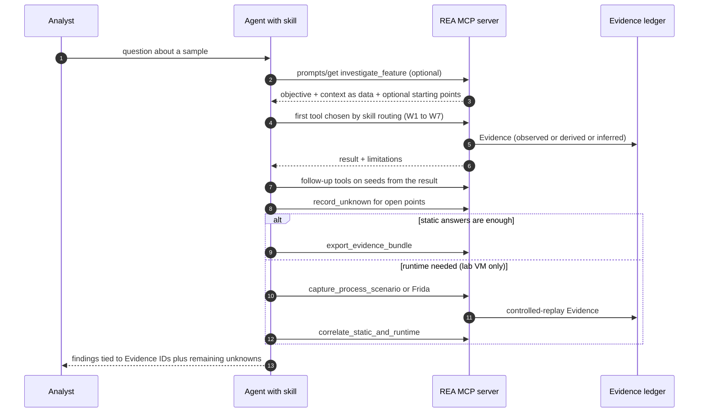

# 22 — End-to-end workflow atlas (where each complete workflow is documented, its tool chain, and its verification level)

This chapter is the map. The detailed step tables, outputs and diagrams live in the linked chapters. Labels: **RUN** = executed in the lab with real output ([27](27-manual-test-log.md)); **DOC** = described from tool contracts/docs.

| # | Workflow (goal) | Tool chain | Where | Level |
|---|---|---|---|---|
| W1 | Electron/JS app triage (what can it do to the host, where does it talk) | `analyze_javascript_application` → `inspect_analysis_view` → `trace_application_feature` → `trace_javascript_semantics` → `record_unknown` → `export_evidence_bundle` | [26](26-tool-usage-in-context-malware-analyst-view.md) §2, [16](16-javascript-electron-analysis.md) | RUN |
| W2 | Native binary triage with a deep engine | `open_binary` → `binary_overview` → `list_strings`/`search_strings` → `xrefs` → `resolve_containing_procedure` → `analyze_function` → `batch_decompile` → `trace_call_path` → `trace_native_values` → `set_address_name` → `record_unknown` → `export_evidence_bundle` → `close_binary` | [26](26-tool-usage-in-context-malware-analyst-view.md) §3 + addendum A1, [08](08-ghidra-provider.md) | RUN (Ghidra); DOC (Hopper/IDA) |
| W3 | Engine-free ELF triage | `inspect_with_objdump symbols/disassemble`, `inspect_binary_layout` | [26] §4, [09](09-other-native-providers.md) | RUN |
| W4 | Go/Rust implant fingerprint | `inspect_go_binary`, `inspect_rust_binary` | [26] §5, [15](15-filetypes-managed-firmware-wasm-evm-misc.md) | RUN |
| W5 | Dropper/archive anatomy and safe unpack | `open_binary` → `inspect_artifact` → `extract_artifact` | [26] §6, [14](14-filetypes-native-apple-archives.md) | RUN (inspect), DOC (extract) |
| W6 | .NET loader/stealer | `inspect_managed_artifact` → `inspect_managed_members` → `inspect_managed_native_boundaries` → `compare_managed_members` | [26] A2, [15] | RUN |
| W7 | Android malware | `inspect_android_package` → `search_android_classes` → `inspect_android_method` → `trace_android_references` | [26] A3, [19](19-android-mobile.md) | RUN |
| W8 | Variant / campaign diff | `analyze_function` ×2 → `compare_functions` → `compare_application_versions` → `find_changed_behavior` | [26] §9, [11](11-comparison-snapshots-analysis-view-reconstruction.md) | RUN (JS and managed diffs), DOC (native `compare_functions`) |
| W9 | Controlled detonation + static/runtime correlation (VM only) | `capture_process_scenario` → `compare_process_captures` → `correlate_static_and_runtime` → `verify_unknown_resolution`; Frida attach/spawn | [26] §10, [18](18-process-capture-and-instrumentation.md) | RUN (benign demo in disposable container) |
| W10 | Network IOC extraction from recordings | `inspect_pcap_capture`, `inspect_packet_capture`, `inspect_web_network_capture` | [26] §11, [20](20-network-and-signal-captures.md) | RUN (pcap, HAR/SAZ/qlog written by hand); sigrok/mitmproxy DOC |
| W11 | Evidence → Unknown → report loop | `record_unknown`, `update_unknown`, `verify_unknown_resolution`, `get/export/import_evidence_bundle`, `compare_bundles` | [26] §12, [10](10-evidence-model-ledger-unknowns-bundles.md) | RUN (record/list/export), DOC (update/verify/import) |
| W12 | Vulnerability research: hardening, crash root cause, patch diff, Electron surface, EVM selectors | `inspect_binary_layout`, `inspect_recorded_crash`, Ghidra chain, `compare_application_versions`, `inspect_evm_interface` | [28](28-vulnerability-research-with-rea.md) | RUN |
| W13 | Prompt-driven investigations (six guided prompts + completion) | `prompts/list`, `prompts/get`, `completion/complete` then the suggested tools | [12](12-ai-layer-prompts-and-skills.md), [27] L2 | RUN (rendering, arguments, completion); the LLM-in-the-loop behaviour was not tested |
| W14 | Firmware image analysis | `inspect_firmware_regions` → `extract_firmware` (needs Unblob) → native flow on extracted ELF | [15], [27] L8 | RUN (regions), DOC (extraction) |
| W15 | Mobile/desktop IOC + rule layer | REA Evidence → `prototype/rea-triage` + YARA | [prototype/rea-triage](prototype/rea-triage/README.md), [24](24-porting-blueprints.md) §14 | RUN (prototype) |
| W16 | Setup and agent registration (operations) | `rea doctor` → `rea setup --dry-run` → `rea setup --yes` → restart agent | [05](05-setup-doctor-update-uninstall-clients.md) | RUN with isolated HOME (ch05 verification) |

## Cross-workflow sequence (agent view)

*Figure 1 — Generic agent workflow across W1–W15.* The skill picks the first tool by target type; every result becomes Evidence; open questions become Unknowns; runtime is optional and compared back to static claims.
