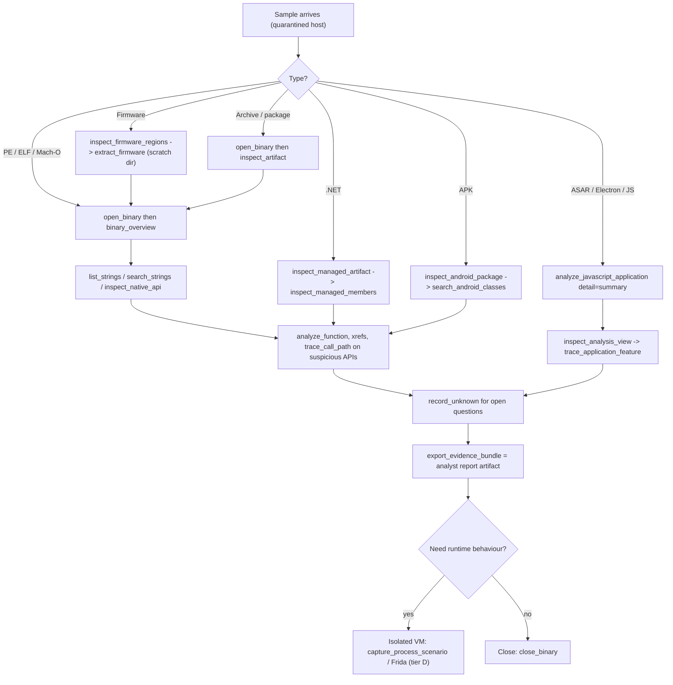
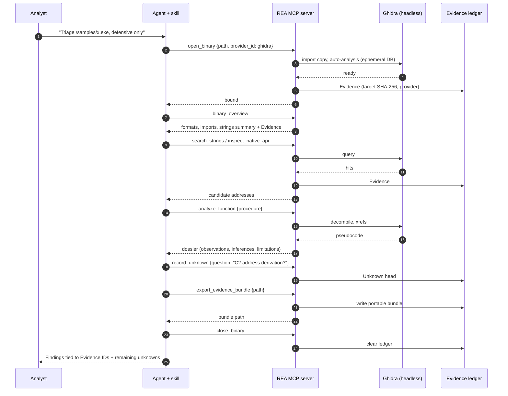

# 23 — Using REA defensively for malware analysis

Synthesis chapter. Facts about tools/effects come from the generated catalog ([13](13-tool-catalog-index.md)) and chapters [03](03-mcp-server-runtime-and-contracts.md), [10](10-evidence-model-ledger-unknowns-bundles.md), [12](12-ai-layer-prompts-and-skills.md). Statements marked **INFERRED** are recommendations, not REA behaviour. REA itself is a local-only analysis tool; it has no malware-specific features, signatures or sandbox.

## 1. Why REA fits defensive triage
- **Evidence-first output**: each result carries provenance, confidence and limitations; the skill requires separating observations, inferences and unknowns ([12](12-ai-layer-prompts-and-skills.md)). This maps onto an analyst report.
- **Static-first, local-only**: sample bytes are not sent anywhere by REA (see [03](03-mcp-server-runtime-and-contracts.md) §7 and AGENTS.md text in [12 part c](12-ai-layer-prompts-and-skills-part-c-repo-skills-and-llm-text.md)).
- **Residual Unknowns** (`record_unknown`, `update_unknown`, `verify_unknown_resolution`) track what is not yet proven. A `verified` resolution needs Evidence of the required authority, and REA's own process captures are recorded with `environment.isolation: "process"`, so an Unknown requiring a VM environment cannot be closed by them (ch10 writer, executed).

## 2. Tool risk tiers (from `TOOL_EFFECTS`)
| Tier | Count | Tools | Handling |
|---|---|---|---|
| A. No flagged effects (parse/inspect only; record session Evidence) | 97 | see [13](13-tool-catalog-index.md) "PURE": e.g. `inspect_managed_artifact`, `inspect_pe_resources`, `analyze_javascript_application`, `inspect_go_binary`, `inspect_rust_binary`, `inspect_electron_fuses`, `inspect_keyed_archive`, plus provider-backed reads (`list_strings`, `procedure_pseudo_code`, `xrefs`, `analyze_function`, `batch_decompile`) | Safe default for hostile samples. Provider-backed reads still make Hopper/Ghidra/IDA parse the sample; REA classes that as operator-configured analysis, not foreign execution. Run engines in an analysis VM anyway (**INFERRED**). |
| B. Writes files / launches helper processes | — | `extract_artifact`, `extract_firmware`, `inspect_with_objdump`, `inspect_binary_layout`, `inspect_recorded_crash` | Use a scratch output directory; extraction handling of hostile archives: see [14](14-filetypes-native-apple-archives.md). |
| C. Mutates target database | 30 | e.g. `set_address_name`, `set_comment`, `annotate_native_function` | Edits the engine database/session, not necessarily the sample file; Ghidra uses an ephemeral DB and never modifies executable bytes (AGENTS.md). |
| D. Executes foreign code | 15 | `capture_process_scenario`, `observe_native_calls`, `capture_native_ui_scenario`, `capture_browser_scenario`, `capture_electron_scenario`, `cutter_command`, `execute_rizin_command`, `gdb_console`, `close_gdb_session`, `start_rizin_debug_session`, `rizin_debug_command`, `close_rizin_debug_session`, `load_frida_script`, `resume_frida_session`, `instrument_with_frida` | **Detonation-class.** Only inside an isolated, disposable VM with controlled egress. REA adds no sandbox ([04](04-cli-reference.md) §4.8). |
| E. Mutates Android device | 6 | `push_adb_file`, `install_adb_package`, `uninstall_adb_package`, `start_adb_app`, `start_adb_activity`, `stop_adb_app` | Dedicated analysis emulator/device only. |

Audit gaps reported by the ch03 writer: `start_frida_session`, `start_gdb_session` and `observe_web_execution` are **not** flagged `executesForeignCode` although the next call in each group runs the sample or drives the page. Treat them as tier D.

Also: 205 of 207 tools carry `_meta.provenance.untrusted_content`; nothing in REA enforces policy on it, so the agent host must treat tool output (strings, decompiled text, page content) as untrusted data, which is a prompt-injection surface in malware samples (**INFERRED** risk, supported by the marker and the server `instructions`).

## 3. Triage workflow (static)

*Figure 1 — Static-first triage.* Route by type (skill rules), gather capability indicators, trace, track unknowns, export an Evidence bundle, and only then consider detonation in a VM.

Suggested mapping to guided prompts: `investigate_feature` (what does a capability like persistence/C2 look like in code), `compare_application_versions` (variant diffing, packer/loader updates), `audit_residual_unknowns` (report gaps), `trace_crash` / `prepare_bounded_process_capture` (**execute the target** despite the "prepare" name — ch12 writer).

## 4. Defensive use cases and the REA features behind them
| Use case | REA capability |
|---|---|
| Variant/version diff | `compare_application_versions`, `compare_functions`, `find_changed_behavior`, `compare_artifacts` ([11](11-comparison-snapshots-analysis-view-reconstruction.md)) |
| Malicious Electron/npm-style app review | `analyze_javascript_application`, `trace_javascript_semantics`, `recover_javascript_sources`, `inspect_electron_fuses` ([16](16-javascript-electron-analysis.md)) |
| .NET loader/stager review | `inspect_managed_*`, `verify_managed_native_boundaries` (static, no assembly load per docs) |
| Android malware | `inspect_android_package`, `trace_android_references`, `decode_android_resources` (tools in [25](25-capabilities-reference.md) family `android`) |
| Network IOC extraction from captures | `inspect_pcap_capture`, `inspect_web_network_capture` (HAR/SAZ/mitmproxy) ([17](17-browser-and-web-observation.md)) |
| Evidence sharing / reproducibility | `export_evidence_bundle` / `import_evidence_bundle`, analysis snapshots ([10](10-evidence-model-ledger-unknowns-bundles.md), [11](11-comparison-snapshots-analysis-view-reconstruction.md)) |

## 5. Gaps for malware work (all **INFERRED** unless cited)
No YARA/signature matching, unpacking, IOC extraction, sandbox orchestration, or VM-isolation provider exists in the catalog; the ledger is in-memory per connection (lost on process exit); engines (Hopper/Ghidra/IDA) are bring-your-own; Windows Ghidra has no mutation authority (AGENTS.md); `REA_BROWSER_NO_SANDBOX=true` disables the browser sandbox (ch03 writer).

## 6. Scenario playbooks (tool-call chains an agent can follow)
All chains use real catalog tool names ([25](25-capabilities-reference.md)); ordering is a **recommendation (INFERRED)** built from the skill routing rules ([12 part b](12-ai-layer-prompts-and-skills-part-b-bundled-skill-verbatim.md)) and the prompt chain table ([12](12-ai-layer-prompts-and-skills.md) §12.11). Tier D steps are marked and belong in a VM.

| # | Scenario | Chain |
|---|---|---|
| 1 | Unknown Windows PE | `open_binary` -> `binary_overview` -> `inspect_pe_resources` -> `inspect_signature` -> `list_strings`/`search_strings` -> `inspect_native_api` -> `procedure_callers` on network/crypto/persistence APIs -> `analyze_function` -> `trace_call_path` -> `record_unknown` -> `export_evidence_bundle` -> `close_binary` |
| 2 | .NET loader/stealer | `inspect_managed_artifact` -> `inspect_managed_members` -> `inspect_managed_native_boundaries` -> `verify_managed_native_boundaries` -> `project_managed_application_graph` -> `record_unknown` |
| 3 | Trojanized Electron / JS app | `analyze_javascript_application` (`detail: "summary"`) -> `inspect_analysis_view` -> `inspect_electron_fuses` -> `trace_application_feature` (seed: URL/route/API) -> `trace_javascript_semantics` -> `recover_javascript_sources` |
| 4 | Malicious APK | `inspect_android_package` -> `search_android_classes` -> `inspect_android_method` -> `trace_android_references` -> `decode_android_resources` -> `project_android_application_graph` |
| 5 | Dropper / archive / installer | `open_binary` (archive) -> `inspect_artifact` -> `extract_artifact` (scratch dir) -> analyse each extracted payload with chain 1-4 |
| 6 | Variant / campaign diff | `analyze_function` on both builds -> `compare_functions` -> `compare_application_versions` -> `find_changed_behavior` -> `audit_residual_unknowns` prompt |
| 7 | IOC extraction from sandbox PCAP | `inspect_pcap_capture` (`detail: summary`) -> `inspect_web_network_capture` for HAR/SAZ -> `record_unknown` for unresolved hosts |
| 8 | Controlled detonation (VM only, tier D) | `capture_process_scenario` -> `compare_process_captures` (vs clean baseline) -> `correlate_static_and_runtime` -> `verify_unknown_resolution` (note: REA's own captures are labelled isolation `process`, not VM) |

*Figure 2 — Agent-driven static triage of a PE sample.* The agent opens the sample (REA binds one provider with no fallback), queries strings/APIs, decompiles suspicious functions, records open questions as Unknowns, exports the Evidence bundle as the report artifact and closes the session. Nothing is executed. Ledger lifetime is the connection; `close_binary` or process exit clears it ([10](10-evidence-model-ledger-unknowns-bundles.md)).

## 7. Which parts to reuse for a malware-analysis product (summary)
1. **Keep as-is (static, tier A):** managed/JS/Go/Rust/PE-resource/ASAR/archive inspectors and the Evidence/Unknown model — they are the cheapest, safest wins.
2. **Reuse with hardening:** `extract_artifact`/`extract_firmware` and the archive code ([14](14-filetypes-native-apple-archives.md)) — add your own size/depth quotas and a sandboxed scratch mount.
3. **Wrap, do not trust:** deep providers (Ghidra/IDA/Hopper) parse the hostile sample; run them in a disposable VM/container with no network.
4. **Gate behind VM isolation (tier D/E):** process capture, Frida, debuggers, browser/Electron scenarios, ADB mutation. Re-implement the isolation layer; REA's `process` isolation is not a sandbox.
5. **Add what REA lacks:** YARA/signature matching, unpacking, IOC extraction/export (STIX/MISP), persistent case storage, sandbox-detonation orchestration, enforcement of the `untrusted_content` marker (prompt-injection defence for samples that embed LLM instructions).
6. **Reuse the AI layer:** adapt the six prompts and skill ([12](12-ai-layer-prompts-and-skills.md) "Porting the AI layer", which contains proposed malware agent/skill definitions) so the agent keeps observation/inference/unknown discipline.
