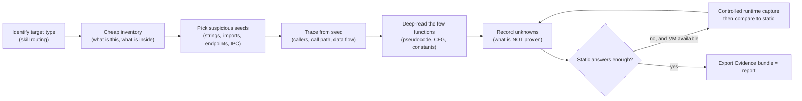
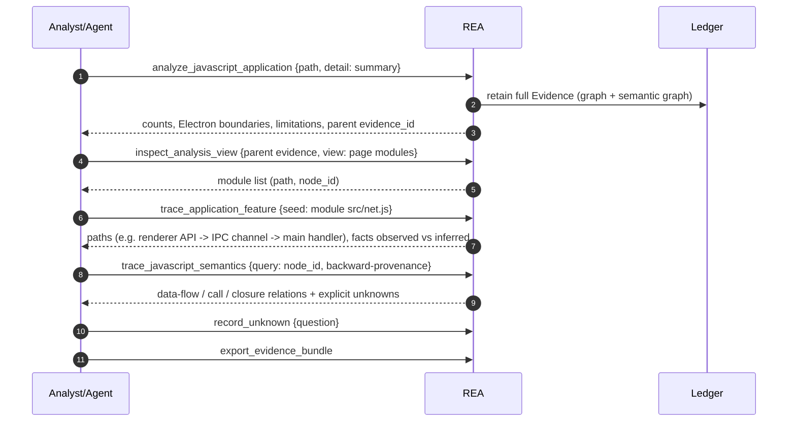
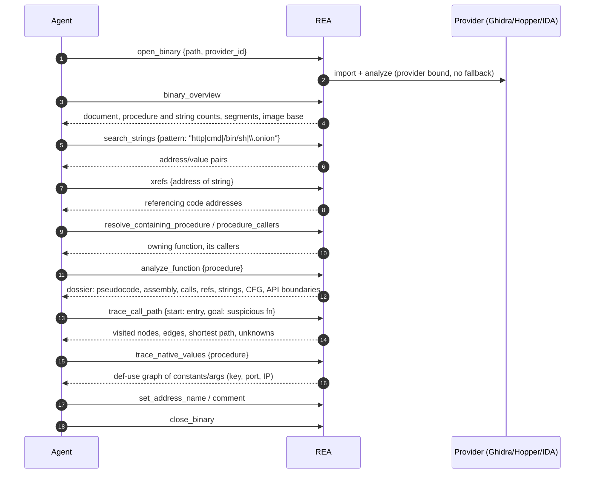
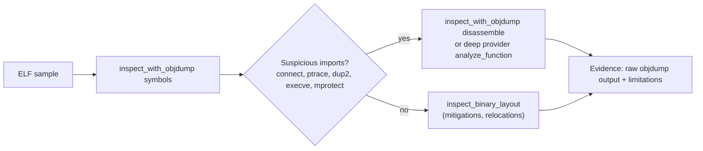
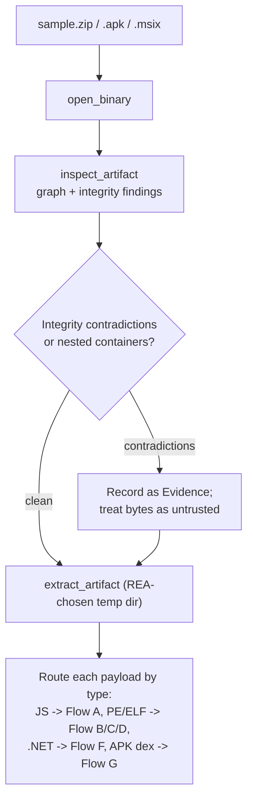
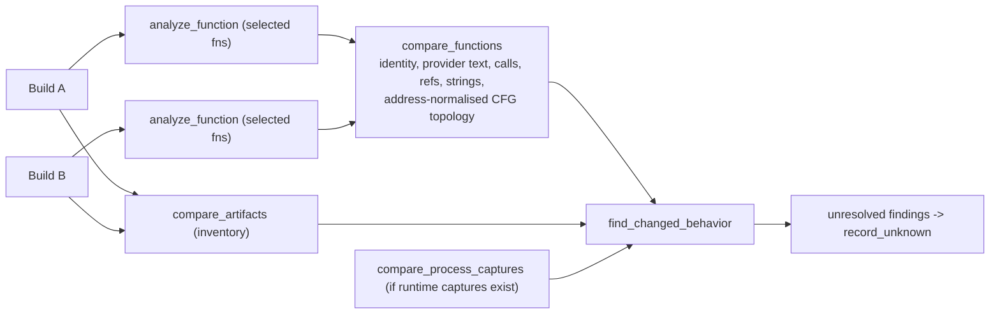
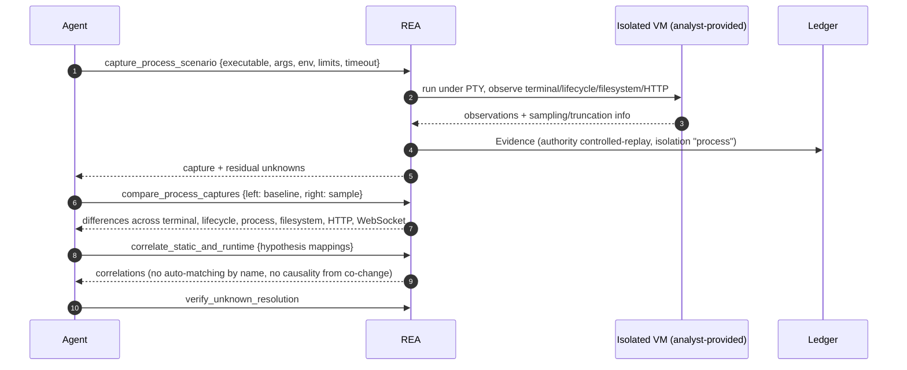
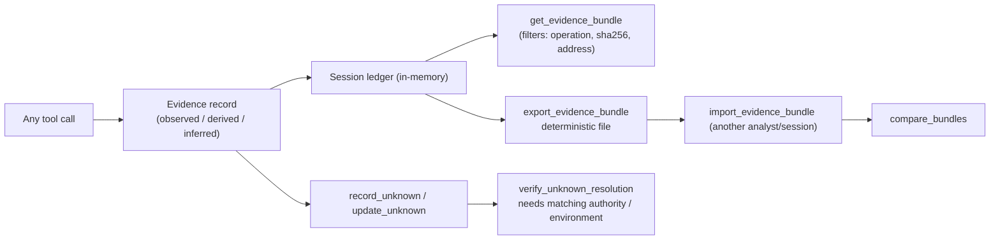

# 26 — How REA's tools are used in context: what is called, what is extracted, how it helps (malware analyst / security researcher view)

This chapter answers: *in which situation does an analyst (or the agent acting for them) call which tool, what exactly comes back, what do we do with it next, and how far can we trust it?* It is organised as **flows**, each with a diagram and a step table. Catalog of every tool: [25](25-capabilities-reference.md). Prompts/skill: [12](12-ai-layer-prompts-and-skills.md). Safety tiers: [23](23-defensive-malware-analysis-playbook.md).

## 0. Method and honesty labels
I built REA locally and ran it on **small benign demo samples written for this document** (inert strings only, `example.invalid` / TEST-NET addresses, nothing is executed): a mock Electron "updater" app, a Go program, a C program, and a zip of the app. Under the sandbox here **no Ghidra/Hopper/IDA, .NET, JADX, tshark or Frida** were available. Every step below is therefore labelled:

- **RUN** — I executed it and the field names/values shown are real output from REA v6.4.0 (`node scripts/rea.mjs <command> --json`; the MCP tool is the same workflow).
- **DOC** — described from the tool's advertised description and REA docs/source; *not executed here*. Treat as intended behaviour, not verified output.

Everything REA returns is an **Evidence record** (fields: `evidence_id, subject{sha256,format}, provider, predicate_type, operation, parameters, normalized_result, confidence (observed|derived|inferred), authority (shipped-artifact|controlled-replay|historical-reference|external-service|analyst-inference), limitations, locations, evidence_links` — [10](10-evidence-model-ledger-unknowns-bundles.md)). The analyst-relevant habit REA enforces: *observed vs derived vs inferred, and every record lists its limitations*.

## 1. The universal investigation loop

*Figure 1 — The loop every flow below instantiates.* Inventory is cheap and summary-first; deep reading is spent only on seeds the inventory surfaced; unresolved points become Unknowns instead of being silently assumed; runtime is optional and compared back to static claims.

Why "summary first": the skill tells the agent to use `detail: "summary"` and then `inspect_analysis_view` paging, because full Evidence for a real app can be hundreds of MB (docs/cli.md example: a 334 MB Obsidian Evidence file projects to a ~10 KB summary). That is a token-cost control, not a limitation of analysis.

---

## 2. Flow A — Electron / JavaScript application (trojanized desktop app, malicious npm-style package)
**Context:** you have an extracted app folder or `.asar`; question: "what can this app do to the host and where does it talk?" **Tier A (no execution)** — REA parses JS to an AST and never runs it.

*Figure 2 — JS/Electron triage.* First call fingerprints the whole app; paging selects modules; feature trace follows a seed across the Electron process boundary; semantic trace follows values; open items become Unknowns.

### Real run on the demo app (RUN)
Demo: `main.js` creates a `BrowserWindow` with `nodeIntegration: true`, registers `ipcMain.handle('run-task', … exec(cmd) …)`; `preload.js` exposes `api.run` through `contextBridge`; `config.js` holds a base64 string; `net.js` does `setInterval → https.request(...) → eval(response)`.

| Step | Trigger / question | Call (CLI = same workflow as MCP tool) | What REA returned (real) | How the analyst uses it |
|---|---|---|---|---|
| 1 | "What is this app?" | `rea analyze-javascript-application <dir> --json` (`analyze_javascript_application`) | `format: directory`, root SHA-256 `d9bf8b22…`; graph with **36 nodes / 48 edges**; node kinds incl. `electron-main`, `electron-preload`, `electron-renderer`, `browser-window`, `context-bridge-api`, `ipc-channel`, `ipc-handler`, `javascript-module`; `summary`: browser_windows 1, **explicit_web_preferences 2**, preload_entrypoints 1, context_bridge_apis 1, **ipc: 2 operations, 1 literal channel, 1 main handler, 1 renderer transmission paired**, utility_processes 0, native_addon_bindings 0; statistics: 6 relevant files, 4 parsed JS files, 274 AST nodes, 0 parse failures; `confidence: derived`, `authority: shipped-artifact`; 7 limitations | Sets scope: it is an Electron app with a renderer→main IPC bridge. Zero native add-ons and zero utility processes narrows the hunt to JS. SHA-256 = sample identity for the report |
| 2 | "Too big to read — give me an overview" | `rea inspect-analysis-view` with `view:{kind:"summary"}` (`inspect_analysis_view`) | New Evidence, provider `rea-analysis-view`, ~11 KB, `coverage: complete-within-view, examined 22 of 36`, parent_evidence_id link, plus the parent's limitations (e.g. *child-process extraction covers asynchronous node:child_process creation, literal argv/env/stdio options*; *Electron relationships derived from inert syntax; runtime registration, reachability, defaults and enforcement remain unproven*) | Cheap re-read of a retained result; limitations tell you what a negative does **not** prove |
| 3 | "List the modules" | `view:{kind:"page", collection:"modules", offset:0, limit:5}` | `items[]` of `{node_id, kind, path}` (e.g. `src/main.js`, `src/net.js`), pageable | Choose seeds; `node_id` is the handle for deeper calls (a single file path can be several graph roles) |
| 4 | "What does `net.js` connect to, and what reaches the OS?" | `rea trace-application-feature` input `{application: <Evidence>, direction:"both", seed:{kind:"module", value:"src/net.js"}}` (`trace_application_feature`) | 2 seed matches; traced 36 nodes/48 edges; **1 terminal path**: `javascript-asset src/net.js → … electron.ipcRenderer.invoke`; the path nodes show entry `api.run` (`bridge-member`) → channel `run-task` → terminal `electron.ipcRenderer.invoke`; the `ipc-handler` node: side `main`, operation `handle`, channel `run-task`, handler_kind `inline-function`, **location line 11 col 27–96**; summary: observed_facts 31, inferred_facts 57, unknown_facts 0, native_handoffs 0; coverage `complete-within-source` | This is the key finding: *page JavaScript can invoke a main-process handler that runs a command*. Attack-surface statement with file/line. The observed/inferred split tells you which links are syntax facts vs resolution inferences |
| 5 | "What exactly does the handler run / where does it beat?" | `trace_javascript_semantics` (query on a semantic `node_id`) | The semantic graph (computed in step 1, 248 nodes / 202 relations / 11 function fingerprints / 91 unknowns) contains: `child-process` node `exec` with `command: null` (argument is dynamic), `request` node `request` with `endpoint: null`, `timer` node `setInterval` (`delay_milliseconds: null`), a `literal` node holding the base64 string `aHR0cHM6Ly9jMi5leGFtcGxlLmludmFsaWQvdGFzaw==`, relations such as `spawns`, `schedules-timer`, `constructs-request`, `supplies-request-field`, `registers-listener`; `eval` and `Buffer` appear only as generic `expression` nodes | The analyst learns the *shape*: periodic request + spawn path exist, but REA did **not** resolve the command or endpoint. The base64 literal is surfaced → decode manually (`echo … | base64 -d` → the C2 URL). 91 unknowns are the honest frontier |
| 6 | "Pin down the open questions" | `record_unknown`, `list_unknowns` | Unknown heads with revisions | Tracks e.g. "what does `eval(d)` execute?" for runtime follow-up |
| 7 | "Hand over the findings" | `export_evidence_bundle {path}` | Deterministic, canonically ordered bundle | Portable report artifact; `import_evidence_bundle` in another session; `compare_bundles` for variants |

**What REA did *not* do here (verified by reading the real output):** it did not label `eval(<network data>)` or base64-decoding of a config as "dangerous"; those are plain `expression` nodes. There is no malware verdict, no IOC list. The analyst (or a downstream rule layer) must pivot on `child-process`, `request`, `timer`, `ipc-handler` and literal nodes. This is the main gap to fill when porting for malware use ([24](24-porting-blueprints.md)).

**Next tools in context:** if the code is minified, `recover_javascript_sources` (needs caller-supplied Wakaru; writes to a new directory) **DOC**; if you may run the app in a VM, `capture_electron_scenario` / `reconcile_javascript_runtime` ties passive runtime observations back to the static graph **DOC** (tier D).

---

## 3. Flow B — Native executable (PE / ELF / Mach-O) with a deep provider (Ghidra, Hopper or IDA)
**Context:** a suspected implant binary. **Tier A for REA, but the engine parses the hostile file → run it in a disposable VM.** I could not run this flow here (no engine); steps are **DOC**, grounded in each tool's advertised description (quoted) and `docs/native-investigation.md`. A faithful engine-free substitute that I did run is in Flow C.

*Figure 3 — Native triage with a deep provider.* Strings → xrefs → owning function → dossier → path/value tracing, with renames/comments written back to the engine database.

| Step | Trigger | Tool | Extracted (per advertised contract) | Use / value for malware analysis | Caveat quoted from the tool |
|---|---|---|---|---|---|
| 1 | Start | `open_binary` | Binds one immutable provider; target SHA-256 and analysis profile identity | Everything after cites this identity; snapshot import must match it | "binding remains stable until close or an explicit switch, with no failure fallback" |
| 2 | "What am I looking at?" | `binary_overview` | Document, exhaustive procedure/string counts, segments, `image_base` | Size/complexity, packed-looking segments, rebasing | "segment coverage is unavailable rather than empty" if omitted |
| 3 | Hunt indicators | `list_strings`, `search_strings` (literal or regex) | Address/value pairs, encoding, terminator, byte length | C2 hosts/paths, commands, mutex names, ransom text | "complete over those defined objects, not every text sequence"; Ghidra may omit packed/undefined literals; empty ≠ absent |
| 4 | "Who uses this string?" | `xrefs` | Analyzed references to an address | Ties an IOC string to code | bare addresses untyped; indirect refs may be incomplete |
| 5 | Locate the code | `resolve_containing_procedure`, `procedure_callers`, `procedure_callees` | Owning function; caller/callee sets | Builds the call neighbourhood | unresolved indirect calls stay unknown |
| 6 | Read the function | `analyze_function` | Identity + analyzed body ranges (or explicit unknown), pseudocode and assembly, comments, calls, references, referenced strings/names, local CFG blocks, **native API boundary observations** | One call = the analyst's "function page" | "Ghidra terminal-call assumptions that may cut the analyzed body are reported in limitations" |
| 7 | Many functions | `batch_decompile` | Ordered per-item pseudocode or error + aggregate counts | Bulk-read all callers of a sink | per-item failures explicit |
| 8 | Dispatch / API use | `inspect_native_api`, `inspect_native_dispatch_metadata` | Jump-table dispatch, case mappings, default targets, unsupported branches | Command dispatchers in RATs, opcode handlers | "Null case values mean unresolved cases, never a known default" |
| 9 | "Does A reach B?" | `trace_call_path` | Visited nodes, direct-call edges, shortest path, provider failures, unknowns | Entry → network/crypto/persistence reachability | goal "unknown when unresolved expansions prevent proving it absent" |
| 10 | Keys, ports, IPs | `trace_native_values` | High-p-code def-use graph: constants, operators, call arg/return bindings, bounded by depth/nodes/edges | Where a constant (key, port) flows | "alias semantics, persistent state and RNG roles remain unknown" |
| 11 | Build the database | `set_address_name`, `set_addresses_names`, `comment`, `annotate_native_function` | Writes to the engine DB (tier C) | Persist findings for the next session (`open_binary` same target+profile retains edits) | Ghidra DB is ephemeral per AGENTS.md |
| 12 | Wrap-up | `record_unknown`, `export_evidence_bundle`, `close_binary` | Unknown heads, bundle file | Report + clears ledger | ledger is in-memory per connection |

**Mach-O only:** `inspect_signature` returns code-signing identity, hashes, authorities, requirements, entitlements, hardened-runtime state with command provenance — useful for spotting abused entitlements or ad-hoc signed droppers **DOC**.

---

## 4. Flow C — Engine-free ELF/native triage with objdump (RUN)
**Context:** no decompiler licence or you only need imports/sections fast. REA's `gnu.objdump` provider wraps a caller-supplied `objdump` and retains the raw output as Evidence.

Demo C program: opens a socket, `connect()`s to a hard-coded address, `dup2()`s the socket to stdin, anti-debugs with `ptrace(PTRACE_TRACEME)`.

| Step | Call | Real result | Analyst use |
|---|---|---|---|
| 1 | `rea inspect-with-objdump <elf> symbols --json` (`inspect_with_objdump`, op `symbols`) | Evidence: provider `gnu.objdump`, `confidence: observed`, `authority: shipped-artifact`; `parameters.command_arguments: ["-t", path]`; raw output lists undefined imports: **`connect@GLIBC_2.2.5`, `ptrace@GLIBC_2.2.5`, `dup2@GLIBC_2.2.5`, `inet_pton@GLIBC_2.2.5`, `htons@GLIBC_2.2.5`, `puts`** | The classic reverse-shell/anti-debug import set is visible without a decompiler → immediate triage verdict "needs deeper look" |
| 2 | `… disassemble` (same tool) | (**DOC**) full disassembly text retained | Find the call sites of `connect`/`ptrace`; the hard-coded IP lives in `.rodata`, which `symbols` does not show — pair with `read_bytes`/strings via a deep provider or `section_headers` + manual extraction |

Real limitation text returned: *"The executable version and supported formats are reported as unknown because no reliable version probe was performed"*; *"pre-run and post-run digests detect artifact changes across the provider call but cannot prove the exact bytes consumed"*. For ELF layout/mitigations (RELRO, NX, PIE, canaries) the dedicated `inspect_binary_layout` needs caller-supplied pwntools (not available here) **DOC**.

*Figure 4 — Engine-free triage.* Imports gate whether you spend a deep provider on the sample.

---

## 5. Flow D — Go (and Rust) implants (RUN for Go)
**Context:** statically linked Go malware has thousands of runtime functions; first learn *which toolchain and modules* before reading code. **Tier A, no Go install or disassembler needed.**

| Step | Call | Real result | Use |
|---|---|---|---|
| 1 | `rea inspect-go-binary <file> --json` (`inspect_go_binary`) | `format: elf, architecture: amd64, bits: 64`; `build_info`: header offset 5435392, **`go_version: go1.24.7`**, raw module text, `module.path: beacon`, `main.version: (devel)`, **no dependencies**, build settings list (`-buildmode=exe`, `-compiler=gc`, `CGO_ENABLED=1`, `GOARCH=amd64`, `GOOS=linux`, `GOAMD64=v1`), byte offsets/locations of version and module bytes; `confidence: observed` | Toolchain/GOOS/GOARCH fingerprint, module path and dependency list (supply-chain and family clustering: same module path/deps across samples), `-trimpath`/VCS stamps if present |
| — | Limitations returned (verbatim) | *"Only Go build information is inspected; function names, source mappings, type metadata and decompiled code are not recovered."*; *"Embedded build metadata is observed file content, not proof of compiler identity, dependency authenticity or runtime behavior."* | Know that a stripped/garbled-metadata Go binary returns null, "absent metadata does not prove a binary is not Go" (skill text) |
| 2 | then a deep provider (`open_binary` + `search_strings`) | **DOC** | Function recovery for Go needs the deep engine |

`inspect_rust_binary` does the equivalent for **cargo-auditable** dependency sections (crate names, versions, sources, dependency edges); a missing `.dep-v0` is "null metadata, not proof the binary has no dependencies" **DOC**.

---

## 6. Flow E — Archives / droppers / installers (RUN for zip)
**Context:** the sample is a zip/APK/IPA/MSIX/DMG; before analysing payloads, learn the anatomy safely.

| Step | Call | Real result | Use |
|---|---|---|---|
| 1 | `rea inspect-artifact <zip> --json` (`inspect_artifact`; MCP: `open_binary` then `inspect_artifact`) | Provider `rea-artifact-graph`; result object has `inspection_id`, `subject{manifest_id, root_artifact_id, root_sha256, root_format: zip}`, `substeps`, `observations`, `hypotheses`, `contradictions`, `unexplored_branches`, `next_probes`, `coverage`; the root-manifest observation: **node_count 9, occurrence_count 9, edge_count 8**; `integrity_policy: fail` by default; coverage `complete-within-substeps` (hypotheses/next_probes empty for this plain zip) | Inventory with per-file digests, nested-container discovery (ASAR in Electron, DEX in APK), integrity contradictions (declared vs actual hashes) flagged as evidence |
| 2 | `extract_artifact` (**DOC**) | Extracts regular files into a *fresh temp directory chosen by REA*; "Rejects traversal and symlink escapes, never overwrites, and verifies cleanup"; integrity mismatches fail by default, or `record-and-continue` extracts and marks each as "explicitly untrusted integrity contradiction" | Safe unpack of hostile archives (zip-slip defence) — then run Flow A/B/D on each payload |

*Figure 5 — Dropper anatomy.* Inventory first, extract second, then re-enter the type-specific flows.

---

## 7. Flow F — .NET assemblies (stealers, loaders) — **DOC, tier A, static only**
**Context:** PE with CLI header. REA reads metadata/CIL **without loading the assembly**.

| Step | Tool | Extracted (advertised) | Malware use |
|---|---|---|---|
| 1 | `inspect_managed_artifact {path, detail:"summary"}` | Identity, PE/CLI classification with evidence, module MVID, assembly, referenced frameworks, counts, coverage | Is it managed? MVID for clustering/variant matching; obfuscator hints via counts |
| 2 | `inspect_managed_members {path, type_names:[…]}` | Members, signatures, raw CIL hashes, decoded-instruction-tuple hashes, exception regions, **call edges, field-access anchors, and the `#US` string literals loaded by `ldstr`** | Read behaviour as call graph + string literals (URLs, registry keys, browser paths) with no execution; hash-based variant matching |
| 3 | `inspect_managed_native_boundaries` | ModuleRef, ImplMap/P-Invoke declarations, native-header indicators, non-IL method flags | Where managed code calls `kernel32`/`ntdll` (injection, process hollowing) — "managed declarations and degraded native-boundary observations, not verified native exports" |
| 4 | `compare_managed_members`, `project_managed_application_graph` | Build-to-build diff; app graph | Variant diff across a family |

Doc limit (docs/cli.md): the managed parser "does not unpack .NET single-file hosts or decode IL2CPP metadata"; NativeAOT method bodies need a native provider.

## 8. Flow G — Android APK — **DOC**
Context: mobile malware (banker/spyware). Requires headless JADX + JDK (decompile runs on the APK, no execution).

| Step | Tool | Extracted | Use |
|---|---|---|---|
| 1 | `inspect_android_package {path, detail:"summary"}` | Package, SDK and permission declarations, decoded manifest, class/resource counts; retained + linked analysis-view | Permission profile (SMS, accessibility, overlay), components, exported receivers |
| 2 | `search_android_classes {query}` | Decompiler class-name rows (case-sensitive substring), duplicates reported | Find `*Accessibility*`, `*Sms*`, C2 classes; obfuscation (a/b/c names) visible |
| 3 | `inspect_android_method` / `inspect_android_class` | Decompiled method/class | Read candidate code |
| 4 | `trace_android_references {class_name, method_name}` | Incoming static users of an exact class/method overload; exact DEX offsets when available (`direct_invokes_exhaustive` says if complete) | Who calls the SMS-send or DexClassLoader API |
| 5 | `decode_android_resources` (Apktool), `project_android_application_graph` | Manifest/strings/locales; app graph | Resource-hidden configs, repackaging traces |

## 9. Flow H — Variant and campaign diffing (static, session Evidence) — **DOC**
**Context:** two builds of the same family, or "what changed in the update?"

*Figure 6 — Coarse to fine to behavioural diff.* Inventory diff finds changed files; function-level diff localises code; `find_changed_behavior` aggregates validated comparisons and keeps runtime observations separate from static candidates. "missing or incomplete comparisons produce unresolved findings, never causal claims" (tool description). For JS/Electron, `compare_application_versions` and `compare_javascript_export_shapes` do the same at graph level. Known quirk found by the chapter-11 reviewer: the `compare_bundles` added/removed counters are never non-zero ([11](11-comparison-snapshots-analysis-view-reconstruction.md)).

Use: cluster samples into a family by function-fingerprint/CFG similarity, spot a new capability added in a later build, confirm a patch removed a bug.

## 10. Flow I — Controlled detonation and runtime correlation (**tier D, VM only**) — **DOC**
Context: static analysis left unknowns (encrypted config, runtime-resolved C2). The **prompts** `trace_crash` and `prepare_bounded_process_capture` steer this; despite the name, "prepare" runs the target ([12]).

*Figure 7 — Runtime evidence tied back to static hypotheses.* The runtime capture runs a **caller-selected command under a PTY** with a bounded terminal size, timeouts and settle windows. Correlation requires the analyst to *declare* mappings between static findings and runtime dimensions; REA never guesses. Because the Evidence is stamped isolation `process` (not VM), an Unknown that requires a VM-isolated replay cannot be closed by REA's own capture ([10]).

Other tier-D tools in context: `instrument_with_frida`/`load_frida_script` (runtime hooks, key/config extraction), `cutter_command`/`gdb_console`/`rizin_debug_command` (interactive debugging), `capture_browser_scenario`/`capture_electron_scenario` (drive a live page/app). **REA supplies no sandbox**; the VM, network egress control and snapshots are yours.

## 11. Flow J — Network IOC extraction from recordings — **DOC**
Context: you already have a sandbox PCAP, HAR, SAZ or mitmproxy capture; you want indicators without touching the network.

| Step | Tool | Extracted | Use |
|---|---|---|---|
| 1 | `inspect_pcap_capture {path, detail:"summary"}` (tshark + capinfos required) | Metadata, exact packet count, SHA-256, IPv4/IPv6 address counts, DNS questions and answers from single-question responses, **TLS SNI**, protocol distribution, HTTP URIs; retained, paged via `inspect_analysis_view kind pcap` | Domain/IP/SNI IOC list; beacon-protocol mix |
| 2 | `inspect_packet_capture` + `inspect_packet_fields` | Selected TShark fields with display filters / decode-as | Pull a specific field (e.g. User-Agent, custom header) |
| 3 | `inspect_web_network_capture {capture_path, format: har|saz|mitmproxy|qlog}` | Original record ordinals, byte ranges, producer fields, exact exposed binaries "without contacting recorded URLs"; `sensitive_values` handling | C2 request/response bodies from a captured session, safely |

Limits stated by the tools: DNS attribution can be unknown; "page exhaustion does not prove network completeness"; this *reads recordings, it does not capture* live traffic.

## 12. Flow K — Evidence, Unknowns and the report (applies to every flow)

*Figure 8 — From tool output to a shareable case file.* Unknowns only close when Evidence of the required authority/confidence/environment backs them; static string-search Evidence was rejected as proof for an Unknown requiring `controlled-replay` (verified by the chapter-10 writer). CLI note: `compare_artifacts`, `compare_functions`, `find_changed_behavior`, `build_call_path`, `correlate_static_and_runtime`, `verify_reconstruction` and the four unknown tools exist **only over MCP** (they need the live ledger).

## 13. Summary: "up to what level" REA goes
| Level | What REA does | What it leaves to you |
|---|---|---|
| Identify & inventory | Strong: formats, hashes, graphs, import/permission/IPC/module facts, build metadata | — |
| Locate behaviour | Good: seeds → xrefs/callers → paths with observed/inferred split | Deciding which seed is malicious |
| Understand code | Provider-dependent: decompiled pseudocode, CFG, def-use, string/literal extraction | Interpreting crypto/obfuscation; dynamic arguments often `null`/unknown (seen live: `exec` command and `request` endpoint unresolved) |
| Classify as malware | **None** — no verdicts, YARA, IOC export, or scoring | Your rules, TI lookups, case management |
| Execute / observe | Optional, tier D, with Evidence + comparison | Isolation, network control, snapshots |
| Report | Deterministic Evidence bundle + Unknown ledger | Narrative, ATT&CK mapping, distribution |
