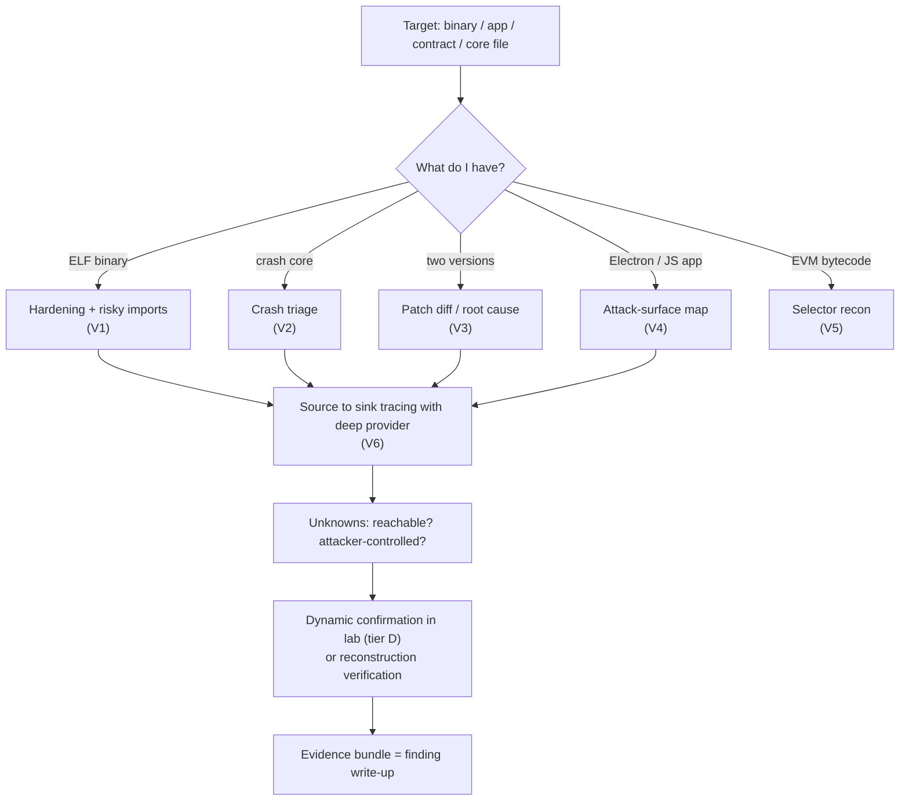
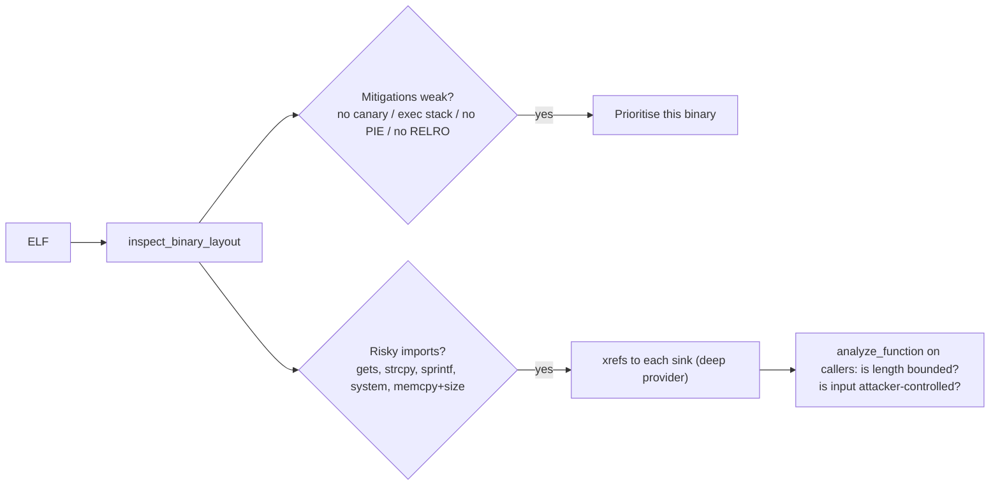
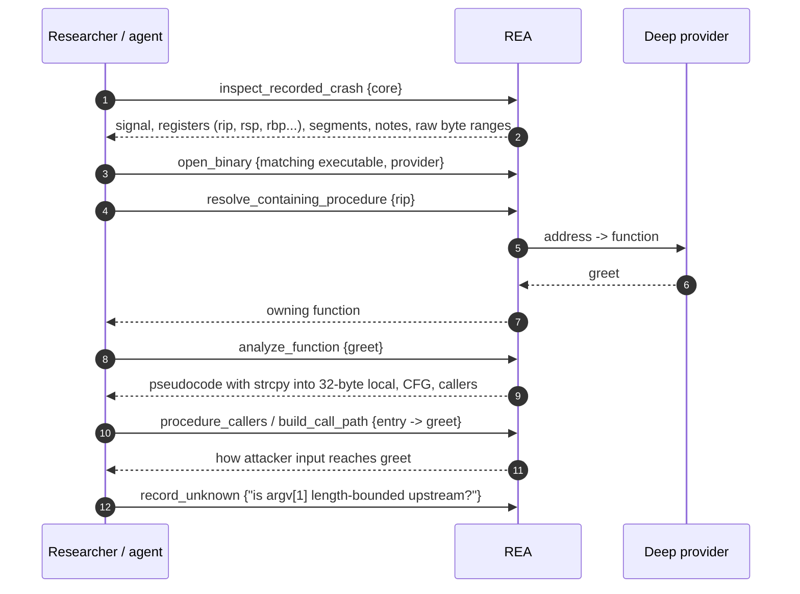
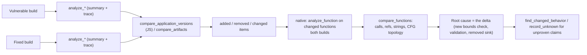
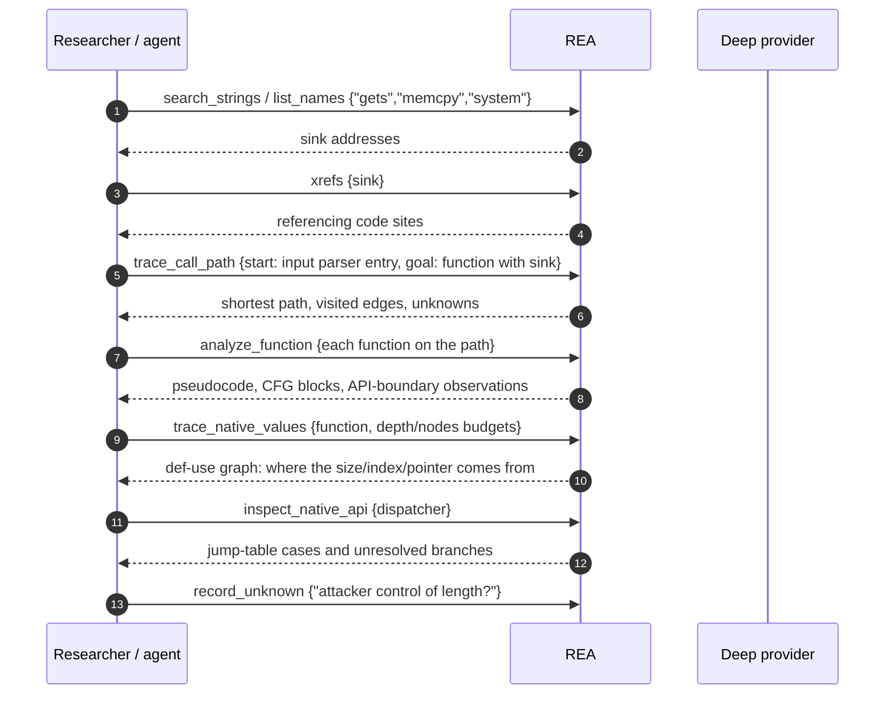

# 28 — Using REA for vulnerability research (defensive: find, understand, verify, patch-diff)

REA is an *evidence-producing analysis layer*, not a fuzzer, exploit framework or symbolic-execution engine. Its own policy says vulnerability analysis is in scope while "exploit or attack-payload automation, credential theft, covert persistence, unauthorized access, or bulk attack workflows" and defeating packers/anti-debug/DRM are not integrated (`CONTRIBUTING.md`, "Contribution scope"; security-model summary in [30](30-subsystem-primers-and-architecture-glue.md) §3.6). This chapter shows where REA helps a security researcher *triage, localise, understand and verify* a bug or a fix. Every flow is labelled **RUN** (executed here, details in [27](27-manual-test-log.md)) or **DOC** (from tool descriptions/docs, not executed). Tool catalog: [25](25-capabilities-reference.md). Malware-oriented counterpart: [26](26-tool-usage-in-context-malware-analyst-view.md).

## 1. What REA gives a vulnerability researcher (and what it doesn't)
| Research need | REA capability | Level |
|---|---|---|
| Is the binary hardened? what dangerous imports exist? | `inspect_binary_layout` (needs pwntools), `inspect_with_objdump` | RUN |
| Where did it crash / what state was recorded? | `inspect_recorded_crash` (core files), prompt `trace_crash` | RUN (core), DOC (prompt chain) |
| What changed between vulnerable and fixed build? | `compare_application_versions`, `compare_functions`, `find_changed_behavior`, `compare_artifacts` | RUN (JS), DOC (native) |
| Map attack surface of desktop/Electron apps | `analyze_javascript_application`, `trace_application_feature`, `inspect_electron_fuses` | RUN (analysis/trace), DOC (fuses) |
| Smart-contract entry points | `inspect_evm_interface` | RUN |
| Find source→sink paths in native code | `search_strings`/`xrefs`/`trace_call_path`/`trace_native_values`/`analyze_function` | DOC (needs deep provider) |
| Confirm dynamically | `capture_process_scenario`, Frida, GDB/Rizin/pwndbg-context | DOC, tier D (execution) |
| Verify "my understanding/rebuild matches" | `verify_reconstruction`, obligation ledgers ([11](11-comparison-snapshots-analysis-view-reconstruction.md)) | DOC |
| **Not provided** | fuzzing, taint engines, symbolic execution, exploit generation, PoC automation, patch generation | — |


*Figure 1 — Vulnerability-research entry points.* Pick the entry by the artefact you hold; everything converges on tracing a suspect path, recording what is unproven as Unknowns, and confirming in a lab only if needed.

---

## 2. V1 — Exploitability surface of a native binary (RUN)
**Context:** you received a native ELF (customer build, vendor release, CTF-like target) and need a first read: hardening posture and obviously risky library use, before spending decompiler time. `inspect_binary_layout` works offline (Linux x64 ELF; caller-supplied pwntools 4.15.0 + pyelftools 0.33 + Unicorn 2.1.2 via `REA_PWNTOOLS_PYTHON`) and never executes the file.

| Build (demo `vuln.c`: `strcpy` to 32-byte stack buffer; `gets`) | `position_independent` | `nx_indicator` | `executable_stack_indicator` | `stack_canary_indicator` | `relro` | Risky symbols present (real) |
|---|---|---|---|---|---|---|
| weak (`-fno-stack-protector -z execstack -no-pie -z norelro`) | false | null | **true** | **false** | null | `strcpy`, `gets`, `printf` |
| hardened (`-fstack-protector-strong -pie -z relro,now -D_FORTIFY_SOURCE=2`) | true | true | false | true | "Full" | `gets`, `__strcpy_chk`, `__printf_chk` |

**How it is used:** the weak build has no canary and an executable stack indicator → a stack overflow in `greet()` would be directly valuable to look at first; the hardened build shows `FORTIFY` replaced `strcpy` by `__strcpy_chk` but `gets` remains a sink in both, so it is still a finding. All mitigation fields are `evidence_kind: "inferred"` (static indicators, not runtime proof); symbols retain table/index; `relocation_inventory_completeness: unknown`; runtime load base is null ("a linked address is not a runtime address"). Limitation to remember: `nx_indicator: null` on the weak build means **unknown/absent indicator, not "NX off"**.


*Figure 2 — Binary hardening triage.* Hardening and sink inventory prioritise targets; the callers of each sink are then read via a deep provider.

---

## 3. V2 — Crash triage from a core file (RUN) and the Ghidra root-cause step (RUN, lab round)
**Context:** a crash report with a core file (fuzzing hit, customer crash). REA reads the core *without launching the target or attaching to a PID* (`target_execution: "not-performed"`).

Real result for the demo crash (200×`A` argument to the weak build):
| Field | Value | Reading |
|---|---|---|
| `recorded_current_signal` / siginfo | 11, `code 128`, `fault_address null` | SIGSEGV; `fault_address_meaning: "unknown"` (REA does not guess) |
| `rip` | `0x4011b6` | Faulting instruction address (my gdb cross-check: `greet+64`, instruction `ret`) |
| `rbp` | `0x4141414141414141` | Saved frame pointer was overwritten with attacker-style data |
| `rsp` | `0x7ffca9b88898` | Stack pointer at fault |
| segments / notes / threads | 24 / 8 / 1 | Full recorded layout retained with byte ranges |
| `debugger` | `not-requested` | Optional BYO GDB/pwndbg "core-only mapping candidates" via `include_debugger_context` (MCP) / `--debugger-context` (CLI); needs caller-supplied GDB/pwndbg, otherwise fails closed with `capability_unavailable` and keeps the basic core evidence |

**INFERRED (mine, not REA's):** a fault at `ret` with a corrupted `rbp` is the classic signature of a stack buffer overflow in the function containing `rip`; confirm by reading that function (`analyze_function`/`resolve_containing_procedure` with a deep provider) and checking the bound on the copy.


*Figure 3 — Core to root cause (provider steps now RUN with Ghidra 12.1.4, see below).* The prompt `trace_crash` encodes this chain: `open_binary` only if needed → `search_strings`/`search_procedures`/`resolve_containing_procedure`/`analyze_function` → `xrefs`/`procedure_callers`/`build_call_path` → optional `capture_process_scenario` + `correlate_static_and_runtime` (which **runs the target**) → `record_unknown` ([12](12-ai-layer-prompts-and-skills.md) §12.11). The prompt's `document` argument is described as "Open Hopper document", a stale wording in a multi-provider product (chapter-12 finding).

**Lab-round RUN (Ghidra 12.1.4 over MCP, transcript [mcp-transcripts/t10.json](manual-tests/mcp-transcripts/t10.json) — `open_binary` weak build → `resolve_containing_procedure` → `analyze_function` → `procedure_callers` → `trace_call_path`):**
- `resolve_containing_procedure 0x4011b6` (the `rip` from the core) → **`greet` at `0x401176`, body `0x401176–0x4011b6`, 65 bytes** — i.e. the faulting `ret` is the last instruction of `greet` (first call 14.2 s for the cold Ghidra analysis).
- `analyze_function greet` pseudocode (verbatim from Ghidra):
```c
void greet(char *param_1)
{
  char local_28 [32];

  strcpy(local_28,param_1);
  printf("hello %s\n",local_28);
  return;
}
```
  with a call to `strcpy` (thunk to the external at `0x404008`). This confirms the INFERRED reading above: an unbounded `strcpy` into a 32-byte local, overflowed by the 200-byte argument, matches the corrupted `rbp` and the fault at `ret`.
- `procedure_callers greet` → `0x4011b7` (`main`'s region); `trace_call_path main→greet forward` → `goal_status: reached` via `main → … → greet` (nodes `0x4011b7`, `0x401080`, `0x401176`).
So the whole chain core → crashing function → root-cause source line is now demonstrated with real output, not just described.

---

## 4. V3 — Patch diffing / N-day root cause (RUN for JS, DOC for native)
**Context:** vendor shipped a fix; where is it and what does it change? REA compares *typed Evidence*, never fuzzy-matches by name.

**RUN (T5):** v1 vs "patched" v2 of the demo Electron app → `unchanged 17, added 16, removed 16, changed 3`; matching tiers `exact_node_identity 12, exact_content_digest 5, semantic_key 3, unmatched 32`. The `ipc-handler` and `browser-window` nodes appear as **removed + added** (their content changed, and identity is content-based; "performs no fuzzy pairing"), while `ipc-channel` and `electron-preload` are `changed` (location). The decisive security delta is easier to read from the two analyses' summaries: `explicit_web_preferences 2 → 4`, `sender_validation_observations 0 → 1`. 


*Figure 4 — Patch-diff pipeline.* Coarse inventory diff narrows to changed units; function-level diff (address-normalised CFG, call/ref/string sets) isolates the fix; unproven conclusions stay Unknowns.

Native comparison (**DOC**): `compare_functions` takes two sets of `analyze_function` Evidence and compares "identity, exact provider text, calls, references, strings, and address-normalized CFG topology"; "missing or provider-incompatible facets remain truncated or unknown". Practical use: a new `cmp`/`jae` guard before a `memcpy`, a removed `system` call, or an added string like "invalid length" shows up as a call/string/CFG difference.

---

## 5. V4 — Electron / desktop-app attack-surface map (RUN)
**Context:** auditing an Electron app for renderer→main privilege escalation. REA statically extracts the Electron boundary facts that audits are built from, with line locations.

| Audit question | REA field (real from T1/T4) | Demo v1 → v2 |
|---|---|---|
| Are web preferences explicitly set? (nodeIntegration/contextIsolation/sandbox live in these) | `summary.explicit_web_preferences` and the `browser-window` node properties | 2 → 4 |
| Which APIs does the preload expose to the page? | `summary.context_bridge_apis`, `exposed_api_members`; node `context-bridge-api`; boundary `api.run` | 1 / 1 / `api.run` |
| Which IPC channels exist and who handles them? | `summary.ipc.*`, `ipc-channel` + `ipc-handler` nodes with `channel`, `handler_location` | channel `run-task`, handler main.js line 11 |
| Does the handler validate the sender? | `summary.sender_validation_observations` | 0 → 1 |
| Does a handler reach process spawning? | semantic `child-process` node + `spawns` relation, `command: null` when dynamic | v1: `exec` spawns; command unresolved |
| Does the app load native add-ons / spawn utility processes? | `native_addon_bindings`, `utility_processes` | 0 / 0 |
| Are runtime fuses safe? | `inspect_electron_fuses` on the packaged binary (**DOC**) | — |

**Finding (RUN):** in v1, `trace_application_feature` returns a path "renderer API `api.run` → IPC `run-task` → main handler (line 11)", and the semantic graph shows the handler spawns a process with an argument that comes from the renderer (REA marks the command `null`/unresolved rather than asserting it). That is exactly the "renderer can run commands in main" pattern a researcher then confirms by reading lines 11 and validating the sender check. REA reported **no verdict**; the interpretation above is mine (INFERRED).

---

## 6. V5 — Smart-contract entry points (RUN)
`inspect_evm_interface` on raw/hex runtime bytecode returned the dispatch selectors with byte offsets, e.g. `0xa9059cbb` @22, `0x70a08231` @24 (`dispatch: "abi"`), with argument types and mutability **inferred** and "candidate coverage does not establish interface completeness" (skill text). Use: enumerate external entry points of an unverified contract before reading the code; no chain lookup or execution occurs.

---

## 7. V6 — Source-to-sink and harness targeting with a deep provider (partly RUN in the lab round, rest DOC)

*Figure 5 — Static source→sink workflow.* Reachability from an input handler to the sink, then value provenance for length/index arguments. Quoted limits: unresolved indirect calls keep a goal "unknown"; value traces leave "alias semantics, persistent state and RNG roles" unknown; Ghidra may omit packed/undefined strings. Output of this flow is a *candidate* path plus Unknowns, which is the correct input for choosing a fuzzing harness or a lab confirmation — REA does not build the harness.

**What was RUN here (lab round, C2-like demo ELF, [27](27-manual-test-log.md) L1):** `search_strings` → address of a string, `xrefs` → referencing sites, `resolve_containing_procedure`, `analyze_function`, `batch_decompile`, `inspect_native_api`, `trace_call_path` (`goal_status: reached` main→check, and backward from `check`), `trace_native_values` (def-use graph with `is_dead` and `block_membership` fields and 20 limitations) all returned as described. Not run: `trace_native_values` on a function with attacker-controlled length (the demo has none), `compare_functions`, and the dynamic-confirmation tools against a vulnerable target (the process-capture crash run in [27] L10 is the only dynamic confirmation done).

Dynamic confirmation (tier D, lab only): `capture_process_scenario` records terminal/lifecycle/filesystem behaviour of a run; `instrument_with_frida` + `load_frida_script` hook functions inside the target (scripts "execute inside the selected target with that process's memory, filesystem, and network authority"); `gdb_console` / `rizin_debug_command` for interactive debugging (flagged as foreign-code execution). Then `correlate_static_and_runtime` links runtime observations to explicit static hypotheses (no auto-matching, no causality from co-change).

## 8. V7 — Other attack surfaces (DOC)
| Surface | Tools | Typical question |
|---|---|---|
| Android app | `inspect_android_package` (permissions, exported components in manifest), `search_android_classes`, `trace_android_references` | Which exported receiver reaches a dangerous API? |
| Firmware | `inspect_firmware_regions` → `extract_firmware` (scratch dir) → native flow on extracted ELFs | Which services/binaries ship, are they hardened (V1)? |
| Web app / site | `list_browser_targets`, `observe_web_session`, `inspect_web_page`, `inspect_web_event_listeners`, `discover_webmcp_tools`, `inspect_web_network_capture` | Which scripts, listeners, endpoints and WebMCP tools are exposed? (passive observation; scenarios drive the page) |
| .NET service | `inspect_managed_members`, `inspect_managed_native_boundaries` | Where do P/Invoke boundaries take attacker data? |
| Local data stores | `inspect_sqlite_database` (Node ≥ 24.15) | Secrets/PII at rest in an app database |
| Binary Rust/Go components | `inspect_rust_binary`, `inspect_go_binary` | Which dependency versions (known-vulnerable crates/modules) are embedded? → supply-chain vuln matching using the extracted package list |

## 9. Verification and write-up (applies to all)
- Keep claims typed: observation vs derived vs inferred (`confidence`) and `authority` (`shipped-artifact`, `controlled-replay`…). A "reachable from the network" claim needs `controlled-replay` Evidence to close an Unknown that demands it; static Evidence is rejected for that (chapter-10 writer ran this).
- `export_evidence_bundle` yields a deterministic file for the advisory/appendix; `import_evidence_bundle` + `compare_bundles` lets a vendor reproduce or diff a finding.
- "Reconstruct and verify": decompile → write an equivalent implementation → `verify_reconstruction` against comparison Evidence is REA's loop for proving understanding (e.g. its README showcases reconstructions verified against thousands of original-binary cases) — useful to prove a parser's exact bounds behaviour without a PoC ([11]).

## 10. Gaps for a vuln-research program (INFERRED unless cited)
No taint/symbolic engine; no fuzz-harness generation; no crash dedup/clustering across cores; no CVE/advisory matching for extracted dependency lists; mitigation reads are static *indicators*; core triage is x86-64/AArch64 Linux only; deep native steps depend on a bring-your-own Ghidra/Hopper/IDA; ledger is in-memory per connection (export bundles to persist). Policy boundary: REA will not integrate exploit-payload automation or protection-defeat workflows (`CONTRIBUTING.md`), so build those, if you must, outside it.
