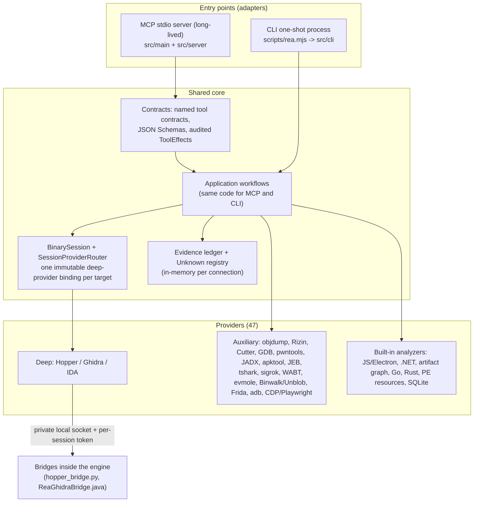
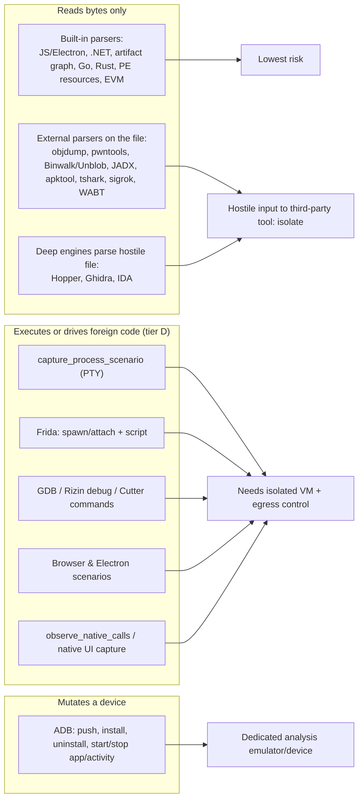

# 30 — Subsystem primers and architecture glue (short, to keep the flows and architecture understandable)

These are deliberately brief stand-ins for the chapters not written in depth (former plan: 09 other native providers, 15 managed/firmware/WASM/EVM formats, 18 process capture and Frida, 19 Android, 20 network/signal captures, 21 security model, 22 end-to-end). Each primer says only what is needed to follow [26](26-tool-usage-in-context-malware-analyst-view.md), [28](28-vulnerability-research-with-rea.md), [02](02-architecture-and-module-map.md) and [03](03-mcp-server-runtime-and-contracts.md). Sources: REA README, `docs/*.md`, `AGENTS.md`, `CONTRIBUTING.md`, `SECURITY.md` and the tool catalog; I did not read the code of these subsystems line by line (see [29](29-pending-and-status.md)).

## 1. One picture: how everything fits (architecture glue)

*Figure 1 — Architecture glue.* Two thin adapters call one application layer; deep native work goes through exactly one provider bound at `open_binary` (no fallback); everything else is auxiliary providers or built-in analyzers. Every result becomes Evidence in the ledger. Detail: [02], [03], [06](06-provider-layer-and-session-routing.md).

Process model (important for porting): the **MCP server is one long-lived process per client connection** holding the ledger and the bound provider; each **CLI invocation is a separate process** with no shared ledger (save JSON between commands; `--snapshot` for analysis snapshots) — which is why session-only tools (`compare_*`, unknowns, `build_call_path`, `correlate_static_and_runtime`, `verify_reconstruction`) exist only over MCP ([12]/[10]).

## 2. The execution-authority map (what runs the sample, what only reads it)

*Figure 2 — Execution authority.* Matches the audited `ToolEffects` tiers in [25]/[13]; known audit gaps in [29].

## 3. Primers
### 3.1 Other native providers (was ch09)
- **objdump** (GNU, caller-supplied): operations `file_headers, section_headers, symbols, relocations, dwarf, disassemble, disassemble_all`; raw output retained as Evidence (RUN in [27] T8).
- **Rizin / Rizin debugger, Cutter, GDB**: offline inspection (`execute_rizin_command`, `cutter_command`) and debug sessions (`start_rizin_debug_session`, `rizin_debug_command`, `start_gdb_session`, `gdb_console`) — arbitrary commands, flagged as foreign-code execution; REA "does not install" them (`docs/reverse-engineering-tools.md`).
- **IDA**: bring-your-own, via the `mrexodia/ida-pro-mcp` bridge; two profiles: legacy attached GUI (binds the open input by SHA-256, never saves/closes the database) and modern headless (creates/closes an owned private DB, no save). Pass the original binary with `provider_id:"ida"`, never an `.idb/.i64`; IDA does not supply `binary_overview` (SKILL text).
- **JEB**: a caller-started JEB serving MCP, `REA_JEB_MCP_URL`; REA lists units and decompiles items.
- **pwntools / pwndbg bridges**: `bridge/pwntools/*`, `bridge/pwndbg/*` Python run with `REA_PWNTOOLS_PYTHON` for ELF layout (T9) and recorded crashes (T10); isolated Python mode, owned cache, never executes the file.

### 3.2 Formats beyond native/archives (was ch15)
Per README requirements: **.NET** static (no engine); **firmware** Binwalk 3.1.x (regions) + Unblob 26.6.x (extraction), Linux x64, "no emulation or execution of extracted programs"; **Go/Rust** built in; **WASM** needs WABT 1.0.42 (`REA_WABT_BIN_DIRECTORY`); **EVM** via bundled evmole; **SQLite** needs Node ≥ 24.15 for native limits; **Flutter/Dart AOT** static APK parsing. Each result keeps raw bytes/locations and explicit "unknown" instead of guessing.

### 3.3 Process capture and Frida (was ch18)
- **Process capture** (`docs/process-capture.md`): runs *one caller-selected command* under a PTY on Linux/macOS (Windows unsupported; macOS also needs `xcrun`/Swift for a helper) with the user's permissions and inherited environment — **"This is not a sandbox"**. Records bounded terminal output, scheduled interactions, process lifetime and selected filesystem snapshots; two captures are compared with `compare_process_captures`; the inherited environment is not recorded.
- **Frida** (`docs/frida-instrumentation.md`): 9 tools (list devices/processes, start session [attach/spawn paused], load/unload script, resume, status, close, one-shot instrument); scripts run inside the target with its authority; message capture bounded to 16 MiB with truncation flag; script source is not stored in Evidence (selected path/digest are); Node bindings are an optional dependency; remote devices via `host[:port]` + token/cert options.

### 3.4 Android and ADB (was ch19)
- **Static**: JADX-based `inspect_android_*`/`search_android_classes`/`trace_android_references` (needs JDK), Apktool for resources (`decode_android_resources`), Flutter detection, JEB, application-graph projection.
- **ADB** (`docs/adb-device-analysis.md`): 24 tools through the caller's `adb` (`REA_ADB_PATH`, verified 34.0.5); fixed argument vectors, caller values only in positional args; REA neither starts nor manages emulators/devices; 6 tools mutate the device (push file, install/uninstall package, start app/activity, stop app); reads include packages, processes, services, logcat, settings, bugreports, screen capture, `pull_adb_package`.

### 3.5 Network and signal captures (was ch20)
`inspect_pcap_capture` (tshark + capinfos, summary then paged facts), `inspect_packet_capture`/`inspect_packet_fields` (selected TShark fields, `REA_TSHARK_COMMAND`, Linux + prlimit), `inspect_web_network_capture` (HAR, Fiddler SAZ, native mitmproxy via `bridge/mitmproxy/capture.py`, aioquic qlog JSON 0.3), `decode_signal_recording`/`inspect_signal_decoders` (sigrok-cli 0.7.2, `REA_SIGROK_COMMAND`). All read recordings; none capture live traffic.

### 3.6 Security model (was ch21)
- Local-only analysis; Hopper/Ghidra bridges authenticated with **per-session random capability tokens** over current-user Unix sockets (Windows Ghidra: authenticated loopback TCP, private NTFS runtime with DACL for current user/SYSTEM) — `SECURITY.md`.
- `AGENTS.md`: Ghidra uses ephemeral databases without modifying executable bytes; IDA analysis read-only; Windows Ghidra P0 has no mutation authority; setup changes are additive, idempotent, backed up and need approval; installers never install unrelated software; redact transport credentials and explicitly marked sensitive values (no secrecy inference from names).
- Fail-closed integration rule (`CONTRIBUTING.md`): runtime features (launch/attach/inject/script/memory edits) need explicit target/authority/cleanup review; no packer-defeat, anti-debug evasion, DRM bypass or exploit-payload automation.
- Prompt-injection posture: 205/207 tools mark output `untrusted_content`; server `instructions` and prompt rendering quote user arguments as data, but REA enforces nothing on the marker (ch03/12 writers) — the host must.

### 3.7 End-to-end workflows (was ch22)
Covered by the flow chapters: malware/defensive [26] and [23] §6, vulnerability research [28], prompt-driven chains [12] §12.11, one-line recipes in the skill ([12 part b](12-ai-layer-prompts-and-skills-part-b-bundled-skill-verbatim.md)).
