# 32 — File-type analysis atlas: for every supported format, what can be analysed, with which tools, and how

One section and one flow diagram per format REA supports. Every tool name below was machine-checked against REA's real tool catalog (207 tools). Diagram legend: rectangles are tool calls (the first line is the tool, the following lines are what it returns), diamonds are decisions, and every flow ends in the shared loop **record_unknown → export_evidence_bundle** ([10](10-evidence-model-ledger-unknowns-bundles.md)). Verification labels: **RUN** = executed in the lab with real output ([27](27-manual-test-log.md)); **DOC** = from tool descriptions and docs only. Deeper chapters: native/Apple [14](14-filetypes-native-apple-archives.md), managed/firmware/WASM/EVM [15](15-filetypes-managed-firmware-wasm-evm-misc.md), JS [16](16-javascript-electron-analysis.md), browser [17](17-browser-and-web-observation.md), Android [19](19-android-mobile.md), captures [20](20-network-and-signal-captures.md); MCP calling mechanics [31](31-mcp-and-prompts-deep-dive.md).

## 0. Routing summary (which first call for which input)
| Input | First call | Engine/prerequisite | Tier of first call | Level |
|---|---|---|---|---|
| ELF / PE / Mach-O (deep) | `open_binary` | Ghidra 12.1.x, Hopper or IDA | B | RUN (Ghidra) |
| ELF offline | `inspect_binary_layout`, `inspect_with_objdump` | pwntools 4.15 / GNU objdump | B | RUN |
| PE resources | `inspect_pe_resources` | none | A | RUN |
| Mach-O metadata | `inspect_macho` (then `inspect_signature`) | none (offline) | A | DOC |
| .NET assembly | `inspect_managed_artifact` | none | A | RUN |
| Raw / DOS COM | `open_binary` with format | Ghidra | B | DOC |
| Core dump | `inspect_recorded_crash` | pwntools; optional GDB | B | RUN |
| `.app`, plist, nib, car, keyed archive | `open_binary` then `inspect_artifact` / `inspect_plist` / `decode_interface_builder` / `inspect_asset_catalog` / `inspect_keyed_archive` | none | A | DOC |
| ZIP/JAR/IPA/MSIX/DMG | `open_binary` then `inspect_artifact` | none | A | RUN (zip) |
| APK | `inspect_android_package` | JADX jar + JDK | B | RUN |
| Flutter APK | `identify_flutter_build`, `inspect_dart_aot` | none | A | DOC |
| ASAR / JS directory | `analyze_javascript_application` | Node (Linux: `ps`) | A | RUN |
| JS bundle | `recover_javascript_sources` | Wakaru | B | DOC |
| Electron binary | `inspect_electron_fuses` | none | A | RUN (negative case) |
| Live page | `list_browser_targets` / `inspect_web_page` | Chrome-family | D | RUN (agent) |
| HAR / SAZ / mitm / qlog | `inspect_web_network_capture` | none (mitmdump for native mitmproxy) | A | RUN (agent) |
| WASM | `inspect_wasm_artifact` | WABT 1.0.42 | B | RUN |
| EVM bytecode | `inspect_evm_interface` | bundled evmole | B | RUN |
| Go / Rust binary | `inspect_go_binary` / `inspect_rust_binary` | none | A | RUN |
| SQLite | `inspect_sqlite_database` | Node 24.15+ | B | RUN |
| pcap/pcapng | `inspect_pcap_capture`, `inspect_packet_capture` | TShark 4.x | B | RUN |
| Signal recording | `decode_signal_recording` | sigrok-cli 0.7.2 | B | DOC |
| Firmware | `inspect_firmware_regions` → `extract_firmware` | Binwalk 3.1.x / Unblob 26.6.x | B | RUN (regions) |
| HarmonyOS HAP/HSP | `inspect_artifact` → `project_harmony_application_graph` | none | A | DOC |

## 1. The generic decision flow every format shares
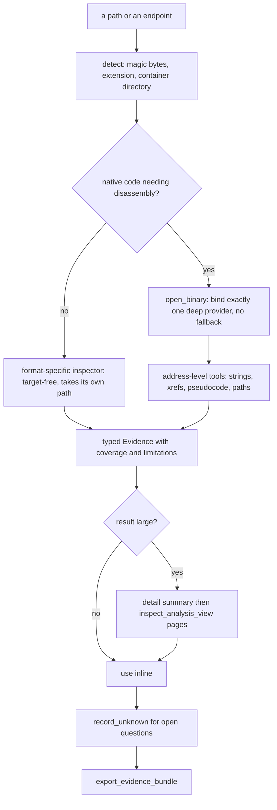
*Figure 0 — Shared flow.* Native code goes through one bound provider; everything else uses target-free inspectors; large results are summarised first and paged; open questions are recorded as Unknowns and the case is exported as an Evidence bundle.

## A. Native executables and libraries

### A1. ELF (executables, shared objects, relocatable objects)
**Detect/route:** magic `7f 45 4c 46`. `open_binary` binds a deep provider (Ghidra/Hopper/IDA); offline tools take the path directly and need no engine.
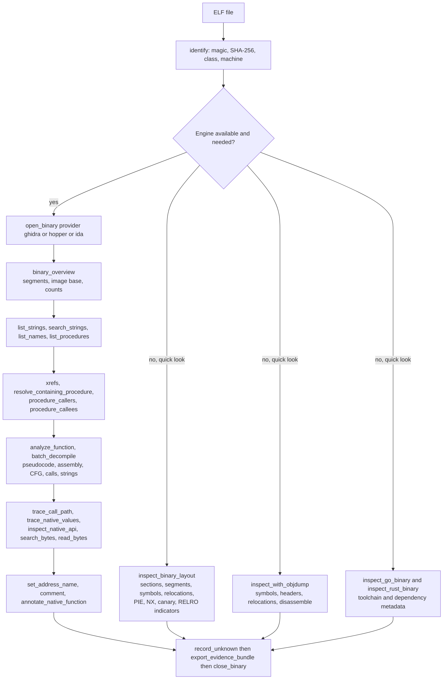
| Tool | What it extracts | Needs |
|---|---|---|
| `inspect_binary_layout` | file-backed sections and segments, original symbol and REL/RELA tables, linked addresses, interpreter and needed libs, static mitigation indicators | pwntools 4.15.0 env (Linux x64 ELF64) |
| `inspect_with_objdump` | raw `symbols`, `file_headers`, `section_headers`, `relocations`, `dwarf`, `disassemble` output as Evidence | GNU objdump |
| `analyze_function` and the `procedure_*` tools | pseudocode, assembly, calls, references, strings, CFG blocks | a deep provider |
| `trace_call_path`, `trace_native_values` | reachability and def-use value flow, with unknowns for indirect calls | a deep provider |
**Limits:** `nx` or `relro` null means no indicator, not a negative proof; Ghidra string search covers defined strings only. **Malware/vuln use:** imports (`ptrace`, `connect`, `dup2`), hard-coded endpoints, mitigations, crash root cause. **Verified:** RUN (objdump, layout, Ghidra flow, core triage).

### A2. PE (native Windows executables, DLLs, drivers)
**Detect/route:** `MZ` + `PE\0\0`; the CLR header decides native versus .NET. Native PE goes to a deep provider; resources and metadata are offline.
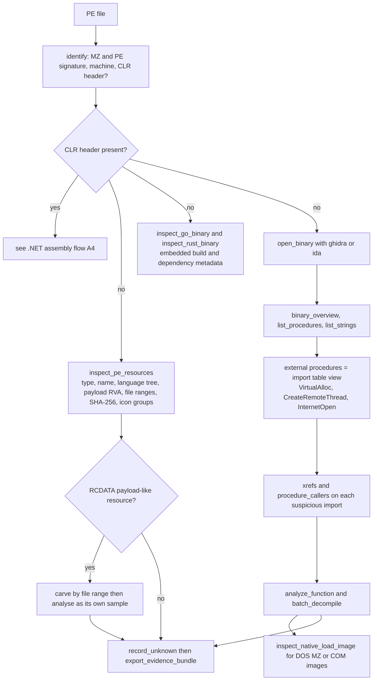
**Extracts:** import list, resource tree with payload hashes (RUN: an RCDATA `PAYLOAD` entry at file offset 15024, 33 bytes), pseudocode via Ghidra. **Limits:** Ghidra on Windows is read-only P0; PE signing is not parsed by REA; unpacking is out of scope (REA excludes packer-defeat). **Toolkit:** `@rtk/triage` parses imports, imphash, section entropy and overlay without an engine.

### A3. Mach-O (thin, fat/universal, dylib, bundle)
**Detect/route:** `feedface/feedfacf` (and byte-swapped) or fat `cafebabe` with a small slice count. Fat binaries open per architecture slice.
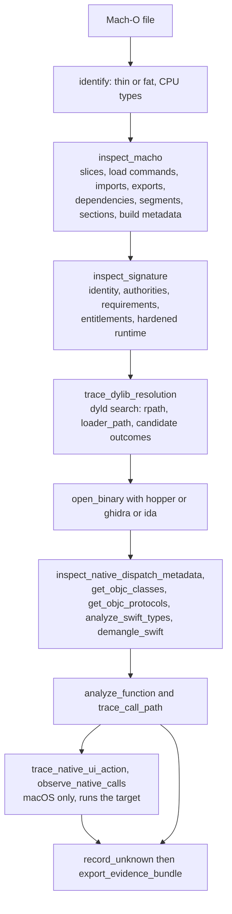
**Extracts:** the whole load-command set offline (no Hopper needed), code signature facts, dyld resolution candidates with digests, ObjC/Swift symbol-level metadata. **Limits:** the dispatch tools are symbol-level, not runtime metadata; universal-binary inventory is macOS-only; `observe_native_calls` and UI capture execute the target (tier D). **Verified:** DOC on Linux (no Mach-O sample was built).

### A4. .NET assembly (PE/CLI)
**Detect/route:** PE with a CLR data directory. Static only; the assembly is never loaded.
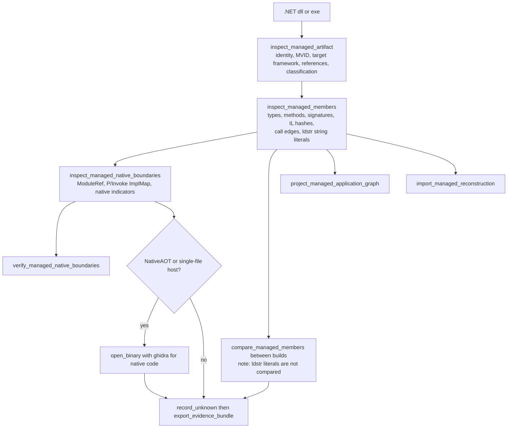
**Extracts (RUN on a stager):** URL and `cmd.exe` literals, `Loader.Main` call edges to `Process.Start`, `GetStringAsync`, `FromBase64String`, and a `kernel32!VirtualAlloc` P/Invoke. **Limits:** no IL2CPP or single-file unpacking; obfuscated names stay obfuscated. **Toolkit:** `@rtk/dotnet-analyzer` adds per-method literal diff.

### A5. Raw binaries and DOS COM (headerless)
**Detect/route:** no header; the caller states the format, architecture and entry point.
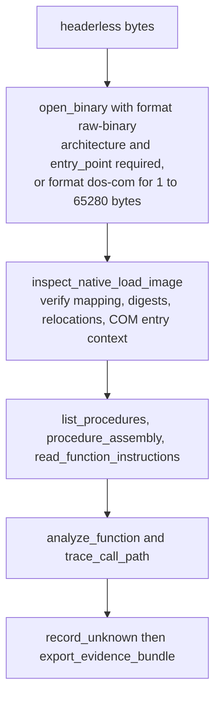
**Notes:** architectures `6502, x86, x86_64, arm, arm64`; file offset 0 maps at the given address; Ghidra only. **Verified:** DOC (REA docs and tests).

### A6. Core dump (Linux ELF64 core)
**Detect/route:** ELF type CORE. Read without launching anything.
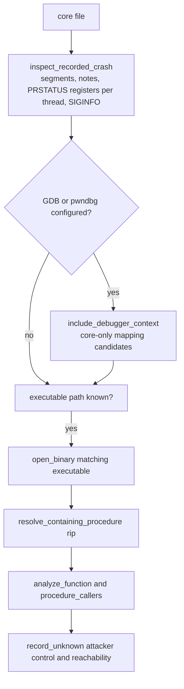
**Extracts (RUN):** signal 11, `rip 0x4011b6`, `rbp 0x4141414141414141`; then Ghidra mapped `rip` to `greet` and showed an unbounded `strcpy` into a 32-byte buffer. **Limits:** x86-64 and AArch64 Linux only; fault address meaning stays unknown unless siginfo supplies it.

### A7. Analysis databases and snapshots (`.hop`, REA snapshots)
**Detect/route:** `open_binary` accepts an analysis database; for IDA pass the original input binary with `provider_id: "ida"`, never an `.idb/.i64`.
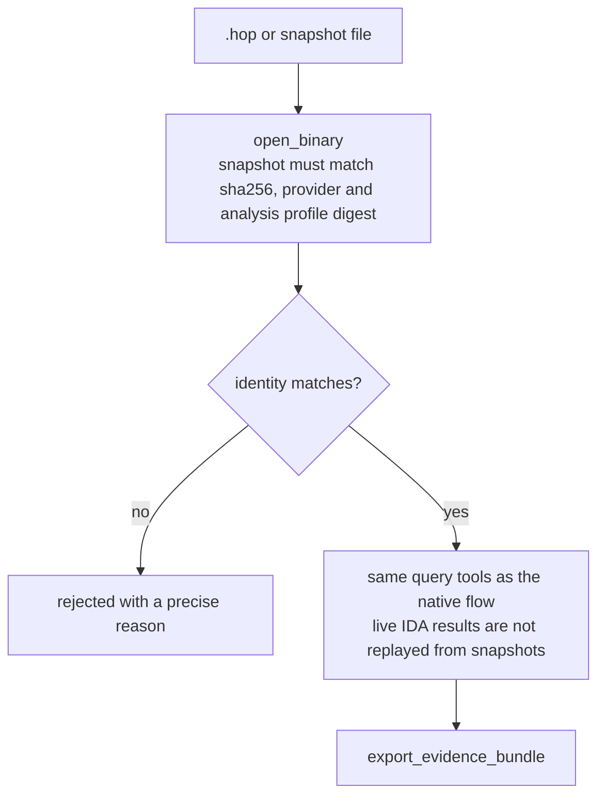
**Notes:** saved `.hop` files are declined on macOS (chapter 07); snapshots are for repeating analysis without re-import.

## B. Apple application artifacts

### B1. macOS `.app` bundle
**Detect/route:** a directory with `Contents/Info.plist`. `open_binary` resolves `CFBundleExecutable` inside the bundle.
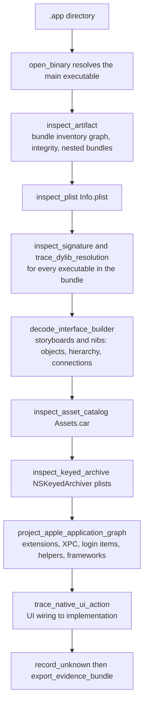
### B2. Property lists (binary and XML)
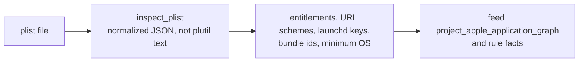
### B3. Compiled Interface Builder (`.nib`, `.storyboardc`)
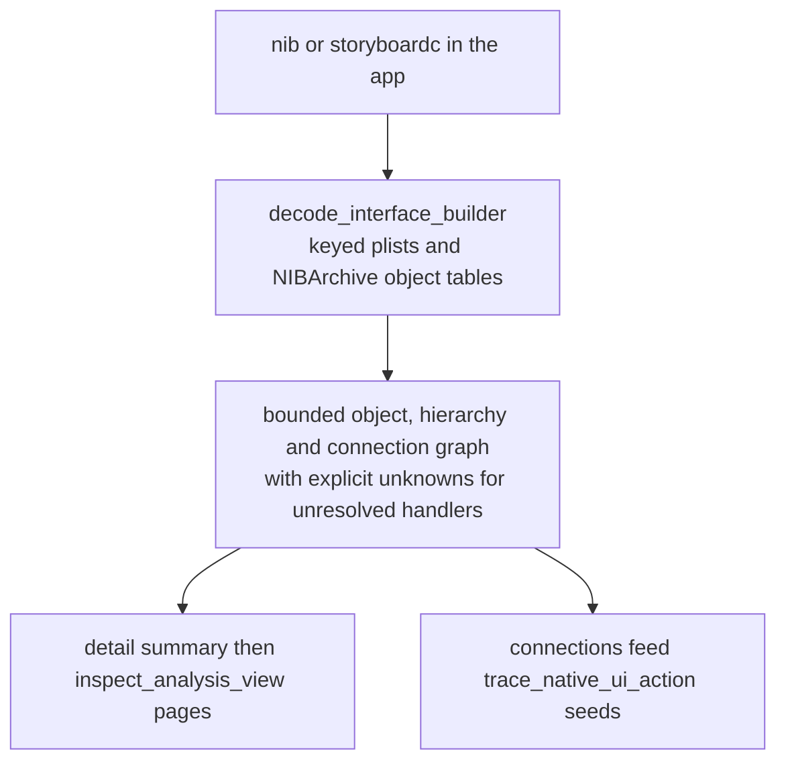
### B4. Apple asset catalogs (`Assets.car`)
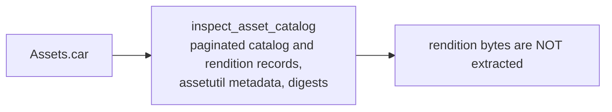
### B5. NSKeyedArchiver archives
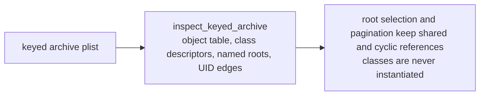
### B6. IPA and DMG
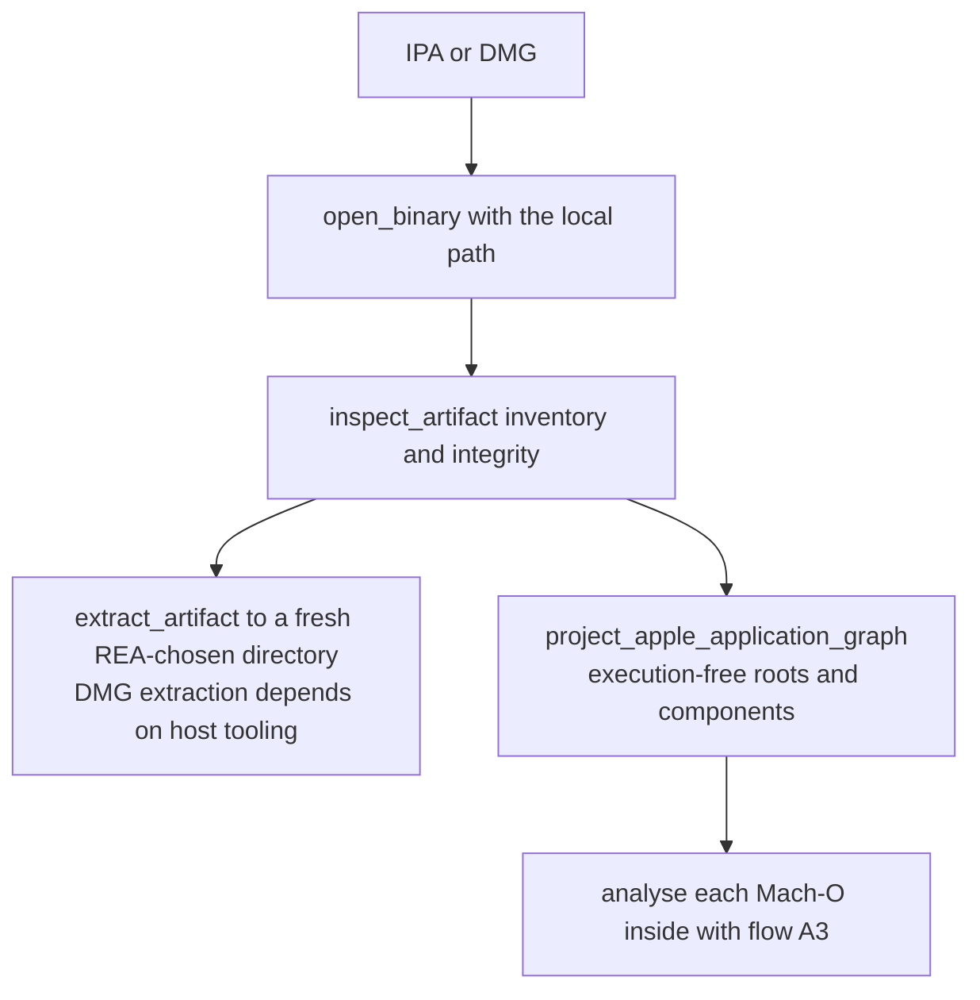

## C. Archives, packages and mobile

### C1. ZIP, JAR and other zip-based containers
**Detect/route:** `PK\x03\x04`; the central directory separates plain zip, jar, OOXML, APK and IPA.
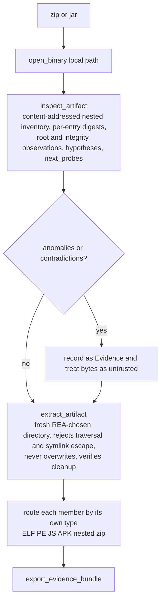
**Extracts (RUN):** 9 nodes, 8 edges, root SHA-256 for a demo zip. **Toolkit:** `@rtk/artifacts` adds quota enforcement while streaming and 20+ anomaly codes (zip-slip, bombs, case collisions).

### C2. Android APK and DEX
**Detect/route:** zip with `AndroidManifest.xml` and `classes*.dex`. JADX provides decompilation; Apktool decodes resources.
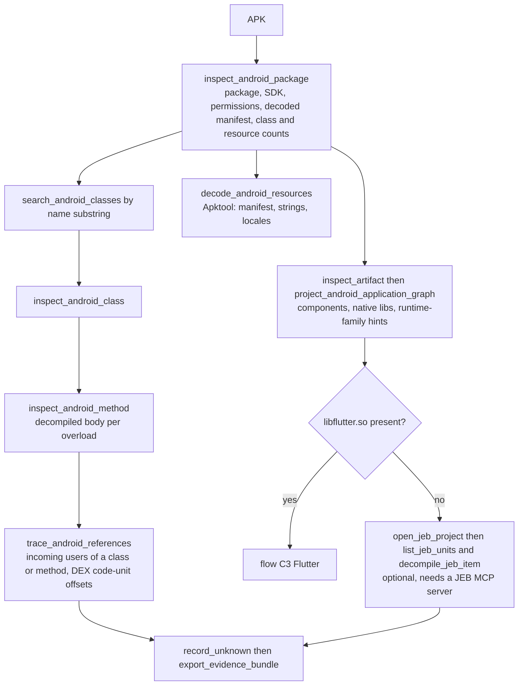
**Extracts (RUN):** permissions `INTERNET, SEND_SMS, READ_SMS`; `exfil` method source; `onCreate` as its caller at DEX unit 5. **Limits:** string constants are not reachable through the five Android tools (read them from the decompiled class); JADX jar hash pin is advisory.

### C3. Flutter apps (Dart AOT)
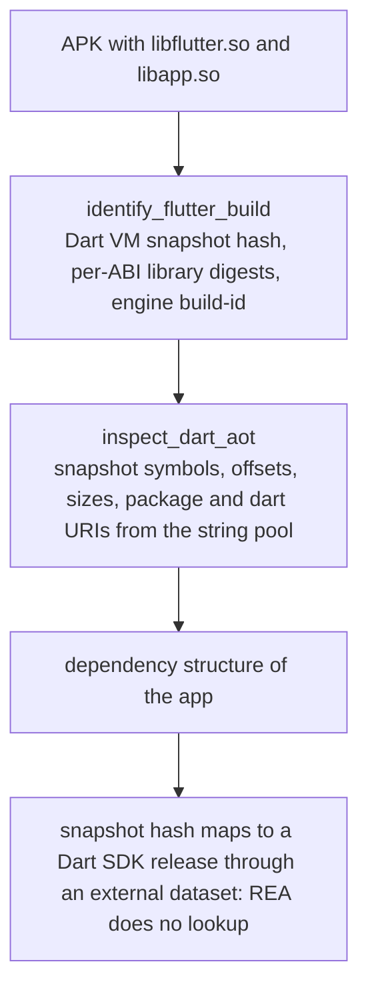
### C4. IPA, MSIX, AppX
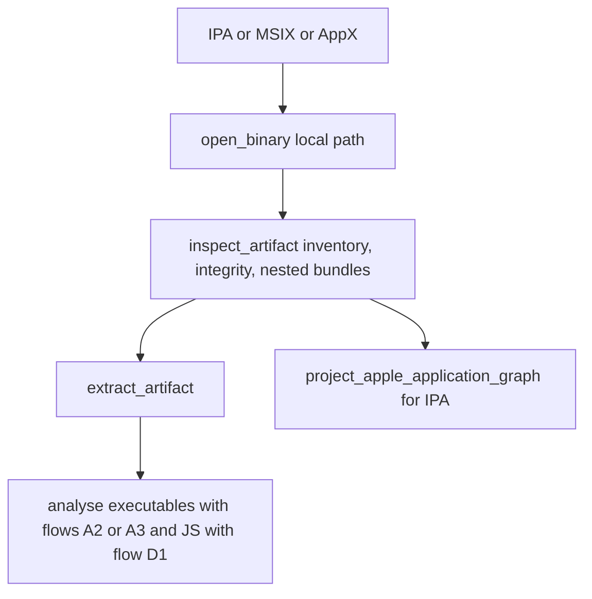
**Notes:** MSIX/AppX inventory is supported by the archive route; Windows package signing is not interpreted.

### C5. ASAR archives
**Detect/route:** Pickle header followed by JSON `{"files":...}`; integrity hashes from the header are verified.
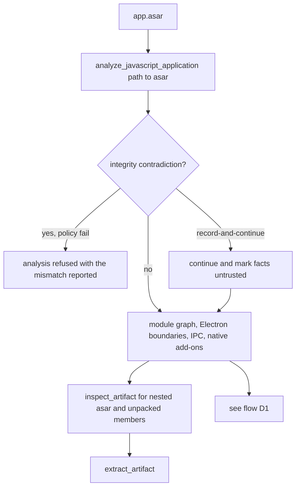
### C6. HarmonyOS HAP, HSP, App Pack
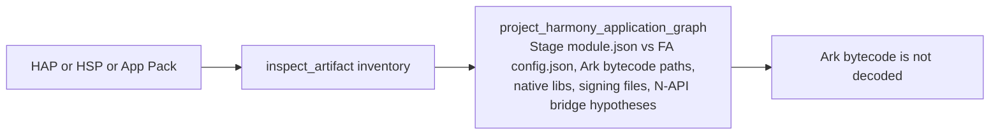
### C7. Firmware images
**Detect/route:** no single magic; Binwalk signature scan finds regions.
```mermaid
flowchart TD
  F["firmware blob"] --> IR["inspect_firmware_regions<br/>Binwalk 3.1.x: offset, reported length, signature, confidence"]
  IR --> EX["extract_firmware with Unblob 26.6.x<br/>into an absent output directory, extraction_gaps and continuation_id"]
  EX --> CH["verified child paths and digests"]
  CH --> NAT["select an extracted ELF then flow A1"]
  CH --> ARC["archives then flow C1"]
```
**Extracts (RUN):** a `squashfs` region at offset 4096 behind random padding. **Limits:** regions are candidates (length validation unknown); extraction fails closed when Unblob is not configured; 128 MiB input limit.

## D. JavaScript, Electron and web

### D1. JavaScript/Electron application directory or ASAR
```mermaid
flowchart TD
  D["app directory or asar"] --> AJ["analyze_javascript_application<br/>modules, imports, Electron main preload renderer,<br/>IPC, contextBridge, utility processes, native add-ons"]
  AJ --> SUM["detail summary then inspect_analysis_view<br/>kinds: summary, page modules, one module"]
  SUM --> TF["trace_application_feature<br/>seed: route, API, module, string, export"]
  TF --> TS["trace_javascript_semantics<br/>data-flow, calls, closures, child-process, request, timer"]
  TS --> CV["compare_application_versions<br/>compare_javascript_export_shapes, compare_source_to_bundle"]
  AJ --> EF["inspect_electron_fuses on the packaged binary"]
  AJ --> RS["reconcile_javascript_runtime with passive runtime Evidence"]
  CV --> UK["record_unknown then export_evidence_bundle"]
```
**Extracts (RUN):** 36 nodes and 48 edges for a 6-file app; the path `api.run` to IPC `run-task` to the main handler at line 11; `exec` command and request endpoint stay null when dynamic. **Toolkit:** `@rtk/js-analyzer` resolves ipc-argument to exec and network-response to eval flows.

### D2. Single JS file, bundle or source map
```mermaid
flowchart TD
  B["bundle or minified script"] --> RJ["recover_javascript_sources<br/>Wakaru: readable modules, source maps, provenance"]
  RJ --> AJ["analyze_javascript_application on the recovered directory"]
  B --> AJ2["analyze_javascript_application path to the file"]
  AJ --> TF["trace_application_feature and trace_javascript_semantics"]
  AJ2 --> TF
  TF --> CS["compare_source_to_bundle against known source"]
```
**Notes:** Wakaru is caller-supplied (not installed here, so DOC).

### D3. Packaged Electron binary
```mermaid
flowchart LR
  E["Electron app or Framework binary"] --> IF["inspect_electron_fuses<br/>per-slice fuse bytes, names, states, implications for<br/>inspect flags, RUN_AS_NODE, asar integrity"]
  IF --> M{"missing sentinel?"}
  M -->|"yes"| U["fuse state unknown"]
  M -->|"no"| L["list_electron_targets and capture_electron_scenario<br/>if a runtime check is authorised"]
```
### D4. Live web page (browser)
**Detect/route:** a URL or an existing Chrome-family debugging endpoint; loopback-only endpoints.
```mermaid
flowchart TD
  U["page or CDP endpoint"] --> LT["list_browser_targets"]
  LT --> IP["inspect_web_page<br/>DOM structure, scripts, network observations, screenshots on request"]
  IP --> OS["observe_web_session, observe_web_execution,<br/>inspect_web_event_listeners, discover_webmcp_tools"]
  OS --> AB["analyze_web_bundle<br/>chunk graph, routes, endpoints, vendor fingerprints"]
  AB --> EW["export_web_scripts then analyze_javascript_application"]
  AB --> TM["trace_web_module_imports and trace_web_source_location"]
  IP --> CB["capture_browser_scenario<br/>declared actions: click, type, navigate"]
  CB --> CW["compare_web_captures and compare_web_screenshots"]
```
**Warning:** the launched Chromium runs with its sandbox disabled by default.

### D5. Network recordings (HAR, SAZ, mitmproxy, qlog)
```mermaid
flowchart TD
  R["HAR 1.2 or SAZ or mitmproxy flows or aioquic qlog"] --> IW["inspect_web_network_capture<br/>detail summary: identity and counts"]
  IW --> PG["page retained records with inspect_analysis_view kind capture"]
  PG --> API["derived API surface: method, origin, path template, query names"]
  PG --> SV["sensitive_values redaction: literal substring match per field"]
  PG --> EX["export_web_scripts when scripts are retained"]
```
## E. Data formats

### E1. WebAssembly
```mermaid
flowchart TD
  W["module.wasm"] --> IW["inspect_wasm_artifact<br/>WABT 1.0.42: validation, sections, import and export WAT forms, decoded WAT"]
  IW --> GL["glue_paths and candidate_paths link JavaScript glue"]
  IW --> CW["compare_wasm_interfaces left right<br/>imports exports kinds signatures"]
  CW --> BL["blind spot: data segments and bodies are not compared"]
```
### E2. EVM bytecode
```mermaid
flowchart LR
  B["raw or hex bytecode"] --> IE["inspect_evm_interface encoding raw or hex<br/>selectors, byte offsets, inferred arguments and mutability"]
  IE --> S["detail summary then parent_evidence_id pages"]
  S --> N["no chain lookup and no execution; candidate coverage is not completeness"]
```
### E3. Go binaries
```mermaid
flowchart LR
  G["ELF or PE or thin Mach-O"] --> IG["inspect_go_binary<br/>go version, main module, dependencies, replacements, build settings"]
  IG --> N["absent metadata does not prove not-Go; no function names are recovered"]
  N --> D["deep analysis then flow A1 or A2"]
```
### E4. Rust binaries
```mermaid
flowchart LR
  R["ELF or PE or thin Mach-O"] --> IR["inspect_rust_binary<br/>cargo-auditable .dep-v0: crates, versions, sources, dependency edges"]
  IR --> N["missing section is null metadata, not proof of no dependencies"]
```
### E5. SQLite databases
```mermaid
flowchart TD
  S["database and sibling WAL"] --> IS["inspect_sqlite_database<br/>schema inventory, hashes of database and WAL"]
  IS --> T["select table and columns then bounded row sample, default 20"]
  T --> N["needs Node 24.15 or newer; use a quiescent snapshot, not a live database"]
```
### E6. Packet captures (pcap, pcapng)
```mermaid
flowchart TD
  P["capture file"] --> IC["inspect_pcap_capture detail summary<br/>endpoints, DNS questions, TLS SNI, protocol mix, HTTP URIs"]
  IC --> PG["inspect_analysis_view kind pcap pages"]
  P --> PF["inspect_packet_fields<br/>discover protocols and field names in the installed TShark"]
  PF --> PC["inspect_packet_capture<br/>chosen fields, display filter, decode-as, paging"]
  PC --> N["no redaction in this tool; pcap summary strips URI userinfo"]
```
### E7. Logic and signal recordings
```mermaid
flowchart LR
  R["sigrok recording"] --> SD["inspect_signal_decoders<br/>list decoders, channels and options"]
  SD --> DS["decode_signal_recording<br/>explicit decoder stack, channels, options; paged annotation lines"]
```
## F. Runtime targets (not files)
| Target | Entry tools | Effects |
|---|---|---|
| Executable to observe | `capture_process_scenario`, `compare_process_captures`, `correlate_static_and_runtime` | executes the target (tier D) |
| Running or spawned process | `list_frida_devices`, `list_frida_processes`, `start_frida_session`, `load_frida_script`, `resume_frida_session`, `instrument_with_frida` | executes/attaches (tier D) |
| Android device | `list_adb_devices`, `inspect_adb_package`, `read_adb_logcat`, `pull_adb_package`; mutating: `install_adb_package`, `start_adb_app` | device mutation (tier E) |
| Debugger sessions | `start_gdb_session`, `gdb_console`, `start_rizin_debug_session`, `cutter_command` | can run the target (tier D) |

## Porting and malware notes
Formats whose analysers are pure static parsers (managed, Go, Rust, PE resources, Flutter, Harmony, plist family) are the safest first-line triage; those that spawn third-party tools on hostile input (WABT, Binwalk/Unblob, JADX, Apktool, TShark, sigrok) need an isolated analysis host; deep engines parse the sample too. The toolkit packages `@rtk/triage`, `@rtk/artifacts`, `@rtk/js-analyzer`, `@rtk/dotnet-analyzer` and `@rtk/ghidra-bridge` re-implement the ELF/PE/archive/JS/.NET/Ghidra lanes ([24](24-porting-blueprints.md)).
